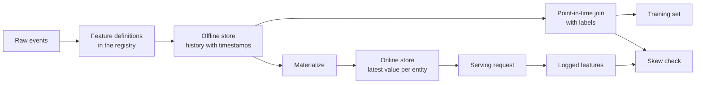

# Хранилища признаков и расхождение между обучением и инференсом (training-serving skew)

> У признака одно определение и два читателя. Обучение читает его историю на момент каждой метки, а инференс читает его последнее значение. Когда эти два читателя расходятся во мнениях, модель видит входные данные, на которых она никогда не обучалась.

**Type:** Build
**Languages:** Python
**Prerequisites:** Phase 2, Lessons 08 (Feature Engineering), 13 (ML Pipelines), 15 (Time Series), and 19 (ML System Design)
**Time:** ~100 минут

## Цели обучения

- Описать офлайн-хранилище, онлайн-хранилище, сущности, временные метки событий и TTL, а также задачу каждого из них
- Реализовать корректное на момент времени (point-in-time correct) соединение и показать, как наивное соединение копирует будущие значения в обучающие данные
- Назвать четыре причины расхождения между обучением и инференсом: два пути кода, устаревшие признаки, разные значения по умолчанию и «путешествие во времени»
- Построить реестр признаков, в котором одно определение питает и путь обучения, и путь инференса
- Выполнить бэкфилл нового признака по прошлым датам, не читая данные, относящиеся к периоду после каждой даты
- Обнаружить расхождение, сравнивая залогированные признаки инференса с путём обучения для той же сущности и того же момента времени

## Проблема

Команда строит модель оттока. Каждая метка говорит о том, не совершил ли пользователь ни одной покупки за 30 дней после дня метки. Команда соединяет метки с таблицей признаков пользователя по `user_id` и обучает правило на `days_since_last_purchase`. Офлайн-точность — 0.948.

На реальном трафике модель работает хуже, чем старая и более простая версия. Таблица признаков хранила самое новое значение для каждого пользователя — из недель, наступивших после дней меток. У пользователя, последняя покупка которого была в день 115, в снимке дня 175 отображалось 60 дней без покупок — то есть признак содержал ответ. При этом другая команда повторно писала признаки инференса в отдельном сервисе. Их 30-дневное окно включало один лишний день, а их значение по умолчанию для нового пользователя было -1 вместо 365.

У обоих дефектов одна и та же причина. Обучение и инференс вычисляли «один и тот же признак» двумя разными способами. В этом уроке с нуля строятся компоненты хранилища признаков. Вы напишете реестр, бэкфилл, соединение, корректное на момент времени, онлайн-хранилище с TTL и проверку расхождения. Демонстрация воспроизводит оба дефекта на конкретных числах.

## Концепция

### Два читателя одного и того же признака

Обучение и инференс запрашивают признаки в разных формах:

| Свойство | Обучение (офлайн) | Инференс (онлайн) |
|---|---|---|
| Вопрос | «Каким было значение для каждой из 10 миллионов пар (сущность, время)?» | «Каково значение для этой одной сущности сейчас?» |
| Время | Множество точек в прошлом | Настоящий момент |
| Объём | Миллионы строк на задачу | Одна строка на запрос |
| Задержка | Минуты допустимы | Несколько миллисекунд |
| Хранение | Офлайн-хранилище: полная история с временными метками, в столбцовых файлах или хранилище данных | Онлайн-хранилище: последнее значение на сущность, в key-value базе данных |

Хранилище признаков наполняет оба хранилища из одного набора определений признаков. Материализация — это задача, которая копирует последние значения из офлайн-хранилища в онлайн-хранилище.



### Сущности, временные метки и TTL

Каждую строку признака описывают четыре термина:

- **Сущность (entity).** Ключ, который описывает признак, например `user_id` или `card_id`.
- **Временная метка события (event timestamp).** Момент, когда значение стало истинным. Счётчик покупок «на момент дня 14» имеет временную метку события «день 14».
- **Временная метка создания (created timestamp).** Момент, когда система записала строку. Бэкфилл, выполняемый сегодня, записывает строки со старыми временными метками событий и новой временной меткой создания.
- **TTL (время жизни).** Максимальный возраст значения. Значение старше TTL считается отсутствующим, поэтому читатель использует значение по умолчанию.

Группу признаков с одной и той же сущностью, источником и TTL часто называют представлением признаков (feature view).

### Соединения, корректные на момент времени

Обучающая строка сопоставляет метку со значениями признаков, существовавшими на момент метки. Соединение, корректное на момент времени, делает следующее для каждой метки:

1. Найти строки признаков той же сущности.
2. Оставить строки, временная метка события которых не позже временной метки метки.
3. Взять самую позднюю из этих строк.
4. Отбросить её, если разница между временной меткой метки и временной меткой события превышает TTL.

Вот один пользователь, метка на день 16 и еженедельные строки признаков:

| День строки признака | `purchases_30d` | Соединение на момент времени | Наивное соединение по `user_id` |
|---|---|---|---|
| 7 | 4 | | |
| 14 | 3 | Выбрано | |
| 21 | 1 | Будущее | |
| 28 | 0 | Будущее | Выбрано |

Метка отвечает на вопрос, совершит ли пользователь какую-либо покупку с дня 17 по день 46. Строка дня 28 уже учитывает спокойные дни после дня метки. Она показывает 0 покупок, потому что пользователь перестал покупать, — а это как раз то событие, которое измеряет метка. Наивное соединение копирует ответ во входные данные.

Мы разбивали данные по времени в уроке о временных рядах по той же причине. Соединение, корректное на момент времени, применяет это правило к каждой строке вместо одной точки разбиения.

### Причины расхождения между обучением и инференсом

«Правила машинного обучения» Google определяют расхождение между обучением и инференсом (training-serving skew) как разницу между производительностью при обучении и при инференсе. Они называют три причины: разную обработку данных в двух конвейерах, изменение данных между обучением и инференсом и петлю обратной связи. В конвейерах признаков снова и снова встречаются четыре конкретные причины:

| Причина | Что происходит | Пример из демонстрации |
|---|---|---|
| Два пути кода | Обучение и инференс вычисляют признак разным кодом | Окно инференса включает день `now - 30`, а окно обучения — нет |
| Устаревшие признаки | Значение, которое читает инференс, отличается по возрасту от значения, использованного при обучении | Обучение читает еженедельные снимки, а новый сервис вычисляет свежие значения |
| Разные значения по умолчанию | Два пути по-разному заполняют отсутствующее значение | Обучение использует 365 для «ещё нет покупки», а инференс использует -1 |
| Путешествие во времени | Обучение читает значение из периода после момента метки | Наивное соединение читает самый новый снимок для каждой метки |

Правило №32 того же руководства гласит: повторно используйте код между обучающим и инференс-конвейером, когда это возможно. Хранилище признаков следует этому правилу, предлагая единое определение, к которому обращаются оба пути.

### Реестр признаков

Реестр — это каталог определений признаков. Каждая запись содержит имя, сущность, источник, преобразование, окно, значение по умолчанию, TTL, владельца, версию и описание.

Два правила обеспечивают его безопасность:

- Оба пути читают определение из реестра. Ни один сервис не хранит собственную копию преобразования.
- Изменение определения создаёт новую версию. Старая версия остаётся, поэтому у старых моделей сохраняется тот признак, на котором они обучались.

### Бэкфиллы

У нового признака нет истории, но обучению нужно его значение на каждый прошлый момент метки. Бэкфилл запускает определение на каждую прошлую дату и записывает по одной строке на сущность и дату. Каждый запуск читает только те события, временные метки которых не позже его даты.

Бэкфиллы стоят вычислений, объём которых растёт как произведение числа сущностей на число дат. Они также привносят тонкую утечку. Бэкфилл, выполняемый сегодня, записывает строки со старыми временными метками событий, но может прочитать данные, которые пришли с опозданием или были исправлены позже. Строгое соединение, корректное на момент времени, также проверяет, что временная метка создания не позже момента метки.

### Обнаружение расхождения

Правило №29 того же руководства гласит: логируйте признаки в момент инференса и используйте их при обучении. Даже небольшая залогированная выборка позволяет проверить согласованность. Сравните каждое залогированное значение со значением, которое путь обучения производит для той же сущности и того же момента времени. Для каждого признака сообщите долю расхождений и среднее абсолютное отклонение.

Чтобы найти причину, сравните три пары:

1. Чтение из онлайн-хранилища против соединения обучения. Это проверяет всю систему и должно показать нулевое расхождение.
2. Свежее вычисление против соединения обучения. Это изолирует устаревание.
3. Второй путь кода против свежего вычисления. Это изолирует различия кода, такие как окна и значения по умолчанию.

```figure
mlprod-pit-join
```

## Реализуйте это

Код в `code/main.py` использует только стандартную библиотеку. Время — целое число дней. Еженедельная пакетная задача записывает снимки признаков в дни 7, 14 и так далее до 175.

### Шаг 1: Определения признаков и реестр

`FeatureDefinition` хранит преобразование как данные: агрегат, окно и значение по умолчанию. Его метод `compute` никогда не читает события после `as_of`.

```python
@dataclass(frozen=True)
class FeatureDefinition:
    name: str
    entity: str
    aggregate: str
    window_days: int | None
    default: float
    version: int = 1
    owner: str = "growth-team"
    description: str = ""

    def compute(self, events: list[Event], as_of: int) -> float:
        visible = [e for e in events if e.day <= as_of]
        if self.window_days is not None:
            visible = [e for e in visible if e.day > as_of - self.window_days]
        if self.aggregate == "count":
            return float(len(visible))
        if self.aggregate == "sum":
            return round(sum(e.amount for e in visible), 2)
        if self.aggregate == "days_since_last":
            return float(as_of - max(e.day for e in visible)) if visible else self.default
        raise ValueError(f"unknown aggregate {self.aggregate!r}")
```

`FeatureRegistry.register` принимает одно и то же определение дважды, но отклоняет другое определение с тем же именем и версией. `fill_defaults` даёт обоим путям одно и то же значение по умолчанию для отсутствующего значения.

Модель фиксирует определение ссылкой вида `spend_30d@1`. `compute` и `fill_defaults` разрешают ссылку, а имя без `@` читает последнюю версию. Ссылка с `@` и без номера версии вызывает `ValueError`, так что опечатка не может незаметно прочитать последнюю версию. Ссылка также служит ключом в каждой сохранённой строке, так что бэкфилл, онлайн-хранилище и чтение при инференсе — все используют зафиксированное определение.

### Шаг 2: Бэкфилл офлайн-хранилища

```python
def backfill(registry: FeatureRegistry, names: list[str], events: list[Event], days: list[int]) -> list[FeatureRow]:
    rows = []
    for entity, entity_events in sorted(group_events(events).items()):
        for day in days:
            rows.append(FeatureRow(entity, day, registry.compute(names, entity_events, day)))
    return rows
```

Демонстрация выполняет бэкфилл трёх признаков для 299 пользователей на 25 дней снимков, что даёт 7475 строк.

### Шаг 3: Соединение, корректное на момент времени

Отсортируйте строки каждой сущности по дню один раз. Для каждой метки `bisect_right` находит последнюю строку не позже дня метки. Проверка TTL отбрасывает слишком старую строку.

```python
def point_in_time_join(labels: list[LabelRow], rows: list[FeatureRow], ttl_days: int | None = None) -> list[JoinedRow]:
    by_entity: dict[str, list[FeatureRow]] = defaultdict(list)
    for row in rows:
        by_entity[row.entity].append(row)
    days_index = {}
    for entity, entity_rows in by_entity.items():
        entity_rows.sort(key=lambda r: r.day)
        days_index[entity] = [r.day for r in entity_rows]
    joined = []
    for label in labels:
        days = days_index.get(label.entity, [])
        pos = bisect.bisect_right(days, label.day) - 1
        match = by_entity[label.entity][pos] if pos >= 0 else None
        if match is not None and ttl_days is not None and label.day - match.day > ttl_days:
            match = None
        joined.append(JoinedRow(
            label.entity, label.day, label.label,
            match.day if match else None, match.values if match else None,
        ))
    return joined
```

### Шаг 4: Измерьте утечку от наивного соединения

`naive_latest_join` соединяет только по сущности, поэтому возвращает самую новую строку для каждой метки. Демонстрация строит метки на дни 100, 120 и 140 и подбирает однопризнаковое правило на каждом обучающем наборе. Затем она тестирует оба правила на метках дня 145, с признаками, корректными на момент времени:

```console
  naive join used a snapshot from after the label day for 100% of rows
  offline accuracy, naive join: 0.948 (rule: idle > 53 days)
  offline accuracy, PIT join:   0.893 (rule: idle > 19 days)
  accuracy on day 145, trained with naive join: 0.763
  accuracy on day 145, trained with PIT join:   0.876
```

Наивое соединение выглядит лучше офлайн — 0.948 против 0.893. На новых данных оно хуже — 0.763 против 0.876. Утёкший признак сдвинул подобранный порог с 19 до 53 дней бездействия.

### Шаг 5: Онлайн-хранилище и материализация

Онлайн-хранилище хранит одну строку на сущность и отклоняет строки старше TTL. `materialize` записывает только строки, день которых не позже времени задачи.

```python
class OnlineStore:
    def __init__(self, ttl_days: int):
        self.ttl_days = ttl_days
        self._latest: dict[str, FeatureRow] = {}

    def write(self, row: FeatureRow) -> None:
        current = self._latest.get(row.entity)
        if current is None or row.day >= current.day:
            self._latest[row.entity] = row

    def read(self, entity: str, now: int) -> dict[str, float] | None:
        row = self._latest.get(entity)
        if row is None or row.day > now or now - row.day > self.ttl_days:
            return None
        return dict(row.values)
```

При TTL в 10 дней чтение на день 145 возвращает строку дня 140. Чтение на день 160, без новой материализации, возвращает значения по умолчанию, потому что строке уже 20 дней.

### Шаг 6: Проверка расхождения

`detect_skew` сравнивает два представления, ключи которых — `(entity, day)`. Она сообщает частоту расхождений и среднее абсолютное отклонение по каждому признаку и помечает признак, если более 1 процента значений расходятся. Она вызывает `ValueError`, когда у двух представлений разные ключи или ключей нет вовсе. Отсутствующий запрос может скрыть расхождение, а проверка без запросов ничего не показывает.

```python
def detect_skew(
    training: dict[tuple[str, int], dict[str, float]],
    serving: dict[tuple[str, int], dict[str, float]],
    features: list[str],
    tolerance: float = 1e-6,
    max_mismatch_rate: float = 0.01,
) -> list[SkewReport]:
    if set(training) != set(serving):
        raise ValueError(f"{len(set(training) ^ set(serving))} keys are in only one view: log and compare the same requests")
    if not training:
        raise ValueError("no requests to compare")
    keys = sorted(training)
    reports = []
    for feature in features:
        diffs = [abs(training[k][feature] - serving[k][feature]) for k in keys]
        mismatches = sum(1 for d in diffs if d > tolerance)
        rate = mismatches / len(keys)
        mean_diff = sum(diffs) / len(keys)
        reports.append(SkewReport(feature, len(keys), rate, mean_diff, rate > max_mismatch_rate))
    return reports
```

Демонстрация логирует запросы в дни с 141 по 150 и выполняет три сравнения из раздела о концепции. Пул запросов включает 20 новых пользователей без истории.

```bash
python3 code/main.py
```

```console
=== Skew checks on 383 logged requests, days 141 to 150 ===
  online store read  vs  training join (one definition, same snapshots)
    ok   days_since_last_purchase   mismatch   0.0%  mean |diff|    0.00
    ok   purchases_30d              mismatch   0.0%  mean |diff|    0.00
    ok   spend_30d                  mismatch   0.0%  mean |diff|    0.00
  fresh compute      vs  training join (staleness only)
    SKEW days_since_last_purchase   mismatch  83.0%  mean |diff|    2.77
    SKEW purchases_30d              mismatch  30.5%  mean |diff|    0.38
    SKEW spend_30d                  mismatch  37.1%  mean |diff|   16.77
  second code path   vs  fresh compute (code differences only)
    SKEW days_since_last_purchase   mismatch   5.5%  mean |diff|   20.07
    SKEW purchases_30d              mismatch  12.5%  mean |diff|    0.13
    SKEW spend_30d                  mismatch  12.5%  mean |diff|    5.09
```

Прочитайте три блока по порядку:

- **Одно определение, одни и те же снимки.** Онлайн-хранилище и соединение обучения читают одни и те же материализованные строки, поэтому расхождение нулевое.
- **Устаревание.** Свежее значение отличается от еженедельного снимка в большинстве запросов. Более свежие данные здесь автоматически не означают «лучше», потому что модель училась на значениях возрастом до шести дней.
- **Различия кода.** Второй путь кода расходится в 12.5 процента счётчиков окна, потому что его окно включает один лишний день. Он расходится по `days_since_last_purchase` только для новых пользователей, но на большую величину: -1 против 365.

## Применяйте это

Feast — это хранилище признаков с открытым исходным кодом. У каждого компонента кода, написанного с нуля, есть аналог в Feast:

| С нуля | Feast |
|---|---|
| `FeatureDefinition`, `FeatureRegistry` | `Entity`, `FeatureView` и `Field` в репозитории признаков, зарегистрированные через `feast apply` |
| История `FeatureRow` | Офлайн-хранилище, например `FileSource` поверх файлов Parquet или таблицы хранилища данных |
| `point_in_time_join` с TTL | `store.get_historical_features(entity_df=..., features=[...])` |
| `materialize` | `feast materialize-incremental <end time>` |
| `OnlineStore.read` | `store.get_online_features(features=[...], entity_rows=[...])` |
| Проверка временной метки создания | `created_timestamp_column` на источнике и `filter_by_created_timestamp=True` |

Определения выглядят так. Этот код следует быстрому старту (quickstart) Feast и не требуется для выполнения данного урока.

```python
from datetime import timedelta

from feast import Entity, FeatureView, Field, FileSource
from feast.types import Float32, Int64

user = Entity(name="user", join_keys=["user_id"])

user_activity_source = FileSource(
    name="user_activity_source",
    path="data/user_activity.parquet",
    timestamp_field="event_timestamp",
    created_timestamp_column="created",
)

user_activity = FeatureView(
    name="user_activity",
    entities=[user],
    ttl=timedelta(days=10),
    schema=[
        Field(name="purchases_30d", dtype=Int64),
        Field(name="spend_30d", dtype=Float32),
        Field(name="days_since_last_purchase", dtype=Int64),
    ],
    source=user_activity_source,
)
```

Обучение и инференс затем читают одно и то же представление признаков:

```python
from feast import FeatureStore

store = FeatureStore(repo_path=".")

training_df = store.get_historical_features(
    entity_df=labels_df,
    features=["user_activity:purchases_30d", "user_activity:days_since_last_purchase"],
    filter_by_created_timestamp=True,
).to_df()

online = store.get_online_features(
    features=["user_activity:purchases_30d", "user_activity:days_since_last_purchase"],
    entity_rows=[{"user_id": 42}],
).to_dict()
```

`labels_df` содержит одну строку на метку с `user_id`, `event_timestamp` и меткой. В документации Feast указано, что TTL отсчитывается относительно каждой временной метки в датафрейме сущностей, а не относительно времени запроса. Это соответствует проверке TTL в `point_in_time_join`. Та же страница описывает `filter_by_created_timestamp=True`, которая не даёт бэкфилленным значениям просачиваться в обучающие данные. Не каждое офлайн-хранилище поддерживает эту опцию. Хранилище без поддержки вызывает ошибку вместо того, чтобы молча игнорировать опцию.

Tecton, Hopsworks и хранилища признаков в крупных облачных ML-платформах используют то же разделение на офлайн- и онлайн-хранилища. Для проверки расхождения TensorFlow Data Validation умеет сравнивать обучающие данные с данными инференса для обнаружения расхождения. Бreck и др. описывают систему валидации данных в TFX, сквозной ML-платформе Google, включая расхождение между обучением и инференсом.

## Отправьте это в продакшн

Этот урок производит `outputs/skill-feature-skew-audit.md`. Этот навык позволяет проверить конвейер признаков на предмет «путешествия во времени» и расхождения между обучением и инференсом. Он проходит через соединение, определения, значения по умолчанию, свежесть каждого пути и логирование, необходимое для проверки расхождения.

## Упражнения

1. Измените интервал снимков с 7 дней на 1 день. Повторно запустите сравнение устаревания и объясните результат.
2. Установите TTL равным 3 дням. Посчитайте обучающие строки, которые теряют свои признаки и получают значения по умолчанию.
3. Добавьте день создания к `FeatureRow`. Сделайте так, чтобы соединение игнорировало строки, записанные после дня метки.
4. Зарегистрируйте `spend_7d` как версию 2 для `spend_30d`. Выполните её бэкфилл и выведите обе версии из реестра.
5. Исправьте `legacy_serving_features` так, чтобы третья проверка расхождения проходила успешно. Перечислите каждое изменение.

## Ключевые термины

| Термин | Что обычно говорят | Что это на самом деле означает |
|------|----------------|----------------------|
| Хранилище признаков | «База данных для признаков» | Система, которая вычисляет признаки из одного набора определений и предоставляет их обучению и инференсу |
| Офлайн-хранилище | «Обучающие данные» | Полная история признаков с временными метками событий, читаемая обучающими задачами и бэкфиллами |
| Онлайн-хранилище | «Кэш признаков» | Последнее значение на сущность, читаемое путём инференса за миллисекунды |
| Сущность | «ID» | Ключ, который описывает признак, например пользователь или карта |
| Временная метка события | «Когда это произошло» | Момент, когда значение признака стало истинным |
| Соединение, корректное на момент времени | «as-of-соединение» | Соединение, сопоставляющее каждую метку с последней строкой признака не позже момента метки |
| TTL | «Истечение срока» | Максимальный возраст значения признака, после которого читатель считает его отсутствующим |
| Материализация | «Синхронизация с онлайн-хранилищем» | Задача, копирующая последние значения признаков из офлайн-хранилища в онлайн-хранилище |
| Бэкфилл | «Вычисление истории» | Запуск определения признака на прошлые даты для создания его истории |
| Расхождение между обучением и инференсом | «Офлайн всё работало» | Разница между признаками или поведением при обучении и при инференсе |

## Дополнительное чтение

- [Feast, Point-in-time joins](https://docs.feast.dev/getting-started/concepts/point-in-time-joins): семантика TTL и фильтр по временной метке создания
- [Документация Feast](https://docs.feast.dev/): представления признаков, офлайн-хранилища, онлайн-хранилища и материализация
- [Google, Rules of Machine Learning](https://developers.google.com/machine-learning/guides/rules-of-ml): правила расхождения между обучением и инференсом, с Правила №29 по Правило №37
- [Breck и др., Data Validation for Machine Learning (SysML 2019)](https://research.google/pubs/data-validation-for-machine-learning/): валидация данных в Google, включая расхождение между обучением и инференсом
- [Руководство по TensorFlow Data Validation](https://www.tensorflow.org/tfx/guide/tfdv): проверки схемы, обнаружение расхождения и обнаружение дрейфа
- [Sculley и др., Hidden Technical Debt in Machine Learning Systems (NeurIPS 2015)](https://papers.nips.cc/paper/2015/hash/86df7dcfd896fcaf2674f757a2463eba-Abstract.html): зависимости данных и технический долг конвейеров вокруг модели