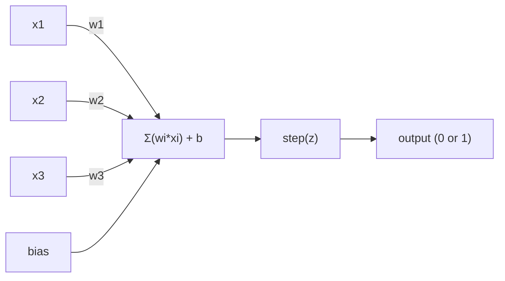
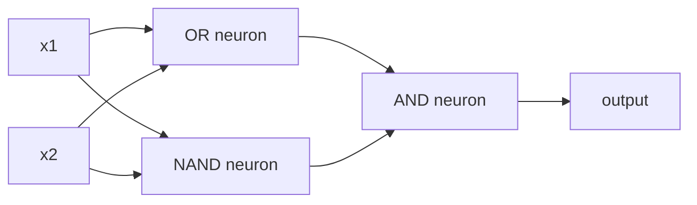

# Перцептрон

> Перцептрон - это атом нейронных сетей. Раздели его, и ты найдешь вес, предвзятость и решение.

**Type:** Build
**Languages:** Python
**Prerequisites:** Phase 1 (Linear Algebra Intuition)
**Time:** ~60 minutes

## Цели обучения

- Внедрить перцептрон с нуля в Python, включая правило обновления веса и функцию активации шага
- Объясните, почему один перцептрон может решать только линейные проблемы и продемонстрировать случай неудачи XOR
- Создать многослойный перцептрон путем сочетания портов OR, NAND и AND для решения XOR
- Обучить двухслойную сеть с сигмоидной активацией и обратной просочкой для автоматического изучения XOR

## Проблема

Вы знаете векторы и точечные продукты. Вы знаете, что матрица превращает входы в выходы. Но как машина *учится* использовать какую трансформацию?

Перцептрон отвечает на это. Это самая простая возможная машинная обучение: возьмите некоторые входы, умножьте на вес, добавьте предвзятость и примите двоичное решение.

Понимание перцептрона означает понимание того, что "учение" на самом деле означает в коде: регулирование чисел до тех пор, пока выход не будет соответствовать действительности.

## Концепция

### Один нейрон, одно решение

Перцептон берет n вводов, умножает каждый весом, суммирует их, добавляет предвзятость и передает результат через функцию активации.



Функция шага является грубой: если взвешенная сумма плюс предвзятость >= 0, выход 1. В противном случае выход 0.

```
step(z) = 1  if z >= 0
           0  if z < 0
```

Это линейный классификатор. Весы и предвзятость определяют линию (или гиперплану в более высоких измерениях), которая делится входном пространством на два региона.

### Ограничение решения

Для двух входов перцептрон чертает линию через 2D пространство:

```
  x2
  ┤
  │  Class 1        /
  │    (0)          /
  │                /
  │               / w1·x1 + w2·x2 + b = 0
  │              /
  │             /     Class 2
  │            /        (1)
  ┼───────────/──────────── x1
```

Все, что на одной стороне линии, выходит 0, все, что на другой стороне выходит 1. Тренировка перемещает эту линию, пока она не правильно разделяет классы.

### Правило обучения

Правило восприятия восприятия простое:

```
For each training example (x, y_true):
    y_pred = predict(x)
    error = y_true - y_pred

    For each weight:
        w_i = w_i + learning_rate * error * x_i
    bias = bias + learning_rate * error
```

Если предсказание правильно, то ошибка = 0, ничего не меняется. Если оно предсказывает 0, но должно быть 1, то вес увеличивается. Если оно предсказывает 1, но должно быть 0, то вес уменьшается. Учительная скорость контролирует, насколько велика каждая корректировка.

### Проблема XOR

Вот где она ломается.

```
AND gate:           OR gate:            XOR gate:
x1  x2  out         x1  x2  out         x1  x2  out
0   0   0           0   0   0           0   0   0
0   1   0           0   1   1           0   1   1
1   0   0           1   0   1           1   0   1
1   1   1           1   1   1           1   1   0
```

И и OR линейно разделяются: можно нарисовать одну линию, чтобы отделить 0 от 1s. XOR не является. Ни одна линия не может отделить [0,1] и [1,0] от [0,0] и [1,1].

```
AND (separable):        XOR (not separable):

  x2                      x2
  1 ┤  0     1            1 ┤  1     0
    │     /                 │
  0 ┤  0 / 0              0 ┤  0     1
    ┼──/──────── x1         ┼──────────── x1
       line works!          no single line works!
```

Это фундаментальный предел.Один перцептон может решить только линейные проблемы.Минский и Паперт доказали это в 1969 году и это почти уничтожило исследования нейронных сетей в течение десяти лет.

Прекращение: постройте перцептрон в слои. Многослойный перцептрон может решить XOR, объединив два линейных решения в нелинейный.

```figure
perceptron-boundary
```

## Создайте его

### Шаг 1: класс Перцептрона

```python
class Perceptron:
    def __init__(self, n_inputs, learning_rate=0.1):
        self.weights = [0.0] * n_inputs
        self.bias = 0.0
        self.lr = learning_rate

    def predict(self, inputs):
        total = sum(w * x for w, x in zip(self.weights, inputs))
        total += self.bias
        return 1 if total >= 0 else 0

    def train(self, training_data, epochs=100):
        for epoch in range(epochs):
            errors = 0
            for inputs, target in training_data:
                prediction = self.predict(inputs)
                error = target - prediction
                if error != 0:
                    errors += 1
                    for i in range(len(self.weights)):
                        self.weights[i] += self.lr * error * inputs[i]
                    self.bias += self.lr * error
            if errors == 0:
                print(f"Converged at epoch {epoch + 1}")
                return
        print(f"Did not converge after {epochs} epochs")
```

### Шаг 2: Обучение логических ворот

```python
and_data = [
    ([0, 0], 0),
    ([0, 1], 0),
    ([1, 0], 0),
    ([1, 1], 1),
]

or_data = [
    ([0, 0], 0),
    ([0, 1], 1),
    ([1, 0], 1),
    ([1, 1], 1),
]

not_data = [
    ([0], 1),
    ([1], 0),
]

print("=== AND Gate ===")
p_and = Perceptron(2)
p_and.train(and_data)
for inputs, _ in and_data:
    print(f"  {inputs} -> {p_and.predict(inputs)}")

print("\n=== OR Gate ===")
p_or = Perceptron(2)
p_or.train(or_data)
for inputs, _ in or_data:
    print(f"  {inputs} -> {p_or.predict(inputs)}")

print("\n=== NOT Gate ===")
p_not = Perceptron(1)
p_not.train(not_data)
for inputs, _ in not_data:
    print(f"  {inputs} -> {p_not.predict(inputs)}")
```

### Шаг 3: Смотрите, как XOR не работает

```python
xor_data = [
    ([0, 0], 0),
    ([0, 1], 1),
    ([1, 0], 1),
    ([1, 1], 0),
]

print("\n=== XOR Gate (single perceptron) ===")
p_xor = Perceptron(2)
p_xor.train(xor_data, epochs=1000)
for inputs, expected in xor_data:
    result = p_xor.predict(inputs)
    status = "OK" if result == expected else "WRONG"
    print(f"  {inputs} -> {result} (expected {expected}) {status}")
```

Это доказывает, что один перцептон не может научиться XOR.

### Шаг 4: Раскрыть XOR двумя слоями

Трик: XOR = (x1 OR x2) И НЕ (x1 И x2).



```python
def xor_network(x1, x2):
    or_neuron = Perceptron(2)
    or_neuron.weights = [1.0, 1.0]
    or_neuron.bias = -0.5

    nand_neuron = Perceptron(2)
    nand_neuron.weights = [-1.0, -1.0]
    nand_neuron.bias = 1.5

    and_neuron = Perceptron(2)
    and_neuron.weights = [1.0, 1.0]
    and_neuron.bias = -1.5

    hidden1 = or_neuron.predict([x1, x2])
    hidden2 = nand_neuron.predict([x1, x2])
    output = and_neuron.predict([hidden1, hidden2])
    return output


print("\n=== XOR Gate (multi-layer network) ===")
for inputs, expected in xor_data:
    result = xor_network(inputs[0], inputs[1])
    print(f"  {inputs} -> {result} (expected {expected})")
```

Положение перцептронов в слои создает границы решения, которые не может создать ни один перцептон.

### Шаг 5: Разрабатывайте двухслойную сеть

Шаг 4 - ручная прокладка весов. Это работает для XOR, но не для реальных проблем, когда вы не знаете правильные весы заранее.

```python
class TwoLayerNetwork:
    def __init__(self, learning_rate=0.5):
        import random
        random.seed(0)
        self.w_hidden = [[random.uniform(-1, 1), random.uniform(-1, 1)] for _ in range(2)]
        self.b_hidden = [random.uniform(-1, 1), random.uniform(-1, 1)]
        self.w_output = [random.uniform(-1, 1), random.uniform(-1, 1)]
        self.b_output = random.uniform(-1, 1)
        self.lr = learning_rate

    def sigmoid(self, x):
        import math
        x = max(-500, min(500, x))
        return 1.0 / (1.0 + math.exp(-x))

    def forward(self, inputs):
        self.inputs = inputs
        self.hidden_outputs = []
        for i in range(2):
            z = sum(w * x for w, x in zip(self.w_hidden[i], inputs)) + self.b_hidden[i]
            self.hidden_outputs.append(self.sigmoid(z))
        z_out = sum(w * h for w, h in zip(self.w_output, self.hidden_outputs)) + self.b_output
        self.output = self.sigmoid(z_out)
        return self.output

    def train(self, training_data, epochs=10000):
        for epoch in range(epochs):
            total_error = 0
            for inputs, target in training_data:
                output = self.forward(inputs)
                error = target - output
                total_error += error ** 2

                d_output = error * output * (1 - output)

                saved_w_output = self.w_output[:]
                hidden_deltas = []
                for i in range(2):
                    h = self.hidden_outputs[i]
                    hd = d_output * saved_w_output[i] * h * (1 - h)
                    hidden_deltas.append(hd)

                for i in range(2):
                    self.w_output[i] += self.lr * d_output * self.hidden_outputs[i]
                self.b_output += self.lr * d_output

                for i in range(2):
                    for j in range(len(inputs)):
                        self.w_hidden[i][j] += self.lr * hidden_deltas[i] * inputs[j]
                    self.b_hidden[i] += self.lr * hidden_deltas[i]
```

```python
net = TwoLayerNetwork(learning_rate=2.0)
net.train(xor_data, epochs=10000)
for inputs, expected in xor_data:
    result = net.forward(inputs)
    predicted = 1 if result >= 0.5 else 0
    print(f"  {inputs} -> {result:.4f} (rounded: {predicted}, expected {expected})")
```

Два ключевых отличия от шага 4. Во-первых, сигмоид заменяет функцию шага - она гладкая, поэтому существуют градиенты. Во-вторых, `train`метод распространяет ошибку назад от выхода к скрытому слою, регулируя каждый вес пропорционально его вкладу в ошибку. Это обратное распространение в 20 строках.

Это мост к уроку 03.`d_output`и `hidden_deltas`Это правило цепочки, которое мы применим к графику сети.

## Используйте его

Всё , что ты только что построил с нуля , существует в одном импорте:

```python
from sklearn.linear_model import Perceptron as SkPerceptron
import numpy as np

X = np.array([[0,0],[0,1],[1,0],[1,1]])
y = np.array([0, 0, 0, 1])

clf = SkPerceptron(max_iter=100, tol=1e-3)
clf.fit(X, y)
print([clf.predict([x])[0] for x in X])
```

Пять строчек, тридцать.`Perceptron`В версии sklearn добавляются проверки конвергенции, функции нескольких потерь и поддержка редких вводов, но основная петля идентична: взвешенная сумма, функция шага, обновление веса по ошибке.

Реальный разрыв проявляется в масштабах.

- Функция шага становится сигмоидной, ReLU или другой гладкой активацией
- Весы автоматически изучаются путем обратного распространения (урок 03)
- Складки становятся глубже: 3, 10, 100+ слоев
- Тот же принцип: каждый слой создает новые характеристики из выходов предыдущего слоя

Один перцептрон может нарисовать только прямые линии.

## Погрузи его

Этот урок дает результаты:
- `outputs/skill-perceptron.md`- умение, которое охватывает необходимость в архитектуре однослоя и многослоя

## Упражнения

1. Обучить перцептрон на NAND-ворот (универсальный ворот - любая логическая схема может быть построена из NAND).
2. Изменить класс Perceptron для отслеживания границы решения (w1*x1 + w2*x2 + b = 0) в каждой эпохе.
3. Создайте 3-входный перцептрон, который выпускает 1 только тогда, когда по крайней мере 2 из 3 входов являются 1 (функция большинства голосов).

## Ключевые условия

| Term | What people say | What it actually means |
|------|----------------|----------------------|
| Perceptron | "A fake neuron" | A linear classifier: dot product of inputs and weights, plus bias, through a step function |
| Weight | "How important an input is" | A multiplier that scales each input's contribution to the decision |
| Bias | "The threshold" | A constant that shifts the decision boundary, letting the perceptron fire even with zero inputs |
| Activation function | "The thing that squishes values" | A function applied after the weighted sum - step function for perceptrons, sigmoid/ReLU for modern networks |
| Linearly separable | "You can draw a line between them" | A dataset where a single hyperplane can perfectly separate the classes |
| XOR problem | "The thing perceptrons can't do" | Proof that single-layer networks cannot learn non-linearly-separable functions |
| Decision boundary | "Where the classifier switches" | The hyperplane w*x + b = 0 that divides input space into two classes |
| Multi-layer perceptron | "A real neural network" | Perceptrons stacked in layers, where each layer's output feeds the next layer's input |

## Дальнейшее чтение

- Фрэнк Розенблат, "Перцептрон: вероятная модель хранения и организации информации в мозге" (1958) - оригинальная статья, которая начала все это.
- Минский и Паперт, "Перцептроны" (1969) - книга, которая доказала, что XOR не может быть решен однослойными сетями и убила исследования перцептрона в течение десяти лет
- Майкл Нильсен, "Нейронные сети и глубокое обучение", Глава 1 (http://neuralnetworksanddeeplearning.com/) -- бесплатное онлайн, лучшее визуальное объяснение того, как перцептроны составляют сети
