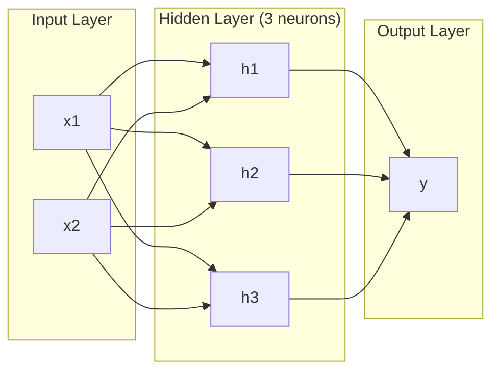
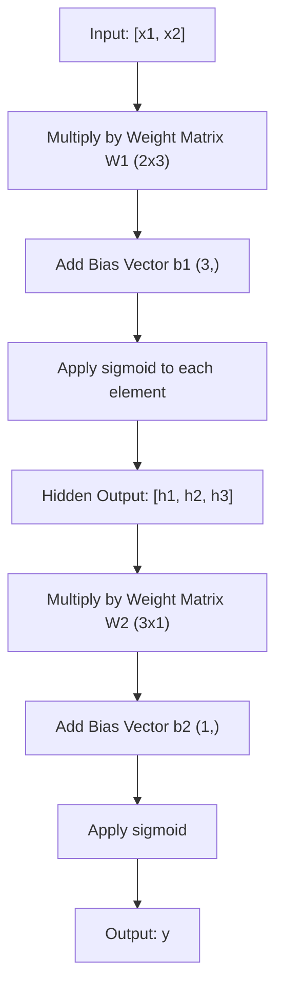
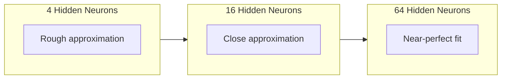

# Многослойные сети и прямой проход

> Один нейрон проводит линию. Сложите их вместе — и вы сможете нарисовать что угодно.

**Type:** Build
**Languages:** Python
**Prerequisites:** Phase 01 (Math Foundations), Lesson 03.01 (The Perceptron)
**Time:** ~90 минут

## Цели обучения

- Построить многослойную сеть с нуля, используя классы Layer и Network, выполняющие полный прямой проход
- Отследить размерности матриц на каждом слое сети и выявлять несоответствия форм
- Объяснить, как наложение друг на друга нелинейных активаций позволяет сети обучать изогнутые границы решений
- Решить задачу XOR, используя архитектуру 2-2-1 с вручную подобранными весами сигмоиды

## Проблема

Один нейрон — это проводник линий. И только. Одна прямая линия через ваши данные. Каждая реальная задача в ИИ — распознавание изображений, понимание языка, игра в го — требует кривых. Укладывание нейронов в слои — это способ получить кривые.

В 1969 году Минский и Пейперт доказали, что это ограничение фатально: однослойная сеть не может обучиться XOR. Не "с трудом обучается" — математически не может. Таблица истинности XOR размещает [0,1] и [1,0] по одну сторону, [0,0] и [1,1] — по другую. Ни одна прямая линия не разделяет их.

Это убило финансирование нейронных сетей более чем на десятилетие. Решение, оглядываясь назад, было очевидным: перестать использовать один слой. Складывать нейроны в слои. Пусть первый слой режет пространство входных данных на новые признаки, а второй слой комбинирует эти признаки в решения, которые ни одна отдельная линия не могла бы принять.

Этот стек — многослойная сеть. Это основа каждой модели глубокого обучения, работающей сегодня в продакшене. Прямой проход — данные, текущие от входа через скрытые слои к выходу — это первое, что нужно построить, прежде чем заработает всё остальное.

## Концепция

### Слои: входной, скрытый, выходной

Многослойная сеть имеет три типа слоёв:

**Входной слой** — на самом деле не слой. Он хранит ваши сырые данные. Два признака означают два входных узла. Вычислений здесь не происходит.

**Скрытые слои** — где происходит работа. Каждый нейрон берёт каждый выход предыдущего слоя, применяет веса и смещение, затем пропускает результат через функцию активации. "Скрытые" — потому что вы никогда не видите эти значения напрямую в обучающих данных.

**Выходной слой** — итоговый ответ. Для бинарной классификации — один нейрон с сигмоидой. Для многоклассовой — один нейрон на класс.



Это сеть 2-3-1. Два входа, три скрытых нейрона, один выход. Каждое соединение несёт вес. Каждый нейрон (кроме входных) несёт смещение.

Каждый слой производит вектор чисел, называемый скрытым состоянием. Для текста скрытые состояния увеличивают размерность — кодируя слово как 768 чисел для захвата семантического значения. Для изображений они уменьшают размерность — сжимая миллионы пикселей в управляемое представление. Скрытое состояние — это место, где живёт обучение.

### Нейроны и активации

Каждый нейрон делает три вещи:

1. Умножает каждый вход на соответствующий вес
2. Суммирует все произведения и добавляет смещение
3. Пропускает сумму через функцию активации

Пока активация — это сигмоида:

```
sigmoid(z) = 1 / (1 + e^(-z))
```

Сигмоида сжимает любое число в диапазон (0, 1). Большие положительные входы приближаются к 1. Большие отрицательные входы приближаются к 0. Ноль отображается в 0.5. Эта плавная кривая — то, что делает обучение возможным: в отличие от жёсткой ступеньки перцептрона, у сигмоиды есть градиент везде.

### Прямой проход: как текут данные

Прямой проход проталкивает входные данные через сеть, слой за слоем, пока они не достигнут выхода. Во время прямого прохода обучение не происходит. Это чистое вычисление: умножить, сложить, активировать, повторить.



На каждом слое последовательно происходят три операции:

```
z = W * input + b       (linear transformation)
a = sigmoid(z)           (activation)
```

Выход одного слоя становится входом следующего. Это и есть весь прямой проход.

### Размерности матриц

Отслеживание размерностей — самый важный навык отладки в глубоком обучении. Вот сеть 2-3-1:

| Шаг | Операция | Размерности | Форма результата |
|------|-----------|------------|-------------|
| Вход | x | -- | (2,) |
| Линейное преобразование скрытого слоя | W1 * x + b1 | W1: (3, 2), b1: (3,) | (3,) |
| Активация скрытого слоя | sigmoid(z1) | -- | (3,) |
| Линейное преобразование выхода | W2 * h + b2 | W2: (1, 3), b2: (1,) | (1,) |
| Активация выхода | sigmoid(z2) | -- | (1,) |

Правило: матрица весов W на слое k имеет форму (neurons_in_layer_k, neurons_in_layer_k_minus_1). Строки соответствуют текущему слою. Столбцы соответствуют предыдущему слою. Если формы не совпадают — у вас баг.

### Теорема об универсальной аппроксимации

В 1989 году Джордж Цыбенко доказал нечто замечательное: нейронная сеть с единственным скрытым слоем и достаточным количеством нейронов может аппроксимировать любую непрерывную функцию с любой желаемой точностью.

Это не означает, что один скрытый слой всегда лучший выбор. Это означает, что архитектура теоретически способна на это. На практике более глубокие сети (больше слоёв, меньше нейронов на слой) обучаются тем же функциям с гораздо меньшим общим числом параметров, чем неглубокие широкие сети. Вот почему работает глубокое обучение.

Интуиция такова: каждый нейрон скрытого слоя учится одной "выпуклости" или признаку. Достаточное количество выпуклостей, размещённых в нужных местах, может аппроксимировать любую гладкую кривую. Больше нейронов — больше выпуклостей — лучше аппроксимация.



### Композируемость

Нейронные сети композируемы. Вы можете складывать их, соединять в цепочки, запускать параллельно. Модель Whisper использует сеть-энкодер для обработки аудио и отдельную сеть-декодер для генерации текста. Современные LLM — только декодеры. BERT — только энкодер. T5 — энкодер-декодер. Выбор архитектуры определяет, что модель может делать.

```figure
mlp-forward
```

## Постройте это

Чистый Python. Без numpy. Каждая матричная операция написана с нуля.

### Шаг 1: Функция активации сигмоида

```python
import math

def sigmoid(x):
    x = max(-500.0, min(500.0, x))
    return 1.0 / (1.0 + math.exp(-x))
```

Ограничение до [-500, 500] предотвращает переполнение. `math.exp(500)` велико, но конечно. `math.exp(1000)` — бесконечность.

### Шаг 2: Класс Layer

Самая важная операция во всём глубоком обучении — умножение матриц. Каждый слой, каждая голова внимания, каждый прямой проход — всё это матмулы сверху донизу. Линейный слой берёт входной вектор, умножает его на матрицу весов и добавляет вектор смещения: y = Wx + b. Это единственное уравнение составляет 90% вычислений в нейронной сети.

Слой хранит матрицу весов и вектор смещения. Его метод forward принимает входной вектор и возвращает активированный выход.

```python
class Layer:
    def __init__(self, n_inputs, n_neurons, weights=None, biases=None):
        if weights is not None:
            self.weights = weights
        else:
            import random
            self.weights = [
                [random.uniform(-1, 1) for _ in range(n_inputs)]
                for _ in range(n_neurons)
            ]
        if biases is not None:
            self.biases = biases
        else:
            self.biases = [0.0] * n_neurons

    def forward(self, inputs):
        self.last_input = inputs
        self.last_output = []
        for neuron_idx in range(len(self.weights)):
            z = sum(
                w * x for w, x in zip(self.weights[neuron_idx], inputs)
            )
            z += self.biases[neuron_idx]
            self.last_output.append(sigmoid(z))
        return self.last_output
```

Матрица весов имеет форму (n_neurons, n_inputs). Каждая строка — это веса одного нейрона по всем входам. Метод forward проходит циклом по нейронам, вычисляет взвешенную сумму плюс смещение, применяет сигмоиду и собирает результаты.

### Шаг 3: Класс Network

Сеть — это список слоёв. Прямой проход соединяет их в цепочку: выход слоя k поступает на вход слоя k+1.

```python
class Network:
    def __init__(self, layers):
        self.layers = layers

    def forward(self, inputs):
        current = inputs
        for layer in self.layers:
            current = layer.forward(current)
        return current
```

Это и есть весь прямой проход. Четыре строки логики. Данные входят, протекают через каждый слой, выходят с другой стороны.

### Шаг 4: XOR с вручную подобранными весами

В Уроке 01 мы решили XOR, комбинируя перцептроны OR, NAND и AND. Теперь сделаем то же самое с нашими классами Layer и Network. Архитектура 2-2-1: два входа, два скрытых нейрона, один выход.

```python
hidden = Layer(
    n_inputs=2,
    n_neurons=2,
    weights=[[20.0, 20.0], [-20.0, -20.0]],
    biases=[-10.0, 30.0],
)

output = Layer(
    n_inputs=2,
    n_neurons=1,
    weights=[[20.0, 20.0]],
    biases=[-30.0],
)

xor_net = Network([hidden, output])

xor_data = [
    ([0, 0], 0),
    ([0, 1], 1),
    ([1, 0], 1),
    ([1, 1], 0),
]

for inputs, expected in xor_data:
    result = xor_net.forward(inputs)
    predicted = 1 if result[0] >= 0.5 else 0
    print(f"  {inputs} -> {result[0]:.6f} (rounded: {predicted}, expected: {expected})")
```

Большие веса (20, -20) заставляют сигмоиду вести себя как ступенчатая функция. Первый скрытый нейрон приближённо реализует OR. Второй — приближённо NAND. Выходной нейрон комбинирует их в AND, что и даёт XOR.

### Шаг 5: Классификация круга

Более сложная задача: классифицировать 2D-точки как находящиеся внутри или снаружи круга радиусом 0.5 с центром в начале координат. Это требует изогнутой границы решения — невозможной для одного перцептрона.

```python
import random
import math

random.seed(42)

data = []
for _ in range(200):
    x = random.uniform(-1, 1)
    y = random.uniform(-1, 1)
    label = 1 if (x * x + y * y) < 0.25 else 0
    data.append(([x, y], label))

circle_net = Network([
    Layer(n_inputs=2, n_neurons=8),
    Layer(n_inputs=8, n_neurons=1),
])
```

При случайных весах сеть будет классифицировать плохо. Но прямой проход всё равно работает. В этом и суть — прямой проход — это просто вычисление. Обучение правильным весам — это обратное распространение, которое будет в Уроке 03.

```python
correct = 0
for inputs, expected in data:
    result = circle_net.forward(inputs)
    predicted = 1 if result[0] >= 0.5 else 0
    if predicted == expected:
        correct += 1

print(f"Accuracy with random weights: {correct}/{len(data)} ({100*correct/len(data):.1f}%)")
```

Случайные веса дают плохую точность — часто хуже, чем простое угадывание преобладающего класса. После обучения (Урок 03) эта же архитектура с 8 скрытыми нейронами нарисует изогнутую границу, отделяющую внутреннюю область от внешней.

## Используйте это

PyTorch делает всё вышеперечисленное в четыре строки:

```python
import torch
import torch.nn as nn

model = nn.Sequential(
    nn.Linear(2, 8),
    nn.Sigmoid(),
    nn.Linear(8, 1),
    nn.Sigmoid(),
)

x = torch.tensor([[0.0, 0.0], [0.0, 1.0], [1.0, 0.0], [1.0, 1.0]])
output = model(x)
print(output)
```

`nn.Linear(2, 8)` — это ваш класс Layer: матрица весов формы (8, 2), вектор смещения формы (8,). `nn.Sigmoid()` — это ваша функция сигмоиды, применяемая поэлементно. `nn.Sequential` — это ваш класс Network: цепочка слоёв по порядку.

Разница — в скорости и масштабе. PyTorch работает на GPU, обрабатывает батчи из миллионов примеров и автоматически вычисляет градиенты для обратного распространения. Но логика прямого прохода идентична тому, что вы только что построили с нуля.

## Отправьте это в работу

Этот урок производит переиспользуемый промпт для проектирования архитектур сетей:

- `outputs/prompt-network-architect.md`

Используйте его, когда вам нужно решить, сколько слоёв, сколько нейронов на слой и какие функции активации использовать для данной задачи.

## Упражнения

1. Постройте сеть 2-4-2-1 (два скрытых слоя) и запустите прямой проход на данных XOR со случайными весами. Выведите промежуточные выходы скрытого слоя, чтобы увидеть, как представление трансформируется на каждом слое.

2. Измените размер скрытого слоя в классификаторе круга с 8 на 2, затем на 32. Каждый раз запускайте прямой проход со случайными весами. Меняет ли количество скрытых нейронов диапазон или распределение выхода? Почему?

3. Реализуйте метод `count_parameters` в классе Network, который возвращает общее число обучаемых весов и смещений. Протестируйте его на сети 784-256-128-10 (классическая архитектура для MNIST). Сколько у неё параметров?

4. Постройте прямой проход для сети 3-4-4-2. Подайте в неё значения RGB-цветов (нормализованные к 0-1) и понаблюдайте за двумя выходами. Это архитектура для простого классификатора цвета с двумя классами.

5. Замените сигмоиду на функцию "leaky step": вернуть 0.01 * z, если z < 0, иначе 1.0. Запустите прямой проход на XOR с теми же вручную подобранными весами из Шага 4. Работает ли это по-прежнему? Почему плавная сигмоида предпочтительнее жёстких отсечек?

## Ключевые термины

| Термин | Что говорят люди | Что это на самом деле означает |
|------|----------------|----------------------|
| Forward pass (прямой проход) | "Запуск модели" | Проталкивание входа через каждый слой — умножение на веса, добавление смещения, активация — для получения выхода |
| Hidden layer (скрытый слой) | "Средняя часть" | Любой слой между входом и выходом, значения которого напрямую не наблюдаются в данных |
| Multi-layer network (многослойная сеть) | "Глубокая нейронная сеть" | Слои нейронов, уложенные последовательно, где выход каждого слоя подаётся на вход следующего слоя |
| Activation function (функция активации) | "Нелинейность" | Функция, применяемая после линейного преобразования, которая вводит кривизну в границу решения |
| Sigmoid (сигмоида) | "S-образная кривая" | sigma(z) = 1/(1+e^(-z)), сжимает любое вещественное число в (0,1), гладкая и дифференцируемая везде |
| Weight matrix (матрица весов) | "Параметры" | Матрица W формы (current_layer_neurons, previous_layer_neurons), содержащая обучаемые силы соединений |
| Bias vector (вектор смещения) | "Смещение" | Вектор, добавляемый после умножения матриц, который позволяет нейронам активироваться, даже когда все входы равны нулю |
| Universal approximation (универсальная аппроксимация) | "Нейросети могут выучить что угодно" | Единственный скрытый слой с достаточным количеством нейронов может аппроксимировать любую непрерывную функцию — но "достаточное" может означать миллиарды |
| Linear transformation (линейное преобразование) | "Шаг умножения матриц" | z = W * x + b, вычисление перед активацией, которое отображает входы в новое пространство |
| Decision boundary (граница решения) | "Где классификатор переключается" | Поверхность во входном пространстве, где выход сети пересекает порог классификации |

## Дополнительное чтение

- Michael Nielsen, "Neural Networks and Deep Learning", главы 1-2 (http://neuralnetworksanddeeplearning.com/) — самое ясное бесплатное объяснение прямых проходов и структуры сетей с интерактивными визуализациями
- Cybenko, "Approximation by Superpositions of a Sigmoidal Function" (1989) — оригинальная статья с теоремой об универсальной аппроксимации, удивительно читабельная
- 3Blue1Brown, "But what is a neural network?" (https://www.youtube.com/watch?v=aircAruvnKk) — 20-минутный визуальный разбор слоёв, весов и прямых проходов, выстраивающий правильную ментальную модель
- Goodfellow, Bengio, Courville, "Deep Learning", глава 6 (https://www.deeplearningbook.org/) — стандартный справочник по многослойным сетям, доступен бесплатно онлайн