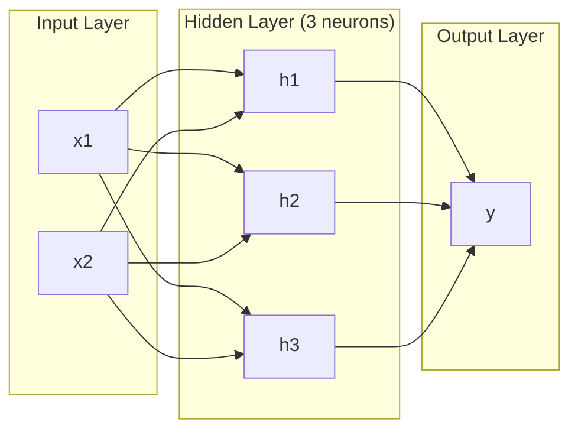
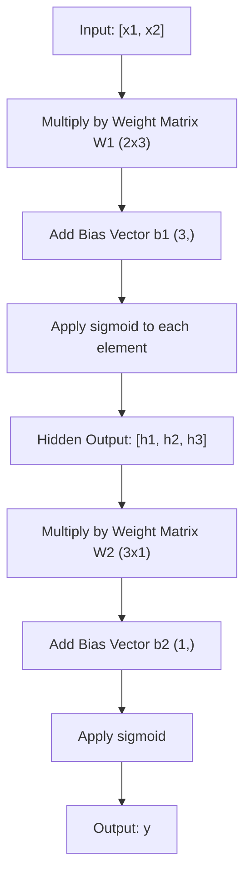
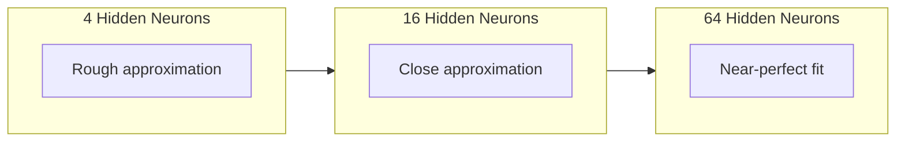

# Многослойные сети и пропускные пункты

> Один нейрон чертает линию, погрузишь их в столб, и ты можешь нарисовать все.

**Type:** Build
**Languages:** Python
**Prerequisites:** Phase 01 (Math Foundations), Lesson 03.01 (The Perceptron)
**Time:** ~90 minutes

## Цели обучения

- Создать многослойную сеть с нуля с помощью классов слоя и сети , которые выполняют полный проход вперед
- Проследить размеры матрицы через каждый слой сети и определить несоответствие формы
- Объясните, как накладка нелинейных активаций позволяет сети учиться кривым границам принятия решений.
- Решение проблемы XOR с использованием архитектуры 2-2-1 с ручной настройкой сигмоидных весов

## Проблема

Один нейрон - это черный чек. Вот и все. Одна прямая линия через ваши данные. Каждая реальная проблема в ИИ - распознавание изображений, понимание языка, игра в го - требует кривых.

В 1969 году Минский и Паперт доказали, что это ограничение было фатальным: однослойная сеть не может научиться XOR. Не "борьба учиться" - математически не может. Таблица истины XOR помещает [0,1] и [1,0] с одной стороны, [0,0] и [1,1] с другой. Ни одна линия не разделяет их.

Это устранило финансирование нейронной сети более десяти лет. В прошлом случае решение было очевидным: прекратить использование одного слоя. Разбить нейроны в слои. Пусть первый слой вырежет входный пространство на новые функции, а второй слой объединит эти функции в решения, которые не может принять ни одна линия.

Эта стека - это многослойная сеть. Она является основой каждой модели глубокого обучения, которая сегодня используется. Пропуск вперед - данные, протекающие от ввода через скрытые слои до вывода - это первое, что нужно построить, прежде чем что-либо еще будет работать.

## Концепция

### Складки: вход, скрытые, выходные

Многослойная сеть имеет три типа слоев:

**Input layer**Это не слой. Он содержит ваши сырые данные. Две функции означают два входных узла.

**Hidden layers**- где происходит работа. Каждый нейрон берет каждый выход из предыдущего слоя, применяет весы и пристрастие, затем передает результат через функцию активации. "Скрыто", потому что вы никогда не видите эти значения напрямую в данных тренировки.

**Output layer**- конечный ответ. Для бинарной классификации один нейрон с сигмоидом. Для многокласса - один нейрон за класс.



Это сеть 2-3-1. Два входа, три скрытых нейрона, один выход. Каждое соединение имеет вес. Каждый нейрон (кроме входа) имеет предвзятость.

Каждый слой создает вектор числа, называемый скрытым состоянием. Для текста скрытые состояния увеличивают измерение - кодируют слово как 768 числа для захвата семантического значения. Для изображений они уменьшают измерение - сжимают миллионы пикселей в управляемое представление.

### Нейроны и активация

Каждый нейрон делает три вещи:

1. Умножить каждый вход на его соответствующий вес
2. Подсчитать все продукты и добавить предвзятость
3. Передавать сумму через функцию активации

На данный момент, активирование сигмоидного:

```
sigmoid(z) = 1 / (1 + e^(-z))
```

Сигмоид сдавливает любое число в диапазон (0, 1). Большие положительные входы толкают в сторону 1. Большие отрицательные входы толкают в сторону 0.

### Пропуск вперед: как передаются данные

Проходный проход толкает входные данные через сеть, слой за слоем, пока они не достигнут выхода.



На каждом слое происходят три операции последовательно:

```
z = W * input + b       (linear transformation)
a = sigmoid(z)           (activation)
```

Выход одного слоя становится входом в следующий.

### Размеры матрицы

Размеры отслеживания - это один из самых важных навыков дебъга в глубоком обучении.

| Step | Operation | Dimensions | Result Shape |
|------|-----------|------------|-------------|
| Input | x | -- | (2,) |
| Hidden linear | W1 * x + b1 | W1: (3, 2), b1: (3,) | (3,) |
| Hidden activation | sigmoid(z1) | -- | (3,) |
| Output linear | W2 * h + b2 | W2: (1, 3), b2: (1,) | (1,) |
| Output activation | sigmoid(z2) | -- | (1,) |

Правило: матрица массы W в слое k имеет форму (нейроны_в_слое_k, нейроны_в_слое_k_minus_1).

### Теорема универсальной приближения

В 1989 году Джордж Сайбенко доказал что-то замечательное: нейронная сеть с одним скрытым слоем и достаточное количество нейронов может приблизить любую непрерывную функцию к любой желаемой точности.

Это не значит, что один скрытый слой всегда лучше. Это означает, что архитектура теоретически способна. На практике более глубокие сети (больше слоев, меньше нейронов на слой) изучают те же функции с гораздо меньшими общими параметрами, чем мелкоширокие сети.

Интуиция: каждый нейрон в скрытом слое учится одному "пульсу" или особенности. Достаточно пульсов, размещенных в правильных местах, может приблизиться к любой гладкой кривой.



### Совместимость

Нейронные сети составляются. Вы можете накапливать их, цеплять их, запускать их параллельно. В модели Whisper используется сеть кодера для обработки аудио и отдельная сеть декодера для генерации текста. Современные LLM являются только декодерами. BERT является только кодерами. T5 является кодерами-декодерами. Выбор архитектуры определяет, что может сделать модель.

```figure
mlp-forward
```

## Создайте его

Чистый Python, без нюпи, каждая операция матрицы написана с нуля.

### Шаг 1: Активация сигмоида

```python
import math

def sigmoid(x):
    x = max(-500.0, min(500.0, x))
    return 1.0 / (1.0 + math.exp(-x))
```

Сцепление до [500, 500] предотвращает переполнение. `math.exp(500)`- Большой, но ограниченный.`math.exp(1000)`бесконечность.

### Шаг 2: класс слоев

Самый важный метод глубокого обучения - умножение матрицы. Каждый слой, каждый уголок внимания, каждый проход вперед - это матмулы вниз. Линейный слой берет входный вектор, умножает его на матрицу веса и добавляет вектор предвзятости: y = Wx + b. Это одно уравнение составляет 90% вычислений в нейронной сети.

Слой содержит матрицу веса и вектор предвзятости.

```python
class Layer:
    def __init__(self, n_inputs, n_neurons, weights=None, biases=None):
        if weights is not None:
            self.weights = weights
        else:
            import random
            self.weights = [
                [random.uniform(-1, 1) for _ in range(n_inputs)]
                for _ in range(n_neurons)
            ]
        if biases is not None:
            self.biases = biases
        else:
            self.biases = [0.0] * n_neurons

    def forward(self, inputs):
        self.last_input = inputs
        self.last_output = []
        for neuron_idx in range(len(self.weights)):
            z = sum(
                w * x for w, x in zip(self.weights[neuron_idx], inputs)
            )
            z += self.biases[neuron_idx]
            self.last_output.append(sigmoid(z))
        return self.last_output
```

Матрица веса имеет форму (n_neurons, n_inputs). Каждый ряд представляет собой вес одного нейрона по всем вводам.

### Шаг 3: класс сети

Сеть - это список слоев. Передний проход цепляет их: выход слоя k питается слоем k + 1.

```python
class Network:
    def __init__(self, layers):
        self.layers = layers

    def forward(self, inputs):
        current = inputs
        for layer in self.layers:
            current = layer.forward(current)
        return current
```

Это весь проход вперед. Четыре строки логики. Данные входят, протекают через каждый слой, выходят с другой стороны.

### Шаг 4: XOR с ручными весями

В уроке 01, мы решили XOR, сочетая в себе OR, NAND и AND перцептрон. Теперь делать то же самое с нашими классами Layer и Network. 2-2-1 архитектура: два входа, два скрытых нейрона, один выход.

```python
hidden = Layer(
    n_inputs=2,
    n_neurons=2,
    weights=[[20.0, 20.0], [-20.0, -20.0]],
    biases=[-10.0, 30.0],
)

output = Layer(
    n_inputs=2,
    n_neurons=1,
    weights=[[20.0, 20.0]],
    biases=[-30.0],
)

xor_net = Network([hidden, output])

xor_data = [
    ([0, 0], 0),
    ([0, 1], 1),
    ([1, 0], 1),
    ([1, 1], 0),
]

for inputs, expected in xor_data:
    result = xor_net.forward(inputs)
    predicted = 1 if result[0] >= 0.5 else 0
    print(f"  {inputs} -> {result[0]:.6f} (rounded: {predicted}, expected: {expected})")
```

Большие весы (20, -20) заставляют сигмоидную функцию действовать как ступенька. Первый скрытый нейрон приближается к OR. Второй приближается к NAND. Выходной нейрон объединяет их в AND, который является XOR.

### Шаг 5: Классификация кругов

Сложнее - классифицировать 2D-точки как внутри или снаружи круга радиуса 0,5 централизованного в источнике.

```python
import random
import math

random.seed(42)

data = []
for _ in range(200):
    x = random.uniform(-1, 1)
    y = random.uniform(-1, 1)
    label = 1 if (x * x + y * y) < 0.25 else 0
    data.append(([x, y], label))

circle_net = Network([
    Layer(n_inputs=2, n_neurons=8),
    Layer(n_inputs=8, n_neurons=1),
])
```

С случайными весями сеть не будет классифицировать хорошо. Но пропуск вперед все еще работает. Вот и дело - пропуск вперед - это просто вычисление.

```python
correct = 0
for inputs, expected in data:
    result = circle_net.forward(inputs)
    predicted = 1 if result[0] >= 0.5 else 0
    if predicted == expected:
        correct += 1

print(f"Accuracy with random weights: {correct}/{len(data)} ({100*correct/len(data):.1f}%)")
```

Случайные весы дают плохую точность - часто хуже, чем предполагать большинство классов. После тренировки (урок 03), эта же архитектура с 8 скрытыми нейронами будет нарисовать изогнутую границу, которая отделяет внутри от снаружи.

## Используйте его

PyTorch делает все выше в четырех строках:

```python
import torch
import torch.nn as nn

model = nn.Sequential(
    nn.Linear(2, 8),
    nn.Sigmoid(),
    nn.Linear(8, 1),
    nn.Sigmoid(),
)

x = torch.tensor([[0.0, 0.0], [0.0, 1.0], [1.0, 0.0], [1.0, 1.0]])
output = model(x)
print(output)
```

`nn.Linear(2, 8)`является классом слоя: матрица массы формы (8, 2), вектор прохождения формы (8,). `nn.Sigmoid()`- это ваша сигмоидная функция, применяемая по элементам.`nn.Sequential`- это ваш класс сети: цепочки слоев в порядке.

Различие в скорости и масштабе. PyTorch работает на GPU, обрабатывает партии миллионов образцов и автоматически вычисляет градиенты для обратного распространения. Но логика пропуска вперед идентична тому, что вы только что построили с нуля.

## Погрузи его

В этом уроке представлена возможность использования повторного запроса для проектирования сетевых архитектур:

- `outputs/prompt-network-architect.md`

Используйте его, когда вам нужно определить, сколько слоев, сколько нейронов на слой и какие функции активации использовать для данной проблемы.

## Упражнения

1. Создайте сеть 2-4-2-1 (два скрытых слоя) и запустите переход вперед на данные XOR с случайными весами.

2. Изменить размер скрытого слоя в классификаторе круга с 8 до 2, затем до 32. Запустить проход вперед с случайными весами каждый раз.

3. Реализация `count_parameters`Метод на классе сети, который возвращает общее количество тренируемых весов и предвзятости.

4. Создайте пропуск вперед для сети 3-4-4-2. подавайте ее цветными значениями RGB (нормализованными до 0-1) и наблюдайте за двумя выходами.

5. Замените сигмоид функцией "просочившийся шаг": верните 0,01 * z, если z < 0, то 1.0.

## Ключевые условия

| Term | What people say | What it actually means |
|------|----------------|----------------------|
| Forward pass | "Running the model" | Pushing input through every layer -- multiply by weights, add bias, activate -- to produce an output |
| Hidden layer | "The middle part" | Any layer between input and output whose values are not directly observed in the data |
| Multi-layer network | "A deep neural network" | Layers of neurons stacked sequentially, where each layer's output feeds the next layer's input |
| Activation function | "The nonlinearity" | A function applied after the linear transformation that introduces curves into the decision boundary |
| Sigmoid | "The S-curve" | sigma(z) = 1/(1+e^(-z)), squashes any real number to (0,1), smooth and differentiable everywhere |
| Weight matrix | "The parameters" | A matrix W of shape (current_layer_neurons, previous_layer_neurons) containing learnable connection strengths |
| Bias vector | "The offset" | A vector added after the matrix multiply that lets neurons activate even when all inputs are zero |
| Universal approximation | "Neural nets can learn anything" | A single hidden layer with enough neurons can approximate any continuous function -- but "enough" can mean billions |
| Linear transformation | "The matrix multiply step" | z = W * x + b, the computation before activation, which maps inputs to a new space |
| Decision boundary | "Where the classifier switches" | The surface in input space where the network output crosses the classification threshold |

## Дальнейшее чтение

- Майкл Нильсен, "Нейронные сети и глубокое обучение", Глава 1-2 (http://neuralnetworksanddeeplearning.com/) - наиболее четкое и свободное объяснение форвард-пасов и структуры сети с помощью интерактивных визуализаций
- Цибенко, "Приближение с помощью суперпозиций сигмоидной функции" (1989) - оригинальная универсальная работа по теореме приближения, удивительно читаемая
- 3Blue1Brown, "Но что такое нейронная сеть?"https://www.youtube.com/watch?v=aircAruvnKk) -- 20-минутная визуальная прогулка по слоям, весям и проходам вперед, которая создает правильную ментальную модель
- Добросовет, Бенгио, Курвилл, "Глубокое обучение", Глава 6 (https://www.deeplearningbook.org/) -- стандартная ссылка на многослойные сети, бесплатная онлайн
