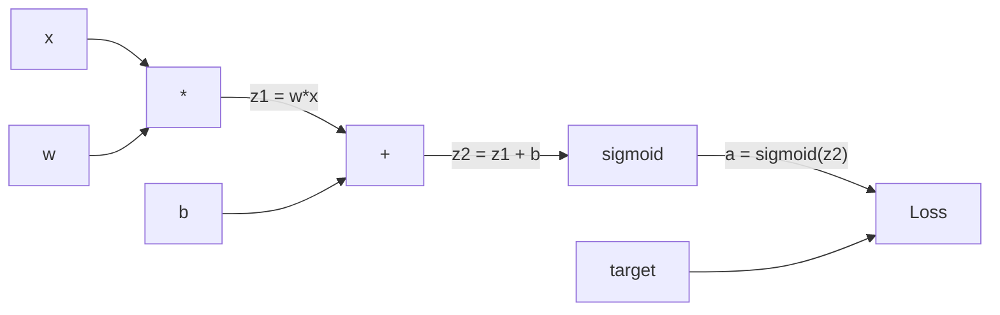
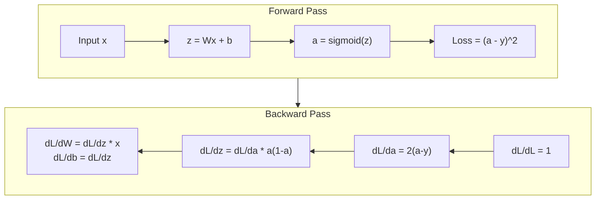
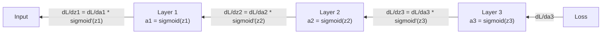

# Backpropagation с нуля

> Backpropagation — это алгоритм, который делает обучение возможным. Без него нейронные сети — это просто дорогостоящие генераторы случайных чисел.

**Type:** Build
**Languages:** Python
**Prerequisites:** Lesson 03.02 (Multi-Layer Networks)
**Time:** ~120 минут

## Цели обучения

- Реализовать движок автоматического дифференцирования на основе Value, который строит вычислительный граф и вычисляет градиенты с помощью топологической сортировки
- Вывести обратный проход для сложения, умножения и sigmoid, используя цепное правило
- Обучить многослойную сеть на задачах XOR и классификации кругов, используя только собственный движок backpropagation, написанный с нуля
- Определить проблему затухающего градиента в глубоких сетях с sigmoid и объяснить, почему градиенты уменьшаются экспоненциально

## Проблема

У вашей сети один скрытый слой с 768 входами и 3072 выходами. Это 2 359 296 весов. Сеть сделала неверное предсказание. Какие веса стали причиной ошибки? Проверка каждого веса по отдельности означает 2,3 миллиона прямых проходов. Backpropagation вычисляет все 2,3 миллиона градиентов за один обратный проход. Это не оптимизация. Это разница между обучаемостью и невозможностью.

Наивный подход: взять один вес, сдвинуть его на крошечную величину, снова запустить прямой проход, измерить, увеличился или уменьшился loss. Это даёт градиент для этого веса. Теперь сделайте то же самое для каждого веса в сети. Умножьте на тысячи шагов обучения и миллионы точек данных. Вам потребуется геологическое время, чтобы обучить что-то полезное.

Backpropagation решает эту проблему. Один прямой проход, один обратный проход — все градиенты вычислены. Трюк заключается в цепном правиле из матанализа, применённом систематически к вычислительному графу. Это алгоритм, который сделал глубокое обучение практически осуществимым. Без него мы бы всё ещё застряли на игрушечных задачах.

## Концепция

### Цепное правило, применённое к сетям

Вы видели цепное правило в Phase 01, Lesson 05. Краткое напоминание: если y = f(g(x)), то dy/dx = f'(g(x)) * g'(x). Вы перемножаете производные вдоль цепочки.

В нейронной сети «цепочка» — это последовательность операций от входа к loss. Каждый слой применяет веса, добавляет смещения, пропускает через функцию активации. Функция loss сравнивает конечный выход с целевым значением. Backpropagation проходит эту цепочку в обратном направлении, вычисляя, как каждая операция повлияла на ошибку.

### Вычислительные графы

Каждый прямой проход строит граф. Каждый узел — это операция (умножение, сложение, sigmoid). Каждое ребро несёт значение вперёд и градиент назад.



Прямой проход: значения текут слева направо. x и w дают z1 = w*x. Прибавляем b, получаем z2. Sigmoid даёт активацию a. Сравниваем a с целевым значением y с помощью функции loss.

Обратный проход: градиенты текут справа налево. Начинаем с dL/da (как loss меняется в зависимости от активации). Умножаем на da/dz2 (производная sigmoid). Получаем dL/dz2. Разделяем на dL/db (равно dL/dz2, поскольку z2 = z1 + b) и dL/dz1. Затем dL/dw = dL/dz1 * x и dL/dx = dL/dz1 * w.

У каждого узла в графе во время обратного прохода одна задача: взять градиент, пришедший сверху, умножить на свою локальную производную и передать вниз.

### Прямой против обратного прохода



Прямой проход сохраняет каждое промежуточное значение: z, a, входы каждого слоя. Обратному проходу эти сохранённые значения нужны для вычисления градиентов. Это компромисс между памятью и вычислениями, лежащий в основе backprop. Вы меняете память (хранение активаций) на скорость (один проход вместо миллионов).

### Поток градиента через сеть

Для 3-слойной сети градиенты проходят цепочкой через каждый слой:



На каждом слое градиент умножается на производную sigmoid. Производная sigmoid равна a * (1 - a), и максимум достигает 0.25 (при a = 0.5). Три слоя в глубину — градиент был умножен максимум на 0.25^3 = 0.0156. Десять слоёв в глубину: 0.25^10 = 0.000001.

### Затухающие градиенты

Это и есть проблема затухающего градиента. Sigmoid сжимает свой выход в диапазон от 0 до 1. Его производная всегда меньше 0.25. Наложите достаточно слоёв sigmoid друг на друга — и градиенты съёжатся до нуля. Ранние слои почти не обучаются, потому что получают градиенты, близкие к нулю.

```
sigmoid(z):     Output range [0, 1]
sigmoid'(z):    Max value 0.25 (at z = 0)

After 5 layers:   gradient * 0.25^5 = 0.001x original
After 10 layers:  gradient * 0.25^10 = 0.000001x original
```

Именно поэтому глубокие сети с sigmoid почти невозможно обучить. Решение — ReLU и его варианты — тема Lesson 04. Пока же важно понимать: backprop работает безупречно. Проблема в том, через что он работает.

### Вывод градиентов для 2-слойной сети

Конкретная математика для сети со входом x, скрытым слоем с sigmoid, выходным слоем с sigmoid и MSE-loss.

Прямой проход:
```
z1 = W1 * x + b1
a1 = sigmoid(z1)
z2 = W2 * a1 + b2
a2 = sigmoid(z2)
L = (a2 - y)^2
```

Обратный проход (применяем цепное правило шаг за шагом):
```
dL/da2 = 2(a2 - y)
da2/dz2 = a2 * (1 - a2)
dL/dz2 = dL/da2 * da2/dz2 = 2(a2 - y) * a2 * (1 - a2)

dL/dW2 = dL/dz2 * a1
dL/db2 = dL/dz2

dL/da1 = dL/dz2 * W2
da1/dz1 = a1 * (1 - a1)
dL/dz1 = dL/da1 * da1/dz1

dL/dW1 = dL/dz1 * x
dL/db1 = dL/dz1
```

Каждый градиент — это произведение локальных производных, прослеженное назад от loss. Это всё, что такое backpropagation.

```figure
backprop-vanishing
```

## Реализация

### Шаг 1: Узел Value

Каждое число в наших вычислениях становится Value. Он хранит свои данные, свой градиент и то, как он был создан (чтобы знать, как вычислять градиенты в обратном проходе).

```python
class Value:
    def __init__(self, data, children=(), op=''):
        self.data = data
        self.grad = 0.0
        self._backward = lambda: None
        self._children = set(children)
        self._op = op

    def __repr__(self):
        return f"Value(data={self.data:.4f}, grad={self.grad:.4f})"
```

Градиента пока нет (0.0). Функции обратного прохода пока нет (no-op). `_children` отслеживают, какие Value породили данный, чтобы позже мы могли топологически отсортировать граф.

### Шаг 2: Операции с функциями обратного прохода

Каждая операция создаёт новый Value и определяет, как градиенты текут через неё в обратном направлении.

```python
def __add__(self, other):
    other = other if isinstance(other, Value) else Value(other)
    out = Value(self.data + other.data, (self, other), '+')

    def _backward():
        self.grad += out.grad
        other.grad += out.grad

    out._backward = _backward
    return out

def __mul__(self, other):
    other = other if isinstance(other, Value) else Value(other)
    out = Value(self.data * other.data, (self, other), '*')

    def _backward():
        self.grad += other.data * out.grad
        other.grad += self.data * out.grad

    out._backward = _backward
    return out
```

Для сложения: d(a+b)/da = 1, d(a+b)/db = 1. Так что оба входа получают градиент выхода напрямую.

Для умножения: d(a*b)/da = b, d(a*b)/db = a. Каждый вход получает значение другого, умноженное на градиент выхода.

`+=` здесь критически важен. Value может использоваться в нескольких операциях. Его градиент — это сумма градиентов от всех путей.

### Шаг 3: Sigmoid и loss

```python
import math

def sigmoid(self):
    x = self.data
    x = max(-500, min(500, x))
    s = 1.0 / (1.0 + math.exp(-x))
    out = Value(s, (self,), 'sigmoid')

    def _backward():
        self.grad += (s * (1 - s)) * out.grad

    out._backward = _backward
    return out
```

Производная sigmoid: sigmoid(x) * (1 - sigmoid(x)). Мы вычислили sigmoid(x) = s во время прямого прохода. Переиспользуем его. Никакой лишней работы.

```python
def mse_loss(predicted, target):
    diff = predicted + Value(-target)
    return diff * diff
```

MSE для одного выхода: (predicted - target)^2. Мы выражаем вычитание как сложение с отрицательным Value.

### Шаг 4: Обратный проход

Топологическая сортировка гарантирует, что мы обрабатываем узлы в правильном порядке — градиент узла полностью накоплен прежде, чем мы распространяем его дальше.

```python
def backward(self):
    topo = []
    visited = set()

    def build_topo(v):
        if v not in visited:
            visited.add(v)
            for child in v._children:
                build_topo(child)
            topo.append(v)

    build_topo(self)
    self.grad = 1.0
    for v in reversed(topo):
        v._backward()
```

Начинаем с loss (градиент = 1.0, поскольку dL/dL = 1). Идём в обратном направлении по отсортированному графу. `_backward` каждого узла передаёт градиенты его дочерним узлам.

### Шаг 5: Layer и Network

```python
import random

class Neuron:
    def __init__(self, n_inputs):
        scale = (2.0 / n_inputs) ** 0.5
        self.weights = [Value(random.uniform(-scale, scale)) for _ in range(n_inputs)]
        self.bias = Value(0.0)

    def __call__(self, x):
        act = sum((wi * xi for wi, xi in zip(self.weights, x)), self.bias)
        return act.sigmoid()

    def parameters(self):
        return self.weights + [self.bias]


class Layer:
    def __init__(self, n_inputs, n_outputs):
        self.neurons = [Neuron(n_inputs) for _ in range(n_outputs)]

    def __call__(self, x):
        out = [n(x) for n in self.neurons]
        return out[0] if len(out) == 1 else out

    def parameters(self):
        params = []
        for n in self.neurons:
            params.extend(n.parameters())
        return params


class Network:
    def __init__(self, sizes):
        self.layers = []
        for i in range(len(sizes) - 1):
            self.layers.append(Layer(sizes[i], sizes[i + 1]))

    def __call__(self, x):
        for layer in self.layers:
            x = layer(x)
            if not isinstance(x, list):
                x = [x]
        return x[0] if len(x) == 1 else x

    def parameters(self):
        params = []
        for layer in self.layers:
            params.extend(layer.parameters())
        return params

    def zero_grad(self):
        for p in self.parameters():
            p.grad = 0.0
```

Neuron принимает входы, вычисляет взвешенную сумму + смещение и применяет sigmoid. Инициализация весов масштабируется на sqrt(2/n_inputs), чтобы предотвратить насыщение sigmoid в более глубоких сетях. Layer — это список Neuron. Network — это список Layer. Метод `parameters()` собирает все обучаемые Value, чтобы мы могли их обновлять.

### Шаг 6: Обучение на XOR

```python
random.seed(42)
net = Network([2, 4, 1])

xor_data = [
    ([0.0, 0.0], 0.0),
    ([0.0, 1.0], 1.0),
    ([1.0, 0.0], 1.0),
    ([1.0, 1.0], 0.0),
]

learning_rate = 1.0

for epoch in range(1000):
    total_loss = Value(0.0)
    for inputs, target in xor_data:
        x = [Value(i) for i in inputs]
        pred = net(x)
        loss = mse_loss(pred, target)
        total_loss = total_loss + loss

    net.zero_grad()
    total_loss.backward()

    for p in net.parameters():
        p.data -= learning_rate * p.grad

    if epoch % 100 == 0:
        print(f"Epoch {epoch:4d} | Loss: {total_loss.data:.6f}")

print("\nXOR Results:")
for inputs, target in xor_data:
    x = [Value(i) for i in inputs]
    pred = net(x)
    print(f"  {inputs} -> {pred.data:.4f} (expected {target})")
```

Смотрите, как loss уменьшается. От случайных предсказаний до правильных выходов XOR — всё это обеспечивается исключительно backpropagation, вычисляющим градиенты и подталкивающим веса в нужном направлении.

### Шаг 7: Классификация кругов

В Lesson 02 вы вручную подбирали веса для классификации кругов. Теперь пусть сеть выучит их сама.

```python
random.seed(7)

def generate_circle_data(n=100):
    data = []
    for _ in range(n):
        x1 = random.uniform(-1.5, 1.5)
        x2 = random.uniform(-1.5, 1.5)
        label = 1.0 if x1 * x1 + x2 * x2 < 1.0 else 0.0
        data.append(([x1, x2], label))
    return data

circle_data = generate_circle_data(80)

circle_net = Network([2, 8, 1])
learning_rate = 0.5

for epoch in range(2000):
    random.shuffle(circle_data)
    total_loss_val = 0.0
    for inputs, target in circle_data:
        x = [Value(i) for i in inputs]
        pred = circle_net(x)
        loss = mse_loss(pred, target)
        circle_net.zero_grad()
        loss.backward()
        for p in circle_net.parameters():
            p.data -= learning_rate * p.grad
        total_loss_val += loss.data

    if epoch % 200 == 0:
        correct = 0
        for inputs, target in circle_data:
            x = [Value(i) for i in inputs]
            pred = circle_net(x)
            predicted_class = 1.0 if pred.data > 0.5 else 0.0
            if predicted_class == target:
                correct += 1
        accuracy = correct / len(circle_data) * 100
        print(f"Epoch {epoch:4d} | Loss: {total_loss_val:.4f} | Accuracy: {accuracy:.1f}%")
```

Здесь мы используем онлайн-SGD — обновляем веса после каждого примера, а не накапливаем полный батч. Это быстрее разрушает симметрию и предотвращает насыщение sigmoid на полном ландшафте loss. Перемешивание данных на каждой эпохе не даёт сети запомнить порядок.

Никакой ручной настройки. Сеть сама находит круговую границу принятия решения. В этом сила backpropagation: вы определяете архитектуру, функцию loss и данные. Алгоритм сам находит веса.

## Применение

PyTorch делает всё вышеописанное в несколько строк. Основная идея идентична — autograd строит вычислительный граф во время прямого прохода и проходит его в обратном направлении для вычисления градиентов.

```python
import torch
import torch.nn as nn

model = nn.Sequential(
    nn.Linear(2, 4),
    nn.Sigmoid(),
    nn.Linear(4, 1),
    nn.Sigmoid(),
)
optimizer = torch.optim.SGD(model.parameters(), lr=1.0)
criterion = nn.MSELoss()

X = torch.tensor([[0,0],[0,1],[1,0],[1,1]], dtype=torch.float32)
y = torch.tensor([[0],[1],[1],[0]], dtype=torch.float32)

for epoch in range(1000):
    pred = model(X)
    loss = criterion(pred, y)
    optimizer.zero_grad()
    loss.backward()
    optimizer.step()

print("PyTorch XOR Results:")
with torch.no_grad():
    for i in range(4):
        pred = model(X[i])
        print(f"  {X[i].tolist()} -> {pred.item():.4f} (expected {y[i].item()})")
```

`loss.backward()` — это ваш `total_loss.backward()`. `optimizer.step()` — это ваш ручной `p.data -= lr * p.grad`. `optimizer.zero_grad()` — это ваш `net.zero_grad()`. Тот же алгоритм, промышленная реализация. PyTorch обрабатывает ускорение на GPU, смешанную точность, gradient checkpointing и сотни типов слоёв. Но обратный проход — это то же самое цепное правило, применённое к тому же вычислительному графу.

Обучение запускает прямой проход, затем обратный проход, затем обновляет веса. Инференс запускает только прямой проход. Без градиентов, без обновлений. Это различие важно, потому что инференс — это то, что происходит в продакшене. Когда вы обращаетесь к API вроде Claude или GPT, вы запускаете инференс — ваш промпт течёт вперёд через сеть, а на другом конце выходят токены. Никакие веса не меняются. Понимание backprop важно, потому что именно он сформировал каждый вес в этой сети.

## Поставка

Этот урок производит:
- `outputs/prompt-gradient-debugger.md` — переиспользуемый промпт для диагностики проблем с градиентами (затухание, взрыв, NaN) в любой нейронной сети

## Упражнения

1. Добавьте метод `__sub__` в класс Value (a - b = a + (-1 * b)). Затем реализуйте метод `__neg__`. Проверьте корректность градиентов, сравнив с ручным вычислением для простого выражения вроде (a - b)^2.

2. Добавьте метод `relu` в Value (выход max(0, x), производная равна 1, если x > 0, иначе 0). Замените sigmoid на relu в скрытых слоях и снова обучите на XOR. Сравните скорость сходимости. Вы должны увидеть более быстрое обучение — это предвосхищает Lesson 04.

3. Реализуйте метод `__pow__` для Value для целых степеней. Используйте его, чтобы заменить `mse_loss` на корректное выражение `(predicted - target) ** 2`. Проверьте, что градиенты совпадают с исходной реализацией.

4. Добавьте обрезку градиентов (gradient clipping) в цикл обучения: после вызова `backward()` обрежьте все градиенты до диапазона [-1, 1]. Обучите более глубокую сеть (4+ слоя с sigmoid) и сравните кривые loss с обрезкой и без неё. Это ваша первая защита от взрывающихся градиентов.

5. Постройте визуализацию: после обучения на XOR выведите градиент каждого параметра сети. Определите, у какого слоя самые маленькие градиенты. Это продемонстрирует проблему затухающего градиента, о которой вы читали в разделе «Концепция».

## Ключевые термины

| Термин | Что говорят люди | Что это на самом деле означает |
|------|----------------|----------------------|
| Backpropagation | «Сеть учится» | Алгоритм, который вычисляет dL/dw для каждого веса, применяя цепное правило в обратном направлении по вычислительному графу |
| Вычислительный граф | «Структура сети» | Направленный ациклический граф, где узлы — это операции, а рёбра несут значения (вперёд) и градиенты (назад) |
| Цепное правило | «Перемножить производные» | Если y = f(g(x)), то dy/dx = f'(g(x)) * g'(x) — математическая основа backpropagation |
| Градиент | «Направление наискорейшего возрастания» | Частная производная loss по параметру — показывает, как изменить этот параметр, чтобы уменьшить loss |
| Затухающий градиент | «Глубокие сети не учатся» | Градиенты экспоненциально уменьшаются по мере распространения через слои с насыщающимися функциями активации, такими как sigmoid |
| Прямой проход | «Запуск сети» | Вычисление выхода из входов путём последовательного применения операций каждого слоя и сохранения промежуточных значений |
| Обратный проход | «Вычисление градиентов» | Прохождение вычислительного графа в обратном направлении, накопление градиентов в каждом узле с помощью цепного правила |
| Скорость обучения (learning rate) | «Насколько быстро она учится» | Скаляр, контролирующий размер шага при обновлении весов: w_new = w_old - lr * gradient |
| Топологическая сортировка | «Правильный порядок» | Упорядочивание узлов графа, при котором каждый узел появляется после всех узлов, от которых он зависит — гарантирует, что градиенты полностью накоплены перед распространением |
| Autograd | «Автоматическое дифференцирование» | Система, которая строит вычислительные графы во время прямого вычисления и автоматически вычисляет градиенты — то, что делает движок PyTorch |

## Дополнительное чтение

- Rumelhart, Hinton & Williams, «Learning representations by back-propagating errors» (1986) — статья, которая сделала backpropagation мейнстримом и открыла путь к обучению многослойных сетей
- 3Blue1Brown, серия «Neural Networks» (https://www.youtube.com/playlist?list=PLZHQObOWTQDNU6R1_67000Dx_ZCJB-3pi) — лучшее визуальное объяснение backpropagation и потока градиентов через сети