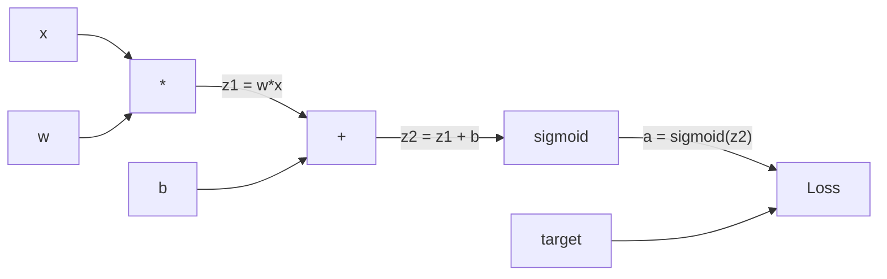
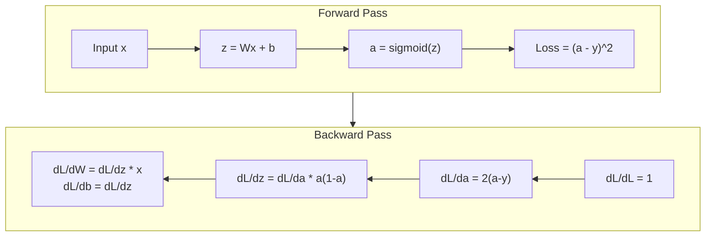
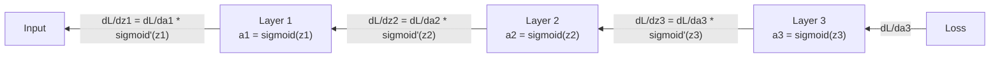

# Отсчет с нуля

> Без него нейронные сети - это просто дорогие генераторы случайных чисел.

**Type:** Build
**Languages:** Python
**Prerequisites:** Lesson 03.02 (Multi-Layer Networks)
**Time:** ~120 minutes

## Цели обучения

- Внедрить автограду на основе ценностей, который создает вычислительный график и вычисляет градиенты с помощью топологического сортирования
- Выводите обратный проход для добавления, умножения и сигмоиды с использованием правила цепочки
- Обучайте многослойную сеть на XOR и классификации кругов с использованием только вашего двигателя обратного распространения с нуля
- Определите проблему исчезающего градиента в глубоких сигмоидных сетях и объясните, почему градиенты сокращаются экспоненциально

## Проблема

У вашей сети есть один скрытый слой с 768 входами и 3072 выходами. Это 2 359 296 весов. Это сделал неправильное предсказание. Какие весы вызвали ошибку?

Наивный подход: взять один вес, подтолкнуть его на небольшую сумму, снова пробежать вперед, измерить, поднялся ли потеря или не. Это дает вам градиент для этого веса. Теперь делайте это для каждого веса в сети. Умножьте тысячами тренировочных шагов и миллионами точек данных. Вам понадобится геологическое время, чтобы тренировать что-то полезное.

Это решение, которое мы можем решить. Один проход вперед, один проход в обратном направлении, все градиенты вычислены.

## Концепция

### Правило "цепочка" применимо к сетям

Вы видели правило цепи в Фазе 01, Урок 05. Быстро резюмировать: если y = f(g(x)), то dy/dx = f'(g(x)) * g'(x. Вы умножаете производные по цепи.

В нейронной сети "цепочка" - это последовательность операций от ввода до потери. Каждый слой применяет весы, добавляет предвзятости, проходит через активацию.

### Вычислительные графики

Каждый проход вперед создает график. Каждый узел является операцией (множение, добавление, сигмоид). Каждый край несет значение вперед и градиент назад.



Проход вперед: значения течет с лева на право. x и w дают z1 = w*x. Добавьте b, чтобы получить z2. Сигмоид дает активацию a. Сравните a с целевой y с помощью функции потерь.

Переход назад: градиенты течет направо-налево. Начните с dL/da (как изменяется потеря с активацией). Умножьте на da/dz2 (сигмоидный производ). Это дает dL/dz2. Разделите на dL/dz2 (что равно dL/dz2, так как z2 = z1 + b) и dL/dz1.

Каждый узел в графике имеет одну задачу во время обратного прохода: взять градиент, приходящий сверху, умножить на его локальную производную и передать ее вниз.

### Вперед против назад



Передний проход хранит все промежуточные значения: z, a, вводы в каждый слой.

### Постепенный поток через сеть

Для трехслойной сети, цепь градиентов через каждый слой:



На каждом слое градиент умножается на сигмоидный производ. Сигмоидный производ является * (1 - а), который достигает максимума 0,25 (когда a = 0,5).

### Избавление от градиентов

Это проблема исчезающего градиента. Сигмоид сдавливает его выход между 0 и 1. Его производный всегда меньше 0,25.

```
sigmoid(z):     Output range [0, 1]
sigmoid'(z):    Max value 0.25 (at z = 0)

After 5 layers:   gradient * 0.25^5 = 0.001x original
After 10 layers:  gradient * 0.25^10 = 0.000001x original
```

Именно поэтому глубокие сети сигмоидов практически невозможно обучить. Реакция - ReLU и его варианты - является предметом урока 04. Пока понимаете, что backprop работает идеально. Проблема в том, что он работает через.

### Вывод градиентов для двухслойной сети

Конкретные математики для сети с вводом x, скрытым слоем с сигмоидом, выходном слоем с сигмоидом и потерей MSE.

Пропуск вперед:
```
z1 = W1 * x + b1
a1 = sigmoid(z1)
z2 = W2 * a1 + b2
a2 = sigmoid(z2)
L = (a2 - y)^2
```

Отступление назад (применение правила цепочки шаг за шагом):
```
dL/da2 = 2(a2 - y)
da2/dz2 = a2 * (1 - a2)
dL/dz2 = dL/da2 * da2/dz2 = 2(a2 - y) * a2 * (1 - a2)

dL/dW2 = dL/dz2 * a1
dL/db2 = dL/dz2

dL/da1 = dL/dz2 * W2
da1/dz1 = a1 * (1 - a1)
dL/dz1 = dL/da1 * da1/dz1

dL/dW1 = dL/dz1 * x
dL/db1 = dL/dz1
```

Каждый градиент - это продукт местных производных, прослеживаемых после потери.

```figure
backprop-vanishing
```

## Создайте его

### Шаг 1: Узел значения

Каждое число в нашем вычислении становится значением. Оно хранит свои данные, его градиент и то, как оно было создано (так что оно знает, как вычислять градиенты назад).

```python
class Value:
    def __init__(self, data, children=(), op=''):
        self.data = data
        self.grad = 0.0
        self._backward = lambda: None
        self._children = set(children)
        self._op = op

    def __repr__(self):
        return f"Value(data={self.data:.4f}, grad={self.grad:.4f})"
```

Пока нет градиента (0,0). Пока нет обратной функции (без работы). `_children`Следить за тем, какие значения создали этот, так что мы можем топологически сортировать график позже.

### Шаг 2: Операции с обратными функциями

Каждая операция создает новую ценность и определяет, как градиенты течет назад через нее.

```python
def __add__(self, other):
    other = other if isinstance(other, Value) else Value(other)
    out = Value(self.data + other.data, (self, other), '+')

    def _backward():
        self.grad += out.grad
        other.grad += out.grad

    out._backward = _backward
    return out

def __mul__(self, other):
    other = other if isinstance(other, Value) else Value(other)
    out = Value(self.data * other.data, (self, other), '*')

    def _backward():
        self.grad += other.data * out.grad
        other.grad += self.data * out.grad

    out._backward = _backward
    return out
```

Для добавления: d(a+b)/da = 1, d(a+b)/db = 1. Так что оба входа получают градиент выхода напрямую.

Для умножения: d(a*b)/da = b, d(a*b)/db = a. Каждый вход получает значение другого в размере выходной градиента.

- Да .`+=`значение может быть использовано в нескольких операциях. его градиент - сумма градиентов от всех путей.

### Третий шаг: Сигмоид и потеря

```python
import math

def sigmoid(self):
    x = self.data
    x = max(-500, min(500, x))
    s = 1.0 / (1.0 + math.exp(-x))
    out = Value(s, (self,), 'sigmoid')

    def _backward():
        self.grad += (s * (1 - s)) * out.grad

    out._backward = _backward
    return out
```

Считается, что в течение пропуска вперед, мы вычислили сигмоид.

```python
def mse_loss(predicted, target):
    diff = predicted + Value(-target)
    return diff * diff
```

MSE для одного выхода: (предсказанное - целевое) ^ 2. Выражаем вычитание как сумма с отрицательной стоимостью.

### Шаг 4: Переход назад

Топологический сортировка обеспечивает обработку узлов в правильном порядке - градиент узла полностью накапливается до того, как мы распространимся через него.

```python
def backward(self):
    topo = []
    visited = set()

    def build_topo(v):
        if v not in visited:
            visited.add(v)
            for child in v._children:
                build_topo(child)
            topo.append(v)

    build_topo(self)
    self.grad = 1.0
    for v in reversed(topo):
        v._backward()
```

Начните с потери (градиент = 1.0, так как dL/dL = 1). Пройдите назад по сортированной графике.`_backward`Получает детей.

### Шаг 5: Склад и сеть

```python
import random

class Neuron:
    def __init__(self, n_inputs):
        scale = (2.0 / n_inputs) ** 0.5
        self.weights = [Value(random.uniform(-scale, scale)) for _ in range(n_inputs)]
        self.bias = Value(0.0)

    def __call__(self, x):
        act = sum((wi * xi for wi, xi in zip(self.weights, x)), self.bias)
        return act.sigmoid()

    def parameters(self):
        return self.weights + [self.bias]


class Layer:
    def __init__(self, n_inputs, n_outputs):
        self.neurons = [Neuron(n_inputs) for _ in range(n_outputs)]

    def __call__(self, x):
        out = [n(x) for n in self.neurons]
        return out[0] if len(out) == 1 else out

    def parameters(self):
        params = []
        for n in self.neurons:
            params.extend(n.parameters())
        return params


class Network:
    def __init__(self, sizes):
        self.layers = []
        for i in range(len(sizes) - 1):
            self.layers.append(Layer(sizes[i], sizes[i + 1]))

    def __call__(self, x):
        for layer in self.layers:
            x = layer(x)
            if not isinstance(x, list):
                x = [x]
        return x[0] if len(x) == 1 else x

    def parameters(self):
        params = []
        for layer in self.layers:
            params.extend(layer.parameters())
        return params

    def zero_grad(self):
        for p in self.parameters():
            p.grad = 0.0
```

Нейрон принимает входы, вычисляет взвешенную сумму + предвзятость и применяет сигмоид.`parameters()`метод собирает все учимые ценности, чтобы мы могли их обновлять.

### Шаг 6: Поезд на XOR

```python
random.seed(42)
net = Network([2, 4, 1])

xor_data = [
    ([0.0, 0.0], 0.0),
    ([0.0, 1.0], 1.0),
    ([1.0, 0.0], 1.0),
    ([1.0, 1.0], 0.0),
]

learning_rate = 1.0

for epoch in range(1000):
    total_loss = Value(0.0)
    for inputs, target in xor_data:
        x = [Value(i) for i in inputs]
        pred = net(x)
        loss = mse_loss(pred, target)
        total_loss = total_loss + loss

    net.zero_grad()
    total_loss.backward()

    for p in net.parameters():
        p.data -= learning_rate * p.grad

    if epoch % 100 == 0:
        print(f"Epoch {epoch:4d} | Loss: {total_loss.data:.6f}")

print("\nXOR Results:")
for inputs, target in xor_data:
    x = [Value(i) for i in inputs]
    pred = net(x)
    print(f"  {inputs} -> {pred.data:.4f} (expected {target})")
```

От случайных прогнозов до корректировки выходов XOR, полностью обусловленных градиентами вычислительной обратной просочкой и толчком веса в правильном направлении.

### Шаг 7: Классификация кругов

В уроке 02, вы настроили весы для классификации кругов.

```python
random.seed(7)

def generate_circle_data(n=100):
    data = []
    for _ in range(n):
        x1 = random.uniform(-1.5, 1.5)
        x2 = random.uniform(-1.5, 1.5)
        label = 1.0 if x1 * x1 + x2 * x2 < 1.0 else 0.0
        data.append(([x1, x2], label))
    return data

circle_data = generate_circle_data(80)

circle_net = Network([2, 8, 1])
learning_rate = 0.5

for epoch in range(2000):
    random.shuffle(circle_data)
    total_loss_val = 0.0
    for inputs, target in circle_data:
        x = [Value(i) for i in inputs]
        pred = circle_net(x)
        loss = mse_loss(pred, target)
        circle_net.zero_grad()
        loss.backward()
        for p in circle_net.parameters():
            p.data -= learning_rate * p.grad
        total_loss_val += loss.data

    if epoch % 200 == 0:
        correct = 0
        for inputs, target in circle_data:
            x = [Value(i) for i in inputs]
            pred = circle_net(x)
            predicted_class = 1.0 if pred.data > 0.5 else 0.0
            if predicted_class == target:
                correct += 1
        accuracy = correct / len(circle_data) * 100
        print(f"Epoch {epoch:4d} | Loss: {total_loss_val:.4f} | Accuracy: {accuracy:.1f}%")
```

Мы используем онлайн SGD здесь - обновление веса после каждой образцы вместо накопления всей партии. Это быстрее нарушает симметрию и избегает сигмоидной насыщения на пейзаже полного потерь. Смешивание данных в каждой эпохе препятствует сети запоминать порядок.

Нет ручного настройки. Сеть открывает круглые границы решения сама по себе. Это сила обратной распространения: вы определяете архитектуру, функцию потерь и данные. Алгоритм определяет весы.

## Используйте его

PyTorch делает все выше в нескольких строках. Основная идея идентична - автоград создает вычислительный график во время прохождения вперед и отслеживает его назад для вычисливания градиентов.

```python
import torch
import torch.nn as nn

model = nn.Sequential(
    nn.Linear(2, 4),
    nn.Sigmoid(),
    nn.Linear(4, 1),
    nn.Sigmoid(),
)
optimizer = torch.optim.SGD(model.parameters(), lr=1.0)
criterion = nn.MSELoss()

X = torch.tensor([[0,0],[0,1],[1,0],[1,1]], dtype=torch.float32)
y = torch.tensor([[0],[1],[1],[0]], dtype=torch.float32)

for epoch in range(1000):
    pred = model(X)
    loss = criterion(pred, y)
    optimizer.zero_grad()
    loss.backward()
    optimizer.step()

print("PyTorch XOR Results:")
with torch.no_grad():
    for i in range(4):
        pred = model(X[i])
        print(f"  {X[i].tolist()} -> {pred.item():.4f} (expected {y[i].item()})")
```

`loss.backward()`- Это твой .`total_loss.backward()`- Я не знаю .`optimizer.step()`Это ваш справочник.`p.data -= lr * p.grad`- Я не знаю .`optimizer.zero_grad()`- Это твой .`net.zero_grad()`PyTorch управляет ускорением GPU, смешанной точностью, пробегом градиента и сотнями типов слоев.

Тренировка запускает проход вперед, затем проход в обратную сторону, затем обновляет весы. Инференция проходит только вперед. Никаких градиентов, никаких обновлений. Это различие имеет значение, потому что вывод - это то, что происходит в производстве. Когда вы звоните API, как Клод или GPT, вы делаете вывод - ваш запрос проходит вперед через сеть, и токены выходят с другого конца. Не меняется вес. Понимание о заднем положении имеет значение, потому что оно формировало каждый вес в этой сети.

## Погрузи его

Этот урок дает результаты:
- `outputs/prompt-gradient-debugger.md`-- повторное использование для диагностики проблем с градиентами (исчезновение, взрыв, NaN) в любой нейронной сети

## Упражнения

1. Добавьте `__sub__`Затем внедрить `__neg__`Проверьте правильность градиентов, сравнивая с ручным расчетом для простого выражения (a - b) ^ 2.

2. Добавьте `relu`Сравните скорость конвергенции. Вы должны увидеть более быстрый тренинг - это предварительный просмотр урока 04.

3. Реализация `__pow__`Метод на значение для целых величин. Используйте его для замены `mse_loss`с правильным `(predicted - target) ** 2`Проверьте, что градиенты соответствуют оригинальной реализации.

4. Добавить нагрузку на скрещивание нагрузки: после вызова `backward()`Вы можете прокрутить все градиенты до [-1, 1]. Вы можете прокрутить более глубокую сеть (с сигмоидом более 4 слоев) и сравнить кривые потерь с и без резки.

5. Создайте визуализацию: после тренировки на XOR, напечатайте градиент каждого параметра в сети. Определите, какой слой имеет наименьшие градиенты. Это демонстрирует проблему с исчезающим градиентом, о которой вы читали в разделе Концепция.

## Ключевые условия

| Term | What people say | What it actually means |
|------|----------------|----------------------|
| Backpropagation | "The network learns" | An algorithm that computes dL/dw for every weight by applying the chain rule backward through the computational graph |
| Computational graph | "The network structure" | A directed acyclic graph where nodes are operations and edges carry values (forward) and gradients (backward) |
| Chain rule | "Multiply the derivatives" | If y = f(g(x)), then dy/dx = f'(g(x)) * g'(x) -- the mathematical foundation of backpropagation |
| Gradient | "The direction of steepest ascent" | The partial derivative of the loss with respect to a parameter -- tells you how to change that parameter to reduce the loss |
| Vanishing gradient | "Deep networks don't learn" | Gradients shrink exponentially as they propagate through layers with saturating activations like sigmoid |
| Forward pass | "Running the network" | Computing the output from inputs by sequentially applying each layer's operations and storing intermediate values |
| Backward pass | "Computing gradients" | Traversing the computational graph in reverse, accumulating gradients at each node using the chain rule |
| Learning rate | "How fast it learns" | A scalar that controls the step size when updating weights: w_new = w_old - lr * gradient |
| Topological sort | "The right order" | An ordering of graph nodes where each node appears after all nodes it depends on -- ensures gradients are fully accumulated before propagation |
| Autograd | "Automatic differentiation" | A system that builds computational graphs during forward computation and automatically computes gradients -- what PyTorch's engine does |

## Дальнейшее чтение

- Rumelhart, Hinton & Williams, "Учиться представления путем обратной пропаганды ошибок" (1986) - статья, которая сделала обратной пропаганды основным и разблокированного многослойного сетевого обучения
- 3Blue1Brown, серия "Нейронные сети" (https://www.youtube.com/playlist?list=PLZHQObOWTQDNU6R1_67000Dx_ZCJB-3pi) -- лучшее визуальное объяснение обратного распространения и поток градиента через сети
