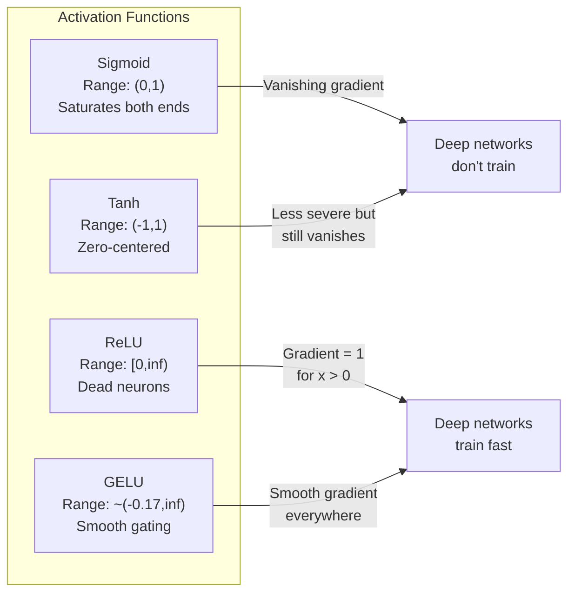
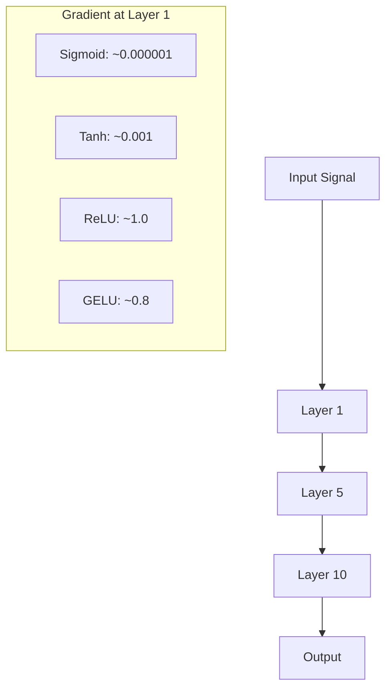
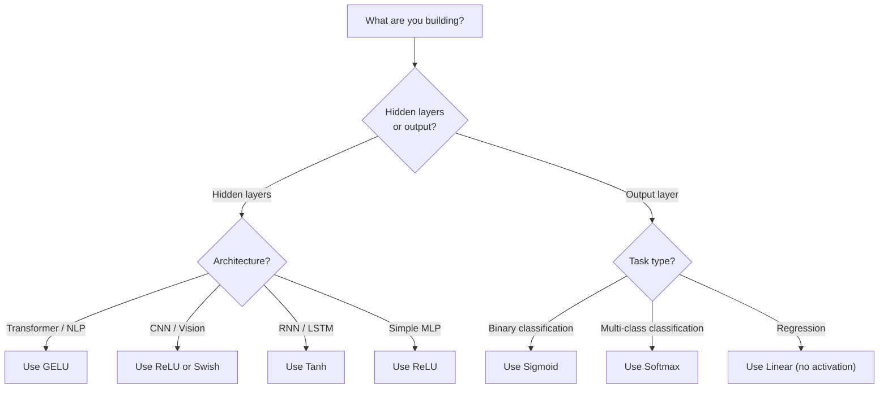

# Функции активации

> Без нелинейности ваша 100-слойная сеть — это навороченное матричное умножение. Активации — это врата, позволяющие нейронным сетям мыслить кривыми.

**Type:** Build
**Languages:** Python
**Prerequisites:** Урок 03.03 (Обратное распространение ошибки)
**Time:** ~75 минут

## Цели обучения

- Реализовать с нуля sigmoid, tanh, ReLU, Leaky ReLU, GELU, Swish и softmax вместе с их производными
- Диагностировать проблему затухающего градиента, измеряя величину активаций через 10+ слоёв с разными функциями активации
- Обнаружить мёртвые нейроны в сети с ReLU и объяснить, почему GELU избегает этого режима отказа
- Выбрать правильную функцию активации для заданной архитектуры (transformer, CNN, RNN, выходной слой)

## Проблема

Сложите два линейных преобразования: y = W2(W1x + b1) + b2. Раскройте это: y = W2W1x + W2b1 + b2. Это просто y = Ax + c — единственное линейное преобразование. Сколько бы линейных слоёв вы ни складывали, результат схлопывается в одно матричное умножение. Ваша 100-слойная сеть обладает той же выразительной мощностью, что и один-единственный слой.

Это не теоретическая курьёзность. Это означает, что глубокая линейная сеть буквально не может выучить XOR, не может классифицировать датасет-спираль, не может распознать лицо. Без функций активации глубина — иллюзия.

Функции активации разрушают линейность. Они искажают выход каждого слоя через нелинейную функцию, давая сети возможность изгибать границы решений, аппроксимировать произвольные функции и действительно обучаться. Но выберите неправильную активацию — и ваши градиенты затухнут до нуля (sigmoid в глубоких сетях), взорвутся до бесконечности (неограниченные активации без тщательной инициализации) или ваши нейроны умрут навсегда (ReLU с большими отрицательными смещениями). Выбор функции активации напрямую определяет, обучится ли ваша сеть вообще.

## Концепция

### Почему нелинейность необходима

Матричное умножение композируемо. Умножение вектора на матрицу A, а затем на матрицу B, идентично умножению на AB. Это значит, что наложение десяти линейных слоёв математически эквивалентно одному линейному слою с одной большой матрицей. Все эти параметры, вся эта глубина — впустую. Вам нужно что-то, что разорвёт цепочку. Именно это и делают функции активации.

Вот доказательство. Линейный слой вычисляет f(x) = Wx + b. Сложим два:

```
Layer 1: h = W1 * x + b1
Layer 2: y = W2 * h + b2
```

Подставим:

```
y = W2 * (W1 * x + b1) + b2
y = (W2 * W1) * x + (W2 * b1 + b2)
y = A * x + c
```

Один слой. Вставим нелинейную активацию g() между слоями:

```
h = g(W1 * x + b1)
y = W2 * h + b2
```

Теперь подстановка не работает. W2 * g(W1 * x + b1) + b2 нельзя свести к единственному линейному преобразованию. Сеть может представлять нелинейные функции. Каждый дополнительный слой с активацией добавляет выразительную способность.

### Sigmoid

Изначальная функция активации для нейронных сетей.

```
sigmoid(x) = 1 / (1 + e^(-x))
```

Диапазон выходных значений: (0, 1). Гладкая, дифференцируемая, отображает любое вещественное число в значение, похожее на вероятность.

Производная:

```
sigmoid'(x) = sigmoid(x) * (1 - sigmoid(x))
```

Максимальное значение этой производной равно 0,25 и достигается при x = 0. При обратном распространении градиенты перемножаются через слои. Десять слоёв sigmoid означают, что градиент умножается не более чем на 0,25 десять раз подряд:

```
0.25^10 = 0.000000953674
```

Менее одной миллионной от исходного сигнала. Это проблема затухающего градиента. Градиенты в ранних слоях становятся настолько малы, что веса едва обновляются. Кажется, что сеть обучается — потеря уменьшается в поздних слоях, — но первые слои заморожены. Глубокие сети с sigmoid попросту не обучаются.

Дополнительная проблема: выходы sigmoid всегда положительны (от 0 до 1), а значит, градиенты по весам всегда одного знака. Это вызывает зигзагообразное движение при градиентном спуске.

### Tanh

Центрированная версия sigmoid.

```
tanh(x) = (e^x - e^(-x)) / (e^x + e^(-x))
```

Диапазон выходных значений: (-1, 1). Центрирована относительно нуля, что устраняет проблему зигзага.

Производная:

```
tanh'(x) = 1 - tanh(x)^2
```

Максимальная производная равна 1,0 при x = 0 — в четыре раза лучше, чем у sigmoid. Но проблема затухающего градиента по-прежнему существует. Для больших положительных или отрицательных входов производная стремится к нулю. Десять слоёв по-прежнему подавляют градиент, просто менее агрессивно.

### ReLU: прорыв

Rectified Linear Unit (выпрямленная линейная единица). Популяризирована для глубокого обучения Наиром и Хинтоном в 2010 году (сама функция восходит к работе Фукусимы 1969 года), она изменила всё.

```
relu(x) = max(0, x)
```

Диапазон выходных значений: [0, бесконечность). Производная тривиально проста:

```
relu'(x) = 1  if x > 0
            0  if x <= 0
```

Нет затухания градиента для положительных входов. Градиент ровно 1, передаётся без изменений. Именно поэтому глубокие сети стали обучаемыми — ReLU сохраняет величину градиента через слои.

Но существует режим отказа: проблема мёртвых нейронов. Если взвешенный вход нейрона всегда отрицателен (из-за большого отрицательного смещения или неудачной инициализации весов), его выход всегда равен нулю, его градиент всегда равен нулю, и он никогда не обновляется. Он навсегда мёртв. На практике 10-40% нейронов в сети с ReLU могут погибнуть в процессе обучения.

### Leaky ReLU

Простейшее исправление проблемы мёртвых нейронов.

```
leaky_relu(x) = x        if x > 0
                alpha * x if x <= 0
```

Где alpha — небольшая константа, обычно 0,01. На отрицательной стороне есть небольшой наклон вместо нуля, поэтому мёртвые нейроны всё же получают сигнал градиента и могут восстановиться.

### GELU: современный выбор по умолчанию

Gaussian Error Linear Unit (гауссова линейная единица с функцией ошибок). Представлена Хендриксом и Гимпелем в 2016 году. Активация по умолчанию в BERT, GPT и большинстве современных трансформеров.

```
gelu(x) = x * Phi(x)
```

Где Phi(x) — кумулятивная функция распределения стандартного нормального распределения. Аппроксимация, используемая на практике:

```
gelu(x) ~= 0.5 * x * (1 + tanh(sqrt(2/pi) * (x + 0.044715 * x^3)))
```

GELU гладкая повсюду, допускает небольшие отрицательные значения (в отличие от ReLU, который жёстко обрезает до нуля), и имеет вероятностную интерпретацию: она взвешивает каждый вход по тому, насколько вероятно, что он положителен при гауссовом распределении. Это плавное гейтирование превосходит ReLU в архитектурах трансформеров, поскольку обеспечивает лучший поток градиента и полностью избегает проблемы мёртвых нейронов.

### Swish / SiLU

Самогейтируемая активация, обнаруженная Рамачандраном и соавторами в 2017 году путём автоматизированного поиска.

```
swish(x) = x * sigmoid(x)
```

Swish формально записывается как x * sigmoid(x). Google обнаружила её через автоматизированный поиск по пространству функций активации — нейронная сеть, проектирующая части нейронных сетей.

Как и GELU, она гладкая, немонотонная и допускает небольшие отрицательные значения. Различие тонкое: Swish использует sigmoid для гейтирования, а GELU — гауссову функцию распределения. На практике производительность почти идентична. Swish используется в EfficientNet и некоторых моделях для работы с изображениями. GELU доминирует в языковых моделях.

### Softmax: выходная активация

Не используется в скрытых слоях. Softmax преобразует вектор сырых оценок (логитов) в распределение вероятностей.

```
softmax(x_i) = e^(x_i) / sum(e^(x_j) for all j)
```

Каждый выход находится между 0 и 1. Сумма всех выходов равна 1. Это делает её стандартной финальной активацией для многоклассовой классификации. Наибольший логит получает наивысшую вероятность, но в отличие от argmax, softmax дифференцируема и сохраняет информацию об относительной уверенности.

### Сравнение форм



### Сравнение потока градиента



### Какую активацию когда использовать



```figure
softmax-temperature
```

## Реализация

### Шаг 1: Реализуйте все функции активации с производными

Каждая функция принимает одно число с плавающей точкой и возвращает число с плавающей точкой. Каждая функция производной принимает тот же вход и возвращает градиент.

```python
import math

def sigmoid(x):
    x = max(-500, min(500, x))
    return 1.0 / (1.0 + math.exp(-x))

def sigmoid_derivative(x):
    s = sigmoid(x)
    return s * (1 - s)

def tanh_act(x):
    return math.tanh(x)

def tanh_derivative(x):
    t = math.tanh(x)
    return 1 - t * t

def relu(x):
    return max(0.0, x)

def relu_derivative(x):
    return 1.0 if x > 0 else 0.0

def leaky_relu(x, alpha=0.01):
    return x if x > 0 else alpha * x

def leaky_relu_derivative(x, alpha=0.01):
    return 1.0 if x > 0 else alpha

def gelu(x):
    return 0.5 * x * (1 + math.tanh(math.sqrt(2 / math.pi) * (x + 0.044715 * x ** 3)))

def gelu_derivative(x):
    phi = 0.5 * (1 + math.erf(x / math.sqrt(2)))
    pdf = math.exp(-0.5 * x * x) / math.sqrt(2 * math.pi)
    return phi + x * pdf

def swish(x):
    return x * sigmoid(x)

def swish_derivative(x):
    s = sigmoid(x)
    return s + x * s * (1 - s)

def softmax(xs):
    max_x = max(xs)
    exps = [math.exp(x - max_x) for x in xs]
    total = sum(exps)
    return [e / total for e in exps]
```

### Шаг 2: Визуализируйте, где градиенты умирают

Вычислите градиент в 100 равномерно распределённых точках от -5 до 5. Выведите текстовую гистограмму, показывающую, где градиент каждой активации близок к нулю.

```python
def gradient_scan(name, derivative_fn, start=-5, end=5, n=100):
    step = (end - start) / n
    near_zero = 0
    healthy = 0
    for i in range(n):
        x = start + i * step
        g = derivative_fn(x)
        if abs(g) < 0.01:
            near_zero += 1
        else:
            healthy += 1
    pct_dead = near_zero / n * 100
    print(f"{name:15s}: {healthy:3d} healthy, {near_zero:3d} near-zero ({pct_dead:.0f}% dead zone)")

gradient_scan("Sigmoid", sigmoid_derivative)
gradient_scan("Tanh", tanh_derivative)
gradient_scan("ReLU", relu_derivative)
gradient_scan("Leaky ReLU", leaky_relu_derivative)
gradient_scan("GELU", gelu_derivative)
gradient_scan("Swish", swish_derivative)
```

### Шаг 3: Эксперимент с затухающим градиентом

Пропустите сигнал через прямой проход через N слоёв, используя sigmoid и ReLU. Измерьте, как изменяется величина активации.

```python
import random

def vanishing_gradient_experiment(activation_fn, name, n_layers=10, n_inputs=5):
    random.seed(42)
    values = [random.gauss(0, 1) for _ in range(n_inputs)]

    print(f"\n{name} through {n_layers} layers:")
    for layer in range(n_layers):
        weights = [random.gauss(0, 1) for _ in range(n_inputs)]
        z = sum(w * v for w, v in zip(weights, values))
        activated = activation_fn(z)
        magnitude = abs(activated)
        bar = "#" * int(magnitude * 20)
        print(f"  Layer {layer+1:2d}: magnitude = {magnitude:.6f} {bar}")
        values = [activated] * n_inputs

vanishing_gradient_experiment(sigmoid, "Sigmoid")
vanishing_gradient_experiment(relu, "ReLU")
vanishing_gradient_experiment(gelu, "GELU")
```

### Шаг 4: Детектор мёртвых нейронов

Создайте сеть с ReLU, пропустите через неё случайные входы, подсчитайте, сколько нейронов никогда не срабатывают.

```python
def dead_neuron_detector(n_inputs=5, hidden_size=20, n_samples=1000):
    random.seed(0)
    weights = [[random.gauss(0, 1) for _ in range(n_inputs)] for _ in range(hidden_size)]
    biases = [random.gauss(0, 1) for _ in range(hidden_size)]

    fire_counts = [0] * hidden_size

    for _ in range(n_samples):
        inputs = [random.gauss(0, 1) for _ in range(n_inputs)]
        for neuron_idx in range(hidden_size):
            z = sum(w * x for w, x in zip(weights[neuron_idx], inputs)) + biases[neuron_idx]
            if relu(z) > 0:
                fire_counts[neuron_idx] += 1

    dead = sum(1 for c in fire_counts if c == 0)
    rarely_fire = sum(1 for c in fire_counts if 0 < c < n_samples * 0.05)
    healthy = hidden_size - dead - rarely_fire

    print(f"\nDead Neuron Report ({hidden_size} neurons, {n_samples} samples):")
    print(f"  Dead (never fired):     {dead}")
    print(f"  Barely alive (<5%):     {rarely_fire}")
    print(f"  Healthy:                {healthy}")
    print(f"  Dead neuron rate:       {dead/hidden_size*100:.1f}%")

    for i, c in enumerate(fire_counts):
        status = "DEAD" if c == 0 else "WEAK" if c < n_samples * 0.05 else "OK"
        bar = "#" * (c * 40 // n_samples)
        print(f"  Neuron {i:2d}: {c:4d}/{n_samples} fires [{status:4s}] {bar}")

dead_neuron_detector()
```

### Шаг 5: Сравнение обучения — sigmoid против ReLU против GELU

Обучите одну и ту же двухслойную сеть на датасете «круг» (точки внутри круга = класс 1, снаружи = класс 0) с тремя разными активациями. Сравните скорость сходимости.

```python
def make_circle_data(n=200, seed=42):
    random.seed(seed)
    data = []
    for _ in range(n):
        x = random.uniform(-2, 2)
        y = random.uniform(-2, 2)
        label = 1.0 if x * x + y * y < 1.5 else 0.0
        data.append(([x, y], label))
    return data


class ActivationNetwork:
    def __init__(self, activation_fn, activation_deriv, hidden_size=8, lr=0.1):
        random.seed(0)
        self.act = activation_fn
        self.act_d = activation_deriv
        self.lr = lr
        self.hidden_size = hidden_size

        self.w1 = [[random.gauss(0, 0.5) for _ in range(2)] for _ in range(hidden_size)]
        self.b1 = [0.0] * hidden_size
        self.w2 = [random.gauss(0, 0.5) for _ in range(hidden_size)]
        self.b2 = 0.0

    def forward(self, x):
        self.x = x
        self.z1 = []
        self.h = []
        for i in range(self.hidden_size):
            z = self.w1[i][0] * x[0] + self.w1[i][1] * x[1] + self.b1[i]
            self.z1.append(z)
            self.h.append(self.act(z))

        self.z2 = sum(self.w2[i] * self.h[i] for i in range(self.hidden_size)) + self.b2
        self.out = sigmoid(self.z2)
        return self.out

    def backward(self, target):
        error = self.out - target
        d_out = error * self.out * (1 - self.out)

        for i in range(self.hidden_size):
            d_h = d_out * self.w2[i] * self.act_d(self.z1[i])
            self.w2[i] -= self.lr * d_out * self.h[i]
            for j in range(2):
                self.w1[i][j] -= self.lr * d_h * self.x[j]
            self.b1[i] -= self.lr * d_h
        self.b2 -= self.lr * d_out

    def train(self, data, epochs=200):
        losses = []
        for epoch in range(epochs):
            total_loss = 0
            correct = 0
            for x, y in data:
                pred = self.forward(x)
                self.backward(y)
                total_loss += (pred - y) ** 2
                if (pred >= 0.5) == (y >= 0.5):
                    correct += 1
            avg_loss = total_loss / len(data)
            accuracy = correct / len(data) * 100
            losses.append(avg_loss)
            if epoch % 50 == 0 or epoch == epochs - 1:
                print(f"    Epoch {epoch:3d}: loss={avg_loss:.4f}, accuracy={accuracy:.1f}%")
        return losses


data = make_circle_data()

configs = [
    ("Sigmoid", sigmoid, sigmoid_derivative),
    ("ReLU", relu, relu_derivative),
    ("GELU", gelu, gelu_derivative),
]

results = {}
for name, act_fn, act_d_fn in configs:
    print(f"\n=== Training with {name} ===")
    net = ActivationNetwork(act_fn, act_d_fn, hidden_size=8, lr=0.1)
    losses = net.train(data, epochs=200)
    results[name] = losses

print("\n=== Final Loss Comparison ===")
for name, losses in results.items():
    print(f"  {name:10s}: start={losses[0]:.4f} -> end={losses[-1]:.4f} (improvement: {(1 - losses[-1]/losses[0])*100:.1f}%)")
```

## Применение

PyTorch предоставляет все эти функции как в функциональном виде, так и в виде модулей:

```python
import torch
import torch.nn as nn
import torch.nn.functional as F

x = torch.randn(4, 10)

relu_out = F.relu(x)
gelu_out = F.gelu(x)
sigmoid_out = torch.sigmoid(x)
swish_out = F.silu(x)

logits = torch.randn(4, 5)
probs = F.softmax(logits, dim=1)

model = nn.Sequential(
    nn.Linear(10, 64),
    nn.GELU(),
    nn.Linear(64, 32),
    nn.GELU(),
    nn.Linear(32, 5),
)
```

Скрытые слои в трансформере: GELU. Скрытые слои в CNN: ReLU. Выходной слой для классификации: softmax. Выходной слой для регрессии: без активации (линейный). Выходной слой для вероятностей: sigmoid. Вот и всё. Начинайте с этих значений по умолчанию. Меняйте их только тогда, когда у вас есть для этого основания.

RNN и LSTM используют tanh для скрытого состояния и sigmoid для вентилей (gates), но если вы сегодня строите что-то с нуля, вы, вероятно, не используете RNN. Если нейроны умирают в вашей сети с ReLU, переключитесь на GELU. Не прибегайте к Leaky ReLU без конкретной причины — GELU решает проблему мёртвых нейронов и обеспечивает лучший поток градиента.

## Что сдать

Этот урок производит:
- `outputs/prompt-activation-selector.md` — переиспользуемый промпт, который помогает выбрать правильную функцию активации для любой архитектуры

## Упражнения

1. Реализуйте Parametric ReLU (PReLU), где отрицательный наклон alpha является обучаемым параметром. Обучите его на датасете «круг» и сравните с фиксированным Leaky ReLU.

2. Проведите эксперимент с затухающим градиентом с 50 слоями вместо 10. Постройте график величины на каждом слое для sigmoid, tanh, ReLU и GELU. На каком слое сигнал каждой активации фактически достигает нуля?

3. Реализуйте ELU (Exponential Linear Unit): elu(x) = x, если x > 0, alpha * (e^x - 1), если x <= 0. Сравните её частоту мёртвых нейронов с ReLU на одной и той же сети.

4. Постройте «монитор здоровья градиента», работающий во время обучения: на каждой эпохе вычисляйте среднюю величину градиента на каждом слое. Выводите предупреждение, когда градиент какого-либо слоя падает ниже 0,001 или превышает 100.

5. Измените сравнение обучения, используя датасет XOR из Урока 01 вместо кругов. Какая активация сходится быстрее всего на XOR? Почему это отличается от результатов на кругах?

## Ключевые термины

| Термин | Что говорят люди | Что это на самом деле означает |
|------|----------------|----------------------|
| Функция активации | «Нелинейная часть» | Функция, применяемая к выходу каждого нейрона, которая разрушает линейность, позволяя сети обучаться нелинейным отображениям |
| Затухающий градиент | «Градиенты исчезают в глубоких сетях» | Градиенты уменьшаются экспоненциально через слои, когда производная активации меньше 1, что делает ранние слои необучаемыми |
| Взрывающийся градиент | «Градиенты взрываются» | Градиенты растут экспоненциально через слои, когда эффективный множитель превышает 1, что вызывает нестабильность обучения |
| Мёртвый нейрон | «Нейрон, переставший обучаться» | Нейрон с ReLU, вход которого постоянно отрицателен, что производит нулевой выход и нулевой градиент |
| Sigmoid | «Сжимает значения в диапазон 0-1» | Логистическая функция 1/(1+e^-x), исторически важная, но вызывающая затухание градиента в глубоких сетях |
| ReLU | «Обрезает отрицательные значения до нуля» | max(0, x) — активация, сделавшая глубокое обучение практичным благодаря сохранению величины градиента |
| GELU | «Активация трансформеров» | Gaussian Error Linear Unit, гладкая активация, взвешивающая входы по вероятности того, что они положительны |
| Swish/SiLU | «Самогейтируемый ReLU» | x * sigmoid(x), обнаруженная путём автоматизированного поиска, используется в EfficientNet |
| Softmax | «Превращает оценки в вероятности» | Нормализует вектор логитов в распределение вероятностей, где все значения находятся в (0,1) и в сумме дают 1 |
| Leaky ReLU | «ReLU, который не умирает» | max(alpha*x, x), где alpha мало (0,01), предотвращает мёртвые нейроны, допуская небольшие отрицательные градиенты |
| Насыщение | «Плоская часть sigmoid» | Области, где производная активации стремится к нулю, блокируя поток градиента |
| Логит | «Сырая оценка перед softmax» | Ненормализованный выход финального слоя перед применением softmax или sigmoid |

## Дополнительное чтение

- Nair & Hinton, "Rectified Linear Units Improve Restricted Boltzmann Machines" (2010) — статья, представившая ReLU и позволившая обучать глубокие сети
- Hendrycks & Gimpel, "Gaussian Error Linear Units (GELUs)" (2016) — представила функцию активации, ставшую стандартной для трансформеров
- Ramachandran et al., "Searching for Activation Functions" (2017) — использовали автоматизированный поиск для обнаружения Swish, показав, что проектирование активаций можно автоматизировать
- Glorot & Bengio, "Understanding the difficulty of training deep feedforward neural networks" (2010) — статья, диагностировавшая проблемы затухающего/взрывающегося градиента и предложившая инициализацию Xavier
- Goodfellow, Bengio, Courville, "Deep Learning", глава 6.3 (https://www.deeplearningbook.org/) — строгое рассмотрение скрытых единиц и функций активации