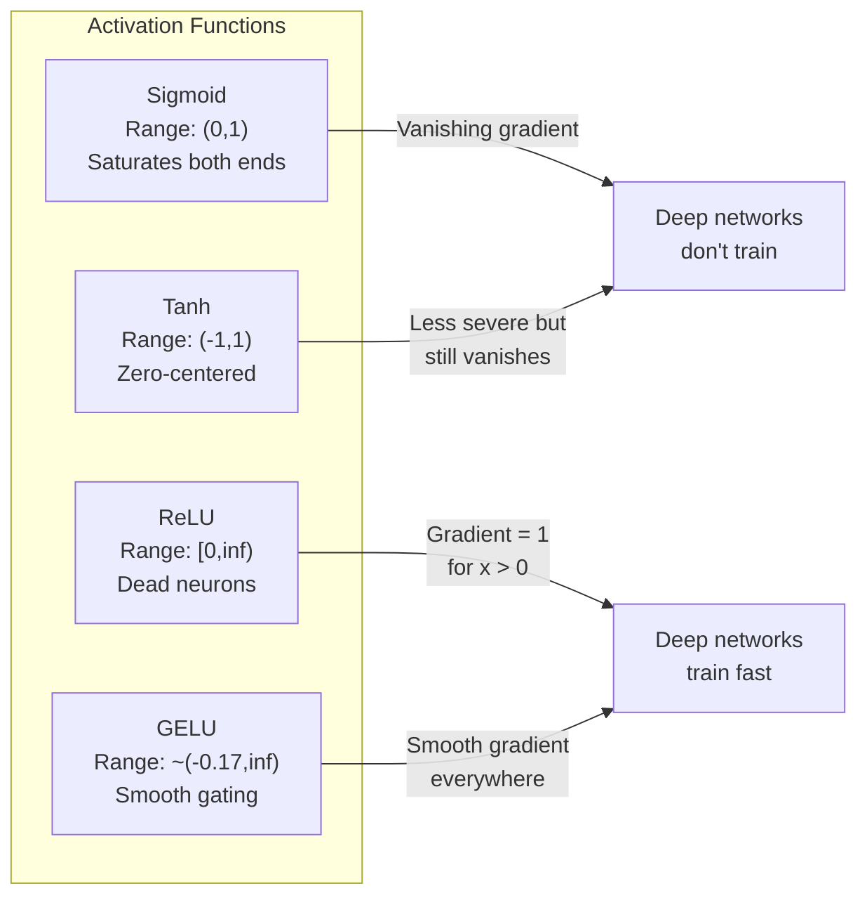
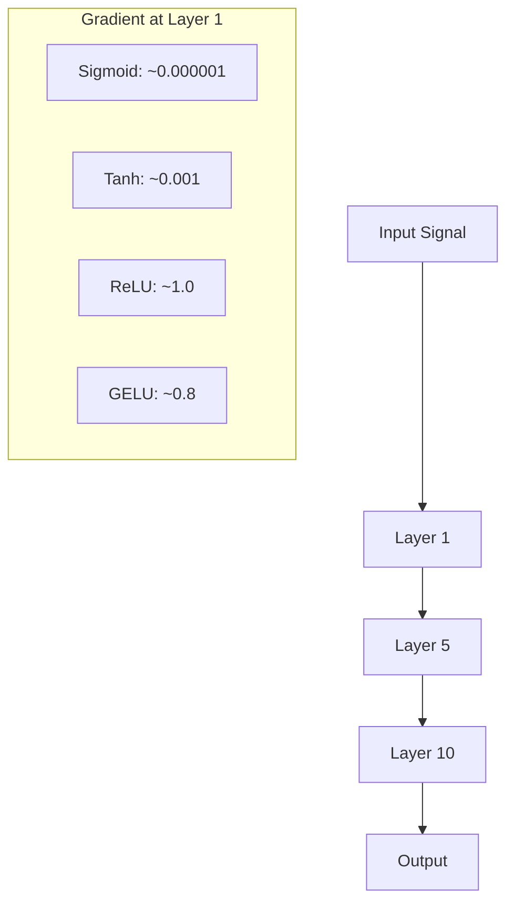
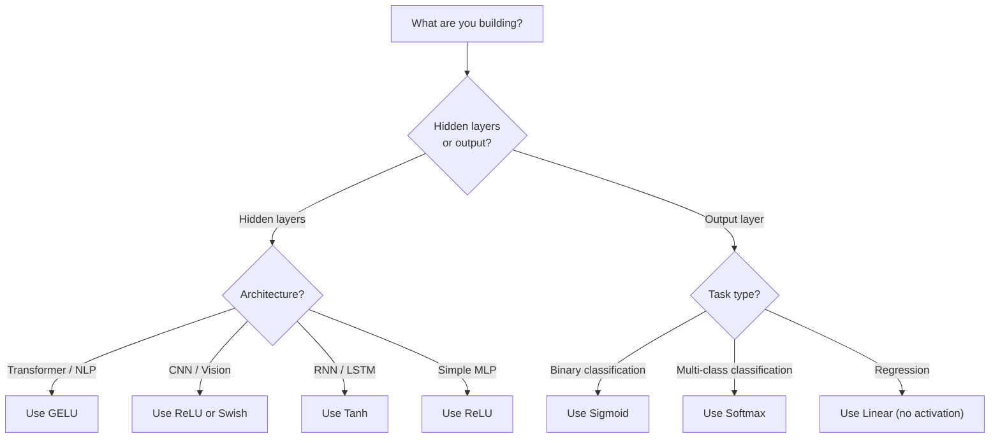

# Функции активации

> Без нелинейности ваша сеть в 100 слоях - это матричное множение.

**Type:** Build
**Languages:** Python
**Prerequisites:** Lesson 03.03 (Backpropagation)
**Time:** ~75 minutes

## Цели обучения

- Внедрить сигмоид, танх, ReLU, Leaky ReLU, GELU, Swish и softmax с их производными с нуля
- Диагностировать проблему с исчезающим градиентом путем измерения величин активации через 10+ слоев с различными активациями
- Выявление мертвых нейронов в сети ReLU и объяснение , почему GELU избегает этого режима неисправности
- Выберите правильную функцию активации для данной архитектуры (трансформатор, CNN, RNN, выходной слой)

## Проблема

Складывайте две линейные преобразования: y = W2(W1x + b1) + b2. Расширите их: y = W2W1x + W2b1 + b2. Это просто y = Ax + c - одна линейная преобразование. Независимо от того, сколько линейных слоев вы собираете, результат разрушается до одной матрицы умножается. Ваша 100-слойная сеть имеет такую же репрезентативную силу, как один слой.

Это не теоретическое любопытство. Это означает, что глубокая линейная сеть буквально не может узнать XOR, не может классифицировать спиральный набор данных, не может распознать лицо. Без функций активации глубина - это иллюзия.

Функции активации нарушают линейность. Они деформируют выход каждого слоя через нелинейную функцию, давая сети возможность сгибать границы решения, приблизить произвольные функции и фактически учиться. Но выберите неправильную активацию, и ваши градиенты исчезнут до нуля (сигмоидные в глубоких сетях), взрываются до бесконечности (неограниченные активации без тщательной инициализации), или ваши нейроны умирают постоянно (ReLU с большими отрицательными предвзятостями). Выбор функции активации напрямую определяет, учится ли ваша сеть вообще.

## Концепция

### Почему нелинейная система необходима

Умножение матрицы составляется. Умножение вектора матрицей A, затем матрицей B равно умножению на AB. Это означает, что укладка десяти линейных слоев математически эквивалентна одному линейному слою с одной большой матрицей. Все эти параметры, вся эта глубина - потрачено. Вам нужно что-то, чтобы сломать цепочку.

Вот доказательство. Линейный слой вычисляет f ((x) = Wx + b.

```
Layer 1: h = W1 * x + b1
Layer 2: y = W2 * h + b2
```

Заместитель:

```
y = W2 * (W1 * x + b1) + b2
y = (W2 * W1) * x + (W2 * b1 + b2)
y = A * x + c
```

Один слой. Вставьте нелинейную активацию g() между слоями:

```
h = g(W1 * x + b1)
y = W2 * h + b2
```

Теперь замена ломается. W2 * g(W1 * x + b1) + b2 не может быть сведена к одной линейной трансформации. Сеть может представлять нелинейные функции. Каждый дополнительный слой с активацией добавляет репрезентативную способность.

### Сигмоид

Первоначальная функция активации нейронных сетей.

```
sigmoid(x) = 1 / (1 + e^(-x))
```

Диапазон выпуска: (0, 1). Плохой, дифференцируемый, отображает любое реальное число на вероятностно-подобную величину.

Производственная продукция:

```
sigmoid'(x) = sigmoid(x) * (1 - sigmoid(x))
```

Максимальное значение этого производного составляет 0,25, возникающее при x = 0. При обратном распространении градиенты умножаются через слои.

```
0.25^10 = 0.000000953674
```

Менее чем в миллионную часть оригинального сигнала. Это проблема с исчезающим градиентом. Градиенты в ранних слоях становятся настолько малыми, что весы едва обновляются. Сеть, похоже, учится - потеря уменьшается в более поздних слоях - но первые слои заморожены.

Дополнительная проблема: выходные сигмоиды всегда положительные (0-1), что означает, что градиенты на весах всегда одинаковы.

### Танх

Централизованная версия сигмоида.

```
tanh(x) = (e^x - e^(-x)) / (e^x + e^(-x))
```

Диапазон выпуска: (-1, 1). Центровый нуль, что устраняет проблему зигзага.

Производственная продукция:

```
tanh'(x) = 1 - tanh(x)^2
```

Максимальная производная величина - 1,0 при x = 0 - в четыре раза лучше, чем сигмоид. Но проблема с исчезающим градиентом все еще существует. Для больших положительных или отрицательных входов производная приближается к нулю. десять слоев все еще разбивают градиент, только менее агрессивно.

### Релю: прорыв

Популяризированный для глубокого обучения Найром и Хинтоном в 2010 году (сама функция датируется работой Фукушимы 1969 года), он изменил все.

```
relu(x) = max(0, x)
```

Выходной диапазон: [0, бесконечность).

```
relu'(x) = 1  if x > 0
            0  if x <= 0
```

Нет никакого избавления от градиента для положительных входов. градиент точно 1, прошедший прямо через. Вот почему глубокие сети стали обучаемыми - ReLU сохраняет величину градиента по слоям.

Но есть режим неисправности: проблема мертвых нейронов. Если весенный вход нейрона всегда отрицательный (из-за большого отрицательного предвзятости или несчастной инициализации веса), его выход всегда нулевый, его градиент всегда нулевый, и он никогда не обновляется. Он постоянно мертв.

### Прозрачный релю

Простейший способ излечить мертвые нейроны.

```
leaky_relu(x) = x        if x > 0
                alpha * x if x <= 0
```

Где альфа - это маленькая постоянная, обычно 0,01. Негативная сторона имеет небольшую наклона вместо нуля, поэтому мертвые нейроны все еще получают сигнал градиента и могут восстановиться.

### ГЕЛУ: современный дефолт

Гауссианская ошибочная линейная единица. Внедрена Хендриксом и Гимпелем в 2016 году.

```
gelu(x) = x * Phi(x)
```

где Phi ((x) - кумулятивная функция распределения стандартного нормального распределения. Приближение, используемое на практике:

```
gelu(x) ~= 0.5 * x * (1 + tanh(sqrt(2/pi) * (x + 0.044715 * x^3)))
```

GELU везде гладкий, позволяет иметь небольшие отрицательные значения (в отличие от ReLU, который сжимается до нуля), и имеет вероятностную интерпретацию: он взвешивает каждый вход по вероятности того, что он будет позитивным при гаусианском распределении.

### Свиши / СиЛУ

Самозащитная активация, обнаруженная Рамачандраном и др. в 2017 году посредством автоматического поиска.

```
swish(x) = x * sigmoid(x)
```

Swish формально x * sigmoid (x). Google обнаружил его через автоматический поиск через пространство функций активации - нейронную сеть, проектирующую части нейронных сетей.

Как и GELU, он гладкий, не монотонный и позволяет иметь небольшие отрицательные значения. Разница тонкая: Swish использует sigmoid для гатирования, в то время как GELU использует Gaussian CDF. На практике производительность почти идентична. Swish используется в EfficientNet и некоторых моделях зрения. GELU доминирует в языковых моделях.

### Softmax: Активация выхода

Не используется в скрытых слоях. Softmax преобразует вектор сырых баллов (логит) в распределение вероятности.

```
softmax(x_i) = e^(x_i) / sum(e^(x_j) for all j)
```

Каждый выход находится между 0 и 1. Все выходные суммы до 1. Это делает его стандартной окончательной активацией для классификации многоклассов.

### Сравнение форм



### Сравнение по мере потока



### Какая активация



```figure
softmax-temperature
```

## Создайте его

### Шаг 1: Использование всех функций активации с помощью производных

Каждая функция берет один плавающий и возвращает плавающий.

```python
import math

def sigmoid(x):
    x = max(-500, min(500, x))
    return 1.0 / (1.0 + math.exp(-x))

def sigmoid_derivative(x):
    s = sigmoid(x)
    return s * (1 - s)

def tanh_act(x):
    return math.tanh(x)

def tanh_derivative(x):
    t = math.tanh(x)
    return 1 - t * t

def relu(x):
    return max(0.0, x)

def relu_derivative(x):
    return 1.0 if x > 0 else 0.0

def leaky_relu(x, alpha=0.01):
    return x if x > 0 else alpha * x

def leaky_relu_derivative(x, alpha=0.01):
    return 1.0 if x > 0 else alpha

def gelu(x):
    return 0.5 * x * (1 + math.tanh(math.sqrt(2 / math.pi) * (x + 0.044715 * x ** 3)))

def gelu_derivative(x):
    phi = 0.5 * (1 + math.erf(x / math.sqrt(2)))
    pdf = math.exp(-0.5 * x * x) / math.sqrt(2 * math.pi)
    return phi + x * pdf

def swish(x):
    return x * sigmoid(x)

def swish_derivative(x):
    s = sigmoid(x)
    return s + x * s * (1 - s)

def softmax(xs):
    max_x = max(xs)
    exps = [math.exp(x - max_x) for x in xs]
    total = sum(exps)
    return [e / total for e in exps]
```

### Шаг 2: Представьте себе, где умирают градиенты

Вычислить градиент на 100 равномерных точках от -5 до 5. Напечатать текстовую гистограмму, показывающую, где градиент каждой активации приближается к нулю.

```python
def gradient_scan(name, derivative_fn, start=-5, end=5, n=100):
    step = (end - start) / n
    near_zero = 0
    healthy = 0
    for i in range(n):
        x = start + i * step
        g = derivative_fn(x)
        if abs(g) < 0.01:
            near_zero += 1
        else:
            healthy += 1
    pct_dead = near_zero / n * 100
    print(f"{name:15s}: {healthy:3d} healthy, {near_zero:3d} near-zero ({pct_dead:.0f}% dead zone)")

gradient_scan("Sigmoid", sigmoid_derivative)
gradient_scan("Tanh", tanh_derivative)
gradient_scan("ReLU", relu_derivative)
gradient_scan("Leaky ReLU", leaky_relu_derivative)
gradient_scan("GELU", gelu_derivative)
gradient_scan("Swish", swish_derivative)
```

### Третий шаг: исчезающий эксперимент

Пропускать сигнал через N слоев с помощью сигмоида против ReLU. Измерить, как изменяется величина активации.

```python
import random

def vanishing_gradient_experiment(activation_fn, name, n_layers=10, n_inputs=5):
    random.seed(42)
    values = [random.gauss(0, 1) for _ in range(n_inputs)]

    print(f"\n{name} through {n_layers} layers:")
    for layer in range(n_layers):
        weights = [random.gauss(0, 1) for _ in range(n_inputs)]
        z = sum(w * v for w, v in zip(weights, values))
        activated = activation_fn(z)
        magnitude = abs(activated)
        bar = "#" * int(magnitude * 20)
        print(f"  Layer {layer+1:2d}: magnitude = {magnitude:.6f} {bar}")
        values = [activated] * n_inputs

vanishing_gradient_experiment(sigmoid, "Sigmoid")
vanishing_gradient_experiment(relu, "ReLU")
vanishing_gradient_experiment(gelu, "GELU")
```

### Шаг 4: детектор невронов мертвых

Создайте сеть ReLU, пропускайте случайные входы через нее, подсчитайте, сколько нейронов никогда не запускают.

```python
def dead_neuron_detector(n_inputs=5, hidden_size=20, n_samples=1000):
    random.seed(0)
    weights = [[random.gauss(0, 1) for _ in range(n_inputs)] for _ in range(hidden_size)]
    biases = [random.gauss(0, 1) for _ in range(hidden_size)]

    fire_counts = [0] * hidden_size

    for _ in range(n_samples):
        inputs = [random.gauss(0, 1) for _ in range(n_inputs)]
        for neuron_idx in range(hidden_size):
            z = sum(w * x for w, x in zip(weights[neuron_idx], inputs)) + biases[neuron_idx]
            if relu(z) > 0:
                fire_counts[neuron_idx] += 1

    dead = sum(1 for c in fire_counts if c == 0)
    rarely_fire = sum(1 for c in fire_counts if 0 < c < n_samples * 0.05)
    healthy = hidden_size - dead - rarely_fire

    print(f"\nDead Neuron Report ({hidden_size} neurons, {n_samples} samples):")
    print(f"  Dead (never fired):     {dead}")
    print(f"  Barely alive (<5%):     {rarely_fire}")
    print(f"  Healthy:                {healthy}")
    print(f"  Dead neuron rate:       {dead/hidden_size*100:.1f}%")

    for i, c in enumerate(fire_counts):
        status = "DEAD" if c == 0 else "WEAK" if c < n_samples * 0.05 else "OK"
        bar = "#" * (c * 40 // n_samples)
        print(f"  Neuron {i:2d}: {c:4d}/{n_samples} fires [{status:4s}] {bar}")

dead_neuron_detector()
```

### Шаг 5: Сравнение тренировок - Сигмоид против РЕЛУ против ЖЕЛУ

Обучение одной и той же двухслойной сети на наборе данных круга (точки внутри круга = класс 1, снаружи = класс 0) с тремя различными активациями. Сравните скорость конвергенции.

```python
def make_circle_data(n=200, seed=42):
    random.seed(seed)
    data = []
    for _ in range(n):
        x = random.uniform(-2, 2)
        y = random.uniform(-2, 2)
        label = 1.0 if x * x + y * y < 1.5 else 0.0
        data.append(([x, y], label))
    return data


class ActivationNetwork:
    def __init__(self, activation_fn, activation_deriv, hidden_size=8, lr=0.1):
        random.seed(0)
        self.act = activation_fn
        self.act_d = activation_deriv
        self.lr = lr
        self.hidden_size = hidden_size

        self.w1 = [[random.gauss(0, 0.5) for _ in range(2)] for _ in range(hidden_size)]
        self.b1 = [0.0] * hidden_size
        self.w2 = [random.gauss(0, 0.5) for _ in range(hidden_size)]
        self.b2 = 0.0

    def forward(self, x):
        self.x = x
        self.z1 = []
        self.h = []
        for i in range(self.hidden_size):
            z = self.w1[i][0] * x[0] + self.w1[i][1] * x[1] + self.b1[i]
            self.z1.append(z)
            self.h.append(self.act(z))

        self.z2 = sum(self.w2[i] * self.h[i] for i in range(self.hidden_size)) + self.b2
        self.out = sigmoid(self.z2)
        return self.out

    def backward(self, target):
        error = self.out - target
        d_out = error * self.out * (1 - self.out)

        for i in range(self.hidden_size):
            d_h = d_out * self.w2[i] * self.act_d(self.z1[i])
            self.w2[i] -= self.lr * d_out * self.h[i]
            for j in range(2):
                self.w1[i][j] -= self.lr * d_h * self.x[j]
            self.b1[i] -= self.lr * d_h
        self.b2 -= self.lr * d_out

    def train(self, data, epochs=200):
        losses = []
        for epoch in range(epochs):
            total_loss = 0
            correct = 0
            for x, y in data:
                pred = self.forward(x)
                self.backward(y)
                total_loss += (pred - y) ** 2
                if (pred >= 0.5) == (y >= 0.5):
                    correct += 1
            avg_loss = total_loss / len(data)
            accuracy = correct / len(data) * 100
            losses.append(avg_loss)
            if epoch % 50 == 0 or epoch == epochs - 1:
                print(f"    Epoch {epoch:3d}: loss={avg_loss:.4f}, accuracy={accuracy:.1f}%")
        return losses


data = make_circle_data()

configs = [
    ("Sigmoid", sigmoid, sigmoid_derivative),
    ("ReLU", relu, relu_derivative),
    ("GELU", gelu, gelu_derivative),
]

results = {}
for name, act_fn, act_d_fn in configs:
    print(f"\n=== Training with {name} ===")
    net = ActivationNetwork(act_fn, act_d_fn, hidden_size=8, lr=0.1)
    losses = net.train(data, epochs=200)
    results[name] = losses

print("\n=== Final Loss Comparison ===")
for name, losses in results.items():
    print(f"  {name:10s}: start={losses[0]:.4f} -> end={losses[-1]:.4f} (improvement: {(1 - losses[-1]/losses[0])*100:.1f}%)")
```

## Используйте его

PyTorch предоставляет все эти формы как функциональные, так и модульные:

```python
import torch
import torch.nn as nn
import torch.nn.functional as F

x = torch.randn(4, 10)

relu_out = F.relu(x)
gelu_out = F.gelu(x)
sigmoid_out = torch.sigmoid(x)
swish_out = F.silu(x)

logits = torch.randn(4, 5)
probs = F.softmax(logits, dim=1)

model = nn.Sequential(
    nn.Linear(10, 64),
    nn.GELU(),
    nn.Linear(64, 32),
    nn.GELU(),
    nn.Linear(32, 5),
)
```

Скрытые слои в трансформаторе: GELU. Скрытые слои в CNN: ReLU. Выходной слой для классификации: softmax. Выходной слой для регрессии: нет (линейный). Выходной слой для вероятности: sigmoid. Вот и все. Начните с этих дефолтов. Измените их только тогда, когда у вас есть доказательства.

РНН и ЛСТМ используют танх для скрытого состояния и сигмоид для ворот, но если вы строите с нуля сегодня, вы, вероятно, не используете РНН. Если нейроны умирают в вашей сети ReLU, перейдите на GELU. Не подходите к Leaky ReLU, если у вас нет конкретной причины - GELU решает проблему мертвых нейронов и дает лучший поток градиента.

## Погрузи его

Этот урок дает результаты:
- `outputs/prompt-activation-selector.md`-- повторное использование запроса, который поможет вам выбрать правильную функцию активации для любой архитектуры

## Упражнения

1. Внедрить параметрический ReLU (PReLU), где отрицательный наклон альфа является учимным параметром.

2. Выполните эксперимент с исчезающим градиентом с 50 слоями вместо 10.

3. Используйте ELU (экспоненциальная линейная единица): elu(x) = x, если x > 0, альфа * (e^x - 1) если x <= 0. Сравните его скорость мертвых нейронов с ReLU на той же сети.

4. Создайте "монитор на уровне градиента здоровья", который будет работать во время тренировки: при каждой эпохе вычислите среднюю величину градиента на каждом слое.

5. Изменить сравнение тренировок, чтобы использовать набор данных XOR из урока 01 вместо кругов. Какая активация сближается с XOR наиболее быстро? Почему это отличается от результатов круга?

## Ключевые условия

| Term | What people say | What it actually means |
|------|----------------|----------------------|
| Activation function | "The nonlinear part" | A function applied to each neuron's output that breaks linearity, enabling the network to learn nonlinear mappings |
| Vanishing gradient | "Gradients disappear in deep networks" | Gradients shrink exponentially through layers when the activation's derivative is less than 1, making early layers untrainable |
| Exploding gradient | "Gradients blow up" | Gradients grow exponentially through layers when the effective multiplier exceeds 1, causing unstable training |
| Dead neuron | "A neuron that stopped learning" | A ReLU neuron whose input is permanently negative, producing zero output and zero gradient |
| Sigmoid | "Squishes values to 0-1" | The logistic function 1/(1+e^-x), historically important but causes vanishing gradients in deep networks |
| ReLU | "Clips negatives to zero" | max(0, x) -- the activation that made deep learning practical by preserving gradient magnitude |
| GELU | "The transformer activation" | Gaussian Error Linear Unit, a smooth activation that weights inputs by their probability of being positive |
| Swish/SiLU | "Self-gated ReLU" | x * sigmoid(x), discovered through automated search, used in EfficientNet |
| Softmax | "Turns scores into probabilities" | Normalizes a vector of logits into a probability distribution where all values are in (0,1) and sum to 1 |
| Leaky ReLU | "ReLU that doesn't die" | max(alpha*x, x) where alpha is small (0.01), preventing dead neurons by allowing small negative gradients |
| Saturation | "The flat part of sigmoid" | Regions where an activation's derivative approaches zero, blocking gradient flow |
| Logit | "The raw score before softmax" | The unnormalized output of the final layer before applying softmax or sigmoid |

## Дальнейшее чтение

- Наир и Хинтон, "Предоставленные линейные единицы улучшают ограниченные машины Болцмана" (2010) - статья, внедрившая ReLU и позволяющая обучать глубокие сети
- Хендрикс и Гимпель, "Гаусские ошибочные линейные единицы (GELU) " (2016) -- представили функцию активации, которая стала дефолтом для трансформаторов
- Рамачандран и др., "Поиск функций активации" (2017) -- использовал автоматизированный поиск для обнаружения Swish, показывая, что дизайн активации может быть автоматизированным
- Глорот и Бенгио, "Понимание сложности обучения глубоким обратным сигнальным нейронным сетям" (2010) - статья, которая диагностировала исчезающие/эксплодирующие градиенты и предложила инициирование Xavier
- Добрый товарищ, Бенгио, Курвилл, "Глубокое обучение" Глава 6.3 (https://www.deeplearningbook.org/) -- строгое обращение с скрытыми устройствами и функциями активации
