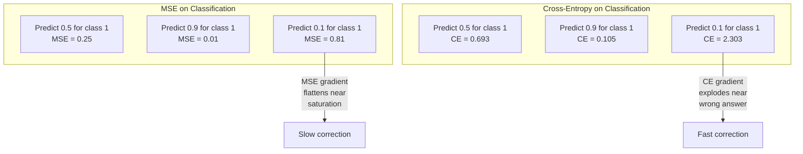
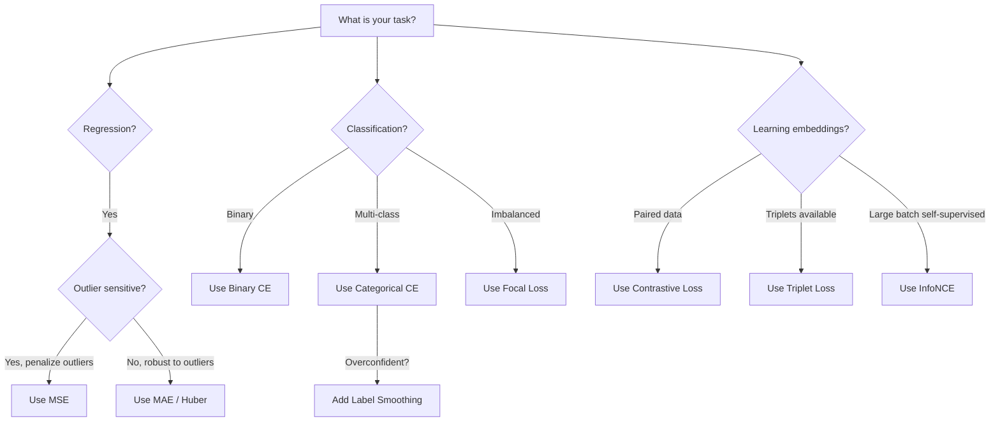
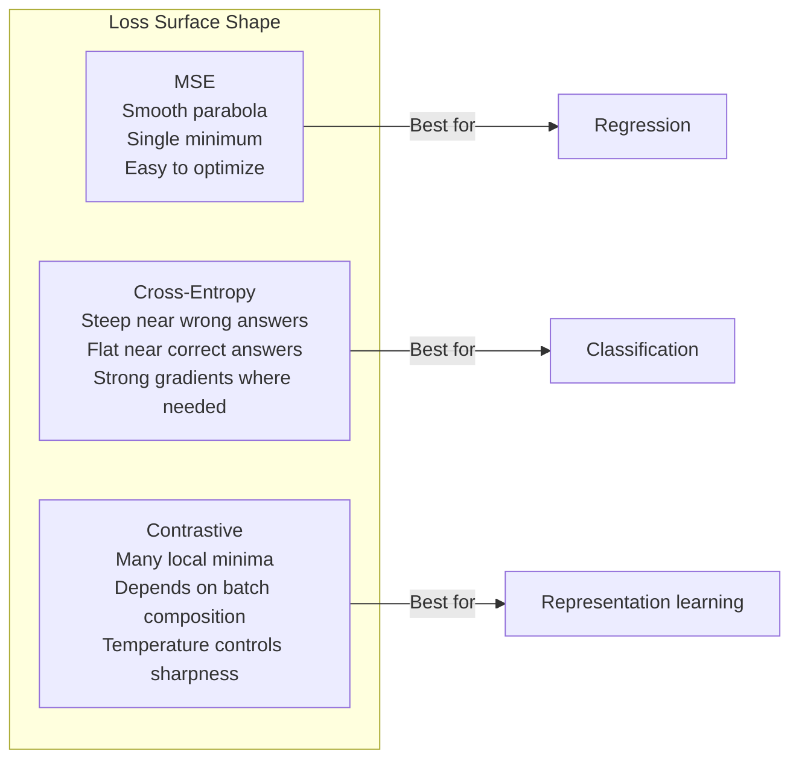

# Потеря функций

> Ваша сеть делает предсказание. Основная правда говорит иначе. Насколько это неправильно? Это число - потеря. Выберите неправильную функцию потерь и ваша модель оптимизирует для неправильной вещи полностью.

**Type:** Build
**Languages:** Python
**Prerequisites:** Lesson 03.04 (Activation Functions)
**Time:** ~75 minutes

## Цели обучения

- Внедрение MSE, бинарной кросс-энтропии, категорической кросс-энтропии и контрастивной потери (InfoNCE) с нуля с их градиентами
- Объясните, почему MSE не может быть классифицирована, демонстрируя режим неудачи "предсказание 0,5 для всего".
- Применить гладкое помещение к кросс-энтропии и описать, как оно предотвращает чрезмерное уверенность в прогнозах
- Выберите правильную функцию потери для регрессии, бинарной классификации, многоклассной классификации и внедрения задач обучения

## Проблема

Модель, которая минимизирует MSE в классификационной проблеме, уверенно предскажет 0,5 для всего. Это минимизирует потери. Это также бесполезно.

Функция потерь - единственное, что на самом деле оптимизирует ваша модель. Не точность. Не в Формуле 1. Не то, что ты сообщаешь своему менеджеру. Оптимизатор принимает градиент функции потери и корректирует весы, чтобы сделать этот номер меньше. Если функция потерь не отражает то, что вам важно, модель найдет математически самый дешевый способ удовлетворить ее, и этот способ почти никогда не является тем, что вы хотели.

Вот конкретный пример. У вас есть задача по двоичной классификации. Два класса, 50/50 разделение. Вы используете МЭС как свой убыток. Модель предсказывает 0,5 за каждый вход. Средний MSE составляет 0,25, что минимально, не зная ничего. Модель не имеет никаких дискриминационных способностей, но технически она свела к минимуму вашу функцию потери. Перейти к кросс-энтропии и та же модель вынуждена толкать прогнозы к 0 или 1, потому что -log(0.5) = 0.693 - это ужасная потеря, в то время как -log(0.99) = 0.01 вознаграждает уверенность в правильных прогнозах. Выбор функции потери - это разница между моделью, которая учится, и моделью, которая играет в метрику.

В самоконтрольном обучении нет даже ярлыков. Контрастная потеря полностью определяет сигнал обучения: что считается схожим, что считается отличным и насколько сильно модель должна их раздвигать. Если контрастная потеря ошибается, ваши встроенные элементы срываются до одной точки - каждая карта входа в один вектор. Технически нулевая потеря. Совершенно бесполезная.

## Концепция

### Средняя квадратная ошибка (MSE)

Вычислить квадратную разницу между прогнозом и целью, средний по всем образцам.

```
MSE = (1/n) * sum((y_pred - y_true)^2)
```

Почему квадратизация имеет значение: это наказывает большие ошибки квадратически. ошибка 2 стоит 4x столько же, как ошибка 1. ошибка 10 стоит 100x. Это делает MSE чувствительной к аномальным - одно безумно неправильное предсказание доминирует потери.

Реальные цифры: если ваша модель прогнозирует цены на жилье и не соответствует $10,000 on most houses but off by $200 000 на одном особняке, MSE будет агрессивно пытаться исправить этот особняк, потенциально повредив производительности на остальных 99 домов.

Грейдент МЭС по отношению к прогнозу:

```
dMSE/dy_pred = (2/n) * (y_pred - y_true)
```

Это функция регрессии (большие ошибки требуют больших коррекций) и ошибка для классификации (вы хотите наказывать уверенные неправильные ответы экспоненциально, а не линейно).

### Потеря кросс-энтропии

Функция потерь для классификации, основанная на теории информации, измеряет расхождение между прогнозируемым распределением вероятности и истинным распределением.

**Binary Cross-Entropy (BCE):**

```
BCE = -(y * log(p) + (1 - y) * log(1 - p))
```

где y - это истинная этикетка (0 или 1) и p - прогнозируемая вероятность.

Почему -log(p) работает: когда истинная этикетка 1 и вы предсказываете p = 0,99, потеря -log(0,99) = 0,01. Когда вы предсказываете p = 0,01, потеря -log(0,01) = 4,6.

Грейдент рассказывает о том же:

```
dBCE/dp = -(y/p) + (1-y)/(1-p)
```

Когда y = 1 и p близко к нулю, градиент составляет -1/p, что приближается к отрицательному бесконечности.

**Categorical Cross-Entropy:**

Для многоклассной классификации с однокодированными целями.

```
CCE = -sum(y_i * log(p_i))
```

Если есть 10 классов и правильный класс получает вероятность 0,1 (случайный выбор), потеря составляет -log(0.1) = 2.3.

### Почему МЭС не может быть классифицирована



Градиенты MSE плоскими, когда прогнозы близки к 0 или 1 (из-за насыщения сигмоида).

### Лейблетные гладкие

Стандартные одноразовые этикетки говорят: "Это 100% класс 3 и 0% все остальное". Это твердое утверждение.

```
smooth_label = (1 - alpha) * one_hot + alpha / num_classes
```

При альфа = 0,1 и 10 классов: вместо [0, 0, 1, 0, ...], цель становится [0, 01, 0, 01, 0, 91, 0, 01, ...].

Почему это работает: модель, пытающаяся выпустить точно 1,0 через softmax, должна подтолкнуть логиты до бесконечности. Это вызывает чрезмерную уверенность, вредит обобщению и делает модель хрупкой для смещения распределения.

### Противопоказательная потеря

Никаких ярлыков, ни классов, просто пары входов и вопрос: похожи ли они или разные?

**SimCLR-style contrastive loss (NT-Xent / InfoNCE):**

Возьмите один изображение. Создайте два дополненных вида (вырубка, вращение, раздражение цвета). Это "позитивная пара" - они должны иметь схожие вкладки. Каждое другое изображение в партии образует "отрицательную пару" - они должны иметь разные вкладки.

```
L = -log(exp(sim(z_i, z_j) / tau) / sum(exp(sim(z_i, z_k) / tau)))
```

Там, где sim() - это сосиновая сходство, z_i и z_j - положительная пара, сумма превышает все отрицательные, а tau (температура) контролирует, насколько резко распределение.

Реальные числа: размер партии 256 означает 255 отрицательных на положительную пару. Температура тау = 0,07 (SimCLR по умолчанию). Утрата выглядит как мягкий максимум по сравнению с схожими - она хочет, чтобы сходство положительной пары было самым высоким среди всех 256 вариантов.

**Triplet Loss:**

Принимает три входа: якорь, положительный (один и тот же класс), отрицательный (разный класс).

```
L = max(0, d(anchor, positive) - d(anchor, negative) + margin)
```

Маржина (обычно 0,2-1.0) обеспечивает минимальный разрыв между положительными и отрицательными расстояниями. Если отрицательная уже достаточно далеко, потеря составляет нуль - никакого градиента, никакого обновления. Это делает тренировку эффективной, но требует тщательного добычи тройных слоев (выбор твердых отрицательных, которые близки к якорям).

### Потеря фокуса

Для неравновешенных наборов данных стандартная кросс-энтропия относится ко всем правильно классифицированным примерам одинаково.

```
FL = -alpha * (1 - p_t)^gamma * log(p_t)
```

где p_t - прогнозируемая вероятность истинного класса, а гамма контролирует фокусировку. при гамма = 0, это стандартная кросс-энтропия. при гамма = 2 (по умолчанию):

- Легкий пример (p_t = 0,9): вес = (0,1) ^2 = 0,01.
- Твердый пример (p_t = 0,1): вес = (0,9) ^2 = 0,81.

Фокальная потеря была введена Лин и др. для обнаружения объектов, где 99% кандидатов регионов являются фоном (легкие отрицательные).

### Дерево решения по потере функции



### Потеря пейзажа



```figure
cross-entropy-loss
```

## Создайте его

### Шаг 1: МЭС и его градиент

```python
def mse(predictions, targets):
    n = len(predictions)
    total = 0.0
    for p, t in zip(predictions, targets):
        total += (p - t) ** 2
    return total / n

def mse_gradient(predictions, targets):
    n = len(predictions)
    grads = []
    for p, t in zip(predictions, targets):
        grads.append(2.0 * (p - t) / n)
    return grads
```

### Шаг 2: Бинарная кросс-энтропия

Проблема log(0) является реальной. Если модель предсказывает точно 0 для положительного примера, log(0) = отрицательное бесконечность.

```python
import math

def binary_cross_entropy(predictions, targets, eps=1e-15):
    n = len(predictions)
    total = 0.0
    for p, t in zip(predictions, targets):
        p_clipped = max(eps, min(1 - eps, p))
        total += -(t * math.log(p_clipped) + (1 - t) * math.log(1 - p_clipped))
    return total / n

def bce_gradient(predictions, targets, eps=1e-15):
    grads = []
    for p, t in zip(predictions, targets):
        p_clipped = max(eps, min(1 - eps, p))
        grads.append(-(t / p_clipped) + (1 - t) / (1 - p_clipped))
    return grads
```

### Шаг 3: Категорическая кросс-энтропия с Softmax

Softmax преобразует сырые логиты в вероятности, а затем вычисляем кросс-энтропию против одной горячей цели.

```python
def softmax(logits):
    max_val = max(logits)
    exps = [math.exp(x - max_val) for x in logits]
    total = sum(exps)
    return [e / total for e in exps]

def categorical_cross_entropy(logits, target_index, eps=1e-15):
    probs = softmax(logits)
    p = max(eps, probs[target_index])
    return -math.log(p)

def cce_gradient(logits, target_index):
    probs = softmax(logits)
    grads = list(probs)
    grads[target_index] -= 1.0
    return grads
```

Грейдент мягкого максимума + кросс-энтропии упрощает прекрасно: это просто (предсказанная вероятность - 1) для настоящего класса, и (предсказанная вероятность) для всех других классов. Это элегантное упрощение не совпадение - именно поэтому мягкий максимум и кросс-энтропия сочетаются.

### Шаг 4: Уточняние ярлыка

```python
def label_smoothed_cce(logits, target_index, num_classes, alpha=0.1, eps=1e-15):
    probs = softmax(logits)
    loss = 0.0
    for i in range(num_classes):
        if i == target_index:
            smooth_target = 1.0 - alpha + alpha / num_classes
        else:
            smooth_target = alpha / num_classes
        p = max(eps, probs[i])
        loss += -smooth_target * math.log(p)
    return loss
```

### Шаг 5: Контрастная потеря (простившийся InfoNCE)

```python
def cosine_similarity(a, b):
    dot = sum(x * y for x, y in zip(a, b))
    norm_a = math.sqrt(sum(x * x for x in a))
    norm_b = math.sqrt(sum(x * x for x in b))
    if norm_a < 1e-10 or norm_b < 1e-10:
        return 0.0
    return dot / (norm_a * norm_b)

def contrastive_loss(anchor, positive, negatives, temperature=0.07):
    sim_pos = cosine_similarity(anchor, positive) / temperature
    sim_negs = [cosine_similarity(anchor, neg) / temperature for neg in negatives]

    max_sim = max(sim_pos, max(sim_negs)) if sim_negs else sim_pos
    exp_pos = math.exp(sim_pos - max_sim)
    exp_negs = [math.exp(s - max_sim) for s in sim_negs]
    total_exp = exp_pos + sum(exp_negs)

    return -math.log(max(1e-15, exp_pos / total_exp))
```

### Шаг 6: МЭС против кросс-энтропии по классификации

Обучайте одну и ту же сеть с урока 04 (сбор данных круга) с обеими функциями потерь.

```python
import random

def sigmoid(x):
    x = max(-500, min(500, x))
    return 1.0 / (1.0 + math.exp(-x))

def make_circle_data(n=200, seed=42):
    random.seed(seed)
    data = []
    for _ in range(n):
        x = random.uniform(-2, 2)
        y = random.uniform(-2, 2)
        label = 1.0 if x * x + y * y < 1.5 else 0.0
        data.append(([x, y], label))
    return data


class LossComparisonNetwork:
    def __init__(self, loss_type="bce", hidden_size=8, lr=0.1):
        random.seed(0)
        self.loss_type = loss_type
        self.lr = lr
        self.hidden_size = hidden_size

        self.w1 = [[random.gauss(0, 0.5) for _ in range(2)] for _ in range(hidden_size)]
        self.b1 = [0.0] * hidden_size
        self.w2 = [random.gauss(0, 0.5) for _ in range(hidden_size)]
        self.b2 = 0.0

    def forward(self, x):
        self.x = x
        self.z1 = []
        self.h = []
        for i in range(self.hidden_size):
            z = self.w1[i][0] * x[0] + self.w1[i][1] * x[1] + self.b1[i]
            self.z1.append(z)
            self.h.append(max(0.0, z))

        self.z2 = sum(self.w2[i] * self.h[i] for i in range(self.hidden_size)) + self.b2
        self.out = sigmoid(self.z2)
        return self.out

    def backward(self, target):
        if self.loss_type == "mse":
            d_loss = 2.0 * (self.out - target)
        else:
            eps = 1e-15
            p = max(eps, min(1 - eps, self.out))
            d_loss = -(target / p) + (1 - target) / (1 - p)

        d_sigmoid = self.out * (1 - self.out)
        d_out = d_loss * d_sigmoid

        for i in range(self.hidden_size):
            d_relu = 1.0 if self.z1[i] > 0 else 0.0
            d_h = d_out * self.w2[i] * d_relu
            self.w2[i] -= self.lr * d_out * self.h[i]
            for j in range(2):
                self.w1[i][j] -= self.lr * d_h * self.x[j]
            self.b1[i] -= self.lr * d_h
        self.b2 -= self.lr * d_out

    def compute_loss(self, pred, target):
        if self.loss_type == "mse":
            return (pred - target) ** 2
        else:
            eps = 1e-15
            p = max(eps, min(1 - eps, pred))
            return -(target * math.log(p) + (1 - target) * math.log(1 - p))

    def train(self, data, epochs=200):
        losses = []
        for epoch in range(epochs):
            total_loss = 0.0
            correct = 0
            for x, y in data:
                pred = self.forward(x)
                self.backward(y)
                total_loss += self.compute_loss(pred, y)
                if (pred >= 0.5) == (y >= 0.5):
                    correct += 1
            avg_loss = total_loss / len(data)
            accuracy = correct / len(data) * 100
            losses.append((avg_loss, accuracy))
            if epoch % 50 == 0 or epoch == epochs - 1:
                print(f"    Epoch {epoch:3d}: loss={avg_loss:.4f}, accuracy={accuracy:.1f}%")
        return losses
```

## Используйте его

PyTorch обеспечивает все стандартные функции потери с числовой стабильностью, встроенной в:

```python
import torch
import torch.nn as nn
import torch.nn.functional as F

predictions = torch.tensor([0.9, 0.1, 0.7], requires_grad=True)
targets = torch.tensor([1.0, 0.0, 1.0])

mse_loss = F.mse_loss(predictions, targets)
bce_loss = F.binary_cross_entropy(predictions, targets)

logits = torch.randn(4, 10)
labels = torch.tensor([3, 7, 1, 9])
ce_loss = F.cross_entropy(logits, labels)
ce_smooth = F.cross_entropy(logits, labels, label_smoothing=0.1)
```

Использование`F.cross_entropy`(не `F.nll_loss`Это сочетает в себе логино-мегкий максимум и отрицательную логино-вероятность в одной численно стабильной операции.

Для контрастного обучения большинство команд используют пользовательские реализации или библиотеки, такие как `lightly`или `pytorch-metric-learning`. Основная петля всегда одинакова: вычислить пары сходства, создать мягкий максимум положительных и отрицательных, обратное распространение.

## Погрузи его

Этот урок дает результаты:
- `outputs/prompt-loss-function-selector.md`-- повторное использование для выбора правильной функции потери
- `outputs/prompt-loss-debugger.md`- диагностический запрос для того, когда кривая потерь выглядит неправильно

## Упражнения

1. Внедрить потерю Хьюбера (гладкая потеря L1), которая является MSE для небольших ошибок и MAE для больших ошибок.

2. Добавьте фокусную потерю к тренировочной петле бинарной классификации. Создайте дисбалансированный набор данных (90% класс 0, 10% класс 1). Сравните стандартную BCE с фокусной потерей (гамма=2) на восстановлении меньшинства классов после 200 эпох.

3. Используйте потерю тройной части с полу-жестким отрицательным майнингом. Выделяйте 2D-укладку данных для 5 классов. Для каждой якорь, найдите наиболее тяжелый отрицательный, который все еще дальше положительного (полу-жесткий). Сравните конвергенцию с случайным выбором тройной части.

4. Проверьте, что кросс-энтропия производит более крупные градиенты в ранние эпохи, когда модель наиболее неопределенна.

5. Внедрить KL дивергентный убыток и проверить, что минимизация KL(true ниши предсказанной) дает те же градиенты, что и кросс-энтропия, когда истинное распределение одно горячее.

## Ключевые условия

| Term | What people say | What it actually means |
|------|----------------|----------------------|
| Loss function | "How wrong the model is" | A differentiable function mapping predictions and targets to a scalar that the optimizer minimizes |
| MSE | "Average squared error" | Mean of squared differences between predictions and targets; penalizes large errors quadratically |
| Cross-entropy | "The classification loss" | Measures divergence between predicted probability distribution and true distribution using -log(p) |
| Binary cross-entropy | "BCE" | Cross-entropy for two classes: -(y*log(p) + (1-y)*log(1-p)) |
| Label smoothing | "Softening the targets" | Replacing hard 0/1 targets with soft values (e.g., 0.1/0.9) to prevent overconfidence and improve generalization |
| Contrastive loss | "Pull together, push apart" | A loss that learns representations by making similar pairs close and dissimilar pairs far in embedding space |
| InfoNCE | "The CLIP/SimCLR loss" | Normalized temperature-scaled cross-entropy over similarity scores; treats contrastive learning as classification |
| Focal loss | "The imbalanced data fix" | Cross-entropy weighted by (1-p_t)^gamma to down-weight easy examples and focus on hard ones |
| Triplet loss | "Anchor-positive-negative" | Pushes anchor closer to positive than negative by at least a margin in embedding space |
| Temperature | "Sharpness knob" | A scalar divisor on logits/similarities that controls how peaked the resulting distribution is; lower = sharper |

## Дальнейшее чтение

- Lin et al., "Фокальная потеря для обнаружения плотных объектов" (2017) -- внедряется фокальная потеря для обработки экстремального классового дисбаланса в обнаружении объектов (RetinaNet)
- Chen et al., "Простая рамка для контрастивного обучения визуальных представлений" (SimCLR, 2020) -- определила современный контрастивный трубопровод обучения с потерей NT-Xent
- Szegedy et al., "Преосмысление архитектуры начала" (2016) -- внедрил гладкий лейбл как метод регуляризации, который теперь является стандартным в большинстве крупных моделей
- Хинтон и др., "Дестиллирование знаний в нейронной сети" (2015) -- дистилляция знаний с использованием мягких целей и дивергенция КЛ, основополагающая на сжатии моделей
