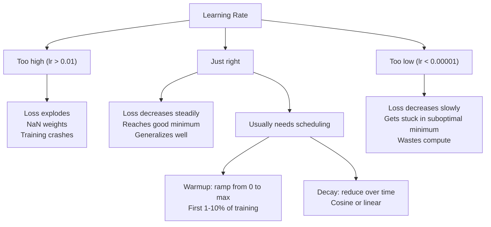
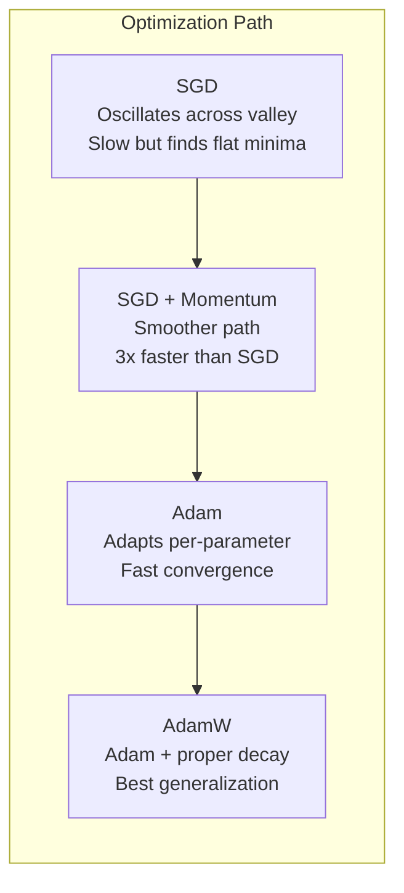
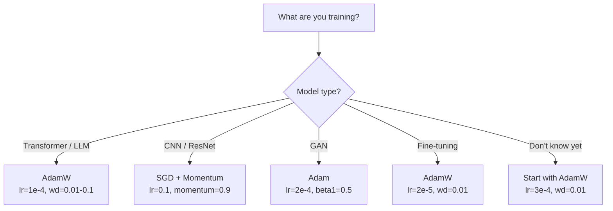

# Оптимизаторы

> Степень спуска указывает, в каком направлении двигаться, не говорит, насколько далеко или как быстро.

**Type:** Build
**Languages:** Python
**Prerequisites:** Lesson 03.05 (Loss Functions)
**Time:** ~75 minutes

## Цели обучения

- Использовать SGD, SGD с импульсом, Adam и AdamW оптимизаторы с нуля в Python
- Объясните, как коррекция предвзятости Адама компенсирует оценку нулевого момента на ранних этапах обучения.
- Покажите, почему AdamW производит лучшую обобщение, чем Adam с регуляризацией L2 на той же задаче
- Выберите подходящий оптимизатор и гиперпараметры по умолчанию для трансформаторов, CNN, GAN и фини-турнировки

## Проблема

Вы вычислили градиенты. Вы знаете, что вес # 4,721 должен уменьшиться на 0,003 для уменьшения потери. Но 0,003 в каких единицах?

На каждом этапе применяется одинаковый уровень обучения для каждого параметра: w = w - lr *.

Во-первых, колебания. Ландшафт потерь редко имеет форму гладкой миски. Это больше похоже на длинную, узкую долину. Грейдент указывает на всю долину (упорный путь), а не на ее протяжении (пустый путь). Потепление спуска отскочивает вперед и назад через узкое измерение, делая небольшой прогресс вдоль полезного. Вы видели, что потеря падает быстрее, чем плато, не потому, что модель сближается, а потому, что она колеблется.

Во-вторых, один уровень обучения для всех параметров неправилен. Некоторые весы нуждаются в больших обновлениях (они находятся на ранней, недостаточной стадии). Другие нуждаются в небольших обновлениях (они близки к их оптимальному значению).

В-третьих, точки седла. В высоких измерениях, у потери ландшафт имеет обширные плоские области, где градиент близок к нулю. Ваня SGD проскалывает через них со скоростью градиента, которая фактически является нулем. Модель выглядит застрявшей. Она не застряла - она находится в плоской области с полезным спусканием с другой стороны. Но SGD не имеет механизма, чтобы проникнуть.

Адам решает все три. Он поддерживает два текущих средних показателя на параметр - средний градиент (момент, управляет колебаниями) и средний квадратный градиент (адаптивная скорость, управляет различными масштабами). В сочетании с коррекцией предвзятости на первых шагах, он дает вам один оптимизатор, который работает на 80% проблем с дефолтными гиперпараметрами. Этот урок строит его с нуля, чтобы вы точно понимали, когда и почему он провалился на остальных 20%.

## Концепция

### Стохастическое градиентное спускание (SGD)

Простейший оптимизатор: вычислить градиент на мини-пакете и сделать шаг в противоположном направлении.

```
w = w - lr * gradient
```

"Стохастический" означает, что вы используете случайный подмножество данных (мини-пачты) для оценки градиента, а не полный набор данных. Этот шум на самом деле полезен - он помогает избежать острых местных минимумов. Но шум также вызывает колебания.

Учительная скорость - единственная кнопка. Слишком высокая: потеря расхождается. Слишком низкая: обучение занимает вечность. Оптимальное значение зависит от архитектуры, данных, размера партии и текущего этапа обучения. Для ваниловых SGD на современных сетях типичные значения колеблются от 0,01 до 0,1.

### Импульс

Аналогия "болы-руллинг-доунг-хилл" слишком используется, но точна.

```
m_t = beta * m_{t-1} + gradient
w = w - lr * m_t
```

Бета (обычно 0,9) контролирует, сколько истории нужно сохранить.

Почему это исправляет колебания: градиенты, указывающие в одном направлении, накапливаются. Градиенты, которые переворачивают направление, отменяются. В этой узкой долине, "передовой" компонент переворачивается на каждый шаг и ослабевает.

Реальные цифры: SGD в одиночку на плохо настроенном краеугольном ландшафте может занять 10 000 шагов. SGD с импульсом (бета = 0,9) обычно занимает 3000 - 5000 шагов на одну и ту же проблему.

### RMSProp

Первый метод адаптивного уровня обучения на параметр, который действительно сработал.

```
s_t = beta * s_{t-1} + (1 - beta) * gradient^2
w = w - lr * gradient / (sqrt(s_t) + epsilon)
```

s_t отслеживает средний показатель квадратных градиентов. Параметры с последовательно большими градиентами делятся на большое число (меньше эффективная скорость обучения). Параметры с небольшими градиентами делятся на небольшое число (большая эффективная скорость обучения).

Это решает проблему "один уровень обучения для всех параметров". Тель, которая уже получает большие обновления, вероятно, близка к цели - замедляет ее. Тель, которая получает небольшие обновления, может быть недостаточно подготовлена - ускоряет ее.

Эпсилон (обычно 1e-8) предотвращает деление на нуль, когда параметр не обновлен.

### Адам: Момент + RMSProp

Адам объединяет оба понятия.

```
m_t = beta1 * m_{t-1} + (1 - beta1) * gradient        (first moment: mean)
v_t = beta2 * v_{t-1} + (1 - beta2) * gradient^2       (second moment: variance)
```

**Bias correction**Это ключевая деталь, которую большинство объяснений пропустит. На шаге 1, m_1 = (1 - бета1) * градиент. при бета1 = 0,9, это 0,1 * градиент - в десять раз слишком маленький.

```
m_hat = m_t / (1 - beta1^t)
v_hat = v_t / (1 - beta2^t)
```

На этапе 1 с бета1 = 0,9: m_hat = m_1 / (1 - 0,9) = m_1 / 0.1 = фактический градиент. На этапе 100: (1 - 0,9^100) примерно 1,0, поэтому коррекция исчезает.

Обновление:

```
w = w - lr * m_hat / (sqrt(v_hat) + epsilon)
```

В случае с ошибкой, если вы не ошибаетесь, измените первое, а затем beta2.

### Уменьшение веса сделано правильно

В ванилле SGD это эквивалентно распада веса (отчитая lambda * w от веса на каждом шаге).

Лошкилов и Хаттер: когда вы добавляете L2 к потере, а затем Адам обрабатывает градиент, адаптивная скорость обучения также скалирует термин регуляризации. Параметры с большим вариантом градиента получают меньше регуляризации. Параметры с небольшим вариантом получают больше. Это не то, что вы хотите - вы хотите однородное регулярирование независимо от статистики градиента.

AdamW исправляет это, применяя распад веса непосредственно к весям, после обновления Adam:

```
w = w - lr * m_hat / (sqrt(v_hat) + epsilon) - lr * lambda * w
```

Термин распада веса (lr * lambda * w) не измеряется адаптивным фактором Адама.

Это кажется незначительным детали. Это не так. AdamW сближается с лучшими решениями, чем регуляризация Adam + L2 практически на каждой задаче. Это стандартный оптимизатор PyTorch для обучения трансформаторов, моделей диффузии и большинства современных архитектур. BERT, GPT, LLaMA, Stable Diffusion - все обучены с AdamW.

### Уровень обучения: важнейший гиперпараметр



Если вы настроите один гиперпараметр, настроите скорость обучения. 10x изменение скорости обучения имеет большее значение, чем любое архитектурное решение, которое вы сделаете.

- SGD: lr = 0,01 - 0,1
- Адам/АдамВ: lr = 1e-4 до 3e-4
- Модели с доработкой на тонкое настройке: lr = 1e-5 до 5e-5
- Уровень обучения: линейная рампа на первых 1-10% шагов

### Оптимизатор сравнения



### Когда каждый оптимизатор выигрывает



```figure
optimizer-trajectory
```

## Создайте его

### Шаг 1: Ваняльная СГД

```python
class SGD:
    def __init__(self, lr=0.01):
        self.lr = lr

    def step(self, params, grads):
        for i in range(len(params)):
            params[i] -= self.lr * grads[i]
```

### Шаг 2: SGD с Моментами

```python
class SGDMomentum:
    def __init__(self, lr=0.01, beta=0.9):
        self.lr = lr
        self.beta = beta
        self.velocities = None

    def step(self, params, grads):
        if self.velocities is None:
            self.velocities = [0.0] * len(params)
        for i in range(len(params)):
            self.velocities[i] = self.beta * self.velocities[i] + grads[i]
            params[i] -= self.lr * self.velocities[i]
```

### Третий шаг: Адам

```python
import math

class Adam:
    def __init__(self, lr=0.001, beta1=0.9, beta2=0.999, epsilon=1e-8):
        self.lr = lr
        self.beta1 = beta1
        self.beta2 = beta2
        self.epsilon = epsilon
        self.m = None
        self.v = None
        self.t = 0

    def step(self, params, grads):
        if self.m is None:
            self.m = [0.0] * len(params)
            self.v = [0.0] * len(params)

        self.t += 1

        for i in range(len(params)):
            self.m[i] = self.beta1 * self.m[i] + (1 - self.beta1) * grads[i]
            self.v[i] = self.beta2 * self.v[i] + (1 - self.beta2) * grads[i] ** 2

            m_hat = self.m[i] / (1 - self.beta1 ** self.t)
            v_hat = self.v[i] / (1 - self.beta2 ** self.t)

            params[i] -= self.lr * m_hat / (math.sqrt(v_hat) + self.epsilon)
```

### Шаг 4: АдамВ

```python
class AdamW:
    def __init__(self, lr=0.001, beta1=0.9, beta2=0.999, epsilon=1e-8, weight_decay=0.01):
        self.lr = lr
        self.beta1 = beta1
        self.beta2 = beta2
        self.epsilon = epsilon
        self.weight_decay = weight_decay
        self.m = None
        self.v = None
        self.t = 0

    def step(self, params, grads):
        if self.m is None:
            self.m = [0.0] * len(params)
            self.v = [0.0] * len(params)

        self.t += 1

        for i in range(len(params)):
            self.m[i] = self.beta1 * self.m[i] + (1 - self.beta1) * grads[i]
            self.v[i] = self.beta2 * self.v[i] + (1 - self.beta2) * grads[i] ** 2

            m_hat = self.m[i] / (1 - self.beta1 ** self.t)
            v_hat = self.v[i] / (1 - self.beta2 ** self.t)

            params[i] -= self.lr * m_hat / (math.sqrt(v_hat) + self.epsilon)
            params[i] -= self.lr * self.weight_decay * params[i]
```

### Шаг 5: Сравнение обучения

Обучайте одну и ту же двухслойную сеть на наборе данных круга с урока 05 с помощью всех четырех оптимизаторов.

```python
import random

def sigmoid(x):
    x = max(-500, min(500, x))
    return 1.0 / (1.0 + math.exp(-x))

def make_circle_data(n=200, seed=42):
    random.seed(seed)
    data = []
    for _ in range(n):
        x = random.uniform(-2, 2)
        y = random.uniform(-2, 2)
        label = 1.0 if x * x + y * y < 1.5 else 0.0
        data.append(([x, y], label))
    return data


class OptimizerTestNetwork:
    def __init__(self, optimizer, hidden_size=8):
        random.seed(0)
        self.hidden_size = hidden_size
        self.optimizer = optimizer

        self.w1 = [[random.gauss(0, 0.5) for _ in range(2)] for _ in range(hidden_size)]
        self.b1 = [0.0] * hidden_size
        self.w2 = [random.gauss(0, 0.5) for _ in range(hidden_size)]
        self.b2 = 0.0

    def get_params(self):
        params = []
        for row in self.w1:
            params.extend(row)
        params.extend(self.b1)
        params.extend(self.w2)
        params.append(self.b2)
        return params

    def set_params(self, params):
        idx = 0
        for i in range(self.hidden_size):
            for j in range(2):
                self.w1[i][j] = params[idx]
                idx += 1
        for i in range(self.hidden_size):
            self.b1[i] = params[idx]
            idx += 1
        for i in range(self.hidden_size):
            self.w2[i] = params[idx]
            idx += 1
        self.b2 = params[idx]

    def forward(self, x):
        self.x = x
        self.z1 = []
        self.h = []
        for i in range(self.hidden_size):
            z = self.w1[i][0] * x[0] + self.w1[i][1] * x[1] + self.b1[i]
            self.z1.append(z)
            self.h.append(max(0.0, z))

        self.z2 = sum(self.w2[i] * self.h[i] for i in range(self.hidden_size)) + self.b2
        self.out = sigmoid(self.z2)
        return self.out

    def compute_grads(self, target):
        eps = 1e-15
        p = max(eps, min(1 - eps, self.out))
        d_loss = -(target / p) + (1 - target) / (1 - p)
        d_sigmoid = self.out * (1 - self.out)
        d_out = d_loss * d_sigmoid

        grads = [0.0] * (self.hidden_size * 2 + self.hidden_size + self.hidden_size + 1)
        idx = 0
        for i in range(self.hidden_size):
            d_relu = 1.0 if self.z1[i] > 0 else 0.0
            d_h = d_out * self.w2[i] * d_relu
            grads[idx] = d_h * self.x[0]
            grads[idx + 1] = d_h * self.x[1]
            idx += 2

        for i in range(self.hidden_size):
            d_relu = 1.0 if self.z1[i] > 0 else 0.0
            grads[idx] = d_out * self.w2[i] * d_relu
            idx += 1

        for i in range(self.hidden_size):
            grads[idx] = d_out * self.h[i]
            idx += 1

        grads[idx] = d_out
        return grads

    def train(self, data, epochs=300):
        losses = []
        for epoch in range(epochs):
            total_loss = 0.0
            correct = 0
            for x, y in data:
                pred = self.forward(x)
                grads = self.compute_grads(y)
                params = self.get_params()
                self.optimizer.step(params, grads)
                self.set_params(params)

                eps = 1e-15
                p = max(eps, min(1 - eps, pred))
                total_loss += -(y * math.log(p) + (1 - y) * math.log(1 - p))
                if (pred >= 0.5) == (y >= 0.5):
                    correct += 1
            avg_loss = total_loss / len(data)
            accuracy = correct / len(data) * 100
            losses.append((avg_loss, accuracy))
            if epoch % 75 == 0 or epoch == epochs - 1:
                print(f"    Epoch {epoch:3d}: loss={avg_loss:.4f}, accuracy={accuracy:.1f}%")
        return losses
```

## Используйте его

PyTorch оптимизаторы обрабатывают группы параметров, резение градиентов и планирование скорости обучения:

```python
import torch
import torch.optim as optim

model = torch.nn.Sequential(
    torch.nn.Linear(784, 256),
    torch.nn.ReLU(),
    torch.nn.Linear(256, 10),
)

optimizer = optim.AdamW(model.parameters(), lr=3e-4, weight_decay=0.01)

scheduler = optim.lr_scheduler.CosineAnnealingLR(optimizer, T_max=100)

for epoch in range(100):
    optimizer.zero_grad()
    output = model(torch.randn(32, 784))
    loss = torch.nn.functional.cross_entropy(output, torch.randint(0, 10, (32,)))
    loss.backward()
    torch.nn.utils.clip_grad_norm_(model.parameters(), max_norm=1.0)
    optimizer.step()
    scheduler.step()
```

Например, если вы ошибаетесь, то это является распространенным источником тонких ошибок.

Для CNN многие практикующие все еще предпочитают SGD + импульс (lr=0,1, импульс=0,9, вес_упадок=1e-4) с шагом или косиновым графиком. SGD находит более плоские минимумы, которые часто обобщаются лучше. Для трансформаторов и LLM, AdamW с отоплением + косиновым упадком является универсальным дефолтом. Не сражайтесь с консенсусом без измеренной причины.

## Погрузи его

Этот урок дает результаты:
- `outputs/prompt-optimizer-selector.md`-- решение о выборе правильного оптимизатора и скорости обучения для любой архитектуры

## Упражнения

1. Используйте импульс Нестерова, где вы вычисляете градиент на позиции "назад в глаза" (w - lr * beta * v) вместо текущей позиции.

2. Реализуйте график обучения по скорости нагрева: линейная рампа от 0 до максимума в течение первых 10% этапов обучения, затем косиновый распад до 0.

3. Следить за эффективной скоростью обучения для каждого параметра во время обучения Адама. Эффективная скорость lr * m_hat / (sqrt(v_hat) + eps).

4. Реализуйте нагрузку на градиент (клип по глобальной норме). Установить максимальную норму на градиент на 1.0. Обучайтесь с и без нагрузки с использованием высокой скорости обучения (lr=0,01 для Адама). Считайте, сколько пробегов дивергирует (потеря идет на NaN) с и без нагрузки более 10 случайных семян.

5. Сравните Адама с АдамаВ на сети с большими весами. Инициализируйте все весы на случайные значения в [-5, 5] (много больше, чем обычно).

## Ключевые условия

| Term | What people say | What it actually means |
|------|----------------|----------------------|
| Learning rate | "Step size" | The scalar multiplier on the gradient update; the single most impactful hyperparameter in training |
| SGD | "Basic gradient descent" | Stochastic gradient descent: update weights by subtracting lr * gradient, computed on a mini-batch |
| Momentum | "Rolling ball analogy" | Exponential moving average of past gradients; dampens oscillation and accelerates consistent directions |
| RMSProp | "Adaptive learning rate" | Divides each parameter's gradient by the running RMS of its recent gradients; equalizes learning rates |
| Adam | "The default optimizer" | Combines momentum (first moment) and RMSProp (second moment) with bias correction for the initial steps |
| AdamW | "Adam done right" | Adam with decoupled weight decay; applies regularization directly to weights rather than through the gradient |
| Bias correction | "Warmup for running averages" | Dividing by (1 - beta^t) to compensate for the zero-initialization of Adam's moment estimates |
| Weight decay | "Shrink the weights" | Subtracting a fraction of the weight value at each step; a regularizer that penalizes large weights |
| Learning rate schedule | "Changing lr over time" | A function that adjusts the learning rate during training; warmup + cosine decay is the modern default |
| Gradient clipping | "Capping the gradient norm" | Scaling down the gradient vector when its norm exceeds a threshold; prevents exploding gradient updates |

## Дальнейшее чтение

- Kingma & Ba, "Адам: метод стохастической оптимизации" (2014) - оригинальная статья Адама с анализом конвергенции и производством коррекции предвзятости
- Лошкилов и Хаттер, "Рэгуляризация распада веса" (2017) -- доказали, что регуляризация L2 и распад веса не эквивалентны у Адама, и предложили AdamW
- Смит, "Циклические показатели обучения для обучения нейронных сетей" (2017) -- представил тест LR диапазона и циклические графики, которые устраняют необходимость настройки фиксированной скорости обучения
- Рудер, "Обзор алгоритмов оптимизации по степени спуска" (2016) - лучший одиночный опрос всех вариантов оптимизатора, с ясными сравнениями и интуициями
