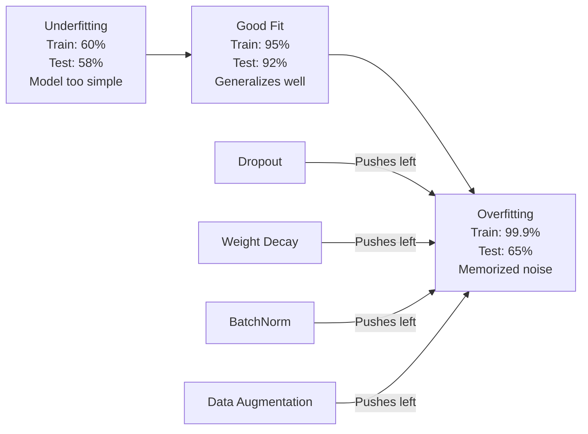
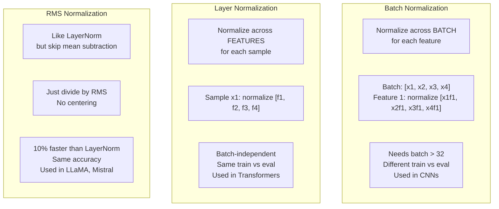
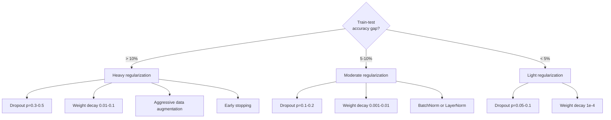

# Регуляризация

> Ваша модель показывает 99% на обучающих данных и 60% на тестовых. Она запомнила вместо того, чтобы научиться. Регуляризация — это налог на сложность, который вы вводите, чтобы заставить модель обобщать.

**Type:** Build
**Languages:** Python
**Prerequisites:** Урок 03.06 (Оптимизаторы)
**Time:** ~75 минут

## Цели обучения

- Реализовать с нуля dropout с инвертированным масштабированием, L2 weight decay, batch normalization, layer normalization и RMSNorm
- Измерить разрыв между точностью на обучении и тесте и диагностировать переобучение с помощью экспериментов с регуляризацией
- Объяснить, почему трансформеры используют LayerNorm вместо BatchNorm и почему современные LLM предпочитают RMSNorm
- Применять правильную комбинацию техник регуляризации в зависимости от степени переобучения

## Проблема

Нейросеть с достаточным числом параметров может запомнить любой датасет. Это не гипотеза — Zhang et al. (2017) доказали это, обучая стандартные сети на ImageNet со случайными метками. Сети достигли почти нулевого training loss на полностью случайных назначениях меток. Они запомнили миллион случайных пар вход-выход, в которых не было никакой закономерности для изучения. Training loss был идеальным. Точность на тесте была нулевой.

Это и есть проблема переобучения, и она усугубляется по мере роста размера моделей. У GPT-3 175 миллиардов параметров. Обучающий набор содержит около 500 миллиардов токенов. При таком количестве параметров модель обладает достаточной емкостью, чтобы дословно запомнить значительные куски обучающих данных. Без регуляризации она бы просто воспроизводила обучающие примеры вместо того, чтобы изучать обобщаемые закономерности.

Разрыв между производительностью на обучении и на тесте — это overfitting gap (разрыв переобучения). Каждая техника в этом уроке атакует этот разрыв под своим углом. Dropout заставляет сеть не полагаться на какой-то один нейрон. Weight decay не позволяет ни одному весу вырасти слишком большим. Batch normalization сглаживает ландшафт функции потерь, чтобы оптимизатор находил более плоские, лучше обобщающиеся минимумы. Layer normalization делает то же самое, но работает там, где batch normalization не справляется (малые батчи, последовательности переменной длины). RMSNorm делает это на 10% быстрее, отбрасывая вычисление среднего. Каждая техника проста. Вместе они составляют разницу между моделью, которая запоминает, и моделью, которая обобщает.

## Концепция

### Спектр переобучения

Любая модель находится где-то на спектре от недообучения (слишком простая, чтобы уловить закономерность) до переобучения (настолько сложная, что улавливает шум). Оптимальная точка находится между ними, и регуляризация подталкивает модели к ней со стороны переобучения.



### Dropout

Самая простая техника регуляризации с самой элегантной интерпретацией. Во время обучения выход каждого нейрона случайно обнуляется с вероятностью p.

```
output = activation(z) * mask    where mask[i] ~ Bernoulli(1 - p)
```

При p = 0.5 половина нейронов обнуляется на каждом прямом проходе. Сеть вынуждена учить избыточные представления, потому что не может предсказать, какие нейроны будут доступны. Это предотвращает коадаптацию — ситуацию, когда нейроны учатся полагаться на присутствие конкретных других нейронов.

Интерпретация через ансамбль: сеть с N нейронами и dropout создает 2^N возможных подсетей (каждую комбинацию включенных/выключенных нейронов). Обучение с dropout приблизительно обучает все 2^N подсетей одновременно, каждую на разных мини-батчах. Во время теста используются все нейроны (без dropout), а выходы масштабируются на (1 - p), чтобы соответствовать ожидаемому значению при обучении. Это эквивалентно усреднению предсказаний 2^N подсетей — массивный ансамбль из единственной модели.

На практике масштабирование применяется во время обучения, а не тестирования (инвертированный dropout):

```
During training:  output = activation(z) * mask / (1 - p)
During testing:   output = activation(z)   (no change needed)
```

Это чище, потому что тестовому коду вообще не нужно знать о dropout.

Значения по умолчанию: p = 0.1 для трансформеров, p = 0.5 для MLP, p = 0.2-0.3 для CNN. Чем выше dropout, тем сильнее регуляризация — и тем выше риск недообучения.

### Weight Decay (L2-регуляризация)

Добавьте квадрат величины всех весов к функции потерь:

```
total_loss = task_loss + (lambda / 2) * sum(w_i^2)
```

Градиент члена регуляризации равен lambda * w. Это означает, что на каждом шаге каждый вес сжимается к нулю на долю, пропорциональную его величине. Большие веса штрафуются сильнее. Модель подталкивается к решениям, где ни один отдельный вес не доминирует.

Почему это помогает обобщению: переобученные модели, как правило, имеют большие веса, усиливающие шум в обучающих данных. Weight decay удерживает веса малыми, что ограничивает эффективную емкость модели и заставляет ее опираться на устойчивые, обобщаемые признаки, а не на запомненные особенности.

Гиперпараметр lambda контролирует силу регуляризации. Типичные значения:

- 0.01 для AdamW на трансформерах
- 1e-4 для SGD на CNN
- 0.1 для сильно переобученных моделей

Как обсуждалось в уроке 06: weight decay и L2-регуляризация эквивалентны в SGD, но не в Adam. Всегда используйте AdamW (decoupled weight decay) при обучении с Adam.

### Batch Normalization

Нормализуйте выход каждого слоя по мини-батчу перед передачей его в следующий слой.

Для мини-батча активаций на некотором слое:

```
mu = (1/B) * sum(x_i)           (batch mean)
sigma^2 = (1/B) * sum((x_i - mu)^2)   (batch variance)
x_hat = (x_i - mu) / sqrt(sigma^2 + eps)   (normalize)
y = gamma * x_hat + beta        (scale and shift)
```

Gamma и beta — обучаемые параметры, позволяющие сети отменить нормализацию, если это оптимально. Без них вы бы принудительно делали выход каждого слоя нулевым по среднему и единичным по дисперсии, что может быть не тем, чего хочет сеть.

**Разделение обучения и инференса:** во время обучения mu и sigma берутся из текущего мини-батча. Во время инференса используются скользящие средние, накопленные во время обучения (экспоненциальное скользящее среднее с momentum = 0.1, то есть 90% старого + 10% нового).

Почему BatchNorm работает — все еще предмет дискуссий. В оригинальной статье утверждалось, что он уменьшает «internal covariate shift» (изменение распределения входов слоя по мере обновления более ранних слоев). Santurkar et al. (2018) показали, что это объяснение неверно. Настоящая причина: BatchNorm делает ландшафт функции потерь более гладким. Градиенты становятся более предсказуемыми, константы Липшица меньше, и оптимизатор может безопасно делать более крупные шаги. Именно поэтому BatchNorm позволяет использовать более высокие темпы обучения и сходиться быстрее.

У BatchNorm есть фундаментальное ограничение: он зависит от статистик батча. При размере батча 1 среднее и дисперсия не имеют смысла. При малых батчах (< 32) статистики зашумлены и ухудшают производительность. Это важно для таких задач, как обнаружение объектов (где память ограничивает размер батча) и языковое моделирование (где длины последовательностей варьируются).

### Layer Normalization

Нормализация по признакам, а не по батчу. Для одного образца:

```
mu = (1/D) * sum(x_j)           (feature mean)
sigma^2 = (1/D) * sum((x_j - mu)^2)   (feature variance)
x_hat = (x_j - mu) / sqrt(sigma^2 + eps)
y = gamma * x_hat + beta
```

D — размерность признакового пространства. Каждый образец нормализуется независимо — без зависимости от размера батча. Именно поэтому трансформеры используют LayerNorm вместо BatchNorm. Последовательности имеют переменную длину, размеры батчей часто малы (или равны 1 во время генерации), а вычисления идентичны при обучении и инференсе.

LayerNorm в трансформерах применяется после каждого блока self-attention и каждого feed-forward блока (Post-LN), либо перед ними (Pre-LN, что более стабильно для обучения).

### RMSNorm

LayerNorm без вычитания среднего. Предложен Zhang & Sennrich (2019).

```
rms = sqrt((1/D) * sum(x_j^2))
y = gamma * x / rms
```

Вот и всё. Никакого вычисления среднего, никакого параметра beta. Наблюдение: ре-центрирование (вычитание среднего) в LayerNorm вносит очень малый вклад в производительность модели, но требует вычислительных затрат. Удаление этого шага дает ту же точность примерно при 10% меньших накладных расходах.

LLaMA, LLaMA 2, LLaMA 3, Mistral и большинство современных LLM используют RMSNorm вместо LayerNorm. В масштабе миллиардов параметров и триллионов токенов эта экономия в 10% существенна.

### Сравнение видов нормализации



### Аугментация данных как регуляризация

Это не модификация модели, а модификация данных. Трансформируйте обучающие входы, сохраняя метки:

- Изображения: случайный кроп, отражение, поворот, цветовой джиттер, cutout
- Текст: замена синонимов, обратный перевод, случайное удаление
- Аудио: растяжение по времени, изменение высоты тона, добавление шума

Эффект идентичен регуляризации: увеличивается эффективный размер обучающего набора, что усложняет запоминание моделью конкретных примеров. Модель, которая видит каждое изображение только один раз в исходной форме, может его запомнить. Модель, которая видит 50 аугментированных версий каждого изображения, вынуждена учить инвариантную структуру.

### Early Stopping (ранняя остановка)

Самый простой регуляризатор: остановить обучение, когда validation loss начинает расти. В этот момент модель еще не переобучилась. На практике вы отслеживаете validation loss на каждой эпохе, сохраняете лучшую модель и продолжаете обучение в течение окна «терпения» (patience, обычно 5-20 эпох). Если validation loss не улучшается в пределах окна терпения, вы останавливаетесь и загружаете лучшую сохраненную модель.

### Когда что применять



```figure
l2-regularization
```

## Реализация

### Шаг 1: Dropout (режимы train и eval)

```python
import random
import math


class Dropout:
    def __init__(self, p=0.5):
        self.p = p
        self.training = True
        self.mask = None

    def forward(self, x):
        if not self.training:
            return list(x)
        self.mask = []
        output = []
        for val in x:
            if random.random() < self.p:
                self.mask.append(0)
                output.append(0.0)
            else:
                self.mask.append(1)
                output.append(val / (1 - self.p))
        return output

    def backward(self, grad_output):
        grads = []
        for g, m in zip(grad_output, self.mask):
            if m == 0:
                grads.append(0.0)
            else:
                grads.append(g / (1 - self.p))
        return grads
```

### Шаг 2: L2 Weight Decay

```python
def l2_regularization(weights, lambda_reg):
    penalty = 0.0
    for w in weights:
        penalty += w * w
    return lambda_reg * 0.5 * penalty

def l2_gradient(weights, lambda_reg):
    return [lambda_reg * w for w in weights]
```

### Шаг 3: Batch Normalization

```python
class BatchNorm:
    def __init__(self, num_features, momentum=0.1, eps=1e-5):
        self.gamma = [1.0] * num_features
        self.beta = [0.0] * num_features
        self.eps = eps
        self.momentum = momentum
        self.running_mean = [0.0] * num_features
        self.running_var = [1.0] * num_features
        self.training = True
        self.num_features = num_features

    def forward(self, batch):
        batch_size = len(batch)
        if self.training:
            mean = [0.0] * self.num_features
            for sample in batch:
                for j in range(self.num_features):
                    mean[j] += sample[j]
            mean = [m / batch_size for m in mean]

            var = [0.0] * self.num_features
            for sample in batch:
                for j in range(self.num_features):
                    var[j] += (sample[j] - mean[j]) ** 2
            var = [v / batch_size for v in var]

            for j in range(self.num_features):
                self.running_mean[j] = (1 - self.momentum) * self.running_mean[j] + self.momentum * mean[j]
                self.running_var[j] = (1 - self.momentum) * self.running_var[j] + self.momentum * var[j]
        else:
            mean = list(self.running_mean)
            var = list(self.running_var)

        self.x_hat = []
        output = []
        for sample in batch:
            normalized = []
            out_sample = []
            for j in range(self.num_features):
                x_h = (sample[j] - mean[j]) / math.sqrt(var[j] + self.eps)
                normalized.append(x_h)
                out_sample.append(self.gamma[j] * x_h + self.beta[j])
            self.x_hat.append(normalized)
            output.append(out_sample)
        return output
```

### Шаг 4: Layer Normalization

```python
class LayerNorm:
    def __init__(self, num_features, eps=1e-5):
        self.gamma = [1.0] * num_features
        self.beta = [0.0] * num_features
        self.eps = eps
        self.num_features = num_features

    def forward(self, x):
        mean = sum(x) / len(x)
        var = sum((xi - mean) ** 2 for xi in x) / len(x)

        self.x_hat = []
        output = []
        for j in range(self.num_features):
            x_h = (x[j] - mean) / math.sqrt(var + self.eps)
            self.x_hat.append(x_h)
            output.append(self.gamma[j] * x_h + self.beta[j])
        return output
```

### Шаг 5: RMSNorm

```python
class RMSNorm:
    def __init__(self, num_features, eps=1e-6):
        self.gamma = [1.0] * num_features
        self.eps = eps
        self.num_features = num_features

    def forward(self, x):
        rms = math.sqrt(sum(xi * xi for xi in x) / len(x) + self.eps)
        output = []
        for j in range(self.num_features):
            output.append(self.gamma[j] * x[j] / rms)
        return output
```

### Шаг 6: Обучение с регуляризацией и без неё

```python
def sigmoid(x):
    x = max(-500, min(500, x))
    return 1.0 / (1.0 + math.exp(-x))


def make_circle_data(n=200, seed=42):
    random.seed(seed)
    data = []
    for _ in range(n):
        x = random.uniform(-2, 2)
        y = random.uniform(-2, 2)
        label = 1.0 if x * x + y * y < 1.5 else 0.0
        data.append(([x, y], label))
    return data


class RegularizedNetwork:
    def __init__(self, hidden_size=16, lr=0.05, dropout_p=0.0, weight_decay=0.0):
        random.seed(0)
        self.hidden_size = hidden_size
        self.lr = lr
        self.dropout_p = dropout_p
        self.weight_decay = weight_decay
        self.dropout = Dropout(p=dropout_p) if dropout_p > 0 else None

        self.w1 = [[random.gauss(0, 0.5) for _ in range(2)] for _ in range(hidden_size)]
        self.b1 = [0.0] * hidden_size
        self.w2 = [random.gauss(0, 0.5) for _ in range(hidden_size)]
        self.b2 = 0.0

    def forward(self, x, training=True):
        self.x = x
        self.z1 = []
        self.h = []
        for i in range(self.hidden_size):
            z = self.w1[i][0] * x[0] + self.w1[i][1] * x[1] + self.b1[i]
            self.z1.append(z)
            self.h.append(max(0.0, z))

        if self.dropout and training:
            self.dropout.training = True
            self.h = self.dropout.forward(self.h)
        elif self.dropout:
            self.dropout.training = False
            self.h = self.dropout.forward(self.h)

        self.z2 = sum(self.w2[i] * self.h[i] for i in range(self.hidden_size)) + self.b2
        self.out = sigmoid(self.z2)
        return self.out

    def backward(self, target):
        eps = 1e-15
        p = max(eps, min(1 - eps, self.out))
        d_loss = -(target / p) + (1 - target) / (1 - p)
        d_sigmoid = self.out * (1 - self.out)
        d_out = d_loss * d_sigmoid

        for i in range(self.hidden_size):
            d_relu = 1.0 if self.z1[i] > 0 else 0.0
            d_h = d_out * self.w2[i] * d_relu
            self.w2[i] -= self.lr * (d_out * self.h[i] + self.weight_decay * self.w2[i])
            for j in range(2):
                self.w1[i][j] -= self.lr * (d_h * self.x[j] + self.weight_decay * self.w1[i][j])
            self.b1[i] -= self.lr * d_h
        self.b2 -= self.lr * d_out

    def evaluate(self, data):
        correct = 0
        total_loss = 0.0
        for x, y in data:
            pred = self.forward(x, training=False)
            eps = 1e-15
            p = max(eps, min(1 - eps, pred))
            total_loss += -(y * math.log(p) + (1 - y) * math.log(1 - p))
            if (pred >= 0.5) == (y >= 0.5):
                correct += 1
        return total_loss / len(data), correct / len(data) * 100

    def train_model(self, train_data, test_data, epochs=300):
        history = []
        for epoch in range(epochs):
            total_loss = 0.0
            correct = 0
            for x, y in train_data:
                pred = self.forward(x, training=True)
                self.backward(y)
                eps = 1e-15
                p = max(eps, min(1 - eps, pred))
                total_loss += -(y * math.log(p) + (1 - y) * math.log(1 - p))
                if (pred >= 0.5) == (y >= 0.5):
                    correct += 1
            train_loss = total_loss / len(train_data)
            train_acc = correct / len(train_data) * 100
            test_loss, test_acc = self.evaluate(test_data)
            history.append((train_loss, train_acc, test_loss, test_acc))
            if epoch % 75 == 0 or epoch == epochs - 1:
                gap = train_acc - test_acc
                print(f"    Epoch {epoch:3d}: train_acc={train_acc:.1f}%, test_acc={test_acc:.1f}%, gap={gap:.1f}%")
        return history
```

## Применение

PyTorch предоставляет всю нормализацию и регуляризацию в виде модулей:

```python
import torch
import torch.nn as nn

model = nn.Sequential(
    nn.Linear(784, 256),
    nn.BatchNorm1d(256),
    nn.ReLU(),
    nn.Dropout(0.3),
    nn.Linear(256, 128),
    nn.BatchNorm1d(128),
    nn.ReLU(),
    nn.Dropout(0.3),
    nn.Linear(128, 10),
)

model.train()
out_train = model(torch.randn(32, 784))

model.eval()
out_test = model(torch.randn(1, 784))
```

Переключатель `model.train()` / `model.eval()` критически важен. Он включает/выключает dropout и указывает BatchNorm использовать статистики батча или скользящие статистики. Забыть вызвать `model.eval()` перед инференсом — одна из самых распространенных ошибок в глубоком обучении. Ваша точность на тесте будет случайно колебаться, потому что dropout всё еще активен, а BatchNorm использует статистики мини-батча.

Для трансформеров паттерн другой:

```python
class TransformerBlock(nn.Module):
    def __init__(self, d_model=512, nhead=8, dropout=0.1):
        super().__init__()
        self.attention = nn.MultiheadAttention(d_model, nhead, dropout=dropout)
        self.norm1 = nn.LayerNorm(d_model)
        self.ff = nn.Sequential(
            nn.Linear(d_model, d_model * 4),
            nn.GELU(),
            nn.Linear(d_model * 4, d_model),
            nn.Dropout(dropout),
        )
        self.norm2 = nn.LayerNorm(d_model)
        self.dropout = nn.Dropout(dropout)

    def forward(self, x):
        attended, _ = self.attention(x, x, x)
        x = self.norm1(x + self.dropout(attended))
        x = self.norm2(x + self.ff(x))
        return x
```

LayerNorm, а не BatchNorm. Dropout p=0.1, а не p=0.5. Это значения по умолчанию для трансформеров.

## Публикация

Этот урок производит:
- `outputs/prompt-regularization-advisor.md` — промпт, который диагностирует переобучение и рекомендует правильную стратегию регуляризации

## Упражнения

1. Реализуйте spatial dropout для 2D-данных: вместо удаления отдельных нейронов отбрасывайте целые каналы признаков. Смоделируйте это, рассматривая группы последовательных признаков как каналы и отбрасывая целые группы. Сравните разрыв между train и test с обычным dropout на датасете circle при hidden_size=32.

2. Реализуйте label smoothing из урока 05 в сочетании с dropout из этого урока. Обучите в четырех конфигурациях: без них, только dropout, только label smoothing, оба вместе. Измерьте итоговый разрыв между точностью на обучении и тесте для каждой конфигурации. Какая комбинация дает наименьший разрыв?

3. Добавьте слой BatchNorm между скрытым слоем и функцией активации в вашей сети для датасета circle. Обучите с BatchNorm и без него при темпах обучения 0.01, 0.05 и 0.1. BatchNorm должен обеспечивать стабильное обучение при более высоких темпах обучения, где обычная сеть расходится.

4. Реализуйте раннюю остановку: отслеживайте test loss на каждой эпохе, сохраняйте лучшие веса и останавливайтесь, если test loss не улучшается в течение 20 эпох. Запустите регуляризованную сеть на 1000 эпох. Сообщите, на какой эпохе была достигнута лучшая точность на тесте и сколько эпох вычислений вы сэкономили.

5. Сравните LayerNorm и RMSNorm на 4-слойной сети (а не только 2-слойной). Инициализируйте обе одинаковыми весами. Обучайте 200 эпох и сравните итоговую точность, скорость обучения (время на эпоху) и величины градиентов на первом слое. Убедитесь, что RMSNorm быстрее при той же точности.

## Ключевые термины

| Термин | Что говорят люди | Что это на самом деле означает |
|------|----------------|----------------------|
| Overfitting (переобучение) | «Модель запомнила данные» | Ситуация, когда производительность модели на обучении значительно превышает производительность на тесте, что указывает на изучение шума, а не сигнала |
| Regularization (регуляризация) | «Предотвращение переобучения» | Любая техника, ограничивающая сложность модели для улучшения обобщения: dropout, weight decay, нормализация, аугментация |
| Dropout | «Случайное удаление нейронов» | Обнуление случайных нейронов во время обучения с вероятностью p, что заставляет учить избыточные представления; эквивалентно обучению ансамбля |
| Weight decay | «L2-штраф» | Сжатие всех весов к нулю путем вычитания lambda * w на каждом шаге; штрафует сложность через величину весов |
| Batch normalization | «Нормализация по батчу» | Нормализация выходов слоя по измерению батча с использованием статистик батча во время обучения и скользящих средних во время инференса |
| Layer normalization | «Нормализация по образцу» | Нормализация по признакам внутри каждого образца; не зависит от батча, используется в трансформерах, где размер батча варьируется |
| RMSNorm | «LayerNorm без среднего» | Нормализация по среднеквадратичному значению; убирает вычитание среднего из LayerNorm, давая ускорение на 10% при равной точности |
| Early stopping (ранняя остановка) | «Остановиться до переобучения» | Прекращение обучения, когда validation loss перестает улучшаться; простейший регуляризатор, часто используемый вместе с другими |
| Data augmentation (аугментация данных) | «Больше данных из меньшего» | Трансформация обучающих входов (отражение, кроп, шум) для увеличения эффективного размера датасета и принуждения к изучению инвариантности |
| Generalization gap (разрыв обобщения) | «Разделение train-test» | Разница между производительностью на обучении и тесте; регуляризация стремится минимизировать этот разрыв |

## Дополнительное чтение

- Srivastava et al., «Dropout: A Simple Way to Prevent Neural Networks from Overfitting» (2014) — оригинальная статья о dropout с интерпретацией через ансамбль и обширными экспериментами
- Ioffe & Szegedy, «Batch Normalization: Accelerating Deep Network Training by Reducing Internal Covariate Shift» (2015) — ввели BatchNorm и процедуру его обучения, одна из самых цитируемых работ в области глубокого обучения
- Zhang & Sennrich, «Root Mean Square Layer Normalization» (2019) — показали, что RMSNorm соответствует точности LayerNorm при меньших вычислительных затратах; принят в LLaMA и Mistral
- Zhang et al., «Understanding Deep Learning Requires Rethinking Generalization» (2017) — знаковая статья, показывающая, что нейросети могут запоминать случайные метки, что ставит под вопрос традиционные взгляды на обобщение