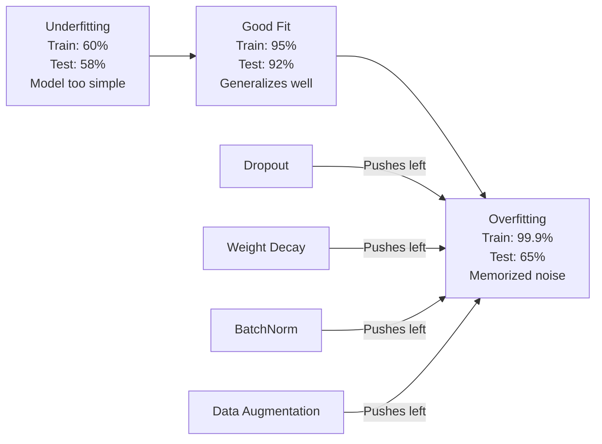
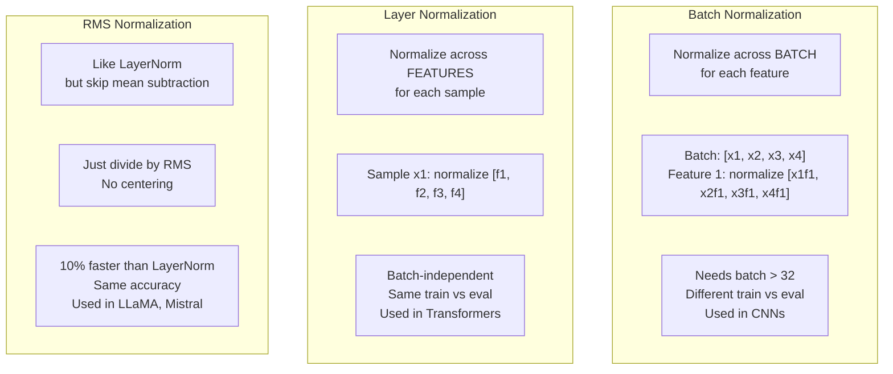
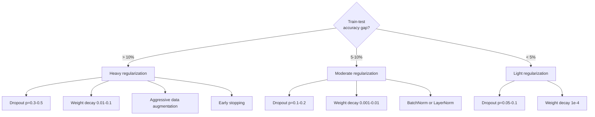

# Регуляризация

> В вашей модели 99% находятся на данных о обучении и 60% на данных тестов.

**Type:** Build
**Languages:** Python
**Prerequisites:** Lesson 03.06 (Optimizers)
**Time:** ~75 minutes

## Цели обучения

- Реализация отказов с перевернутым масштабированием, распада веса L2, нормализации партий, нормализации слоев и RMSNorm с нуля
- Измерение пробела в точности испытаний поезда и диагностика переподъема с использованием экспериментов регуляризации
- Объясните, почему трансформаторы используют LayerNorm вместо BatchNorm и почему современные LLM предпочитают RMSNorm.
- Применять правильное сочетание методов регуляризации на основе степени тяжести переподъема

## Проблема

Нейронная сеть с достаточными параметрами может запоминать любой набор данных. Это не гипотетическое - Zhang et al. (2017) доказали это обучением стандартных сетей на ImageNet случайными этикетками. Сети достигли почти нулевой потери обучения на полностью случайных заданных этикетках. Они запомнили миллион случайных вводных-выходных пар без шаблона для изучения.

Это проблема переподъема, и она ухудшается по мере увеличения моделей. GPT-3 имеет 175 миллиардов параметров. Учебный набор имеет около 500 миллиардов токенов. С таким количеством параметров модель имеет достаточно возможностей, чтобы запомнить значительные части данных о тренировке буквально. Без регуляризации, она просто будет регурировать примеры тренировок вместо изучения обобщаемых закономерностей.

Разрыв между результатом обучения и результатом испытаний - это переподходящий разрыв. Каждая техника в этом уроке атакует этот разрыв с другого угла. Выпуск заставляет сеть не полагаться на ни один нейрон. Ухудшение веса предотвращает, чтобы вес не увеличивался. Нормализация партии гладкостивает пейзаж потерь, так что оптимизатор находит более плоские, более обобщимые минимумы. Нормализация слоев делает то же самое, но работает там, где не удается нормализация партии (маленькие партии, последовательности переменной длины). RMSNorm делает это на 10% быстрее, сбросив средний расчет. Каждая техника проста. Вместе они представляют собой разницу между моделью, которая запоминает и моделью, которая обобщает.

## Концепция

### Сверхприспособленный спектр

Каждая модель находится где-то в спектре от недостаточного (слишком просто, чтобы запечатлеть шаблон) до переподъемности (так сложно, что она запечатлевает шум).



### Отпуск

Простейший метод регуляризации с наиболее элегантной интерпретацией.

```
output = activation(z) * mask    where mask[i] ~ Bernoulli(1 - p)
```

При p=0,5 половина нейронов на каждом проходе вперед нулевая. Сеть должна учиться избыточным представлениям, потому что не может предсказать, какие нейроны будут доступны. Это предотвращает ко-адаптацию - нейроны учатся полагаться на наличие конкретных других нейронов.

Интерпретация ансамбля: сеть с N нейронами и отказом создает 2^N возможных подсетей (каждая комбинация нейронов включена или отключена). Обучение с броском приблизительно одновременно обучает все 2^N подсети, каждая на разных мини-партах. В момент теста вы используете все нейроны (без отказов) и измеряете выходы на 1 - p, чтобы соответствовать ожидаемому показателю во время тренировки. Это эквивалентно среднестатистическому прогнозу 2^N подсетей - массивного ансамбля из одной модели.

На практике масштабирование применяется во время обучения вместо испытаний (обратный отказ от работы):

```
During training:  output = activation(z) * mask / (1 - p)
During testing:   output = activation(z)   (no change needed)
```

Это чище, потому что тест-код не должен знать о отказе вообще.

Уровень дефолта: p = 0,1 для трансформаторов, p = 0,5 для MLP, p = 0,2 - 0,3 для CNN.

### Ухудшение веса (регуляризация L2)

Добавьте квадратную величину всех весов к потере:

```
total_loss = task_loss + (lambda / 2) * sum(w_i^2)
```

Грейдент термина регуляризации - lambda * w. Это означает, что на каждом шаге каждый вес сокращается к нулю на долю, пропорциональную его величине.

Почему это помогает обобщению: модели сверхспособности имеют тенденцию иметь большие весы, которые усиливают шум в данных о тренировках.

Гиперпараметр Ламбды контролирует прочность.

- 0,01 для AdamW на трансформаторах
- 1e-4 для SGD на CNN
- 0,1 для моделей, которые сильно переоборудованы

Как обсуждалось в уроке 06: уменьшение веса и регуляризация L2 эквивалентны в SGD, но не в Адама.

### Нормализация партии

Нормализуйте выход каждого слоя через мини-парт, прежде чем перейти его на следующий слой.

Для мини-пакета активаций на одном слое:

```
mu = (1/B) * sum(x_i)           (batch mean)
sigma^2 = (1/B) * sum((x_i - mu)^2)   (batch variance)
x_hat = (x_i - mu) / sqrt(sigma^2 + eps)   (normalize)
y = gamma * x_hat + beta        (scale and shift)
```

Гамма и бета - это изучимые параметры, которые позволяют сети отменить нормализацию, если это оптимально. Без них вы заставляете выход каждого слоя быть нулевой средней единичной варианцией, что может быть не то, что хочет сеть.

**Training vs inference split:**Во время тренировки mu и sigma происходят из текущей мини-партиры. во время вывода вы используете средние средние, накопленные во время тренировки (экспонденциальный подвижной средний с импульсом = 0,1, то есть 90% старое + 10% новое).

Почему BatchNorm работает, все еще обсуждается. Оригинальная статья утверждала, что она уменьшает "внутренний ковариантный сдвиг" (распределение вводов слоя меняется по мере обновления более ранних слоев). Сантуркар и др. (2018) показало, что это объяснение неверно. Фактическая причина: BatchNorm делает пейзаж потерь более плавным. Грейденты более предсказуемы, константы Ліпсица меньше, и оптимизатор может безопасно сделать большие шаги. Вот почему BatchNorm позволяет использовать более высокие показатели обучения и сближаться быстрее.

BatchNorm имеет фундаментальное ограничение: он зависит от статистики партии. При размере партии 1 средняя и варианты бессмысленны. При небольших партиях (< 32), статистика шумнеет и повреждает производительность. Это имеет значение для таких задач, как обнаружение объектов (где память ограничивает размер партии) и моделирование языка (где длины последовательности варьируются).

### Нормализация слоев

Нормализация по всем характеристикам вместо по всей партии.

```
mu = (1/D) * sum(x_j)           (feature mean)
sigma^2 = (1/D) * sum((x_j - mu)^2)   (feature variance)
x_hat = (x_j - mu) / sqrt(sigma^2 + eps)
y = gamma * x_hat + beta
```

D - это размер функции. Каждый образец нормализуется независимо - без зависимости от размера партии. Вот почему трансформаторы используют LayerNorm вместо BatchNorm.

LayerNorm в трансформаторах применяется после каждого блока самоотверженности и каждого блока передачи передачи (Post-LN) или до них (Pre-LN, который более стабилен для тренировки).

### RMSNorm

LayerNorm без средней вычёта. Предложен Zhang & Sennrich (2019).

```
rms = sqrt((1/D) * sum(x_j^2))
y = gamma * x / rms
```

Это все. Нет среднего вычисления, нет бета-параметра. Наблюдение: переоценка (среднее удаление) в LayerNorm очень мало вносит вклад в производительность модели, но стоит вычисления.

LLaMA, LLaMA 2, LLaMA 3, Mistral и большинство современных LLM используют RMSNorm вместо LayerNorm.

### Сравнение нормализации



### Увеличение данных в качестве регуляризации

Не модификация модели, а модификация данных.

- Изображения: случайный урожай, перевернутый, вращение, цветный нерв, вырез
- Текст: заменить синоним, перевести обратно, удалить случайным образом
- Аудио: расстояние времени, смена звука, добавление шума

Эффект идентичен регуляризации: он увеличивает эффективный размер учебного набора, что затрудняет модели запоминать конкретные примеры.

### Раннее остановка

Самый простой регулятор: прекратите тренировку, когда потеря валидации начинает увеличиваться. Модель еще не переоборудована на этом этапе. На практике вы отслеживаете потерю валидации каждый эпоха, сохранить лучшую модель, и продолжать тренировку для "терпения" окна (обычно 5-20 эпох).

### Когда применять что



```figure
l2-regularization
```

## Создайте его

### Шаг 1: Выход (поезд и режим Eval)

```python
import random
import math


class Dropout:
    def __init__(self, p=0.5):
        self.p = p
        self.training = True
        self.mask = None

    def forward(self, x):
        if not self.training:
            return list(x)
        self.mask = []
        output = []
        for val in x:
            if random.random() < self.p:
                self.mask.append(0)
                output.append(0.0)
            else:
                self.mask.append(1)
                output.append(val / (1 - self.p))
        return output

    def backward(self, grad_output):
        grads = []
        for g, m in zip(grad_output, self.mask):
            if m == 0:
                grads.append(0.0)
            else:
                grads.append(g / (1 - self.p))
        return grads
```

### Шаг 2: L2 Ухудшение веса

```python
def l2_regularization(weights, lambda_reg):
    penalty = 0.0
    for w in weights:
        penalty += w * w
    return lambda_reg * 0.5 * penalty

def l2_gradient(weights, lambda_reg):
    return [lambda_reg * w for w in weights]
```

### Третий шаг: Нормализация партии

```python
class BatchNorm:
    def __init__(self, num_features, momentum=0.1, eps=1e-5):
        self.gamma = [1.0] * num_features
        self.beta = [0.0] * num_features
        self.eps = eps
        self.momentum = momentum
        self.running_mean = [0.0] * num_features
        self.running_var = [1.0] * num_features
        self.training = True
        self.num_features = num_features

    def forward(self, batch):
        batch_size = len(batch)
        if self.training:
            mean = [0.0] * self.num_features
            for sample in batch:
                for j in range(self.num_features):
                    mean[j] += sample[j]
            mean = [m / batch_size for m in mean]

            var = [0.0] * self.num_features
            for sample in batch:
                for j in range(self.num_features):
                    var[j] += (sample[j] - mean[j]) ** 2
            var = [v / batch_size for v in var]

            for j in range(self.num_features):
                self.running_mean[j] = (1 - self.momentum) * self.running_mean[j] + self.momentum * mean[j]
                self.running_var[j] = (1 - self.momentum) * self.running_var[j] + self.momentum * var[j]
        else:
            mean = list(self.running_mean)
            var = list(self.running_var)

        self.x_hat = []
        output = []
        for sample in batch:
            normalized = []
            out_sample = []
            for j in range(self.num_features):
                x_h = (sample[j] - mean[j]) / math.sqrt(var[j] + self.eps)
                normalized.append(x_h)
                out_sample.append(self.gamma[j] * x_h + self.beta[j])
            self.x_hat.append(normalized)
            output.append(out_sample)
        return output
```

### Шаг 4: Нормализация слоя

```python
class LayerNorm:
    def __init__(self, num_features, eps=1e-5):
        self.gamma = [1.0] * num_features
        self.beta = [0.0] * num_features
        self.eps = eps
        self.num_features = num_features

    def forward(self, x):
        mean = sum(x) / len(x)
        var = sum((xi - mean) ** 2 for xi in x) / len(x)

        self.x_hat = []
        output = []
        for j in range(self.num_features):
            x_h = (x[j] - mean) / math.sqrt(var + self.eps)
            self.x_hat.append(x_h)
            output.append(self.gamma[j] * x_h + self.beta[j])
        return output
```

### Шаг 5: RMSNorm

```python
class RMSNorm:
    def __init__(self, num_features, eps=1e-6):
        self.gamma = [1.0] * num_features
        self.eps = eps
        self.num_features = num_features

    def forward(self, x):
        rms = math.sqrt(sum(xi * xi for xi in x) / len(x) + self.eps)
        output = []
        for j in range(self.num_features):
            output.append(self.gamma[j] * x[j] / rms)
        return output
```

### Шаг 6: Обучение с регулярным обучением и без него

```python
def sigmoid(x):
    x = max(-500, min(500, x))
    return 1.0 / (1.0 + math.exp(-x))


def make_circle_data(n=200, seed=42):
    random.seed(seed)
    data = []
    for _ in range(n):
        x = random.uniform(-2, 2)
        y = random.uniform(-2, 2)
        label = 1.0 if x * x + y * y < 1.5 else 0.0
        data.append(([x, y], label))
    return data


class RegularizedNetwork:
    def __init__(self, hidden_size=16, lr=0.05, dropout_p=0.0, weight_decay=0.0):
        random.seed(0)
        self.hidden_size = hidden_size
        self.lr = lr
        self.dropout_p = dropout_p
        self.weight_decay = weight_decay
        self.dropout = Dropout(p=dropout_p) if dropout_p > 0 else None

        self.w1 = [[random.gauss(0, 0.5) for _ in range(2)] for _ in range(hidden_size)]
        self.b1 = [0.0] * hidden_size
        self.w2 = [random.gauss(0, 0.5) for _ in range(hidden_size)]
        self.b2 = 0.0

    def forward(self, x, training=True):
        self.x = x
        self.z1 = []
        self.h = []
        for i in range(self.hidden_size):
            z = self.w1[i][0] * x[0] + self.w1[i][1] * x[1] + self.b1[i]
            self.z1.append(z)
            self.h.append(max(0.0, z))

        if self.dropout and training:
            self.dropout.training = True
            self.h = self.dropout.forward(self.h)
        elif self.dropout:
            self.dropout.training = False
            self.h = self.dropout.forward(self.h)

        self.z2 = sum(self.w2[i] * self.h[i] for i in range(self.hidden_size)) + self.b2
        self.out = sigmoid(self.z2)
        return self.out

    def backward(self, target):
        eps = 1e-15
        p = max(eps, min(1 - eps, self.out))
        d_loss = -(target / p) + (1 - target) / (1 - p)
        d_sigmoid = self.out * (1 - self.out)
        d_out = d_loss * d_sigmoid

        for i in range(self.hidden_size):
            d_relu = 1.0 if self.z1[i] > 0 else 0.0
            d_h = d_out * self.w2[i] * d_relu
            self.w2[i] -= self.lr * (d_out * self.h[i] + self.weight_decay * self.w2[i])
            for j in range(2):
                self.w1[i][j] -= self.lr * (d_h * self.x[j] + self.weight_decay * self.w1[i][j])
            self.b1[i] -= self.lr * d_h
        self.b2 -= self.lr * d_out

    def evaluate(self, data):
        correct = 0
        total_loss = 0.0
        for x, y in data:
            pred = self.forward(x, training=False)
            eps = 1e-15
            p = max(eps, min(1 - eps, pred))
            total_loss += -(y * math.log(p) + (1 - y) * math.log(1 - p))
            if (pred >= 0.5) == (y >= 0.5):
                correct += 1
        return total_loss / len(data), correct / len(data) * 100

    def train_model(self, train_data, test_data, epochs=300):
        history = []
        for epoch in range(epochs):
            total_loss = 0.0
            correct = 0
            for x, y in train_data:
                pred = self.forward(x, training=True)
                self.backward(y)
                eps = 1e-15
                p = max(eps, min(1 - eps, pred))
                total_loss += -(y * math.log(p) + (1 - y) * math.log(1 - p))
                if (pred >= 0.5) == (y >= 0.5):
                    correct += 1
            train_loss = total_loss / len(train_data)
            train_acc = correct / len(train_data) * 100
            test_loss, test_acc = self.evaluate(test_data)
            history.append((train_loss, train_acc, test_loss, test_acc))
            if epoch % 75 == 0 or epoch == epochs - 1:
                gap = train_acc - test_acc
                print(f"    Epoch {epoch:3d}: train_acc={train_acc:.1f}%, test_acc={test_acc:.1f}%, gap={gap:.1f}%")
        return history
```

## Используйте его

PyTorch обеспечивает все нормализацию и регуляризацию в виде модулей:

```python
import torch
import torch.nn as nn

model = nn.Sequential(
    nn.Linear(784, 256),
    nn.BatchNorm1d(256),
    nn.ReLU(),
    nn.Dropout(0.3),
    nn.Linear(256, 128),
    nn.BatchNorm1d(128),
    nn.ReLU(),
    nn.Dropout(0.3),
    nn.Linear(128, 10),
)

model.train()
out_train = model(torch.randn(32, 784))

model.eval()
out_test = model(torch.randn(1, 784))
```

- Да .`model.train()`- Я не знаю .`model.eval()`Переменная система имеет решающее значение. Она включает и выключает отключение и говорит BatchNorm использовать статистику партии против статистики запуска.`model.eval()`Точная оценка будет колебаться случайным образом, потому что отказ от тестирования все еще активен, и BatchNorm использует статистику мини-частей.

Для трансформаторов эта модель отличается:

```python
class TransformerBlock(nn.Module):
    def __init__(self, d_model=512, nhead=8, dropout=0.1):
        super().__init__()
        self.attention = nn.MultiheadAttention(d_model, nhead, dropout=dropout)
        self.norm1 = nn.LayerNorm(d_model)
        self.ff = nn.Sequential(
            nn.Linear(d_model, d_model * 4),
            nn.GELU(),
            nn.Linear(d_model * 4, d_model),
            nn.Dropout(dropout),
        )
        self.norm2 = nn.LayerNorm(d_model)
        self.dropout = nn.Dropout(dropout)

    def forward(self, x):
        attended, _ = self.attention(x, x, x)
        x = self.norm1(x + self.dropout(attended))
        x = self.norm2(x + self.ff(x))
        return x
```

LayerNorm, а не BatchNorm. Выпуск p=0.1, а не p=0.5.

## Погрузи его

Этот урок дает результаты:
- `outputs/prompt-regularization-advisor.md`-- пропортер , который диагностирует переподходящее и рекомендует правильную стратегию регуляризации

## Упражнения

1. Используйте пространственный отказ для 2D данных: вместо того, чтобы отпускать отдельные нейроны, отпускайте целые канала функции. Симулируйте это, обращаясь с группами последовательных функций как с каналами и отпуская целые группы. Сравните разрыв поезда-теста с стандартным отказом на наборе данных круга с hidden_size=32.

2. Внедрить гладкий наклад с урока 05 в сочетании с отказом от этого урока. Движение с четырьмя конфигурациями: ни один, только отказ, только гладкий наклад, оба. Измерить окончательный пробел точности испытания поезда для каждого. Какая комбинация дает наименьший пробел?

3. Добавьте слой BatchNorm между скрытым слоем и активацией в сети круговорота.

4. Реализуйте раннее остановку: отслеживайте потерю испытаний в каждой эпохе, сохраняйте лучшие весы и прекращайте, если потеря испытаний не улучшилась в течение 20 эпох. Запустите регулярную сеть в течение 1000 эпох. Ответьте, какая эпоха имела лучшую точность испытаний и сколько эпох вычислений сохранили.

5. Сравните LayerNorm с RMSNorm на 4-слойной сети (не только 2). Инициализируйте оба с одинаковыми весами.

## Ключевые условия

| Term | What people say | What it actually means |
|------|----------------|----------------------|
| Overfitting | "Model memorized the data" | When a model's training performance significantly exceeds its test performance, indicating it learned noise rather than signal |
| Regularization | "Preventing overfitting" | Any technique that constrains model complexity to improve generalization: dropout, weight decay, normalization, augmentation |
| Dropout | "Random neuron deletion" | Zeroing random neurons during training with probability p, forcing redundant representations; equivalent to training an ensemble |
| Weight decay | "L2 penalty" | Shrinking all weights toward zero by subtracting lambda * w at each step; penalizes complexity through weight magnitude |
| Batch normalization | "Normalize per batch" | Normalizing layer outputs across the batch dimension using batch statistics during training and running averages during inference |
| Layer normalization | "Normalize per sample" | Normalizing across features within each sample; batch-independent, used in transformers where batch size varies |
| RMSNorm | "LayerNorm without the mean" | Root mean square normalization; drops the mean subtraction from LayerNorm for 10% speedup with equal accuracy |
| Early stopping | "Stop before overfit" | Halting training when validation loss stops improving; the simplest regularizer, often used alongside others |
| Data augmentation | "More data from less" | Transforming training inputs (flip, crop, noise) to increase effective dataset size and force invariance learning |
| Generalization gap | "Train-test split" | The difference between training and test performance; regularization aims to minimize this gap |

## Дальнейшее чтение

- Шривастава и др., "Дропут: простой способ предотвратить переустройство нейронных сетей" (2014) - оригинальная статья о брошении работы с ансамбльской интерпретацией и обширными экспериментами
- Ioffe & Szegedy, "Нормализация бачек: ускорение глубокой сетевой подготовки путем уменьшения внутренних ковариатных сдвигов" (2015) -- представила BatchNorm и ее процедуру обучения, одну из наиболее цитируемых статей глубокого обучения
- Zhang & Sennrich, "Рот Mean Square Layer Normalization" (2019) -- показал, что RMSNorm соответствует точности LayerNorm с уменьшенным вычислением; принято LLaMA и Mistral
- Zhang et al., "Понимание глубокого обучения требует переосмысления генерализации" (2017) - знаковая статья, показывающая, что нейронные сети могут запоминать случайные этикетки, бросая вызов традиционным взглядам на генерализацию
