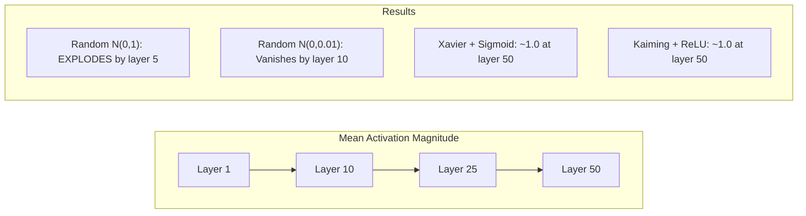
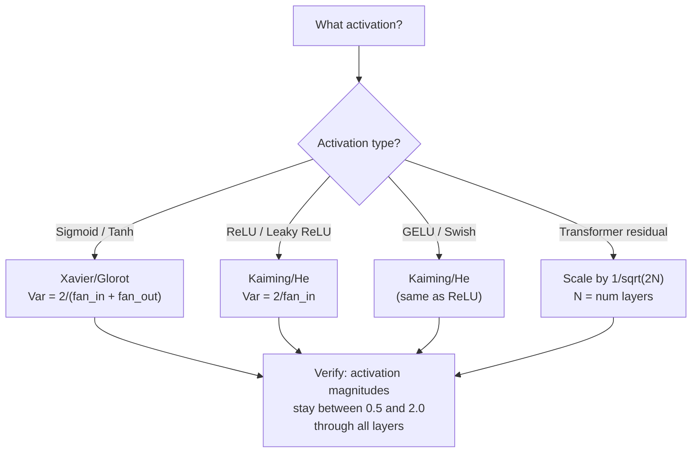

```mermaid
flowchart TD
    subgraph "Zero Init"
        Z1["Layer 1<br/>All weights = 0"] --> Z2["Layer 2<br/>All neurons identical"]
        Z2 --> Z3["Layer 3<br/>Still identical"]
        Z3 --> ZR["Result: 1 effective neuron<br/>regardless of width"]
    end

    subgraph "Xavier Init"
        X1["Layer 1<br/>Var = 2/(fan_in+fan_out)"] --> X2["Layer 2<br/>Signal stable"]
        X2 --> X3["Layer 50<br/>Signal stable"]
        X3 --> XR["Result: Trains with<br/>sigmoid/tanh"]
    end

    subgraph "Kaiming Init"
        K1["Layer 1<br/>Var = 2/fan_in"] --> K2["Layer 2<br/>Signal stable"]
        K2 --> K3["Layer 50<br/>Signal stable"]
        K3 --> KR["Result: Trains with<br/>ReLU/GELU"]
    end
```

# Начало и стабильность тренировок

> Инициализируйте неправильно, и тренировка никогда не начинается. Инициализируйте правильно, и 50 слоев тренируются так же гладко, как 3.

**Type:** Build
**Languages:** Python
**Prerequisites:** Lesson 03.04 (Activation Functions), Lesson 03.07 (Regularization)
**Time:** ~90 minutes

## Цели обучения

- Используйте стратегии инициализации нуля, случайности, Ксавьера/Глората и Кайминга/Хе и измеряйте их влияние на величины активации через 50 слоев
- Вывод почему Xavier init использует Var(w) = 2/(fan_in + fan_out) и Каиминг использует Var(w) = 2/fan_in
- Продемонстрировать проблему симметрии с нулевой инициализацией и объяснить, почему случайная масштабная система в одиночку недостаточна
- Совпадение правильной стратегии инициализации с функцией активации: Ксавье для сигмоида/танх, Кайминг для ReLU/GELU

## Проблема

Инициализируйте все весы до нуля. Ничто не учится. Каждый нейрон вычисляет ту же функцию, получает тот же градиент и обновляется идентично. После 10 000 эпох, ваш скрытый слой из 512 нейронов все еще составляет 512 копий того же нейрона. Вы заплатили за 512 параметров и получили 1.

При этом, если вы запустите их слишком большими, активирование будет взрываться через сеть.

Инициализируйте их случайным образом из стандартного нормального распределения. Работает на 3 слоя. На 50 слоев сигнал разрушается до нуля или детонация до бесконечности в зависимости от того, была ли случайная шкала немного слишком маленькой или немного слишком большой. Граница между "работает" и "сламалась" является мелкой.

Инициализация веса - это самое недооцененное решение в глубоком обучении. Архитектура получает документы. Оптимизаторы получают сообщения в блогах. Инициализация получает записку. Но поймите это неправильно, и ничего другого не имеет значения - ваша сеть мертва до начала тренировки.

## Концепция

### Проблема симметрии

Каждый нейрон в слое имеет ту же структуру: умножить входы на вес, добавить предвзятость, применить активацию. Если все весы начинаются с одного и того же значения (нуль - экстремальный случай), каждый нейрон вычисляет тот же выход. Во время обратного распространения каждый нейрон получает тот же градиент. Во время этапа обновления каждый нейрон меняется одинаково.

В сети сотни параметров, но все они движутся в замке. Это называется симметрия, и случайная инициализация - это способ разрушить ее грубой силой. Каждый нейрон начинается в другой точке в пространстве веса, поэтому каждый учится другой особенности.

Но "случайность" не достаточно. * масштаб* случайности определяет, работает ли сеть.

### Распространение вариантов через слои

Рассмотрим один слой с вводами fan_in:

```
z = w1*x1 + w2*x2 + ... + w_n*x_n
```

Если каждый вес wi извлечен из распределения с варианцией Var(w) и каждый вход xi имеет варианцию Var(x), то выходная варианция составляет:

```
Var(z) = fan_in * Var(w) * Var(x)
```

Если Var(w) = 1 и fan_in = 512, то выходная варианция составляет 512x входной варианции. После 10 слоев: 512^10 = 1.2e27.

Если Var ((w) = 0,001, то выходный варианс сокращается на 0,001 * 512 = 0,512 на слой. После 10 слоев: 0,512^10 = 0,00013.

Цель: выбрать Var(w) так, чтобы Var(z) = Var(x). Величина сигнала остается постоянной по уровням.

### Инициализация Xavier/Glorot

Glorot and Bengio (2010) получили решение для сигмоидных и танх-активаций.

```
Var(w) = 2 / (fan_in + fan_out)
```

На практике весы получаются из:

```
w ~ Uniform(-limit, limit)  where limit = sqrt(6 / (fan_in + fan_out))
```

или:

```
w ~ Normal(0, sqrt(2 / (fan_in + fan_out)))
```

Это работает потому, что сигмоид и тань приблизительно линейны около нуля, где живет правильно инициированная активация.

### Каминг/Он инициализация

ReLU убивает половину выходов (все отрицательное становится нулем). эффективный fan_in уменьшается вдвое, потому что в среднем половина входов уменьшается. Xavier init не учитывает этого - он недооценивает необходимый вариант.

He et al. (2015) корректировали формулу:

```
Var(w) = 2 / fan_in
```

Весы извлечены из:

```
w ~ Normal(0, sqrt(2 / fan_in))
```

Фактор 2 компенсирует то, что ReLU нулевая половина активаций. Без него сигнал сокращается примерно на 0,5 раза на слой.

### Интивализация трансформатора

GPT-2 ввел другой шаблон.

```
x = x + sublayer(x)
```

При N остаточных слоев варианс растет пропорционально N. GPT-2 масштабирует вес остаточных слоев на 1/sqrt(2N), где N - количество слоев. Это поддерживает накопленную величину сигнала стабильной.

В Llama 3 (405B параметры, 126 слоев) используется аналогичная схема.



### Величина активации через 50 слоев



### Выбор правильного сердца



```figure
weight-init-variance
```

## Создайте его

### Шаг 1: Стратегии инициирования

Четыре способа инициирования матрицы веса. Каждый возвращает список списков (двухмерная матрица) с фан_в колоннами и фан_в выходящими строками.

```python
import math
import random


def zero_init(fan_in, fan_out):
    return [[0.0 for _ in range(fan_in)] for _ in range(fan_out)]


def random_init(fan_in, fan_out, scale=1.0):
    return [[random.gauss(0, scale) for _ in range(fan_in)] for _ in range(fan_out)]


def xavier_init(fan_in, fan_out):
    std = math.sqrt(2.0 / (fan_in + fan_out))
    return [[random.gauss(0, std) for _ in range(fan_in)] for _ in range(fan_out)]


def kaiming_init(fan_in, fan_out):
    std = math.sqrt(2.0 / fan_in)
    return [[random.gauss(0, std) for _ in range(fan_in)] for _ in range(fan_out)]
```

### Шаг 2: Функции активации

Нам нужны сигмоид, танх и ReLU, чтобы проверить каждую стратегию init с ее намеченной активацией.

```python
def sigmoid(x):
    x = max(-500, min(500, x))
    return 1.0 / (1.0 + math.exp(-x))


def tanh_act(x):
    return math.tanh(x)


def relu(x):
    return max(0.0, x)
```

### Третий шаг: проходите через 50 слоев

Пропускайте случайные данные через глубокую сеть и измеряйте средний объем активации на каждом слое.

```python
def forward_deep(init_fn, activation_fn, n_layers=50, width=64, n_samples=100):
    random.seed(42)
    layer_magnitudes = []

    inputs = [[random.gauss(0, 1) for _ in range(width)] for _ in range(n_samples)]

    for layer_idx in range(n_layers):
        weights = init_fn(width, width)
        biases = [0.0] * width

        new_inputs = []
        for sample in inputs:
            output = []
            for neuron_idx in range(width):
                z = sum(weights[neuron_idx][j] * sample[j] for j in range(width)) + biases[neuron_idx]
                output.append(activation_fn(z))
            new_inputs.append(output)
        inputs = new_inputs

        magnitudes = []
        for sample in inputs:
            magnitudes.append(sum(abs(v) for v in sample) / width)
        mean_mag = sum(magnitudes) / len(magnitudes)
        layer_magnitudes.append(mean_mag)

    return layer_magnitudes
```

### Четвертый шаг: эксперимент

Запустить все комбинации: нулевой init, случайный N(0,1), случайный N(0,0.01), Ксавье с сигмоидом, Ксавье с танхом, Кайминг с ReLU.

```python
def run_experiment():
    configs = [
        ("Zero init + Sigmoid", lambda fi, fo: zero_init(fi, fo), sigmoid),
        ("Random N(0,1) + ReLU", lambda fi, fo: random_init(fi, fo, 1.0), relu),
        ("Random N(0,0.01) + ReLU", lambda fi, fo: random_init(fi, fo, 0.01), relu),
        ("Xavier + Sigmoid", xavier_init, sigmoid),
        ("Xavier + Tanh", xavier_init, tanh_act),
        ("Kaiming + ReLU", kaiming_init, relu),
    ]

    print(f"{'Strategy':<30} {'L1':>10} {'L5':>10} {'L10':>10} {'L25':>10} {'L50':>10}")
    print("-" * 80)

    for name, init_fn, act_fn in configs:
        mags = forward_deep(init_fn, act_fn)
        row = f"{name:<30}"
        for idx in [0, 4, 9, 24, 49]:
            val = mags[idx]
            if val > 1e6:
                row += f" {'EXPLODED':>10}"
            elif val < 1e-6:
                row += f" {'VANISHED':>10}"
            else:
                row += f" {val:>10.4f}"
        print(row)
```

### Шаг 5: демонстрация симметрии

Покажите, что нулевая инициация производит идентичные нейроны.

```python
def symmetry_demo():
    random.seed(42)
    weights = zero_init(2, 4)
    biases = [0.0] * 4

    inputs = [0.5, -0.3]
    outputs = []
    for neuron_idx in range(4):
        z = sum(weights[neuron_idx][j] * inputs[j] for j in range(2)) + biases[neuron_idx]
        outputs.append(sigmoid(z))

    print("\nSymmetry Demo (4 neurons, zero init):")
    for i, out in enumerate(outputs):
        print(f"  Neuron {i}: output = {out:.6f}")
    all_same = all(abs(outputs[i] - outputs[0]) < 1e-10 for i in range(len(outputs)))
    print(f"  All identical: {all_same}")
    print(f"  Effective parameters: 1 (not {len(weights) * len(weights[0])})")
```

### Шаг 6: Отчет о величине слоя по слою

Напечатать визуальную таблицу величин активации через 50 слоев.

```python
def magnitude_report(name, magnitudes):
    print(f"\n{name}:")
    for i, mag in enumerate(magnitudes):
        if i % 5 == 0 or i == len(magnitudes) - 1:
            if mag > 1e6:
                bar = "X" * 50 + " EXPLODED"
            elif mag < 1e-6:
                bar = "." + " VANISHED"
            else:
                bar_len = min(50, max(1, int(mag * 10)))
                bar = "#" * bar_len
            print(f"  Layer {i+1:3d}: {bar} ({mag:.6f})")
```

## Используйте его

PyTorch предоставляет следующие функции встроенными в систему:

```python
import torch
import torch.nn as nn

layer = nn.Linear(512, 256)

nn.init.xavier_uniform_(layer.weight)
nn.init.xavier_normal_(layer.weight)

nn.init.kaiming_uniform_(layer.weight, nonlinearity='relu')
nn.init.kaiming_normal_(layer.weight, nonlinearity='relu')

nn.init.zeros_(layer.bias)
```

Когда ты позвонишь`nn.Linear(512, 256)`ПайТорч выполняет правильный выбор, но когда вы создаете пользовательские архитектуры или проникаете глубже, чем 20 слоев, вам нужно понять, что происходит и потенциально отменить дефолт.

Для трансформаторов модели HuggingFace обычно обрабатывают инициализацию в их `_init_weights`Если вы строите трансформатор с нуля, вам нужно добавить это самостоятельно.

## Погрузи его

Этот урок дает результаты:
- `outputs/prompt-init-strategy.md`-- пропортер , который диагностирует проблемы с инициализацией веса и рекомендует правильную стратегию

## Упражнения

1. Добавьте инициализацию LeCun (Var = 1/fan_in, предназначенная для активации SELU).

2. Используйте остаточный масштабирование GPT-2: умножьте выпуск каждого слоя на 1/sqrt(2*N) перед добавлением к остаточному потоку.

3. Создать функцию "проверка состояния init", которая принимает размеры слоя сети и тип активации, затем рекомендует правильную инициализацию и предупреждает, если текущий init вызовет проблемы.

4. Запустить эксперимент с fan_in = 16 против fan_in = 1024. Ксавье и Кайминг адаптируются к fan_in, но случайный init не. Покажите, как разрыв между "работает" и "перерывы" расширяется с более крупными слоями.

5. Реализуйте ортогональную инициализацию (генерируйте случайную матрицу, вычислите ее SVD, используйте ортогональную матрицу U).

## Ключевые условия

| Term | What people say | What it actually means |
|------|----------------|----------------------|
| Weight initialization | "Set starting weights randomly" | The strategy for choosing initial weight values that determines whether a network can train at all |
| Symmetry breaking | "Make neurons different" | Using random initialization to ensure neurons learn distinct features instead of computing identical functions |
| Fan-in | "Number of inputs to a neuron" | The number of incoming connections, which determines how input variance accumulates in the weighted sum |
| Fan-out | "Number of outputs from a neuron" | The number of outgoing connections, relevant for maintaining gradient variance during backpropagation |
| Xavier/Glorot init | "The sigmoid initialization" | Var(w) = 2/(fan_in + fan_out), designed to preserve variance through sigmoid and tanh activations |
| Kaiming/He init | "The ReLU initialization" | Var(w) = 2/fan_in, accounts for ReLU zeroing half the activations |
| Variance propagation | "How signals grow or shrink through layers" | The mathematical analysis of how activation variance changes layer by layer based on weight scale |
| Residual scaling | "GPT-2's init trick" | Scaling residual connection weights by 1/sqrt(2N) to prevent variance growth through N transformer layers |
| Dead network | "Nothing trains" | A network where poor initialization causes all gradients to be zero or all activations to saturate |
| Exploding activations | "Values go to infinity" | When weight variance is too high, causing activation magnitudes to grow exponentially through layers |

## Дальнейшее чтение

- Глорот и Бенгио, "Понимание сложности обучения глубоким обратным сигнальным нейронным сетям" (2010) - оригинальная статья о инициировании Xavier с анализом вариантов
- He et al., "Глубокое погружение в исправляющие" (2015) -- представил инициализацию Кайминга для сетей ReLU
- Radford и др., "Модели языка - неконтролируемые многозадачные учащиеся" (2019) -- GPT-2 документ с остаточной масштабировкой инициализации
- Мишкин и Матас, "Все, что вам нужно, это хорошее начало" (2016) - начальная последовательность единиц-вариансов, эмпирическая альтернатива аналитическим формулам
