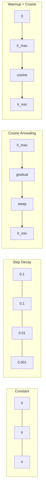
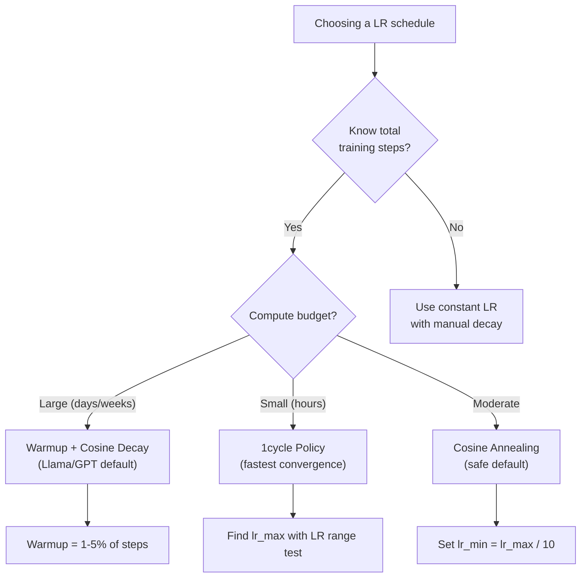
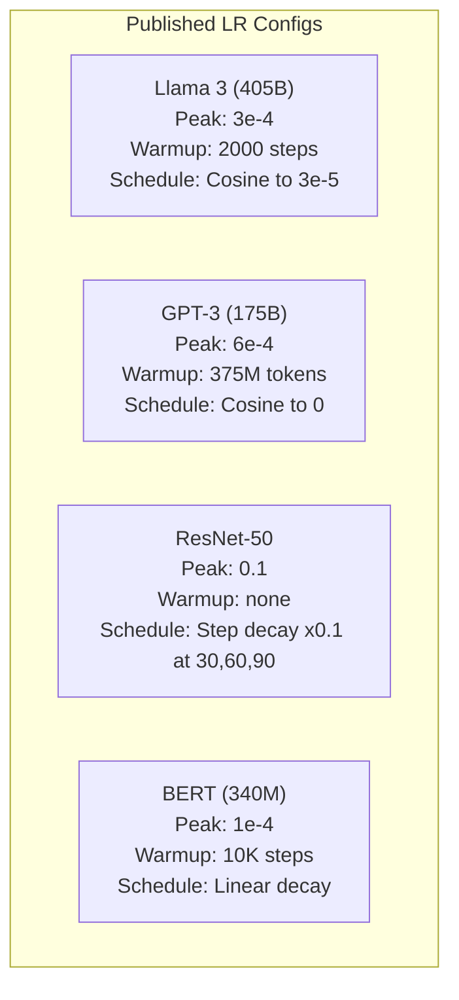

# Расписания изменения learning rate и warmup

> Learning rate — самый важный гиперпараметр. Не архитектура. Не размер датасета. Не функция активации. Именно learning rate. Если вы ничего больше не настраиваете, настройте хотя бы это.

**Type:** Build
**Languages:** Python
**Prerequisites:** Lesson 03.06 (Optimizers), Lesson 03.08 (Weight Initialization)
**Time:** ~90 минут

## Цели обучения

- Реализовать с нуля расписания learning rate: константное, ступенчатое затухание (step decay), cosine annealing, warmup + cosine и 1cycle
- Продемонстрировать три режима отказа при выборе learning rate: расхождение (слишком высокий), застревание (слишком низкий) и колебания (отсутствие затухания)
- Объяснить, почему warmup необходим для оптимизаторов на основе Adam и как он стабилизирует раннее обучение
- Сравнить скорость сходимости всех пяти расписаний на одной и той же задаче и выбрать подходящее для заданного бюджета обучения

## Проблема

Установите learning rate равным 0.1. Обучение расходится — loss улетает в бесконечность за 3 шага. Установите 0.0001. Обучение ползёт — после 100 эпох модель почти не сдвинулась с места от случайной инициализации. Установите 0.01. Обучение работает 50 эпох, затем loss начинает колебаться вокруг минимума, которого он никогда не достигнет, потому что шаги слишком велики.

Оптимальный learning rate — не константа. Он меняется в процессе обучения. В начале нужны большие шаги, чтобы быстро покрыть пространство. Ближе к концу обучения нужны крошечные шаги, чтобы осесть в резком минимуме. Разница между моделью с точностью 90% и моделью с точностью 95% часто заключается именно в расписании.

Каждая крупная модель, опубликованная за последние три года, использует расписание learning rate. Llama 3 использовала пиковый lr=3e-4 с 2000 шагами warmup и cosine-затуханием до 3e-5. GPT-3 использовала lr=6e-4 с warmup на протяжении 375 миллионов токенов. Это не произвольные решения. Это результат масштабных перебора гиперпараметров стоимостью в миллионы долларов.

Вам нужно понимать расписания, потому что значения по умолчанию не подойдут для вашей задачи. При дообучении (fine-tune) предобученной модели правильное расписание отличается от обучения с нуля. При увеличении размера батча период warmup нужно менять. Когда обучение ломается на шаге 10 000, вам нужно знать, проблема в расписании или в чём-то другом.

## Концепция

### Константный Learning Rate

Самый простой подход. Выбрать число и использовать его на каждом шаге.

```
lr(t) = lr_0
```

Редко оптимален. Он либо слишком высок для конца обучения (колебания вокруг минимума), либо слишком низок для начала (потраченные впустую вычисления на крошечные шаги). Хорошо подходит для маленьких моделей и отладки. Ужасный выбор для всего, что обучается дольше часа.

### Step Decay (Ступенчатое затухание)

Подход старой школы из эпохи ResNet. Уменьшать learning rate в фиксированное число раз (обычно в 10 раз) на определённых эпохах.

```
lr(t) = lr_0 * gamma^(floor(epoch / step_size))
```

Где gamma = 0.1 и step_size = 30 означает: lr падает в 10 раз каждые 30 эпох. ResNet-50 использовал это — lr=0.1, падение в 10 раз на эпохах 30, 60 и 90.

Проблема: оптимальные точки затухания зависят от датасета и архитектуры. Переходите к другой задаче — и вам нужно заново настраивать моменты падения. Переходы резкие — loss может подскочить при внезапном изменении скорости.

### Cosine Annealing

Плавное затухание от максимального learning rate к минимальному по косинусоидальной кривой:

```
lr(t) = lr_min + 0.5 * (lr_max - lr_min) * (1 + cos(pi * t / T))
```

Где t — текущий шаг, а T — общее количество шагов.

При t=0 косинусный член равен 1, поэтому lr = lr_max. При t=T косинусный член равен -1, поэтому lr = lr_min. Затухание сначала мягкое, ускоряется в середине и снова становится мягким ближе к концу.

Это стандарт по умолчанию для большинства современных запусков обучения. Не требует настройки гиперпараметров, кроме lr_max и lr_min. Косинусная форма соответствует эмпирическому наблюдению, что большая часть обучения происходит в середине процесса — в этот критический период нужны разумные размеры шагов.

### Warmup: зачем начинать с малого

Adam и другие адаптивные оптимизаторы поддерживают скользящие оценки среднего и дисперсии градиента. На шаге 0 эти оценки инициализируются нулями. Первые несколько обновлений градиента основаны на мусорной статистике. Если learning rate в этот период велик, модель делает огромные, плохо направленные шаги.

Warmup исправляет это. Начните с крошечного learning rate (часто lr_max / warmup_steps или даже нуля) и линейно увеличивайте его до lr_max за первые N шагов. К моменту достижения полного learning rate статистика Adam уже стабилизировалась.

```
lr(t) = lr_max * (t / warmup_steps)     for t < warmup_steps
```

Типичный warmup: 1-5% от общего числа шагов обучения. Llama 3 обучалась на ~1.8 триллиона токенов и использовала warmup в течение 2000 шагов. GPT-3 использовала warmup на протяжении 375 миллионов токенов.

### Linear Warmup + Cosine Decay

Современный стандарт по умолчанию. Линейное наращивание, затем затухание по косинусу:

```
if t < warmup_steps:
    lr(t) = lr_max * (t / warmup_steps)
else:
    progress = (t - warmup_steps) / (total_steps - warmup_steps)
    lr(t) = lr_min + 0.5 * (lr_max - lr_min) * (1 + cos(pi * progress))
```

Именно это используют Llama, GPT, PaLM и большинство современных трансформеров. Warmup предотвращает раннюю нестабильность. Cosine decay помогает модели осесть в хорошем минимуме.

### Политика 1cycle

Открытие Лесли Смита (2018): наращивать learning rate от низкого значения до высокого в первой половине обучения, затем снижать его обратно во второй половине. Контринтуитивно — зачем *увеличивать* learning rate в середине обучения?

Теория: высокий learning rate действует как регуляризация, добавляя шум в траекторию оптимизации. Во время фазы наращивания модель исследует больше областей ландшафта функции потерь, находя лучшие бассейны притяжения. Фаза снижения затем дорабатывает решение внутри найденного лучшего бассейна.

```
Phase 1 (0 to T/2):    lr ramps from lr_max/25 to lr_max
Phase 2 (T/2 to T):    lr ramps from lr_max to lr_max/10000
```

1cycle часто обучается быстрее, чем cosine annealing, при фиксированном вычислительном бюджете. Компромисс: нужно заранее знать общее количество шагов.

### Формы расписаний



### Блок-схема принятия решений



### Реальные цифры из опубликованных моделей



```figure
lr-schedule
```

## Реализация

### Шаг 1: Функции расписаний

Каждая функция принимает текущий шаг и возвращает learning rate на этом шаге.

```python
import math


def constant_schedule(step, lr=0.01, **kwargs):
    return lr


def step_decay_schedule(step, lr=0.1, step_size=100, gamma=0.1, **kwargs):
    return lr * (gamma ** (step // step_size))


def cosine_schedule(step, lr=0.01, total_steps=1000, lr_min=1e-5, **kwargs):
    if step >= total_steps:
        return lr_min
    return lr_min + 0.5 * (lr - lr_min) * (1 + math.cos(math.pi * step / total_steps))


def warmup_cosine_schedule(step, lr=0.01, total_steps=1000, warmup_steps=100, lr_min=1e-5, **kwargs):
    if total_steps <= warmup_steps:
        return lr * (step / max(warmup_steps, 1))
    if step < warmup_steps:
        return lr * step / warmup_steps
    progress = (step - warmup_steps) / (total_steps - warmup_steps)
    return lr_min + 0.5 * (lr - lr_min) * (1 + math.cos(math.pi * progress))


def one_cycle_schedule(step, lr=0.01, total_steps=1000, **kwargs):
    mid = max(total_steps // 2, 1)
    if step < mid:
        return (lr / 25) + (lr - lr / 25) * step / mid
    else:
        progress = (step - mid) / max(total_steps - mid, 1)
        return lr * (1 - progress) + (lr / 10000) * progress
```

### Шаг 2: Визуализация всех расписаний

Выведите текстовый график, показывающий, как каждое расписание изменяется в процессе обучения.

```python
def visualize_schedule(name, schedule_fn, total_steps=500, **kwargs):
    steps = list(range(0, total_steps, total_steps // 20))
    if total_steps - 1 not in steps:
        steps.append(total_steps - 1)

    lrs = [schedule_fn(s, total_steps=total_steps, **kwargs) for s in steps]
    max_lr = max(lrs) if max(lrs) > 0 else 1.0

    print(f"\n{name}:")
    for s, lr_val in zip(steps, lrs):
        bar_len = int(lr_val / max_lr * 40)
        bar = "#" * bar_len
        print(f"  Step {s:4d}: lr={lr_val:.6f} {bar}")
```

### Шаг 3: Обучающая сеть

Простая двухслойная сеть на датасете "circle", как в предыдущих уроках, но теперь мы варьируем расписание.

```python
import random


def sigmoid(x):
    x = max(-500, min(500, x))
    return 1.0 / (1.0 + math.exp(-x))


def relu(x):
    return max(0.0, x)


def relu_deriv(x):
    return 1.0 if x > 0 else 0.0


def make_circle_data(n=200, seed=42):
    random.seed(seed)
    data = []
    for _ in range(n):
        x = random.uniform(-2, 2)
        y = random.uniform(-2, 2)
        label = 1.0 if x * x + y * y < 1.5 else 0.0
        data.append(([x, y], label))
    return data


def train_with_schedule(schedule_fn, schedule_name, data, epochs=300, base_lr=0.05, **kwargs):
    random.seed(0)
    hidden_size = 8
    total_steps = epochs * len(data)

    std = math.sqrt(2.0 / 2)
    w1 = [[random.gauss(0, std) for _ in range(2)] for _ in range(hidden_size)]
    b1 = [0.0] * hidden_size
    w2 = [random.gauss(0, std) for _ in range(hidden_size)]
    b2 = 0.0

    step = 0
    epoch_losses = []

    for epoch in range(epochs):
        total_loss = 0
        correct = 0

        for x, target in data:
            lr = schedule_fn(step, lr=base_lr, total_steps=total_steps, **kwargs)

            z1 = []
            h = []
            for i in range(hidden_size):
                z = w1[i][0] * x[0] + w1[i][1] * x[1] + b1[i]
                z1.append(z)
                h.append(relu(z))

            z2 = sum(w2[i] * h[i] for i in range(hidden_size)) + b2
            out = sigmoid(z2)

            error = out - target
            d_out = error * out * (1 - out)

            for i in range(hidden_size):
                d_h = d_out * w2[i] * relu_deriv(z1[i])
                w2[i] -= lr * d_out * h[i]
                for j in range(2):
                    w1[i][j] -= lr * d_h * x[j]
                b1[i] -= lr * d_h
            b2 -= lr * d_out

            total_loss += (out - target) ** 2
            if (out >= 0.5) == (target >= 0.5):
                correct += 1
            step += 1

        avg_loss = total_loss / len(data)
        accuracy = correct / len(data) * 100
        epoch_losses.append(avg_loss)

    return epoch_losses
```

### Шаг 4: Сравнение всех расписаний

Обучите одну и ту же сеть с каждым расписанием и сравните итоговый loss и поведение сходимости.

```python
def compare_schedules(data):
    configs = [
        ("Constant", constant_schedule, {}),
        ("Step Decay", step_decay_schedule, {"step_size": 15000, "gamma": 0.1}),
        ("Cosine", cosine_schedule, {"lr_min": 1e-5}),
        ("Warmup+Cosine", warmup_cosine_schedule, {"warmup_steps": 3000, "lr_min": 1e-5}),
        ("1cycle", one_cycle_schedule, {}),
    ]

    print(f"\n{'Schedule':<20} {'Start Loss':>12} {'Mid Loss':>12} {'End Loss':>12} {'Best Loss':>12}")
    print("-" * 70)

    for name, schedule_fn, extra_kwargs in configs:
        losses = train_with_schedule(schedule_fn, name, data, epochs=300, base_lr=0.05, **extra_kwargs)
        mid_idx = len(losses) // 2
        best = min(losses)
        print(f"{name:<20} {losses[0]:>12.6f} {losses[mid_idx]:>12.6f} {losses[-1]:>12.6f} {best:>12.6f}")
```

### Шаг 5: LR слишком высокий против слишком низкого

Продемонстрируйте три режима отказа: слишком высокий (расхождение), слишком низкий (застревание) и подходящий.

```python
def lr_sensitivity(data):
    learning_rates = [1.0, 0.1, 0.01, 0.001, 0.0001]

    print("\nLR Sensitivity (constant schedule, 100 epochs):")
    print(f"  {'LR':>10} {'Start Loss':>12} {'End Loss':>12} {'Status':>15}")
    print("  " + "-" * 52)

    for lr in learning_rates:
        losses = train_with_schedule(constant_schedule, f"lr={lr}", data, epochs=100, base_lr=lr)
        start = losses[0]
        end = losses[-1]

        if end > start or math.isnan(end) or end > 1.0:
            status = "DIVERGED"
        elif end > start * 0.9:
            status = "BARELY MOVED"
        elif end < 0.15:
            status = "CONVERGED"
        else:
            status = "LEARNING"

        end_str = f"{end:.6f}" if not math.isnan(end) else "NaN"
        print(f"  {lr:>10.4f} {start:>12.6f} {end_str:>12} {status:>15}")
```

## Применение на практике

PyTorch предоставляет планировщики в `torch.optim.lr_scheduler`:

```python
import torch
import torch.optim as optim
from torch.optim.lr_scheduler import CosineAnnealingLR, OneCycleLR, StepLR

model = nn.Sequential(nn.Linear(10, 64), nn.ReLU(), nn.Linear(64, 1))
optimizer = optim.Adam(model.parameters(), lr=3e-4)

scheduler = CosineAnnealingLR(optimizer, T_max=1000, eta_min=1e-5)

for step in range(1000):
    loss = train_step(model, optimizer)
    scheduler.step()
```

Для warmup + cosine используйте lambda-планировщик или `get_cosine_schedule_with_warmup` из HuggingFace:

```python
from transformers import get_cosine_schedule_with_warmup

scheduler = get_cosine_schedule_with_warmup(
    optimizer,
    num_warmup_steps=2000,
    num_training_steps=100000,
)
```

Именно эту функцию HuggingFace используют большинство скриптов дообучения Llama и GPT. Если сомневаетесь, используйте warmup + cosine с warmup = 3-5% от общего числа шагов. Это работает почти для всего.

## Что сдать

Этот урок производит:
- `outputs/prompt-lr-schedule-advisor.md` — промпт, который рекомендует подходящее расписание learning rate и гиперпараметры для вашей конфигурации обучения

## Упражнения

1. Реализуйте экспоненциальное затухание: lr(t) = lr_0 * gamma^t, где gamma = 0.999. Сравните с cosine annealing на датасете "circle".

2. Реализуйте тест диапазона learning rate (Лесли Смит): обучайте в течение нескольких сотен шагов, экспоненциально увеличивая LR от 1e-7 до 1. Постройте график loss от LR. Оптимальный максимальный LR находится прямо перед тем, как loss начинает расти.

3. Обучайте с warmup + cosine, но варьируйте длину warmup: 0%, 1%, 5%, 10%, 20% от общего числа шагов. Найдите оптимальную точку, где обучение наиболее стабильно.

4. Реализуйте cosine annealing с тёплыми перезапусками (SGDR): сбрасывайте learning rate до lr_max каждые T шагов и снова затухайте. Сравните со стандартным cosine на более длительном обучении.

5. Постройте "хирурга расписаний" (schedule surgeon), который отслеживает training loss и автоматически переключается с warmup на cosine, когда loss стабилизируется, а также уменьшает lr, если loss выходит на плато слишком долго.

## Ключевые термины

| Термин | Что говорят люди | Что это на самом деле означает |
|------|----------------|----------------------|
| Learning rate | "Насколько быстро учится модель" | Скаляр, умножающий градиент, определяющий размер обновления параметров |
| Schedule (расписание) | "Менять LR со временем" | Функция, отображающая шаг обучения в learning rate, спроектированная для оптимизации сходимости |
| Warmup | "Начать с маленького LR" | Линейное наращивание LR от значения, близкого к нулю, до целевого значения за первые N шагов для стабилизации статистики оптимизатора |
| Cosine annealing | "Плавное затухание LR" | Уменьшение LR по косинусоидальной кривой от lr_max до lr_min в процессе обучения |
| Step decay | "Снижать LR на контрольных точках" | Умножение LR на коэффициент (обычно 0.1) через фиксированные интервалы эпох |
| 1cycle policy | "Вверх, потом вниз" | Метод Лесли Смита, заключающийся в наращивании LR, а затем его снижении в рамках одного цикла для более быстрой сходимости |
| LR range test | "Найти лучший learning rate" | Кратковременное обучение с увеличением LR для поиска значения, при котором loss начинает расходиться |
| Cosine с тёплыми перезапусками | "Сбросить и повторить" | Периодический сброс LR до lr_max с последующим затуханием (SGDR) |
| Eta min | "Нижняя граница для LR" | Минимальный learning rate, до которого затухает расписание |
| Peak learning rate | "Максимальный LR" | Наивысший LR, достигаемый в процессе обучения, обычно после warmup |

## Дополнительное чтение

- Loshchilov & Hutter, "SGDR: Stochastic Gradient Descent with Warm Restarts" (2017) — представили cosine annealing и тёплые перезапуски
- Smith, "Super-Convergence: Very Fast Training of Neural Networks Using Large Learning Rates" (2018) — статья о политике 1cycle
- Touvron et al., "Llama 2: Open Foundation and Fine-Tuned Chat Models" (2023) — описывает расписание warmup + cosine, используемое в промышленном масштабе
- Goyal et al., "Accurate, Large Minibatch SGD: Training ImageNet in 1 Hour" (2017) — правило линейного масштабирования и warmup для обучения с большими батчами