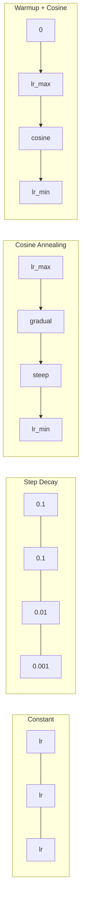
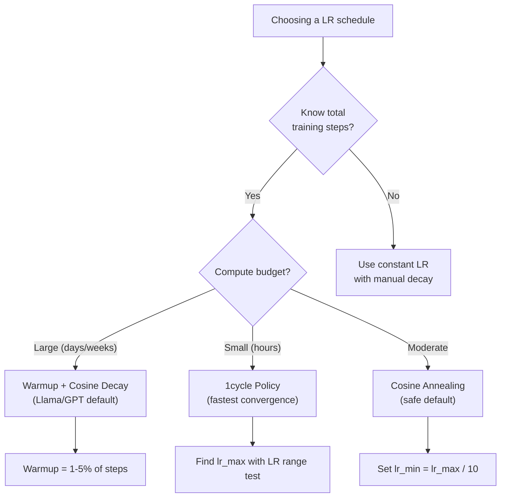
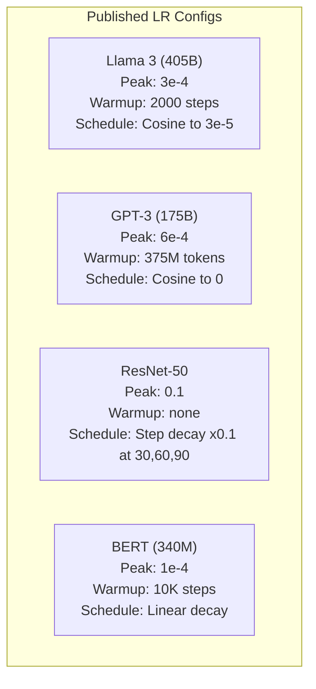

# График обучения и нагрев

> Скорость обучения - это один из самых важных гиперпараметров. Не архитектура, не размер наборов данных, не функция активации. Скорость обучения. Если вы ничего не настроите, настройте это.

**Type:** Build
**Languages:** Python
**Prerequisites:** Lesson 03.06 (Optimizers), Lesson 03.08 (Weight Initialization)
**Time:** ~90 minutes

## Цели обучения

- Реализация постоянных, этапных распада, косинового перезагрузки, нагрева + косиновых и 1-циклических графиков скорости обучения с нуля
- Доказать три способа выбора скорости обучения: дивергенция (слишком высокая), задержка (слишком низкая) и колебания (без распада)
- Объясните, почему для оптимизаторов, которые работают на основе Адама, необходимо отапливать и как это стабилизирует раннюю подготовку
- Сравните скорость конвергенции по всем пяти расписаниям одной задачи и выберите подходящий для данного бюджета обучения

## Проблема

Настройте скорость обучения на 0,1. Тренинг расхождается - потеря скачает до бесконечности в 3 шага. Настройте его на 0,0001. Тренинг скатывается - после 100 эпох модель едва переходит от случайного. Настройте его на 0,01. Тренинг работает в течение 50 эпох, затем потеря колеблется вокруг минимума, который он никогда не может достичь, потому что шаги слишком большие.

Оптимизм обучения не является постоянным. Он меняется во время тренировки. В начале, вы хотите, чтобы большие шаги быстро покрывали землю. В конце тренировки, вы хотите, чтобы крошечные шаги были установлены в резкий минимум. Различие между 90% точной моделью и 95% точной моделью часто просто график.

Каждая из основных моделей, опубликованных за последние три года, использует график уровня обучения. Llama 3 использовал пик lr=3e-4 с 2000 этапами нагрева и косинового распада до 3e-5. GPT-3 использовал lr=6e-4 с нагревом более 375 миллионов токенов.

Вы должны понимать графики, потому что дефолты не будут работать для вашей проблемы. Когда вы настроите доподготовленную модель, правильный график отличается от тренировки с нуля. Когда вы увеличиваете размер партии, период нагрева должен измениться. Когда тренировка перерывается на шаг 10,000, вам нужно знать, является ли это проблемой с графиком или чем-то другим.

## Концепция

### Постоянный уровень обучения

Простейший подход: выберите номер, используйте его на каждом шагу.

```
lr(t) = lr_0
```

Очень редко оптимальный. или слишком высокий для окончания тренировки (осилляция около минимума) или слишком низкий для начала (распущенный вычисление на крошечных шагах).

### Степень распада

Старый школьный подход из эпохи ResNet: сокращение уровня обучения на фактор (обычно в 10 раз) в фиксированные эпохи.

```
lr(t) = lr_0 * gamma^(floor(epoch / step_size))
```

где гамма = 0,1 и шаг_размер = 30 означает: lr падает в 10 раз каждые 30 эпох. ResNet-50 использовал это - lr = 0,1, падает в 10 раз в эпохи 30, 60 и 90.

Проблема: оптимальные точки распада зависят от набора данных и архитектуры. Перейти к другой проблеме и нужно перестроить, когда вы должны выйти. Переходы резкие - потеря может увеличиться, когда скорость внезапно меняется.

### Козино-аннелинг

Плавный распад от максимальной скорости обучения до минимума, следуя косиновой кривой:

```
lr(t) = lr_min + 0.5 * (lr_max - lr_min) * (1 + cos(pi * t / T))
```

где t - текущий шаг, а T - общее количество шагов.

При t=0, косиновый термин - 1, так что lr = lr_max. При t=T, косиновый термин -1, так что lr = lr_min.

Это стандарт для большинства современных тренировочных курсов. Нет гиперпараметров для настройки за рамки lr_max и lr_min. Форма косинусов соответствует эмпирическому наблюдению, что большинство обучения происходит в середине тренировки - вы хотите разумные размеры шагов в этот критический период.

### Огромное внимание: почему нужно начинать с малого

Адам и другие адаптивные оптимизаторы поддерживают текущие оценки среднего и вариантного градиента. На этапе 0, эти оценки инициируются до нуля. Первые несколько обновлений градиента основаны на статистике мусора.

Warmup исправляет это. Начните с небольшого уровня обучения (часто lr_max / warmup_steps или даже нуля) и линейно подняться до lr_max на первых N шагах.

```
lr(t) = lr_max * (t / warmup_steps)     for t < warmup_steps
```

Типичная нагрев: 1-5% от общего количества тренировочных этапов. Llama 3 тренировалась на ~ 1,8 трлн токенов и нагревалась на 2000 этапов. GPT-3 нагревала более 375 миллионов токенов.

### Линейное потепление + распад козина

Современный дефолт.

```
if t < warmup_steps:
    lr(t) = lr_max * (t / warmup_steps)
else:
    progress = (t - warmup_steps) / (total_steps - warmup_steps)
    lr(t) = lr_min + 0.5 * (lr_max - lr_min) * (1 + cos(pi * progress))
```

Это то, что используют Ллама, GPT, PaLM и большинство современных трансформаторов.

### 1 цикл Политика

Открытие Лесли Смит (2018): увеличить уровень обучения с низкого уровня до высокого уровня в первой половине обучения, а затем снизить его во второй половине.

Теория: высокая скорость обучения действует как регуляризация, добавляя шум к траектории оптимизации.

```
Phase 1 (0 to T/2):    lr ramps from lr_max/25 to lr_max
Phase 2 (T/2 to T):    lr ramps from lr_max to lr_max/10000
```

1цикл часто загружается быстрее, чем косиновый перегон для фиксированного вычислительного бюджета.

### Формы расписания



### Схема решения



### Реальные цифры из опубликованных моделей



```figure
lr-schedule
```

## Создайте его

### Шаг 1: Расписание задач

Каждая функция выполняет текущий шаг и возвращает скорость обучения на этом шаге.

```python
import math


def constant_schedule(step, lr=0.01, **kwargs):
    return lr


def step_decay_schedule(step, lr=0.1, step_size=100, gamma=0.1, **kwargs):
    return lr * (gamma ** (step // step_size))


def cosine_schedule(step, lr=0.01, total_steps=1000, lr_min=1e-5, **kwargs):
    if step >= total_steps:
        return lr_min
    return lr_min + 0.5 * (lr - lr_min) * (1 + math.cos(math.pi * step / total_steps))


def warmup_cosine_schedule(step, lr=0.01, total_steps=1000, warmup_steps=100, lr_min=1e-5, **kwargs):
    if total_steps <= warmup_steps:
        return lr * (step / max(warmup_steps, 1))
    if step < warmup_steps:
        return lr * step / warmup_steps
    progress = (step - warmup_steps) / (total_steps - warmup_steps)
    return lr_min + 0.5 * (lr - lr_min) * (1 + math.cos(math.pi * progress))


def one_cycle_schedule(step, lr=0.01, total_steps=1000, **kwargs):
    mid = max(total_steps // 2, 1)
    if step < mid:
        return (lr / 25) + (lr - lr / 25) * step / mid
    else:
        progress = (step - mid) / max(total_steps - mid, 1)
        return lr * (1 - progress) + (lr / 10000) * progress
```

### Шаг 2: представьте все расписания

Печать текстный график, показывающий, как развивается каждый график обучения.

```python
def visualize_schedule(name, schedule_fn, total_steps=500, **kwargs):
    steps = list(range(0, total_steps, total_steps // 20))
    if total_steps - 1 not in steps:
        steps.append(total_steps - 1)

    lrs = [schedule_fn(s, total_steps=total_steps, **kwargs) for s in steps]
    max_lr = max(lrs) if max(lrs) > 0 else 1.0

    print(f"\n{name}:")
    for s, lr_val in zip(steps, lrs):
        bar_len = int(lr_val / max_lr * 40)
        bar = "#" * bar_len
        print(f"  Step {s:4d}: lr={lr_val:.6f} {bar}")
```

### Третий шаг: Сеть обучения

Простая двухслойная сеть на наборе данных круга, такая же, как и в предыдущих уроках, но теперь мы изменяем график.

```python
import random


def sigmoid(x):
    x = max(-500, min(500, x))
    return 1.0 / (1.0 + math.exp(-x))


def relu(x):
    return max(0.0, x)


def relu_deriv(x):
    return 1.0 if x > 0 else 0.0


def make_circle_data(n=200, seed=42):
    random.seed(seed)
    data = []
    for _ in range(n):
        x = random.uniform(-2, 2)
        y = random.uniform(-2, 2)
        label = 1.0 if x * x + y * y < 1.5 else 0.0
        data.append(([x, y], label))
    return data


def train_with_schedule(schedule_fn, schedule_name, data, epochs=300, base_lr=0.05, **kwargs):
    random.seed(0)
    hidden_size = 8
    total_steps = epochs * len(data)

    std = math.sqrt(2.0 / 2)
    w1 = [[random.gauss(0, std) for _ in range(2)] for _ in range(hidden_size)]
    b1 = [0.0] * hidden_size
    w2 = [random.gauss(0, std) for _ in range(hidden_size)]
    b2 = 0.0

    step = 0
    epoch_losses = []

    for epoch in range(epochs):
        total_loss = 0
        correct = 0

        for x, target in data:
            lr = schedule_fn(step, lr=base_lr, total_steps=total_steps, **kwargs)

            z1 = []
            h = []
            for i in range(hidden_size):
                z = w1[i][0] * x[0] + w1[i][1] * x[1] + b1[i]
                z1.append(z)
                h.append(relu(z))

            z2 = sum(w2[i] * h[i] for i in range(hidden_size)) + b2
            out = sigmoid(z2)

            error = out - target
            d_out = error * out * (1 - out)

            for i in range(hidden_size):
                d_h = d_out * w2[i] * relu_deriv(z1[i])
                w2[i] -= lr * d_out * h[i]
                for j in range(2):
                    w1[i][j] -= lr * d_h * x[j]
                b1[i] -= lr * d_h
            b2 -= lr * d_out

            total_loss += (out - target) ** 2
            if (out >= 0.5) == (target >= 0.5):
                correct += 1
            step += 1

        avg_loss = total_loss / len(data)
        accuracy = correct / len(data) * 100
        epoch_losses.append(avg_loss)

    return epoch_losses
```

### Шаг 4: Сравните все расписания

Обучайте одну и ту же сеть с каждым графиком и сравнивайте поведение конечных потерь и конвергенции.

```python
def compare_schedules(data):
    configs = [
        ("Constant", constant_schedule, {}),
        ("Step Decay", step_decay_schedule, {"step_size": 15000, "gamma": 0.1}),
        ("Cosine", cosine_schedule, {"lr_min": 1e-5}),
        ("Warmup+Cosine", warmup_cosine_schedule, {"warmup_steps": 3000, "lr_min": 1e-5}),
        ("1cycle", one_cycle_schedule, {}),
    ]

    print(f"\n{'Schedule':<20} {'Start Loss':>12} {'Mid Loss':>12} {'End Loss':>12} {'Best Loss':>12}")
    print("-" * 70)

    for name, schedule_fn, extra_kwargs in configs:
        losses = train_with_schedule(schedule_fn, name, data, epochs=300, base_lr=0.05, **extra_kwargs)
        mid_idx = len(losses) // 2
        best = min(losses)
        print(f"{name:<20} {losses[0]:>12.6f} {losses[mid_idx]:>12.6f} {losses[-1]:>12.6f} {best:>12.6f}")
```

### Шаг 5: ЛР слишком высокий против слишком низкий

Покажите три режима неудачи: слишком высокий (дивергенция), слишком низкий (крабка) и просто правильный.

```python
def lr_sensitivity(data):
    learning_rates = [1.0, 0.1, 0.01, 0.001, 0.0001]

    print("\nLR Sensitivity (constant schedule, 100 epochs):")
    print(f"  {'LR':>10} {'Start Loss':>12} {'End Loss':>12} {'Status':>15}")
    print("  " + "-" * 52)

    for lr in learning_rates:
        losses = train_with_schedule(constant_schedule, f"lr={lr}", data, epochs=100, base_lr=lr)
        start = losses[0]
        end = losses[-1]

        if end > start or math.isnan(end) or end > 1.0:
            status = "DIVERGED"
        elif end > start * 0.9:
            status = "BARELY MOVED"
        elif end < 0.15:
            status = "CONVERGED"
        else:
            status = "LEARNING"

        end_str = f"{end:.6f}" if not math.isnan(end) else "NaN"
        print(f"  {lr:>10.4f} {start:>12.6f} {end_str:>12} {status:>15}")
```

## Используйте его

PyTorch предоставляет расписания в `torch.optim.lr_scheduler`В следующем случае:

```python
import torch
import torch.optim as optim
from torch.optim.lr_scheduler import CosineAnnealingLR, OneCycleLR, StepLR

model = nn.Sequential(nn.Linear(10, 64), nn.ReLU(), nn.Linear(64, 1))
optimizer = optim.Adam(model.parameters(), lr=3e-4)

scheduler = CosineAnnealingLR(optimizer, T_max=1000, eta_min=1e-5)

for step in range(1000):
    loss = train_step(model, optimizer)
    scheduler.step()
```

Для нагрева + косину используйте график ламбды или `get_cosine_schedule_with_warmup`От HuggingFace:

```python
from transformers import get_cosine_schedule_with_warmup

scheduler = get_cosine_schedule_with_warmup(
    optimizer,
    num_warmup_steps=2000,
    num_training_steps=100000,
)
```

Функция HuggingFace - это то, что используется большинством скриптов для настройки Llama и GPT.

## Погрузи его

Этот урок дает результаты:
- `outputs/prompt-lr-schedule-advisor.md`-- запрос , который рекомендует правильный график скорости обучения и гиперпараметры для вашего обучения настройки

## Упражнения

1. Используйте экспоненциальный распад: lr(t) = lr_0 * gamma^t, где гамма = 0,999.

2. Реализуйте тест диапазона скорости обучения (Лесли Смит): тренируйтесь на несколько сотен шагов, экспоненциально увеличивая ЛР с 1e-7 до 1.

3. Тренируйтесь с теплом + косином, но варьируйте длину тепла: 0%, 1%, 5%, 10%, 20% от общего количества шагов.

4. Внедрение косинового отключения с тепловым запусками (SGDR): восстановление скорости обучения до lr_max на каждые T шаги и повторное разложение.

5. Создайте "хирург-настройщика", который будет следить за потерями тренировок и автоматически переходит от нагрева к косину, когда потеря стабилизируется, и уменьшает лишний вес, если потеря затягивается слишком долго.

## Ключевые условия

| Term | What people say | What it actually means |
|------|----------------|----------------------|
| Learning rate | "How fast the model learns" | The scalar that multiplies the gradient to determine the parameter update size |
| Schedule | "Change the LR over time" | A function that maps training step to learning rate, designed to optimize convergence |
| Warmup | "Start with a small LR" | Linearly ramping the LR from near-zero to the target value over the first N steps to stabilize optimizer statistics |
| Cosine annealing | "Smooth LR decay" | Decreasing the LR following a cosine curve from lr_max to lr_min over training |
| Step decay | "Drop LR at milestones" | Multiplying the LR by a factor (usually 0.1) at fixed epoch intervals |
| 1cycle policy | "Up then down" | Leslie Smith's method of ramping LR up then down in a single cycle for faster convergence |
| LR range test | "Find the best learning rate" | Training briefly while increasing LR to find the value where loss starts diverging |
| Cosine with warm restarts | "Reset and repeat" | Periodically resetting the LR to lr_max and decaying again (SGDR) |
| Eta min | "The floor for the LR" | The minimum learning rate that the schedule decays to |
| Peak learning rate | "The maximum LR" | The highest LR reached during training, typically after warmup |

## Дальнейшее чтение

- Лошкилов и Хаттер, "СГДР: Стохастическое градиентное спускание с теплым восстановлением" (2017) -- внедрили косиновое затягивание и теплый восстановление
- Смит, "Супер-конвергенция: очень быстрая подготовка нейронных сетей с использованием высоких темпов обучения" (2018) -- документ политики 1 цикла
- Touvron et al., "Llama 2: Open Foundation and Fine-Tuned Chat Models" (2023) -- документирует теплая + косиновый график, используемый в масштабе
- Goyal et al., "Точная, большая мини-пачка SGD: Training ImageNet in 1 Hour" (2017) -- правило линейного масштабирования и нагрева для больших партий обучения
