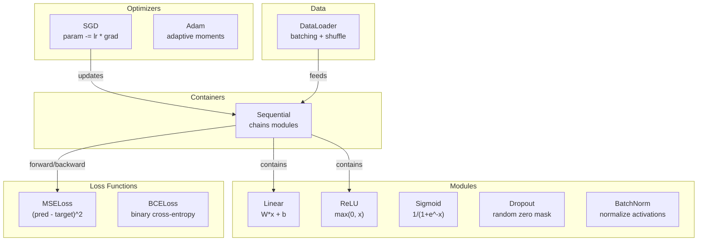
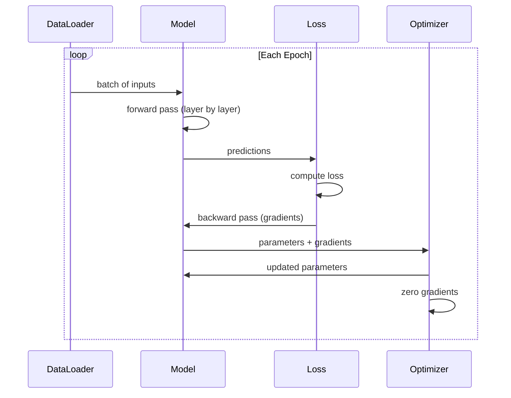
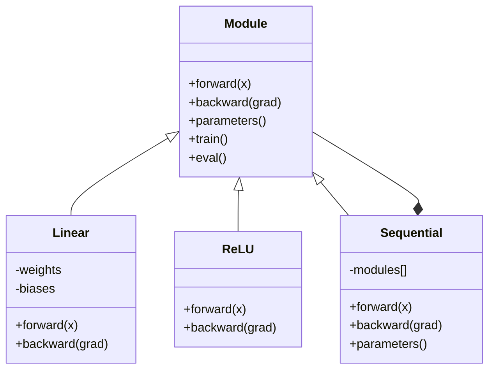

# Создайте свою собственную мини-схему

> Вы создали нейроны, слои, сети, заднюю опору, активации, функции потери, оптимизаторы, регуляризация, инициализация и графики LR. Все это как отдельные части. Теперь соедините их в рамку.

**Type:** Build
**Languages:** Python
**Prerequisites:** All of Phase 03 (Lessons 01-09)
**Time:** ~120 minutes

## Цели обучения

- Создать полную систему глубокого обучения (~ 500 строк) с помощью модулей, линейных, ReLU, Sigmoid, Dropout, BatchNorm, Sequential, функций потери, оптимизаторов и DataLoader
- Объясните абстракцию модуля (наперед, назад, параметры) и почему необходимо переключение режима поезда/эва
- Включить все компоненты в рабочую тренировочную петлю, которая обучает 4-слойную сеть по классификации кругов
- Карта каждого компонента вашей структуры к его PyTorch эквивалент (nn.Module, nn.Sequential, optim.Adam, DataLoader)

## Проблема

У вас есть десять уроков строительных блоков, разбросанных по отдельным файлам.`Value`Урок здесь, тренировочный цикл там, инициализация веса в другом файле, графики скорости обучения в другом. Чтобы обучить сеть, вы копируете и вставляете из пяти различных уроков и проводите их вместе вручную.

Это то, что решают рамки.`nn.Module`- Я не знаю .`nn.Sequential`- Я не знаю .`optim.Adam`- Я не знаю .`DataLoader`Тенсор-Флоу дает вам`keras.Layer`- Я не знаю .`keras.Sequential`- Я не знаю .`keras.optimizers.Adam`Это не магия, это организационные модели, которые позволяют определять, обучать и оценивать сети, не переосмысливая водопроводную систему каждый раз.

Вы собираетесь построить то же самое в примерно 500 строках Python. Нет numpy. Нет внешних зависимостей. Фреймворк, который может определить любую обратную сеть, обучить ее с SGD или Адамом, партидировать данные, применять отказ и нормализацию партидирования, использовать любую активацию и планировать скорость обучения.

Когда ты закончишь, ты поймешь, что происходит, когда ты пишешь.`model = nn.Sequential(...)`Вы поймете, почему.`model.train()`и `model.eval()`Вы поймете, почему.`optimizer.zero_grad()`Вы поймете все это, потому что вы построили все это.

## Концепция

### Абстракция модулей

Каждый слой в PyTorch наследует от `nn.Module`Модуль имеет три функции:

1. **forward()**-- вычислить выходные данные входы
2. **parameters()**- вернуть все тренируемые весы
3. **backward()**-- вычислительные градиенты (обрабатываются автоградом в PyTorch, явно в нашем)

Линейный слой - это модуль. Активация ReLU - это модуль. Снижающий слой - это модуль.

### Последовательный контейнер

`nn.Sequential`Модулы. Передний проход: передача данных через модуль 1, затем модуль 2, затем модуль 3. Передний проход: обратная цепочка. Контейнер сам по себе является модулем - он имеет вперед(), параметры(), и назад(). Это композитный шаблон: последовательность модулей сама по себе является модулем.

### Обучение против оценки

В результате выпуска, невроны будут выделены на нулево во время тренировки, но все пройдет во время оценки.`train()`и `eval()`Каждый модуль имеет`training`флаг.

### Оптимизатор

Оптимизатор обновляет параметры с использованием их градиентов.`param -= lr * grad`Адам: поддерживает оценки импульса и вариантности, затем обновляет. Оптимизатор не знает об архитектуре сети - он видит только плоский список параметров и их градиентов.

### DataLoader

Загрузка данных имеет значение по двум причинам: во-первых, для больших проблем не удается поместить в память весь набор данных. во-вторых, снижение градиента мини-часа обеспечивает шум, который помогает избежать локальных минимумов.

### Рамочная архитектура



### Обучающий цикл



### Иерархия модулей



```figure
gradient-clipping
```

## Создайте его

### Шаг 1: базовый класс модуля

Абстрактный интерфейс, который реализует каждый слой.

```python
class Module:
    def __init__(self):
        self.training = True

    def forward(self, x):
        raise NotImplementedError

    def backward(self, grad):
        raise NotImplementedError

    def parameters(self):
        return []

    def train(self):
        self.training = True

    def eval(self):
        self.training = False
```

### Шаг 2: Линейный слой

Основной блок. Сохраняет весы и предвзятости, вычисляет Wx + b вперед и градиенты веса / ввода назад.

```python
import math
import random


class Linear(Module):
    def __init__(self, fan_in, fan_out):
        super().__init__()
        std = math.sqrt(2.0 / fan_in)
        self.weights = [[random.gauss(0, std) for _ in range(fan_in)] for _ in range(fan_out)]
        self.biases = [0.0] * fan_out
        self.weight_grads = [[0.0] * fan_in for _ in range(fan_out)]
        self.bias_grads = [0.0] * fan_out
        self.fan_in = fan_in
        self.fan_out = fan_out
        self.input = None

    def forward(self, x):
        self.input = x
        output = []
        for i in range(self.fan_out):
            val = self.biases[i]
            for j in range(self.fan_in):
                val += self.weights[i][j] * x[j]
            output.append(val)
        return output

    def backward(self, grad):
        input_grad = [0.0] * self.fan_in
        for i in range(self.fan_out):
            self.bias_grads[i] += grad[i]
            for j in range(self.fan_in):
                self.weight_grads[i][j] += grad[i] * self.input[j]
                input_grad[j] += grad[i] * self.weights[i][j]
        return input_grad

    def parameters(self):
        params = []
        for i in range(self.fan_out):
            for j in range(self.fan_in):
                params.append((self.weights, i, j, self.weight_grads))
            params.append((self.biases, i, None, self.bias_grads))
        return params
```

### Шаг 3: Модулы активации

ReLU, Sigmoid и Tanh как модули.

```python
class ReLU(Module):
    def __init__(self):
        super().__init__()
        self.mask = None

    def forward(self, x):
        self.mask = [1.0 if v > 0 else 0.0 for v in x]
        return [max(0.0, v) for v in x]

    def backward(self, grad):
        return [g * m for g, m in zip(grad, self.mask)]


class Sigmoid(Module):
    def __init__(self):
        super().__init__()
        self.output = None

    def forward(self, x):
        self.output = []
        for v in x:
            v = max(-500, min(500, v))
            self.output.append(1.0 / (1.0 + math.exp(-v)))
        return self.output

    def backward(self, grad):
        return [g * o * (1 - o) for g, o in zip(grad, self.output)]


class Tanh(Module):
    def __init__(self):
        super().__init__()
        self.output = None

    def forward(self, x):
        self.output = [math.tanh(v) for v in x]
        return self.output

    def backward(self, grad):
        return [g * (1 - o * o) for g, o in zip(grad, self.output)]
```

### Шаг 4: модуль "Отпускать"

Случайный нулевой элементы во время тренировки. Скалы оставшиеся элементы на 1/(1-p) так ожидаемые значения остаются теми же.

```python
class Dropout(Module):
    def __init__(self, p=0.5):
        super().__init__()
        self.p = p
        self.mask = None

    def forward(self, x):
        if not self.training:
            return x
        self.mask = [0.0 if random.random() < self.p else 1.0 / (1 - self.p) for _ in x]
        return [v * m for v, m in zip(x, self.mask)]

    def backward(self, grad):
        if self.mask is None:
            return grad
        return [g * m for g, m in zip(grad, self.mask)]
```

### Шаг 5: Модуль BatchNorm

Нормализует активации до нулевой средней и единичной варианции на каждую функцию в партии.

```python
class BatchNorm(Module):
    def __init__(self, size, momentum=0.1, eps=1e-5):
        super().__init__()
        self.size = size
        self.gamma = [1.0] * size
        self.beta = [0.0] * size
        self.gamma_grads = [0.0] * size
        self.beta_grads = [0.0] * size
        self.running_mean = [0.0] * size
        self.running_var = [1.0] * size
        self.momentum = momentum
        self.eps = eps
        self.x_norm = None
        self.std_inv = None
        self.batch_input = None

    def forward_batch(self, batch):
        batch_size = len(batch)
        output_batch = []

        if self.training:
            mean = [0.0] * self.size
            for sample in batch:
                for j in range(self.size):
                    mean[j] += sample[j]
            mean = [m / batch_size for m in mean]

            var = [0.0] * self.size
            for sample in batch:
                for j in range(self.size):
                    var[j] += (sample[j] - mean[j]) ** 2
            var = [v / batch_size for v in var]

            self.std_inv = [1.0 / math.sqrt(v + self.eps) for v in var]

            self.x_norm = []
            self.batch_input = batch
            for sample in batch:
                normed = [(sample[j] - mean[j]) * self.std_inv[j] for j in range(self.size)]
                self.x_norm.append(normed)
                output = [self.gamma[j] * normed[j] + self.beta[j] for j in range(self.size)]
                output_batch.append(output)

            for j in range(self.size):
                self.running_mean[j] = (1 - self.momentum) * self.running_mean[j] + self.momentum * mean[j]
                self.running_var[j] = (1 - self.momentum) * self.running_var[j] + self.momentum * var[j]
        else:
            std_inv = [1.0 / math.sqrt(v + self.eps) for v in self.running_var]
            for sample in batch:
                normed = [(sample[j] - self.running_mean[j]) * std_inv[j] for j in range(self.size)]
                output = [self.gamma[j] * normed[j] + self.beta[j] for j in range(self.size)]
                output_batch.append(output)

        return output_batch

    def forward(self, x):
        result = self.forward_batch([x])
        return result[0]

    def backward(self, grad):
        if self.x_norm is None:
            return grad
        for j in range(self.size):
            self.gamma_grads[j] += self.x_norm[0][j] * grad[j]
            self.beta_grads[j] += grad[j]
        return [grad[j] * self.gamma[j] * self.std_inv[j] for j in range(self.size)]

    def parameters(self):
        params = []
        for j in range(self.size):
            params.append((self.gamma, j, None, self.gamma_grads))
            params.append((self.beta, j, None, self.beta_grads))
        return params
```

### Шаг 6: Последовательный контейнер

Модули цепей. Вперед - с лева на правую, назад - с правой на левую.

```python
class Sequential(Module):
    def __init__(self, *modules):
        super().__init__()
        self.modules = list(modules)

    def forward(self, x):
        for module in self.modules:
            x = module.forward(x)
        return x

    def backward(self, grad):
        for module in reversed(self.modules):
            grad = module.backward(grad)
        return grad

    def parameters(self):
        params = []
        for module in self.modules:
            params.extend(module.parameters())
        return params

    def train(self):
        self.training = True
        for module in self.modules:
            module.train()

    def eval(self):
        self.training = False
        for module in self.modules:
            module.eval()
```

### Шаг 7: Потеря функций

MSE и Binary Cross-Entropy. Каждый возвращает значение потери и обеспечивает обратный (() который возвращает градиент.

```python
class MSELoss:
    def __call__(self, predicted, target):
        self.predicted = predicted
        self.target = target
        n = len(predicted)
        self.loss = sum((p - t) ** 2 for p, t in zip(predicted, target)) / n
        return self.loss

    def backward(self):
        n = len(self.predicted)
        return [2 * (p - t) / n for p, t in zip(self.predicted, self.target)]


class BCELoss:
    def __call__(self, predicted, target):
        self.predicted = predicted
        self.target = target
        eps = 1e-7
        n = len(predicted)
        self.loss = 0
        for p, t in zip(predicted, target):
            p = max(eps, min(1 - eps, p))
            self.loss += -(t * math.log(p) + (1 - t) * math.log(1 - p))
        self.loss /= n
        return self.loss

    def backward(self):
        eps = 1e-7
        n = len(self.predicted)
        grads = []
        for p, t in zip(self.predicted, self.target):
            p = max(eps, min(1 - eps, p))
            grads.append((-t / p + (1 - t) / (1 - p)) / n)
        return grads
```

### Шаг 8: SGD и Adam Optimizers

Оба принимают список параметров и обновляют весы с помощью градиентов.

```python
class SGD:
    def __init__(self, parameters, lr=0.01):
        self.params = parameters
        self.lr = lr

    def step(self):
        for container, i, j, grad_container in self.params:
            if j is not None:
                container[i][j] -= self.lr * grad_container[i][j]
            else:
                container[i] -= self.lr * grad_container[i]

    def zero_grad(self):
        for container, i, j, grad_container in self.params:
            if j is not None:
                grad_container[i][j] = 0.0
            else:
                grad_container[i] = 0.0


class Adam:
    def __init__(self, parameters, lr=0.001, beta1=0.9, beta2=0.999, eps=1e-8):
        self.params = parameters
        self.lr = lr
        self.beta1 = beta1
        self.beta2 = beta2
        self.eps = eps
        self.t = 0
        self.m = [0.0] * len(parameters)
        self.v = [0.0] * len(parameters)

    def step(self):
        self.t += 1
        for idx, (container, i, j, grad_container) in enumerate(self.params):
            if j is not None:
                g = grad_container[i][j]
            else:
                g = grad_container[i]

            self.m[idx] = self.beta1 * self.m[idx] + (1 - self.beta1) * g
            self.v[idx] = self.beta2 * self.v[idx] + (1 - self.beta2) * g * g

            m_hat = self.m[idx] / (1 - self.beta1 ** self.t)
            v_hat = self.v[idx] / (1 - self.beta2 ** self.t)

            update = self.lr * m_hat / (math.sqrt(v_hat) + self.eps)

            if j is not None:
                container[i][j] -= update
            else:
                container[i] -= update

    def zero_grad(self):
        for container, i, j, grad_container in self.params:
            if j is not None:
                grad_container[i][j] = 0.0
            else:
                grad_container[i] = 0.0
```

### Шаг 9: DataLoader

Разделяет данные на партии, выбирая вариант перемешивания каждой эпохи.

```python
class DataLoader:
    def __init__(self, data, batch_size=32, shuffle=True):
        self.data = data
        self.batch_size = batch_size
        self.shuffle = shuffle

    def __iter__(self):
        indices = list(range(len(self.data)))
        if self.shuffle:
            random.shuffle(indices)
        for start in range(0, len(indices), self.batch_size):
            batch_indices = indices[start:start + self.batch_size]
            batch = [self.data[i] for i in batch_indices]
            inputs = [item[0] for item in batch]
            targets = [item[1] for item in batch]
            yield inputs, targets

    def __len__(self):
        return (len(self.data) + self.batch_size - 1) // self.batch_size
```

### Шаг 10: Обучить 4-слойную сеть по классификации кругов

Соедините все, определите модель, выберите проигрыш, выберите оптимизатор, запустите тренировочную петлю.

```python
def make_circle_data(n=500, seed=42):
    random.seed(seed)
    data = []
    for _ in range(n):
        x = random.uniform(-2, 2)
        y = random.uniform(-2, 2)
        label = 1.0 if x * x + y * y < 1.5 else 0.0
        data.append(([x, y], [label]))
    return data


def train():
    random.seed(42)

    model = Sequential(
        Linear(2, 16),
        ReLU(),
        Linear(16, 16),
        ReLU(),
        Linear(16, 8),
        ReLU(),
        Linear(8, 1),
        Sigmoid(),
    )

    criterion = BCELoss()
    optimizer = Adam(model.parameters(), lr=0.01)

    data = make_circle_data(500)
    split = int(len(data) * 0.8)
    train_data = data[:split]
    test_data = data[split:]

    loader = DataLoader(train_data, batch_size=16, shuffle=True)

    model.train()

    for epoch in range(100):
        total_loss = 0
        total_correct = 0
        total_samples = 0

        for batch_inputs, batch_targets in loader:
            batch_loss = 0
            for x, t in zip(batch_inputs, batch_targets):
                pred = model.forward(x)
                loss = criterion(pred, t)
                batch_loss += loss

                optimizer.zero_grad()
                grad = criterion.backward()
                model.backward(grad)
                optimizer.step()

                predicted_class = 1.0 if pred[0] >= 0.5 else 0.0
                if predicted_class == t[0]:
                    total_correct += 1
                total_samples += 1

            total_loss += batch_loss

        avg_loss = total_loss / total_samples
        accuracy = total_correct / total_samples * 100

        if epoch % 10 == 0 or epoch == 99:
            print(f"Epoch {epoch:3d} | Loss: {avg_loss:.6f} | Train Accuracy: {accuracy:.1f}%")

    model.eval()
    correct = 0
    for x, t in test_data:
        pred = model.forward(x)
        predicted_class = 1.0 if pred[0] >= 0.5 else 0.0
        if predicted_class == t[0]:
            correct += 1
    test_accuracy = correct / len(test_data) * 100
    print(f"\nTest Accuracy: {test_accuracy:.1f}% ({correct}/{len(test_data)})")

    return model, test_accuracy
```

## Используйте его

Вот эквивалент PyTorch того, что вы только что построили:

```python
import torch
import torch.nn as nn
from torch.utils.data import DataLoader, TensorDataset

model = nn.Sequential(
    nn.Linear(2, 16),
    nn.ReLU(),
    nn.Linear(16, 16),
    nn.ReLU(),
    nn.Linear(16, 8),
    nn.ReLU(),
    nn.Linear(8, 1),
    nn.Sigmoid(),
)

criterion = nn.BCELoss()
optimizer = torch.optim.Adam(model.parameters(), lr=0.01)

for epoch in range(100):
    model.train()
    for inputs, targets in dataloader:
        optimizer.zero_grad()
        predictions = model(inputs)
        loss = criterion(predictions, targets)
        loss.backward()
        optimizer.step()

    model.eval()
    with torch.no_grad():
        test_predictions = model(test_inputs)
```

Структура идентична.`Sequential`- Я не знаю .`Linear`- Я не знаю .`ReLU`- Я не знаю .`Sigmoid`- Я не знаю .`BCELoss`- Я не знаю .`Adam`- Я не знаю .`zero_grad`- Я не знаю .`backward`- Я не знаю .`step`- Я не знаю .`train`- Я не знаю .`eval`Каждый концепт картирует один на один. Разница в том, что PyTorch автоматически обрабатывает автоград (не нужно внедрять назад в каждом модуле), работает на GPU и оптимизирована на протяжении многих лет.

Когда вы видите код PyTorch, вы точно знаете, что происходит на каждой строке.

## Погрузи его

Этот урок дает результаты:
- `outputs/prompt-framework-architect.md`-- запрос для проектирования архитектур нейронных сетей с использованием абстракций рамок

## Упражнения

1. Добавьте `SoftmaxCrossEntropyLoss`Softmax прогнозы, вычислить потери кросс-энтропии, и обработать комбинированный обратный проход.

2. Внедрить график скорости обучения в оптимизаторе: добавить `set_lr()`Урок 9 - Обучить классификатор круга с помощью тепла + косину и сравнить с постоянным LR.

3. Добавьте `save()`и `load()`С помощью метода Sequential, который сериализирует все весы в файл JSON и загружает их обратно.

4. Внедрить упадки веса (регуляризация L2) в оптимизатор Адама.`weight_decay`Параметр, который сокращает вес к нулю на каждом шагу.

5. Замените тренировочную петлю на образцы правильным мини-пачтом набора градиентов: накопите градиенты по всем образцам в партии, затем делитесь по размеру партии и сделайте один шаг оптимизатора. Измерить, изменяется ли скорость конвергенции.

## Ключевые условия

| Term | What people say | What it actually means |
|------|----------------|----------------------|
| Module | "A layer" | The base abstraction in a framework -- anything with forward(), backward(), and parameters() |
| Sequential | "Stack layers in order" | A container that chains modules, applying them in sequence for forward and reverse for backward |
| Forward pass | "Run the network" | Computing the output by passing input through each module in order |
| Backward pass | "Compute gradients" | Propagating the loss gradient through each module in reverse to compute parameter gradients |
| Parameters | "The trainable weights" | All values in the network that the optimizer can update -- weights and biases |
| Optimizer | "The thing that updates weights" | An algorithm that uses gradients to update parameters, implementing SGD, Adam, or other rules |
| DataLoader | "The thing that feeds data" | An iterator that splits a dataset into batches, optionally shuffling between epochs |
| Training mode | "model.train()" | A flag that enables stochastic behavior like dropout and batch normalization with batch stats |
| Evaluation mode | "model.eval()" | A flag that disables dropout and uses running statistics for batch normalization |
| Zero grad | "Clear the gradients" | Resetting all parameter gradients to zero before computing the next batch's gradients |

## Дальнейшее чтение

- Paszke et al., "PyTorch: Imperative Style, High-Performance Deep Learning Library" (2019) - статья, описывающая решения PyTorch по дизайну
- Чоллет, "Глубокое обучение с Python, второе издание" (2021) -- Глава 3 охватывает внутренние части Керас с той же абстракцией модуля/слоя
- Джонсон, "Маленький ДНН" (https://github.com/tiny-dnn/tiny-dnn) -- рамка глубокого обучения в C++ только для заголовков для понимания внутренних элементов рамки
