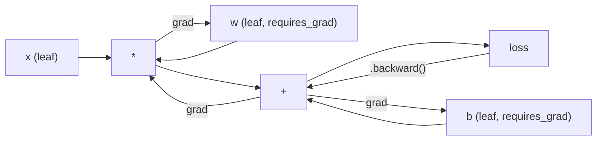
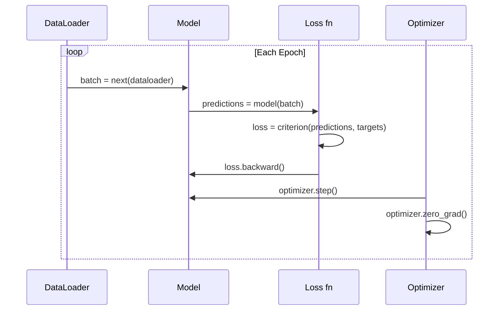

# Введение в PyTorch

> Ты построил двигатель из поршков и коробков, а теперь научись управлять тем, что действительно работает на всех.

**Type:** Build
**Languages:** Python
**Prerequisites:** Lesson 03.10 (Build Your Own Mini Framework)
**Time:** ~75 minutes

## Цели обучения

- Создание и обучение нейронных сетей с использованием nn.Module PyTorch, nn.Sequential и autograd
- Используйте тенсоры PyTorch, ускорение GPU и стандартную тренировочную петлю (zero_grad, вперед, потеря, назад, шаг)
- Преобразуйте свои мини-компоненты из нуля в их эквиваленты PyTorch
- Профилируйте и сравнивайте скорость обучения между вашей структурой Pure-Python и PyTorch на одном и том же задании

## Проблема

У вас есть работающая мини-фреймворк. Линейные слои, ReLU, выпуск, партия норма, Адам, DataLoader, тренировочный петля. Он обучает 4-слойную сеть на проблеме классификации кругов в чистом Python.

Он также в 500 раз медленнее, чем PyTorch на той же проблеме.

Ваша мини-фреймворк обрабатывает один образец в один раз с заложенными петлями Python. PyTorch отправляет те же операции в оптимизированные ядра C++ / CUDA, которые работают на GPU. На одной NVIDIA A100 PyTorch тренирует ResNet-50 (25,6 млн параметров) на ImageNet (1.28 млн изображений) примерно за 6 часов. Ваша структура заняла бы примерно 3000 часов на ту же задачу - если бы она не исчерпала сначала память.

Скорость - не единственный пробел. У вашей системы нет поддержки GPU. Нет автоматической дифференциации - вы написали рукой назад для каждого модуля. Нет сериализации. Нет распределенного обучения. Нет смешанной точности. Нет способа отрегулировать поток градиента без печатных заявлений.

PyTorch заполняет все эти пробелы. и это делает, сохраняя ту же ментальную модель, которую вы уже построили: модуль, вперед(), параметры(), назад(), оптимизатор.этап().

## Концепция

### Почему Питероч победил

В 2015 году TensorFlow потребовал от вас определить график статического вычисления, прежде чем вы запустили что-либо. Вы создали график, компилировали его, а затем подавали данные через него.

PyTorch был запущен в 2017 году с другой философией: стремительное исполнение. Вы пишете Python. Он работает сразу. `y = model(x)`на самом деле вычисляет y прямо сейчас, а не "добавить узел в график, который будет вычислять y позже". Это означало, что стандартные инструменты дебюгирования Python работали.

К 2020 году рынок вышел на рынок. Доля PyTorch в исследовательских работах ML выросла с 7% (2017) до более 75% (2022). Meta, Google DeepMind, OpenAI, Anthropic и Hugging Face все используют PyTorch в качестве своей основной структуры. TensorFlow 2.x принял востребованное исполнение в ответ - молчаливое признание того, что дизайн PyTorch был правильным.

Урок: разработчики испытывают соединения. Фреймворк, который на 10% медленнее, но на 50% быстрее дебгурирует, выигрывает каждый раз.

### Тенсоры

Тензор - это многомерный массив с тремя критическими свойствами: формой, дтипом и устройством.

```python
import torch

x = torch.zeros(3, 4)           # shape: (3, 4), dtype: float32, device: cpu
x = torch.randn(2, 3, 224, 224) # batch of 2 RGB images, 224x224
x = torch.tensor([1, 2, 3])     # from a Python list
```

**Shape**Скаларизм - форма (), вектор - (n), матрица - (m, n), партия изображений - (часть, каналы, высота, ширина).

**Dtype**контролирует точность и память.

| dtype | Bits | Range | Use case |
|-------|------|-------|----------|
| float32 | 32 | ~7 decimal digits | Default training |
| float16 | 16 | ~3.3 decimal digits | Mixed precision |
| bfloat16 | 16 | Same range as float32, less precision | LLM training |
| int8 | 8 | -128 to 127 | Quantized inference |

**Device**определяет, где происходит вычисление.

```python
device = torch.device("cuda" if torch.cuda.is_available() else "cpu")
x = torch.randn(3, 4, device=device)
x = x.to("cuda")
x = x.cpu()
```

Каждая операция требует всех тензоров на одном устройстве.`RuntimeError: Expected all tensors to be on the same device`- Поправить это, переместив все на одно устройство до вычисления.

**Reshaping**Это постоянное время - это изменяет метаданные, а не данные.

```python
x = torch.randn(2, 3, 4)
x.view(2, 12)      # reshape to (2, 12) -- must be contiguous
x.reshape(6, 4)    # reshape to (6, 4) -- works always
x.permute(2, 0, 1) # reorder dimensions
x.unsqueeze(0)     # add dimension: (1, 2, 3, 4)
x.squeeze()        # remove size-1 dimensions
```

### Автоград

Ваша мини-фреймворк требует, чтобы вы реализовали назад для каждого модуля. PyTorch не делает этого. Он записывает каждую операцию на тензорах в направленную ациклическую графику (вычислительную графику), а затем переходит через эту графику в обратном направлении, чтобы автоматически рассчитывать градиенты.



Основное отличие от вашей системы: PyTorch использует автоматическое дифференцирование на основе ленты.`.backward()`пересматривает ленту в обратном направлении.

```python
x = torch.randn(3, requires_grad=True)
y = x ** 2 + 3 * x
z = y.sum()
z.backward()
print(x.grad)  # dz/dx = 2x + 3
```

Три правила автограда:

1. Только листья тензоров с `requires_grad=True`накопительные градиенты
2. Градиенты накапливаются по умолчанию -- вызов `optimizer.zero_grad()`перед каждым обратным проходом
3. `torch.no_grad()`отключает отслеживание градиента (использование во время оценки)

### nn.Модуль

`nn.Module`Вы уже построили эту абстракцию в уроке 10. версия PyTorch добавляет автоматическую регистрацию параметров, рекурсивное обнаружение модулей, управление устройством и сериализацию диктового состояния.

```python
import torch.nn as nn

class MLP(nn.Module):
    def __init__(self, input_dim, hidden_dim, output_dim):
        super().__init__()
        self.layer1 = nn.Linear(input_dim, hidden_dim)
        self.relu = nn.ReLU()
        self.layer2 = nn.Linear(hidden_dim, output_dim)

    def forward(self, x):
        x = self.layer1(x)
        x = self.relu(x)
        x = self.layer2(x)
        return x
```

Когда вы назначаете `nn.Module`или `nn.Parameter`как атрибут в `__init__`PyTorch автоматически регистрирует его.`model.parameters()`Поэтому вам никогда не нужно собирать весы вручную, как в мини-рамочке.

Ключевые строительные блоки:

| Module | What it does | Parameters |
|--------|-------------|------------|
| nn.Linear(in, out) | Wx + b | in*out + out |
| nn.Conv2d(in_ch, out_ch, k) | 2D convolution | in_ch*out_ch*k*k + out_ch |
| nn.BatchNorm1d(features) | Normalize activations | 2 * features |
| nn.Dropout(p) | Random zeroing | 0 |
| nn.ReLU() | max(0, x) | 0 |
| nn.GELU() | Gaussian error linear | 0 |
| nn.Embedding(vocab, dim) | Lookup table | vocab * dim |
| nn.LayerNorm(dim) | Per-sample normalization | 2 * dim |

### Убытки функций и оптимизаторы

PyTorch отправляет готовые к производству версии всего, что вы построили.

**Loss functions**(от `torch.nn`):

| Loss | Task | Input |
|------|------|-------|
| nn.MSELoss() | Regression | Any shape |
| nn.CrossEntropyLoss() | Multi-class classification | Logits (not softmax) |
| nn.BCEWithLogitsLoss() | Binary classification | Logits (not sigmoid) |
| nn.L1Loss() | Regression (robust) | Any shape |
| nn.CTCLoss() | Sequence alignment | Log probabilities |

Примечание: `CrossEntropyLoss`сочетает `LogSoftmax`+ `NLLLoss`Это обычная ошибка, которая производит неправильные градиенты тихо.

**Optimizers**(от `torch.optim`):

| Optimizer | When to use | Typical LR |
|-----------|-------------|-----------|
| SGD(params, lr, momentum) | CNNs, well-tuned pipelines | 0.01--0.1 |
| Adam(params, lr) | Default starting point | 1e-3 |
| AdamW(params, lr, weight_decay) | Transformers, fine-tuning | 1e-4--1e-3 |
| LBFGS(params) | Small-scale, second-order | 1.0 |

### Обучение

Каждый тренировочный цикл PyTorch следует тому же 5-ступенчатому шаблону.



Канонический шаблон:

```python
for epoch in range(num_epochs):
    model.train()
    for inputs, targets in train_loader:
        inputs, targets = inputs.to(device), targets.to(device)
        optimizer.zero_grad()
        outputs = model(inputs)
        loss = criterion(outputs, targets)
        loss.backward()
        optimizer.step()
```

Пять линий внутри петли партии, пять линий, которые обучают GPT-4, стабильную диффузию и LLaMA.

### Комплект данных и DataLoader

Питорч `Dataset`является абстрактным классом с двумя методами: `__len__`и `__getitem__`- Я не знаю .`DataLoader`Завершает сборку, перемешивание и загрузку данных с несколькими процессами.

```python
from torch.utils.data import Dataset, DataLoader

class MNISTDataset(Dataset):
    def __init__(self, images, labels):
        self.images = images
        self.labels = labels

    def __len__(self):
        return len(self.labels)

    def __getitem__(self, idx):
        return self.images[idx], self.labels[idx]

loader = DataLoader(dataset, batch_size=64, shuffle=True, num_workers=4)
```

`num_workers=4`При этом, при работе с диском (большие изображения, аудио), это может удвоить скорость обучения.

### Обучение на GPU

Перемещение модели на GPU:

```python
device = torch.device("cuda" if torch.cuda.is_available() else "cpu")
model = model.to(device)
```

Это рекурсивно переносит каждый параметр и буфер на ГПУ.

```python
inputs, targets = inputs.to(device), targets.to(device)
```

**Mixed precision**удвоивает использование памяти и пропускную способность на современных графических процессорах (A100, H100, RTX 4090) путем движения вперед/задом в float16 при сохранении основных весов в float32:

```python
from torch.amp import autocast, GradScaler

scaler = GradScaler()
for inputs, targets in loader:
    with autocast(device_type="cuda"):
        outputs = model(inputs)
        loss = criterion(outputs, targets)
    scaler.scale(loss).backward()
    scaler.step(optimizer)
    scaler.update()
    optimizer.zero_grad()
```

### Сравнение: Mini Framework против PyTorch против JAX

| Feature | Mini Framework (L10) | PyTorch | JAX |
|---------|---------------------|---------|-----|
| Autodiff | Manual backward() | Tape-based autograd | Functional transforms |
| Execution | Eager (Python loops) | Eager (C++ kernels) | Traced + JIT compiled |
| GPU support | No | Yes (CUDA, ROCm, MPS) | Yes (CUDA, TPU) |
| Speed (MNIST MLP) | ~300s/epoch | ~0.5s/epoch | ~0.3s/epoch |
| Module system | Custom Module class | nn.Module | Stateless functions (Flax/Equinox) |
| Debugging | print() | print(), pdb, breakpoint() | Harder (JIT tracing breaks print) |
| Ecosystem | None | Hugging Face, Lightning, timm | Flax, Optax, Orbax |
| Learning curve | You built it | Moderate | Steep (functional paradigm) |
| Production use | Toy problems | Meta, OpenAI, Anthropic, HF | Google DeepMind, Midjourney |

```figure
dropout-mask
```

## Создайте его

3-слойная MLP, обученная на МНИСТ, используя только примитивные PyTorch.`torchvision.datasets`Мы сами загружаем и анализируем сырые данные.

### Шаг 1: Загрузить MNIST из сырых файлов

MNIST отправляется в виде 4 файлов: тренировочные изображения (60.000 x 28 x 28), тренировочные этикетки, тестовые изображения (10.000 x 28 x 28), тестовые этикетки.

```python
import torch
import torch.nn as nn
import struct
import gzip
import urllib.request
import os

def download_mnist(path="./mnist_data"):
    base_url = "https://storage.googleapis.com/cvdf-datasets/mnist/"
    files = [
        "train-images-idx3-ubyte.gz",
        "train-labels-idx1-ubyte.gz",
        "t10k-images-idx3-ubyte.gz",
        "t10k-labels-idx1-ubyte.gz",
    ]
    os.makedirs(path, exist_ok=True)
    for f in files:
        filepath = os.path.join(path, f)
        if not os.path.exists(filepath):
            urllib.request.urlretrieve(base_url + f, filepath)

def load_images(filepath):
    with gzip.open(filepath, "rb") as f:
        magic, num, rows, cols = struct.unpack(">IIII", f.read(16))
        data = f.read()
        images = torch.frombuffer(bytearray(data), dtype=torch.uint8)
        images = images.reshape(num, rows * cols).float() / 255.0
    return images

def load_labels(filepath):
    with gzip.open(filepath, "rb") as f:
        magic, num = struct.unpack(">II", f.read(8))
        data = f.read()
        labels = torch.frombuffer(bytearray(data), dtype=torch.uint8).long()
    return labels
```

### Шаг 2: Определите модель

3-слойная MLP: 784 -> 256 -> 128 -> 10. Активация ReLU. Отмена для регуляризации. Нет нормы партии, чтобы сохранить его просто.

```python
class MNISTModel(nn.Module):
    def __init__(self):
        super().__init__()
        self.net = nn.Sequential(
            nn.Linear(784, 256),
            nn.ReLU(),
            nn.Dropout(0.2),
            nn.Linear(256, 128),
            nn.ReLU(),
            nn.Dropout(0.2),
            nn.Linear(128, 10),
        )

    def forward(self, x):
        return self.net(x)
```

Выходной слой производит 10 сырых логитов (один за цифру).`CrossEntropyLoss`- Он справляется с этим внутри.

Параметр: 784*256 + 256 + 256*128 + 128 + 128*10 + 10 = 235,146.

### Третий шаг: тренировка

Канонический шаблон шагов вперед-потеря-задом.

```python
def train_one_epoch(model, loader, criterion, optimizer, device):
    model.train()
    total_loss = 0
    correct = 0
    total = 0
    for images, labels in loader:
        images, labels = images.to(device), labels.to(device)
        optimizer.zero_grad()
        outputs = model(images)
        loss = criterion(outputs, labels)
        loss.backward()
        optimizer.step()
        total_loss += loss.item() * images.size(0)
        _, predicted = outputs.max(1)
        correct += predicted.eq(labels).sum().item()
        total += labels.size(0)
    return total_loss / total, correct / total


def evaluate(model, loader, criterion, device):
    model.eval()
    total_loss = 0
    correct = 0
    total = 0
    with torch.no_grad():
        for images, labels in loader:
            images, labels = images.to(device), labels.to(device)
            outputs = model(images)
            loss = criterion(outputs, labels)
            total_loss += loss.item() * images.size(0)
            _, predicted = outputs.max(1)
            correct += predicted.eq(labels).sum().item()
            total += labels.size(0)
    return total_loss / total, correct / total
```

Замечание `torch.no_grad()`Это отключает автограду, снижая использование памяти и ускоряя вывод.

### Шаг 4: Соедините все

```python
def main():
    device = torch.device("cuda" if torch.cuda.is_available() else "cpu")

    download_mnist()
    train_images = load_images("./mnist_data/train-images-idx3-ubyte.gz")
    train_labels = load_labels("./mnist_data/train-labels-idx1-ubyte.gz")
    test_images = load_images("./mnist_data/t10k-images-idx3-ubyte.gz")
    test_labels = load_labels("./mnist_data/t10k-labels-idx1-ubyte.gz")

    train_dataset = torch.utils.data.TensorDataset(train_images, train_labels)
    test_dataset = torch.utils.data.TensorDataset(test_images, test_labels)
    train_loader = torch.utils.data.DataLoader(
        train_dataset, batch_size=64, shuffle=True
    )
    test_loader = torch.utils.data.DataLoader(
        test_dataset, batch_size=256, shuffle=False
    )

    model = MNISTModel().to(device)
    criterion = nn.CrossEntropyLoss()
    optimizer = torch.optim.Adam(model.parameters(), lr=1e-3)

    num_params = sum(p.numel() for p in model.parameters())
    print(f"Device: {device}")
    print(f"Parameters: {num_params:,}")
    print(f"Train samples: {len(train_dataset):,}")
    print(f"Test samples: {len(test_dataset):,}")
    print()

    for epoch in range(10):
        train_loss, train_acc = train_one_epoch(
            model, train_loader, criterion, optimizer, device
        )
        test_loss, test_acc = evaluate(
            model, test_loader, criterion, device
        )
        print(
            f"Epoch {epoch+1:2d} | "
            f"Train Loss: {train_loss:.4f} | Train Acc: {train_acc:.4f} | "
            f"Test Loss: {test_loss:.4f} | Test Acc: {test_acc:.4f}"
        )

    torch.save(model.state_dict(), "mnist_mlp.pt")
    print(f"\nModel saved to mnist_mlp.pt")
    print(f"Final test accuracy: {test_acc:.4f}")
```

Ожидаемый выход после 10 эпох: ~97,8% точности теста. Время тренировки на процессоре: ~30 секунд. На GPU: ~5 секунд. На вашей мини-фреймворке с той же архитектурой: ~45 минут.

## Используйте его

### Быстрое сравнение: мини-фреймворк против PyTorch

| Mini Framework (Lesson 10) | PyTorch |
|---------------------------|---------|
| `model = Sequential(Linear(784, 256), ReLU(), ...)` | `model = nn.Sequential(nn.Linear(784, 256), nn.ReLU(), ...)` |
| `pred = model.forward(x)` | `pred = model(x)` |
| `optimizer.zero_grad()` | `optimizer.zero_grad()` |
| `grad = criterion.backward()` then `model.backward(grad)` | `loss.backward()` |
| `optimizer.step()` | `optimizer.step()` |
| No GPU | `model.to("cuda")` |
| Manual backward for every module | Autograd handles everything |

Интерфейс почти идентичен, разница в том, что все под капотом.

### Сберегающие и загружающие модели

```python
torch.save(model.state_dict(), "model.pt")

model = MNISTModel()
model.load_state_dict(torch.load("model.pt", weights_only=True))
model.eval()
```

Всегда сберегайте`state_dict()`Затем, когда вы используете рефакторный код, он ломается.

### График обучения

```python
scheduler = torch.optim.lr_scheduler.CosineAnnealingLR(
    optimizer, T_max=10
)
for epoch in range(10):
    train_one_epoch(model, train_loader, criterion, optimizer, device)
    scheduler.step()
```

PyTorch поставляет более 15 графиков: StepLR, ExponentialLR, CosineAnnealingLR, OneCycleLR, ReduceLROnPlateau. Все подключаются к одному интерфейсу оптимизатора.

## Погрузи его

В этом уроке есть два артефакта:

- `outputs/prompt-pytorch-debugger.md`-- пропорция для диагностики распространенных неудач в тренировке PyTorch
- `outputs/skill-pytorch-patterns.md`-- справка о навыках для моделей обучения PyTorch

## Упражнения

1. **Add batch normalization.**Вставьте `nn.BatchNorm1d`После каждого линейного слоя (до активации). Сравните точность испытаний и скорость тренировки с версией, используемой только для выхода. Норма партии должна достигать 98%+ в меньшие периоды.

2. **Implement a learning rate finder.**Обучение в течение одной эпохи с экспоненциально увеличивающейся скоростью обучения (с 1e-7 до 1,0). Потеря зацепки против LR. Оптимальный LR - это незадолго до того, как потеря начнет подниматься. Используйте это, чтобы выбрать лучший LR для модели MNIST.

3. **Port to GPU with mixed precision.**Добавить`torch.amp.autocast`и `GradScaler`Смешанная точность и без нее на GPU. На A100 ожидайте ~ 2x ускорение.

4. **Build a custom Dataset.**Скачать Fashion-MNIST (то же формат, что и MNIST, но с одеждой).`FashionMNISTDataset(Dataset)`класс с `__getitem__`и `__len__`Мод-МНИСТ сложнее - ожидайте 88% против 98%.

5. **Replace Adam with SGD + momentum.**Поезд с `SGD(params, lr=0.01, momentum=0.9)`Сравните кривые конвергенции, затем добавьте `CosineAnnealingLR`Я планирую, и посмотрим, догонит ли SGD Адама к эпохе 10.

## Ключевые условия

| Term | What people say | What it actually means |
|------|----------------|----------------------|
| Tensor | "A multi-dimensional array" | A typed, device-aware array with automatic differentiation support baked into every operation |
| Autograd | "Automatic backprop" | A tape-based system that records operations during forward pass, then replays them in reverse to compute exact gradients |
| nn.Module | "A layer" | The base class for any differentiable computation block -- registers parameters, supports nesting, handles train/eval modes |
| state_dict | "The model weights" | An OrderedDict mapping parameter names to tensors -- the portable, serializable representation of a trained model |
| .backward() | "Compute gradients" | Traverse the computational graph in reverse, computing and accumulating gradients for every leaf tensor with requires_grad=True |
| .to(device) | "Move to GPU" | Recursively transfer all parameters and buffers to the specified device (CPU, CUDA, MPS) |
| DataLoader | "The data pipeline" | An iterator that batches, shuffles, and optionally parallelizes data loading from a Dataset |
| Mixed precision | "Use float16" | Train with float16 forward/backward for speed while keeping float32 master weights for numerical stability |
| Eager execution | "Run it now" | Operations execute immediately when called, not deferred to a later compilation step -- the core design choice that differentiates PyTorch from TF 1.x |
| zero_grad | "Reset gradients" | Set all parameter gradients to zero before the next backward pass, since PyTorch accumulates gradients by default |

## Дальнейшее чтение

- Paszke et al., "PyTorch: Imperative Style, High-Performance Deep Learning Library" (2019) - оригинальная статья, объясняющая дизайнерские компромиссы PyTorch
- Учебные пособия PyTorch: "Учиться PyTorch с примерами" (https://pytorch.org/tutorials/beginner/pytorch_with_examples.html) -- официальный путь от тензоров до nn.Модюла
- Руководство по регулированию производительности PyTorch (https://pytorch.org/tutorials/recipes/recipes/tuning_guide.html) -- смешанная точность, рабочие на DataLoader, записанная память и другие оптимизации производства
- Хорас Хе, "Дейп-лрендинг - это брррр"https://horace.io/brrr_intro.html) -- почему обучение GPU быстро, с помощью стратегий оптимизации, специфических для PyTorch
