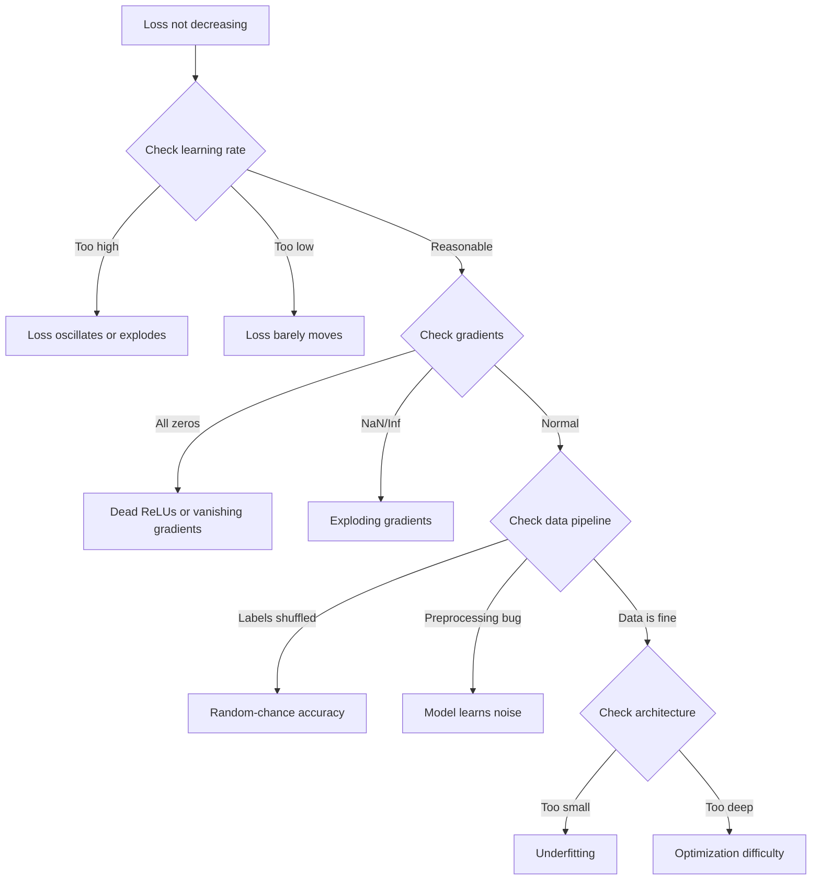
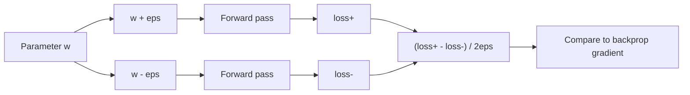
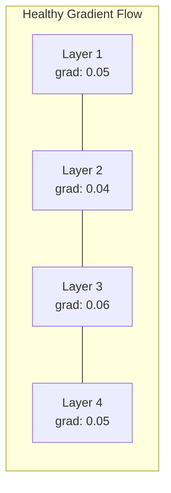
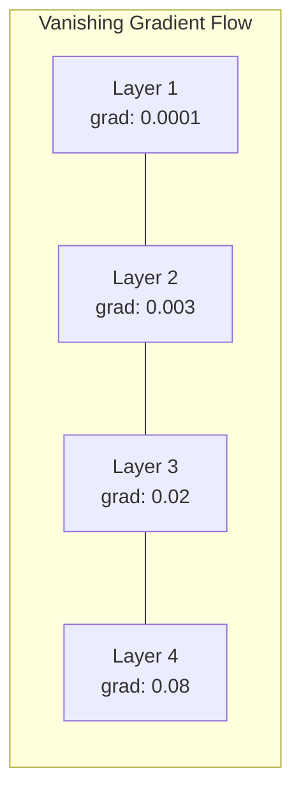
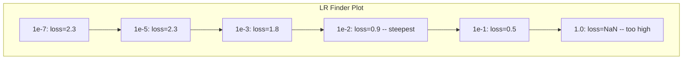

# Оправление нейронных сетей

> Ваша сеть компилировалась. Она работала. Она выпустила номер. Номер неисправен, и ничего не сбилось. Добро пожаловать в самый трудный тип дебэггирования - тот, где нет сообщения об ошибке.

**Type:** Build
**Languages:** Python, PyTorch
**Prerequisites:** Phase 03 Lessons 01-10 (especially backpropagation, loss functions, optimizers)
**Time:** ~90 minutes

## Цели обучения

- Диагностировать распространенные неисправности нейронной сети (потеря NaN, кривая плоской потери, переподъемность, колебания) с использованием системных стратегий дебгугирования
- Применяйте метод "одно-более подходящее партию", чтобы проверить, что архитектура модели и цикл обучения являются правильными
- Проверяйте величины градиента, распределение активации и нормы веса для выявления проблем с исчезновением/выполнением градиента
- Создайте контрольный список дебъга, который охватывает трубопровод данных, архитектуру модели, функцию потерь, оптимизатор и проблемы скорости обучения

## Проблема

Традиционное программное обеспечение сбивается, когда оно сломается. Нулевый указатель бросает исключение. Несовместимость типа не удается во время составления. Одноположная ошибка производит явно неправильный выход.

Нейронные сети не дают вам такого роскоши.

Разрушенная нейронная сеть работает до конца, печатает значение потери и выпускает прогнозы. Потеря может уменьшиться. Предсказания могут показаться правдоподобными. Но модель молча ошибается - учится скортики, запоминает шум или приближается к бесполезному местному минимуму. Исследователи Google оценили, что 60-70% времени дебъга ML тратится на "тихие" ошибки, которые не производят ошибок, но ухудшают качество модели.

Различие между рабочей моделью и сломанной моделью часто заключается в одной неуместной строке: отсутствующей `zero_grad()`, переведенное измерение, скорость обучения уменьшается на 10x. Канонический "Рецепт для обучения нейронным сетям" (2019) начинается следующим образом: "Самыми распространенными ошибками нейронной сети являются ошибки, которые не сбиваются".

Этот урок учит тебя найти этих жуков.

## Концепция

### Огромное мышление

Забудьте о дебюгации печати и прокачки. Дебюгации нейронной сети требуют систематического подхода, потому что цикл обратной связи медленен (от минут до часов на тренировку) и симптомы неоднозначны (плохая потеря может означать 20 разных вещей).

Золотое правило:**start simple, add complexity one piece at a time, and verify each piece independently.**



### Симптом 1: потеря не уменьшается

Это наиболее распространенная жалоба: тренировочная цикл проходит, эпохи проходят, а потеря остается плоской или колеблется дико.

**Wrong learning rate.**Слишком высокий: потеря колеблется или прыгает до NaN. Слишком низкий: потеря снижается так медленно, что кажется плоской. Для Адама, начинайте с 1e-3. Для SGD, начинайте с 1e-1 или 1e-2.

**Dead ReLUs.**Если нейрон ReLU получает большой отрицательный вход, он выпускает 0, а его градиент - 0, он никогда не активируется снова. Если умирает достаточное количество нейронов, сеть не может учиться.

**Vanishing gradients.**В глубоких сетях с сигмоидными или танх-активациями градиенты сокращаются экспоненциально по мере их распространения назад. К тому времени, как они достигают первого слоя, они составляют ~0. Первые слои прекращают обучение.

**Exploding gradients.**Противоположная проблема - градиенты растут экспоненциально.`torch.nn.utils.clip_grad_norm_`), снижение уровня обучения или добавление нормализации.

### Симптом 2: потеря снижается, но модель плохая

Убытки снижаются, точность тренировок достигает 99%, но точность тестов - 55%.

**Overfitting.**Модель запоминает данные о тренировке вместо учебных моделей. Разрыв между тренировкой и потерей валидации растет с течением времени.

**Data leakage.**В ходе тренировок просочились данные о тестах. Точность подозрительно высока. Общие причины: смешивание перед разделом, предварительная обработка статистикой из полного набора данных, дублирование образцов по разделам.

**Label errors.**5-10% этикет в большинстве реальных наборов данных ошибочны (Northcutt et al., 2021 - "Всеобъемлющие ошибки на этикетке в тестовых наборах").

### Симптом 3: НаН или ИнФ в потерях

Значение потерь становится `nan`или `inf`Тренировка окончена.

**Learning rate too high.**Уровень обновления превышает пределы, и вес взрывается.

**log(0) or log(negative).**Расчет кросс-энтропических потерь `log(p)`Если ваша модель выходит точно на 0 или отрицательная вероятность, журнал взорвется.`[eps, 1-eps]`где`eps=1e-7`- Я не знаю .

**Division by zero.**Нормализация партии делится по стандартному отклонению.

**Numerical overflow.**Большие активизации вводятся в `exp()`Установка: вычитать максимум до экспоненциализации (трик лог-сум-эксп).

### Метод 1: проверка степени

Сравните свои аналитические градиенты (от обратной опоры) с числовыми градиентами (от конечных различий).

Цифровой градиент параметра `w`В следующем случае:

```
grad_numerical = (loss(w + eps) - loss(w - eps)) / (2 * eps)
```

Счетные показатели соглашения (относительная разница):

```
rel_diff = |grad_analytical - grad_numerical| / max(|grad_analytical|, |grad_numerical|, 1e-8)
```

Если`rel_diff < 1e-5`Если`rel_diff > 1e-3`- Это, наверное, жучок.



### Техника 2: Статистика активизации

Следить за средним и стандартным отклонением от активаций после каждого слоя во время тренировки.

| Health indicator | Mean | Std | Diagnosis |
|-----------------|------|-----|-----------|
| Healthy | ~0 | ~1 | Network is learning normally |
| Saturated | >>0 or <<0 | ~0 | Activations stuck at extreme values |
| Dead | 0 | 0 | Neurons are dead (all zeros) |
| Exploding | >>10 | >>10 | Activations growing without bound |

### Техника 3: визуализация по мере потока

Назовите среднюю величину градиента для каждого слоя. В здоровой сети величины градиента должны быть примерно аналогичными по слоям. Если ранние слои имеют градиенты в 1000 раз меньше, чем поздние слои, у вас есть исчезновение градиентов.





### Техника 4: Оверфит-один-парт тест

Самой важной техникой дебэггирования в глубоком обучении.

Возьмите одну небольшую партию (8-32 образца). Обучайтесь на ней более 100 итераций. Утрата должна быть почти нулевой и точность тренировки должна достигать 100%. Если это не так, у вашей модели или тренировочной петли есть фундаментальная ошибка - не переходите к полной тренировке.

Этот тест обнаруживает:
- Функции с нарушенными потерями
- Сламавшиеся обратные проходы
- Архитектура слишком маленькая, чтобы представлять данные
- Оптимизатор, не подключенный к параметрам модели
- Данные и этикетки несовместимы

Это занимает 30 секунд для запуска и экономит часы дебгугирования полных тренировочных заправ.

### Техника 5: Учитель уровень обучения

Лесли Смит (2017) предложил увеличить уровень обучения с очень маленького (1e-7) до очень большого (10) за один период, записывая потерю.



Лучший LR в этом примере: ~1e-3 (один порядок величины до самой крутой точки).

### Общие бусы PyTorch

Это те жуки , которые тратили самые коллективные часы в сообществе PyTorch:

| Bug | Symptom | Fix |
|-----|---------|-----|
| Forgetting `optimizer.zero_grad()` | Gradients accumulate across batches, loss oscillates | Add `optimizer.zero_grad()` before `loss.backward()` |
| Forgetting `model.eval()` at test time | Dropout and batch norm behave differently, test accuracy varies between runs | Add `model.eval()` and `torch.no_grad()` |
| Wrong tensor shapes | Silent broadcasting produces wrong results, no error | Print shapes after every operation during debugging |
| CPU/GPU mismatch | `RuntimeError: expected CUDA tensor` | Use `.to(device)` on model AND data |
| Not detaching tensors | Computation graph grows forever, OOM | Use `.detach()` or `with torch.no_grad()` |
| In-place operations breaking autograd | `RuntimeError: modified by in-place operation` | Replace `x += 1` with `x = x + 1` |
| Data not normalized | Loss stuck at random-chance level | Normalize inputs to mean=0, std=1 |
| Labels as wrong dtype | Cross-entropy expects `Long`, got `Float` | Cast labels: `labels.long()` |

### Главный стол для раздела ошибок

| Symptom | Likely cause | First thing to try |
|---------|-------------|-------------------|
| Loss stuck at -log(1/num_classes) | Model predicting uniform distribution | Check data pipeline, verify labels match inputs |
| Loss NaN after a few steps | Learning rate too high | Reduce LR by 10x |
| Loss NaN immediately | log(0) or division by zero | Add epsilon to log/division operations |
| Loss oscillating wildly | LR too high or batch size too small | Reduce LR, increase batch size |
| Loss decreasing then plateaus | LR too high for fine-tuning phase | Add LR schedule (cosine or step decay) |
| Training acc high, test acc low | Overfitting | Add dropout, weight decay, more data |
| Training acc = test acc = chance | Model not learning anything | Run overfit-one-batch test |
| Training acc = test acc but both low | Underfitting | Bigger model, more layers, more features |
| Gradients all zero | Dead ReLUs or detached computation graph | Switch to LeakyReLU, check `.requires_grad` |
| Out of memory during training | Batch too large or graph not freed | Reduce batch size, use `torch.no_grad()` for eval |

```figure
learning-curves
```

## Создайте его

Диагностический инструмент, который отслеживает активации, градиенты и кривые потерь.

### Шаг 1: класс NetworkDebugger

Привязывается к модели PyTorch для записи статистики активации и градиента на слой.

```python
import torch
import torch.nn as nn
import math


class NetworkDebugger:
    def __init__(self, model):
        self.model = model
        self.activation_stats = {}
        self.gradient_stats = {}
        self.loss_history = []
        self.lr_losses = []
        self.hooks = []
        self._register_hooks()

    def _register_hooks(self):
        for name, module in self.model.named_modules():
            if isinstance(module, (nn.Linear, nn.Conv2d, nn.ReLU, nn.LeakyReLU)):
                hook = module.register_forward_hook(self._make_activation_hook(name))
                self.hooks.append(hook)
                hook = module.register_full_backward_hook(self._make_gradient_hook(name))
                self.hooks.append(hook)

    def _make_activation_hook(self, name):
        def hook(module, input, output):
            with torch.no_grad():
                out = output.detach().float()
                self.activation_stats[name] = {
                    "mean": out.mean().item(),
                    "std": out.std().item(),
                    "fraction_zero": (out == 0).float().mean().item(),
                    "min": out.min().item(),
                    "max": out.max().item(),
                }
        return hook

    def _make_gradient_hook(self, name):
        def hook(module, grad_input, grad_output):
            if grad_output[0] is not None:
                with torch.no_grad():
                    grad = grad_output[0].detach().float()
                    self.gradient_stats[name] = {
                        "mean": grad.mean().item(),
                        "std": grad.std().item(),
                        "abs_mean": grad.abs().mean().item(),
                        "max": grad.abs().max().item(),
                    }
        return hook

    def record_loss(self, loss_value):
        self.loss_history.append(loss_value)

    def check_loss_health(self):
        if len(self.loss_history) < 2:
            return "NOT_ENOUGH_DATA"
        recent = self.loss_history[-10:]
        if any(math.isnan(v) or math.isinf(v) for v in recent):
            return "NAN_OR_INF"
        if len(self.loss_history) >= 20:
            first_half = sum(self.loss_history[:10]) / 10
            second_half = sum(self.loss_history[-10:]) / 10
            if second_half >= first_half * 0.99:
                return "NOT_DECREASING"
        if len(recent) >= 5:
            diffs = [recent[i+1] - recent[i] for i in range(len(recent)-1)]
            if max(diffs) - min(diffs) > 2 * abs(sum(diffs) / len(diffs)):
                return "OSCILLATING"
        return "HEALTHY"

    def check_activations(self):
        issues = []
        for name, stats in self.activation_stats.items():
            if stats["fraction_zero"] > 0.5:
                issues.append(f"DEAD_NEURONS: {name} has {stats['fraction_zero']:.0%} zero activations")
            if abs(stats["mean"]) > 10:
                issues.append(f"EXPLODING_ACTIVATIONS: {name} mean={stats['mean']:.2f}")
            if stats["std"] < 1e-6:
                issues.append(f"COLLAPSED_ACTIVATIONS: {name} std={stats['std']:.2e}")
        return issues if issues else ["HEALTHY"]

    def check_gradients(self):
        issues = []
        grad_magnitudes = []
        for name, stats in self.gradient_stats.items():
            grad_magnitudes.append((name, stats["abs_mean"]))
            if stats["abs_mean"] < 1e-7:
                issues.append(f"VANISHING_GRADIENT: {name} abs_mean={stats['abs_mean']:.2e}")
            if stats["abs_mean"] > 100:
                issues.append(f"EXPLODING_GRADIENT: {name} abs_mean={stats['abs_mean']:.2e}")
        if len(grad_magnitudes) >= 2:
            first_mag = grad_magnitudes[0][1]
            last_mag = grad_magnitudes[-1][1]
            if last_mag > 0 and first_mag / last_mag > 100:
                issues.append(f"GRADIENT_RATIO: first/last = {first_mag/last_mag:.0f}x (vanishing)")
        return issues if issues else ["HEALTHY"]

    def print_report(self):
        print("\n=== NETWORK DEBUGGER REPORT ===")
        print(f"\nLoss health: {self.check_loss_health()}")
        if self.loss_history:
            print(f"  Last 5 losses: {[f'{v:.4f}' for v in self.loss_history[-5:]]}")
        print("\nActivation diagnostics:")
        for item in self.check_activations():
            print(f"  {item}")
        print("\nGradient diagnostics:")
        for item in self.check_gradients():
            print(f"  {item}")
        print("\nPer-layer activation stats:")
        for name, stats in self.activation_stats.items():
            print(f"  {name}: mean={stats['mean']:.4f} std={stats['std']:.4f} zero={stats['fraction_zero']:.1%}")
        print("\nPer-layer gradient stats:")
        for name, stats in self.gradient_stats.items():
            print(f"  {name}: abs_mean={stats['abs_mean']:.2e} max={stats['max']:.2e}")

    def remove_hooks(self):
        for hook in self.hooks:
            hook.remove()
        self.hooks.clear()
```

### Шаг 2: Официальный тест

```python
def overfit_one_batch(model, x_batch, y_batch, criterion, lr=0.01, steps=200):
    optimizer = torch.optim.Adam(model.parameters(), lr=lr)
    model.train()
    print("\n=== OVERFIT ONE BATCH TEST ===")
    print(f"Batch size: {x_batch.shape[0]}, Steps: {steps}")

    for step in range(steps):
        optimizer.zero_grad()
        output = model(x_batch)
        loss = criterion(output, y_batch)
        loss.backward()
        optimizer.step()

        if step % 50 == 0 or step == steps - 1:
            with torch.no_grad():
                preds = (output > 0).float() if output.shape[-1] == 1 else output.argmax(dim=1)
                targets = y_batch if y_batch.dim() == 1 else y_batch.squeeze()
                acc = (preds.squeeze() == targets).float().mean().item()
            print(f"  Step {step:3d} | Loss: {loss.item():.6f} | Accuracy: {acc:.1%}")

    final_loss = loss.item()
    if final_loss > 0.1:
        print(f"\n  FAIL: Loss did not converge ({final_loss:.4f}). Model or training loop is broken.")
        return False
    print(f"\n  PASS: Loss converged to {final_loss:.6f}")
    return True
```

### Третий шаг: Учебный рейтинг

```python
def find_learning_rate(model, x_data, y_data, criterion, start_lr=1e-7, end_lr=10, steps=100):
    import copy
    original_state = copy.deepcopy(model.state_dict())
    optimizer = torch.optim.SGD(model.parameters(), lr=start_lr)
    lr_mult = (end_lr / start_lr) ** (1 / steps)

    model.train()
    results = []
    best_loss = float("inf")
    current_lr = start_lr

    print("\n=== LEARNING RATE FINDER ===")

    for step in range(steps):
        optimizer.zero_grad()
        output = model(x_data)
        loss = criterion(output, y_data)

        if math.isnan(loss.item()) or loss.item() > best_loss * 10:
            break

        best_loss = min(best_loss, loss.item())
        results.append((current_lr, loss.item()))

        loss.backward()
        optimizer.step()

        current_lr *= lr_mult
        for param_group in optimizer.param_groups:
            param_group["lr"] = current_lr

    model.load_state_dict(original_state)

    if len(results) < 10:
        print("  Could not complete LR sweep -- loss diverged too quickly")
        return results

    min_loss_idx = min(range(len(results)), key=lambda i: results[i][1])
    suggested_lr = results[max(0, min_loss_idx - 10)][0]

    print(f"  Swept {len(results)} steps from {start_lr:.0e} to {results[-1][0]:.0e}")
    print(f"  Minimum loss {results[min_loss_idx][1]:.4f} at lr={results[min_loss_idx][0]:.2e}")
    print(f"  Suggested learning rate: {suggested_lr:.2e}")

    return results
```

### Шаг 4: проверка степени

```python
def _flat_to_multi_index(flat_idx, shape):
    multi_idx = []
    remaining = flat_idx
    for dim in reversed(shape):
        multi_idx.insert(0, remaining % dim)
        remaining //= dim
    return tuple(multi_idx)


def gradient_check(model, x, y, criterion, eps=1e-4):
    model.train()
    x_double = x.double()
    y_double = y.double()
    model_double = model.double()

    print("\n=== GRADIENT CHECK ===")
    overall_max_diff = 0
    checked = 0

    for name, param in model_double.named_parameters():
        if not param.requires_grad:
            continue

        layer_max_diff = 0

        model_double.zero_grad()
        output = model_double(x_double)
        loss = criterion(output, y_double)
        loss.backward()
        analytical_grad = param.grad.clone()

        num_checks = min(5, param.numel())
        for i in range(num_checks):
            idx = _flat_to_multi_index(i, param.shape)
            original = param.data[idx].item()

            param.data[idx] = original + eps
            with torch.no_grad():
                loss_plus = criterion(model_double(x_double), y_double).item()

            param.data[idx] = original - eps
            with torch.no_grad():
                loss_minus = criterion(model_double(x_double), y_double).item()

            param.data[idx] = original

            numerical = (loss_plus - loss_minus) / (2 * eps)
            analytical = analytical_grad[idx].item()

            denom = max(abs(numerical), abs(analytical), 1e-8)
            rel_diff = abs(numerical - analytical) / denom

            layer_max_diff = max(layer_max_diff, rel_diff)
            checked += 1

        overall_max_diff = max(overall_max_diff, layer_max_diff)
        status = "OK" if layer_max_diff < 1e-5 else "MISMATCH"
        print(f"  {name}: max_rel_diff={layer_max_diff:.2e} [{status}]")

    model.float()

    print(f"\n  Checked {checked} parameters")
    if overall_max_diff < 1e-5:
        print("  PASS: Gradients match (rel_diff < 1e-5)")
    elif overall_max_diff < 1e-3:
        print("  WARN: Small differences (1e-5 < rel_diff < 1e-3)")
    else:
        print("  FAIL: Gradient mismatch detected (rel_diff > 1e-3)")
    return overall_max_diff
```

### Шаг 5: Умышленное разрыв сетей

Теперь примените инструментарий к сломанным сетям и диагностируйте каждый из них.

```python
def demo_broken_networks():
    torch.manual_seed(42)
    x = torch.randn(64, 10)
    y = (x[:, 0] > 0).long()

    print("\n" + "=" * 60)
    print("BUG 1: Learning rate too high (lr=10)")
    print("=" * 60)
    model1 = nn.Sequential(nn.Linear(10, 32), nn.ReLU(), nn.Linear(32, 2))
    debugger1 = NetworkDebugger(model1)
    optimizer1 = torch.optim.SGD(model1.parameters(), lr=10.0)
    criterion = nn.CrossEntropyLoss()
    for step in range(20):
        optimizer1.zero_grad()
        out = model1(x)
        loss = criterion(out, y)
        debugger1.record_loss(loss.item())
        loss.backward()
        optimizer1.step()
    debugger1.print_report()
    debugger1.remove_hooks()

    print("\n" + "=" * 60)
    print("BUG 2: Dead ReLUs from bad initialization")
    print("=" * 60)
    model2 = nn.Sequential(nn.Linear(10, 32), nn.ReLU(), nn.Linear(32, 32), nn.ReLU(), nn.Linear(32, 2))
    with torch.no_grad():
        for m in model2.modules():
            if isinstance(m, nn.Linear):
                m.weight.fill_(-1.0)
                m.bias.fill_(-5.0)
    debugger2 = NetworkDebugger(model2)
    optimizer2 = torch.optim.Adam(model2.parameters(), lr=1e-3)
    for step in range(50):
        optimizer2.zero_grad()
        out = model2(x)
        loss = criterion(out, y)
        debugger2.record_loss(loss.item())
        loss.backward()
        optimizer2.step()
    debugger2.print_report()
    debugger2.remove_hooks()

    print("\n" + "=" * 60)
    print("BUG 3: Missing zero_grad (gradients accumulate)")
    print("=" * 60)
    model3 = nn.Sequential(nn.Linear(10, 32), nn.ReLU(), nn.Linear(32, 2))
    debugger3 = NetworkDebugger(model3)
    optimizer3 = torch.optim.SGD(model3.parameters(), lr=0.01)
    for step in range(50):
        out = model3(x)
        loss = criterion(out, y)
        debugger3.record_loss(loss.item())
        loss.backward()
        optimizer3.step()
    debugger3.print_report()
    debugger3.remove_hooks()

    print("\n" + "=" * 60)
    print("HEALTHY NETWORK: Correct setup for comparison")
    print("=" * 60)
    model_good = nn.Sequential(nn.Linear(10, 32), nn.ReLU(), nn.Linear(32, 2))
    debugger_good = NetworkDebugger(model_good)
    optimizer_good = torch.optim.Adam(model_good.parameters(), lr=1e-3)
    for step in range(50):
        optimizer_good.zero_grad()
        out = model_good(x)
        loss = criterion(out, y)
        debugger_good.record_loss(loss.item())
        loss.backward()
        optimizer_good.step()
    debugger_good.print_report()
    debugger_good.remove_hooks()

    print("\n" + "=" * 60)
    print("OVERFIT-ONE-BATCH TEST (healthy model)")
    print("=" * 60)
    model_test = nn.Sequential(nn.Linear(10, 32), nn.ReLU(), nn.Linear(32, 2))
    overfit_one_batch(model_test, x[:8], y[:8], criterion)

    print("\n" + "=" * 60)
    print("LEARNING RATE FINDER")
    print("=" * 60)
    model_lr = nn.Sequential(nn.Linear(10, 32), nn.ReLU(), nn.Linear(32, 2))
    find_learning_rate(model_lr, x, y, criterion)

    print("\n" + "=" * 60)
    print("GRADIENT CHECK")
    print("=" * 60)
    model_grad = nn.Sequential(nn.Linear(10, 8), nn.ReLU(), nn.Linear(8, 2))
    gradient_check(model_grad, x[:4], y[:4], criterion)
```

## Используйте его

### Встроенные инструменты PyTorch

```python
import torch
import torch.nn as nn

model = nn.Sequential(
    nn.Linear(768, 256),
    nn.ReLU(),
    nn.Linear(256, 10),
)

with torch.autograd.detect_anomaly():
    output = model(input_tensor)
    loss = criterion(output, target)
    loss.backward()

for name, param in model.named_parameters():
    if param.grad is not None:
        print(f"{name}: grad_mean={param.grad.abs().mean():.2e}")
```

### Интеграция весов и предвзятости

```python
import wandb

wandb.init(project="debug-training")

for epoch in range(100):
    loss = train_one_epoch()
    wandb.log({
        "loss": loss,
        "lr": optimizer.param_groups[0]["lr"],
        "grad_norm": torch.nn.utils.clip_grad_norm_(model.parameters(), float("inf")),
    })

    for name, param in model.named_parameters():
        if param.grad is not None:
            wandb.log({f"grad/{name}": wandb.Histogram(param.grad.cpu().numpy())})
```

### Тензор-Подска

```python
from torch.utils.tensorboard import SummaryWriter

writer = SummaryWriter("runs/debug_experiment")

for epoch in range(100):
    loss = train_one_epoch()
    writer.add_scalar("Loss/train", loss, epoch)

    for name, param in model.named_parameters():
        writer.add_histogram(f"weights/{name}", param, epoch)
        if param.grad is not None:
            writer.add_histogram(f"gradients/{name}", param.grad, epoch)
```

### Перечень сбоев (до полной подготовки)

1. Проверь тест на переустройство одной партии, если он не выйдет, прекрати.
2. Печать модели резюме - проверьте количество параметров разумно.
3. Запустите один проход вперед с случайными данными - проверьте форму выхода.
4. Поезд на 5 эпох - проверьте, что потеря уменьшается.
5. Проверьте статистику активации - нет мертвых слоев, нет взрывов.
6. Проверьте поток градиента - никаких исчезновений, никаких взрывов.
7. Проверьте трубопровод данных - напечатайте 5 случайных образцов с этикетками.

## Погрузи его

Этот урок дает результаты:
- `outputs/prompt-nn-debugger.md`-- пропорция для диагностики неисправностей обучения нейронной сети
- `outputs/skill-debug-checklist.md`-- контрольный список деревьев решения для задач по дебгугированию обучения

Ключевые шаблоны развертывания для дебъгажирования:
- Добавить прицепы мониторинга к сценариям подготовки к производству
- Статистика активации журналов и градиентов в W&B или TensorBoard каждые N шагов
- Внедрение автоматических сигналов о потере NaN, умерших нейронах (> 80% нуля) или взрыве градиента
- Всегда выполняйте тест сверхспособности одного партии при изменении архитектуры или трубопроводов данных

## Упражнения

1. **Add an exploding gradient detector.**Изменить `NetworkDebugger`для обнаружения, когда градиенты превышают порог и автоматически предполагают значение нарезка градиента.

2. **Build a dead neuron resurrector.**Напишите функцию, которая идентифицирует мертвые нейроны ReLU (всегда выпуская 0) и реинциализирует их приходящие весы с помощью инициализации Кайминга.

3. **Implement the learning rate finder with plotting.**Протяженность`find_learning_rate`для сохранения результатов в виде CSV и написания отдельного сценария, который читает CSV и отображает кривую LR против потерь с использованием matplotlib.

4. **Create a data pipeline validator.**Напишите функцию, которая проверяет: дублирование образцов по разделам поезда/испытания, дисбаланс распределения этикет (> соотношение 10:1), нормализацию ввода (среднее приблизительно 0, std приблизительно 1), и значения NaN/Inf в данных.

5. **Debug a real failure.**Возьмем мини-фреймворк из урока 10, введите тонкую ошибку (например, переложите матрицу веса назад) и используйте проверку градиента, чтобы точно определить, какой параметр имеет неправильные градиенты.

## Ключевые условия

| Term | What people say | What it actually means |
|------|----------------|----------------------|
| Silent bug | "It runs but gives bad results" | A bug that produces no error but degrades model quality -- the dominant failure mode in ML |
| Dead ReLU | "The neurons died" | A ReLU neuron whose input is always negative, so it outputs 0 and receives 0 gradient permanently |
| Vanishing gradients | "Early layers stop learning" | Gradients shrink exponentially through layers, making weights in early layers effectively frozen |
| Exploding gradients | "Loss went to NaN" | Gradients grow exponentially through layers, causing weight updates so large they overflow |
| Gradient checking | "Verify backprop is correct" | Comparing analytical gradients from backprop to numerical gradients from finite differences |
| Overfit-one-batch | "The most important debug test" | Training on a single small batch to verify the model CAN learn -- if it cannot, something is fundamentally broken |
| LR finder | "Sweep to find the right learning rate" | Exponentially increasing the learning rate over one epoch and picking the rate just before loss diverges |
| Data leakage | "Test data leaked into training" | When information from the test set contaminates training, producing artificially high accuracy |
| Activation statistics | "Monitor layer health" | Tracking mean, std, and zero-fraction of each layer's output to detect dead, saturated, or exploding neurons |
| Gradient clipping | "Cap the gradient magnitude" | Scaling gradients down when their norm exceeds a threshold, preventing exploding gradient updates |

## Дальнейшее чтение

- Смит, "Циклические показатели обучения для обучения нейронным сетям" (2017) - статья, внедряющая тест диапазона уровня обучения (LR finder)
- Northcutt и др., "Всеобъемлющие ошибки на этикетке в тестовых наборах дестабилизируют критерии машинного обучения" (2021) -- демонстрирует, что 3-6% этикетки в ImageNet, CIFAR-10 и других основных критериях ошибочны
- Zhang et al., "Понимание глубокого обучения требует переосмысления генерализации" (2017) - статья, показывающая, что нейронные сети могут запоминать случайные этикетки, поэтому тест сверхспособности в одной партии работает
- Документация PyTorch о `torch.autograd.detect_anomaly`и `torch.autograd.set_detect_anomaly`для встроенного обнаружения NaN/Inf
