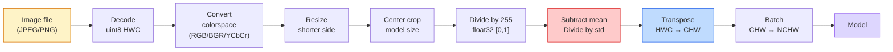
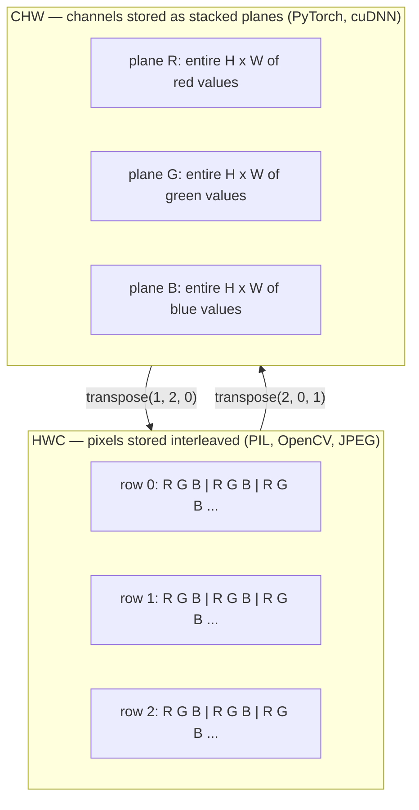

# Основы изображений — пиксели, каналы, цветовые пространства

> Изображение — это тензор отсчётов света. Любая модель компьютерного зрения, с которой вы когда-либо будете работать, начинается именно с этого факта.

**Type:** Build
**Languages:** Python
**Prerequisites:** Phase 1 Lesson 12 (Tensor Operations), Phase 3 Lesson 11 (Intro to PyTorch)
**Time:** ~45 минут

## Цели обучения

- Объяснить, как непрерывная сцена дискретизируется в пиксели, и почему решения о сэмплировании/квантовании задают потолок для всех последующих моделей
- Читать, срезать и исследовать изображения как массивы NumPy и свободно переключаться между раскладками HWC и CHW
- Конвертировать между RGB, grayscale, HSV и YCbCr и обосновывать, зачем существует каждое из этих цветовых пространств
- Применять препроцессинг на уровне пикселей (нормализацию, стандартизацию, изменение размера, channels-first) именно так, как этого ожидают предобученные модели компьютерного зрения PyTorch

## Проблема

Каждая статья, которую вы прочитаете, каждые предобученные веса, которые вы скачаете, каждый API компьютерного зрения, который вы вызовете, предполагают конкретную кодировку входных данных. Передайте изображение в `uint8`, когда модель ожидает `float32` — и код всё равно выполнится, молча выдав мусор. Подайте BGR в сеть, обученную на RGB, и точность упадёт на десять пунктов. Передайте модели вход в формате channels-last, когда она ожидает channels-first, — и первый свёрточный слой начнёт воспринимать высоту как канал признаков. Ничего из этого не вызывает ошибку. Это просто портит ваши метрики, а вы неделю ищете баг, который на самом деле живёт в способе загрузки файла.

Свёртка не представляет сложности, как только вы понимаете, по чему она скользит. Сложность в том, что «изображение» означает разные вещи для камеры, JPEG-декодера, PIL, OpenCV, torchvision и CUDA-ядра. У каждого стека своя раскладка осей, диапазон байт и соглашение о каналах. Инженер компьютерного зрения, который не держит это в голове чётко, выпускает в прод сломанные пайплайны.

Этот урок закладывает фундамент, на который будет опираться вся остальная часть фазы. К концу вы будете знать, что такое пиксель, почему на пиксель приходится три числа, а не одно, что на самом деле делает «нормализация по статистикам ImageNet», и как переходить между двумя-тремя раскладками, которые будут предполагаться во всех остальных уроках этой фазы.

## Концепция

### Полный пайплайн препроцессинга в общих чертах

Каждая продакшн-система компьютерного зрения — это одна и та же последовательность обратимых преобразований. Ошибитесь на одном шаге — и модель увидит совсем не тот вход, на котором её обучали.



Два красных и синих блока — это места, где живёт 80% молчаливых сбоев: отсутствующая стандартизация и неверная раскладка.

### Пиксель — это отсчёт, а не квадратик

Сенсор камеры считает фотоны, попадающие на сетку из крошечных детекторов. Каждый детектор накапливает свет в течение доли секунды и выдаёт напряжение, пропорциональное количеству попавших в него фотонов. Затем сенсор дискретизирует это напряжение в целое число. Один детектор становится одним пикселем.

```
Continuous scene                 Sensor grid                     Digital image
(infinite detail)                (H x W detectors)               (H x W integers)

    ~~~~~                        +--+--+--+--+--+                 210 198 180 155 120
   ~   ~   ~                     |  |  |  |  |  |                 205 195 178 152 118
  ~ light ~      ---->           +--+--+--+--+--+     ---->       200 190 175 150 115
   ~~~~~                         |  |  |  |  |  |                 195 185 170 148 112
                                 +--+--+--+--+--+                 188 180 165 145 108
```

На этом шаге происходят два выбора, и они фиксируют потолок для всего, что следует дальше:

- **Пространственное сэмплирование** определяет, сколько детекторов приходится на градус сцены. Слишком мало — и края становятся зубчатыми (алиасинг). Слишком много — и объём хранения и вычислений взрывается.
- **Квантование интенсивности** определяет, насколько тонко напряжение разбивается на уровни. 8 бит дают 256 уровней и являются стандартом для дисплеев. 10, 12, 16 бит дают более плавные градиенты и важны для медицинской визуализации, HDR и пайплайнов с сырыми данными сенсора.

Пиксель — это не цветной квадратик с площадью. Это единичное измерение. Когда вы изменяете размер или вращаете изображение, вы на самом деле пересэмплируете эту измерительную сетку.

### Почему три канала

Один детектор считает фотоны по всему видимому спектру — это и есть grayscale. Чтобы получить цвет, сенсор покрывает сетку мозаикой из красных, зелёных и синих фильтров. После демозаики в каждой пространственной точке оказывается три числа: отклик детектора с красным фильтром, с зелёным и с синим рядом. Эти три числа и есть RGB-триплет пикселя.

```
One pixel in memory:

    (R, G, B) = (210, 140, 30)   <- reddish-orange

An H x W RGB image:

    shape (H, W, 3)     stored as   H rows of W pixels of 3 values
                                    each in [0, 255] for uint8
```

Три — не магическое число. Камеры глубины добавляют канал Z. Спутники добавляют инфракрасный и ультрафиолетовый диапазоны. Медицинские сканы часто имеют один канал (рентген, КТ) или множество (гиперспектральные снимки). Количество каналов — это последняя ось; свёрточные слои учатся смешивать информацию по ней.

### Две раскладки: HWC и CHW

Один и тот же тензор, два порядка осей. Каждая библиотека выбирает свой.

```
HWC (height, width, channels)           CHW (channels, height, width)

   W ->                                    H ->
  +-----+-----+-----+                     +-----+-----+
H |R G B|R G B|R G B|                   C |R R R R R R|
| +-----+-----+-----+                   | +-----+-----+
v |R G B|R G B|R G B|                   v |G G G G G G|
  +-----+-----+-----+                     +-----+-----+
                                          |B B B B B B|
                                          +-----+-----+

   PIL, OpenCV, matplotlib,              PyTorch, most deep learning
   almost every image file on disk       frameworks, cuDNN kernels
```

CHW существует потому, что ядра свёртки скользят по H и W. Если ось каналов стоит первой, каждое ядро видит непрерывную 2D-плоскость на канал, что хорошо векторизуется. Дисковые форматы сохраняют HWC, потому что так построчно выходят данные из сенсора.

Однострочное преобразование, которое вы будете писать тысячу раз:

```
img_chw = img_hwc.transpose(2, 0, 1)      # NumPy
img_chw = img_hwc.permute(2, 0, 1)        # PyTorch tensor
```

Раскладка памяти в иллюстрации:



### Диапазоны байт и dtype

Доминируют три соглашения:

| Соглашение | dtype | Диапазон | Где встречается |
|------------|-------|-------|------------------|
| Сырое | `uint8` | [0, 255] | Файлы на диске, PIL, вывод OpenCV |
| Нормализованное | `float32` | [0.0, 1.0] | После `img.astype('float32') / 255` |
| Стандартизированное | `float32` | примерно [-2, +2] | После вычитания среднего и деления на стандартное отклонение |

Свёрточные сети обучались на стандартизированных входах. Статистики ImageNet `mean=[0.485, 0.456, 0.406]`, `std=[0.229, 0.224, 0.225]` — это среднее арифметическое и стандартное отклонение трёх каналов по всему обучающему набору ImageNet, вычисленные на пикселях, нормализованных в [0, 1]. Подать сырые `uint8` в модель, которая ожидает стандартизированный float, — это самый распространённый молчаливый сбой в прикладном компьютерном зрении.

### Цветовые пространства и зачем они нужны

RGB — формат захвата, но не всегда самое полезное представление для модели.

```
 RGB               HSV                       YCbCr / YUV

 R red             H hue (angle 0-360)       Y luminance (brightness)
 G green           S saturation (0-1)        Cb chroma blue-yellow
 B blue            V value/brightness (0-1)  Cr chroma red-green

 Linear to         Separates color from      Separates brightness from
 sensor output     brightness. Useful for    color. JPEG and most video
                   color thresholding, UI    codecs compress the chroma
                   sliders, simple filters   channels harder because the
                                             human eye is less sensitive
                                             to chroma detail than to Y.
```

Для большинства современных CNN вы подаёте RGB. С другими пространствами вы сталкиваетесь, когда:

- **HSV** — классический код компьютерного зрения, сегментация по цвету, баланс белого.
- **YCbCr** — чтение внутренностей JPEG, видеопайплайны, модели суперразрешения, работающие только с каналом Y.
- **Grayscale** — OCR, модели для документов, любой случай, когда цвет — это мешающая переменная, а не сигнал.

Grayscale из RGB — это взвешенная сумма, а не среднее, потому что человеческий глаз более чувствителен к зелёному, чем к красному или синему:

```
Y = 0.299 R + 0.587 G + 0.114 B       (ITU-R BT.601, the classic weights)
```

### Соотношение сторон, изменение размера и интерполяция

У каждой модели фиксированный размер входа (224x224 у большинства классификаторов ImageNet, 384x384 или 512x512 у современных детекторов). Ваши изображения редко совпадают с этим размером. Есть три важных варианта изменения размера:

- **Изменить размер по короткой стороне, затем взять центральный кроп** — стандартный рецепт ImageNet. Сохраняет соотношение сторон, отбрасывает полосу краевых пикселей.
- **Изменить размер и добавить паддинг** — сохраняет соотношение сторон и все пиксели, добавляет чёрные полосы. Стандарт для детекции и OCR.
- **Изменить размер напрямую до целевого** — растягивает изображение. Дёшево, искажает геометрию, подходит для многих задач классификации.

Метод интерполяции определяет, как вычисляются промежуточные пиксели, когда новая сетка не совпадает со старой:

```
Nearest neighbour     fastest, blocky, only choice for masks/labels
Bilinear              fast, smooth, default for most image resizing
Bicubic               slower, sharper on upscaling
Lanczos               slowest, best quality, used for final display
```

Эмпирическое правило: билинейная интерполяция для обучения, бикубическая или lanczos для материалов, которые будут рассматриваться визуально, ближайший сосед для всего, что содержит целочисленные ID классов.

```figure
conv-output-size
```

## Реализация

### Шаг 1: Построить тензор изображения и проверить его форму

Начнём с детерминированного синтетического изображения, чтобы первая лабораторная работала офлайн только с NumPy. Декодирование файлов — отдельная граница: как только JPEG- или PNG-декодер вернул байты RGB, все дальнейшие операции с тензором одинаковы.

```python
import numpy as np

def synthetic_rgb(h=128, w=192, seed=0):
    rng = np.random.default_rng(seed)
    yy, xx = np.meshgrid(np.linspace(0, 1, h), np.linspace(0, 1, w), indexing="ij")
    r = (np.sin(xx * 6) * 0.5 + 0.5) * 255
    g = yy * 255
    b = (1 - yy) * xx * 255
    rgb = np.stack([r, g, b], axis=-1) + rng.normal(0, 6, (h, w, 3))
    return np.clip(rgb, 0, 255).astype(np.uint8)

arr = synthetic_rgb()

print(f"type:   {type(arr).__name__}")
print(f"dtype:  {arr.dtype}")
print(f"shape:  {arr.shape}     # (H, W, C)")
print(f"min:    {arr.min()}")
print(f"max:    {arr.max()}")
print(f"pixel at (0, 0): {arr[0, 0]}")
```

Ожидаемый результат: `shape: (H, W, 3)`, `dtype: uint8`, диапазон `[0, 255]`. Это каноническое декодированное представление независимо от того, пришли ли байты от камеры, декодера изображений или этого синтетического генератора.

### Шаг 2: Разделить каналы и переставить раскладку

Извлечём отдельно R, G, B, затем преобразуем из HWC в CHW для PyTorch.

```python
R = arr[:, :, 0]
G = arr[:, :, 1]
B = arr[:, :, 2]
print(f"R shape: {R.shape}, mean: {R.mean():.1f}")
print(f"G shape: {G.shape}, mean: {G.mean():.1f}")
print(f"B shape: {B.shape}, mean: {B.mean():.1f}")

arr_chw = arr.transpose(2, 0, 1)
print(f"\nHWC shape: {arr.shape}")
print(f"CHW shape: {arr_chw.shape}")
```

Три grayscale-плоскости, по одной на канал. CHW просто переставляет оси; копирование данных строго не требуется, если раскладка памяти это позволяет.

### Шаг 3: Преобразования в grayscale и HSV

Взвешенная сумма для grayscale, затем ручное преобразование RGB в HSV.

```python
def rgb_to_grayscale(rgb):
    weights = np.array([0.299, 0.587, 0.114], dtype=np.float32)
    return (rgb.astype(np.float32) @ weights).astype(np.uint8)

def rgb_to_hsv(rgb):
    rgb_f = rgb.astype(np.float32) / 255.0
    r, g, b = rgb_f[..., 0], rgb_f[..., 1], rgb_f[..., 2]
    cmax = np.max(rgb_f, axis=-1)
    cmin = np.min(rgb_f, axis=-1)
    delta = cmax - cmin

    h = np.zeros_like(cmax)
    mask = delta > 0
    argmax = np.argmax(rgb_f, axis=-1)
    rmax = mask & (argmax == 0)
    gmax = mask & (argmax == 1)
    bmax = mask & (argmax == 2)
    h[rmax] = ((g[rmax] - b[rmax]) / delta[rmax]) % 6
    h[gmax] = ((b[gmax] - r[gmax]) / delta[gmax]) + 2
    h[bmax] = ((r[bmax] - g[bmax]) / delta[bmax]) + 4
    h = h * 60.0

    s = np.divide(delta, cmax, out=np.zeros_like(delta), where=cmax > 0)
    v = cmax
    return np.stack([h, s, v], axis=-1)

gray = rgb_to_grayscale(arr)
hsv = rgb_to_hsv(arr)
print(f"gray shape: {gray.shape}, range: [{gray.min()}, {gray.max()}]")
print(f"hsv   shape: {hsv.shape}")
print(f"hue range: [{hsv[..., 0].min():.1f}, {hsv[..., 0].max():.1f}] degrees")
print(f"sat range: [{hsv[..., 1].min():.2f}, {hsv[..., 1].max():.2f}]")
print(f"val range: [{hsv[..., 2].min():.2f}, {hsv[..., 2].max():.2f}]")
```

Hue выдаётся в градусах, saturation и value — в диапазоне [0, 1]. Это соответствует соглашению OpenCV `hsv_full`.

### Шаг 4: Нормализация, стандартизация и обращение операции

Перейдём от сырых байт к точному тензору, которого ожидает предобученная модель ImageNet, а затем вернёмся обратно.

```python
mean = np.array([0.485, 0.456, 0.406], dtype=np.float32)
std = np.array([0.229, 0.224, 0.225], dtype=np.float32)

def preprocess_imagenet(rgb_uint8):
    x = rgb_uint8.astype(np.float32) / 255.0
    x = (x - mean) / std
    x = x.transpose(2, 0, 1)
    return x

def deprocess_imagenet(chw_float32):
    x = chw_float32.transpose(1, 2, 0)
    x = x * std + mean
    x = np.clip(x * 255.0, 0, 255).astype(np.uint8)
    return x

x = preprocess_imagenet(arr)
print(f"preprocessed shape: {x.shape}     # (C, H, W)")
print(f"preprocessed dtype: {x.dtype}")
print(f"preprocessed mean per channel:  {x.mean(axis=(1, 2)).round(3)}")
print(f"preprocessed std  per channel:  {x.std(axis=(1, 2)).round(3)}")

roundtrip = deprocess_imagenet(x)
max_diff = np.abs(roundtrip.astype(int) - arr.astype(int)).max()
print(f"roundtrip max pixel diff: {max_diff}    # should be 0 or 1")
```

Среднее по каналу должно быть близко к нулю, стандартное отклонение — близко к единице. Пара препроцессинг/обратный препроцессинг — это именно то, что под капотом делает каждый вызов torchvision `transforms.Normalize`.

### Шаг 5: Изменение размера с нуля

Метод ближайшего соседа округляет каждую выходную координату до одного исходного пикселя. Билинейная интерполяция находит четыре окружающих пикселя и смешивает их по расстоянию. Обе реализации ниже используют координаты, выровненные по конечным точкам, так что первый и последний исходные пиксели остаются неизменными.

```python
def resize_coordinates(source_length, target_length):
    if target_length == 1:
        return np.zeros(1, dtype=np.float32)
    return np.linspace(0, source_length - 1, target_length, dtype=np.float32)

def nearest_resize(image, target_height, target_width):
    y = np.rint(resize_coordinates(image.shape[0], target_height)).astype(int)
    x = np.rint(resize_coordinates(image.shape[1], target_width)).astype(int)
    return image[y[:, None], x[None, :]]

def bilinear_resize(image, target_height, target_width):
    y = resize_coordinates(image.shape[0], target_height)
    x = resize_coordinates(image.shape[1], target_width)
    y0 = np.floor(y).astype(int)
    x0 = np.floor(x).astype(int)
    y1 = np.minimum(y0 + 1, image.shape[0] - 1)
    x1 = np.minimum(x0 + 1, image.shape[1] - 1)
    wy = (y - y0)[:, None, None]
    wx = (x - x0)[None, :, None]

    source = image.astype(np.float32)
    top = source[y0[:, None], x0[None, :]] * (1 - wx)
    top += source[y0[:, None], x1[None, :]] * wx
    bottom = source[y1[:, None], x0[None, :]] * (1 - wx)
    bottom += source[y1[:, None], x1[None, :]] * wx
    result = top * (1 - wy) + bottom * wy
    return np.clip(np.rint(result), 0, 255).astype(image.dtype)

target_height = arr.shape[0] * 3
target_width = arr.shape[1] * 3
nearest = nearest_resize(arr, target_height, target_width)
bilinear = bilinear_resize(arr, target_height, target_width)

def local_roughness(x):
    gy = np.diff(x.astype(float), axis=0)
    gx = np.diff(x.astype(float), axis=1)
    return float(np.abs(gy).mean() + np.abs(gx).mean())

for name, out in [("nearest", nearest), ("bilinear", bilinear)]:
    print(f"{name:>8}  shape={out.shape}  roughness={local_roughness(out):6.2f}")
```

Метод ближайшего соседа получает наивысший балл по шероховатости, потому что сохраняет резкие края. Билинейная интерполяция более гладкая, поскольку каждый новый пиксель смешивает две позиции по каждой оси. Запускаемый сопутствующий код расширяет ту же сепарабельную идею до четырёх соседей на ось с помощью кубического ядра Катмулла-Рома, а затем выводит все три результата без использования библиотеки работы с изображениями.

## Применение

PyTorch выполняет те же операции над батчами тензоров с учётом устройства. Код ниже изменяет размер по короткой стороне, берёт центральный кроп, стандартизирует каждый канал и выдаёт тензор NCHW, которого ожидает предобученная модель.

```python
import torch
import torch.nn.functional as F

image_hwc = torch.from_numpy(synthetic_rgb(256, 320))
batch = image_hwc.permute(2, 0, 1).unsqueeze(0).float() / 255.0

height, width = batch.shape[-2:]
scale = 256 / min(height, width)
resized_height = round(height * scale)
resized_width = round(width * scale)
batch = F.interpolate(
    batch,
    size=(resized_height, resized_width),
    mode="bilinear",
    align_corners=False,
    antialias=True,
)

top = (resized_height - 224) // 2
left = (resized_width - 224) // 2
batch = batch[:, :, top:top + 224, left:left + 224]

mean = torch.tensor([0.485, 0.456, 0.406]).view(1, 3, 1, 1)
std = torch.tensor([0.229, 0.224, 0.225]).view(1, 3, 1, 1)
batch = (batch - mean) / std

print(f"tensor dtype: {batch.dtype}")
print(f"batched shape: {tuple(batch.shape)}")
print(f"per-channel mean: {batch.mean(dim=(0, 2, 3)).tolist()}")
print(f"per-channel std:  {batch.std(dim=(0, 2, 3)).tolist()}")
```

Четыре шага строго в этом порядке: преобразовать байты в float и поменять HWC на NCHW, изменить размер короткой стороны до 256, взять центральный кроп 224x224, затем вычесть среднее ImageNet и разделить на стандартное отклонение. Изменение этого порядка молча меняет то, что доходит до модели.

## Поставка результата

Этот урок производит:

- `outputs/prompt-vision-preprocessing-audit.md` — промпт, превращающий любую карточку модели или датасета в чек-лист точных инвариантов препроцессинга, которые должна соблюдать команда.
- `outputs/skill-image-tensor-inspector.md` — навык, который для любого тензора или массива в форме изображения сообщает dtype, раскладку, диапазон и то, выглядит ли он сырым, нормализованным или стандартизированным.

## Упражнения

1. **(Лёгкое)** Создайте массив RGB 2x2 `uint8` с четырьмя различными цветами. Преобразуйте HWC в CHW и обратно, выведите обе формы и докажите, что обратное преобразование сохраняет каждое значение.
2. **(Среднее)** Напишите `standardize(img, mean, std)` и обратную ей функцию, которые вместе проходят тест `roundtrip_max_diff <= 1` на любом изображении uint8. Ваши функции должны работать как на одном изображении в HWC, так и на батче в NCHW с одним и тем же вызовом.
3. **(Сложное)** Возьмите трёхканальный тензор, стандартизированный по ImageNet, и пропустите его через свёртку 1x1, которая обучается взвешенной смеси RGB в один grayscale-канал. Инициализируйте веса значением `[0.299, 0.587, 0.114]`, заморозьте их и убедитесь, что выход совпадает с вашим ручным `rgb_to_grayscale` с точностью до ошибки плавающей точки. Какие ещё классические преобразования цветовых пространств можно записать как свёртки 1x1?

## Ключевые термины

| Термин | Что говорят люди | Что это на самом деле означает |
|------|----------------|----------------------|
| Пиксель | «Цветной квадратик» | Один отсчёт интенсивности света в одной точке сетки — три числа для цвета, одно для grayscale |
| Канал | «Цвет» | Одна из параллельных пространственных сеток, объединённых в тензор изображения; последняя ось в HWC, первая в CHW |
| HWC / CHW | «Форма» | Порядок осей тензора изображения; диск и PIL используют HWC, PyTorch и cuDNN используют CHW |
| Нормализация | «Масштабировать изображение» | Деление на 255, чтобы пиксели оказались в диапазоне [0, 1] — необходимо, но недостаточно |
| Стандартизация | «Центрирование к нулю» | Вычитание среднего и деление на стандартное отклонение по каждому каналу, чтобы распределение входа соответствовало тому, на чём обучалась модель |
| Преобразование в grayscale | «Усреднить каналы» | Взвешенная сумма с коэффициентами 0.299/0.587/0.114, соответствующая человеческому восприятию яркости |
| Интерполяция | «Как изменение размера выбирает пиксели» | Правило, определяющее выходные значения, когда новая сетка не совпадает со старой — ближайший сосед для меток, билинейная для обучения, бикубическая для показа |
| Соотношение сторон | «Ширина к высоте» | Соотношение, отличающее «изменить размер и добавить паддинг» от «изменить размер и растянуть» |

## Дополнительное чтение

- [Charles Poynton — A Guided Tour of Color Space](https://web.archive.org/web/20251220000525/https://poynton.ca/PDFs/Guided_tour.pdf) — самое ясное техническое изложение того, почему существует так много цветовых пространств и когда важно каждое из них
- [PyTorch Vision Transforms Docs](https://pytorch.org/vision/stable/transforms.html) — полный набор трансформаций, которые вы будете комбинировать на практике в продакшне
- [How JPEG Works (Colt McAnlis)](https://www.youtube.com/watch?v=F1kYBnY6mwg) — яркий визуальный обзор хроматического субсэмплирования, DCT и того, почему JPEG кодирует YCbCr, а не RGB
- [ImageNet Preprocessing Conventions (torchvision models)](https://pytorch.org/vision/stable/models.html) — источник истины для `mean=[0.485, 0.456, 0.406]` и объяснение того, почему каждая модель в зоопарке этого ожидает