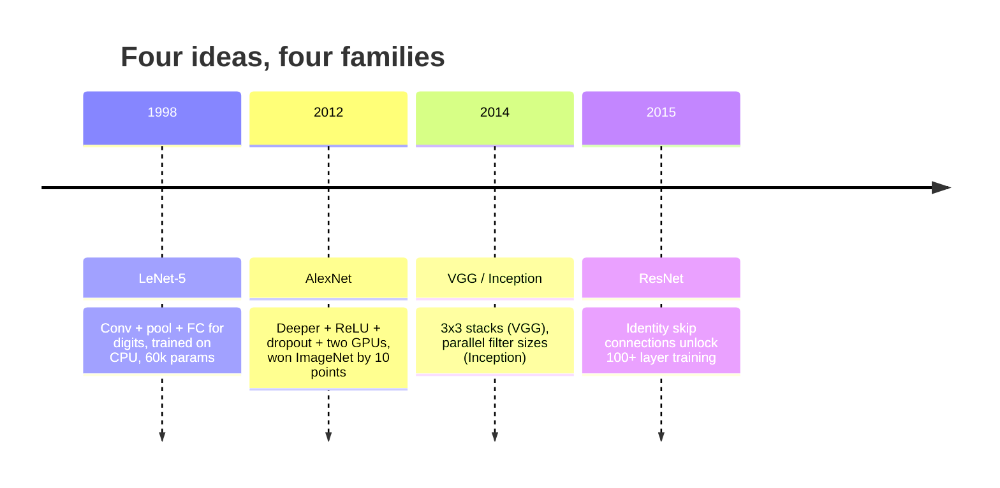
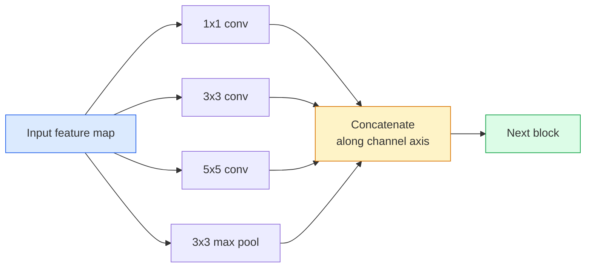
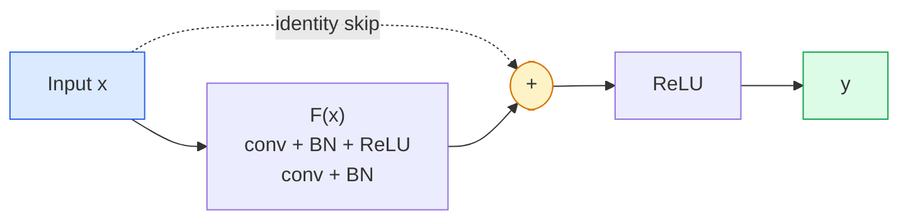

# CNNs — от LeNet до ResNet

> Каждая значимая CNN за последние тридцать лет — это один и тот же рецепт «свёртка–нелинейность–даунсэмплинг» с одной новой идеей, добавленной сверху. Изучите эти идеи по порядку.

**Type:** Learn + Build
**Languages:** Python
**Prerequisites:** Phase 3 Lesson 11 (PyTorch), Phase 4 Lesson 01 (Image Fundamentals), Phase 4 Lesson 02 (Convolutions from Scratch)
**Time:** ~75 минут

## Цели обучения

- Проследить архитектурную линию LeNet-5 -> AlexNet -> VGG -> Inception -> ResNet и сформулировать единственную новую идею, которую внесло каждое семейство
- Реализовать LeNet-5, блок в стиле VGG и BasicBlock ResNet на PyTorch, каждый менее чем в 40 строк
- Объяснить, почему остаточные связи превращают сеть из 1000 слоёв из нетренируемой в передовую
- Прочитать современный бэкбон (ResNet-18, ResNet-50) и предсказать его выходную форму, рецептивное поле и количество параметров, не заглядывая в исходный код

## Проблема

В 2011 году лучший классификатор ImageNet давал около 74% top-5 accuracy. В 2012 году AlexNet дал 85%. В 2015 году ResNet дал 96%. Никаких новых данных. Никакого нового поколения GPU. Прирост получен за счёт архитектурных идей. Работающий инженер по компьютерному зрению обязан знать, какая идея пришла из какой статьи, потому что каждый продуктовый бэкбон, который вы выкатите в 2026 году, — это рекомбинация тех же самых компонентов. И ещё потому, что эти идеи продолжают переноситься: групповые свёртки перешли из CNN в трансформеры, остаточные связи перешли из ResNet в каждую существующую LLM, пакетная нормализация живёт в диффузионных моделях.

Изучение этих сетей по порядку также прививает иммунитет против распространённой ошибки: хвататься за самую большую доступную модель, когда задачу решила бы сеть размером с LeNet. MNIST не нужен ResNet. Знание кривой масштабирования каждого семейства подсказывает, где на ней находиться.

## Концепция

### Четыре идеи, изменившие компьютерное зрение



Ничто другое в классическом компьютерном зрении не имело такого значения, как эти четыре скачка.

### LeNet-5 (1998)

Распознаватель цифр Яна Лекуна. 60 000 параметров. Два блока свёртка-пулинг, два полносвязных слоя, активации tanh. Он задал шаблон, который наследует каждая CNN:

```
input (1, 32, 32)
  conv 5x5 -> (6, 28, 28)
  avg pool 2x2 -> (6, 14, 14)
  conv 5x5 -> (16, 10, 10)
  avg pool 2x2 -> (16, 5, 5)
  flatten -> 400
  dense -> 120
  dense -> 84
  dense -> 10
```

Всё, что современный мир называет CNN — чередование свёрток и даунсэмплинга, подающих результат в небольшой классификационный головной блок, — это LeNet с большим числом слоёв, большими каналами и лучшими активациями.

### AlexNet (2012)

Три изменения, которые вместе сломали ImageNet:

1. **ReLU** вместо tanh. Градиенты перестают затухать. Обучение ускоряется в шесть раз.
2. **Dropout** в полносвязной голове. Регуляризация становится слоем, а не трюком.
3. **Глубина и ширина**. Пять свёрточных слоёв, три полносвязных слоя, 60M параметров, обучение на двух GPU с разделением модели между ними.

На Figure 2 статьи до сих пор показано разделение по GPU как два параллельных потока. Этот параллелизм был аппаратным обходным решением, а не архитектурным озарением — но три идеи выше по-прежнему присутствуют в каждой используемой вами модели.

### VGG (2014)

VGG задался вопросом: что будет, если использовать только свёртки 3x3 и идти вглубь?

```
stack:   conv 3x3 -> conv 3x3 -> pool 2x2
repeat:  16 or 19 conv layers
```

Два свёртки 3x3 видят ту же область входа 5x5, что и одна свёртка 5x5, но с меньшим числом параметров (2*9*C^2 = 18C^2 против 25*C^2) и дополнительным ReLU между ними. VGG превратила это наблюдение в целую архитектуру. Простота — один тип блока, повторяемый многократно — сделала её эталоном для всего, что появилось позже.

Цена: 138M параметров, медленное обучение, дорогой инференс.

### Inception (2014, тот же год)

Ответ Google на вопрос «какой размер ядра использовать?» был такой: все сразу, параллельно.



Каждая ветвь специализируется — 1x1 для смешивания каналов, 3x3 для локальной текстуры, 5x5 для более крупных паттернов, пулинг для сдвиг-инвариантных признаков — а конкатенация позволяет следующему слою выбрать любую полезную ветвь. Inception v1 использовал свёртки 1x1 внутри каждой ветви как «бутылочное горлышко», чтобы удерживать число параметров в разумных пределах.

### Проблема деградации

К 2015 году VGG-19 работала, а VGG-32 — нет. Предполагалось, что глубина должна помогать, но после ~20 слоёв и обучающая, и тестовая ошибка только ухудшались. Это не переобучение. Это неспособность оптимизатора найти полезные веса, потому что градиенты мультипликативно сжимаются через каждый слой.

```
Plain deep network:
  y = f_L( f_{L-1}( ... f_1(x) ... ) )

Gradient wrt early layer:
  dL/dW_1 = dL/dy * df_L/df_{L-1} * ... * df_2/df_1 * df_1/dW_1

Each multiplicative term has magnitude roughly (weight magnitude) * (activation gain).
Stack 100 of them with gains < 1 and the gradient is effectively zero.
```

VGG работала на 19 слоях, потому что пакетная нормализация (опубликованная одновременно) удерживала активации в хорошо масштабированном диапазоне. Но даже пакетная нормализация не могла спасти глубину свыше примерно 30 слоёв.

### ResNet (2015)

Хэ, Чжан, Рен и Сунь предложили одно изменение, которое решило всё:

```
standard block:   y = F(x)
residual block:   y = F(x) + x
```

`+ x` означает, что слой всегда может выбрать «ничего не делать», приведя `F(x)` к нулю. ResNet из 1000 слоёв теперь в худшем случае не хуже сети из одного слоя, потому что у каждого дополнительного блока есть тривиальный путь выхода. При такой гарантии оптимизатор охотно делает каждый блок *чуть-чуть* полезным — а чуть-чуть полезное, умноженное на 100 повторений, и есть передовой результат.



Повсюду встречаются два варианта блока:

- **BasicBlock** (ResNet-18, ResNet-34): две свёртки 3x3, пропуск вокруг обеих.
- **Bottleneck** (ResNet-50, -101, -152): 1x1 вниз, 3x3 посередине, 1x1 вверх, пропуск вокруг тройки. Дешевле при высоком числе каналов.

Когда пропуску нужно пересечь даунсэмплинг (stride=2), путь тождества заменяется свёрткой 1x1 со stride=2 для согласования форм.

### Почему остаточные связи важны не только для зрения

Идея на самом деле была не столько о классификации изображений. Она была о превращении глубоких сетей из «скрести пальцы и надеяться, что градиенты выживут» в надёжный, масштабируемый инженерный инструмент. В каждом трансформере, о котором вы прочитаете в следующей фазе, в каждом блоке точно такая же skip-связь. Без ResNet не было бы GPT.

```figure
pooling
```

## Реализация

### Шаг 1: LeNet-5

Минимальная, верная оригиналу LeNet. Активации tanh, усредняющий пулинг. Единственная уступка современности — использование `nn.CrossEntropyLoss` дальше по сети вместо исходных гауссовых соединений.

```python
import torch
import torch.nn as nn
import torch.nn.functional as F

class LeNet5(nn.Module):
    def __init__(self, num_classes=10):
        super().__init__()
        self.conv1 = nn.Conv2d(1, 6, kernel_size=5)
        self.conv2 = nn.Conv2d(6, 16, kernel_size=5)
        self.pool = nn.AvgPool2d(2)
        self.fc1 = nn.Linear(16 * 5 * 5, 120)
        self.fc2 = nn.Linear(120, 84)
        self.fc3 = nn.Linear(84, num_classes)

    def forward(self, x):
        x = self.pool(torch.tanh(self.conv1(x)))
        x = self.pool(torch.tanh(self.conv2(x)))
        x = torch.flatten(x, 1)
        x = torch.tanh(self.fc1(x))
        x = torch.tanh(self.fc2(x))
        return self.fc3(x)

net = LeNet5()
x = torch.randn(1, 1, 32, 32)
print(f"output: {net(x).shape}")
print(f"params: {sum(p.numel() for p in net.parameters()):,}")
```

Ожидаемый результат: `output: torch.Size([1, 10])`, `params: 61,706`. Это весь классификатор цифр, с которого началось современное компьютерное зрение.

### Шаг 2: Блок VGG

Один переиспользуемый блок: две свёртки 3x3, ReLU, пакетная нормализация, max pool.

```python
class VGGBlock(nn.Module):
    def __init__(self, in_c, out_c):
        super().__init__()
        self.conv1 = nn.Conv2d(in_c, out_c, kernel_size=3, padding=1)
        self.bn1 = nn.BatchNorm2d(out_c)
        self.conv2 = nn.Conv2d(out_c, out_c, kernel_size=3, padding=1)
        self.bn2 = nn.BatchNorm2d(out_c)
        self.pool = nn.MaxPool2d(2)

    def forward(self, x):
        x = F.relu(self.bn1(self.conv1(x)))
        x = F.relu(self.bn2(self.conv2(x)))
        return self.pool(x)

class MiniVGG(nn.Module):
    def __init__(self, num_classes=10):
        super().__init__()
        self.stack = nn.Sequential(
            VGGBlock(3, 32),
            VGGBlock(32, 64),
            VGGBlock(64, 128),
        )
        self.head = nn.Sequential(
            nn.AdaptiveAvgPool2d(1),
            nn.Flatten(),
            nn.Linear(128, num_classes),
        )

    def forward(self, x):
        return self.head(self.stack(x))

net = MiniVGG()
x = torch.randn(1, 3, 32, 32)
print(f"output: {net(x).shape}")
print(f"params: {sum(p.numel() for p in net.parameters()):,}")
```

Три блока VGG на входе размера CIFAR, адаптивный пулинг, один линейный слой. ~290 тыс. параметров. Более чем достаточно для CIFAR-10.

### Шаг 3: BasicBlock ResNet

Ключевой строительный блок ResNet-18 и ResNet-34.

```python
class BasicBlock(nn.Module):
    def __init__(self, in_c, out_c, stride=1):
        super().__init__()
        self.conv1 = nn.Conv2d(in_c, out_c, kernel_size=3, stride=stride, padding=1, bias=False)
        self.bn1 = nn.BatchNorm2d(out_c)
        self.conv2 = nn.Conv2d(out_c, out_c, kernel_size=3, stride=1, padding=1, bias=False)
        self.bn2 = nn.BatchNorm2d(out_c)
        if stride != 1 or in_c != out_c:
            self.shortcut = nn.Sequential(
                nn.Conv2d(in_c, out_c, kernel_size=1, stride=stride, bias=False),
                nn.BatchNorm2d(out_c),
            )
        else:
            self.shortcut = nn.Identity()

    def forward(self, x):
        out = F.relu(self.bn1(self.conv1(x)))
        out = self.bn2(self.conv2(out))
        out = out + self.shortcut(x)
        return F.relu(out)
```

`bias=False` на свёрточных слоях — это конвенция пакетной нормализации: параметр beta в BN уже выполняет роль смещения, так что держать ещё и bias свёртки — пустая трата. `shortcut` требует реальной свёртки только при изменении stride или числа каналов; в остальных случаях это тождественная операция без эффекта.

### Шаг 4: Крошечный ResNet

Соберите четыре группы BasicBlock, чтобы получить рабочий ResNet для входов размера CIFAR.

```python
class TinyResNet(nn.Module):
    def __init__(self, num_classes=10):
        super().__init__()
        self.stem = nn.Sequential(
            nn.Conv2d(3, 32, kernel_size=3, stride=1, padding=1, bias=False),
            nn.BatchNorm2d(32),
            nn.ReLU(inplace=True),
        )
        self.layer1 = self._make_group(32, 32, num_blocks=2, stride=1)
        self.layer2 = self._make_group(32, 64, num_blocks=2, stride=2)
        self.layer3 = self._make_group(64, 128, num_blocks=2, stride=2)
        self.layer4 = self._make_group(128, 256, num_blocks=2, stride=2)
        self.head = nn.Sequential(
            nn.AdaptiveAvgPool2d(1),
            nn.Flatten(),
            nn.Linear(256, num_classes),
        )

    def _make_group(self, in_c, out_c, num_blocks, stride):
        blocks = [BasicBlock(in_c, out_c, stride=stride)]
        for _ in range(num_blocks - 1):
            blocks.append(BasicBlock(out_c, out_c, stride=1))
        return nn.Sequential(*blocks)

    def forward(self, x):
        x = self.stem(x)
        x = self.layer1(x)
        x = self.layer2(x)
        x = self.layer3(x)
        x = self.layer4(x)
        return self.head(x)

net = TinyResNet()
x = torch.randn(1, 3, 32, 32)
print(f"output: {net(x).shape}")
print(f"params: {sum(p.numel() for p in net.parameters()):,}")
```

Четыре группы по два блока в каждой. Stride 2 в начале групп 2, 3, 4. Число каналов удваивается при каждом даунсэмплинге. Примерно 2,8M параметров. Это стандартный рецепт, который чисто масштабируется вплоть до ResNet-152.

### Шаг 5: Сравнение эффективности параметров к признакам

Пропустите один и тот же вход через все три сети и сравните число параметров.

```python
def summary(name, net, x):
    y = net(x)
    params = sum(p.numel() for p in net.parameters())
    print(f"{name:12s}  input {tuple(x.shape)} -> output {tuple(y.shape)}  params {params:>10,}")

x = torch.randn(1, 3, 32, 32)
summary("LeNet5",     LeNet5(),       torch.randn(1, 1, 32, 32))
summary("MiniVGG",    MiniVGG(),      x)
summary("TinyResNet", TinyResNet(),   x)
```

Три модели, три эпохи, три порядка величины в числе параметров. Для точности на CIFAR-10 вам нужно примерно: LeNet — 60%, MiniVGG — 89%, TinyResNet — 93% после нескольких эпох обучения.

## Применение

`torchvision.models` даёт вам предобученные версии всего перечисленного выше. Сигнатура вызова одинакова для всех семейств — именно в этом и смысл абстракции бэкбона.

```python
from torchvision.models import resnet18, ResNet18_Weights, vgg16, VGG16_Weights

r18 = resnet18(weights=ResNet18_Weights.IMAGENET1K_V1)
r18.eval()

print(f"ResNet-18 params: {sum(p.numel() for p in r18.parameters()):,}")
print(r18.layer1[0])
print()

v16 = vgg16(weights=VGG16_Weights.IMAGENET1K_V1)
v16.eval()
print(f"VGG-16   params: {sum(p.numel() for p in v16.parameters()):,}")
```

У ResNet-18 11,7M параметров. У VGG-16 — 138M. Схожая точность top-1 на ImageNet (69,8% против 71,6%). Остаточные связи дают выигрыш в эффективности по параметрам в 12 раз. Именно поэтому варианты ResNet доминировали с 2016 года до появления ViT в 2021-м — и до сих пор доминируют в реальных развёртываниях, где вычисления являются ограничением.

Для transfer learning рецепт всегда один и тот же: загрузить предобученную модель, заморозить бэкбон, заменить классификационную голову.

```python
for p in r18.parameters():
    p.requires_grad = False
r18.fc = nn.Linear(r18.fc.in_features, 10)
```

Три строки. Теперь у вас есть классификатор на 10 классов CIFAR, который наследует представления, оплаченные ImageNet.

## Что сдать

Этот урок производит:

- `outputs/prompt-backbone-selector.md` — промпт, который выбирает подходящее семейство CNN (LeNet/VGG/ResNet/MobileNet/ConvNeXt) с учётом задачи, размера датасета и вычислительного бюджета.
- `outputs/skill-residual-block-reviewer.md` — навык, который читает модуль PyTorch и отмечает ошибки в skip-связях (отсутствующий shortcut при изменении stride, порядок активации в shortcut, расположение BN относительно сложения).

## Упражнения

1. **(Лёгкое)** Подсчитайте вручную количество параметров для `TinyResNet` слой за слоем. Сравните с `sum(p.numel() for p in net.parameters())`. Куда уходит основная часть бюджета параметров — на свёртки, BN или классификационную голову?
2. **(Среднее)** Реализуйте блок Bottleneck (1x1 -> 3x3 -> 1x1 со skip) и постройте с его помощью сеть в стиле ResNet-50 для CIFAR. Сравните число параметров с `TinyResNet`.
3. **(Сложное)** Удалите skip-связь из `BasicBlock`, обучите 34-блочную «плоскую» сеть и 34-блочный ResNet на CIFAR-10 по 10 эпох каждую. Постройте график потерь на обучении в зависимости от эпохи для обеих сетей. Воспроизведите результат Figure 1 из статьи Хэ и др., где плоская глубокая сеть сходится к большим потерям, чем её более мелкий двойник.

## Ключевые термины

| Термин | Что говорят люди | Что это на самом деле означает |
|------|----------------|----------------------|
| Backbone (бэкбон) | «Модель» | Стек свёрточных блоков, который производит карту признаков, подаваемую в головной блок задачи |
| Residual connection (остаточная связь) | «Skip-связь» | `y = F(x) + x`; позволяет оптимизатору обучить тождество, обнулив F, что делает обучаемой произвольную глубину |
| BasicBlock | «Две свёртки 3x3 со skip» | Строительный блок ResNet-18/34: conv-BN-ReLU-conv-BN-add-ReLU |
| Bottleneck | «1x1 вниз, 3x3, 1x1 вверх» | Блок ResNet-50/101/152; дёшев при высоком числе каналов, потому что свёртка 3x3 работает на уменьшенной ширине |
| Degradation problem (проблема деградации) | «Чем глубже, тем хуже» | После ~20 простых свёрточных слоёв растут и обучающая, и тестовая ошибка; решается остаточными связями, а не увеличением данных |
| Stem | «Первый слой» | Начальная свёртка, преобразующая 3-канальный вход в базовую ширину признаков; обычно 7x7 stride 2 для ImageNet, 3x3 stride 1 для CIFAR |
| Head (голова) | «Классификатор» | Слои после финального блока бэкбона: адаптивный пулинг, flatten, линейные слои |
| Transfer learning | «Предобученные веса» | Загрузка бэкбона, обученного на ImageNet, и тонкая настройка только головы под вашу задачу |

## Дополнительное чтение

- [Deep Residual Learning for Image Recognition (He et al., 2015)](https://arxiv.org/abs/1512.03385) — статья о ResNet; изучения заслуживает каждый рисунок
- [Very Deep Convolutional Networks (Simonyan & Zisserman, 2014)](https://arxiv.org/abs/1409.1556) — статья о VGG; по-прежнему лучший источник ответа на вопрос «почему 3x3»
- [ImageNet Classification with Deep CNNs (Krizhevsky et al., 2012)](https://papers.nips.cc/paper_files/paper/2012/hash/c399862d3b9d6b76c8436e924a68c45b-Abstract.html) — AlexNet; статья, завершившая эпоху ручного проектирования признаков
- [Going Deeper with Convolutions (Szegedy et al., 2014)](https://arxiv.org/abs/1409.4842) — Inception v1; идея параллельных фильтров, которая до сих пор встречается в визуальных трансформерах