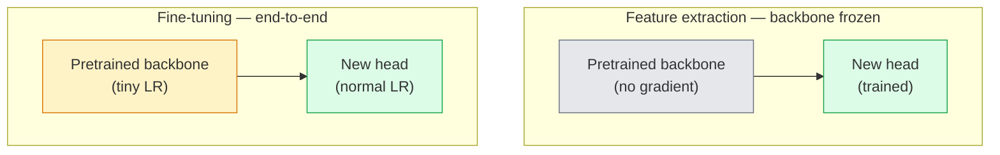

# Перенос обучения и дообучение (Transfer Learning & Fine-Tuning)

> Кто-то другой потратил миллион GPU-часов, обучая сеть тому, как выглядят границы, текстуры и части объектов. Вам стоит позаимствовать эти признаки, прежде чем обучать собственную сеть.

**Type:** Build
**Languages:** Python
**Prerequisites:** Phase 4 Lesson 03 (CNNs), Phase 4 Lesson 04 (Image Classification)
**Time:** ~75 минут

## Цели обучения

- Отличать извлечение признаков (feature extraction) от дообучения (fine-tuning) и выбирать подходящий подход исходя из размера датасета, доменной дистанции и бюджета вычислений
- Загружать предобученный бэкбон, заменять его классификационную голову и обучать только голову до рабочего бейзлайна менее чем в 20 строках
- Постепенно размораживать слои с дифференцированными скоростями обучения (discriminative learning rates), чтобы ранние обобщённые признаки получали меньшие обновления, чем поздние, специфичные для задачи
- Диагностировать три распространённые неудачи: дрейф признаков из-за слишком высокого LR на размороженных блоках, коллапс статистик BN на крошечных датасетах и катастрофическое забывание

## Проблема

Обучение ResNet-50 на ImageNet стоит около 2000 GPU-часов. Очень немногие команды располагают таким бюджетом для каждой задачи, которую они выпускают в продакшн. То, что почти каждая команда на самом деле поставляет — это предобученный бэкбон с новой головой, обученной на нескольких сотнях или тысячах специфичных для задачи изображений.

Это не упрощение. Первый свёрточный блок любой CNN, обученной на ImageNet, учится распознавать границы и фильтры, похожие на фильтры Габора. Следующие несколько блоков учатся распознавать текстуры и простые мотивы. Средние блоки учатся распознавать части объектов. Финальные блоки учатся распознавать комбинации, которые начинают напоминать 1000 категорий ImageNet. Первые 90% этой иерархии переносятся почти без изменений на медицинскую визуализацию, промышленный контроль, спутниковые данные и любую другую задачу компьютерного зрения — потому что у природы ограниченный словарь границ и текстур. Последние 10% — это то, что вы на самом деле обучаете.

Правильный перенос обучения таит три подводных камня: разрушение предобученных признаков из-за слишком высокого learning rate, недообучение модели из-за чрезмерной заморозки и дрейф скользящих статистик BatchNorm в сторону крошечного датасета, на котором остальная часть сети никогда не обучалась. Этот урок намеренно разбирает каждый из них.

## Концепция

### Извлечение признаков vs дообучение

Два режима, выбираемых в зависимости от того, насколько вы доверяете предобученным признакам и сколько у вас данных.



Эмпирические правила:

| Размер датасета | Доменная дистанция | Рецепт |
|--------------|-----------------|--------|
| < 1k изображений | близко к ImageNet | Заморозить бэкбон, обучать только голову |
| 1k-10k | близко | Заморозить первые 2-3 стадии, дообучить остальное |
| 10k-100k | любая | Дообучить end-to-end с дифференцированным LR |
| 100k+ | далеко | Дообучить всё; рассмотреть обучение с нуля, если домен достаточно далёк |

«Близко к ImageNet» примерно означает естественные RGB-фотографии с объектно-подобным содержимым. Медицинские КТ-снимки, спутниковые снимки с высоты и микроскопия — это далёкие домены: признаки всё ещё помогают, но вам потребуется дать адаптироваться большему числу слоёв.

### Почему заморозка вообще работает

Признаки ImageNet, которые учит CNN, не специализированы под 1000 категорий. Они специализированы под статистику естественных изображений: границы определённой ориентации, текстуры, паттерны контраста, примитивы формы. Эта статистика стабильна почти для любого визуального домена, который может назвать человек. Именно поэтому модель, обученная на ImageNet и оценённая в режиме zero-shot на CIFAR-10 всего лишь с новой линейной головой (без дообучения бэкбона), достигает точности 80%+. Голова учится тому, какие из уже выученных признаков взвешивать для данной задачи.

### Дифференцированные скорости обучения

Когда вы всё же размораживаете слои, ранние слои должны обучаться медленнее, чем поздние. Ранние слои кодируют обобщённые признаки, которые вы хотите сохранить; поздние слои кодируют специфичную для задачи структуру, которую нужно сильно сдвинуть.

```
Typical recipe:

  stage 0 (stem + first group): lr = base_lr / 100    (mostly fixed)
  stage 1:                       lr = base_lr / 10
  stage 2:                       lr = base_lr / 3
  stage 3 (last backbone group): lr = base_lr
  head:                          lr = base_lr  (or slightly higher)
```

В PyTorch это просто список групп параметров, передаваемый оптимизатору. Одна модель, пять скоростей обучения, ноль дополнительного кода.

### Проблема BatchNorm

Слои BN хранят буферы `running_mean` и `running_var`, вычисленные на ImageNet. Если ваша задача имеет другое распределение пикселей — другое освещение, другой сенсор, другое цветовое пространство — эти буферы неверны. Три варианта в порядке предпочтения:

1. **Дообучать с BN в режиме train.** Позволить BN обновлять свои скользящие статистики наряду со всем остальным. Выбор по умолчанию, когда датасет задачи среднего размера (>= 5k примеров).
2. **Заморозить BN в режиме eval.** Сохранить статистики ImageNet и обучать только веса. Правильно, когда ваш датасет настолько мал, что скользящее среднее BN было бы зашумлённым.
3. **Заменить BN на GroupNorm.** Полностью устраняет проблему скользящего среднего. Используется в бэкбонах для детекции и сегментации, где размер батча на GPU крошечный.

Ошибка здесь незаметно снижает точность на 5-15%.

### Проектирование головы

Классификационная голова — это 1-3 линейных слоя плюс опциональный dropout. Каждый бэкбон torchvision поставляется с головой по умолчанию, которую вы заменяете:

```
backbone.fc = nn.Linear(backbone.fc.in_features, num_classes)          # ResNet
backbone.classifier[1] = nn.Linear(..., num_classes)                    # EfficientNet, MobileNet
backbone.heads.head = nn.Linear(..., num_classes)                       # torchvision ViT
```

Для маленьких датасетов обычно достаточно одного линейного слоя. Добавление скрытого слоя (Linear -> ReLU -> Dropout -> Linear) помогает, когда распределение задачи дальше от распределения, на котором обучался бэкбон.

### Послойное затухание LR

Более плавная версия дифференцированного LR, используемая в современных дообучениях (BEiT, DINOv2, дообучение ViT-B). Вместо группировки слоёв в стадии, каждому слою даётся немного меньший LR, чем предыдущему:

```
lr_layer_k = base_lr * decay^(L - k)
```

При decay = 0.75 и L = 12 трансформерных блоках первый блок обучается с `0.75^11 ≈ 0.04x` LR головы. Это важнее для дообучения трансформеров, чем для CNN, где обычно достаточно сгруппированных по стадиям LR.

### Что оценивать

Запуски переноса обучения требуют двух чисел, которые вы бы не отслеживали при обучении с нуля:

- **Точность только с предобученными признаками** — точность головы при замороженном бэкбоне. Это ваш пол.
- **Точность после дообучения** — та же модель после end-to-end обучения. Это ваш потолок.

Если точность после дообучения меньше, чем только с предобученными признаками, у вас баг в learning rate или в BN. Всегда печатайте оба значения.

```figure
transfer-learning
```

## Создание

### Шаг 1: Загрузить предобученный бэкбон и изучить его

```python
import torch
import torch.nn as nn
from torchvision.models import resnet18, ResNet18_Weights

backbone = resnet18(weights=ResNet18_Weights.IMAGENET1K_V1)
print(backbone)
print()
print("classifier head:", backbone.fc)
print("feature dim:", backbone.fc.in_features)
```

У `ResNet18` четыре стадии (`layer1..layer4`) плюс stem и голова `fc`. У каждого классификационного бэкбона torchvision аналогичная структура.

### Шаг 2: Извлечение признаков — заморозить всё, заменить голову

```python
def make_feature_extractor(num_classes=10):
    model = resnet18(weights=ResNet18_Weights.IMAGENET1K_V1)
    for p in model.parameters():
        p.requires_grad = False
    model.fc = nn.Linear(model.fc.in_features, num_classes)
    return model

model = make_feature_extractor(num_classes=10)
trainable = sum(p.numel() for p in model.parameters() if p.requires_grad)
frozen = sum(p.numel() for p in model.parameters() if not p.requires_grad)
print(f"trainable: {trainable:>10,}")
print(f"frozen:    {frozen:>10,}")
```

Обучаемым является только `model.fc`. Бэкбон — это замороженный экстрактор признаков.

### Шаг 3: Дифференцированное дообучение

Утилита, строящая группы параметров со специфичными для стадии скоростями обучения.

```python
def discriminative_param_groups(model, base_lr=1e-3, decay=0.3):
    stages = [
        ["conv1", "bn1"],
        ["layer1"],
        ["layer2"],
        ["layer3"],
        ["layer4"],
        ["fc"],
    ]
    groups = []
    for i, names in enumerate(stages):
        lr = base_lr * (decay ** (len(stages) - 1 - i))
        params = [p for n, p in model.named_parameters()
                  if any(n.startswith(k) for k in names)]
        if params:
            groups.append({"params": params, "lr": lr, "name": "_".join(names)})
    return groups

model = resnet18(weights=ResNet18_Weights.IMAGENET1K_V1)
model.fc = nn.Linear(model.fc.in_features, 10)
for p in model.parameters():
    p.requires_grad = True

groups = discriminative_param_groups(model)
for g in groups:
    print(f"{g['name']:>10s}  lr={g['lr']:.2e}  params={sum(p.numel() for p in g['params']):>8,}")
```

`decay=0.3` означает, что каждая стадия обучается со скоростью 30% от следующей. `fc` получает `base_lr`, `layer4` получает `0.3 * base_lr`, `conv1` получает `0.3^5 * base_lr ≈ 0.00243 * base_lr`. Звучит экстремально; эмпирически это работает.

### Шаг 4: Обработка BatchNorm

Вспомогательная функция для заморозки скользящих статистик BN без заморозки его весов.

```python
def freeze_bn_stats(model):
    for m in model.modules():
        if isinstance(m, (nn.BatchNorm1d, nn.BatchNorm2d, nn.BatchNorm3d)):
            m.eval()
            for p in m.parameters():
                p.requires_grad = False
    return model
```

Вызывайте её после установки `model.train()` в начале каждой эпохи. `model.train()` переключает всё в режим обучения; эта функция отменяет это только для слоёв BN.

### Шаг 5: Минимальный end-to-end цикл дообучения

```python
from torch.optim import SGD
from torch.utils.data import DataLoader
from torch.optim.lr_scheduler import CosineAnnealingLR
import torch.nn.functional as F

def fine_tune(model, train_loader, val_loader, device, epochs=5, base_lr=1e-3, freeze_bn=False):
    model = model.to(device)
    groups = discriminative_param_groups(model, base_lr=base_lr)
    optimizer = SGD(groups, momentum=0.9, weight_decay=1e-4, nesterov=True)
    scheduler = CosineAnnealingLR(optimizer, T_max=epochs)

    for epoch in range(epochs):
        model.train()
        if freeze_bn:
            freeze_bn_stats(model)
        tr_loss, tr_correct, tr_total = 0.0, 0, 0
        for x, y in train_loader:
            x, y = x.to(device), y.to(device)
            logits = model(x)
            loss = F.cross_entropy(logits, y, label_smoothing=0.1)
            optimizer.zero_grad()
            loss.backward()
            optimizer.step()
            tr_loss += loss.item() * x.size(0)
            tr_total += x.size(0)
            tr_correct += (logits.argmax(-1) == y).sum().item()
        scheduler.step()

        model.eval()
        va_total, va_correct = 0, 0
        with torch.no_grad():
            for x, y in val_loader:
                x, y = x.to(device), y.to(device)
                pred = model(x).argmax(-1)
                va_total += x.size(0)
                va_correct += (pred == y).sum().item()
        print(f"epoch {epoch}  train {tr_loss/tr_total:.3f}/{tr_correct/tr_total:.3f}  "
              f"val {va_correct/va_total:.3f}")
    return model
```

Пять эпох по указанному выше рецепту на CIFAR-10 переводят `ResNet18-IMAGENET1K_V1` от ~70% точности zero-shot linear-probe до ~93% точности после дообучения. Одна только голова вышла бы на плато около 86%, так и не затронув бэкбон.

### Шаг 6: Постепенная разморозка

Расписание, размораживающее по одной стадии за эпоху от конца к началу. Снижает дрейф признаков ценой нескольких дополнительных эпох.

```python
def progressive_unfreeze_schedule(model):
    stages = ["layer4", "layer3", "layer2", "layer1"]
    yielded = set()

    def start():
        for p in model.parameters():
            p.requires_grad = False
        for p in model.fc.parameters():
            p.requires_grad = True

    def unfreeze(epoch):
        if epoch < len(stages):
            name = stages[epoch]
            yielded.add(name)
            for n, p in model.named_parameters():
                if n.startswith(name):
                    p.requires_grad = True
            return name
        return None

    return start, unfreeze
```

Вызовите `start()` один раз перед первой эпохой. Вызывайте `unfreeze(epoch)` в начале каждой эпохи. Пересоздавайте оптимизатор при каждом изменении набора обучаемых параметров, иначе замороженные параметры всё ещё будут хранить кешированные моменты, которые его запутают.

## Применение

Для большинства реальных задач достаточно `torchvision.models` + трёх строк. Более тяжёлый инструментарий выше важен, когда вы сталкиваетесь с проблемами, которые не может решить поведение библиотеки по умолчанию.

```python
from torchvision.models import resnet50, ResNet50_Weights

model = resnet50(weights=ResNet50_Weights.IMAGENET1K_V2)
model.fc = nn.Linear(model.fc.in_features, num_classes)
optimizer = torch.optim.AdamW(model.parameters(), lr=1e-4, weight_decay=1e-4)
```

Ещё два промышленных стандарта по умолчанию:

- `timm` поставляет ~800 предобученных визуальных бэкбонов с единообразным API (`timm.create_model("resnet50", pretrained=True, num_classes=10)`). Для любого дообучения за пределами зоопарка torchvision это стандарт.
- Для трансформеров `transformers.AutoModelForImageClassification.from_pretrained(name, num_labels=N)` даёт вам ViT / BEiT / DeiT с теми же семантиками загрузки, что и у текстовых моделей.

## Поставка

Этот урок производит:

- `outputs/prompt-fine-tune-planner.md` — промпт, который выбирает между извлечением признаков, постепенной разморозкой и end-to-end дообучением исходя из размера датасета, доменной дистанции и бюджета вычислений.
- `outputs/skill-freeze-inspector.md` — навык, который для данной модели PyTorch сообщает, какие параметры обучаемы, какие слои BatchNorm находятся в режиме eval, и действительно ли оптимизатору подаются обучаемые параметры.

## Упражнения

1. **(Легко)** Обучите `ResNet18` как linear probe (бэкбон заморожен) и как полное дообучение на одном и том же синтетическом датасете на базе CIFAR. Приведите обе точности рядом. Объясните, какой разрыв говорит о том, что признаки хорошо переносятся, а какой — о том, что нет.
2. **(Средне)** Намеренно внесите баг: установите `base_lr = 1e-1` на стадию бэкбона вместо головы. Покажите, как взрывается потеря на обучении, затем восстановите работу, применив вспомогательную функцию `discriminative_param_groups`. Зафиксируйте LR, при котором каждая стадия начинает расходиться.
3. **(Сложно)** Возьмите датасет медицинской визуализации (например, CheXpert-small, PatchCamelyon или HAM10000) и сравните три режима: (a) предобученный на ImageNet замороженный бэкбон + линейная голова; (b) предобученный на ImageNet, дообученный end-to-end; (c) обучение с нуля. Приведите точность и вычислительную стоимость для каждого. При каком размере датасета обучение с нуля становится конкурентоспособным?

## Ключевые термины

| Термин | Что говорят люди | Что это на самом деле означает |
|------|----------------|----------------------|
| Feature extraction (извлечение признаков) | «Заморозить и обучать голову» | Параметры бэкбона заморожены, градиент получает только новая классификационная голова |
| Fine-tuning (дообучение) | «Переобучить end-to-end» | Все параметры обучаемы, обычно с гораздо меньшим LR, чем при обучении с нуля |
| Discriminative LR (дифференцированный LR) | «Меньший LR для ранних слоёв» | Группы параметров оптимизатора, в которых LR ранней стадии составляет долю от LR поздней стадии |
| Layer-wise LR decay (послойное затухание LR) | «Плавный градиент LR» | LR для каждого слоя, умноженный на decay^(L - k); распространено при дообучении трансформеров |
| Catastrophic forgetting (катастрофическое забывание) | «Модель потеряла ImageNet» | Слишком высокий LR перезаписывает предобученные признаки прежде, чем усвоен сигнал новой задачи |
| BN statistics drift (дрейф статистик BN) | «Скользящее среднее неверно» | running_mean/var BatchNorm вычислены на распределении, отличном от текущей задачи, что незаметно снижает точность |
| Linear probe | «Замороженный бэкбон + линейная голова» | Оценка предобученных признаков — точность наилучшего линейного классификатора поверх замороженного представления |
| Catastrophic collapse (катастрофический коллапс) | «Всё предсказывает один класс» | Происходит при дообучении со слишком высоким LR, который разрушает признаки раньше, чем градиенты от головы успевают стабилизироваться |

## Дополнительное чтение

- [How transferable are features in deep neural networks? (Yosinski et al., 2014)](https://arxiv.org/abs/1411.1792) — статья, количественно оценившая переносимость признаков между слоями
- [Universal Language Model Fine-tuning (ULMFiT, Howard & Ruder, 2018)](https://arxiv.org/abs/1801.06146) — оригинальный рецепт дифференцированного LR / постепенной разморозки; идеи напрямую переносятся на компьютерное зрение
- [timm documentation](https://huggingface.co/docs/timm) — справочник по современным визуальным бэкбонам и точным настройкам дообучения по умолчанию, с которыми они обучались
- [A Simple Framework for Linear-Probe Evaluation (Kornblith et al., 2019)](https://arxiv.org/abs/1805.08974) — почему точность linear-probe важна и как правильно её сообщать