# Обнаружение объектов — YOLO с нуля

> Детекция — это классификация плюс регрессия, выполняемые в каждой позиции карты признаков, а затем очищенные с помощью non-maximum suppression.

**Type:** Build
**Languages:** Python
**Prerequisites:** Phase 4 Lesson 03 (CNNs), Phase 4 Lesson 04 (Image Classification), Phase 4 Lesson 05 (Transfer Learning)
**Time:** ~75 минут

## Цели обучения

- Объяснить принцип сетки и якорей (anchors), который превращает детекцию в задачу плотного предсказания, и определить, что означает каждое число в выходном тензоре
- Вычислить Intersection-over-Union между боксами и реализовать non-maximum suppression с нуля
- Построить минимальную YOLO-голову поверх предобученного бэкбона, включая классификационную, objectness- и box-регрессионную функции потерь
- Прочитать строку метрик детекции (precision@0.5, recall, mAP@0.5, mAP@0.5:0.95) и определить, какой параметр крутить дальше

## Проблема

Классификация говорит: «на этом изображении собака». Детекция говорит: «собака находится в пикселях (112, 40, 280, 210), кошка — в (400, 180, 560, 310), и больше ничего в кадре нет». Именно это структурное изменение — предсказание переменного числа размеченных боксов вместо одной метки на изображение — лежит в основе каждой автономной системы, каждого продукта видеонаблюдения, каждого парсера верстки документов и каждой линии компьютерного зрения на производстве.

Детекция — это ещё и место, где все инженерные компромиссы в компьютерном зрении проявляются одновременно. Нужны точные боксы (регрессионная голова), нужен правильный класс для каждого бокса (классификационная голова), нужно, чтобы модель знала, когда обнаруживать нечего (оценка objectness), и нужно ровно одно предсказание на каждый реальный объект (non-maximum suppression). Упустите что-то одно — и пайплайн либо пропускает объекты, либо выдаёт галлюцинированные боксы, либо предсказывает один и тот же объект пятнадцать раз в чуть разных позициях.

YOLO (You Only Look Once, Redmon et al. 2016) — это архитектура, которая позволила делать всё это в реальном времени за один прямой проход свёрточной сети, и те же структурные решения до сих пор лежат в основе современных детекторов (YOLOv8, YOLOv9, YOLO-NAS, RT-DETR). Освойте ядро — и любой вариант станет просто перестановкой тех же частей.

## Концепция

### Детекция как плотное предсказание

Классификатор выдаёт C чисел на изображение. YOLO-подобный детектор выдаёт `(S x S x (5 + C))` чисел на изображение, где S — размер пространственной сетки.

```mermaid
flowchart LR
    IMG["Input 416x416 RGB"] --> BB["Backbone<br/>(ResNet, DarkNet, ...)"]
    BB --> FM["Feature map<br/>(C_feat, 13, 13)"]
    FM --> HEAD["Detection head<br/>(1x1 convs)"]
    HEAD --> OUT["Output tensor<br/>(13, 13, B * (5 + C))"]
    OUT --> DEC["Decode<br/>(grid + sigmoid + exp)"]
    DEC --> NMS["Non-max suppression"]
    NMS --> RESULT["Final boxes"]

    style IMG fill:#dbeafe,stroke:#2563eb
    style HEAD fill:#fef3c7,stroke:#d97706
    style NMS fill:#fecaca,stroke:#dc2626
    style RESULT fill:#dcfce7,stroke:#16a34a
```



Каждая из `S * S` ячеек сетки предсказывает `B` боксов. Для каждого бокса:

- 4 числа описывают геометрию: `tx, ty, tw, th`.
- 1 число — оценка objectness: «есть ли объект, центрированный в этой ячейке?»
- C чисел — вероятности классов.

Всего на ячейку: `B * (5 + C)`. Для VOC с `S=13, B=2, C=20` это 50 чисел на ячейку.

### Зачем нужны сетки и якоря

Простая регрессия предсказывала бы `(x, y, w, h)` для каждого объекта как абсолютную координату. Это сложно для свёрточной сети, потому что сдвиг изображения не должен сдвигать все предсказания на одну и ту же величину — каждый объект пространственно привязан. Сетка решает эту проблему, назначая каждому истинному боксу (ground-truth) ту ячейку сетки, в которую попадает его центр; только эта ячейка отвечает за данный объект.

Якоря решают вторую проблему. Свёртка 3x3 не может легко регрессировать бокс шириной 500 пикселей из ячейки признаков с рецептивным полем 16 пикселей. Вместо этого мы заранее задаём `B` форм боксов-прообразов (якорей) для каждой ячейки и предсказываем небольшие смещения от каждого якоря. Модель учится выбирать правильный якорь и немного подправлять его, а не регрессировать с нуля.

```
Anchor box priors (example for 416x416 input):

  small:   (30,  60)
  medium:  (75,  170)
  large:   (200, 380)

At each grid cell, every anchor emits (tx, ty, tw, th, obj, c_1, ..., c_C).
```

Современные детекторы часто используют FPN с разными наборами якорей для разных разрешений — маленькие якоря на неглубоких картах высокого разрешения, большие якоря на глубоких картах низкого разрешения. Та же идея, но больше масштабов.

### Декодирование предсказаний

Сырые `tx, ty, tw, th` — это не координаты бокса; это регрессионные цели, которые нужно преобразовать перед отрисовкой:

```
centre x  = (sigmoid(tx) + cell_x) * stride
centre y  = (sigmoid(ty) + cell_y) * stride
width     = anchor_w * exp(tw)
height    = anchor_h * exp(th)
```

`sigmoid` удерживает смещения центра внутри ячейки. `exp` позволяет ширине свободно масштабироваться относительно якоря без смены знака. `stride` масштабирует координаты сетки обратно в пиксели. Этот шаг декодирования одинаков во всех версиях YOLO начиная с v2.

### IoU

Универсальная метрика сходства между двумя боксами в детекции:

```
IoU(A, B) = area(A intersect B) / area(A union B)
```

IoU = 1 означает полное совпадение; IoU = 0 означает отсутствие пересечения. IoU между предсказанием и истинным боксом определяет, засчитывается ли предсказание как истинноположительное (обычно IoU >= 0.5). IoU между двумя предсказаниями используется NMS для дедупликации.

### Non-maximum suppression

Свёрточная сеть, обученная на соседних якорях, часто предсказывает перекрывающиеся боксы для одного и того же объекта. NMS оставляет предсказание с наибольшей уверенностью и удаляет любое другое предсказание, у которого IoU с ним выше порога.

```
NMS(boxes, scores, iou_threshold):
    sort boxes by score descending
    keep = []
    while boxes not empty:
        pick the top-scoring box, add to keep
        remove every box with IoU > iou_threshold to the picked box
    return keep
```

Типичный порог: 0.45 для детекции объектов. Современные детекторы заменяют стандартный NMS на `soft-NMS`, `DIoU-NMS` или учат подавление напрямую (RT-DETR), но структурная цель остаётся той же.

### Функция потерь

Потеря YOLO — это три потери, сложенные с весами:

```
L = lambda_coord * L_box(pred, target, where obj=1)
  + lambda_obj   * L_obj(pred, 1,     where obj=1)
  + lambda_noobj * L_obj(pred, 0,     where obj=0)
  + lambda_cls   * L_cls(pred, target, where obj=1)
```

Только ячейки, содержащие объект, вносят вклад в потери box-регрессии и классификации. Ячейки без объектов вносят вклад только в потерю objectness (обучая модель «молчать»). `lambda_noobj` обычно небольшой (~0.5), потому что подавляющее большинство ячеек пусты и иначе доминировали бы в общей потере.

Современные варианты заменяют MSE-потерю бокса на CIoU / DIoU (которые оптимизируют IoU напрямую), используют focal loss для дисбаланса классов и балансируют objectness с помощью quality focal loss. Структура из трёх компонентов остаётся неизменной.

### Метрики детекции

Accuracy не переносится на детекцию. Четыре числа, которые переносятся:

- **Precision@IoU=0.5** — из предсказаний, засчитанных как положительные, сколько действительно верны.
- **Recall@IoU=0.5** — из реальных объектов, сколько мы нашли.
- **AP@0.5** — площадь под кривой precision-recall при пороге IoU 0.5; одно число на класс.
- **mAP@0.5:0.95** — среднее AP по порогам IoU 0.5, 0.55, ..., 0.95. Метрика COCO; самая строгая и наиболее информативная.

Сообщайте все четыре. Детектор, сильный по mAP@0.5, но слабый по mAP@0.5:0.95, локализует объекты приблизительно, но не точно; исправляется улучшением функции потерь box-регрессии. Детектор с высокой precision и низким recall слишком консервативен; снизьте порог уверенности или увеличьте вес objectness.

```figure
object-detection-nms
```

## Реализация

### Шаг 1: IoU

Рабочая лошадка всего занятия. Работает с двумя массивами боксов в формате `(x1, y1, x2, y2)`.

```python
import numpy as np

def box_iou(boxes_a, boxes_b):
    ax1, ay1, ax2, ay2 = boxes_a[:, 0], boxes_a[:, 1], boxes_a[:, 2], boxes_a[:, 3]
    bx1, by1, bx2, by2 = boxes_b[:, 0], boxes_b[:, 1], boxes_b[:, 2], boxes_b[:, 3]

    inter_x1 = np.maximum(ax1[:, None], bx1[None, :])
    inter_y1 = np.maximum(ay1[:, None], by1[None, :])
    inter_x2 = np.minimum(ax2[:, None], bx2[None, :])
    inter_y2 = np.minimum(ay2[:, None], by2[None, :])

    inter_w = np.clip(inter_x2 - inter_x1, 0, None)
    inter_h = np.clip(inter_y2 - inter_y1, 0, None)
    inter = inter_w * inter_h

    area_a = (ax2 - ax1) * (ay2 - ay1)
    area_b = (bx2 - bx1) * (by2 - by1)
    union = area_a[:, None] + area_b[None, :] - inter
    return inter / np.clip(union, 1e-8, None)
```

Возвращает матрицу `(N_a, N_b)` попарных IoU. Используйте её против одного истинного бокса, задав одному из массивов форму `(1, 4)`.

### Шаг 2: Non-max suppression

```python
def nms(boxes, scores, iou_threshold=0.45):
    order = np.argsort(-scores)
    keep = []
    while len(order) > 0:
        i = order[0]
        keep.append(i)
        if len(order) == 1:
            break
        rest = order[1:]
        ious = box_iou(boxes[[i]], boxes[rest])[0]
        order = rest[ious <= iou_threshold]
    return np.array(keep, dtype=np.int64)
```

Детерминированный, `O(N log N)` из сортировки, и совпадает по поведению с `torchvision.ops.nms` на идентичных входных данных.

### Шаг 3: Кодирование и декодирование боксов

Преобразование между пиксельными координатами и целями `(tx, ty, tw, th)`, которые сеть фактически регрессирует.

```python
def encode(box_xyxy, cell_x, cell_y, stride, anchor_wh):
    x1, y1, x2, y2 = box_xyxy
    cx = 0.5 * (x1 + x2)
    cy = 0.5 * (y1 + y2)
    w = x2 - x1
    h = y2 - y1
    tx = cx / stride - cell_x
    ty = cy / stride - cell_y
    tw = np.log(w / anchor_wh[0] + 1e-8)
    th = np.log(h / anchor_wh[1] + 1e-8)
    return np.array([tx, ty, tw, th])


def decode(tx_ty_tw_th, cell_x, cell_y, stride, anchor_wh):
    tx, ty, tw, th = tx_ty_tw_th
    cx = (sigmoid(tx) + cell_x) * stride
    cy = (sigmoid(ty) + cell_y) * stride
    w = anchor_wh[0] * np.exp(tw)
    h = anchor_wh[1] * np.exp(th)
    return np.array([cx - w / 2, cy - h / 2, cx + w / 2, cy + h / 2])


def sigmoid(x):
    return 1.0 / (1.0 + np.exp(-x))
```

Тест: закодируйте бокс, затем декодируйте — вы должны получить что-то очень близкое к исходному (с поправкой на то, что обратная сигмоида не является идеально обратимой, когда `tx` не лежит в постсигмоидном диапазоне).

### Шаг 4: Минимальная голова YOLO

Одна свёртка 1x1 на карте признаков с изменением формы в `(B, S, S, num_anchors, 5 + C)`.

```python
import torch
import torch.nn as nn

class YOLOHead(nn.Module):
    def __init__(self, in_c, num_anchors, num_classes):
        super().__init__()
        self.num_anchors = num_anchors
        self.num_classes = num_classes
        self.conv = nn.Conv2d(in_c, num_anchors * (5 + num_classes), kernel_size=1)

    def forward(self, x):
        n, _, h, w = x.shape
        y = self.conv(x)
        y = y.view(n, self.num_anchors, 5 + self.num_classes, h, w)
        y = y.permute(0, 3, 4, 1, 2).contiguous()
        return y
```

Форма выхода: `(N, H, W, num_anchors, 5 + C)`. Последняя размерность содержит `[tx, ty, tw, th, obj, cls_0, ..., cls_{C-1}]`.

### Шаг 5: Назначение истинных значений (ground-truth)

Для каждого истинного бокса определить, какая `(cell, anchor)` отвечает за него.

```python
def assign_targets(boxes_xyxy, classes, anchors, stride, grid_size, num_classes):
    num_anchors = len(anchors)
    target = np.zeros((grid_size, grid_size, num_anchors, 5 + num_classes), dtype=np.float32)
    has_obj = np.zeros((grid_size, grid_size, num_anchors), dtype=bool)

    for box, cls in zip(boxes_xyxy, classes):
        x1, y1, x2, y2 = box
        cx, cy = 0.5 * (x1 + x2), 0.5 * (y1 + y2)
        gx, gy = int(cx / stride), int(cy / stride)
        bw, bh = x2 - x1, y2 - y1

        ious = np.array([
            (min(bw, aw) * min(bh, ah)) / (bw * bh + aw * ah - min(bw, aw) * min(bh, ah))
            for aw, ah in anchors
        ])
        best = int(np.argmax(ious))
        aw, ah = anchors[best]

        target[gy, gx, best, 0] = cx / stride - gx
        target[gy, gx, best, 1] = cy / stride - gy
        target[gy, gx, best, 2] = np.log(bw / aw + 1e-8)
        target[gy, gx, best, 3] = np.log(bh / ah + 1e-8)
        target[gy, gx, best, 4] = 1.0
        target[gy, gx, best, 5 + cls] = 1.0
        has_obj[gy, gx, best] = True
    return target, has_obj
```

Выбор якоря — это «форма с наилучшим IoU относительно истинного бокса» — дешёвое приближение, соответствующее назначению в YOLOv2/v3. v5 и более поздние версии используют более сложные стратегии (task-aligned matching, dynamic k), уточняющие ту же идею.

### Шаг 6: Три функции потерь

```python
def yolo_loss(pred, target, has_obj, lambda_coord=5.0, lambda_obj=1.0, lambda_noobj=0.5, lambda_cls=1.0):
    has_obj_t = torch.from_numpy(has_obj).bool()
    target_t = torch.from_numpy(target).float()

    # box-regression loss: only on cells with objects
    box_pred = pred[..., :4][has_obj_t]
    box_true = target_t[..., :4][has_obj_t]
    loss_box = torch.nn.functional.mse_loss(box_pred, box_true, reduction="sum")

    # objectness loss
    obj_pred = pred[..., 4]
    obj_true = target_t[..., 4]
    loss_obj_pos = torch.nn.functional.binary_cross_entropy_with_logits(
        obj_pred[has_obj_t], obj_true[has_obj_t], reduction="sum")
    loss_obj_neg = torch.nn.functional.binary_cross_entropy_with_logits(
        obj_pred[~has_obj_t], obj_true[~has_obj_t], reduction="sum")

    # classification loss on cells with objects
    cls_pred = pred[..., 5:][has_obj_t]
    cls_true = target_t[..., 5:][has_obj_t]
    loss_cls = torch.nn.functional.binary_cross_entropy_with_logits(
        cls_pred, cls_true, reduction="sum")

    total = (lambda_coord * loss_box
             + lambda_obj * loss_obj_pos
             + lambda_noobj * loss_obj_neg
             + lambda_cls * loss_cls)
    return total, {"box": loss_box.item(), "obj_pos": loss_obj_pos.item(),
                   "obj_neg": loss_obj_neg.item(), "cls": loss_cls.item()}
```

Пять гиперпараметров, которые каждый туториал по YOLO либо фиксирует жёстко, либо подбирает перебором. Важны соотношения: `lambda_coord=5, lambda_noobj=0.5` повторяет оригинальную статью YOLOv1 и до сих пор работает как разумное значение по умолчанию.

### Шаг 7: Пайплайн вывода

Декодировать сырой выход головы, применить sigmoid/exp, отфильтровать по порогу objectness и применить NMS.

```python
def postprocess(pred_tensor, anchors, stride, img_size, conf_threshold=0.25, iou_threshold=0.45):
    pred = pred_tensor.detach().cpu().numpy()
    grid_h, grid_w = pred.shape[1], pred.shape[2]
    num_anchors = len(anchors)

    boxes, scores, classes = [], [], []
    for gy in range(grid_h):
        for gx in range(grid_w):
            for a in range(num_anchors):
                tx, ty, tw, th, obj, *cls = pred[0, gy, gx, a]
                score = sigmoid(obj) * sigmoid(np.array(cls)).max()
                if score < conf_threshold:
                    continue
                cls_idx = int(np.argmax(cls))
                cx = (sigmoid(tx) + gx) * stride
                cy = (sigmoid(ty) + gy) * stride
                w = anchors[a][0] * np.exp(tw)
                h = anchors[a][1] * np.exp(th)
                boxes.append([cx - w / 2, cy - h / 2, cx + w / 2, cy + h / 2])
                scores.append(float(score))
                classes.append(cls_idx)

    if not boxes:
        return np.zeros((0, 4)), np.zeros((0,)), np.zeros((0,), dtype=int)
    boxes = np.array(boxes)
    scores = np.array(scores)
    classes = np.array(classes)
    keep = nms(boxes, scores, iou_threshold)
    return boxes[keep], scores[keep], classes[keep]
```

Это полный путь оценки: голова -> декодирование -> порог -> NMS.

## Применение

`torchvision.models.detection` поставляет production-детекторы с той же концептуальной структурой. Загрузка предобученной модели занимает три строки.

```python
import torch
from torchvision.models.detection import fasterrcnn_resnet50_fpn_v2

model = fasterrcnn_resnet50_fpn_v2(weights="DEFAULT")
model.eval()
with torch.no_grad():
    predictions = model([torch.randn(3, 400, 600)])
print(predictions[0].keys())
print(f"boxes:  {predictions[0]['boxes'].shape}")
print(f"scores: {predictions[0]['scores'].shape}")
print(f"labels: {predictions[0]['labels'].shape}")
```

Для production-пайплайнов инференса в реальном времени стандартом является `ultralytics` (YOLOv8/v9): `from ultralytics import YOLO; model = YOLO('yolov8n.pt'); model(img)`. Модель обрабатывает декодирование и NMS внутри себя и возвращает ту же тройку `boxes / scores / labels`, которую вы построили выше.

## Что сдать

Это занятие даёт на выходе:

- `outputs/prompt-detection-metric-reader.md` — промпт, который превращает строку `precision, recall, AP, mAP@0.5:0.95` в однострочный диагноз и единственный наиболее полезный следующий эксперимент.
- `outputs/skill-anchor-designer.md` — навык (skill), который по датасету истинных боксов запускает k-means на `(w, h)` и возвращает наборы якорей для каждого уровня FPN плюс статистику покрытия, нужную для выбора правильного числа якорей.

## Упражнения

1. **(Лёгкое)** Реализуйте `box_iou` и запустите против `torchvision.ops.box_iou` на 1000 случайных пар боксов. Проверьте, что максимальная абсолютная разница ниже `1e-6`.
2. **(Среднее)** Портируйте `yolo_loss` в версию, использующую box-потерю `CIoU` вместо MSE. Покажите на синтетическом датасете из 100 изображений, что CIoU сходится к лучшему итоговому mAP@0.5:0.95, чем MSE, за то же количество эпох.
3. **(Сложное)** Реализуйте многомасштабный инференс: подайте одно и то же изображение в трёх разрешениях в модель, объедините предсказания боксов и выполните единый NMS в конце. Измерьте прирост mAP по сравнению с инференсом на одном масштабе на отложенном наборе.

## Ключевые термины

| Термин | Что обычно говорят | Что это на самом деле означает |
|------|----------------|----------------------|
| Anchor (якорь) | «Box prior» | Заранее заданная форма бокса в каждой ячейке сетки, от которой сеть предсказывает смещения вместо абсолютных координат |
| IoU | «Перекрытие» | Пересечение-над-объединением двух боксов; универсальная мера сходства в детекции |
| NMS | «Дедупликация» | Жадный алгоритм, оставляющий предсказания с наивысшей оценкой и удаляющий перекрывающиеся выше порога |
| Objectness | «Есть ли здесь что-то» | Скалярное значение на якорь и ячейку, предсказывающее, центрирован ли в ней объект |
| Grid stride | «Коэффициент понижающей дискретизации» | Количество пикселей на ячейку сетки; вход 416 px с головой на сетке 13 имеет stride 32 |
| mAP | «Mean average precision» | Среднее по площади под кривой precision-recall, усреднённое по классам и (для COCO) по порогам IoU |
| AP@0.5 | «PASCAL VOC AP» | Average precision при пороге IoU 0.5; более мягкая версия метрики |
| mAP@0.5:0.95 | «COCO AP» | Среднее по порогам IoU 0.5..0.95 с шагом 0.05; строгая версия и текущий стандарт сообщества |

## Дополнительное чтение

- [YOLOv1: You Only Look Once (Redmon et al., 2016)](https://arxiv.org/abs/1506.02640) — основополагающая статья; каждая версия YOLO с тех пор является усовершенствованием этой структуры
- [YOLOv3 (Redmon & Farhadi, 2018)](https://arxiv.org/abs/1804.02767) — статья, представившая многомасштабные головы в стиле FPN; до сих пор самая наглядная диаграмма
- [Документация Ultralytics YOLOv8](https://docs.ultralytics.com) — актуальный production-ориентир; охватывает форматы датасетов, аугментации, рецепты обучения
- [The Illustrated Guide to Object Detection (Jonathan Hui)](https://jonathan-hui.medium.com/object-detection-series-24d03a12f904) — лучший простой обзор всего «зоопарка» детекторов; бесценен для понимания того, как связаны DETR, RetinaNet, FCOS и YOLO