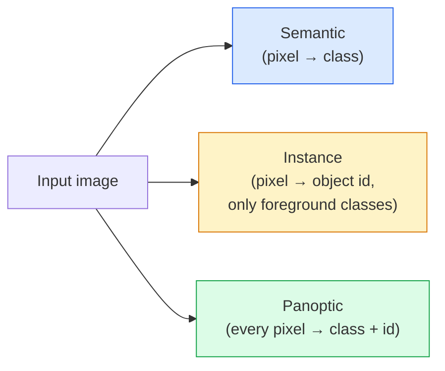
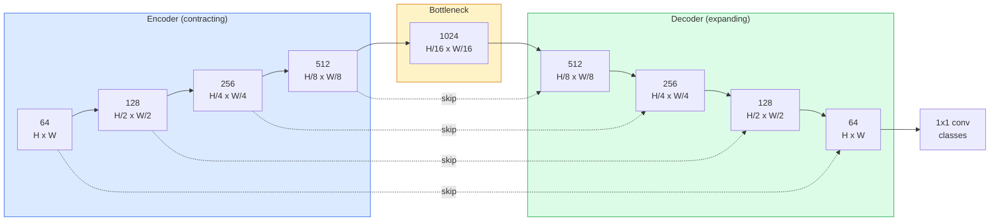

# Семантическая сегментация — U-Net

> Сегментация — это классификация в каждом пикселе. U-Net добивается этого, сопрягая понижающий дискретизацию кодировщик с повышающим дискретизацию декодировщиком и соединяя их skip-connections.

**Type:** Build
**Languages:** Python
**Prerequisites:** Phase 4 Lesson 03 (CNNs), Phase 4 Lesson 04 (Image Classification)
**Time:** ~75 минут

## Цели обучения

- Различать семантическую, instance- и panoptic-сегментацию и выбирать подходящую задачу под конкретную проблему
- Построить U-Net с нуля на PyTorch с блоками кодировщика, bottleneck-слоем, декодировщиком с transposed-свёртками и skip-connections
- Реализовать поэлементную (pixel-wise) cross-entropy, Dice loss и комбинированную функцию потерь, которая сейчас является стандартом по умолчанию для медицинской и промышленной сегментации
- Читать метрики IoU и Dice по классам и диагностировать, вызвана ли низкая оценка плохим recall на мелких объектах, точностью границ или дисбалансом классов

## Проблема

Классификация выдаёт одну метку на изображение. Детекция выдаёт несколько боксов на изображение. Сегментация выдаёт одну метку на пиксель. Для входа размером `H x W` выход — это тензор формы `H x W` (семантическая сегментация) или `H x W x N_instances` (instance-сегментация). Это миллионы предсказаний на изображение, а не одно.

Именно эта структура делает сегментацию основой почти всех продуктов с плотным предсказанием в компьютерном зрении: медицинская визуализация (маски опухолей), автономное вождение (дорога, полоса, препятствие), спутниковые снимки (контуры зданий, границы полей), разбор документов (зоны макета), робототехника (области для захвата). Ни одна из этих задач не решается рамкой вокруг объекта — нужен точный силуэт.

Архитектурная проблема формулируется просто, но решается непросто: сети нужно видеть глобальный контекст изображения (что это за сцена) и локальную пиксельную деталь (какой именно пиксель — дорога, а какой — тротуар) одновременно. Обычная CNN сжимает пространственную размерность, чтобы получить контекст, и при этом теряет детали. U-Net — архитектура, которая получила и то, и другое.

## Концепция

### Семантическая, instance- и panoptic-сегментация



- **Семантическая** говорит: «этот пиксель — дорога, тот пиксель — машина». Две машины рядом сливаются в одно пятно.
- **Instance-сегментация** говорит: «этот пиксель — машина №3, тот пиксель — машина №5». Игнорирует фоновые сущности («stuff» = небо, дорога, трава).
- **Panoptic-сегментация** объединяет оба подхода: каждый пиксель получает метку класса, каждый экземпляр получает уникальный id, сегментируются и фон, и объекты.

Этот урок посвящён семантической сегментации. Следующий урок (Mask R-CNN) посвящён instance-сегментации.

### Форма U-Net



Кодировщик уменьшает пространственное разрешение вдвое четыре раза и удваивает число каналов. Декодировщик делает обратное: увеличивает пространственное разрешение вдвое четыре раза и уменьшает число каналов вдвое. Skip-connections конкатенируют соответствующие признаки кодировщика с признаками декодировщика на каждом уровне разрешения. Финальная свёртка 1x1 отображает `64 -> num_classes` при полном разрешении.

Почему skip-connections необходимы: к моменту, когда декодировщик пытается выдать предсказания на уровне пикселей, он видел только маленькие карты признаков. Без skip-connections он не может точно локализовать края, потому что эта информация была сжата в кодировщике. Skip-connections передают ему карты признаков высокого разрешения, вычисленные кодировщиком по пути вниз.

### Transposed-свёртка против билинейного апсемплинга

Декодировщику нужно расширять пространственные размерности. Два варианта:

- **Transposed-свёртка** (`nn.ConvTranspose2d`) — обучаемый апсемплинг. Исторический вариант по умолчанию для U-Net. Может создавать артефакты «шахматной доски», если stride и размер ядра не делятся друг на друга нацело.
- **Билинейный апсемплинг + свёртка 3x3** — плавный апсемплинг, за которым следует свёртка. Меньше артефактов, меньше параметров, сейчас это современный вариант по умолчанию.

Оба встречаются на практике. Для первой U-Net билинейный вариант безопаснее.

### Cross-entropy на пиксельной сетке

Для семантической сегментации с C классами выход модели — `(N, C, H, W)`. Целевой тензор — `(N, H, W)` с целочисленными ID классов. Cross-entropy идентична случаю классификации, просто применяется в каждой пространственной позиции:

```
Loss = mean over (n, h, w) of -log( softmax(logits[n, :, h, w])[target[n, h, w]] )
```

`F.cross_entropy` в PyTorch обрабатывает эту форму нативно. Reshape не нужен.

### Dice loss и зачем он нужен

Cross-entropy одинаково трактует каждый пиксель. Это неверно, когда один класс доминирует в кадре (медицинская визуализация: 99% фона, 1% опухоли). Сеть может набрать 99% точности, предсказывая фон везде, и при этом быть бесполезной.

Dice loss решает эту проблему, напрямую оптимизируя перекрытие между предсказанной и истинной маской:

```
Dice(p, y) = 2 * sum(p * y) / (sum(p) + sum(y) + epsilon)
Dice_loss = 1 - Dice
```

где `p` — карта вероятностей sigmoid/softmax для класса, а `y` — бинарная маска ground truth. Loss равен нулю только при идеальном перекрытии. Поскольку он основан на соотношении, дисбаланс классов не имеет значения.

На практике используют **комбинированную функцию потерь**:

```
L = L_cross_entropy + lambda * L_dice       (lambda ~ 1)
```

Cross-entropy даёт стабильные градиенты на ранних этапах обучения; Dice фокусирует финальную часть обучения на точном совпадении формы маски. Эта комбинация является стандартом по умолчанию в медицинской визуализации, и её сложно превзойти на любом датасете с дисбалансом классов.

### Метрики оценки

- **Pixel accuracy** — процент правильно предсказанных пикселей. Дёшево вычисляется. Ломается на несбалансированных данных по той же причине, что и accuracy в классификации.
- **IoU по классам** — пересечение над объединением (intersection over union) для маски каждого класса; усреднение по классам = mIoU.
- **Dice (F1 на пикселях)** — похож на IoU; `Dice = 2 * IoU / (1 + IoU)`. Медицинская визуализация предпочитает Dice, сообщество автономного вождения предпочитает IoU; они монотонно связаны.
- **Boundary F1** — измеряет, насколько близки предсказанные границы к границам ground truth, штрафуя даже небольшие сдвиги. Важен для высокоточных задач, например, инспекции полупроводников.

Сообщайте IoU по каждому классу, а не только mIoU. Среднее IoU скрывает класс на уровне 15%, когда девять других находятся на уровне 85%.

### Компромисс по входному разрешению

Кодировщик U-Net четыре раза уменьшает разрешение вдвое, поэтому вход должен делиться на 16. Медицинские изображения часто имеют размер 512x512 или 1024x1024. Кропы для автономного вождения — 2048x1024. Затраты памяти U-Net масштабируются как `H * W * C_max`, и при 1024x1024 с 1024 каналами в bottleneck-слое прямой проход уже использует гигабайты VRAM.

Два стандартных обходных решения:
1. Тайлинг входа — обрабатывать тайлы 256x256 с перекрытием и сшивать результат.
2. Заменить bottleneck-слой на dilated-свёртки, которые сохраняют более высокое пространственное разрешение, но расширяют рецептивное поле (семейство DeepLab).

Для первой модели вход 256x256 с U-Net на базе 64 каналов комфортно обучается на 8 ГБ VRAM.

```figure
segmentation-flood
```

## Собираем

### Шаг 1: Блок кодировщика

Две свёртки 3x3 с batch norm и ReLU. Первая свёртка меняет число каналов; вторая сохраняет его.

```python
import torch
import torch.nn as nn
import torch.nn.functional as F

class DoubleConv(nn.Module):
    def __init__(self, in_c, out_c):
        super().__init__()
        self.net = nn.Sequential(
            nn.Conv2d(in_c, out_c, kernel_size=3, padding=1, bias=False),
            nn.BatchNorm2d(out_c),
            nn.ReLU(inplace=True),
            nn.Conv2d(out_c, out_c, kernel_size=3, padding=1, bias=False),
            nn.BatchNorm2d(out_c),
            nn.ReLU(inplace=True),
        )

    def forward(self, x):
        return self.net(x)
```

Этот блок переиспользуется повсюду. `bias=False`, потому что beta в BN обрабатывает смещение.

### Шаг 2: Блоки down и up

```python
class Down(nn.Module):
    def __init__(self, in_c, out_c):
        super().__init__()
        self.net = nn.Sequential(
            nn.MaxPool2d(2),
            DoubleConv(in_c, out_c),
        )

    def forward(self, x):
        return self.net(x)


class Up(nn.Module):
    def __init__(self, in_c, out_c):
        super().__init__()
        self.up = nn.Upsample(scale_factor=2, mode="bilinear", align_corners=False)
        self.conv = DoubleConv(in_c, out_c)

    def forward(self, x, skip):
        x = self.up(x)
        if x.shape[-2:] != skip.shape[-2:]:
            x = F.interpolate(x, size=skip.shape[-2:], mode="bilinear", align_corners=False)
        x = torch.cat([skip, x], dim=1)
        return self.conv(x)
```

Проверка только пространственной формы (`shape[-2:]`) обрабатывает входы, размерности которых не делятся на 16; безопасный `F.interpolate` выравнивает тензор перед конкатенацией. Сравнение полной формы также вызывало бы срабатывание при различиях в числе каналов, что должно быть явной ошибкой, а не тихой интерполяцией.

### Шаг 3: U-Net

```python
class UNet(nn.Module):
    def __init__(self, in_channels=3, num_classes=2, base=64):
        super().__init__()
        self.inc = DoubleConv(in_channels, base)
        self.d1 = Down(base, base * 2)
        self.d2 = Down(base * 2, base * 4)
        self.d3 = Down(base * 4, base * 8)
        self.d4 = Down(base * 8, base * 16)
        self.u1 = Up(base * 16 + base * 8, base * 8)
        self.u2 = Up(base * 8 + base * 4, base * 4)
        self.u3 = Up(base * 4 + base * 2, base * 2)
        self.u4 = Up(base * 2 + base, base)
        self.outc = nn.Conv2d(base, num_classes, kernel_size=1)

    def forward(self, x):
        x1 = self.inc(x)
        x2 = self.d1(x1)
        x3 = self.d2(x2)
        x4 = self.d3(x3)
        x5 = self.d4(x4)
        x = self.u1(x5, x4)
        x = self.u2(x, x3)
        x = self.u3(x, x2)
        x = self.u4(x, x1)
        return self.outc(x)

net = UNet(in_channels=3, num_classes=2, base=32)
x = torch.randn(1, 3, 256, 256)
print(f"output: {net(x).shape}")
print(f"params: {sum(p.numel() for p in net.parameters()):,}")
```

Форма выхода `(1, 2, 256, 256)` — тот же пространственный размер, что и вход, `num_classes` каналов. Около 7,7 млн параметров при `base=32`.

### Шаг 4: Функции потерь

```python
def dice_loss(logits, targets, num_classes, eps=1e-6):
    probs = F.softmax(logits, dim=1)
    targets_one_hot = F.one_hot(targets, num_classes).permute(0, 3, 1, 2).float()
    dims = (0, 2, 3)
    intersection = (probs * targets_one_hot).sum(dim=dims)
    denom = probs.sum(dim=dims) + targets_one_hot.sum(dim=dims)
    dice = (2 * intersection + eps) / (denom + eps)
    return 1 - dice.mean()


def combined_loss(logits, targets, num_classes, lam=1.0):
    ce = F.cross_entropy(logits, targets)
    dc = dice_loss(logits, targets, num_classes)
    return ce + lam * dc, {"ce": ce.item(), "dice": dc.item()}
```

Dice вычисляется по каждому классу, затем усредняется (macro Dice). `eps` предотвращает деление на ноль для классов, отсутствующих в батче.

### Шаг 5: Метрика IoU

```python
@torch.no_grad()
def iou_per_class(logits, targets, num_classes):
    preds = logits.argmax(dim=1)
    ious = torch.zeros(num_classes)
    for c in range(num_classes):
        pred_c = (preds == c)
        true_c = (targets == c)
        inter = (pred_c & true_c).sum().float()
        union = (pred_c | true_c).sum().float()
        ious[c] = (inter / union) if union > 0 else torch.tensor(float("nan"))
    return ious
```

Возвращает вектор длины C. `nan` помечает классы, отсутствующие в батче, — не усредняйте по ним при вычислении mIoU.

### Шаг 6: Синтетический датасет для сквозной проверки

Сгенерируйте фигуры на цветных фонах, чтобы сети пришлось учить форму, а не цвет пикселей.

```python
import numpy as np
from torch.utils.data import Dataset, DataLoader

def synthetic_segmentation(num_samples=200, size=64, seed=0):
    rng = np.random.default_rng(seed)
    images = np.zeros((num_samples, size, size, 3), dtype=np.float32)
    masks = np.zeros((num_samples, size, size), dtype=np.int64)
    for i in range(num_samples):
        bg = rng.uniform(0, 1, (3,))
        images[i] = bg
        masks[i] = 0
        num_shapes = rng.integers(1, 4)
        for _ in range(num_shapes):
            cls = int(rng.integers(1, 3))
            color = rng.uniform(0, 1, (3,))
            cx, cy = rng.integers(10, size - 10, size=2)
            r = int(rng.integers(4, 12))
            yy, xx = np.meshgrid(np.arange(size), np.arange(size), indexing="ij")
            if cls == 1:
                mask = (xx - cx) ** 2 + (yy - cy) ** 2 < r ** 2
            else:
                mask = (np.abs(xx - cx) < r) & (np.abs(yy - cy) < r)
            images[i][mask] = color
            masks[i][mask] = cls
        images[i] += rng.normal(0, 0.02, images[i].shape)
        images[i] = np.clip(images[i], 0, 1)
    return images, masks


class SegDataset(Dataset):
    def __init__(self, images, masks):
        self.images = images
        self.masks = masks

    def __len__(self):
        return len(self.images)

    def __getitem__(self, i):
        img = torch.from_numpy(self.images[i]).permute(2, 0, 1).float()
        mask = torch.from_numpy(self.masks[i]).long()
        return img, mask
```

Три класса: фон (0), круги (1), квадраты (2). Сеть должна научиться различать форму.

### Шаг 7: Цикл обучения

```python
def train_one_epoch(model, loader, optimizer, device, num_classes):
    model.train()
    loss_sum, total = 0.0, 0
    iou_sum = torch.zeros(num_classes)
    for x, y in loader:
        x, y = x.to(device), y.to(device)
        logits = model(x)
        loss, _ = combined_loss(logits, y, num_classes)
        optimizer.zero_grad()
        loss.backward()
        optimizer.step()
        loss_sum += loss.item() * x.size(0)
        total += x.size(0)
        iou_sum += iou_per_class(logits, y, num_classes).nan_to_num(0)
    return loss_sum / total, iou_sum / len(loader)
```

Запустите это на 10-30 эпох на синтетическом датасете и наблюдайте, как mIoU для классов фигур растёт выше 0,9. Обратите внимание, что `nan_to_num(0)` трактует отсутствующие в батче классы как нулевые; для точного IoU по классам маскируйте по наличию и используйте `torch.nanmean` по всем батчам во время оценки вместо усреднения здесь.

## Применяем

Для продакшена `segmentation_models_pytorch` («smp») оборачивает все стандартные архитектуры сегментации с любым backbone из torchvision или timm. Три строки:

```python
import segmentation_models_pytorch as smp

model = smp.Unet(
    encoder_name="resnet34",
    encoder_weights="imagenet",
    in_channels=3,
    classes=3,
)
```

Также стоит знать для реальной работы:
- **DeepLabV3+** заменяет понижение разрешения на основе max-pool dilated-свёртками, так что bottleneck-слой сохраняет разрешение; более быстрые и точные границы на спутниковых данных и данных автономного вождения.
- **SegFormer** заменяет сверточный кодировщик на иерархический трансформер; текущий SOTA на многих бенчмарках.
- **Mask2Former** / **OneFormer** объединяют семантическую, instance- и panoptic-сегментацию в единой архитектуре.

Все три — взаимозаменяемые замены в `smp` или `transformers` с тем же загрузчиком данных.

## Публикуем

Этот урок даёт на выходе:

- `outputs/prompt-segmentation-task-picker.md` — промпт, который выбирает между семантической, instance- и panoptic-сегментацией и называет архитектуру для заданной задачи.
- `outputs/skill-segmentation-mask-inspector.md` — навык, который сообщает распределение классов, статистику предсказанных масок и классы, которые недопредсказаны или имеют размытые границы.

## Упражнения

1. **(Лёгкое)** Реализуйте `bce_dice_loss` для задачи бинарной сегментации (передний план против фона). Проверьте на синтетическом двуклассовом датасете, что комбинированная функция потерь сходится быстрее, чем одна лишь BCE, когда передний план занимает 5% пикселей.
2. **(Среднее)** Замените up-блок на `nn.Upsample + conv` на up-блок `nn.ConvTranspose2d`. Обучите оба варианта на синтетическом датасете и сравните mIoU. Отметьте, где в варианте с transposed-свёрткой появляются артефакты «шахматной доски».
3. **(Сложное)** Возьмите реальный датасет сегментации (Oxford-IIIT Pets, мини-сплит Cityscapes или медицинский подмножество) и обучите U-Net до результата в пределах 2 пунктов IoU от эталона `smp.Unet`. Сообщите IoU по каждому классу и определите, какие классы получают наибольшую выгоду от добавления Dice в функцию потерь.

## Ключевые термины

| Термин | Что говорят люди | Что это на самом деле означает |
|------|----------------|----------------------|
| Семантическая сегментация | «Разметить каждый пиксель» | Поэлементная классификация на C классов; экземпляры одного класса сливаются |
| Instance-сегментация | «Разметить каждый объект» | Разделяет отдельные экземпляры одного класса; только передний план |
| Panoptic-сегментация | «Семантическая + instance» | Каждый пиксель получает класс; каждый объект-экземпляр также получает уникальный id |
| Skip-connection | «Мост U-Net» | Конкатенация признаков кодировщика с признаками декодировщика того же разрешения; сохраняет высокочастотные детали |
| Transposed-свёртка | «Деконволюция» | Обучаемый апсемплинг; может создавать артефакты «шахматной доски» |
| Dice loss | «Loss перекрытия» | 1 - 2|A ∩ B| / (|A| + |B|); напрямую оптимизирует перекрытие масок и устойчив к дисбалансу классов |
| mIoU | «Среднее пересечение над объединением» | Среднее IoU по классам; стандартная для сообщества метрика сегментации |
| Boundary F1 | «Точность границ» | F1-оценка, вычисленная только на граничных пикселях; важна для задач, критичных к точности |

## Дополнительное чтение

- [U-Net: Convolutional Networks for Biomedical Image Segmentation (Ronneberger et al., 2015)](https://arxiv.org/abs/1505.04597) — оригинальная статья; рисунок, который все копируют, находится на странице 2
- [Fully Convolutional Networks (Long et al., 2015)](https://arxiv.org/abs/1411.4038) — статья, которая первой сделала сегментацию сквозной свёрточной задачей
- [segmentation_models_pytorch](https://github.com/qubvel/segmentation_models.pytorch) — эталон для продакшн-сегментации; все стандартные архитектуры плюс все стандартные функции потерь
- [iafoss, Unet34 submission with TTA (Kaggle notebook)](https://www.kaggle.com/code/iafoss/unet34-submission-tta-0-699-new-public-lb) — test-time augmentation для U-Net на реальном соревновании по сегментации