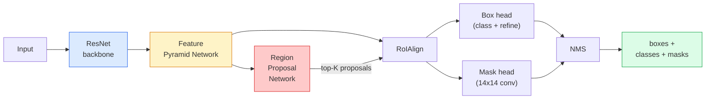

# Сегментация экземпляров — Mask R-CNN

> Добавьте крошечную ветвь масок к детектору Faster R-CNN — и вы получите сегментацию экземпляров. Сложная часть — RoIAlign, и она сложнее, чем кажется.

**Type:** Build + Learn
**Languages:** Python
**Prerequisites:** Phase 4 Lesson 06 (YOLO), Phase 4 Lesson 07 (U-Net)
**Time:** ~75 минут

## Цели обучения

- Проследить архитектуру Mask R-CNN от начала до конца: backbone, FPN, RPN, RoIAlign, box head, mask head
- Реализовать RoIAlign с нуля и объяснить, почему RoIPool больше не используется
- Использовать предобученную модель torchvision `maskrcnn_resnet50_fpn_v2` для получения масок экземпляров производственного качества и корректно читать формат её вывода
- Дообучить Mask R-CNN на небольшом пользовательском датасете, заменив box- и mask-головы и заморозив backbone

## Проблема

Семантическая сегментация даёт одну маску на класс. Сегментация экземпляров даёт одну маску на объект, даже если два объекта относятся к одному классу. Подсчёт отдельных особей, отслеживание по кадрам и измерение объектов (ограничивающий прямоугольник каждого кирпича в стене, каждой клетки на изображении с микроскопа) — всё это требует сегментации экземпляров.

Mask R-CNN (He et al., 2017) решила эту задачу, переформулировав сегментацию экземпляров как детекцию плюс маску. Решение оказалось настолько элегантным, что следующие пять лет почти каждая статья по сегментации экземпляров была вариантом Mask R-CNN, а реализация в torchvision до сих пор остаётся производственным выбором по умолчанию для малых и средних датасетов.

Сложная инженерная задача — это семплирование: как вырезать признаковую область фиксированного размера из предложенного прямоугольника, углы которого не совпадают с границами пикселей? Ошибка здесь стоит десятых долей mAP везде. RoIAlign — это ответ на этот вопрос.

## Концепция

### Архитектура



Пять компонентов, которые нужно понять:

1. **Backbone** — ResNet-50 или ResNet-101, обученные на ImageNet. Производят иерархию карт признаков со страйдами 4, 8, 16, 32.
2. **FPN (Feature Pyramid Network)** — нисходящие и латеральные связи, дающие каждому уровню C каналов семантически насыщенных признаков. Детекция обращается к уровню FPN, соответствующему размеру объекта.
3. **RPN (Region Proposal Network)** — небольшая свёрточная голова, которая в каждой позиции якоря предсказывает «есть ли здесь объект?» и «как уточнить прямоугольник?». Производит ~1000 предложений на изображение.
4. **RoIAlign** — семплирует признаковый патч фиксированного размера (например, 7x7) из любого прямоугольника на любом уровне FPN. Билинейное семплирование, без квантования.
5. **Головы** — двухслойная box-голова, уточняющая прямоугольник и выбирающая класс, плюс небольшая свёрточная голова, выдающая бинарную маску `28x28` для каждого предложения.

### Почему RoIAlign, а не RoIPool

Исходная Fast R-CNN использовала RoIPool, которая разбивает предложенный прямоугольник на сетку, берёт максимум признака в каждой ячейке и округляет все координаты до целых чисел. Это округление сдвигает карту признаков относительно координат входных пикселей на величину до целого пикселя карты признаков — малость на изображении 224x224, катастрофа при страйде карты признаков 32.

```
RoIPool:
  box (34.7, 51.3, 98.2, 142.9)
  round -> (34, 51, 98, 142)
  split grid -> round each cell boundary
  misalignment accumulates at every step

RoIAlign:
  box (34.7, 51.3, 98.2, 142.9)
  sample at exact float coordinates using bilinear interpolation
  no rounding anywhere
```

RoIAlign бесплатно повышает mask AP на COCO на 3-4 пункта. Сейчас его использует каждый детектор, для которого важна локализация — и YOLOv7 seg, и RT-DETR, и Mask2Former.

### RPN в одном абзаце

В каждой позиции карты признаков размещается K якорных прямоугольников разных размеров и форм. Для каждого якоря предсказывается оценка «objectness» и регрессионное смещение, превращающее якорь в лучше подогнанный прямоугольник. Сохраняются ~1000 прямоугольников с наивысшей оценкой, применяется NMS при IoU 0.7, а выжившие передаются головам. RPN обучается собственной мини-функцией потерь — той же структуры, что и loss YOLO из урока 6, только с двумя классами (объект / не объект).

### Mask-голова

Для каждого предложения (после RoIAlign) mask-голова представляет собой крошечную FCN: четыре свёртки 3x3, деконволюция 2x, финальная свёртка 1x1, выдающая `num_classes` выходных каналов с разрешением `28x28`. Сохраняется только канал, соответствующий предсказанному классу; остальные игнорируются. Это отделяет предсказание маски от классификации.

Апсемплирование маски 28x28 до исходного пиксельного размера предложения даёт финальную бинарную маску.

### Функции потерь

Mask R-CNN суммирует четыре функции потерь:

```
L = L_rpn_cls + L_rpn_box + L_box_cls + L_box_reg + L_mask
```

- `L_rpn_cls`, `L_rpn_box` — objectness и регрессия прямоугольника для предложений RPN.
- `L_box_cls` — кросс-энтропия по (C+1) классам (включая фон) на классификаторе головы.
- `L_box_reg` — smooth L1 на уточнении прямоугольника головой.
- `L_mask` — попиксельная бинарная кросс-энтропия на выходе маски 28x28.

У каждой функции потерь свой вес по умолчанию; реализация torchvision выставляет их как аргументы конструктора.

### Формат вывода

`torchvision.models.detection.maskrcnn_resnet50_fpn_v2` возвращает список словарей, по одному на изображение:

```
{
    "boxes":  (N, 4) in (x1, y1, x2, y2) pixel coordinates,
    "labels": (N,) class IDs, 0 = background so indices are 1-based,
    "scores": (N,) confidence scores,
    "masks":  (N, 1, H, W) float masks in [0, 1] — threshold at 0.5 for binary,
}
```

Маска уже имеет разрешение полного изображения. Выход головы 28x28 был апсемплирован внутри модели.

```figure
cv3-roialign-sampling
```

## Реализация

### Шаг 1: RoIAlign с нуля

Это единственный компонент Mask R-CNN, который проще понять в виде кода, чем в виде текста.

```python
import torch
import torch.nn.functional as F

def roi_align_single(feature, box, output_size=7, spatial_scale=1 / 16.0):
    """
    feature: (C, H, W) single-image feature map
    box: (x1, y1, x2, y2) in original image pixel coordinates
    output_size: side of the output grid (7 for box head, 14 for mask head)
    spatial_scale: reciprocal of the feature map stride
    """
    C, H, W = feature.shape
    x1, y1, x2, y2 = [c * spatial_scale - 0.5 for c in box]
    bin_w = (x2 - x1) / output_size
    bin_h = (y2 - y1) / output_size

    grid_y = torch.linspace(y1 + bin_h / 2, y2 - bin_h / 2, output_size)
    grid_x = torch.linspace(x1 + bin_w / 2, x2 - bin_w / 2, output_size)
    yy, xx = torch.meshgrid(grid_y, grid_x, indexing="ij")

    gx = 2 * (xx + 0.5) / W - 1
    gy = 2 * (yy + 0.5) / H - 1
    grid = torch.stack([gx, gy], dim=-1).unsqueeze(0)
    sampled = F.grid_sample(feature.unsqueeze(0), grid, mode="bilinear",
                            align_corners=False)
    return sampled.squeeze(0)
```

Каждое число получено в билинейно семплированной позиции. Никакого округления, квантования, потерянных градиентов.

### Шаг 2: Сравнение с RoIAlign из torchvision

```python
from torchvision.ops import roi_align

feature = torch.randn(1, 16, 50, 50)
boxes = torch.tensor([[0, 10, 20, 100, 90]], dtype=torch.float32)  # (batch_idx, x1, y1, x2, y2)

ours = roi_align_single(feature[0], boxes[0, 1:].tolist(), output_size=7, spatial_scale=1/4)
theirs = roi_align(feature, boxes, output_size=(7, 7), spatial_scale=1/4, sampling_ratio=1, aligned=True)[0]

print(f"shape ours:   {tuple(ours.shape)}")
print(f"shape theirs: {tuple(theirs.shape)}")
print(f"max|diff|:    {(ours - theirs).abs().max().item():.3e}")
```

При `sampling_ratio=1` и `aligned=True` два результата совпадают с точностью до `1e-5`.

### Шаг 3: Загрузка предобученной Mask R-CNN

```python
import torch
from torchvision.models.detection import maskrcnn_resnet50_fpn_v2, MaskRCNN_ResNet50_FPN_V2_Weights

model = maskrcnn_resnet50_fpn_v2(weights=MaskRCNN_ResNet50_FPN_V2_Weights.DEFAULT)
model.eval()
print(f"params: {sum(p.numel() for p in model.parameters()):,}")
print(f"classes (including background): {len(model.roi_heads.box_predictor.cls_score.out_features * [0])}")
```

46 млн параметров, 91 класс (COCO). Первый класс (id 0) — фон; всё, что модель реально детектирует, начинается с id 1.

### Шаг 4: Запуск инференса

```python
with torch.no_grad():
    x = torch.randn(3, 400, 600)
    predictions = model([x])
p = predictions[0]
print(f"boxes:  {tuple(p['boxes'].shape)}")
print(f"labels: {tuple(p['labels'].shape)}")
print(f"scores: {tuple(p['scores'].shape)}")
print(f"masks:  {tuple(p['masks'].shape)}")
```

Тензор маски имеет форму `(N, 1, H, W)`. Применяем порог 0.5, чтобы получить бинарную маску для каждого объекта:

```python
binary_masks = (p['masks'] > 0.5).squeeze(1)  # (N, H, W) boolean
```

### Шаг 5: Замена голов для пользовательского числа классов

Стандартный рецепт дообучения: переиспользовать backbone, FPN и RPN; заменить две классификационные головы.

```python
from torchvision.models.detection.faster_rcnn import FastRCNNPredictor
from torchvision.models.detection.mask_rcnn import MaskRCNNPredictor

def build_custom_maskrcnn(num_classes):
    model = maskrcnn_resnet50_fpn_v2(weights=MaskRCNN_ResNet50_FPN_V2_Weights.DEFAULT)
    in_features = model.roi_heads.box_predictor.cls_score.in_features
    model.roi_heads.box_predictor = FastRCNNPredictor(in_features, num_classes)
    in_features_mask = model.roi_heads.mask_predictor.conv5_mask.in_channels
    hidden_layer = 256
    model.roi_heads.mask_predictor = MaskRCNNPredictor(in_features_mask, hidden_layer, num_classes)
    return model

custom = build_custom_maskrcnn(num_classes=5)
print(f"custom cls_score.out_features: {custom.roi_heads.box_predictor.cls_score.out_features}")
```

`num_classes` должен включать класс фона, поэтому датасет с 4 классами объектов использует `num_classes=5`.

### Шаг 6: Заморозка того, что не нуждается в обучении

На небольших датасетах заморозьте backbone и FPN. Обучаются только objectness + регрессия RPN и две головы.

```python
def freeze_backbone_and_fpn(model):
    # torchvision Mask R-CNN packs the FPN inside `model.backbone` (as
    # `model.backbone.fpn`), so iterating `model.backbone.parameters()` covers
    # both the ResNet feature layers and the FPN lateral/output convs.
    for p in model.backbone.parameters():
        p.requires_grad = False
    return model

custom = freeze_backbone_and_fpn(custom)
trainable = sum(p.numel() for p in custom.parameters() if p.requires_grad)
print(f"trainable after freeze: {trainable:,}")
```

На датасетах из 500 изображений это разница между сходимостью и переобучением.

## Применение

Полный цикл обучения Mask R-CNN в torchvision занимает 40 строк и существенно не меняется между задачами — меняйте датасеты и запускайте.

```python
def train_step(model, images, targets, optimizer):
    model.train()
    loss_dict = model(images, targets)
    losses = sum(loss for loss in loss_dict.values())
    optimizer.zero_grad()
    losses.backward()
    optimizer.step()
    return {k: v.item() for k, v in loss_dict.items()}
```

Список `targets` должен содержать словари по изображению с `boxes`, `labels` и `masks` (в виде бинарных тензоров `(num_instances, H, W)`). Во время обучения модель возвращает словарь из четырёх функций потерь, а во время оценки — список предсказаний, ключи которых — `model.training`.

Эвалюатор `pycocotools` выдаёт mAP@IoU=0.5:0.95 как для прямоугольников, так и для масок; нужны оба числа, чтобы понять, что является узким местом — box-голова или mask-голова.

## Результаты

Этот урок даёт на выходе:

- `outputs/prompt-instance-vs-semantic-router.md` — промпт, который задаёт три вопроса и выбирает между сегментацией экземпляров, семантической или паноптической сегментацией, а также конкретную модель для начала работы.
- `outputs/skill-mask-rcnn-head-swapper.md` — навык, генерирующий 10 строк кода для замены голов на любой детекционной модели torchvision при заданном новом `num_classes`.

## Упражнения

1. **(Лёгкое)** Проверьте свой RoIAlign против `torchvision.ops.roi_align` на 100 случайных прямоугольниках. Приведите максимальную абсолютную разницу. Также запустите RoIPool (поведение до 2017 года) и покажите, что оно расходится на ~1-2 пикселя карты признаков на прямоугольниках у границы.
2. **(Среднее)** Дообучите `maskrcnn_resnet50_fpn_v2` на пользовательском датасете из 50 изображений (любые два класса: воздушные шары, рыбы, выбоины, логотипы). Заморозьте backbone, обучайте 20 эпох, приведите mask AP@0.5.
3. **(Сложное)** Замените mask-голову Mask R-CNN на такую, которая предсказывает с разрешением 56x56 вместо 28x28. Измерьте mAP@IoU=0.75 до и после. Объясните, почему прирост (или его отсутствие) соответствует ожидаемому компромиссу между точностью границ и расходом памяти.

## Ключевые термины

| Термин | Что говорят люди | Что это значит на самом деле |
|------|----------------|----------------------|
| Mask R-CNN | «Детекция плюс маски» | Faster R-CNN + небольшая FCN-голова, предсказывающая маску 28x28 для каждого предложения и каждого класса |
| FPN | «Пирамида признаков» | Нисходящие и латеральные связи, дающие каждому уровню страйда C каналов семантически насыщенных признаков |
| RPN | «Генератор предложений регионов» | Небольшая свёрточная голова, выдающая ~1000 предложений объект/не объект на изображение |
| RoIAlign | «Вырезание без округления» | Билинейно семплирует сетку признаков фиксированного размера из прямоугольника с координатами с плавающей точкой |
| RoIPool | «Вырезание до 2017 года» | Та же цель, что и у RoIAlign, но с округлением координат прямоугольника; устарело |
| Mask AP | «mAP для экземпляров» | Средняя точность, вычисленная с использованием IoU масок вместо IoU прямоугольников; метрика сегментации экземпляров COCO |
| Бинарная mask-голова | «Маска на класс» | Предсказывает одну бинарную маску на класс для каждого предложения; сохраняется только канал предсказанного класса |
| Класс фона | «Класс 0» | Класс-«мусорка» «нет объекта»; индексы настоящих классов начинаются с 1 |

## Дополнительные материалы

- [Mask R-CNN (He et al., 2017)](https://arxiv.org/abs/1703.06870) — статья; раздел 3 про RoIAlign — критически важное чтение
- [FPN: Feature Pyramid Networks (Lin et al., 2017)](https://arxiv.org/abs/1612.03144) — статья про FPN; используется в каждом современном детекторе
- [Руководство по Mask R-CNN в torchvision](https://pytorch.org/tutorials/intermediate/torchvision_tutorial.html) — справочник по циклу дообучения
- [Model zoo Detectron2](https://github.com/facebookresearch/detectron2/blob/main/MODEL_ZOO.md) — производственные реализации с обученными весами почти для каждого варианта детекции и сегментации