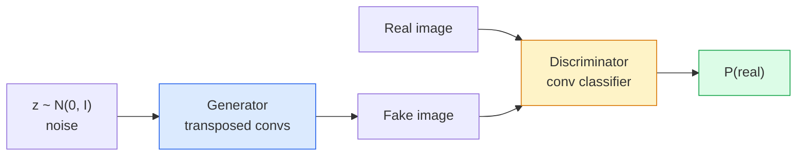
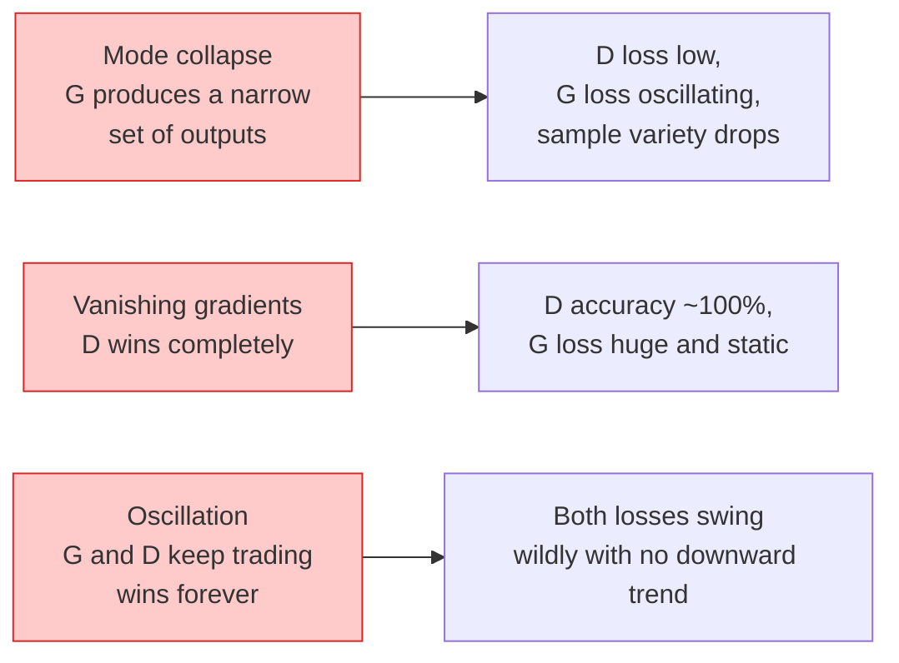

# Генерация изображений — GAN

> GAN — это две нейросети, играющие в фиксированную игру. Одна рисует, другая критикует. Они совершенствуются вместе, пока рисунки не начинают обманывать критика.

**Type:** Build
**Languages:** Python
**Prerequisites:** Phase 4 Lesson 03 (CNNs), Phase 3 Lesson 06 (Optimizers), Phase 3 Lesson 07 (Regularization)
**Time:** ~75 минут

## Цели обучения

- Объяснить минимаксную игру между генератором и дискриминатором и почему равновесие соответствует p_model = p_data
- Реализовать DCGAN на PyTorch и получить генерацию связных синтетических изображений 32x32 менее чем в 60 строк
- Стабилизировать обучение GAN тремя стандартными приёмами: non-saturating loss, spectral norm, TTUR (two-timescale update rule)
- Читать кривые обучения, различая здоровую сходимость, коллапс мод (mode collapse), колебания и полную победу дискриминатора

## Проблема

Классификация учит сеть отображать изображения в метки. Генерация переворачивает задачу: нужно сэмплировать новые изображения, выглядящие так, будто они взяты из того же распределения. Здесь нет «правильного» выхода, с которым можно было бы сравнить результат; есть только распределение, которое нужно имитировать.

Стандартные функции потерь (MSE, cross-entropy) не могут измерить «пришёл ли этот сэмпл из реального распределения». Минимизация попиксельной ошибки даёт размытые усреднения, а не реалистичные сэмплы. Прорыв состоял в том, чтобы выучить саму функцию потерь: обучить вторую сеть, чья задача — отличать реальное от поддельного, и использовать её суждение, чтобы подталкивать генератор.

GAN (Goodfellow et al., 2014) определили этот фреймворк. К 2018 году StyleGAN уже генерировал лица 1024x1024, неотличимые от фотографий. С тех пор диффузионные модели захватили трон по качеству и управляемости, но каждый приём, сделавший диффузию практичной — выбор нормализации, латентные пространства, feature losses — был впервые понят на GAN.

## Концепция

### Две сети



**Генератор** G принимает вектор шума `z` и выдаёт изображение. **Дискриминатор** D принимает изображение и выдаёт одно скалярное значение: вероятность того, что изображение реальное.

### Игра

G хочет, чтобы D ошибался. D хочет быть правым. Формально:

```
min_G max_D  E_x[log D(x)] + E_z[log(1 - D(G(z)))]
```

Читайте справа налево: D максимизирует точность на реальных (`log D(real)`) и поддельных (`log (1 - D(fake))`) изображениях. G минимизирует точность D на подделках — он хочет, чтобы `D(G(z))` было высоким.

Goodfellow доказал, что у этого минимакса есть глобальное равновесие, при котором `p_G = p_data`, D выдаёт 0.5 везде, а дивергенция Йенсена-Шеннона между сгенерированным и реальным распределениями равна нулю. Сложность в том, чтобы до этого равновесия дойти.

### Non-saturating loss

Форма выше численно нестабильна. На ранних этапах обучения `D(G(z))` близко к нулю для каждой подделки, поэтому `log(1 - D(G(z)))` имеет исчезающие градиенты по отношению к G. Решение: перевернуть loss генератора.

```
L_D = -E_x[log D(x)] - E_z[log(1 - D(G(z)))]
L_G = -E_z[log D(G(z))]                          # non-saturating
```

Теперь, когда `D(G(z))` близко к нулю, loss G велик, и его градиент информативен. Каждый современный GAN обучается с этим вариантом.

### Архитектурные правила DCGAN

Radford, Metz, Chintala (2015) свели годы неудачных экспериментов к пяти правилам, которые делают обучение GAN стабильным:

1. Заменить пулинг на свёртки со страйдом (в обеих сетях).
2. Использовать batch norm и в генераторе, и в дискриминаторе, кроме выхода G и входа D.
3. Убрать полносвязные слои в более глубоких архитектурах.
4. G использует ReLU на всех слоях, кроме выходного (tanh для выхода в диапазоне [-1, 1]).
5. D использует LeakyReLU (negative_slope=0.2) на всех слоях.

Каждый современный GAN на основе свёрток (StyleGAN, BigGAN, GigaGAN) до сих пор начинается с этих правил и заменяет детали по одной.

### Режимы отказа и их признаки



- **Коллапс мод (mode collapse)**: G находит одно изображение, которое обманывает D, и производит только его. Решение: добавить minibatch discrimination, spectral norm или условное задание по меткам (label-conditioning).
- **Победа дискриминатора**: D становится слишком сильным слишком быстро, градиенты G исчезают. Решение: меньший D, более низкий learning rate для D, либо применение сглаживания меток (label smoothing) к реальным меткам.
- **Колебания**: две сети меняются победами, но никогда не приближаются к равновесию. Решение: TTUR (D учится быстрее G в 2-4 раза) или переход на Wasserstein loss.

### Оценка

У GAN нет ground truth, так как же узнать, что они работают?

- **Визуальный осмотр сэмплов** — просто смотрите на 64 сэмпла в конце каждой эпохи. Обязательно.
- **FID (Fréchet Inception Distance)** — расстояние между распределениями признаков Inception-v3 реального и сгенерированного наборов. Меньше — лучше. Стандарт сообщества.
- **Inception Score** — старее, более хрупкая метрика; предпочитайте FID.
- **Precision/Recall для генеративных моделей** — измеряет качество (precision) и охват (recall) раздельно. Более информативно, чем один лишь FID.

Для небольшого прогона на синтетических данных достаточно визуального осмотра сэмплов.

```figure
cv-gan-image
```

## Построение

### Шаг 1: Генератор

Небольшой генератор DCGAN, принимающий 64-мерный шум и выдающий изображение 32x32.

```python
import torch
import torch.nn as nn

class Generator(nn.Module):
    def __init__(self, z_dim=64, img_channels=3, feat=64):
        super().__init__()
        self.net = nn.Sequential(
            nn.ConvTranspose2d(z_dim, feat * 4, kernel_size=4, stride=1, padding=0, bias=False),
            nn.BatchNorm2d(feat * 4),
            nn.ReLU(inplace=True),
            nn.ConvTranspose2d(feat * 4, feat * 2, kernel_size=4, stride=2, padding=1, bias=False),
            nn.BatchNorm2d(feat * 2),
            nn.ReLU(inplace=True),
            nn.ConvTranspose2d(feat * 2, feat, kernel_size=4, stride=2, padding=1, bias=False),
            nn.BatchNorm2d(feat),
            nn.ReLU(inplace=True),
            nn.ConvTranspose2d(feat, img_channels, kernel_size=4, stride=2, padding=1, bias=False),
            nn.Tanh(),
        )

    def forward(self, z):
        return self.net(z.view(z.size(0), -1, 1, 1))
```

Четыре транспонированные свёртки, каждая с `kernel_size=4, stride=2, padding=1`, чтобы они чисто удваивали пространственный размер. Выходные активации в [-1, 1] через tanh.

### Шаг 2: Дискриминатор

Зеркало генератора. LeakyReLU, свёртки со страйдом, в конце скалярный логит.

```python
class Discriminator(nn.Module):
    def __init__(self, img_channels=3, feat=64):
        super().__init__()
        self.net = nn.Sequential(
            nn.Conv2d(img_channels, feat, kernel_size=4, stride=2, padding=1),
            nn.LeakyReLU(0.2, inplace=True),
            nn.Conv2d(feat, feat * 2, kernel_size=4, stride=2, padding=1, bias=False),
            nn.BatchNorm2d(feat * 2),
            nn.LeakyReLU(0.2, inplace=True),
            nn.Conv2d(feat * 2, feat * 4, kernel_size=4, stride=2, padding=1, bias=False),
            nn.BatchNorm2d(feat * 4),
            nn.LeakyReLU(0.2, inplace=True),
            nn.Conv2d(feat * 4, 1, kernel_size=4, stride=1, padding=0),
        )

    def forward(self, x):
        return self.net(x).view(-1)
```

Последняя свёртка сводит карту признаков `4x4` к `1x1`. Выход — одно скалярное значение на изображение; применяйте sigmoid только при вычислении loss.

### Шаг 3: Шаг обучения

Чередуйте: обновляйте D один раз, затем G один раз, на каждом батче.

```python
import torch.nn.functional as F

def train_step(G, D, real, z, opt_g, opt_d, device):
    real = real.to(device)
    bs = real.size(0)

    # D step
    opt_d.zero_grad()
    d_real = D(real)
    d_fake = D(G(z).detach())
    loss_d = (F.binary_cross_entropy_with_logits(d_real, torch.ones_like(d_real))
              + F.binary_cross_entropy_with_logits(d_fake, torch.zeros_like(d_fake)))
    loss_d.backward()
    opt_d.step()

    # G step
    opt_g.zero_grad()
    d_fake = D(G(z))
    loss_g = F.binary_cross_entropy_with_logits(d_fake, torch.ones_like(d_fake))
    loss_g.backward()
    opt_g.step()

    return loss_d.item(), loss_g.item()
```

`G(z).detach()` в шаге D критически важен: мы не хотим, чтобы градиенты протекали в G во время его обновления. Забыть об этом — классическая ошибка новичков.

### Шаг 4: Полный цикл обучения на синтетических фигурах

```python
from torch.utils.data import DataLoader, TensorDataset
import numpy as np

def synthetic_images(num=2000, size=32, seed=0):
    rng = np.random.default_rng(seed)
    imgs = np.zeros((num, 3, size, size), dtype=np.float32) - 1.0
    for i in range(num):
        r = rng.uniform(6, 12)
        cx, cy = rng.uniform(r, size - r, size=2)
        yy, xx = np.meshgrid(np.arange(size), np.arange(size), indexing="ij")
        mask = (xx - cx) ** 2 + (yy - cy) ** 2 < r ** 2
        color = rng.uniform(-0.5, 1.0, size=3)
        for c in range(3):
            imgs[i, c][mask] = color[c]
    return torch.from_numpy(imgs)

device = "cuda" if torch.cuda.is_available() else "cpu"
data = synthetic_images()
loader = DataLoader(TensorDataset(data), batch_size=64, shuffle=True)

G = Generator(z_dim=64, img_channels=3, feat=32).to(device)
D = Discriminator(img_channels=3, feat=32).to(device)
opt_g = torch.optim.Adam(G.parameters(), lr=2e-4, betas=(0.5, 0.999))
opt_d = torch.optim.Adam(D.parameters(), lr=2e-4, betas=(0.5, 0.999))

for epoch in range(10):
    for (batch,) in loader:
        z = torch.randn(batch.size(0), 64, device=device)
        ld, lg = train_step(G, D, batch, z, opt_g, opt_d, device)
    print(f"epoch {epoch}  D {ld:.3f}  G {lg:.3f}")
```

`Adam(lr=2e-4, betas=(0.5, 0.999))` — стандарт для DCGAN: низкий beta1 не даёт моменту слишком сильно стабилизировать состязательную игру.

### Шаг 5: Сэмплирование

```python
@torch.no_grad()
def sample(G, n=16, z_dim=64, device="cpu"):
    G.eval()
    z = torch.randn(n, z_dim, device=device)
    imgs = G(z)
    imgs = (imgs + 1) / 2
    return imgs.clamp(0, 1)
```

Всегда переключайтесь в режим eval перед сэмплированием. Для DCGAN это важно, потому что используются накопленные (running) статистики batch norm вместо статистик текущего батча.

### Шаг 6: Спектральная нормализация

Замена «подключи и работай» для BN в дискриминаторе, гарантирующая, что сеть является 1-Липшицевой. Устраняет большинство отказов «D слишком сильно побеждает».

```python
from torch.nn.utils import spectral_norm

def build_sn_discriminator(img_channels=3, feat=64):
    return nn.Sequential(
        spectral_norm(nn.Conv2d(img_channels, feat, 4, 2, 1)),
        nn.LeakyReLU(0.2, inplace=True),
        spectral_norm(nn.Conv2d(feat, feat * 2, 4, 2, 1)),
        nn.LeakyReLU(0.2, inplace=True),
        spectral_norm(nn.Conv2d(feat * 2, feat * 4, 4, 2, 1)),
        nn.LeakyReLU(0.2, inplace=True),
        spectral_norm(nn.Conv2d(feat * 4, 1, 4, 1, 0)),
    )
```

Замените `Discriminator` на `build_sn_discriminator()` — и часто уже не понадобится приём TTUR. Спектральная нормализация — самое простое отдельное улучшение надёжности, которое можно применить.

## Применение

Для серьёзной генерации используйте предобученные веса или переходите на диффузию. Две стандартные библиотеки:

- `torch_fidelity` вычисляет FID / IS для вашего генератора без написания собственного кода для оценки.
- `pytorch-gan-zoo` (устаревшая) и `StudioGAN` поставляют протестированные реализации DCGAN, WGAN-GP, SN-GAN, StyleGAN и BigGAN.

В 2026 году GAN по-прежнему остаются лучшим выбором для: генерации изображений в реальном времени (задержка <10 мс), переноса стиля, перевода изображение-в-изображение с точным контролем (Pix2Pix, CycleGAN). Диффузия побеждает по фотореализму и текстовому кондиционированию.

## Поставка

Этот урок производит:

- `outputs/prompt-gan-training-triage.md` — промпт, который читает описание кривой обучения и определяет режим отказа (коллапс мод, победа D, колебания), плюс единственную рекомендованную меру исправления.
- `outputs/skill-dcgan-scaffold.md` — навык, который пишет шаблон DCGAN на основе `z_dim`, целевого `image_size` и `num_channels`, включая цикл обучения и сохранение сэмплов.

## Упражнения

1. **(Easy)** Обучите приведённый выше DCGAN на синтетическом датасете кругов и сохраняйте сетку из 16 сэмплов в конце каждой эпохи. К какой эпохе сгенерированные круги становятся явно круглыми?
2. **(Medium)** Замените batch norm дискриминатора на spectral norm. Обучите обе версии параллельно. Какая сходится быстрее? У какой ниже дисперсия по трём случайным инициализациям (seeds)?
3. **(Hard)** Реализуйте условный DCGAN: подавайте метку класса и в G, и в D (конкатенируйте one-hot к шуму в G, добавьте канал с эмбеддингом класса в D). Обучите на синтетическом датасете «круги против квадратов» из урока 7 и покажите, что условное задание класса работает, сэмплируя с конкретными метками.

## Ключевые термины

| Термин | Как говорят | Что это на самом деле означает |
|------|----------------|----------------------|
| Генератор (G) | «Сеть, которая рисует» | Отображает шум в изображения; обучается обманывать дискриминатор |
| Дискриминатор (D) | «Критик» | Бинарный классификатор; обучается отличать реальные изображения от сгенерированных |
| Минимакс | «Игра» | min по G, max по D от состязательного loss; равновесие — это p_G = p_data |
| Non-saturating loss | «Численно разумная версия» | Loss G равен -log(D(G(z))) вместо log(1 - D(G(z))), чтобы избежать исчезающих градиентов на ранних этапах обучения |
| Коллапс мод (mode collapse) | «Генератор делает одно и то же» | G производит только небольшое подмножество распределения данных; исправляется с помощью SN, minibatch discrimination или увеличения батча |
| TTUR | «Два learning rate» | D учится быстрее G, обычно в 2-4 раза; стабилизирует обучение |
| Spectral norm | «1-Липшицев слой» | Нормализация весов, ограничивающая константу Липшица каждого слоя; не даёт D становиться сколь угодно «крутым» |
| FID | «Fréchet Inception Distance» | Расстояние между распределениями признаков Inception-v3 реального и сгенерированного наборов; стандартная метрика оценки |

## Дополнительное чтение

- [Generative Adversarial Networks (Goodfellow et al., 2014)](https://arxiv.org/abs/1406.2661) — статья, с которой всё началось
- [DCGAN (Radford, Metz, Chintala, 2015)](https://arxiv.org/abs/1511.06434) — архитектурные правила, сделавшие GAN обучаемыми
- [Spectral Normalization for GANs (Miyato et al., 2018)](https://arxiv.org/abs/1802.05957) — самый полезный по отдельности приём стабилизации
- [StyleGAN3 (Karras et al., 2021)](https://arxiv.org/abs/2106.12423) — SOTA GAN; читается как сборник лучших хитов из каждого приёма за последнее десятилетие