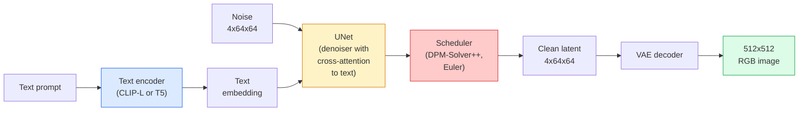

# Stable Diffusion — архитектура и дообучение

> Stable Diffusion — это DDPM, работающий в латентном пространстве предобученного VAE, обусловленный текстом через cross-attention, сэмплируемый быстрым детерминированным ODE-решателем и управляемый classifier-free guidance.

**Type:** Learn + Use
**Languages:** Python
**Prerequisites:** Phase 4 Lesson 10 (Diffusion), Phase 7 Lesson 02 (Self-Attention)
**Time:** ~75 минут

## Learning Objectives

- Проследить пять компонентов пайплайна Stable Diffusion: VAE, текстовый энкодер, U-Net, scheduler, safety checker — и что каждый из них на самом деле делает
- Объяснить латентную диффузию и почему обучение в латентном пространстве 4x64x64 (вместо изображения 3x512x512) снижает вычислительные затраты в 48 раз без потери качества
- Использовать `diffusers` для генерации изображений, запуска image-to-image, inpainting и генерации с управлением через ControlNet
- Дообучить Stable Diffusion с помощью LoRA на небольшом пользовательском датасете и загрузить LoRA-адаптер при инференсе

## The Problem

Обучение DDPM напрямую на RGB-изображениях 512x512 обходится дорого. Каждый шаг обучения прогоняет обратное распространение через U-Net, который видит 3x512x512 = 786 432 входных значения, а сэмплирование требует 50+ прямых проходов через этот же U-Net. На уровне качества Stable Diffusion 1.5 (выпущена в 2022 году) диффузия в пространстве пикселей потребовала бы примерно 256 GPU-месяцев обучения и 10-30 секунд на изображение на потребительской видеокарте.

Трюк, сделавший text-to-image с открытыми весами практичным, — это **латентная диффузия** (Rombach et al., CVPR 2022). Обучить VAE, отображающий изображение 3x512x512 в латентный тензор 4x64x64 и обратно, а диффузию проводить уже в этом латентном пространстве. Вычислительные затраты падают в `(3*512*512)/(4*64*64) = 48x`. Сэмплирование сокращается с десятков секунд до менее двух секунд на той же видеокарте.

Почти каждая современная модель генерации изображений — SDXL, SD3, FLUX, HunyuanDiT, Wan-Video — это модель латентной диффузии с вариациями автоэнкодера, денойзера (U-Net или DiT) и текстового обусловливания. Изучив Stable Diffusion, вы изучаете шаблон для всех остальных.

## The Concept

### Пайплайн



- **VAE** — замороженный автоэнкодер. Энкодер превращает изображение в латенты (используется для img2img и обучения). Декодер превращает латенты обратно в изображение.
- **Текстовый энкодер** — CLIP-текстовый энкодер (SD 1.x/2.x), CLIP-L + CLIP-G (SDXL) или T5-XXL (SD3/FLUX). Создаёт последовательность эмбеддингов токенов.
- **U-Net** — денойзер. Имеет слои cross-attention, обращающиеся от латентов к текстовому эмбеддингу на каждом уровне разрешения.
- **Scheduler** — алгоритм сэмплирования (DDIM, Euler, DPM-Solver++). Выбирает sigmas, смешивает предсказанный шум обратно в латент.
- **Safety checker** — опциональный фильтр NSFW / запрещённого контента на выходном изображении.

### Classifier-free guidance (CFG)

Обычное текстовое обусловливание изучает `epsilon_theta(x_t, t, c)` для каждого промпта `c`. CFG обучает ту же сеть, но с `c`, отбрасываемым в 10% случаев (заменяемым пустым эмбеддингом), что даёт единую модель, предсказывающую как условный, так и безусловный шум. При инференсе:

```
eps = eps_uncond + w * (eps_cond - eps_uncond)
```

`w` — это масштаб guidance. `w=0` — безусловное предсказание, `w=1` — обычное условное, `w>1` сдвигает результат в сторону "большей обусловленности промптом" ценой разнообразия. Значение по умолчанию в SD — `w=7.5`.

CFG — причина, по которой text-to-image работает на уровне продакшн-качества. Без него промпты слабо влияют на результат; с ним — промпты доминируют.

### Геометрия латентного пространства

4-канальный латент VAE — это не просто сжатое изображение. Это многообразие, где арифметика примерно соответствует семантическим правкам (на этом основаны и prompt engineering, и интерполяция), и где U-Net диффузии обучен тратить весь свой моделирующий бюджет. Декодирование случайного латента 4x64x64 не даёт изображение, выглядящее случайным, — оно даёт мусор, потому что в валидные изображения декодируется только конкретное подмногообразие латентов.

Два следствия:

1. **Img2img** = закодировать изображение в латент, добавить частичный шум, запустить денойзер, декодировать. Структура изображения сохраняется, потому что кодирование почти обратимо; содержание меняется в зависимости от промпта.
2. **Inpainting** = то же, что img2img, но денойзер обновляет только замаскированные области; незамаскированные области остаются на уровне закодированного латента.

### Архитектура U-Net

U-Net в SD — это большая версия TinyUNet из Lesson 10 с тремя дополнениями:

- **Трансформерные блоки** на каждом пространственном разрешении, содержащие self-attention + cross-attention к текстовому эмбеддингу.
- **Эмбеддинг времени** через MLP на синусоидальном кодировании.
- **Skip-соединения** между энкодером и декодером на соответствующих разрешениях.

Общее число параметров в SD 1.5: ~860M. SDXL: ~2.6B. FLUX: ~12B. Рост числа параметров приходится в основном на слои attention.

### Дообучение LoRA

Полное дообучение Stable Diffusion требует 20+ ГБ видеопамяти и обновляет 860M параметров. LoRA (Low-Rank Adaptation) оставляет базовую модель замороженной и внедряет небольшие матрицы низкорангового разложения в слои attention. LoRA-адаптер для SD обычно весит 10-50 МБ, обучается за 10-60 минут на одной потребительской видеокарте и загружается во время инференса как модификация "на лету".

```
Original: W_q : (d_in, d_out)   frozen
LoRA:     W_q + alpha * (A @ B)   where A : (d_in, r), B : (r, d_out)

r is typically 4-32.
```

LoRA — это способ, которым распространяется почти каждое дообучение сообщества. CivitAI и Hugging Face размещают миллионы таких адаптеров.

### Schedulers, которые вы встретите

- **DDIM** — детерминированный, ~50 шагов, простой.
- **Euler ancestral** — стохастический, 30-50 шагов, чуть более творческие сэмплы.
- **DPM-Solver++ 2M Karras** — детерминированный, 20-30 шагов, продакшн-дефолт.
- **LCM / TCD / Turbo** — consistency-модели и дистиллированные варианты; 1-4 шага ценой некоторого качества.

Смена scheduler — это однострочное изменение в `diffusers`, которое иногда исправляет проблемы с сэмплами без какого-либо переобучения.

```figure
cv3-latent-compression
```

## Build It

В этом уроке используется `diffusers` целиком, а не пересборка Stable Diffusion с нуля. Компоненты, которые пришлось бы пересобирать (VAE, текстовый энкодер, U-Net, scheduler), — темы отдельных уроков; здесь цель — свободное владение продакшн-API.

### Шаг 1: Text-to-image

```python
import torch
from diffusers import StableDiffusionPipeline

pipe = StableDiffusionPipeline.from_pretrained(
    "runwayml/stable-diffusion-v1-5",
    torch_dtype=torch.float16,
).to("cuda")

image = pipe(
    prompt="a dog riding a skateboard in tokyo, studio ghibli style",
    guidance_scale=7.5,
    num_inference_steps=25,
    generator=torch.Generator("cuda").manual_seed(42),
).images[0]
image.save("dog.png")
```

`float16` сокращает объём видеопамяти вдвое без видимой потери качества. `num_inference_steps=25` с DPM-Solver++ по умолчанию соответствует `num_inference_steps=50` с DDIM.

### Шаг 2: Смена scheduler

```python
from diffusers import DPMSolverMultistepScheduler, EulerAncestralDiscreteScheduler

pipe.scheduler = DPMSolverMultistepScheduler.from_config(pipe.scheduler.config)
pipe.scheduler = EulerAncestralDiscreteScheduler.from_config(pipe.scheduler.config)
```

Состояние scheduler отделено от весов U-Net. Можно обучать на DDPM и сэмплировать с любым scheduler.

### Шаг 3: Image-to-image

```python
from diffusers import StableDiffusionImg2ImgPipeline
from PIL import Image

img2img = StableDiffusionImg2ImgPipeline.from_pretrained(
    "runwayml/stable-diffusion-v1-5",
    torch_dtype=torch.float16,
).to("cuda")

init_image = Image.open("dog.png").convert("RGB").resize((512, 512))
out = img2img(
    prompt="a dog riding a skateboard, oil painting",
    image=init_image,
    strength=0.6,
    guidance_scale=7.5,
).images[0]
```

`strength` — это количество шума, добавляемого перед денойзингом (0.0 = без изменений, 1.0 = полная регенерация). 0.5-0.7 — стандартный диапазон для переноса стиля.

### Шаг 4: Inpainting

```python
from diffusers import StableDiffusionInpaintPipeline

inpaint = StableDiffusionInpaintPipeline.from_pretrained(
    "runwayml/stable-diffusion-inpainting",
    torch_dtype=torch.float16,
).to("cuda")

image = Image.open("dog.png").convert("RGB").resize((512, 512))
mask = Image.open("dog_mask.png").convert("L").resize((512, 512))

out = inpaint(
    prompt="a cat",
    image=image,
    mask_image=mask,
    guidance_scale=7.5,
).images[0]
```

Белые пиксели в маске — область для регенерации. Чёрные пиксели сохраняются.

### Шаг 5: Загрузка LoRA

```python
pipe.load_lora_weights(
    "artificialguybr/studioghibli-redmond-1-5v-studio-ghibli-lora-for-liberteredmond-sd-1-5",
    weight_name="StudioGhibliRedmond-15V-LiberteRedmond-StdGBRedmAF-StudioGhibli.safetensors",
)
pipe.fuse_lora(lora_scale=0.8)

image = pipe(prompt="a village square, StdGBRedmAF, Studio Ghibli").images[0]
```

Триггерная фраза из карточки модели (`StdGBRedmAF, Studio Ghibli`) включает стиль. `lora_scale` управляет силой; 0.0 = нет эффекта, 1.0 = полный эффект. `fuse_lora` запекает адаптер в веса на месте для скорости, но не позволяет менять его. Вызовите `pipe.unfuse_lora()` перед загрузкой другого адаптера.

### Шаг 6: Обучение LoRA (набросок)

Настоящее обучение LoRA проводится в `peft` или `diffusers.training`. Общая схема:

```python
# Pseudocode
for step, batch in enumerate(dataloader):
    images, prompts = batch
    latents = vae.encode(images).latent_dist.sample() * 0.18215

    t = torch.randint(0, num_train_timesteps, (batch_size,))
    noise = torch.randn_like(latents)
    noisy_latents = scheduler.add_noise(latents, noise, t)

    text_emb = text_encoder(tokenizer(prompts))

    pred_noise = unet(noisy_latents, t, text_emb)  # LoRA weights injected here

    loss = F.mse_loss(pred_noise, noise)
    loss.backward()
    optimizer.step()
```

Градиент получают только матрицы LoRA; базовый U-Net, VAE и текстовый энкодер заморожены. При размере батча 1 и gradient checkpointing это помещается в 8 ГБ видеопамяти.

## Use It

На практике вы реально принимаете следующие решения:

- **Семейство модели**: SD 1.5 для дообучений сообщества с открытым исходным кодом, SDXL для более высокой точности, SD3 / FLUX для state of the art и строгих лицензионных требований.
- **Scheduler**: DPM-Solver++ 2M Karras для 20-30 шагов, LCM-LoRA, когда задержка должна быть меньше 1 секунды.
- **Точность**: `float16` на 4080/4090, `bfloat16` на A100 и новее, `int8` (через `bitsandbytes` или `compel`), когда видеопамяти не хватает.
- **Обусловливание**: обычный текст работает; для более сильного контроля добавьте ControlNet (canny, depth, pose) поверх базового пайплайна.

Для пакетной генерации `AUTO1111` / `ComfyUI` — инструменты сообщества; для продакшн-API — `diffusers` + `accelerate` или `optimum-nvidia` с компиляцией TensorRT.

## Ship It

Этот урок даёт на выходе:

- `outputs/prompt-sd-pipeline-planner.md` — промпт, который выбирает SD 1.5 / SDXL / SD3 / FLUX, а также scheduler и точность, исходя из бюджета задержки, целевой точности и лицензионных ограничений.
- `outputs/skill-lora-training-setup.md` — навык, который пишет полную конфигурацию обучения LoRA для пользовательского датасета, включая подписи, ранг, размер батча и скорость обучения.

## Exercises

1. **(Easy)** Сгенерируйте один и тот же промпт с `guidance_scale` в `[1, 3, 5, 7.5, 10, 15]`. Опишите, как меняется изображение. При каком значении guidance появляются артефакты?
2. **(Medium)** Возьмите любую реальную фотографию, прогоните её через `StableDiffusionImg2ImgPipeline` при `strength` в `[0.2, 0.4, 0.6, 0.8, 1.0]`. При какой силе (strength) сохраняется композиция, но меняется стиль? Почему при 1.0 входное изображение полностью игнорируется?
3. **(Hard)** Обучите LoRA на 10-20 изображениях одного субъекта (питомец, логотип, персонаж) и сгенерируйте новые сцены с этим субъектом. Укажите ранг LoRA и число шагов обучения, давшие лучшее сохранение идентичности без переобучения на входных изображениях.

## Key Terms

| Term | What people say | What it actually means |
|------|----------------|----------------------|
| Латентная диффузия | "Диффузия в латентах" | Проведение всего DDPM в латентном пространстве VAE (4x64x64) вместо пространства пикселей (3x512x512); экономия вычислений в 48 раз |
| Масштабный коэффициент VAE | "0.18215" | Константа, масштабирующая сырой латент VAE примерно к единичной дисперсии; зашита в каждый пайплайн SD |
| Classifier-free guidance | "CFG" | Смешивание условного и безусловного предсказаний шума; самый влиятельный параметр инференса |
| Scheduler | "Sampler" | Алгоритм, превращающий шум + предсказания модели в денойзированную траекторию латента |
| LoRA | "Низкоранговый адаптер" | Небольшие матрицы низкорангового разложения, дообучающие слои attention без изменения базовых весов |
| Cross-attention | "Текст-изображение attention" | Attention от латентных токенов к текстовым токенам; внедряет информацию промпта на каждом уровне U-Net |
| ControlNet | "Структурное обусловливание" | Отдельно обученный адаптер, управляющий SD дополнительным входом (canny, depth, pose, сегментация) |
| DPM-Solver++ | "Scheduler по умолчанию" | ODE-решатель второго порядка, детерминированный; лучшее качество при малом числе шагов (20-30) в 2026 году |

## Further Reading

- [High-Resolution Image Synthesis with Latent Diffusion (Rombach et al., 2022)](https://arxiv.org/abs/2112.10752) — статья по Stable Diffusion; содержит все абляции, обосновывающие дизайн
- [Classifier-Free Diffusion Guidance (Ho & Salimans, 2022)](https://arxiv.org/abs/2207.12598) — статья по CFG
- [LoRA: Low-Rank Adaptation of Large Language Models (Hu et al., 2021)](https://arxiv.org/abs/2106.09685) — LoRA изначально появился в NLP; перенёсся в SD почти без изменений
- [diffusers documentation](https://huggingface.co/docs/diffusers) — справочник по каждому пайплайну SD / SDXL / SD3 / FLUX