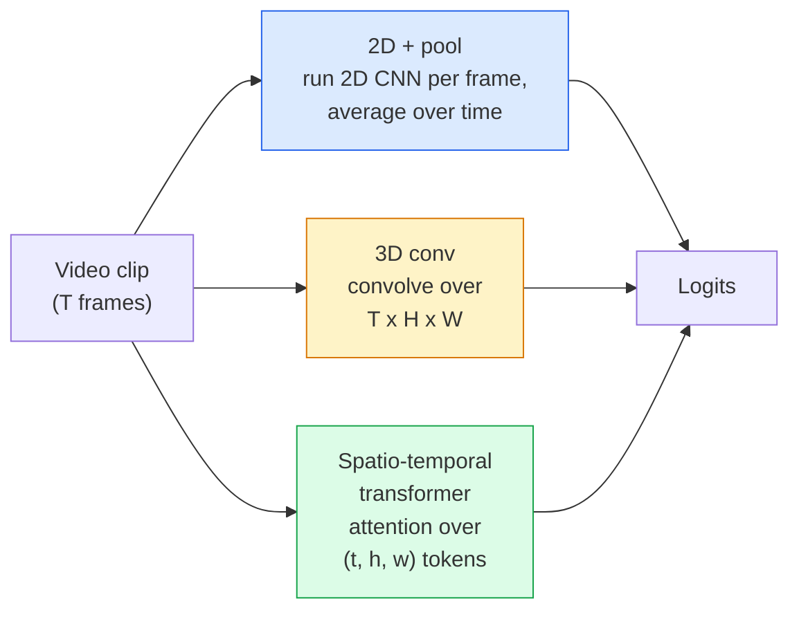

# Понимание видео — Моделирование времени

> Видео — это последовательность изображений плюс физика, которая их связывает. Каждая видеомодель либо рассматривает время как дополнительную ось (3D-свёртка), либо как последовательность для внимания (трансформер), либо как признак, который извлекается один раз и затем усредняется (2D+pool).

**Type:** Learn + Build
**Languages:** Python
**Prerequisites:** Phase 4 Lesson 03 (CNNs), Phase 4 Lesson 04 (Image Classification)
**Time:** ~45 минут

## Цели обучения

- Различать три основных подхода к моделированию видео (2D+pool, 3D-свёртка, пространственно-временной трансформер) и предсказывать их компромиссы по стоимости и точности
- Реализовать сэмплирование кадров, временное усреднение и базовый классификатор 2D+pool на PyTorch
- Объяснить, почему «надутые» (inflated) 3D-ядра I3D хорошо переносятся с весов ImageNet и чем факторизованная (2+1)D-свёртка отличается от этого подхода
- Разбираться в стандартных датасетах и метриках для распознавания действий: Kinetics-400/600, UCF101, Something-Something V2; top-1 точность на уровне клипа и на уровне видео

## Проблема

30-секундное видео при 30 fps — это 900 изображений. Наивно, классификация видео — это классификация изображений, выполненная 900 раз, с последующей какой-то агрегацией. Это работает, когда действие видно почти в каждом кадре (спорт, кулинария, видео с упражнениями), и сильно ломается, когда действие определяется самим движением: «подвинуть что-то слева направо» выглядит как два неподвижных объекта в каждом отдельном кадре.

Главный вопрос для каждой видеоархитектуры: когда моделируется временная структура и как именно? Ответ определяет всё остальное — вычислительную стоимость, стратегию предобучения, возможность переиспользовать веса ImageNet, на каких датасетах обучается модель.

Этот урок намеренно короче уроков по статическим изображениям. Основной механизм работы с изображениями уже на месте, и понимание видео — это по большей части история про время: сэмплирование, моделирование и агрегация.

## Концепция

### Три архитектурных семейства



### 2D + pool

Берём 2D CNN (ResNet, EfficientNet, ViT). Запускаем её независимо на каждом сэмплированном кадре. Усредняем (или max-pool, или attention-pool) покадровые эмбеддинги. Подаём усреднённый вектор в классификатор.

Плюсы:
- Предобучение на ImageNet переносится напрямую.
- Проще всего реализовать.
- Дёшево: T кадров * стоимость инференса на одном изображении.

Минусы:
- Не может моделировать движение. Действие = агрегат внешнего вида.
- Временное усреднение инвариантно к порядку; «открыть дверь» и «закрыть дверь» выглядят одинаково.

Когда использовать: задачи, где важен внешний вид, трансферное обучение на небольших видеодатасетах, начальные базовые решения.

### 3D-свёртки

Заменяем 2D-ядра (H, W) на 3D-ядра (T, H, W). Сеть свёртывает и по пространству, и по времени. Раннее семейство: C3D, I3D, SlowFast.

Трюк I3D: берём предобученную 2D ImageNet-модель и «надуваем» (inflate) каждое 2D-ядро, копируя его вдоль новой оси времени. 3x3 2D-свёртка становится 3x3x3 3D-свёрткой. Это даёт 3D-модели сильные предобученные веса вместо обучения с нуля.

Плюсы:
- Напрямую моделирует движение.
- Надувание I3D даёт трансферное обучение «бесплатно».

Минусы:
- В T/8 раз больше FLOPs, чем у 2D-аналога (для временного ядра размером 3, умноженного трижды).
- Временные ядра небольшие; для долгосрочного движения нужна пирамида или двухпотоковый подход.

Когда использовать: распознавание действий, где сигналом является движение (Something-Something V2, Kinetics с классами, насыщенными движением).

### Пространственно-временные трансформеры

Токенизируем видео в сетку пространственно-временных патчей и применяем внимание ко всем сразу. TimeSformer, ViViT, Video Swin, VideoMAE.

Важные паттерны внимания:
- **Совместное (joint)** — одно большое внимание над (t, h, w). Квадратичная сложность по `T*H*W`; дорого.
- **Раздельное (divided)** — два внимания на блок: одно по времени, одно по пространству. Масштабирование почти линейное.
- **Факторизованное** — внимание по времени чередуется с вниманием по пространству между блоками.

Плюсы:
- SOTA-точность на всех основных бенчмарках.
- Переносится из трансформеров изображений (ViT) через надувание патчей.
- Поддерживает длинный контекст видео через разреженное внимание.

Минусы:
- Требует много вычислений.
- Нужен тщательный выбор паттерна внимания, иначе время работы резко растёт.

Когда использовать: большие датасеты, высокоточное понимание видео, мультимодальные задачи видео+текст.

### Сэмплирование кадров

10-секундный клип при 30 fps — это 300 кадров; подавать все 300 в любую модель расточительно. Стандартные стратегии:

- **Равномерное сэмплирование (uniform sampling)** — выбираем T кадров равномерно по клипу. По умолчанию для 2D+pool.
- **Плотное сэмплирование (dense sampling)** — случайное непрерывное окно из T кадров. Распространено для 3D-свёрток, поскольку движение требует соседних кадров.
- **Multi-clip** — сэмплируем несколько окон по T кадров из одного и того же видео, классифицируем каждое, усредняем предсказания при тестировании.

T обычно равно 8, 16, 32 или 64. Чем выше T, тем больше временного сигнала при больших вычислительных затратах.

### Оценка

Два уровня:
- **Точность на уровне клипа** — модель видит один клип из T кадров, выдаёт top-k.
- **Точность на уровне видео** — усреднение предсказаний по нескольким клипам на видео; выше и стабильнее.

Всегда сообщайте оба значения. Модель, показывающая 78% на клипе / 82% на видео, сильно полагается на усреднение при тестировании; модель с 80% / 81% более устойчива на уровне отдельного клипа.

### Датасеты, с которыми вы встретитесь

- **Kinetics-400 / 600 / 700** — универсальный датасет действий. 400 тыс. клипов; ссылки на YouTube (многие уже недоступны).
- **Something-Something V2** — действия, определяемые движением («переместить X слева направо»). Не решается через 2D+pool.
- **UCF-101**, **HMDB-51** — более старые, меньшие, всё ещё упоминаются в отчётах.
- **AVA** — *локализация* действий в пространстве и времени; сложнее классификации.

```figure
v4-video-temporal
```

## Реализация

### Шаг 1: Сэмплер кадров

Равномерный и плотный сэмплеры, работающие со списком кадров (или тензором видео).

```python
import numpy as np

def sample_uniform(num_frames_total, T):
    if num_frames_total <= T:
        return list(range(num_frames_total)) + [num_frames_total - 1] * (T - num_frames_total)
    step = num_frames_total / T
    return [int(i * step) for i in range(T)]


def sample_dense(num_frames_total, T, rng=None):
    rng = rng or np.random.default_rng()
    if num_frames_total <= T:
        return list(range(num_frames_total)) + [num_frames_total - 1] * (T - num_frames_total)
    start = int(rng.integers(0, num_frames_total - T + 1))
    return list(range(start, start + T))
```

Оба возвращают индексы `T`, которые вы используете для среза тензора видео.

### Шаг 2: Базовая модель 2D+pool

Запускаем 2D ResNet-18 на каждом кадре, усредняем признаки, классифицируем.

```python
import torch
import torch.nn as nn
from torchvision.models import resnet18, ResNet18_Weights

class FramePool(nn.Module):
    def __init__(self, num_classes=400, pretrained=True):
        super().__init__()
        weights = ResNet18_Weights.IMAGENET1K_V1 if pretrained else None
        backbone = resnet18(weights=weights)
        self.features = nn.Sequential(*(list(backbone.children())[:-1]))  # global avg pool kept
        self.head = nn.Linear(512, num_classes)

    def forward(self, x):
        # x: (N, T, 3, H, W)
        N, T = x.shape[:2]
        x = x.view(N * T, *x.shape[2:])
        feats = self.features(x).view(N, T, -1)
        pooled = feats.mean(dim=1)
        return self.head(pooled)

model = FramePool(num_classes=10)
x = torch.randn(2, 8, 3, 224, 224)
print(f"output: {model(x).shape}")
print(f"params: {sum(p.numel() for p in model.parameters()):,}")
```

Одиннадцать миллионов параметров, предобучено на ImageNet, работает покадрово, усредняет, классифицирует. Этот базовый вариант часто отстаёт всего на 5-10 пунктов от настоящих 3D-моделей на задачах, где важен внешний вид — иногда даже превосходит их, поскольку переиспользует более сильный backbone ImageNet.

### Шаг 3: 3D-свёртка в стиле I3D с надуванием

Превращаем одну 2D-свёртку в 3D-свёртку, повторяя веса вдоль новой оси времени.

```python
def inflate_2d_to_3d(conv2d, time_kernel=3):
    out_c, in_c, kh, kw = conv2d.weight.shape
    weight_3d = conv2d.weight.data.unsqueeze(2)  # (out, in, 1, kh, kw)
    weight_3d = weight_3d.repeat(1, 1, time_kernel, 1, 1) / time_kernel
    conv3d = nn.Conv3d(in_c, out_c, kernel_size=(time_kernel, kh, kw),
                        padding=(time_kernel // 2, conv2d.padding[0], conv2d.padding[1]),
                        stride=(1, conv2d.stride[0], conv2d.stride[1]),
                        bias=False)
    conv3d.weight.data = weight_3d
    return conv3d

conv2d = nn.Conv2d(3, 64, kernel_size=3, padding=1, bias=False)
conv3d = inflate_2d_to_3d(conv2d, time_kernel=3)
print(f"2D weight shape:  {tuple(conv2d.weight.shape)}")
print(f"3D weight shape:  {tuple(conv3d.weight.shape)}")
x = torch.randn(1, 3, 8, 56, 56)
print(f"3D output shape:  {tuple(conv3d(x).shape)}")
```

Деление на `time_kernel` сохраняет примерно постоянную величину активаций — важно, чтобы не сломать статистику batch-norm на первом проходе.

### Шаг 4: Факторизованная (2+1)D-свёртка

Разбиваем 3D-свёртку на 2D (пространственную) и 1D (временную) свёртки. То же рецептивное поле, меньше параметров, лучше точность на некоторых бенчмарках.

```python
class Conv2Plus1D(nn.Module):
    def __init__(self, in_c, out_c, kernel_size=3):
        super().__init__()
        mid_c = (in_c * out_c * kernel_size * kernel_size * kernel_size) \
                // (in_c * kernel_size * kernel_size + out_c * kernel_size)
        self.spatial = nn.Conv3d(in_c, mid_c, kernel_size=(1, kernel_size, kernel_size),
                                 padding=(0, kernel_size // 2, kernel_size // 2), bias=False)
        self.bn = nn.BatchNorm3d(mid_c)
        self.act = nn.ReLU(inplace=True)
        self.temporal = nn.Conv3d(mid_c, out_c, kernel_size=(kernel_size, 1, 1),
                                  padding=(kernel_size // 2, 0, 0), bias=False)

    def forward(self, x):
        return self.temporal(self.act(self.bn(self.spatial(x))))

c = Conv2Plus1D(3, 64)
x = torch.randn(1, 3, 8, 56, 56)
print(f"(2+1)D output: {tuple(c(x).shape)}")
```

Полная сеть R(2+1)D — это тот же ResNet-18, в котором каждая 3x3 свёртка заменена на `Conv2Plus1D`.

## Применение

Две библиотеки покрывают промышленную работу с видео:

- `torchvision.models.video` — R(2+1)D, MViT, Swin3D с предобученными весами Kinetics. Тот же API, что и у моделей изображений.
- `pytorchvideo` (Meta) — зоопарк моделей, загрузчики данных для Kinetics / SSv2 / AVA, стандартные преобразования.

Для моделей, связывающих видение и язык в видео (описание видео, вопрос-ответ по видео), используйте `transformers` (`VideoMAE`, `VideoLLaMA`, `InternVideo`).

## Что должно получиться

Этот урок производит:

- `outputs/prompt-video-architecture-picker.md` — промпт, который выбирает 2D+pool / I3D / (2+1)D / трансформер, исходя из соотношения внешнего вида и движения, размера датасета и вычислительного бюджета.
- `outputs/skill-frame-sampler-auditor.md` — скилл, который проверяет сэмплер видеопайплайна и отмечает типичные ошибки: сдвиг индекса на единицу, неравномерное сэмплирование при `num_frames < T`, отсутствие кропа с сохранением пропорций и т.д.

## Упражнения

1. **(Лёгкое)** Посчитайте приблизительные FLOPs для FramePool при T=8 и для I3D-подобного 3D ResNet при T=8. Обоснуйте, почему 2D+pool в 3-5 раз дешевле.
2. **(Среднее)** Сгенерируйте синтетический датасет видео: случайные шары, движущиеся в случайных направлениях, с метками направления движения («слева направо», «справа налево», «по диагонали вверх»). Обучите FramePool на нём. Покажите, что он достигает точности, близкой к случайной, доказывая, что одного внешнего вида недостаточно для задач с движением.
3. **(Сложное)** Постройте R(2+1)D-18, заменив каждую Conv2d в ResNet-18 на `Conv2Plus1D`. Проинициализируйте веса первой свёртки надуванием из предобученного на ImageNet ResNet-18. Обучите на датасете движения из упражнения 2 и превзойдите FramePool.

## Ключевые термины

| Термин | Что говорят люди | Что это на самом деле означает |
|------|----------------|----------------------|
| 2D + pool | «Покадровый классификатор» | Запуск 2D CNN на каждом сэмплированном кадре, усреднение признаков по времени, классификация |
| 3D-свёртка | «Пространственно-временное ядро» | Ядро, свёртывающее по (T, H, W); может моделировать движение нативно |
| Надувание (inflation) | «Поднять 2D-веса до 3D» | Инициализация весов 3D-свёртки повторением весов 2D-свёртки вдоль новой оси времени с последующим делением на kernel_T для сохранения масштаба активаций |
| (2+1)D | «Факторизованная свёртка» | Разбиение 3D на 2D-пространственную + 1D-временную; меньше параметров, дополнительная нелинейность между ними |
| Раздельное внимание (divided attention) | «Сначала время, потом пространство» | Блок трансформера с двумя вниманиями на слой: одно по токенам того же кадра, другое по токенам той же позиции |
| Клип | «Окно из T кадров» | Сэмплированная подпоследовательность из T кадров; единица, которую потребляет видеомодель |
| Точность клипа и видео | «Два варианта оценки» | Клип = один сэмпл на видео, видео = усреднение по нескольким сэмплированным клипам |
| Kinetics | «ImageNet для видео» | 400-700 классов действий, 300 тыс.+ клипов с YouTube, стандартный корпус для предобучения видеомоделей |

## Дополнительное чтение

- [I3D: Quo Vadis, Action Recognition (Carreira & Zisserman, 2017)](https://arxiv.org/abs/1705.07750) — вводит надувание и датасет Kinetics
- [R(2+1)D: A Closer Look at Spatiotemporal Convolutions (Tran et al., 2018)](https://arxiv.org/abs/1711.11248) — факторизованная свёртка, всё ещё сильный базовый вариант
- [TimeSformer: Is Space-Time Attention All You Need? (Bertasius et al., 2021)](https://arxiv.org/abs/2102.05095) — первый сильный видеотрансформер
- [VideoMAE (Tong et al., 2022)](https://arxiv.org/abs/2203.12602) — предобучение методом маскированного автокодировщика для видео; текущий доминирующий рецепт предобучения