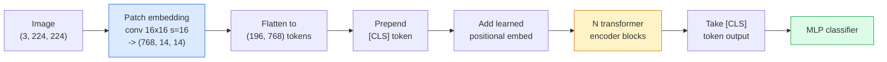

# Vision Transformers (ViT)

> Разрежьте изображение на патчи, обращайтесь с каждым патчем как со словом, запустите стандартный трансформер. Больше ничего не нужно.

**Type:** Build
**Languages:** Python
**Prerequisites:** Phase 7 Lesson 02 (Self-Attention), Phase 4 Lesson 04 (Image Classification)
**Time:** ~45 минут

## Learning Objectives

- Реализовать с нуля patch embedding, обучаемое позиционное вложение, class token и блоки энкодера трансформера, чтобы собрать минимальный ViT
- Объяснить, почему считалось, что ViT требует огромных объёмов данных для предобучения, пока DeiT и MAE не доказали обратное
- Сравнить ViT, Swin и ConvNeXt по их архитектурным приорам (отсутствие приоров, локальное оконное внимание, сверточный backbone)
- Дообучить предобученный ViT на небольшом датасете с помощью `timm` и стандартного рецепта linear-probe / fine-tune

## The Problem

Целое десятилетие свёртка была синонимом компьютерного зрения. CNN обладали сильными индуктивными смещениями (inductive biases) — локальностью, трансляционной эквивариантностью — которые, как считалось, невозможно заменить. Затем Dosovitskiy et al. (2020) показали, что обычный трансформер, применённый к развёрнутым в последовательность патчам изображения, вообще без какой-либо сверточной машинерии, может сравниться с лучшими CNN или превзойти их — при масштабе.

Загвоздка была именно в "при масштабе". ViT на ImageNet-1k проигрывал ResNet. ViT, предобученный на ImageNet-21k или JFT-300M, а затем дообученный на ImageNet-1k, превосходил его. Вывод был таков: трансформерам не хватает полезных приоров, но они способны выучить их при наличии достаточного количества данных. Последующие работы (DeiT, MAE, DINO) показали, что при правильных рецептах обучения — сильной аугментации, самообучении (self-supervised pretraining), дистилляции — ViT прекрасно обучаются и на небольших данных.

К 2026 году чистые CNN всё ещё конкурентоспособны на edge-устройствах (ConvNeXt — самый сильный из них), но трансформеры доминируют во всём остальном: сегментация (Mask2Former, SegFormer), детекция (DETR, RT-DETR), мультимодальность (CLIP, SigLIP), видео (VideoMAE, VJEPA). Блочную структуру ViT нужно знать обязательно.

## The Concept

### The pipeline



Семь шагов. Патчи -> токены -> внимание -> классификатор. Каждый вариант (DeiT, Swin, ConvNeXt, MAE-предобучение) меняет один-два из этих семи шагов, оставляя остальные без изменений.

### Patch embedding

Первый conv — это и есть весь секрет. Размер ядра 16, шаг 16, поэтому изображение 224x224 превращается в сетку 14x14 из патчей 16x16, каждый из которых проецируется в 768-мерное вложение. Эта единственная свёртка одновременно выполняет и разбиение на патчи, и линейную проекцию.

```
Input:  (3, 224, 224)
Conv (3 -> 768, k=16, s=16, no padding):
Output: (768, 14, 14)
Flatten spatial: (196, 768)
```

196 патчей = 196 токенов. Размерность признаков каждого токена — 768 (ViT-B), 1024 (ViT-L) или 1280 (ViT-H).

### Class token

Единственный обучаемый вектор, добавляемый в начало последовательности:

```
tokens = [CLS; patch_1; patch_2; ...; patch_196]   shape (197, 768)
```

После N блоков трансформера выход, соответствующий `[CLS]`, представляет собой глобальное представление изображения. Голова классификации читает только этот один вектор.

### Positional embedding

У трансформеров нет встроенного понятия пространственного положения. К каждому токену добавляется обучаемый вектор:

```
tokens = tokens + learned_pos_embedding   (also shape (197, 768))
```

Вложение является параметром модели; обучение методом градиентного спуска адаптирует его под 2D-структуру изображения. Существуют синусоидальные 2D-альтернативы, но на практике они используются редко.

### Transformer encoder block

Стандартный блок. Многоголовое self-attention, MLP, residual-связи, pre-LayerNorm.

```
x = x + MSA(LN(x))
x = x + MLP(LN(x))

MLP is two-layer with GELU: Linear(d -> 4d) -> GELU -> Linear(4d -> d)
```

ViT-B/16 состоит из 12 таких блоков, каждый с 12 головами внимания, в общей сложности 86 млн параметров.

### Почему pre-LN

Ранние трансформеры использовали post-LN (`x = LN(x + sublayer(x))`) и с трудом обучались глубже 6-8 слоёв без warmup. Pre-LN (`x = x + sublayer(LN(x))`) позволяет стабильно обучать более глубокие сети без warmup. Каждый ViT и каждая современная LLM используют pre-LN.

### Компромисс размера патча

- Патчи 16x16 -> 196 токенов, стандарт.
- Патчи 32x32 -> 49 токенов, быстрее, но ниже разрешение.
- Патчи 8x8 -> 784 токена, более тонкая детализация, но стоимость attention растёт как O(n^2), что плохо масштабируется.

Крупнее патчи = меньше токенов = быстрее, но меньше пространственной детализации. SwinV2 использует патчи 4x4 в иерархических окнах.

### Рецепт DeiT для обучения ViT на ImageNet-1k

Исходному ViT требовался JFT-300M, чтобы обойти CNN. DeiT (Touvron et al., 2020) обучил ViT-B до 81.8% top-1 на одном лишь ImageNet-1k с помощью четырёх изменений:

1. Сильная аугментация: RandAugment, Mixup, CutMix, Random Erasing.
2. Stochastic depth (случайное отбрасывание целых блоков во время обучения).
3. Повторяющаяся аугментация (одно и то же изображение попадает в батч 3 раза).
4. Дистилляция от CNN-учителя (опционально, дополнительно поднимает точность).

Каждый современный рецепт обучения ViT происходит от DeiT.

### Swin vs ConvNeXt

- **Swin** (Liu et al., 2021) — внимание на основе окон. Каждый блок обращает внимание внутри локального окна; чередующиеся блоки сдвигают окно, чтобы смешивать информацию между окнами. Возвращает CNN-подобный приор локальности, сохраняя оператор внимания.
- **ConvNeXt** (Liu et al., 2022) — переработанная CNN, повторяющая архитектурные решения Swin (depthwise-свёртки, LayerNorm, GELU, инвертированный bottleneck). Показала, что разрыв в качестве — это не "внимание против свёртки", а "современный рецепт обучения + архитектура".

В 2026 году и ConvNeXt-V2, и Swin-V2 готовы к продакшену; правильный выбор зависит от вашего инференс-стека (ConvNeXt лучше компилируется для edge) и корпуса для предобучения.

### MAE-предобучение

Masked Autoencoder (He et al., 2022): маскируем 75% патчей случайным образом, обучаем энкодер обрабатывать только видимые 25%, обучаем небольшой декодер восстанавливать замаскированные патчи по выходу энкодера. После предобучения декодер отбрасывается, а энкодер дообучается.

MAE делает возможным обучение ViT на одном лишь ImageNet-1k, достигает SOTA и является нынешним стандартным рецептом самообучения.

```figure
batchnorm-inference
```

## Build It

### Шаг 1: Patch embedding

```python
import torch
import torch.nn as nn

class PatchEmbedding(nn.Module):
    def __init__(self, in_channels=3, patch_size=16, dim=192, image_size=64):
        super().__init__()
        assert image_size % patch_size == 0
        self.proj = nn.Conv2d(in_channels, dim, kernel_size=patch_size, stride=patch_size)
        num_patches = (image_size // patch_size) ** 2
        self.num_patches = num_patches

    def forward(self, x):
        x = self.proj(x)
        return x.flatten(2).transpose(1, 2)
```

Одна свёртка, один flatten, один transpose. Это и есть весь шаг преобразования изображения в токены.

### Шаг 2: Блок трансформера

Pre-LN, многоголовое self-attention, MLP с GELU, residual-связи.

```python
class Block(nn.Module):
    def __init__(self, dim, num_heads, mlp_ratio=4, dropout=0.0):
        super().__init__()
        self.ln1 = nn.LayerNorm(dim)
        self.attn = nn.MultiheadAttention(dim, num_heads, dropout=dropout, batch_first=True)
        self.ln2 = nn.LayerNorm(dim)
        self.mlp = nn.Sequential(
            nn.Linear(dim, dim * mlp_ratio),
            nn.GELU(),
            nn.Dropout(dropout),
            nn.Linear(dim * mlp_ratio, dim),
            nn.Dropout(dropout),
        )

    def forward(self, x):
        a, _ = self.attn(self.ln1(x), self.ln1(x), self.ln1(x), need_weights=False)
        x = x + a
        x = x + self.mlp(self.ln2(x))
        return x
```

`nn.MultiheadAttention` отвечает за разбиение на головы, масштабированное скалярное произведение (scaled dot-product) и выходную проекцию. `batch_first=True`, поэтому формы имеют вид `(N, seq, dim)`.

### Шаг 3: ViT

```python
class ViT(nn.Module):
    def __init__(self, image_size=64, patch_size=16, in_channels=3,
                 num_classes=10, dim=192, depth=6, num_heads=3, mlp_ratio=4):
        super().__init__()
        self.patch = PatchEmbedding(in_channels, patch_size, dim, image_size)
        num_patches = self.patch.num_patches
        self.cls_token = nn.Parameter(torch.zeros(1, 1, dim))
        self.pos_embed = nn.Parameter(torch.zeros(1, num_patches + 1, dim))
        self.blocks = nn.ModuleList([
            Block(dim, num_heads, mlp_ratio) for _ in range(depth)
        ])
        self.ln = nn.LayerNorm(dim)
        self.head = nn.Linear(dim, num_classes)
        nn.init.trunc_normal_(self.pos_embed, std=0.02)
        nn.init.trunc_normal_(self.cls_token, std=0.02)

    def forward(self, x):
        x = self.patch(x)
        cls = self.cls_token.expand(x.size(0), -1, -1)
        x = torch.cat([cls, x], dim=1)
        x = x + self.pos_embed
        for blk in self.blocks:
            x = blk(x)
        x = self.ln(x[:, 0])
        return self.head(x)

vit = ViT(image_size=64, patch_size=16, num_classes=10, dim=192, depth=6, num_heads=3)
x = torch.randn(2, 3, 64, 64)
print(f"output: {vit(x).shape}")
print(f"params: {sum(p.numel() for p in vit.parameters()):,}")
```

Около 2,8 млн параметров — крошечный ViT, который можно обучить на CPU. Настоящий ViT-B — это 86 млн; то же самое определение класса с `dim=768, depth=12, num_heads=12`.

### Шаг 4: Проверка здравого смысла — инференс на одном изображении

```python
logits = vit(torch.randn(1, 3, 64, 64))
print(f"logits: {logits}")
print(f"probs:  {logits.softmax(-1)}")
```

Должно выполниться без ошибок. Сумма вероятностей равна 1.

## Use It

`timm` поставляется с каждым вариантом ViT и предобученными на ImageNet весами. Одна строка:

```python
import timm

model = timm.create_model("vit_base_patch16_224", pretrained=True, num_classes=10)
```

`timm` — стандарт для продакшена среди vision-трансформеров в 2026 году. Поддерживает ViT, DeiT, Swin, Swin-V2, ConvNeXt, ConvNeXt-V2, MaxViT, MViT, EfficientFormer и десятки других моделей в рамках одного и того же API.

Для мультимодальной работы (изображение + текст) `transformers` поставляется с CLIP, SigLIP, BLIP-2, LLaVA. Энкодер изображений во всех этих моделях — это вариант ViT.

## Ship It

Этот урок производит:

- `outputs/prompt-vit-vs-cnn-picker.md` — промпт, который выбирает между ViT, ConvNeXt или Swin в зависимости от размера датасета, вычислительных ресурсов и инференс-стека.
- `outputs/skill-vit-patch-and-pos-embed-inspector.md` — навык, который проверяет, что формы patch embedding и positional embedding ViT соответствуют ожидаемой моделью длине последовательности, отлавливая самые частые ошибки портирования.

## Exercises

1. **(Easy)** Выведите формы всех промежуточных тензоров для прямого прохода через крошечный ViT выше. Подтвердите: вход `(N, 3, 64, 64)` -> патчи `(N, 16, 192)` -> с CLS `(N, 17, 192)` -> вход классификатора `(N, 192)` -> выход `(N, num_classes)`.
2. **(Medium)** Дообучите предобученный `timm` ViT-S/16 на синтетическом датасете synthetic-CIFAR из урока 4. Сравните с дообучением ResNet-18 на тех же данных. Сообщите время обучения и итоговую точность.
3. **(Hard)** Реализуйте MAE-предобучение для крошечного ViT: замаскируйте 75% патчей, обучите энкодер + небольшой декодер восстанавливать замаскированные патчи. Оцените точность linear-probe на синтетических данных до и после предобучения.

## Key Terms

| Term | What people say | What it actually means |
|------|----------------|----------------------|
| Patch embedding | "Первый conv" | Свёртка с размером ядра = шагу = размеру патча; превращает изображение в сетку вложений-токенов |
| Class token | "[CLS]" | Обучаемый вектор, добавляемый в начало последовательности токенов; его итоговый выход — глобальное представление изображения |
| Positional embedding | "Обучаемая позиция" | Обучаемый вектор, добавляемый к каждому токену, чтобы трансформер знал, откуда взят каждый патч |
| Pre-LN | "LayerNorm перед подслоем" | Стабильный вариант трансформера: `x + sublayer(LN(x))` вместо `LN(x + sublayer(x))` |
| Multi-head attention | "Параллельное внимание" | Стандартное attention трансформера, разделённое на num_heads независимых подпространств, конкатенируемых после |
| ViT-B/16 | "Base, патч 16" | Канонический размер: dim=768, depth=12, heads=12, patch_size=16, image=224; ~86 млн параметров |
| DeiT | "Data-efficient ViT" | ViT, обученный только на ImageNet-1k с сильной аугментацией; доказал, что большие датасеты для предобучения строго не обязательны |
| MAE | "Masked autoencoder" | Самообучаемое предобучение: маскируем 75% патчей, восстанавливаем; доминирующий рецепт предобучения ViT |

## Further Reading

- [An Image is Worth 16x16 Words (Dosovitskiy et al., 2020)](https://arxiv.org/abs/2010.11929) — статья о ViT
- [DeiT: Data-efficient Image Transformers (Touvron et al., 2020)](https://arxiv.org/abs/2012.12877) — как обучить ViT только на ImageNet-1k
- [Masked Autoencoders are Scalable Vision Learners (He et al., 2022)](https://arxiv.org/abs/2111.06377) — MAE-предобучение
- [timm documentation](https://huggingface.co/docs/timm) — справочник по каждому vision-трансформеру, который вы будете использовать в продакшене