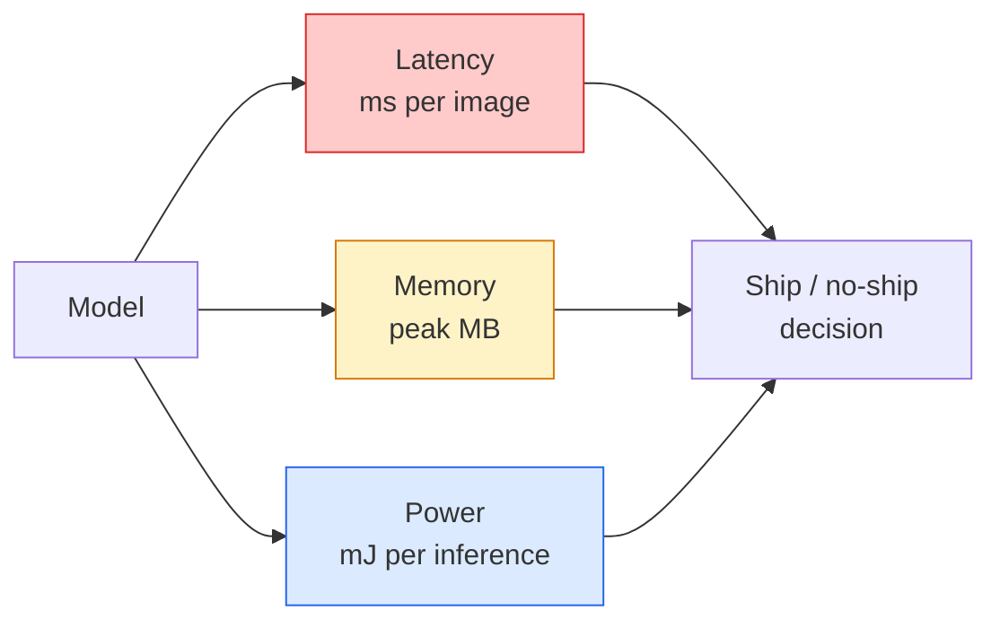

# Real-Time Vision — Развёртывание на граничных устройствах

> Edge inference (инференс на граничных устройствах) — это дисциплина заставить модель с точностью 90 работать со скоростью 30 fps на устройстве с 2 ГБ оперативной памяти. Каждый процентный пункт точности обменивается на миллисекунды задержки.

**Type:** Learn + Build
**Languages:** Python
**Prerequisites:** Phase 4 Lesson 04 (Image Classification), Phase 10 Lesson 11 (Quantization)
**Time:** ~75 минут

## Цели обучения

- Измерять задержку инференса, пиковую память и пропускную способность для любой модели PyTorch и читать компромисс FLOPs / параметры / задержка
- Квантовать модель компьютерного зрения в INT8 с помощью пост-тренировочной квантизации PyTorch и проверить, что потеря точности < 1%
- Экспортировать модель в ONNX и скомпилировать с помощью ONNX Runtime или TensorRT; назвать три наиболее частые ошибки экспорта и способы их исправления
- Объяснить, когда выбирать MobileNetV3, EfficientNet-Lite, ConvNeXt-Tiny или MobileViT для заданного ограничения на граничном устройстве

## Проблема

Модель компьютерного зрения, обученная для тренировки, — это монстр с плавающей точкой. 100М параметров, 10 GFLOPs на прямой проход, 2 ГБ VRAM. Ничто из этого не поместится на телефоне, в автомобильной информационно-развлекательной системе, промышленной камере или дроне. Поставка системы компьютерного зрения означает, что нужно уместить те же предсказания в бюджет, который в 100 раз меньше.

Основную работу выполняют три рычага: выбор модели (архитектура меньшего размера с тем же рецептом), квантизация (INT8 вместо FP32) и среда исполнения инференса (ONNX Runtime, TensorRT, Core ML, TFLite). Правильная настройка этих рычагов — это разница между демонстрацией, работающей на рабочей станции, и продуктом, который поставляется на модуле камеры за $30.

В этом уроке сначала выстраивается дисциплина измерений (нельзя оптимизировать то, что нельзя измерить), а затем рассматриваются все три рычага. Цель — не изучить каждую граничную среду исполнения, а узнать, какие рычаги существуют и как проверить, что каждый из них действительно делает то, что вы думаете.

## Концепция

### Три бюджета



- **Задержка**: p50, p95, p99. Усреднение только по p50 скрывает поведение хвостов, которое важно для систем реального времени.
- **Пиковая память**: максимум, который когда-либо увидит устройство, а не среднее значение в установившемся режиме. Это важно, потому что переполнение памяти (OOM) фатально для встраиваемых целевых устройств.
- **Мощность / энергия**: милливатт-часы на инференс на устройстве с батарейным питанием. Часто аппроксимируется через загрузку CPU/GPU * время.

Таблица (модель, задержка, память, точность) — это то, на основании чего принимается решение для граничного устройства. Каждая ячейка измеряется на целевом устройстве, а не на рабочей станции.

### Дисциплина измерений

Три правила, которым должен следовать каждый профиль для граничных устройств:

1. **Разогрейте** модель 5-10 фиктивными прямыми проходами перед измерением. Холодные кэши и JIT-компиляция дают нерепрезентативные первые цифры.
2. **Синхронизируйте** нагрузки GPU с помощью `torch.cuda.synchronize()` до и после измеряемого блока. Без этого вы измеряете диспетчеризацию ядра, а не его выполнение.
3. **Зафиксируйте размеры входных данных** на продакшн-разрешении. Задержка на 224x224 — это не задержка на 512x512.

### FLOPs как прокси

FLOPs (операции с плавающей точкой на инференс) — дешёвый, независимый от устройства прокси для задержки. Полезен для сравнения архитектур, но вводит в заблуждение как абсолютное время по часам. Модель с на 10% большим количеством FLOPs может быть в 2 раза быстрее на практике, потому что использует аппаратно-дружественные операции (depthwise-свёртки компилируются хорошо, крупные свёртки 7x7 — нет).

Правило: используйте FLOPs для поиска архитектуры, используйте задержку на устройстве для решений о развёртывании.

### Квантизация в одном абзаце

Замените веса и активации FP32 на INT8. Размер модели уменьшается в 4 раза, пропускная способность памяти снижается в 4 раза, вычисления сокращаются в 2-4 раза на оборудовании с ядрами INT8 (любой современный мобильный SoC, любой GPU NVIDIA с Tensor Cores). Потеря точности на задачах компьютерного зрения обычно составляет 0,1-1 процентный пункт при пост-тренировочной статической квантизации.

Типы:

- **Динамическая** — квантование весов в INT8, активации вычисляются в FP. Легко, небольшое ускорение.
- **Статическая (пост-тренировочная)** — квантование весов + калибровка диапазонов активаций на небольшом калибровочном наборе. Намного быстрее динамической.
- **Квантизационно-осознанное обучение (QAT)** — симуляция квантизации во время обучения, чтобы модель училась с учётом этого. Лучшая точность, требует размеченных данных.

Для компьютерного зрения пост-тренировочная статическая квантизация даёт 95% выгоды при 5% усилий. Используйте QAT только тогда, когда потеря точности от PTQ неприемлема.

### Прунинг и дистилляция

- **Прунинг** — удаление неважных весов (на основе величины) или каналов (структурированный). Хорошо работает на переподогнанных моделях; менее полезен на уже компактных архитектурах.
- **Дистилляция** — обучение маленького «студента» имитировать логиты крупного «учителя». Часто восстанавливает большую часть точности, потерянной при уменьшении модели. Стандарт для продакшн-моделей на граничных устройствах.

### Среды исполнения инференса

- **PyTorch eager** — медленно, не для развёртывания. Использовать только для разработки.
- **TorchScript** — устаревшее. Заменено `torch.compile` и экспортом в ONNX.
- **ONNX Runtime** — нейтральная среда исполнения. CPU, CUDA, CoreML, TensorRT, OpenVINO — у всех есть провайдеры ONNX. Начинайте отсюда.
- **TensorRT** — компилятор NVIDIA. Лучшая задержка на GPU NVIDIA (рабочая станция и Jetson). Интегрируется с ONNX Runtime или работает отдельно.
- **Core ML** — среда исполнения Apple для iOS/macOS. Требует `.mlmodel` или `.mlpackage`.
- **TFLite** — среда исполнения Google для Android/ARM. Требует `.tflite`.
- **OpenVINO** — среда исполнения Intel для CPU/VPU. Требует `.xml` + `.bin`.

На практике: экспортируйте PyTorch -> ONNX -> выберите среду исполнения для целевой платформы. ONNX — это общий язык.

### Подбор архитектуры для граничных устройств

| Бюджет | Модель | Почему |
|--------|-------|-----|
| < 3M параметров | MobileNetV3-Small | Компилируется везде, хороший базовый вариант |
| 3-10M | EfficientNet-Lite-B0 | Лучшая точность на параметр на TFLite |
| 10-20M | ConvNeXt-Tiny | Лучшая точность на параметр, дружелюбен к CPU |
| 20-30M | MobileViT-S или EfficientViT | Transformer с точностью уровня ImageNet |
| 30-80M | Swin-V2-Tiny | Если стек поддерживает window attention |

Квантуйте все из них в INT8, если нет особой причины этого не делать.

```figure
cnn-param-count
```

## Реализация

### Шаг 1: Правильное измерение задержки

```python
import time
import torch

def measure_latency(model, input_shape, device="cpu", warmup=10, iters=50):
    model = model.to(device).eval()
    x = torch.randn(input_shape, device=device)
    with torch.no_grad():
        for _ in range(warmup):
            model(x)
        if device == "cuda":
            torch.cuda.synchronize()
        times = []
        for _ in range(iters):
            if device == "cuda":
                torch.cuda.synchronize()
            t0 = time.perf_counter()
            model(x)
            if device == "cuda":
                torch.cuda.synchronize()
            times.append((time.perf_counter() - t0) * 1000)
    times.sort()
    return {
        "p50_ms": times[len(times) // 2],
        "p95_ms": times[int(len(times) * 0.95)],
        "p99_ms": times[int(len(times) * 0.99)],
        "mean_ms": sum(times) / len(times),
    }
```

Разогрейте, синхронизируйте, используйте `time.perf_counter()`. Сообщайте перцентили, а не только среднее.

### Шаг 2: Подсчёт параметров и FLOPs

```python
def parameter_count(model):
    return sum(p.numel() for p in model.parameters())

def flops_estimate(model, input_shape):
    """
    Rough FLOP count for a conv/linear-only model. For production use `fvcore` or `ptflops`.
    """
    total = 0
    def conv_hook(m, inp, out):
        nonlocal total
        c_out, c_in, kh, kw = m.weight.shape
        h, w = out.shape[-2:]
        total += 2 * c_in * c_out * kh * kw * h * w
    def linear_hook(m, inp, out):
        nonlocal total
        total += 2 * m.in_features * m.out_features
    hooks = []
    for m in model.modules():
        if isinstance(m, torch.nn.Conv2d):
            hooks.append(m.register_forward_hook(conv_hook))
        elif isinstance(m, torch.nn.Linear):
            hooks.append(m.register_forward_hook(linear_hook))
    model.eval()
    with torch.no_grad():
        model(torch.randn(input_shape))
    for h in hooks:
        h.remove()
    return total
```

Для реальных проектов используйте `fvcore.nn.FlopCountAnalysis` или `ptflops`; они корректно обрабатывают все типы модулей.

### Шаг 3: Пост-тренировочная статическая квантизация

```python
def quantise_ptq(model, calibration_loader, backend="x86"):
    import torch.ao.quantization as tq
    model = model.eval().cpu()
    model.qconfig = tq.get_default_qconfig(backend)
    tq.prepare(model, inplace=True)
    with torch.no_grad():
        for x, _ in calibration_loader:
            model(x)
    tq.convert(model, inplace=True)
    return model
```

Три шага: настройка, подготовка (вставка наблюдателей), калибровка на реальных данных, преобразование (слияние + квантизация). Требует, чтобы модель была слита (`Conv -> BN -> ReLU` -> `ConvBnReLU`), что обрабатывает `torch.ao.quantization.fuse_modules`.

### Шаг 4: Экспорт в ONNX

```python
def export_onnx(model, sample_input, path="model.onnx"):
    model = model.eval()
    torch.onnx.export(
        model,
        sample_input,
        path,
        input_names=["input"],
        output_names=["output"],
        dynamic_axes={"input": {0: "batch"}, "output": {0: "batch"}},
        opset_version=17,
    )
    return path
```

`opset_version=17` — безопасный выбор по умолчанию в 2026 году. `dynamic_axes` позволяет запускать модель ONNX с произвольным размером батча.

### Шаг 5: Бенчмаркинг и сравнение режимов

```python
import torch.nn as nn
from torchvision.models import mobilenet_v3_small

def compare_regimes():
    model = mobilenet_v3_small(weights=None, num_classes=10)
    params = parameter_count(model)
    flops = flops_estimate(model, (1, 3, 224, 224))
    lat_fp32 = measure_latency(model, (1, 3, 224, 224), device="cpu")
    print(f"FP32 MobileNetV3-Small: {params:,} params  {flops/1e9:.2f} GFLOPs  "
          f"p50={lat_fp32['p50_ms']:.2f}ms  p95={lat_fp32['p95_ms']:.2f}ms")
```

Запустите одну и ту же функцию для `resnet50`, `efficientnet_v2_s` и `convnext_tiny` — и у вас будет сравнительная таблица, необходимая для решения о развёртывании.

## Применение

Продакшн-стеки сходятся к одному из трёх путей:

- **Веб / бессерверные вычисления**: PyTorch -> ONNX -> ONNX Runtime (провайдер CPU или CUDA). Проще всего, подходит в большинстве случаев.
- **Граничные устройства NVIDIA (Jetson, GPU-сервер)**: PyTorch -> ONNX -> TensorRT. Лучшая задержка, самые большие инженерные усилия.
- **Мобильные устройства**: PyTorch -> ONNX -> Core ML (iOS) или TFLite (Android). Квантуйте перед экспортом.

Для измерений `torch-tb-profiler`, `nvprof` / `nsys` и Instruments на macOS дают послойную разбивку. `benchmark_app` (OpenVINO) и `trtexec` (TensorRT) дают отдельные показатели через CLI.

## Поставка

Этот урок производит:

- `outputs/prompt-edge-deployment-planner.md` — промпт, который подбирает основу (backbone), стратегию квантизации и среду исполнения с учётом целевого устройства и SLA по задержке.
- `outputs/skill-latency-profiler.md` — навык, который пишет полный скрипт бенчмаркинга задержки с разогревом, синхронизацией, перцентилями и отслеживанием памяти.

## Упражнения

1. **(Лёгкое)** Измерьте задержку p50 для `resnet18`, `mobilenet_v3_small`, `efficientnet_v2_s` и `convnext_tiny` при разрешении 224x224 на CPU. Представьте таблицу и определите, у какой архитектуры лучшее соотношение точность/мс.
2. **(Среднее)** Примените пост-тренировочную статическую квантизацию к `mobilenet_v3_small`. Сообщите задержку FP32 против INT8 и потерю точности на отложенном подмножестве CIFAR-10 или аналогичном.
3. **(Сложное)** Экспортируйте `convnext_tiny` в ONNX, запустите через `onnxruntime` с `CPUExecutionProvider` и сравните задержку с базовым вариантом PyTorch eager. Определите первый слой, на котором ONNX Runtime быстрее, и объясните почему.

## Ключевые термины

| Термин | Что говорят люди | Что это означает на самом деле |
|------|----------------|----------------------|
| Задержка (Latency) | «Насколько быстро» | Время от входа до выхода; перцентили p50/p95/p99, а не среднее |
| FLOPs | «Размер модели» | Операции с плавающей точкой на прямой проход; приблизительный прокси для вычислительной стоимости |
| Квантизация INT8 | «8-битная» | Замена весов/активаций FP32 на 8-битные целые числа; ~в 4 раза меньше, в 2-4 раза быстрее |
| PTQ | «Пост-тренировочная квантизация» | Квантование обученной модели без переобучения; легко, обычно достаточно |
| QAT | «Квантизационно-осознанное обучение» | Симуляция квантизации во время обучения; лучшая точность, требует размеченных данных |
| ONNX | «Нейтральный формат» | Формат обмена моделями, поддерживаемый всеми основными средами исполнения инференса |
| TensorRT | «Компилятор NVIDIA» | Компилирует ONNX в оптимизированный движок для GPU NVIDIA |
| Дистилляция | «Учитель -> студент» | Обучение маленькой модели имитировать логиты большой модели; восстанавливает большую часть потерянной точности |

## Дополнительное чтение

- [EfficientNet (Tan & Le, 2019)](https://arxiv.org/abs/1905.11946) — составное масштабирование для эффективных архитектур
- [MobileNetV3 (Howard et al., 2019)](https://arxiv.org/abs/1905.02244) — архитектура, ориентированная на мобильные устройства, с h-swish и squeeze-excite
- [Accelerating Inference Up to 6x Faster in PyTorch with Torch-TensorRT (NVIDIA)](https://developer.nvidia.com/blog/accelerating-inference-up-to-6x-faster-in-pytorch-with-torch-tensorrt/) — как на самом деле получить показатели пропускной способности из статьи
- [Документация ONNX Runtime](https://onnxruntime.ai/docs/) — квантизация, оптимизация графа, выбор провайдера