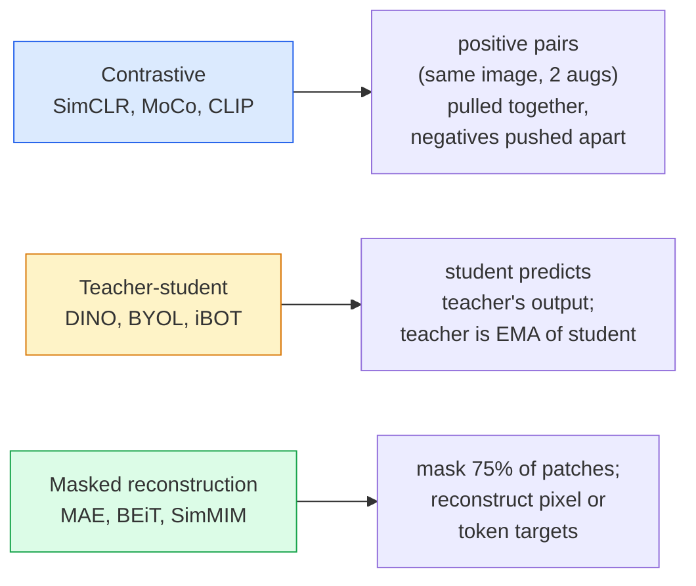

# Self-Supervised Vision — SimCLR, DINO, MAE

> Разметка — узкое место компьютерного зрения. Самостоятельное (self-supervised) предобучение убирает её: модель учит визуальные признаки на 100 млн неразмеченных изображений, а дообучается уже на 10 тыс. размеченных.

**Type:** Изучить + Построить
**Languages:** Python
**Prerequisites:** Phase 4 Lesson 04 (Image Classification), Phase 4 Lesson 14 (ViT)
**Time:** ~75 минут

## Цели обучения

- Проследить три основных семейства self-supervised подходов — контрастивные (SimCLR), teacher-student (DINO), маскированная реконструкция (MAE) — и сформулировать, что оптимизирует каждый из них
- Реализовать InfoNCE loss с нуля и объяснить, почему батч размером 512 работает, а батч размером 32 — нет
- Объяснить, почему 75%-ная маскировка в MAE не произвольна и чем она отличается от 15% у BERT для текста
- Использовать чекпойнты DINOv2 или MAE, обученные на ImageNet, для линейного пробинга и zero-shot retrieval

## Проблема

Размеченный ImageNet содержит 1,3 млн изображений, на аннотирование которых, по оценкам, ушло $10 млн. Медицинские и промышленные датасеты меньше и ещё дороже в разметке. Каждая команда, занимающаяся компьютерным зрением, задаётся вопросом: можно ли предобучиться на дешёвых неразмеченных данных — кадрах из YouTube, веб-краулинге, записях с веб-камер, спутниковых снимках — а затем дообучиться на небольшом размеченном наборе?

Self-supervised learning — это ответ. Современный self-supervised ViT, обученный на LAION или JFT, достигает или превосходит точность supervised ImageNet при дообучении. Он также лучше переносится на downstream-задачи (детекция, сегментация, оценка глубины), чем supervised-предобучение. DINOv2 (Meta, 2023) и MAE (Meta, 2022) — текущие промышленные стандарты для переносимых визуальных признаков.

Концептуальный сдвиг состоит в том, что pretext-задача — то, на выполнение чего обучается модель — не обязана совпадать с downstream-задачей. Важно лишь, чтобы она заставляла модель учить полезные признаки. Предсказание цвета для чёрно-белых изображений, поворот изображений с последующей классификацией угла поворота, маскирование патчей с их реконструкцией — всё это работало. Три подхода, которые масштабируются, — это контрастивное обучение, teacher-student дистилляция и маскированная реконструкция.

## Концепция

### Три семейства



### Контрастивное обучение (SimCLR)

Берём одно изображение, применяем к нему две случайные аугментации, получаем два представления (views). Пропускаем оба через один и тот же энкодер плюс проекционную голову. Минимизируем loss, который говорит: "эти два эмбеддинга должны быть близки" и "этот эмбеддинг должен быть далёк от эмбеддингов всех остальных изображений в батче".

```
Loss for positive pair (z_i, z_j) among 2N views per batch:

   L_ij = -log( exp(sim(z_i, z_j) / tau) / sum_k in batch \ {i} exp(sim(z_i, z_k) / tau) )

sim = cosine similarity
tau = temperature (0.1 standard)
```

Это и есть InfoNCE loss. Он требует много негативных примеров на каждый позитивный, поэтому размер батча важен — SimCLR нужен батч от 512 до 8192. MoCo ввёл очередь прошлых батчей с momentum-обновлением, чтобы отвязать количество негативов от размера батча.

### Teacher-student (DINO)

Две сети с одинаковой архитектурой: student и teacher. Teacher — это экспоненциальное скользящее среднее (EMA) весов student. Обе видят аугментированные представления изображения. Выход student обучается совпадать с выходом teacher — явных негативных примеров нет.

```
loss = CE( student_output(view_1),  teacher_output(view_2) )
     + CE( student_output(view_2),  teacher_output(view_1) )

teacher_weights = m * teacher_weights + (1 - m) * student_weights   (m ≈ 0.996)
```

Почему не происходит коллапса к "предсказанию константы": выход teacher центрируется (вычитается покомпонентное среднее) и обостряется (делится на малую температуру). Центрирование не даёт одному измерению доминировать; обострение не даёт выходу схлопнуться к равномерному распределению.

DINO — это именно то, что DINOv2 масштабирует до 142 млн курируемых изображений. Получаемые признаки — текущий SOTA для zero-shot визуального поиска и плотного предсказания (dense prediction).

### Маскированная реконструкция (MAE)

Маскируем 75% патчей на входе ViT. Через энкодер пропускаем только видимые 25%. Небольшой декодер получает выход энкодера плюс mask-токены на позициях замаскированных патчей и обучается восстанавливать пиксели этих патчей.

```
Encoder:  visible 25% of patches -> features
Decoder:  features + mask tokens at masked positions -> reconstructed pixels
Loss:     MSE between reconstructed and original pixels on masked patches only
```

Ключевые проектные решения, благодаря которым MAE работает:

- **75%-ный коэффициент маскировки** — высокий. Заставляет энкодер учить семантические признаки; реконструкция 25% была бы почти тривиальной (соседние пиксели настолько коррелированы, что с этим справилась бы и CNN).
- **Асимметричные энкодер/декодер** — большой ViT-энкодер видит только видимые патчи; небольшой декодер (8 слоёв, 512 измерений) занимается реконструкцией. Предобучение в 3 раза быстрее, чем у наивного BEiT.
- **Целевая реконструкция в пиксельном пространстве** — проще, чем токенизированная цель BEiT, и лучше работает на ViT.

После предобучения декодер отбрасывается. Энкодер становится экстрактором признаков.

### Почему 75%, а не 15%

BERT маскирует 15% токенов. MAE — 75%. Разница в плотности информации.

- У естественного языка высокая энтропия на токен. Предсказать 15% токенов всё равно сложно, потому что у каждой замаскированной позиции много правдоподобных вариантов заполнения.
- У патчей изображения низкая энтропия — немаскированное окружение часто почти точно определяет пиксели замаскированного патча. Чтобы предсказание требовало семантического понимания, маскировать нужно агрессивно.

75% — это достаточно много, чтобы простая пространственная экстраполяция не могла решить задачу; энкодеру приходится представлять содержание изображения.

### Оценка через линейный пробинг

После self-supervised предобучения стандартная оценка — это **линейный пробинг (linear probe)**: энкодер замораживается, а поверх него на метках ImageNet обучается один линейный классификатор. Сообщается top-1 точность.

- SimCLR ResNet-50: ~71% (2020)
- DINO ViT-S/16: ~77% (2021)
- MAE ViT-L/16: ~76% (2022)
- DINOv2 ViT-g/14: ~86% (2023)

Линейный пробинг — это чистая мера качества признаков; дообучение (fine-tuning) обычно добавляет 2-5 пунктов, но при этом примешивает эффект переобучения головы.

```figure
data-augmentation
```

## Построить

### Шаг 1: Пайплайн аугментации с двумя представлениями

```python
import torch
import torchvision.transforms as T

two_view_train = lambda: T.Compose([
    T.RandomResizedCrop(96, scale=(0.2, 1.0)),
    T.RandomHorizontalFlip(),
    T.ColorJitter(0.4, 0.4, 0.4, 0.1),
    T.RandomGrayscale(p=0.2),
    T.ToTensor(),
])


class TwoViewDataset(torch.utils.data.Dataset):
    def __init__(self, base):
        self.base = base
        self.aug = two_view_train()

    def __len__(self):
        return len(self.base)

    def __getitem__(self, i):
        img, _ = self.base[i]
        v1 = self.aug(img)
        v2 = self.aug(img)
        return v1, v2
```

Каждый вызов __getitem__ возвращает два аугментированных представления одного и того же изображения; метки не нужны.

### Шаг 2: Loss InfoNCE

```python
import torch.nn.functional as F

def info_nce(z1, z2, tau=0.1):
    """
    z1, z2: (N, D) L2-normalised embeddings of paired views
    """
    N, D = z1.shape
    z = torch.cat([z1, z2], dim=0)  # (2N, D)
    sim = z @ z.T / tau              # (2N, 2N)

    mask = torch.eye(2 * N, dtype=torch.bool, device=z.device)
    sim = sim.masked_fill(mask, float("-inf"))

    targets = torch.cat([torch.arange(N, 2 * N), torch.arange(0, N)]).to(z.device)
    return F.cross_entropy(sim, targets)
```

Перед вызовом эмбеддинги нормализуются по L2. `tau=0.1` — значение по умолчанию в SimCLR; меньшее значение делает loss более резким и требует больше негативных примеров.

### Шаг 3: Проверка InfoNCE на здравый смысл

```python
z1 = F.normalize(torch.randn(16, 32), dim=-1)
z2 = z1.clone()
loss_same = info_nce(z1, z2, tau=0.1).item()
z2_random = F.normalize(torch.randn(16, 32), dim=-1)
loss_random = info_nce(z1, z2_random, tau=0.1).item()
print(f"InfoNCE with identical pairs:  {loss_same:.3f}")
print(f"InfoNCE with random pairs:     {loss_random:.3f}")
```

Идентичные пары должны давать низкий loss (близкий к 0 при большом батче и низкой температуре). Случайные пары должны давать log(2N-1) = ~log(31) = ~3.4 при батче из 16 пар.

### Шаг 4: Маскирование в стиле MAE

```python
def random_mask_indices(num_patches, mask_ratio=0.75, seed=0):
    g = torch.Generator().manual_seed(seed)
    n_keep = int(num_patches * (1 - mask_ratio))
    perm = torch.randperm(num_patches, generator=g)
    visible = perm[:n_keep]
    masked = perm[n_keep:]
    return visible.sort().values, masked.sort().values


num_patches = 196
visible, masked = random_mask_indices(num_patches, mask_ratio=0.75)
print(f"visible: {len(visible)} / {num_patches}")
print(f"masked:  {len(masked)} / {num_patches}")
```

Просто, быстро и детерминированно при фиксированном seed. В реальных реализациях MAE это делается батчами, с сохранением масок для каждого примера.

## Использовать

DINOv2 — промышленный стандарт в 2026 году:

```python
import torch
from transformers import AutoImageProcessor, AutoModel

processor = AutoImageProcessor.from_pretrained("facebook/dinov2-base")
model = AutoModel.from_pretrained("facebook/dinov2-base")
model.eval()

# Per-image embeddings for zero-shot retrieval
with torch.no_grad():
    inputs = processor(images=[pil_image], return_tensors="pt")
    outputs = model(**inputs)
    embedding = outputs.last_hidden_state[:, 0]  # CLS token
```

Получаемый 768-мерный эмбеддинг — основа современных пайплайнов для поиска изображений, плотного сопоставления (dense correspondence) и zero-shot переноса. Дообучение на downstream-задаче редко требует больше, чем линейная голова.

Для эмбеддингов "изображение-текст" эквивалентами являются SigLIP или OpenCLIP; для дообучения в стиле MAE репозиторий `timm` содержит все чекпойнты MAE.

## Отгрузить

Этот урок производит:

- `outputs/prompt-ssl-pretraining-picker.md` — промпт, который выбирает SimCLR / MAE / DINOv2 исходя из размера датасета, доступных вычислений и downstream-задачи.
- `outputs/skill-linear-probe-runner.md` — навык, который пишет код оценки через линейный пробинг для любого замороженного энкодера + размеченного датасета.

## Упражнения

1. **(Лёгкое)** Проверьте, что loss InfoNCE падает при уменьшении температуры для хорошо выровненных эмбеддингов и растёт при уменьшении температуры для случайных эмбеддингов. Постройте график `tau in [0.05, 0.1, 0.2, 0.5]` в зависимости от loss.
2. **(Среднее)** Реализуйте буфер центрирования в стиле DINO. Покажите, что без центрирования student за несколько эпох схлопывается к константному вектору.
3. **(Сложное)** Обучите MAE на CIFAR-100, используя TinyUNet из Lesson 10 в качестве backbone. Приведите точность линейного пробинга на 10, 50 и 200 эпохах. Покажите, что линейный пробинг на предобученном MAE превосходит линейный пробинг, обученный с нуля на том же подмножестве из 1000 изображений.

## Ключевые термины

| Термин | Что говорят люди | Что это на самом деле означает |
|------|----------------|----------------------|
| Self-supervised | "Без разметки" | Pretext-задача, которая производит полезные представления из неразмеченных данных |
| Pretext task | "Фиктивная задача" | Цель, используемая во время SSL (реконструировать патчи, сопоставить представления); отбрасывается после предобучения |
| Linear probe | "Замороженный энкодер + линейная голова" | Стандартная оценка SSL: обучается только линейный классификатор поверх замороженных признаков |
| InfoNCE | "Контрастивный loss" | softmax по косинусным сходствам; позитивная пара — целевой класс, все остальные — негативные |
| EMA teacher | "Teacher со скользящим средним" | Teacher, веса которого представляют собой экспоненциальное скользящее среднее весов student; используется в BYOL, MoCo, DINO |
| Mask ratio | "% скрытых патчей" | Доля патчей, маскируемых в MAE; 75% для зрения, 15% для текста |
| Representation collapse | "Константный выход" | Сбой SSL, при котором энкодер выдаёт константный вектор для всех входов; предотвращается центрированием, обострением или негативными примерами |
| DINOv2 | "Промышленный SSL backbone" | Self-supervised ViT от Meta 2023 года; самые сильные признаки изображения общего назначения в 2026 году |

## Дополнительное чтение

- [SimCLR (Chen et al., 2020)](https://arxiv.org/abs/2002.05709) — справочник по контрастивному обучению
- [DINO (Caron et al., 2021)](https://arxiv.org/abs/2104.14294) — teacher-student с momentum, центрированием, обострением
- [MAE (He et al., 2022)](https://arxiv.org/abs/2111.06377) — предобучение masked autoencoder для ViT
- [DINOv2 (Oquab et al., 2023)](https://arxiv.org/abs/2304.07193) — масштабирование self-supervised ViT до промышленных признаков