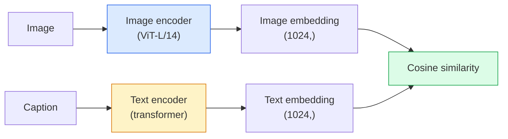

# Открытый словарь в зрении — CLIP

> Обучите энкодер изображений и текстовый энкодер совместно так, чтобы совпадающие пары (изображение, подпись) оказывались в одной точке общего пространства. В этом и состоит весь трюк.

**Type:** Build + Use
**Languages:** Python
**Prerequisites:** Phase 4 Lesson 14 (ViT), Phase 4 Lesson 17 (Self-Supervised)
**Time:** ~45 минут

## Цели обучения

- Объяснить архитектуру CLIP с двумя башнями и контрастивную целевую функцию обучения
- Использовать предобученный CLIP (или SigLIP) для zero-shot классификации без какого-либо специфичного для задачи обучения
- Реализовать zero-shot классификацию с нуля: кодирование промптов классов, вычисление косинусного сходства, выбор argmax
- Различать CLIP, SigLIP, OpenCLIP и модели LLaVA/LLaMA-vision — для чего каждая из них применяется в 2026 году

## Проблема

Традиционные классификаторы работают с закрытым словарём: модель ImageNet на 1000 классов может предсказывать только эти 1000 меток. Каждая новая категория требует размеченных данных и переобучения выходного слоя.

CLIP (Radford et al., OpenAI 2021) показал, что обучение на 400 млн пар (изображение, подпись), собранных из интернета, даёт модель, способную при инференсе классифицировать в любой набор категорий, описанных чистым естественным языком. Новый класс вы задаёте, просто написав предложение.

Эта способность — zero-shot перенос — является причиной того, что каждая современная система компьютерного зрения начинается с чекпоинта семейства CLIP. Детекция (Grounding DINO, OWL-ViT), сегментация (CLIPSeg, SAM), поиск, модерация контента, VLM и генерация изображений по тексту — всё это строится на совместных эмбеддингах в стиле CLIP.

## Концепция

### Две башни



Оба энкодера заканчиваются линейной проекцией в одну и ту же размерность эмбеддинга (512 для CLIP-B/32, 1024 для CLIP-L/14). Выполняется L2-нормализация и вычисляется косинусное сходство.

### Целевая функция

Дан батч из N пар (изображение, подпись); строится матрица сходства NxN. Оба энкодера обучаются так, чтобы на диагонали (совпадающие пары) сходство было высоким, а вне диагонали (несовпадающие пары) — низким.

```
sim_matrix = image_embeddings @ text_embeddings.T / tau

loss_i2t = cross_entropy(sim_matrix,       targets=arange(N))
loss_t2i = cross_entropy(sim_matrix.T,     targets=arange(N))
loss = (loss_i2t + loss_t2i) / 2
```

Симметрична, потому что должен работать как поиск от изображения к тексту, так и от текста к изображению. `tau` (температура) обычно обучается как скалярный параметр, инициализируемый значением 0.07.

### SigLIP: более удачный лосс

SigLIP (Zhai et al., 2023) заменил softmax на поэлементный (per-pair) sigmoid:

```
loss = mean over pairs of log(1 + exp(-y_ij * sim_ij))
y_ij = +1 if matching, -1 otherwise
```

Поэлементный лосс устраняет необходимость в нормализации на уровне батча, которая требуется в CLIP. SigLIP лучше обучается на малых размерах батча и сравнивается или превосходит CLIP при равном объёме данных.

### Zero-shot классификация

Дана обученная модель CLIP:

1. Для каждого класса составляется промпт: "a photo of a {class}".
2. Все промпты классов кодируются текстовым энкодером -> `T` формы (C, d).
3. Тестовое изображение кодируется -> `I` формы (1, d).
4. Сходство = `I @ T.T` формы (1, C).
5. Argmax -> предсказанный класс.

Инженерия промптов важна. OpenAI опубликовали 80 шаблонов промптов для ImageNet ("a photo of a {}", "a blurry photo of a {}", "a sketch of a {}", ...). Усреднение эмбеддингов всех шаблонов для каждого класса даёт дополнительные 1-3% точности top-1.

### Где модели в стиле CLIP применяются в 2026 году

- **Zero-shot классификация** — прямое использование.
- **Поиск изображений** — все изображения кодируются один раз, запрос кодируется при инференсе.
- **Детекция с текстовым условием** — Grounding DINO, OWL-ViT оборачивают текстовую башню CLIP вокруг детектора.
- **Сегментация с текстовым условием** — CLIPSeg; SAM использует текстовые промпты через CLIP.
- **VLM** — LLaVA, Qwen-VL, InternVL подключают визуальный энкодер семейства CLIP к LLM.
- **Генерация изображений по тексту** — Stable Diffusion, DALL-E 3 обуславливаются на текстовых эмбеддингах CLIP.

Как только есть общее пространство эмбеддингов, любая задача, связывающая зрение и язык, сводится к вычислению расстояния.

```figure
clip-contrastive
```

## Реализация

### Шаг 1: Миниатюрная модель с двумя башнями

Настоящий CLIP — это ViT + трансформер. Для этого урока башни представляют собой небольшие MLP поверх заранее извлечённых признаков, чтобы сигнал обучения был виден на CPU.

```python
import torch
import torch.nn as nn
import torch.nn.functional as F


class TwoTower(nn.Module):
    def __init__(self, img_in=128, txt_in=64, emb=64):
        super().__init__()
        self.image_proj = nn.Sequential(nn.Linear(img_in, 128), nn.ReLU(), nn.Linear(128, emb))
        self.text_proj = nn.Sequential(nn.Linear(txt_in, 128), nn.ReLU(), nn.Linear(128, emb))
        self.logit_scale = nn.Parameter(torch.ones([]) * 2.6592)  # ln(1/0.07)

    def forward(self, img_feats, txt_feats):
        i = F.normalize(self.image_proj(img_feats), dim=-1)
        t = F.normalize(self.text_proj(txt_feats), dim=-1)
        return i, t, self.logit_scale.exp()
```

Две проекции, общая выходная размерность, обучаемая температура. Та же форма, что и у реального API CLIP.

### Шаг 2: Контрастивный лосс

```python
def clip_loss(image_emb, text_emb, logit_scale):
    N = image_emb.size(0)
    sim = logit_scale * image_emb @ text_emb.T
    targets = torch.arange(N, device=sim.device)
    l_i = F.cross_entropy(sim, targets)
    l_t = F.cross_entropy(sim.T, targets)
    return (l_i + l_t) / 2
```

Симметричный. Чем выше logit_scale, тем острее softmax — больше уверенность, но выше риск нестабильности.

### Шаг 3: Zero-shot классификатор

```python
@torch.no_grad()
def zero_shot_classify(model, image_feats, class_text_feats, class_names):
    """
    image_feats:      (N, img_in)
    class_text_feats: (C, txt_in)   one averaged embedding per class
    """
    i = F.normalize(model.image_proj(image_feats), dim=-1)
    t = F.normalize(model.text_proj(class_text_feats), dim=-1)
    sim = i @ t.T
    pred = sim.argmax(dim=-1)
    return [class_names[p] for p in pred.tolist()]
```

По одной строке на шаг. Это та же самая процедура zero-shot, что используется с производственным чекпоинтом CLIP.

### Шаг 4: Проверка на вменяемость

```python
torch.manual_seed(0)
model = TwoTower()

img = torch.randn(8, 128)
txt = torch.randn(8, 64)
i, t, scale = model(img, txt)
loss = clip_loss(i, t, scale)
print(f"batch size: {i.size(0)}   loss: {loss.item():.3f}")
```

Для случайно инициализированной модели лосс должен быть близок к `log(N) = log(8) = 2.08` — это целевое значение симметричной кросс-энтропии, когда никакая структура ещё не выучена.

## Применение

В 2026 году стандартом сообщества является OpenCLIP:

```python
import open_clip
import torch
from PIL import Image

model, _, preprocess = open_clip.create_model_and_transforms("ViT-B-32", pretrained="laion2b_s34b_b79k")
tokenizer = open_clip.get_tokenizer("ViT-B-32")

image = preprocess(Image.open("dog.jpg")).unsqueeze(0)
text = tokenizer(["a photo of a dog", "a photo of a cat", "a photo of a car"])

with torch.no_grad():
    image_features = model.encode_image(image)
    text_features = model.encode_text(text)
    image_features = image_features / image_features.norm(dim=-1, keepdim=True)
    text_features = text_features / text_features.norm(dim=-1, keepdim=True)
    probs = (100.0 * image_features @ text_features.T).softmax(dim=-1)

print(probs)
```

SigLIP новее, лучше обучается на малых масштабах и предпочтителен для новых проектов: `google/siglip-base-patch16-224`. Hugging Face предоставляет оба варианта.

## Что сдать

По итогам этого урока создаются:

- `outputs/prompt-zero-shot-class-picker.md` — промпт, который проектирует шаблоны классов для zero-shot CLIP по списку классов и домену.
- `outputs/skill-image-text-retriever.md` — скилл, который строит индекс эмбеддингов изображений с любым чекпоинтом CLIP, поддерживает запрос по тексту и запрос по изображению.

## Упражнения

1. **(Лёгкое)** Используйте предобученный OpenCLIP ViT-B/32 и выполните zero-shot классификацию на CIFAR-10 с набором из 80 шаблонов промптов. Сообщите точность top-1; она должна быть около 85-90%.
2. **(Среднее)** Сравните эмбеддинги с одним шаблоном ("a photo of a {}") и усреднённые по 80 шаблонам на той же задаче CIFAR-10. Количественно оцените разницу и объясните, почему шаблоны помогают.
3. **(Сложное)** Постройте индекс для zero-shot поиска изображений: закодируйте 1000 изображений с помощью CLIP, постройте индекс FAISS, выполните запрос с описанием на естественном языке. Сообщите recall@5 для 20 отложенных запросов, составленных вами вручную.

## Ключевые термины

| Термин | Что говорят люди | Что это на самом деле означает |
|------|----------------|----------------------|
| Two-tower | "Dual encoder" | Отдельные энкодеры изображений и текста, заканчивающиеся проекционной головой общей размерности |
| Zero-shot | "No task-specific training" | Классификация по классам, описанным только текстом, при инференсе; метки не используются вовсе |
| Temperature / logit_scale | "tau" | Обучаемый скаляр, масштабирующий матрицу сходства перед softmax |
| Prompt template | "A photo of a {}" | Обёртка на естественном языке вокруг названий классов; усреднение множества шаблонов повышает точность zero-shot |
| CLIP | "Image+text model" | Модель OpenAI 2021 года; базовый термин области в 2026 году |
| SigLIP | "Sigmoid CLIP" | Заменяет softmax на поэлементный sigmoid; лучше обучается на малых батчах |
| OpenCLIP | "Open reproduction" | Обученные сообществом варианты CLIP на LAION; стандарт для открытых production-пайплайнов |
| VLM | "Vision-language model" | Энкодер семейства CLIP плюс LLM, обученные отвечать на вопросы об изображениях |

## Дополнительное чтение

- [CLIP: Learning Transferable Visual Models from Natural Language Supervision (Radford et al., 2021)](https://arxiv.org/abs/2103.00020)
- [SigLIP: Sigmoid Loss for Language-Image Pre-Training (Zhai et al., 2023)](https://arxiv.org/abs/2303.15343)
- [OpenCLIP](https://github.com/mlfoundations/open_clip) — кодовая база сообщества
- [Oquab et al. (2023). DINOv2: Learning Robust Visual Features without Supervision](https://arxiv.org/abs/2304.07193) — статья с бенчмарками признаков в сравнении с моделями в стиле CLIP и MAE