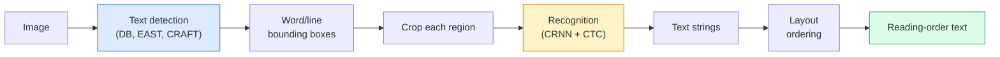

# OCR и понимание документов

> OCR — это трёхступенчатый конвейер: обнаружить текстовые блоки, распознать символы, затем расставить их в нужном порядке. Каждая современная OCR-система переставляет эти этапы местами или объединяет их.

**Type:** Learn + Use
**Languages:** Python
**Prerequisites:** Phase 4 Lesson 06 (Detection), Phase 7 Lesson 02 (Self-Attention)
**Time:** ~45 минут

## Цели обучения

- Проследить классический OCR-конвейер (обнаружение -> распознавание -> вёрстка) и современные end-to-end альтернативы (Donut, Qwen-VL-OCR)
- Реализовать функцию потерь CTC (Connectionist Temporal Classification) для обучения OCR по схеме sequence-to-sequence
- Использовать PaddleOCR или EasyOCR для промышленного разбора документов без обучения
- Различать OCR, разбор вёрстки (layout parsing) и понимание документов — и выбирать подходящий инструмент под задачу

## Проблема

Изображения, полные текста, повсюду: чеки, счета, документы удостоверения личности, отсканированные книги, формы, доски, вывески, скриншоты. Извлечение структурированных данных из них — не просто символов, а того, что "это итоговая сумма" — одна из наиболее ценных прикладных задач компьютерного зрения.

Область делится на три уровня навыков:

1. **Собственно OCR**: превратить пиксели в текст.
2. **Разбор вёрстки**: сгруппировать результат OCR в области (заголовок, основной текст, таблица, колонтитул).
3. **Понимание документов**: извлечь структурированные поля ("invoice_total = $42.50") из вёрстки.

У каждого уровня есть классические и современные подходы, и разрыв между "я хочу получить текст с изображения" и "мне нужна итоговая сумма из этого чека" гораздо больше, чем думает большинство команд.

## Концепция

### Классический конвейер



- **Обнаружение текста** даёт четырёхугольники на уровне строк или слов.
- **Распознавание** обрезает каждую область до фиксированной высоты, пропускает через CNN + BiLSTM + CTC для получения последовательности символов.
- **Вёрстка** восстанавливает порядок чтения (сверху вниз, слева направо для латиницы; иначе для арабского, японского).

### CTC в одном абзаце

Распознавание OCR выдаёт последовательность переменной длины из карты признаков фиксированной длины. CTC (Graves и др., 2006) позволяет обучать это без выравнивания на уровне символов. Модель выдаёт распределение по (словарь + blank) на каждом временном шаге; функция потерь CTC маргинализирует по всем выравниваниям, которые после слияния повторов и удаления blank-символов сводятся к целевому тексту.

```
raw output: "h h h _ _ e e l l _ l l o _ _"
after merge repeats and remove blanks: "hello"
```

CTC — причина, по которой CRNN работал в 2015 году и до сих пор обучает большинство промышленных OCR-моделей в 2026 году.

### Современные end-to-end модели

- **Donut** (Kim и др., 2022) — энкодер ViT + текстовый декодер; читает изображение и выдаёт JSON напрямую. Без детектора текста, без модуля вёрстки.
- **TrOCR** — ViT + трансформерный декодер для OCR на уровне строк.
- **Qwen-VL-OCR / InternVL** — полноценные визуально-языковые модели, дообученные под задачи OCR; лучшая точность в 2026 году на сложных документах.
- **PaddleOCR** — классический конвейер DB + CRNN в зрелом промышленном пакете; всё ещё рабочая лошадка с открытым исходным кодом.

End-to-end моделям нужно больше данных и вычислений, но они избегают накопления ошибок, характерного для многоступенчатых конвейеров.

### Разбор вёрстки

Для структурированных документов запускается детектор вёрстки (LayoutLMv3, DocLayNet), который размечает каждую область: заголовок, абзац, рисунок, таблица, сноска. Порядок чтения тогда сводится к "перебрать области в порядке вёрстки, объединить".

Для форм используются модели **извлечения пар ключ-значение** (Donut для визуально насыщенных документов, LayoutLMv3 для простых сканов). Они принимают изображение + распознанный текст + позиции и предсказывают структурированные пары ключ-значение.

### Метрики оценки

- **Character Error Rate (CER)** — расстояние Левенштейна / длина эталона. Чем меньше, тем лучше. Промышленный ориентир: < 2% на чистых сканах.
- **Word Error Rate (WER)** — то же самое на уровне слов.
- **F1 по структурированным полям** — для задач ключ-значение; измеряет, корректно ли появляется `{invoice_total: 42.50}`.
- **Расстояние редактирования по JSON** — для end-to-end разбора документов; в статье про Donut введено нормализованное древовидное расстояние редактирования.

```figure
cv3-ctc-collapse
```

## Реализация

### Шаг 1: функция потерь CTC + жадный декодер

```python
import torch
import torch.nn as nn
import torch.nn.functional as F


def ctc_loss(log_probs, targets, input_lengths, target_lengths, blank=0):
    """
    log_probs:      (T, N, C) log-softmax over vocab including blank at index 0
    targets:        (N, S) int targets (no blanks)
    input_lengths:  (N,) per-sample time steps used
    target_lengths: (N,) per-sample target length
    """
    return F.ctc_loss(log_probs, targets, input_lengths, target_lengths,
                      blank=blank, reduction="mean", zero_infinity=True)


def greedy_ctc_decode(log_probs, blank=0):
    """
    log_probs: (T, N, C) log-softmax
    returns: list of index sequences (blanks removed, repeats merged)
    """
    preds = log_probs.argmax(dim=-1).transpose(0, 1).cpu().tolist()
    out = []
    for seq in preds:
        decoded = []
        prev = None
        for idx in seq:
            if idx != prev and idx != blank:
                decoded.append(idx)
            prev = idx
        out.append(decoded)
    return out
```

`F.ctc_loss` использует эффективную реализацию CuDNN, когда она доступна. Жадный декодер проще, чем лучевой поиск (beam search), и обычно отстаёт от него не более чем на 1% по CER.

### Шаг 2: Крошечный распознаватель CRNN

Минимальная CNN + BiLSTM для построчного OCR.

```python
class TinyCRNN(nn.Module):
    def __init__(self, vocab_size=40, hidden=128, feat=32):
        super().__init__()
        self.cnn = nn.Sequential(
            nn.Conv2d(1, feat, 3, 1, 1), nn.BatchNorm2d(feat), nn.ReLU(inplace=True),
            nn.MaxPool2d(2),
            nn.Conv2d(feat, feat * 2, 3, 1, 1), nn.BatchNorm2d(feat * 2), nn.ReLU(inplace=True),
            nn.MaxPool2d(2),
            nn.Conv2d(feat * 2, feat * 4, 3, 1, 1), nn.BatchNorm2d(feat * 4), nn.ReLU(inplace=True),
            nn.MaxPool2d((2, 1)),
            nn.Conv2d(feat * 4, feat * 4, 3, 1, 1), nn.BatchNorm2d(feat * 4), nn.ReLU(inplace=True),
            nn.MaxPool2d((2, 1)),
        )
        self.rnn = nn.LSTM(feat * 4, hidden, bidirectional=True, batch_first=True)
        self.head = nn.Linear(hidden * 2, vocab_size)

    def forward(self, x):
        # x: (N, 1, H, W)
        f = self.cnn(x)                # (N, C, H', W')
        f = f.mean(dim=2).transpose(1, 2)  # (N, W', C)
        h, _ = self.rnn(f)
        return F.log_softmax(self.head(h).transpose(0, 1), dim=-1)  # (W', N, vocab)
```

Вход фиксированной высоты (CNN сводит высоту к 1 с помощью max-pooling). Ширина — это временное измерение для CTC.

### Шаг 3: Синтетический OCR

Сгенерируйте чёрные на белом строки из цифр для сквозного дымового теста.

```python
import numpy as np

def synthetic_line(text, height=32, char_width=16):
    W = char_width * len(text)
    img = np.ones((height, W), dtype=np.float32)
    for i, c in enumerate(text):
        x = i * char_width
        shade = 0.0 if c.isalnum() else 0.5
        img[6:height - 6, x + 2:x + char_width - 2] = shade
    return img


def build_batch(strings, vocab):
    H = 32
    W = 16 * max(len(s) for s in strings)
    imgs = np.ones((len(strings), 1, H, W), dtype=np.float32)
    target_lengths = []
    targets = []
    for i, s in enumerate(strings):
        imgs[i, 0, :, :16 * len(s)] = synthetic_line(s)
        ids = [vocab.index(c) for c in s]
        targets.extend(ids)
        target_lengths.append(len(ids))
    return torch.from_numpy(imgs), torch.tensor(targets), torch.tensor(target_lengths)


vocab = ["_"] + list("0123456789abcdefghijklmnopqrstuvwxyz")
imgs, targets, lengths = build_batch(["hello", "world"], vocab)
print(f"images: {imgs.shape}   targets: {targets.shape}   lengths: {lengths.tolist()}")
```

Реальный датасет OCR добавляет шрифты, шум, поворот, размытие и цвет. Конвейер выше остаётся тем же.

### Шаг 4: Набросок обучения

```python
model = TinyCRNN(vocab_size=len(vocab))
opt = torch.optim.Adam(model.parameters(), lr=1e-3)

for step in range(200):
    strings = ["abc" + str(step % 10)] * 4 + ["xyz" + str((step + 1) % 10)] * 4
    imgs, targets, target_lens = build_batch(strings, vocab)
    log_probs = model(imgs)  # (W', 8, vocab)
    input_lens = torch.full((8,), log_probs.size(0), dtype=torch.long)
    loss = ctc_loss(log_probs, targets, input_lens, target_lens, blank=0)
    opt.zero_grad(); loss.backward(); opt.step()
```

Потери должны упасть примерно с 3 до ~0.2 за 200 шагов на этих тривиальных синтетических данных.

## Применение

Три промышленных пути:

- **PaddleOCR** — зрелый, быстрый, многоязычный. Использование в одну строку: `paddleocr.PaddleOCR(lang="en").ocr(image_path)`.
- **EasyOCR** — написан на Python, многоязычный, на основе PyTorch.
- **Tesseract** — классический вариант; всё ещё полезен для старых отсканированных документов, когда модели справляются плохо.

Для сквозного разбора документов используйте Donut или VLM:

```python
from transformers import DonutProcessor, VisionEncoderDecoderModel

processor = DonutProcessor.from_pretrained("naver-clova-ix/donut-base-finetuned-cord-v2")
model = VisionEncoderDecoderModel.from_pretrained("naver-clova-ix/donut-base-finetuned-cord-v2")
```

Для чеков, счетов и форм с повторяющейся структурой дообучайте Donut. Для произвольных документов или OCR с рассуждением текущий выбор по умолчанию — VLM вроде Qwen-VL-OCR.

## Поставка результата

Этот урок даёт:

- `outputs/prompt-ocr-stack-picker.md` — промпт, который выбирает Tesseract / PaddleOCR / Donut / VLM-OCR в зависимости от типа документа, языка и структуры.
- `outputs/skill-ctc-decoder.md` — навык, который пишет с нуля жадные и лучевые декодеры CTC, включая нормализацию по длине.

## Упражнения

1. **(Лёгкое)** Обучите TinyCRNN на 5-значных случайных числовых строках за 500 шагов. Сообщите CER на отложенной выборке.
2. **(Среднее)** Замените жадное декодирование на лучевой поиск (beam_width=5). Сообщите разницу по CER. На каких входных данных лучевой поиск выигрывает?
3. **(Сложное)** Примените PaddleOCR к набору из 20 чеков, извлеките позиции товаров и вычислите F1 относительно размеченной вручную эталонной разметки для пар {item_name, price}.

## Ключевые термины

| Термин | Что говорят люди | Что это на самом деле означает |
|------|----------------|----------------------|
| OCR | "Текст из пикселей" | Превращение областей изображения в последовательности символов |
| CTC | "Функция потерь без выравнивания" | Функция потерь, обучающая модель последовательностей без поэтапных меток; маргинализирует по выравниваниям |
| CRNN | "Классическая модель OCR" | Свёрточный экстрактор признаков + BiLSTM + CTC; базовая модель 2015 года, до сих пор используемая в промышленности |
| Donut | "End-to-end OCR" | Энкодер ViT + текстовый декодер; выдаёт JSON напрямую из изображения |
| Разбор вёрстки | "Найти области" | Обнаружение и разметка областей заголовок/таблица/рисунок/абзац в документе |
| Порядок чтения | "Последовательность текста" | Упорядочивание распознанных областей в предложение; тривиально для латиницы, нетривиально для смешанных вёрсток |
| CER / WER | "Частота ошибок" | Расстояние Левенштейна / длина эталона на уровне символов или слов |
| VLM-OCR | "LLM, который читает" | Визуально-языковая модель, обученная или промптированная для задач OCR; текущий SOTA на сложных документах |

## Дополнительное чтение

- [CRNN (Shi и др., 2015)](https://arxiv.org/abs/1507.05717) — оригинальная архитектура CNN+RNN+CTC
- [CTC (Graves и др., 2006)](https://www.cs.toronto.edu/~graves/icml_2006.pdf) — оригинальная статья о CTC; плотно насыщена алгоритмическими идеями
- [Donut (Kim и др., 2022)](https://arxiv.org/abs/2111.15664) — трансформер для понимания документов без OCR
- [PaddleOCR](https://github.com/PaddlePaddle/PaddleOCR) — промышленный стек OCR с открытым исходным кодом