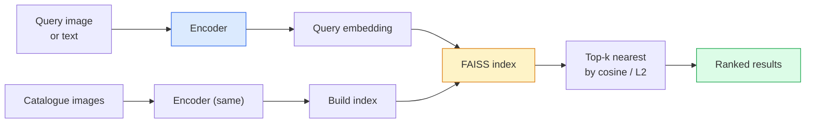

# Поиск изображений и метрическое обучение

> Система поиска ранжирует кандидатов по расстоянию в пространстве эмбеддингов. Метрическое обучение — это дисциплина формирования такого пространства, в котором расстояния означают именно то, что вам нужно.

**Type:** Build
**Languages:** Python
**Prerequisites:** Phase 4 Lesson 14 (ViT), Phase 4 Lesson 18 (CLIP)
**Time:** ~45 минут

## Цели обучения

- Объяснить triplet, contrastive и proxy-based методы метрического обучения и выбрать подходящий для конкретного датасета
- Корректно реализовать L2-нормализацию и косинусное сходство и понимать разницу между поиском «того же объекта» и «того же класса»
- Построить индекс FAISS, выполнять по нему запросы текстом и изображением и отчитаться по recall@K на отложенном наборе запросов
- Использовать DINOv2, CLIP и SigLIP как готовые эмбеддинг-бэкбоны и знать, когда какой из них выигрывает

## Проблема

Поиск повсюду в продакшн-вижн: обнаружение дубликатов, обратный поиск изображений, визуальный поиск («найти похожие товары»), повторная идентификация лиц, re-ID людей для видеонаблюдения, сопоставление на уровне экземпляров для e-commerce. Продуктовый вопрос всегда один и тот же: «дано изображение-запрос, ранжируй мой каталог».

Два архитектурных решения определяют всю систему. Эмбеддинг — какая модель производит векторы. Индекс — как находить ближайших соседей в масштабе. Оба в 2026 году стали commodity-решениями (DINOv2 для эмбеддинга, FAISS для индекса), что поднимает планку: сложная часть — определить, *что считается похожим* для вашего приложения, а затем сформировать пространство эмбеддингов так, чтобы расстояния этому соответствовали.

Это формирование и есть метрическое обучение. Небольшая, но высокоэффективная дисциплина.

## Концепция

### Поиск вкратце



### Четыре семейства функций потерь

| Loss | Требует | Плюсы | Минусы |
|------|----------|------|------|
| **Contrastive** | (anchor, positive) + негативы | Просто, работает с любой разметкой пар | Медленная сходимость без большого числа негативов |
| **Triplet** | (anchor, positive, negative) | Интуитивно понятно; прямой контроль margin | Майнинг сложных триплетов затратен |
| **NT-Xent / InfoNCE** | Пары + негативы, намайненные в батче | Масштабируется на большие батчи | Нужен большой батч или momentum-очередь |
| **Proxy-based (ProxyNCA)** | Только метки классов | Быстро, стабильно, без майнинга | Может переобучаться на прокси на малых датасетах |

Для большинства продакшн-кейсов начните с предобученного бэкбона и добавляйте fine-tune с метрическим обучением только если готовые эмбеддинги показывают недостаточный результат на вашем тестовом наборе.

### Triplet loss формально

```
L = max(0, ||f(a) - f(p)||^2 - ||f(a) - f(n)||^2 + margin)
```

Притягиваем anchor `a` ближе к positive `p`, отталкиваем от negative `n`, с `margin`, который обеспечивает зазор. Структура из трёх изображений обобщается на любой порядок сходства.

Майнинг важен: лёгкие триплеты (`n` уже далеко от `a`) дают нулевой loss; только сложные триплеты обучают сеть. Semi-hard майнинг (`n` дальше, чем `p`, но в пределах margin) — рецепт FaceNet 2016 года, который всё ещё доминирует.

### Косинусное сходство против L2

Две метрики, две конвенции:

- **Cosine**: угол между векторами. Требует L2-нормализованных эмбеддингов.
- **L2**: евклидово расстояние. Работает как на сырых, так и на нормализованных эмбеддингах, но обычно сочетается с L2-нормализацией и квадратом L2.

Для большинства современных сетей эти две метрики эквивалентны: `||a - b||^2 = 2 - 2 cos(a, b)`, когда `||a|| = ||b|| = 1`. Выбирайте конвенцию, соответствующую обучению вашего эмбеддинга; смешивание их незаметно меняет смысл понятия «ближайший».

### Recall@K

Стандартная метрика поиска:

```
recall@K = fraction of queries where at least one correct match is in the top K results
```

Отчитывайтесь по recall@1, @5, @10 параллельно. Recall@10 выше 0.95 при recall@1 ниже 0.5 означает, что пространство эмбеддингов имеет правильную структуру, но ранжирование зашумлено — попробуйте более долгий fine-tune или шаг ре-ранжирования.

Для обнаружения дубликатов важнее precision@K, потому что каждый ложноположительный результат — это заметная пользователю ошибка. Для визуального поиска recall@K — продуктовый сигнал.

### FAISS в одном абзаце

Facebook AI Similarity Search. Де-факто стандартная библиотека для поиска ближайших соседей. Три варианта индекса:

- `IndexFlatIP` / `IndexFlatL2` — полный перебор, точный, без обучения. Используйте до ~1М векторов.
- `IndexIVFFlat` — разбиение на K ячеек, поиск только в нескольких ближайших ячейках. Приближённый, быстрый, требует обучающих данных.
- `IndexHNSW` — на основе графа, самый быстрый при большом числе запросов, большой размер индекса.

Для 100 тыс. векторов, вероятно, подойдёт `IndexFlatIP` по косинусному сходству. Для 10 млн — `IndexIVFFlat`. Для 100 млн+ в сочетании с продуктовой квантизацией (`IndexIVFPQ`).

### Поиск на уровне экземпляра против поиска на уровне категории

Две совершенно разные задачи под одним названием:

- **На уровне категории** — «найти кошек в моём каталоге». Class-conditional сходство; готовые эмбеддинги CLIP / DINOv2 работают хорошо.
- **На уровне экземпляра** — «найти *этот самый* товар в моём каталоге». Требует тонкой дискриминации между визуально похожими объектами одного класса; готовые эмбеддинги показывают недостаточный результат; важен fine-tune с метрическим обучением.

Всегда спрашивайте, какую именно задачу вы решаете, прежде чем выбирать модель.

```figure
metric-embedding
```

## Собираем

### Шаг 1: Triplet loss

```python
import torch
import torch.nn.functional as F

def triplet_loss(anchor, positive, negative, margin=0.2):
    d_ap = F.pairwise_distance(anchor, positive, p=2)
    d_an = F.pairwise_distance(anchor, negative, p=2)
    return F.relu(d_ap - d_an + margin).mean()
```

Одна строка. Работает как на L2-нормализованных, так и на сырых эмбеддингах.

### Шаг 2: Semi-hard майнинг

Дан батч эмбеддингов и меток, найти самый сложный semi-hard негатив для каждого anchor.

```python
def semi_hard_negatives(emb, labels, margin=0.2):
    dist = torch.cdist(emb, emb)
    same_class = labels[:, None] == labels[None, :]
    diff_class = ~same_class
    N = emb.size(0)

    positives = dist.clone()
    positives[~same_class] = float("-inf")
    positives.fill_diagonal_(float("-inf"))
    pos_idx = positives.argmax(dim=1)

    semi_hard = dist.clone()
    semi_hard[same_class] = float("inf")
    d_ap = dist[torch.arange(N), pos_idx].unsqueeze(1)
    semi_hard[dist <= d_ap] = float("inf")
    neg_idx = semi_hard.argmin(dim=1)

    fallback_mask = semi_hard[torch.arange(N), neg_idx] == float("inf")
    if fallback_mask.any():
        hardest = dist.clone()
        hardest[same_class] = float("inf")
        neg_idx = torch.where(fallback_mask, hardest.argmin(dim=1), neg_idx)
    return pos_idx, neg_idx
```

Каждый anchor получает самый сложный positive внутри класса и semi-hard негатив, который дальше, чем positive, но в пределах margin.

### Шаг 3: Recall@K

```python
def recall_at_k(query_emb, gallery_emb, query_labels, gallery_labels, k=1):
    sim = query_emb @ gallery_emb.T
    _, top_k = sim.topk(k, dim=-1)
    matches = (gallery_labels[top_k] == query_labels[:, None]).any(dim=-1)
    return matches.float().mean().item()
```

Top-k по скалярному произведению на L2-нормализованных эмбеддингах равносилен top-k по косинусному сходству. Отчитайтесь по средней доле запросов, у которых есть хотя бы один правильный сосед.

### Шаг 4: Собираем всё вместе

```python
import torch
import torch.nn as nn
from torch.optim import Adam

class Encoder(nn.Module):
    def __init__(self, in_dim=128, emb_dim=64):
        super().__init__()
        self.net = nn.Sequential(
            nn.Linear(in_dim, 128), nn.ReLU(),
            nn.Linear(128, emb_dim),
        )

    def forward(self, x):
        return F.normalize(self.net(x), dim=-1)

torch.manual_seed(0)
num_classes = 6
protos = F.normalize(torch.randn(num_classes, 128), dim=-1)

def sample_batch(bs=32):
    labels = torch.randint(0, num_classes, (bs,))
    x = protos[labels] + 0.15 * torch.randn(bs, 128)
    return x, labels

enc = Encoder()
opt = Adam(enc.parameters(), lr=3e-3)

for step in range(200):
    x, y = sample_batch(32)
    emb = enc(x)
    pos_idx, neg_idx = semi_hard_negatives(emb, y)
    loss = triplet_loss(emb, emb[pos_idx], emb[neg_idx])
    opt.zero_grad(); loss.backward(); opt.step()
```

После нескольких сотен шагов кластеры эмбеддингов формируют по одному кластеру на класс.

## Применяем

Продакшн-стеки в 2026 году:

- **DINOv2 + FAISS** — универсальный визуальный поиск. Работает «из коробки».
- **CLIP + FAISS** — когда запросы текстовые.
- **Fine-tuned DINOv2 + FAISS** — поиск на уровне экземпляра, re-ID лиц, fashion, e-commerce.
- **Milvus / Weaviate / Qdrant** — управляемые векторные БД-обёртки вокруг FAISS или HNSW.

Для SOTA-поиска на уровне экземпляра рецепт такой: бэкбон DINOv2, добавить эмбеддинг-голову, дообучить с triplet или InfoNCE loss на размеченных по экземплярам парах, индексировать в FAISS.

## Публикуем

Этот урок даёт на выходе:

- `outputs/prompt-retrieval-loss-picker.md` — промпт, который выбирает triplet / InfoNCE / ProxyNCA для заданной задачи поиска.
- `outputs/skill-recall-at-k-runner.md` — навык, который пишет чистый harness для оценки recall@K с разбиением на train/val/gallery и корректным контрактом данных.

## Упражнения

1. **(Лёгкое)** Запустите приведённый выше игрушечный пример. Постройте график эмбеддингов методом PCA до и после обучения, чтобы увидеть формирование шести кластеров.
2. **(Среднее)** Добавьте реализацию ProxyNCA loss: один обучаемый «прокси» на класс, стандартная кросс-энтропия по косинусному сходству. Сравните скорость сходимости с triplet loss на игрушечных данных.
3. **(Сложное)** Возьмите 1000 изображений из валидационного набора ImageNet, получите эмбеддинги с помощью DINOv2 через HuggingFace, постройте плоский индекс FAISS и отчитайтесь по recall@{1, 5, 10} относительно тех же изображений в качестве запросов (должно быть 1.0) и относительно отложенного разбиения с метками ImageNet в качестве эталона.

## Ключевые термины

| Термин | Что говорят люди | Что это на самом деле означает |
|------|----------------|----------------------|
| Metric learning | «Формируем пространство» | Обучение энкодера так, чтобы расстояния в выходном пространстве отражали целевое сходство |
| Triplet loss | «Притянуть и оттолкнуть» | L = max(0, d(a, p) - d(a, n) + margin); канонический loss метрического обучения |
| Semi-hard mining | «Полезные негативы» | Негативы, более далёкие от anchor, чем positive, но в пределах margin; эмпирически наиболее информативны |
| Proxy-based loss | «Прототипы классов» | Один обучаемый прокси на класс; кросс-энтропия по сходству с прокси; без майнинга пар |
| Recall@K | «Top-K hit rate» | Доля запросов, у которых есть хотя бы один правильный результат в top K |
| Instance retrieval | «Найти именно эту вещь» | Тонкое сопоставление; готовые признаки обычно показывают недостаточный результат |
| FAISS | «Библиотека NN» | Библиотека ближайших соседей от Facebook; поддерживает точные и приближённые индексы |
| HNSW | «Графовый индекс» | Hierarchical navigable small world; быстрый приближённый поиск ближайших соседей с небольшими накладными расходами по памяти |

## Дополнительное чтение

- [FaceNet: A Unified Embedding for Face Recognition (Schroff et al., 2015)](https://arxiv.org/abs/1503.03832) — статья про triplet loss / semi-hard mining
- [In Defense of the Triplet Loss for Person Re-Identification (Hermans et al., 2017)](https://arxiv.org/abs/1703.07737) — практическое руководство по triplet fine-tuning
- [FAISS documentation](https://github.com/facebookresearch/faiss/wiki) — каждый индекс, каждый компромисс
- [SMoT: Metric Learning Taxonomy (Kim et al., 2021)](https://arxiv.org/abs/2010.06927) — обзор современных loss-функций и их взаимосвязей