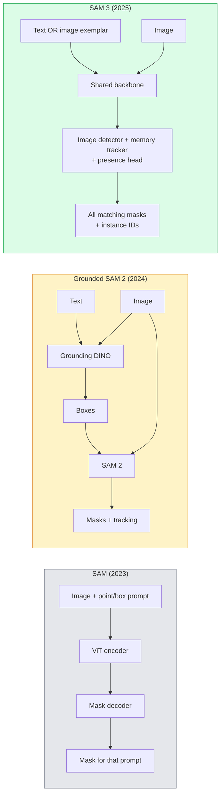

# SAM 3 и сегментация с открытым словарём

> Дайте модели текстовый запрос и изображение — получите маски для каждого подходящего объекта. SAM 3 свёл это к одному прямому проходу.

**Type:** Использование + разработка
**Languages:** Python
**Prerequisites:** Phase 4 Lesson 07 (U-Net), Phase 4 Lesson 08 (Mask R-CNN), Phase 4 Lesson 18 (CLIP)
**Time:** ~60 минут

## Цели обучения

- Различать SAM (только визуальные запросы), Grounded SAM / SAM 2 (детектор + SAM) и SAM 3 (нативные текстовые запросы через Promptable Concept Segmentation)
- Объяснить архитектуру SAM 3: общий backbone + детектор изображений + видеотрекер на основе памяти + presence head + разделённая конструкция детектор-трекер
- Использовать интеграцию SAM 3 в Hugging Face `transformers` для детекции, сегментации и отслеживания в видео по текстовым запросам
- Выбирать между SAM 3, Grounded SAM 2, YOLO-World и SAM-MI в зависимости от задержки, сложности концепта и целевой платформы развёртывания

## Проблема

SAM 2023 года была моделью только с визуальными запросами: вы кликаете точку или рисуете рамку, и она возвращает маску. Для задачи «дай мне все апельсины на этом фото» требовался детектор (Grounding DINO) для построения рамок, а затем SAM для сегментации каждой из них. Grounded SAM превратил это в конвейер, но это был каскад из двух замороженных моделей с неизбежным накоплением ошибок.

SAM 3 (Meta, ноябрь 2025, ICLR 2026) свернула этот каскад. Она принимает короткую именную группу или изображение-эталон в качестве запроса и возвращает все подходящие маски и идентификаторы экземпляров за один прямой проход. Это называется **Promptable Concept Segmentation (PCS)**. В сочетании с обновлением Object Multiplex от марта 2026 (SAM 3.1) модель эффективно отслеживает несколько экземпляров одного концепта в видео.

Этот урок — о структурном сдвиге, который это представляет. 2D-сегментация, детекция и связывание текста с изображением объединились в одну модель. Производственный вопрос больше не звучит как «какой конвейер собрать из частей», а как «какая промптируемая модель решает мою задачу целиком».

## Концепция

### Три поколения



### Promptable Concept Segmentation

«Концептуальный запрос» — это короткая именная группа (`"yellow school bus"`, `"striped red umbrella"`, `"hand holding a mug"`) или изображение-эталон. Модель возвращает маски сегментации для каждого экземпляра на изображении, соответствующего концепту, плюс уникальный идентификатор экземпляра для каждого совпадения.

Это отличается от классической визуально-промптируемой SAM тремя моментами:

1. Не требуется запрос для каждого экземпляра отдельно — один текстовый запрос возвращает все совпадения.
2. Открытый словарь — концепт может быть чем угодно, что описывается естественным языком.
3. Возвращает несколько экземпляров сразу, а не одну маску на запрос.

### Ключевые архитектурные элементы

- **Общий backbone** — единый ViT обрабатывает изображение. И голова детектора, и трекер на основе памяти читают данные из него.
- **Presence head** — предсказывает, присутствует ли концепт на изображении вообще. Отделяет вопрос «это здесь есть?» от «где это находится?». Снижает число ложных срабатываний на отсутствующих концептах.
- **Разделённые детектор и трекер** — детекция на уровне изображения и отслеживание на уровне видео имеют отдельные головы, чтобы не мешать друг другу.
- **Банк памяти** — хранит признаки по каждому экземпляру по кадрам для отслеживания в видео (тот же механизм, что использовался в SAM 2).

### Обучение в большом масштабе

SAM 3 была обучена на **4 миллионах уникальных концептов**, сгенерированных движком данных, который итеративно размечает и исправляет данные с использованием ИИ и проверки человеком. Новый бенчмарк **SA-CO** содержит 270 тыс. уникальных концептов — в 50 раз больше, чем предыдущие бенчмарки. SAM 3 достигает 75-80% от производительности человека на SA-CO и вдвое превосходит существующие системы на PCS для изображений и видео.

### SAM 3.1 Object Multiplex

Обновление марта 2026: **Object Multiplex** вводит механизм общей памяти для совместного отслеживания множества экземпляров одного концепта одновременно. Ранее отслеживание N экземпляров означало N отдельных банков памяти. Multiplex сворачивает это в одну общую память с запросами для каждого экземпляра. Результат: существенно более быстрое отслеживание множества объектов без потери точности.

### Где Grounded SAM всё ещё актуален в 2026

- Когда вам нужно подставить конкретный детектор с открытым словарём (DINO-X, Florence-2).
- Когда лицензия SAM 3 (ограниченный доступ на HF) является препятствием.
- Когда вам нужен больший контроль над порогом детектора, чем предоставляет SAM 3.
- Для исследовательской работы / абляций компонента детектора.

Модульные конвейеры всё ещё имеют право на существование. Для большинства производственных задач SAM 3 — более простой ответ.

### YOLO-World против SAM 3

- **YOLO-World** — только детектор с открытым словарём (без масок). Работает в реальном времени. Лучший выбор, когда нужны рамки с высоким fps.
- **SAM 3** — полная сегментация + отслеживание. Медленнее, но даёт более богатый выход.

Производственное разделение: YOLO-World для быстрых конвейеров только с детекцией (навигация роботов, быстрые дашборды), SAM 3 для всего, что требует масок или отслеживания.

### Эффективность SAM-MI

SAM-MI (2025-2026) решает проблему узкого места декодера SAM. Ключевые идеи:

- **Разреженное точечное промптирование** — использует несколько тщательно выбранных точек вместо плотных запросов; сокращает число вызовов декодера на 96%.
- **Неглубокая агрегация масок** — объединяет грубые предсказания масок в одну более чёткую маску.
- **Разделённая инъекция маски** — декодер получает заранее вычисленные признаки маски вместо повторного запуска.

Результат: ~1.6× ускорение по сравнению с Grounded-SAM на бенчмарках с открытым словарём.

### Формат вывода для трёх моделей

Все возвращают одну и ту же общую структуру (рамки + метки + оценки + маски + идентификаторы), что удобно — вашему последующему конвейеру не нужно разветвляться в зависимости от того, какая модель отработала.

```figure
cv3-open-vocab
```

## Реализация

### Шаг 1: Построение запроса

Постройте вспомогательную функцию, которая превращает предложение пользователя в список концептуальных запросов для SAM 3. Это граница, где «то, что ввёл пользователь» встречается с «тем, что потребляет модель».

```python
def split_concepts(sentence):
    """
    Heuristic splitter for multi-concept prompts.
    Returns list of short noun phrases.
    """
    for sep in [",", ";", "and", "or", "&"]:
        if sep in sentence:
            parts = [p.strip() for p in sentence.replace("and ", ",").split(",")]
            return [p for p in parts if p]
    return [sentence.strip()]

print(split_concepts("cats, dogs and balloons"))
```

SAM 3 принимает один концепт за прямой проход; для запросов с несколькими концептами выполняйте цикл или пакетную обработку.

### Шаг 2: Вспомогательные функции постобработки

Преобразуйте сырые выходные данные SAM 3 в чистый список детекций, соответствующий контракту конвейера из Phase 4 Lesson 16.

```python
from dataclasses import dataclass
from typing import List

@dataclass
class ConceptDetection:
    concept: str
    instance_id: int
    box: tuple          # (x1, y1, x2, y2)
    score: float
    mask_rle: str       # run-length encoded


def rle_encode(binary_mask):
    flat = binary_mask.flatten().astype("uint8")
    runs = []
    prev, count = flat[0], 0
    for v in flat:
        if v == prev:
            count += 1
        else:
            runs.append((int(prev), count))
            prev, count = v, 1
    runs.append((int(prev), count))
    return ";".join(f"{v}x{c}" for v, c in runs)
```

RLE сохраняет небольшой размер полезной нагрузки ответа даже для множества масок высокого разрешения. Тот же формат работает для SAM 2, SAM 3, Grounded SAM 2.

### Шаг 3: Единый интерфейс сегментации с открытым словарём

Оберните любой имеющийся у вас бэкенд (SAM 3, Grounded SAM 2, YOLO-World + SAM 2) единым методом. Ваш последующий код не меняется при смене бэкенда.

```python
from abc import ABC, abstractmethod
import numpy as np

class OpenVocabSeg(ABC):
    @abstractmethod
    def detect(self, image: np.ndarray, concept: str) -> List[ConceptDetection]:
        ...


class StubOpenVocabSeg(OpenVocabSeg):
    """
    Deterministic stub used for pipeline testing when real models are not loaded.
    """
    def detect(self, image, concept):
        h, w = image.shape[:2]
        return [
            ConceptDetection(
                concept=concept,
                instance_id=0,
                box=(w * 0.2, h * 0.3, w * 0.5, h * 0.8),
                score=0.89,
                mask_rle="0x100;1x50;0x200",
            ),
            ConceptDetection(
                concept=concept,
                instance_id=1,
                box=(w * 0.55, h * 0.25, w * 0.85, h * 0.75),
                score=0.74,
                mask_rle="0x80;1x40;0x220",
            ),
        ]
```

Реальный подкласс `SAM3OpenVocabSeg` должен обёртывать `transformers.Sam3Model` и `Sam3Processor`.

### Шаг 4: Использование SAM 3 через Hugging Face (справочно)

Для реальной модели — интеграция `transformers`:

```python
from transformers import Sam3Processor, Sam3Model
import torch

processor = Sam3Processor.from_pretrained("facebook/sam3")
model = Sam3Model.from_pretrained("facebook/sam3").eval()

inputs = processor(images=pil_image, return_tensors="pt")
inputs = processor.set_text_prompt(inputs, "yellow school bus")

with torch.no_grad():
    outputs = model(**inputs)

masks = processor.post_process_masks(
    outputs.masks, inputs.original_sizes, inputs.reshaped_input_sizes
)
boxes = outputs.boxes
scores = outputs.scores
```

Один запрос — все совпадения возвращены за один вызов.

### Шаг 5: Измерьте, что Grounded SAM 2 давал вам бесплатно

Честный бенчмарк: что происходит, когда вы заменяете Grounded SAM 2 на SAM 3 в реальном конвейере?

- Задержка: SAM 3 экономит один прямой проход (нет отдельного детектора), но сама модель тяжелее; обычно это нейтрально или даёт небольшое ускорение.
- Точность: SAM 3 существенно лучше на редких или составных концептах («полосатый красный зонт»). Схожа на распространённых однословных концептах.
- Гибкость: Grounded SAM 2 позволяет подставлять разные детекторы (DINO-X, Florence-2, Grounding DINO 1.5); SAM 3 монолитна.

Вывод: SAM 3 — выбор по умолчанию для сегментации с открытым словарём в 2026 году. Grounded SAM 2 по-прежнему верный ответ, когда нужна гибкость детектора или иные условия лицензии.

## Применение

Паттерны производственного развёртывания:

- **Разметка в реальном времени** — SAM 3 + функция CVAT «метка как текстовый запрос». Разметчики выбирают имя метки; SAM 3 предразмечает каждый подходящий экземпляр. Проверка и исправление.
- **Видеоаналитика** — SAM 3.1 Object Multiplex для отслеживания множества объектов; кадры подаются в трекер на основе памяти.
- **Робототехника** — SAM 3 для манипуляций с открытым словарём («возьми красную чашку»); работает как примитив планирования.
- **Медицинская визуализация** — SAM 3, дообученная на медицинских концептах; требует запроса доступа на HF.

Ultralytics оборачивает SAM 3 в свой Python-пакет:

```python
from ultralytics import SAM

model = SAM("sam3.pt")
results = model(image_path, prompts="yellow school bus")
```

Тот же интерфейс, что и у YOLO и SAM 2.

## Публикация результата

Этот урок производит:

- `outputs/prompt-open-vocab-stack-picker.md` — промпт, который выбирает SAM 3 / Grounded SAM 2 / YOLO-World / SAM-MI в зависимости от задержки, сложности концепта и условий лицензирования.
- `outputs/skill-concept-prompt-designer.md` — навык, превращающий высказывания пользователя в корректно сформированные концептуальные запросы SAM 3 (разбиение, устранение неоднозначности, резервные варианты).

## Упражнения

1. **(Лёгкое)** Запустите SAM 3 на 10 изображениях с концептуальными запросами по вашему выбору. Сравните с SAM 2 + Grounding DINO 1.5 на тех же изображениях. Сообщите, какие концепты пропустила каждая модель.
2. **(Среднее)** Постройте интерфейс «клик-чтобы-включить / клик-чтобы-исключить» поверх SAM 3: текстовый запрос возвращает кандидатов-экземпляров; пользователь кликами отмечает, какие из них считать положительными. Выведите итоговый набор концептов в формате JSON.
3. **(Сложное)** Дообучите SAM 3 на пользовательском наборе концептов (например, 5 типов электронных компонентов) с 20 размеченными изображениями на каждый. Сравните с zero-shot SAM 3 на том же тестовом наборе; измерьте улучшение IoU масок.

## Ключевые термины

| Термин | Что говорят люди | Что это означает на самом деле |
|------|----------------|----------------------|
| Сегментация с открытым словарём | «Сегментация по тексту» | Создание масок для объектов, описанных естественным языком, а не из фиксированного набора меток |
| PCS | «Promptable Concept Segmentation» | Основная задача SAM 3 — по именной группе или изображению-эталону сегментировать все подходящие экземпляры |
| Концептуальный запрос | «Текстовый ввод» | Короткая именная группа или изображение-эталон; не полное предложение |
| Presence head | «Это здесь?» | Модуль SAM 3, определяющий, существует ли концепт на изображении, перед локализацией |
| SA-CO | «Бенчмарк SAM 3» | Бенчмарк сегментации с открытым словарём на 270 тыс. концептов; в 50 раз больше предыдущих бенчмарков открытого словаря |
| Object Multiplex | «Обновление SAM 3.1» | Отслеживание нескольких объектов с общей памятью; быстрое совместное отслеживание множества экземпляров |
| Grounded SAM 2 | «Модульный конвейер» | Каскад детектор + SAM 2; всё ещё актуален, когда важна замена детектора |
| SAM-MI | «Эффективный вариант SAM» | Mask Injection для 1.6-кратного ускорения по сравнению с Grounded-SAM |

## Дополнительное чтение

- [SAM 3: Segment Anything with Concepts (arXiv 2511.16719)](https://arxiv.org/abs/2511.16719)
- [SAM 3.1 Object Multiplex (Meta AI, март 2026)](https://ai.meta.com/blog/segment-anything-model-3/)
- [Страница модели SAM 3 на Hugging Face](https://huggingface.co/facebook/sam3)
- [Учебник по Grounded SAM 2 (PyImageSearch)](https://pyimagesearch.com/2026/01/19/grounded-sam-2-from-open-set-detection-to-segmentation-and-tracking/)
- [Документация Ultralytics по SAM 3](https://docs.ultralytics.com/models/sam-3/)
- [SAM3-I: Instruction-aware SAM (arXiv 2512.04585)](https://arxiv.org/abs/2512.04585)