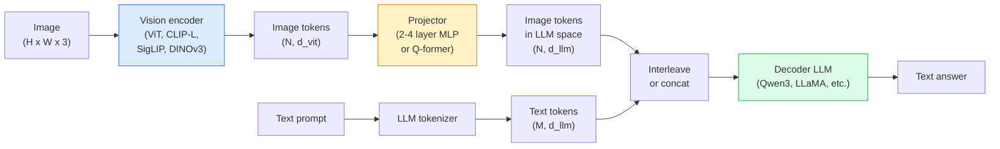

# Модели для работы с изображениями и текстом (VLM) — паттерн ViT-MLP-LLM

> Визуальный энкодер преобразует изображение в токены. MLP-проектор отображает эти токены в пространство эмбеддингов языковой модели. Языковая модель делает всё остальное. Этот паттерн — ViT-MLP-LLM — лежит в основе каждой продакшн-VLM в 2026 году.

**Type:** Learn + Use
**Languages:** Python
**Prerequisites:** Phase 4 Lesson 14 (ViT), Phase 4 Lesson 18 (CLIP), Phase 7 Lesson 02 (Self-Attention)
**Time:** ~75 минут

## Цели обучения

- Сформулировать архитектуру ViT-MLP-LLM и объяснить вклад каждого из трёх компонентов
- Сравнить Qwen3-VL, InternVL3.5, LLaVA-Next и GLM-4.6V по числу параметров, длине контекста и результатам на бенчмарках
- Объяснить DeepStack: почему многоуровневые признаки ViT обеспечивают более точное согласование изображения и текста, чем признаки только последнего слоя
- Измерять галлюцинации VLM в продакшене с помощью Cross-Modal Error Rate (CMER) и действовать на основе этого сигнала

## Проблема

CLIP (Phase 4 Lesson 18) даёт общее пространство эмбеддингов для изображений и текста, чего достаточно для zero-shot классификации и поиска. Но он не может ответить на вопрос «сколько красных машин на этом изображении?», потому что CLIP не генерирует текст — он лишь оценивает степень сходства.

Vision-Language Models (VLM) — Qwen3-VL, InternVL3.5, LLaVA-Next, GLM-4.6V — пристыковывают энкодер изображений семейства CLIP к полноценной языковой модели. Модель видит изображение и вопрос и генерирует ответ. В 2026 году открытые VLM сравнимы или превосходят GPT-5 и Gemini-2.5-Pro на мультимодальных бенчмарках (MMMU, MMBench, DocVQA, ChartQA, MathVista, OSWorld).

Триада компонентов (ViT, проектор, LLM) — это стандарт. Различия между моделями заключаются в выборе ViT, проектора, LLM, обучающих данных и рецепта выравнивания. Как только вы понимаете паттерн, замена любого компонента становится механической задачей.

## Концепция

### Архитектура ViT-MLP-LLM



1. **Визуальный энкодер** — предобученный ViT (CLIP-L/14, SigLIP, DINOv3 или дообученный вариант). Производит токены патчей.
2. **Проектор** — небольшой модуль (MLP из 2-4 слоёв либо Q-former), отображающий визуальные токены в размерность эмбеддингов LLM. Именно здесь происходит основная часть дообучения.
3. **LLM** — декодер-ориентированная языковая модель (Qwen3, Llama, Mistral, GLM, InternLM). Читает последовательность визуальных и текстовых токенов, генерирует текст.

Все три компонента в принципе обучаемы. На практике визуальный энкодер и LLM остаются в основном замороженными, пока обучается проектор — несколько миллиардов параметров сигнала получаются недорого.

### DeepStack

Обычное проецирование использует только последний слой ViT. DeepStack (Qwen3-VL) выбирает признаки с нескольких уровней глубины ViT и складывает их вместе. Более глубокие слои несут высокоуровневую семантику; более поверхностные — мелкозернистую пространственную и текстурную информацию. Подача обоих типов признаков в LLM сокращает разрыв между «что содержит изображение» (семантика) и «где именно» (пространственная привязка).

### Три этапа обучения

Современные VLM обучаются поэтапно:

1. **Выравнивание (alignment)** — ViT и LLM заморожены. Обучается только проектор на парах изображение-подпись. Учит проектор отображать визуальное пространство в языковое.
2. **Предобучение (pre-training)** — всё размораживается. Обучение на масштабных перемежающихся данных изображение-текст (500M+ пар). Формирует визуальные знания модели.
3. **Инструктивное дообучение (instruction tuning)** — тонкая настройка на отобранных тройках (изображение, вопрос, ответ). Учит диалоговому поведению и форматам задач. Именно это превращает «языковую модель, осведомлённую о зрении» в пригодного для использования ассистента.

Большинство LoRA-дообучений нацелены на этап 3 с небольшим размеченным датасетом.

### Сравнение семейств моделей (начало 2026 года)

| Модель | Параметры | Визуальный энкодер | LLM | Контекст | Сильные стороны |
|-------|--------|----------------|-----|---------|-----------|
| Qwen3-VL-235B-A22B (MoE) | 235B (22B активных) | custom ViT + DeepStack | Qwen3 | 256K | Общий SOTA, GUI-агент |
| Qwen3-VL-30B-A3B (MoE) | 30B (3B активных) | custom ViT + DeepStack | Qwen3 | 256K | Более компактная MoE-альтернатива |
| Qwen3-VL-8B (dense) | 8B | custom ViT | Qwen3 | 128K | Стандартный плотный продакшн-вариант |
| InternVL3.5-38B | 38B | InternViT-6B | Qwen3 + GPT-OSS | 128K | Сильные показатели MMBench / MMVet |
| InternVL3.5-241B-A28B | 241B (28B активных) | InternViT-6B | Qwen3 | 128K | Конкурентоспособен с GPT-4o |
| LLaVA-Next 72B | 72B | SigLIP | Llama-3 | 32K | Открытая, легко дообучать |
| GLM-4.6V | ~70B | custom | GLM | 64K | С открытым исходным кодом, сильный OCR |
| MiniCPM-V-2.6 | 8B | SigLIP | MiniCPM | 32K | Подходит для edge-устройств |

### Визуальные агенты

Qwen3-VL-235B достигает лучших в мире показателей на OSWorld — бенчмарке для **визуальных агентов**, управляющих графическими интерфейсами (десктоп, мобильные, веб). Модель видит скриншот, понимает интерфейс и выдаёт действия (клик, ввод текста, прокрутка). В сочетании с инструментами она замыкает цикл для типичных десктопных задач. Именно это лежит в основе большинства демонстраций «AI PC» в 2026 году.

### Агентные возможности + варианты RoPE

VLM должны знать, **в какой момент времени** находится кадр в видео. Qwen3-VL эволюционировал от T-RoPE (временных поворотных позиционных эмбеддингов) к **выравниванию по текстовым меткам времени** — явным токенам временных меток, перемежающимся с кадрами видео. Модель видит «`<timestamp 00:32>` кадр, запрос» и может рассуждать о временных отношениях.

### Проблема выравнивания

12% пар изображение-текст в собранном из интернета датасете содержат описания, не полностью привязанные к изображению. VLM, обученная на этом, незаметно учится галлюцинировать — выдумывать объекты, неверно считывать числа, придумывать отношения. В продакшене это доминирующий режим отказа.

Skywork.ai ввела метрику **Cross-Modal Error Rate (CMER)** для отслеживания этого:

```
CMER = fraction of outputs where the text confidence is high but the image-text similarity (via a CLIP-family checker) is low
```

Высокий CMER означает, что модель уверенно утверждает вещи, не привязанные к изображению. Мониторинг CMER и отношение к нему как к продакшн-KPI снизили частоту галлюцинаций примерно на 35% в их развёртывании. Приём заключается не в «исправлении модели», а в «направлении выводов с высоким CMER на проверку человеком».

### Дообучение с LoRA / QLoRA

Полное дообучение 70B-модели VLM недоступно большинству команд. LoRA (ранг 16-64) на слоях внимания + проектора, или QLoRA с 4-битными базовыми весами, помещается на одну A100 / H100. Стоимость: 5000-50000 примеров, $100-$5000 на вычисления, 2-10 часов обучения.

### Пространственные рассуждения всё ещё слабы

Современные VLM набирают 50-60% на бенчмарках пространственных рассуждений (выше-ниже, слева-справа, подсчёт, расстояние). Если ваш сценарий использования зависит от «какой объект находится поверх какого», тщательно проверяйте — общая производительность VLM ниже человеческой. Более подходящие альтернативы для чисто пространственных задач: специализированный оценщик ключевых точек / позы, модель глубины или модель детекции с постобработкой геометрии рамок.

```figure
v4-vlm-projector
```

## Создаём

### Шаг 1: Проектор

Часть, которую вы будете обучать чаще всего. MLP из 2-4 слоёв с GELU.

```python
import torch
import torch.nn as nn


class Projector(nn.Module):
    def __init__(self, vit_dim=768, llm_dim=4096, hidden=4096):
        super().__init__()
        self.net = nn.Sequential(
            nn.Linear(vit_dim, hidden),
            nn.GELU(),
            nn.Linear(hidden, llm_dim),
        )

    def forward(self, x):
        return self.net(x)
```

Входные данные — тензор `(N_patches, d_vit)` токенов. Выход — `(N_patches, d_llm)`. LLM трактует каждую выходную строку просто как ещё один токен.

### Шаг 2: Собираем ViT-MLP-LLM целиком

Скелет прямого прохода для минимальной VLM. Реальный код использует `transformers`; здесь представлена концептуальная схема.

```python
class MinimalVLM(nn.Module):
    def __init__(self, vit, projector, llm, image_token_id):
        super().__init__()
        self.vit = vit
        self.projector = projector
        self.llm = llm
        self.image_token_id = image_token_id  # placeholder token in text prompt

    def forward(self, image, input_ids, attention_mask):
        # 1. vision features
        vision_tokens = self.vit(image)                     # (B, N_patches, d_vit)
        vision_embeds = self.projector(vision_tokens)       # (B, N_patches, d_llm)

        # 2. text embeddings
        text_embeds = self.llm.get_input_embeddings()(input_ids)  # (B, M, d_llm)

        # 3. replace image placeholder tokens with vision embeds
        merged = self._merge(text_embeds, vision_embeds, input_ids)

        # 4. run LLM
        return self.llm(inputs_embeds=merged, attention_mask=attention_mask)

    def _merge(self, text_embeds, vision_embeds, input_ids):
        out = text_embeds.clone()
        expected = vision_embeds.size(1)
        for b in range(input_ids.size(0)):
            positions = (input_ids[b] == self.image_token_id).nonzero(as_tuple=True)[0]
            if len(positions) != expected:
                raise ValueError(
                    f"batch item {b} has {len(positions)} image tokens but vision_embeds has {expected} patches."
                    " Every sample in the batch must be pre-padded to the same number of image placeholder tokens.")
            out[b, positions] = vision_embeds[b]
        return out
```

Токен-заполнитель `<image>` в тексте заменяется реальными эмбеддингами изображения — тот же паттерн используют LLaVA, Qwen-VL и InternVL.

### Шаг 3: Вычисление CMER

Лёгкая проверка во время выполнения.

```python
import torch.nn.functional as F


def cross_modal_error_rate(image_emb, text_emb, text_confidence, sim_threshold=0.25, conf_threshold=0.8):
    """
    image_emb, text_emb: embeddings of image and generated text (normalised internally)
    text_confidence:     mean per-token probability in [0, 1]
    Returns:             fraction of high-confidence outputs with low image-text alignment
    """
    image_emb = F.normalize(image_emb, dim=-1)
    text_emb = F.normalize(text_emb, dim=-1)
    sim = (image_emb * text_emb).sum(dim=-1)        # cosine similarity
    high_conf_low_sim = (text_confidence > conf_threshold) & (sim < sim_threshold)
    return high_conf_low_sim.float().mean().item()
```

Относитесь к CMER как к продакшн-KPI. Отслеживайте его по каждому эндпоинту, по каждому типу запроса, по каждому клиенту. Рост CMER указывает на то, что модель начинает галлюцинировать на каком-то распределении входных данных.

### Шаг 4: Игрушечный VLM-классификатор (запускаемый)

Демонстрирует, что проектор обучается. На вход подаются поддельные «признаки ViT»; крошечный LLM-подобный токен предсказывает класс.

```python
class ToyVLM(nn.Module):
    def __init__(self, vit_dim=32, llm_dim=64, num_classes=5):
        super().__init__()
        self.projector = Projector(vit_dim, llm_dim, hidden=64)
        self.head = nn.Linear(llm_dim, num_classes)

    def forward(self, vision_tokens):
        projected = self.projector(vision_tokens)
        pooled = projected.mean(dim=1)
        return self.head(pooled)
```

Это можно обучить на синтетических парах (признак, класс) менее чем за 200 шагов — достаточно, чтобы показать, что паттерн проектора работает.

## Используем

Три способа, которыми продакшн-команды используют VLM в 2026 году:

- **Размещённый API** — OpenAI Vision, Anthropic Claude Vision, Google Gemini Vision. Нулевая инфраструктура, риск зависимости от поставщика.
- **Самостоятельный хостинг open-source** — Qwen3-VL или InternVL3.5 через `transformers` и `vllm`. Полный контроль, более высокие первоначальные усилия.
- **Дообучение под домен** — загрузить Qwen2.5-VL-7B или LLaVA-1.6-7B, LoRA на 5к-50к собственных примерах, обслуживание через `vllm` или `TGI`.

```python
from transformers import AutoProcessor, AutoModelForVision2Seq
import torch
from PIL import Image

model_id = "Qwen/Qwen3-VL-8B-Instruct"
processor = AutoProcessor.from_pretrained(model_id)
model = AutoModelForVision2Seq.from_pretrained(model_id, torch_dtype=torch.bfloat16, device_map="auto")

messages = [{
    "role": "user",
    "content": [
        {"type": "image", "image": Image.open("plot.png")},
        {"type": "text", "text": "What does this chart show?"},
    ],
}]
inputs = processor.apply_chat_template(messages, add_generation_prompt=True, tokenize=True, return_dict=True, return_tensors="pt").to("cuda")
generated = model.generate(**inputs, max_new_tokens=256)
answer = processor.decode(generated[0][inputs["input_ids"].shape[1]:], skip_special_tokens=True)
```

`apply_chat_template` скрывает токенизацию заполнителя `<image>`; модель обрабатывает объединение внутренне.

## Отправляем в производство

Этот урок производит:

- `outputs/prompt-vlm-selector.md` — выбирает Qwen3-VL / InternVL3.5 / LLaVA-Next / API, исходя из точности, задержки, длины контекста и бюджета.
- `outputs/skill-cmer-monitor.md` — выдаёт код для инструментирования продакшн-эндпоинта VLM с метрикой кросс-модальной частоты ошибок, дашбордами по эндпоинтам и порогами оповещений.

## Упражнения

1. **(Лёгкое)** Прогоните три запроса («что это?», «сосчитай объекты», «опиши сцену») через любую открытую VLM на пяти изображениях. Оцените каждый ответ вручную как правильный / частично правильный / галлюцинацию. Посчитайте приблизительную величину, похожую на CMER.
2. **(Среднее)** Дообучите Qwen2.5-VL-3B или LLaVA-1.6-7B с помощью LoRA (ранг 16) на 500 изображениях целевого домена с подписями. Сравните точность в стиле MMBench для zero-shot и дообученной модели.
3. **(Сложное)** Замените энкодер изображений VLM на DINOv3 вместо стандартного SigLIP/CLIP. Переобучите только проектор (LLM и DINOv3 заморожены). Измерьте, улучшаются ли задачи плотного предсказания (подсчёт, пространственные рассуждения).

## Ключевые термины

| Термин | Что говорят люди | Что это на самом деле означает |
|------|----------------|----------------------|
| ViT-MLP-LLM | «Паттерн VLM» | Визуальный энкодер + проектор + языковая модель; основа каждой VLM в 2026 году |
| Проектор | «Мост» | MLP из 2-4 слоёв (или Q-former), отображающий визуальные токены в пространство эмбеддингов LLM |
| DeepStack | «Приём с признаками Qwen3-VL» | Многоуровневые признаки ViT, складываемые вместе, а не только признаки последнего слоя |
| Токен изображения | «Заполнитель <image>» | Специальный токен в текстовом потоке, заменяемый спроецированными визуальными эмбеддингами |
| CMER | «KPI галлюцинаций» | Cross-Modal Error Rate; высокий, когда уверенность текста высока, но сходство изображения и текста низкое |
| Визуальный агент | «VLM, которая кликает» | VLM, управляющая графическими интерфейсами (OSWorld, мобильные, веб) с вызовами инструментов |
| Q-former | «Мост с фиксированным числом токенов» | Проектор в стиле BLIP-2, производящий фиксированное число визуальных запросных токенов |
| Выравнивание / предобучение / инструктивное дообучение | «Три этапа» | Стандартный пайплайн обучения VLM |

## Дополнительное чтение

- [Qwen3-VL Technical Report (arXiv 2511.21631)](https://arxiv.org/abs/2511.21631)
- [InternVL3.5 Advancing Open-Source Multimodal Models (arXiv 2508.18265)](https://arxiv.org/html/2508.18265v1)
- [Серия LLaVA-Next](https://llava-vl.github.io/blog/2024-05-10-llava-next-stronger-llms/)
- [BentoML: Best Open-Source VLMs 2026](https://www.bentoml.com/blog/multimodal-ai-a-guide-to-open-source-vision-language-models)
- [MMMU: Multi-discipline Multimodal Understanding benchmark](https://mmmu-benchmark.github.io/)
- [VLM в производстве (Robotics Tomorrow, март 2026)](https://www.roboticstomorrow.com/story/2026/03/when-machines-learn-to-see-like-experts-the-rise-of-vision-language-models-in-manufacturing/26335/)