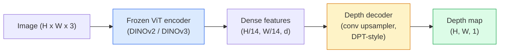

# Оценка монокулярной глубины и геометрии

> Карта глубины — это одноканальное изображение, где каждый пиксель представляет собой расстояние от камеры. Предсказать её по одному RGB-кадру раньше было невозможно без стерео или LiDAR. В 2026 году замороженный энкодер ViT плюс лёгкая голова даёт результат, отличающийся от истинных значений всего на несколько процентов.

**Type:** Build + Use
**Languages:** Python
**Prerequisites:** Phase 4 Lesson 14 (ViT), Phase 4 Lesson 17 (Self-Supervised Vision), Phase 4 Lesson 07 (U-Net)
**Time:** ~60 минут

## Цели обучения

- Различать относительную и метрическую глубину и указывать, какую из них решает каждая production-модель (MiDaS, Marigold, Depth Anything V3, ZoeDepth)
- Использовать Depth Anything V3 (бэкбон DINOv2) для предсказания глубины произвольных одиночных изображений без калибровки
- Объяснять, почему монокулярная глубина вообще работает по одному изображению (перспективные признаки, градиенты текстуры, выученные априорные знания) и что она не может восстановить (абсолютный масштаб, скрытую геометрию)
- Поднимать 2D-детекции в 3D-точки, используя карту глубины и внутренние параметры камеры-обскуры

## Проблема

Глубина — это недостающая ось в 2D компьютерном зрении. Имея RGB-изображение, вы знаете, где объекты расположены на плоскости изображения, но не знаете, насколько они далеко. Датчики глубины (стереосистемы, LiDAR, time-of-flight) решают эту задачу напрямую, но они дороги, хрупки и ограничены по дальности.

Монокулярная оценка глубины — предсказание глубины по одному RGB-кадру — раньше давала размытый, ненадёжный результат. К 2026 году крупные предобученные энкодеры изменили ситуацию: Depth Anything V3 использует замороженный бэкбон DINOv2 и выдаёт карты глубины, которые хорошо обобщаются на внутренние, уличные, медицинские и спутниковые домены. Marigold переформулирует задачу глубины как условную диффузионную задачу. ZoeDepth регрессирует истинные метрические расстояния.

Глубина также служит мостом между 2D-детекцией и 3D-пониманием: умножив пиксели обнаруженного бокса на глубину, вы поднимаете 2D-объект в облако 3D-точек. Это основа каждой AR-системы окклюзии, каждого конвейера избегания препятствий и каждого робота, который «берёт чашку».

## Концепция

### Относительная и метрическая глубина

- **Относительная глубина** — упорядоченные `z`-значения без реальной единицы измерения. «Пиксель A ближе, чем пиксель B, но соотношение расстояний не привязано к метрам».
- **Метрическая глубина** — абсолютное расстояние в метрах от камеры. Требует, чтобы модель выучила статистическую связь между признаками изображения и реальным расстоянием.

MiDaS и Depth Anything V3 выдают относительную глубину. Marigold выдаёт относительную глубину. ZoeDepth, UniDepth и Metric3D выдают метрическую глубину. Метрические модели чувствительны к внутренним параметрам камеры; относительные — нет.

### Паттерн энкодер-декодер



Depth Anything V3 замораживает энкодер и обучает только декодер в стиле DPT. Энкодер предоставляет богатые признаки; декодер интерполирует их обратно до разрешения изображения и регрессирует глубину.

### Почему одно изображение вообще даёт глубину

2D-изображение содержит множество монокулярных признаков, коррелирующих с глубиной:

- **Перспектива** — параллельные линии в 3D сходятся в 2D.
- **Градиент текстуры** — удалённые поверхности имеют более мелкую, плотную текстуру.
- **Порядок окклюзии** — ближние объекты заслоняют дальние.
- **Постоянство размера** — известные объекты (машины, люди) дают приблизительный масштаб.
- **Атмосферная перспектива** — удалённые объекты выглядят более размытыми и синеватыми на уличных сценах.

ViT, обученный на миллиардах изображений, усваивает эти признаки. При достаточном объёме данных и сильном бэкбоне монокулярная глубина достигает разумной точности без какого-либо явного 3D-контроля.

### Чего монокулярная глубина не может

- **Абсолютного метрического масштаба** без внутренних параметров или известного объекта в сцене. Сеть может предсказать «чашка в два раза дальше, чем ложка», не зная, находится ли чашка в 1 м или в 10 м.
- **Скрытую геометрию** — заднюю часть стула не видно, и её нельзя надёжно вывести.
- **Действительно нетекстурированные/отражающие поверхности** — зеркала, стекло, однородные стены. Сеть выдаёт правдоподобную, но неверную глубину.

### Depth Anything V3 в 2026 году

- Обычный DINOv2 ViT-L/14 в качестве энкодера (заморожен).
- Декодер DPT.
- Обучена на парах изображений с известными позами из разнообразных источников (явный контроль по глубине не требуется сверх фотометрической согласованности).
- Предсказывает пространственно согласованную геометрию по **произвольному числу визуальных входов, с известными позами камеры или без них**.
- SOTA по монокулярной глубине, геометрии с произвольного ракурса, визуальному рендерингу, оценке позы камеры.

Это модель, которую стоит использовать «из коробки», когда нужна глубина в 2026 году.

### Marigold — диффузия для глубины

Marigold (Ke et al., CVPR 2024) переформулирует оценку глубины как условную диффузию image-to-image. Условие: RGB. Цель: карта глубины. Использует предобученный U-Net из Stable Diffusion 2 в качестве бэкбона. Выходные карты глубины исключительно чёткие на границах объектов. Компромисс: более медленный инференс, чем у feed-forward моделей (10-50 шагов шумоподавления).

### Внутренние параметры и камера-обскура

Чтобы поднять пиксель `(u, v)` с глубиной `d` до 3D-точки `(X, Y, Z)` в координатах камеры:

```
fx, fy, cx, cy = camera intrinsics
X = (u - cx) * d / fx
Y = (v - cy) * d / fy
Z = d
```

Внутренние параметры берутся из метаданных EXIF, калибровочного шаблона или монокулярного оценщика внутренних параметров (Perspective Fields, UniDepth). Без внутренних параметров вы всё же можете отрендерить облако точек, приняв угол обзора 60-70° и умеренное разрешение принципальных точек — пригодно для визуализации, но не для измерений.

### Оценка

Две стандартные метрики:

- **AbsRel** (абсолютная относительная ошибка): `mean(|d_pred - d_gt| / d_gt)`. Чем меньше, тем лучше. 0,05-0,1 для production-моделей.
- **delta < 1.25** (точность по порогу): доля пикселей, где `max(d_pred/d_gt, d_gt/d_pred) < 1.25`. Чем больше, тем лучше. 0,9+ для SOTA.

Для относительной глубины (Depth Anything V3, MiDaS) оценка использует инвариантные к масштабу и сдвигу версии обеих метрик.

```figure
depth-sweep
```

## Построение

### Шаг 1: Метрики глубины

```python
import torch

def abs_rel_error(pred, target, mask=None):
    if mask is not None:
        pred = pred[mask]
        target = target[mask]
    return (torch.abs(pred - target) / target.clamp(min=1e-6)).mean().item()


def delta_accuracy(pred, target, threshold=1.25, mask=None):
    if mask is not None:
        pred = pred[mask]
        target = target[mask]
    ratio = torch.maximum(pred / target.clamp(min=1e-6), target / pred.clamp(min=1e-6))
    return (ratio < threshold).float().mean().item()
```

Всегда маскируйте недопустимые пиксели глубины (ноль, NaN, насыщенные значения) перед оценкой.

### Шаг 2: Выравнивание по масштабу и сдвигу

Для моделей относительной глубины выравнивайте предсказание по истинным значениям перед вычислением метрик. Метод наименьших квадратов для подгонки `a * pred + b = target`:

```python
def align_scale_shift(pred, target, mask=None):
    if mask is not None:
        p = pred[mask]
        t = target[mask]
    else:
        p = pred.flatten()
        t = target.flatten()
    A = torch.stack([p, torch.ones_like(p)], dim=1)
    coeffs, *_ = torch.linalg.lstsq(A, t.unsqueeze(-1))
    a, b = coeffs[:2, 0]
    return a * pred + b
```

Запускайте `align_scale_shift` перед `abs_rel_error` при оценке MiDaS / Depth Anything.

### Шаг 3: Поднятие глубины в облако точек

```python
import numpy as np

def depth_to_point_cloud(depth, intrinsics):
    H, W = depth.shape
    fx, fy, cx, cy = intrinsics
    v, u = np.meshgrid(np.arange(H), np.arange(W), indexing="ij")
    z = depth
    x = (u - cx) * z / fx
    y = (v - cy) * z / fy
    return np.stack([x, y, z], axis=-1)


depth = np.random.uniform(0.5, 4.0, (240, 320))
intr = (320.0, 320.0, 160.0, 120.0)
pc = depth_to_point_cloud(depth, intr)
print(f"point cloud shape: {pc.shape}  (H, W, 3)")
```

Одна функция — для каждого приложения, поднятого в 3D. Экспортируйте облако точек в `.ply` и откройте в MeshLab или CloudCompare.

### Шаг 4: Дымовой тест на синтетической сцене с глубиной

```python
def synthetic_depth(size=96):
    yy, xx = np.meshgrid(np.arange(size), np.arange(size), indexing="ij")
    # Floor: linear gradient from near (top) to far (bottom)
    depth = 1.0 + (yy / size) * 4.0
    # Box in the middle: closer
    mask = (np.abs(xx - size / 2) < size / 6) & (np.abs(yy - size * 0.6) < size / 6)
    depth[mask] = 2.0
    return depth.astype(np.float32)


gt = torch.from_numpy(synthetic_depth(96))
pred = gt + 0.3 * torch.randn_like(gt)  # simulated prediction
aligned = align_scale_shift(pred, gt)
print(f"before align  absRel = {abs_rel_error(pred, gt):.3f}")
print(f"after align   absRel = {abs_rel_error(aligned, gt):.3f}")
```

### Шаг 5: Использование Depth Anything V2 (справочно)

```python
import numpy as np
from transformers import pipeline
from PIL import Image

pipe = pipeline(task="depth-estimation", model="depth-anything/Depth-Anything-V2-Large-hf")

image = Image.open("street.jpg").convert("RGB")
out = pipe(image)
depth_np = np.array(out["depth"])
```

Три строки. `out["depth"]` — это grayscale-изображение PIL; конвертируйте в numpy для вычислений. Depth Anything 3 (ноябрь 2025) не загружается через этот конвейер. Она поставляется с собственным пакетом `depth_anything_3`: `DepthAnything3.from_pretrained("depth-anything/DA3MONO-LARGE")` загружает относительную монокулярную модель, а `model.inference(images).depth` возвращает массив глубины `[N, H, W]`.

## Применение

- **Depth Anything V3** (Meta AI / ByteDance, 2024-2026) — модель по умолчанию для относительной глубины. Самая быстрая production-модель с бэкбоном ViT-large.
- **Marigold** (ETH, 2024) — наивысшее визуальное качество, медленный инференс.
- **UniDepth** (ETH, 2024) — метрическая глубина с оценкой внутренних параметров камеры.
- **ZoeDepth** (Intel, 2023) — метрическая глубина; старее, но по-прежнему надёжна.
- **MiDaS v3.1** — устаревшая, но стабильная; хороший базовый вариант для сравнения.

Типичный паттерн интеграции:

1. Приходит RGB-кадр.
2. Модель глубины выдаёт карту глубины.
3. Детектор выдаёт боксы.
4. Поднимите центроиды боксов через глубину в 3D; объедините с облаком точек, если оно доступно.
5. Далее: AR-окклюзия, планирование пути, оценка размера объекта, замена стерео.

Для использования в реальном времени Depth Anything V2 Small (квантизованная в INT8) достигает ~30 fps на потребительском GPU при разрешении 518x518.

## Отгрузка

Этот урок производит:

- `outputs/prompt-depth-model-picker.md` — выбирает между Depth Anything V3, Marigold, UniDepth, MiDaS с учётом задержки, потребности в метрической либо относительной глубине и типа сцены.
- `outputs/skill-depth-to-pointcloud.md` — навык, строящий облака точек из карт глубины с корректной обработкой внутренних параметров и экспортом в `.ply`.

## Упражнения

1. **(Легко)** Запустите Depth Anything V2 на любых 10 изображениях вашего стола. Сохраните глубину как grayscale PNG и изучите результат. Найдите один объект, чья предсказанная глубина выглядит неверной, и объясните, почему монокулярные признаки не сработали.
2. **(Средне)** Имея RGB + глубину от Depth Anything V2, постройте облако точек и отрендерите его с помощью `open3d`. Сравните две сцены (внутри помещения / на улице) и отметьте, какая выглядит более правдоподобно.
3. **(Сложно)** Возьмите пять пар изображений, которые отличаются только положением известного объекта (например, бутылка передвинута на 30 см ближе). Используйте UniDepth для предсказания метрической глубины на обоих изображениях. Сообщите разницу предсказанного расстояния относительно истинных 30 см.

## Ключевые термины

| Термин | Что говорят люди | Что это на самом деле значит |
|------|----------------|----------------------|
| Monocular depth | «Глубина по одному изображению» | Оценка глубины по одному RGB-кадру без стерео или LiDAR |
| Relative depth | «Упорядоченная глубина» | Упорядоченные z-значения без реальных единиц измерения |
| Metric depth | «Абсолютное расстояние» | Глубина в метрах; требует калибровки или модели, обученной с метрическим контролем |
| AbsRel | «Абсолютная относительная ошибка» | Среднее от |d_pred - d_gt| / d_gt; стандартная метрика глубины |
| Delta accuracy | «delta < 1.25» | Доля пикселей, у которых предсказание отличается от истинного значения менее чем на 25% |
| Pinhole camera | «fx, fy, cx, cy» | Модель камеры, используемая для поднятия (u, v, d) в (X, Y, Z) |
| DPT | «Dense Prediction Transformer» | Декодер на основе свёрток, используемый поверх замороженных энкодеров ViT для глубины |
| DINOv2 backbone | «Причина, по которой это работает» | Самообучаемые признаки, обобщающиеся на разные домены без меток глубины |

## Дополнительное чтение

- [Страница статьи Depth Anything V3](https://depth-anything.github.io/) — SOTA монокулярная глубина с энкодером DINOv2
- [Marigold (Ke et al., CVPR 2024)](https://marigoldmonodepth.github.io/) — оценка глубины на основе диффузии
- [UniDepth (Piccinelli et al., 2024)](https://arxiv.org/abs/2403.18913) — метрическая глубина с оценкой внутренних параметров
- [MiDaS v3.1 (Intel ISL)](https://github.com/isl-org/MiDaS) — канонический базовый вариант относительной глубины
- [Блог-пост о DINOv3 (Meta)](https://ai.meta.com/blog/dinov3-self-supervised-vision-model/) — семейство энкодеров, повышающее точность глубины