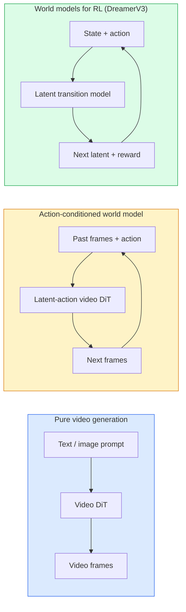

# Мировые модели и видеодиффузия

> Видеомодель, которая предсказывает следующие секунды сцены, — это симулятор мира. Обусловьте это предсказание действиями — и вы получите обученный игровой движок.

**Type:** Изучение + Разработка
**Languages:** Python
**Prerequisites:** Phase 4 Lesson 10 (Диффузия), Phase 4 Lesson 12 (Понимание видео), Phase 4 Lesson 23 (DiT + Rectified Flow)
**Time:** ~75 минут

## Цели обучения

- Объяснить разницу между чистой моделью генерации видео (Sora 2) и мировой моделью, обусловленной действиями (Genie 3, DreamerV3)
- Описать видео-DiT: пространственно-временные патчи, 3D-позиционное кодирование, совместное внимание по токенам (T, H, W)
- Проследить, как мировая модель встраивается в робототехнику: VLM планирует → видеомодель симулирует → модель обратной динамики выдаёт действия
- Выбрать между Sora 2, Genie 3, Runway GWM-1 Worlds, Wan-Video и HunyuanVideo для конкретного сценария использования (творческое видео, интерактивная симуляция, синтез данных для автономного вождения)

## Проблема

Генерация видео и мировое моделирование сошлись в 2026 году. Модель, способная сгенерировать связную минуту видео, в некотором смысле научилась тому, как движется мир: постоянство объектов, гравитация, причинность, стиль. Если обусловить это предсказание действиями (шаг влево, открыть дверь), видеомодель превращается в обучаемый симулятор, способный заменить игровой движок, симулятор вождения или робототехническую среду.

Ставки вполне конкретны. Genie 3 генерирует играбельные окружения из одного изображения. Runway GWM-1 Worlds синтезирует бесконечно исследуемые сцены. Sora 2 выдаёт минутные видео с синхронизированным звуком и смоделированной физикой. NVIDIA Cosmos-Drive, Wayve Gaia-2 и Tesla DrivingWorld генерируют реалистичное видео вождения для обучающих данных автономных транспортных средств. Парадигма мировых моделей тихо захватывает область sim-to-real в робототехнике.

Этот урок — «большая картина» для Phase 4. Он связывает генерацию изображений, понимание видео и агентное рассуждение в архитектурный паттерн, к которому движутся доминирующие исследования.

## Концепция

### Три семейства мирового моделирования



- **Sora 2** — чистая генерация видео, обусловленная промптами. Нет интерфейса действий. Вы не можете «рулить» ей в процессе генерации.
- **Genie 3**, **GWM-1 Worlds**, **Mirage / Magica** — мировые модели, обусловленные действиями. Они выводят латентные действия из наблюдаемого видео, затем обусловливают предсказание будущих кадров этими действиями. Интерактивны — вы нажимаете клавиши или перемещаете камеру, а сцена отвечает.
- **DreamerV3** и классическое семейство мировых моделей для RL предсказывают в латентном пространстве с явным обусловливанием на действия, обучаясь на сигнале вознаграждения. Менее визуальны; более полезны для сэмпл-эффективного RL.

### Архитектура видео-DiT

```
Video latent:          (C, T, H, W)
Patchify (spatial):    grid of P_h x P_w patches per frame
Patchify (temporal):   group P_t frames into a temporal patch
Resulting tokens:      (T / P_t) * (H / P_h) * (W / P_w) tokens
```

Позиционное кодирование 3D: ротационное или обучаемое вложение для каждой координаты (t, h, w). Внимание может быть:

- **Полное совместное** — все токены внимают всем токенам. O(N^2) при N токенах. Непомерно дорого для длинных видео.
- **Разделённое** — чередование временного внимания (одна и та же пространственная позиция, по времени: `(H*W) * T^2`) и пространственного внимания (один и тот же временной шаг, по пространству: `T * (H*W)^2`). Используется в TimeSformer и большинстве видео-DiT.
- **Оконное** — локальные окна в (t, h, w). Используется в Video Swin.

Каждая видеодиффузионная модель 2026 года использует один из этих трёх паттернов вместе с AdaLN-обусловливанием (Урок 23) и rectified flow.

### Обусловливание на действия: модели латентных действий

Genie обучает **латентное действие** для каждого кадра, дискриминативно предсказывая действие между парой последовательных кадров. Декодер модели затем обусловливается на выведенном латентном действии — а не на явных нажатиях клавиш. На этапе вывода пользователь может указать латентное действие (или сэмплировать его из свежего приора), и модель генерирует следующий кадр, согласованный с этим действием.

Sora полностью пропускает интерфейс действий. Её декодер предсказывает следующие пространственно-временные токены из прошлых пространственно-временных токенов. Промпт обусловливает начало; ничто не управляет процессом генерации в середине.

### Физическая правдоподобность

Релиз Sora 2 в 2026 году явно рекламировал **физическую правдоподобность**: вес, баланс, постоянство объектов, причинно-следственные связи. Команда измеряла это с помощью оценок правдоподобия, выставленных людьми; модель заметно улучшилась в отношении падающих предметов, столкновений персонажей и намеренных неудач (неудавшийся прыжок) по сравнению с Sora 1.

Правдоподобность остаётся доминирующим режимом отказа. Видео 2024–2025 годов с людьми, едящими спагетти или пьющими из стаканов, выявили отсутствие у модели устойчивого представления объектов. Модели 2026 года (Sora 2, Runway Gen-5, HunyuanVideo) уменьшают, но не устраняют эти проблемы.

### Мировые модели для автономного вождения

Мировые модели для вождения генерируют реалистичные дорожные сцены, обусловленные траекториями, ограничивающими рамками или навигационными картами. Применение:

- **Cosmos-Drive-Dreams** (NVIDIA) — генерирует минуты видео вождения для обучения RL.
- **Gaia-2** (Wayve) — синтез сцен, обусловленный траекторией, для оценки политик.
- **DrivingWorld** (Tesla) — симулирует разнообразную погоду, время суток, условия движения.
- **Vista** (ByteDance) — реактивный синтез сцен вождения.

Они заменяют дорогостоящий сбор данных в реальном мире для краевых случаев — пешеходы, перебегающие дорогу ночью, обледенелые перекрёстки, необычные типы транспортных средств, — для которых иначе потребовались бы миллионы миль пробега.

### Робототехнический стек: VLM + видеомодель + обратная динамика

Формирующийся трёхкомпонентный цикл в робототехнике:

1. **VLM** разбирает цель («поднять красную чашку»), планирует последовательность действий высокого уровня.
2. **Модель генерации видео** симулирует, как бы выглядело выполнение каждого действия — предсказывает наблюдения на N кадров вперёд.
3. **Модель обратной динамики** извлекает конкретные моторные команды, которые привели бы к этим наблюдениям.

Это заменяет формирование вознаграждения и ресурсоёмкий RL. Мировая модель занимается «воображением»; обратная динамика замыкает цикл на уровне исполнительных механизмов. Genie Envisioner — одна из реализаций; многие исследовательские группы сходятся к этой структуре.

### Оценка

- **Визуальное качество** — FVD (Fréchet Video Distance), пользовательские исследования.
- **Соответствие промпту** — CLIPScore по кадрам, оценка в стиле VQA.
- **Физическая правдоподобность** — ручная оценка по набору бенчмарков (внутренний бенчмарк Sora 2, VBench).
- **Управляемость** (для интерактивных мировых моделей) — согласованность действие → наблюдение; можно ли вернуться к предыдущему состоянию?

### Ландшафт моделей в 2026 году

| Модель | Применение | Параметры | Выход | Лицензия |
|-------|-----|------------|--------|---------|
| Sora 2 | текст-в-видео, аудио | — | 1 мин 1080p + аудио | только API |
| Runway Gen-5 | текст/изображение-в-видео | — | клипы 10с | API |
| Runway GWM-1 Worlds | интерактивный мир | — | бесконечный 3D-роллаут | API |
| Genie 3 | интерактивный мир из изображения | 11B+ | играбельные кадры | исследовательский препринт |
| Wan-Video 2.1 | открытая текст-в-видео | 14B | клипы высокого качества | некоммерческая |
| HunyuanVideo | открытая текст-в-видео | 13B | клипы 10с | разрешительная |
| Cosmos / Cosmos-Drive | симуляция автономного вождения | 7-14B | дорожные сцены | NVIDIA, открытая |
| Magica / Mirage 2 | ИИ-нативный игровой движок | — | изменяемые миры | продукт |

```figure
v4-world-rollout
```

## Разработка

### Шаг 1: 3D-патчификация для видео

```python
import torch
import torch.nn as nn


class VideoPatch3D(nn.Module):
    def __init__(self, in_channels=4, dim=64, patch_t=2, patch_h=2, patch_w=2):
        super().__init__()
        self.proj = nn.Conv3d(
            in_channels, dim,
            kernel_size=(patch_t, patch_h, patch_w),
            stride=(patch_t, patch_h, patch_w),
        )
        self.patch_t = patch_t
        self.patch_h = patch_h
        self.patch_w = patch_w

    def forward(self, x):
        # x: (N, C, T, H, W)
        x = self.proj(x)
        n, c, t, h, w = x.shape
        tokens = x.reshape(n, c, t * h * w).transpose(1, 2)
        return tokens, (t, h, w)
```

3D-свёртка с шагом, равным размеру ядра, действует как пространственно-временной патчификатор. Сетка токенов `(T, H, W) -> (T/2, H/2, W/2)`.

### Шаг 2: 3D-ротационное позиционное кодирование

Rotary Position Embeddings (RoPE) применяются отдельно вдоль осей `t`, `h`, `w`:

```python
def rope_3d(tokens, t_dim, h_dim, w_dim, grid):
    """
    tokens: (N, T*H*W, D)
    grid: (T, H, W) sizes
    t_dim + h_dim + w_dim == D
    """
    T, H, W = grid
    n, seq, d = tokens.shape
    if t_dim + h_dim + w_dim != d:
        raise ValueError(f"t_dim+h_dim+w_dim ({t_dim}+{h_dim}+{w_dim}) must equal D={d}")
    assert seq == T * H * W
    t_idx = torch.arange(T, device=tokens.device).repeat_interleave(H * W)
    h_idx = torch.arange(H, device=tokens.device).repeat_interleave(W).repeat(T)
    w_idx = torch.arange(W, device=tokens.device).repeat(T * H)
    # Simplified: just scale channels by frequencies. Real RoPE rotates pairs.
    freqs_t = torch.exp(-torch.log(torch.tensor(10000.0)) * torch.arange(t_dim // 2, device=tokens.device) / (t_dim // 2))
    freqs_h = torch.exp(-torch.log(torch.tensor(10000.0)) * torch.arange(h_dim // 2, device=tokens.device) / (h_dim // 2))
    freqs_w = torch.exp(-torch.log(torch.tensor(10000.0)) * torch.arange(w_dim // 2, device=tokens.device) / (w_dim // 2))
    emb_t = torch.cat([torch.sin(t_idx[:, None] * freqs_t), torch.cos(t_idx[:, None] * freqs_t)], dim=-1)
    emb_h = torch.cat([torch.sin(h_idx[:, None] * freqs_h), torch.cos(h_idx[:, None] * freqs_h)], dim=-1)
    emb_w = torch.cat([torch.sin(w_idx[:, None] * freqs_w), torch.cos(w_idx[:, None] * freqs_w)], dim=-1)
    return tokens + torch.cat([emb_t, emb_h, emb_w], dim=-1)
```

Упрощённая аддитивная форма. Реальный RoPE вращает парные каналы на определённых частотах; позиционная информация та же.

### Шаг 3: Блок разделённого внимания

```python
class DividedAttentionBlock(nn.Module):
    def __init__(self, dim=64, heads=2):
        super().__init__()
        self.time_attn = nn.MultiheadAttention(dim, heads, batch_first=True)
        self.space_attn = nn.MultiheadAttention(dim, heads, batch_first=True)
        self.ln1 = nn.LayerNorm(dim)
        self.ln2 = nn.LayerNorm(dim)
        self.ln3 = nn.LayerNorm(dim)
        self.mlp = nn.Sequential(nn.Linear(dim, 4 * dim), nn.GELU(), nn.Linear(4 * dim, dim))

    def forward(self, x, grid):
        T, H, W = grid
        n, seq, d = x.shape
        # time attention: same (h, w), across t
        xt = x.view(n, T, H * W, d).permute(0, 2, 1, 3).reshape(n * H * W, T, d)
        a, _ = self.time_attn(self.ln1(xt), self.ln1(xt), self.ln1(xt), need_weights=False)
        xt = (xt + a).reshape(n, H * W, T, d).permute(0, 2, 1, 3).reshape(n, seq, d)
        # space attention: same t, across (h, w)
        xs = xt.view(n, T, H * W, d).reshape(n * T, H * W, d)
        a, _ = self.space_attn(self.ln2(xs), self.ln2(xs), self.ln2(xs), need_weights=False)
        xs = (xs + a).reshape(n, T, H * W, d).reshape(n, seq, d)
        xs = xs + self.mlp(self.ln3(xs))
        return xs
```

Временное внимание внимает в пределах каждой пространственной позиции по времени; пространственное внимание внимает в пределах каждого кадра по позициям. Две операции O(T^2 + (HW)^2) вместо одной O((THW)^2). Это ядро TimeSformer и всех современных видео-DiT.

### Шаг 4: Собрать крошечный видео-DiT

```python
class TinyVideoDiT(nn.Module):
    def __init__(self, in_channels=4, dim=64, depth=2, heads=2):
        super().__init__()
        self.patch = VideoPatch3D(in_channels=in_channels, dim=dim, patch_t=2, patch_h=2, patch_w=2)
        self.blocks = nn.ModuleList([DividedAttentionBlock(dim, heads) for _ in range(depth)])
        self.out = nn.Linear(dim, in_channels * 2 * 2 * 2)

    def forward(self, x):
        tokens, grid = self.patch(x)
        for blk in self.blocks:
            tokens = blk(tokens, grid)
        return self.out(tokens), grid
```

Не рабочий видеогенератор, а структурная демонстрация того, что каждый компонент корректно формирует формы.

### Шаг 5: Проверить формы

```python
vid = torch.randn(1, 4, 8, 16, 16)  # (N, C, T, H, W)
model = TinyVideoDiT()
out, grid = model(vid)
print(f"input  {tuple(vid.shape)}")
print(f"tokens grid {grid}")
print(f"output {tuple(out.shape)}")
```

Ожидайте `grid = (4, 8, 8)` и `out = (1, 256, 32)` после патчификации; затем голова проецирует в пространственно-временные патчи на токен, готовые к обратной депатчификации в видео.

## Применение

Паттерны промышленного доступа в 2026 году:

- **Sora 2 API** (OpenAI) — текст-в-видео, синхронизированный звук. Премиальная цена.
- **Runway Gen-5 / GWM-1** (Runway) — изображение-в-видео, интерактивные миры.
- **Wan-Video 2.1 / HunyuanVideo** — открытый исходный код, самостоятельный хостинг.
- **Cosmos / Cosmos-Drive** (NVIDIA) — открытые веса для симуляции вождения.
- **Genie 3** — исследовательский препринт, запрос доступа.

Для построения демо интерактивной мировой модели: начните с Wan-Video ради качества, добавьте адаптер латентных действий для интерактивности. Для симуляции автономного вождения: Cosmos-Drive — открытый эталон 2026 года.

Для робототехники — стек на практике:

1. Языковая цель -> VLM (Qwen3-VL) -> план высокого уровня.
2. План -> видеомодель с латентными действиями -> воображаемый роллаут.
3. Роллаут -> модель обратной динамики -> действия низкого уровня.
4. Действия исполняются -> наблюдение подаётся обратно на шаг 1.

## Сдача результата

Этот урок производит:

- `outputs/prompt-video-model-picker.md` — выбирает между Sora 2 / Runway / Wan / HunyuanVideo / Cosmos исходя из задачи, лицензии и задержки.
- `outputs/skill-physical-plausibility-checks.md` — навык, определяющий автоматизированные проверки (постоянство объектов, гравитация, непрерывность) для запуска на любом сгенерированном видео перед отправкой.

## Упражнения

1. **(Лёгкое)** Вычислите количество токенов для 5-секундного видео 360p с patch-t=2, patch-h=8, patch-w=8. Оцените затраты памяти для внимания при таком размере.
2. **(Среднее)** Замените блок разделённого внимания выше на блок полного совместного внимания и измерьте форму и количество параметров. Объясните, почему разделённое внимание необходимо для реальных видеомоделей.
3. **(Сложное)** Постройте минимальную модель видео с латентными действиями: возьмите набор данных троек (frame_t, action_t, frame_{t+1}) (любая простая 2D-игра), обучите крошечный видео-DiT, обусловленный на эмбеддинги действий, и покажите, что разные действия приводят к разным следующим кадрам.

## Ключевые термины

| Термин | Что говорят люди | Что это на самом деле означает |
|------|----------------|----------------------|
| Мировая модель | «Обученный симулятор» | Модель, предсказывающая будущие наблюдения по состоянию и действию |
| Видео-DiT | «Пространственно-временной трансформер» | Диффузионный трансформер с 3D-патчификацией и разделённым вниманием |
| Латентное действие | «Выведенное управление» | Дискретное или непрерывное латентное действие, выведенное из пар кадров; используется для обусловливания генерации следующего кадра |
| Разделённое внимание | «Сначала время, потом пространство» | Две операции внимания на блок — по времени, затем по пространству — для сохранения приемлемого O(N^2) |
| Постоянство объектов | «Вещи остаются реальными» | Свойство сцены, которое видеомодели должны выучить; классический режим отказа на еде, стекле |
| FVD | «Fréchet Video Distance» | Видео-эквивалент FID; основная метрика визуального качества |
| Модель обратной динамики | «От наблюдений к действиям» | По паре (состояние, следующее состояние) выдаёт действие, их связывающее; замыкает цикл робототехники |
| Cosmos-Drive | «Симулятор вождения NVIDIA» | Мировая модель автономного вождения с открытыми весами для RL и оценки |

## Дополнительное чтение

- [Технический отчёт Sora (OpenAI)](https://openai.com/index/video-generation-models-as-world-simulators/)
- [Genie: Generative Interactive Environments (Bruce et al., 2024)](https://arxiv.org/abs/2402.15391) — мировые модели с латентными действиями
- [TimeSformer (Bertasius et al., 2021)](https://arxiv.org/abs/2102.05095) — разделённое внимание для видеотрансформеров
- [DreamerV3 (Hafner et al., 2023)](https://arxiv.org/abs/2301.04104) — мировые модели для RL
- [Cosmos-Drive-Dreams (NVIDIA, 2025)](https://research.nvidia.com/labs/toronto-ai/cosmos-drive-dreams/) — мировая модель вождения
- [Топ-10 моделей генерации видео 2026 (DataCamp)](https://www.datacamp.com/blog/top-video-generation-models)
- [От генерации видео к мировой модели — репозиторий обзора](https://github.com/ziqihuangg/Awesome-From-Video-Generation-to-World-Model/)