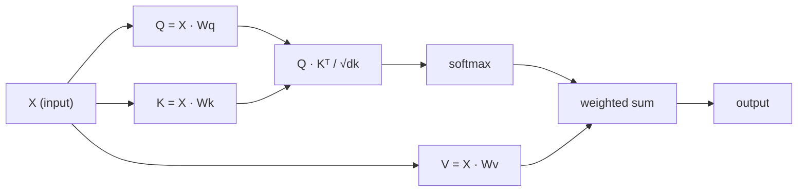

# Самовнимание с нуля

> Внимание - это поисковая таблица, где каждое слово задает вопрос "кто мне важно?" - и узнает ответ.

**Type:** Build
**Languages:** Python
**Prerequisites:** Phase 3 (Deep Learning Core), Phase 5 Lesson 10 (Sequence-to-Sequence)
**Time:** ~90 minutes

## Цели обучения

- Реализация масштабированного продукта самоотверженности точками с нуля с использованием только NumPy, включая запросы/ключи/проекции значения и сумму, взвешенную в зависимости от softmax
- Создайте многоглавный слой внимания, который разделяет головы, вычисляет параллельное внимание и конкаценирует результаты
- Отслеживать, как матрица внимания захватывает токенные отношения и объяснить, почему масштабирование по sqrt(d_k) предотвращает насыщение softmax
- Применение причинно-следственной маскировки для преобразования двунаправленного внимания в авторегрессивное (по стилю декодера) внимание

## Проблема

RNN обрабатывает последовательность одного токеня за раз. К тому времени, когда вы достигаете токен 50, информация из токен 1 была сжата через 50 шагов сжатия.

В статье Bahdanau attention 2014 года показано решение: позволь декодер посмотреть назад на каждую позицию кодера и решить, какие из них важны для текущего шага. Но она все же была завязана на RNN. В статье "Attention Is All You Need" 2017 года задавался более острый вопрос: что, если внимание является *единственным* механизмом? Нет повторения. Нет скручивания. Просто внимание.

Самообслуживание позволяет каждой позиции последовательности придерживаться каждой другой позиции в одном параллельном шаге.

## Концепция

### Аналогия поиска базы данных

Подумайте о внимании как о мягком поиске базы данных:

```
Traditional database:
  Query: "capital of France"  -->  exact match  -->  "Paris"

Attention:
  Query: "capital of France"  -->  similarity to ALL keys  -->  weighted blend of ALL values
```

Каждый знак генерирует три вектора:
- **Query (Q)**"Чего я ищу?"
- **Key (K)**"Что я содержу?"
- **Value (V)**"Какую информацию я предоставлю, если выберу?"

Продукция точек между запросом и всеми клавишами производит баллы внимания. Высокий балл означает "этот ключ соответствует моему запросу". Эти баллы взвешивают значения.

### Q, K, V Вычисления

Каждое вкладка символов проецируется через три матрицы массы:

```
Input embeddings (sequence of n tokens, each d-dimensional):

  X = [x1, x2, x3, ..., xn]       shape: (n, d)

Three weight matrices:

  Wq  shape: (d, dk)
  Wk  shape: (d, dk)
  Wv  shape: (d, dv)

Projections:

  Q = X @ Wq    shape: (n, dk)      each token's query
  K = X @ Wk    shape: (n, dk)      each token's key
  V = X @ Wv    shape: (n, dv)      each token's value
```

Визуально, для одного признака:

```
             Wq
  x_i ------[*]------> q_i    "What am I looking for?"
       |
       |     Wk
       +----[*]------> k_i    "What do I contain?"
       |
       |     Wv
       +----[*]------> v_i    "What do I offer?"
```

### Матрица внимания

Как только у вас есть Q, K, V для всех токенов, оценки внимания образуют матрицу:

```
Scores = Q @ K^T    shape: (n, n)

              k1    k2    k3    k4    k5
        +-----+-----+-----+-----+-----+
   q1   | 2.1 | 0.3 | 0.1 | 0.8 | 0.2 |   <- how much q1 attends to each key
        +-----+-----+-----+-----+-----+
   q2   | 0.4 | 1.9 | 0.7 | 0.1 | 0.3 |
        +-----+-----+-----+-----+-----+
   q3   | 0.2 | 0.6 | 2.3 | 0.5 | 0.1 |
        +-----+-----+-----+-----+-----+
   q4   | 0.9 | 0.1 | 0.4 | 1.7 | 0.6 |
        +-----+-----+-----+-----+-----+
   q5   | 0.1 | 0.3 | 0.2 | 0.5 | 2.0 |
        +-----+-----+-----+-----+-----+

Each row: one token's attention over the entire sequence
```

Смотреть один запрос за раз протирать ключи: каждый ряд отсчитывает каждый токен, softmax превращает результаты в весы, а контекстный вектор - это взвешенная смесь значений.

```figure
attention-matrix
```

### Почему масштаб?

Если dk = 64, точковые продукты могут быть в диапазоне десятков, толкая softmax в области, где градиенты исчезают.

```
Scaled scores = (Q @ K^T) / sqrt(dk)
```

Это поддерживает значения в диапазоне, где softmax производит полезные градиенты.

### Softmax превращает баллы в весы

Softmax преобразует сырые результаты в распределение вероятности по каждому строку:

```
Raw scores for q1:   [2.1, 0.3, 0.1, 0.8, 0.2]
                            |
                         softmax
                            |
Attention weights:   [0.52, 0.09, 0.07, 0.14, 0.08]   (sums to ~1.0)
```

Теперь у каждого символа есть набор весов, которые указывают, сколько нужно отдать каждому другому символу.

### Весенная сумма ценностей

Конечный выход для каждого токеня - это взвешенная сумма всех векторов значения:

```
output_i = sum( attention_weight[i][j] * v_j  for all j )

For token 1:
  output_1 = 0.52 * v1 + 0.09 * v2 + 0.07 * v3 + 0.14 * v4 + 0.08 * v5
```

### Полный трубопровод



Формула в одной строке:

```
Attention(Q, K, V) = softmax( Q @ K^T / sqrt(dk) ) @ V
```

```figure
softmax-attention-scaling
```

## Создайте его

### Шаг 1: Softmax с нуля

Softmax преобразует сырые логиты в вероятности.

```python
import numpy as np

def softmax(x):
    shifted = x - np.max(x, axis=-1, keepdims=True)
    exp_x = np.exp(shifted)
    return exp_x / np.sum(exp_x, axis=-1, keepdims=True)

logits = np.array([2.0, 1.0, 0.1])
print(f"logits:  {logits}")
print(f"softmax: {softmax(logits)}")
print(f"sum:     {softmax(logits).sum():.4f}")
```

### Шаг 2: Расширенное внимание к продукту точками

Функция ядра: принимает матрицы Q, K, V и возвращает выход внимания плюс матрицу веса.

```python
def scaled_dot_product_attention(Q, K, V):
    dk = Q.shape[-1]
    scores = Q @ K.T / np.sqrt(dk)
    weights = softmax(scores)
    output = weights @ V
    return output, weights
```

### Шаг 3: занятие самообслуживания с изученными проекциями

Полный модуль самоотверженности с матрицами массы Wq, Wk, Wv, инициированный с помощью скалирования типа Ксавьера.

```python
class SelfAttention:
    def __init__(self, d_model, dk, dv, seed=42):
        rng = np.random.default_rng(seed)
        scale = np.sqrt(2.0 / (d_model + dk))
        self.Wq = rng.normal(0, scale, (d_model, dk))
        self.Wk = rng.normal(0, scale, (d_model, dk))
        scale_v = np.sqrt(2.0 / (d_model + dv))
        self.Wv = rng.normal(0, scale_v, (d_model, dv))
        self.dk = dk

    def forward(self, X):
        Q = X @ self.Wq
        K = X @ self.Wk
        V = X @ self.Wv
        output, weights = scaled_dot_product_attention(Q, K, V)
        return output, weights
```

### Шаг 4: прочитайте на предложении

Создайте фальшивые вкладки для предложения и посмотрите на вес внимания.

```python
sentence = ["The", "cat", "sat", "on", "the", "mat"]
n_tokens = len(sentence)
d_model = 8
dk = 4
dv = 4

rng = np.random.default_rng(42)
X = rng.normal(0, 1, (n_tokens, d_model))

attn = SelfAttention(d_model, dk, dv, seed=42)
output, weights = attn.forward(X)

print("Attention weights (each row: where that token looks):\n")
print(f"{'':>6}", end="")
for token in sentence:
    print(f"{token:>6}", end="")
print()

for i, token in enumerate(sentence):
    print(f"{token:>6}", end="")
    for j in range(n_tokens):
        w = weights[i][j]
        print(f"{w:6.3f}", end="")
    print()
```

### Шаг 5: визуализируйте внимание с помощью тепловой карты ASCII

Описание внимания на персонажей для быстрого визуального обзора.

```python
def ascii_heatmap(weights, tokens, chars=" ░▒▓█"):
    n = len(tokens)
    print(f"\n{'':>6}", end="")
    for t in tokens:
        print(f"{t:>6}", end="")
    print()

    for i in range(n):
        print(f"{tokens[i]:>6}", end="")
        for j in range(n):
            level = int(weights[i][j] * (len(chars) - 1) / weights.max())
            level = min(level, len(chars) - 1)
            print(f"{'  ' + chars[level] + '   '}", end="")
        print()

ascii_heatmap(weights, sentence)
```

## Используйте его

Питорч `nn.MultiheadAttention`делает то же самое, что мы построили, плюс многоглавный раздел и выходное проекция:

```python
import torch
import torch.nn as nn

d_model = 8
n_heads = 2
seq_len = 6

mha = nn.MultiheadAttention(embed_dim=d_model, num_heads=n_heads, batch_first=True)

X_torch = torch.randn(1, seq_len, d_model)

output, attn_weights = mha(X_torch, X_torch, X_torch)

print(f"Input shape:            {X_torch.shape}")
print(f"Output shape:           {output.shape}")
print(f"Attention weight shape: {attn_weights.shape}")
print(f"\nAttn weights (averaged over heads):")
print(attn_weights[0].detach().numpy().round(3))
```

Ключевое отличие: многоглавная внимание выполняет несколько функций внимания параллельно, каждая с собственными проекциями Q, K, V размером dk = d_model / n_heads, затем конкатенирует результаты.

## Погрузи его

Этот урок дает результаты:
- `outputs/prompt-attention-explainer.md`- просьба объяснить внимание посредством аналогии поиска в базе данных

## Упражнения

1. Изменить `scaled_dot_product_attention`принимать матрицу маски по выбору, которая устанавливает определенные позиции до отрицательного бесконечности до softmax (так работает причинно-следственное / декодерное маскирование)
2. Реализуйте многоглавную внимание с нуля: делите Q, K, V на `n_heads`кусочки, обратить внимание на каждый, конкаценат, и проецировать через окончательную матрицу веса Wo
3. Возьмите два различных предложения одинаковой длины, пропишите их через один и тот же пример самосознания и сравните их образы внимания.

## Ключевые условия

| Term | What people say | What it actually means |
|------|----------------|----------------------|
| Query (Q) | "The question vector" | A learned projection of the input that represents what information this token is looking for |
| Key (K) | "The label vector" | A learned projection that represents what information this token contains, matched against queries |
| Value (V) | "The content vector" | A learned projection carrying the actual information that gets aggregated based on attention scores |
| Scaled dot-product attention | "The attention formula" | softmax(QK^T / sqrt(dk)) @ V - scaling prevents softmax saturation in high dimensions |
| Self-attention | "The token looks at itself and others" | Attention where Q, K, V all come from the same sequence, letting every position attend to every other position |
| Attention weights | "How much focus" | A probability distribution over positions, produced by softmax over scaled dot products |
| Multi-head attention | "Parallel attention" | Running multiple attention functions with different projections, then concatenating results for richer representations |

## Дальнейшее чтение

- [Attention Is All You Need (Vaswani et al., 2017)](https://arxiv.org/abs/1706.03762)- оригинальная трансформаторная бумага
- [The Illustrated Transformer (Jay Alammar)](https://jalammar.github.io/illustrated-transformer/)- лучший визуальный проход по всей архитектуре
- [The Annotated Transformer (Harvard NLP)](https://nlp.seas.harvard.edu/annotated-transformer/)- осуществление PyTorch по строке с объяснениями
