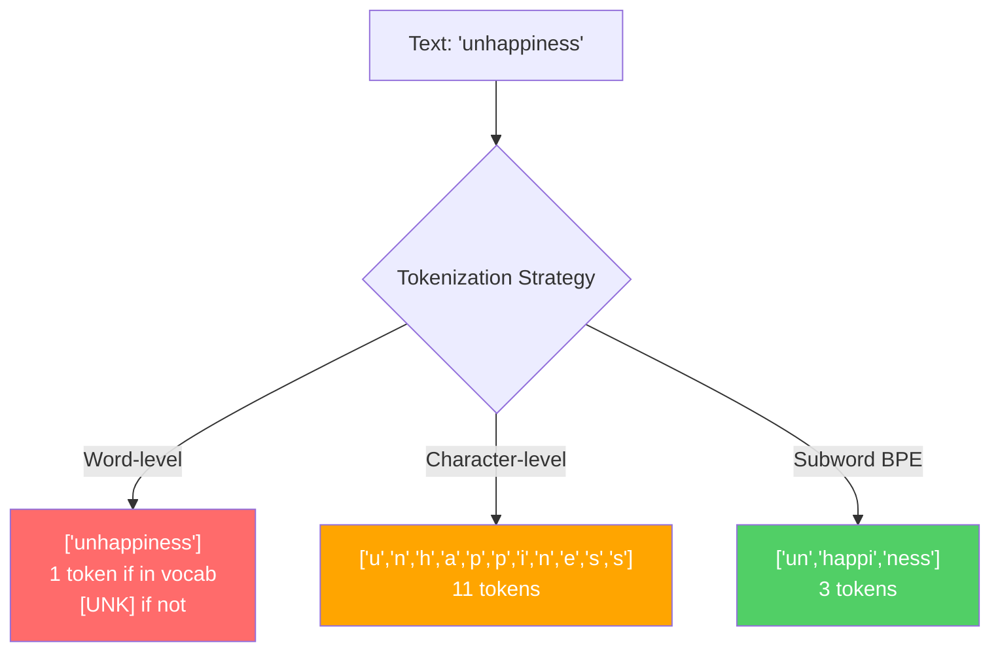
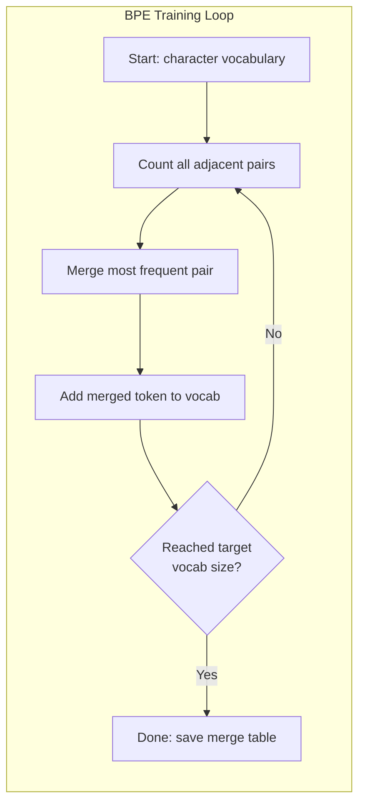
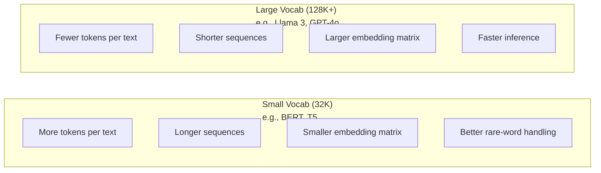

# Токенизаторы: BPE, WordPiece, SentencePiece

> Ваша LLM не читает английский. Она читает целые числа. Токенизатор решает, несут ли эти числа смысл или впустую растрачивают его.

**Type:** Build
**Languages:** Python
**Prerequisites:** Phase 05 (NLP Foundations)
**Time:** ~90 минут

## Цели обучения

- Реализовать алгоритмы токенизации BPE, WordPiece и Unigram с нуля и сравнить их стратегии слияния
- Объяснить, как размер словаря влияет на эффективность модели: слишком маленький создаёт длинные последовательности, слишком большой тратит впустую параметры эмбеддингов
- Проанализировать артефакты токенизации на разных языках и коде, выявив, где конкретные токенизаторы дают сбой
- Использовать библиотеки tiktoken и sentencepiece для токенизации текста и проверки получившихся ID токенов

## Проблема

Ваша LLM не читает английский. Она не читает ни один язык. Она читает числа.

Разрыв между "Hello, world!" и [15496, 11, 995, 0] — это токенизатор. Каждое слово, каждый пробел, каждый знак препинания должны быть преобразованы в целое число, прежде чем модель сможет их обработать. Это преобразование не нейтрально. Оно закладывает в модель допущения, которые нельзя будет отменить позже.

Ошибитесь здесь — и ваша модель будет впустую тратить ёмкость, кодируя распространённые слова несколькими токенами. "unfortunately" превращается в четыре токена вместо одного. Ваше окно контекста в 128K только что сократилось на 75% для текста, насыщенного многосложными словами. Сделайте это правильно — и то же окно контекста вместит вдвое больше смысла. Разница между "эта модель хорошо работает с кодом" и "эта модель захлёбывается на Python" часто сводится к тому, как был обучен токенизатор.

Каждый ваш API-запрос к GPT-4 или Claude оплачивается за токен. Каждый токен, который генерирует ваша модель, стоит вычислительных ресурсов. Чем меньше токенов требуется для представления вывода, тем быстрее сквозной инференс. Токенизация — это не предобработка. Это архитектура.

## Концепция

### Три подхода, которые провалились (и один, который победил)

Есть три очевидных способа преобразовать текст в числа. Два из них не работают на масштабе.

**Пословная токенизация** разбивает текст по пробелам и пунктуации. "The cat sat" становится ["The", "cat", "sat"]. Просто. Но что насчёт "tokenization"? Или "GPT-4o"? Или немецкого сложного слова вроде "Geschwindigkeitsbegrenzung"? Пословная токенизация требует огромного словаря, чтобы покрыть каждое слово на каждом языке. Пропустите слово — и получите пресловутый токен `[UNK]` — способ модели сказать "понятия не имею, что это такое". Только в английском более миллиона словоформ. Добавьте код, URL, научную нотацию и ещё 100 языков — и понадобится бесконечный словарь.

**Посимвольная токенизация** идёт в противоположном направлении. "hello" становится ["h", "e", "l", "l", "o"]. Словарь крошечный (несколько сотен символов). Неизвестных токенов не бывает никогда. Но последовательности становятся очень длинными. Предложение, которое заняло бы 10 пословных токенов, превращается в 50 посимвольных. Модель вынуждена учить, что "t", "h", "e" вместе означают "the" — тратя ёмкость внимания на то, что человек усваивает в три года.

**Субсловная токенизация** находит золотую середину. Распространённые слова остаются целыми: "the" — это один токен. Редкие слова разбиваются на осмысленные части: "unhappiness" становится ["un", "happi", "ness"]. Словарь остаётся управляемым (от 30K до 128K токенов). Последовательности остаются короткими. Неизвестные токены практически исчезают, поскольку любое слово можно собрать из субсловных частей.

Каждая современная LLM использует субсловную токенизацию. GPT-2, GPT-4, BERT, Llama 3, Claude — все они. Вопрос лишь в том, какой алгоритм.



### BPE: Byte Pair Encoding

BPE — это жадный алгоритм сжатия, переработанный для токенизации. Идея достаточно проста, чтобы уместиться на карточке.

Начните с отдельных символов. Подсчитайте каждую соседнюю пару в обучающем корпусе. Слейте наиболее частую пару в новый токен. Повторяйте, пока не достигнете целевого размера словаря.

```figure
tokenizer-bpe
```

Вот как BPE работает на крошечном корпусе со словами "lower", "lowest" и "newest":

```
Corpus (with word frequencies):
  "lower"  x5
  "lowest" x2
  "newest" x6

Step 0 -- Start with characters:
  l o w e r       (x5)
  l o w e s t     (x2)
  n e w e s t     (x6)

Step 1 -- Count adjacent pairs:
  (e,s): 8    (s,t): 8    (l,o): 7    (o,w): 7
  (w,e): 13   (e,r): 5    (n,e): 6    ...

Step 2 -- Merge most frequent pair (w,e) -> "we":
  l o we r        (x5)
  l o we s t      (x2)
  n e we s t      (x6)

Step 3 -- Recount and merge (e,s) -> "es":
  l o we r        (x5)
  l o we s t      (x2)    <- 'es' only forms from 'e'+'s', not 'we'+'s'
  n e we s t      (x6)    <- wait, the 'e' before 'we' and 's' after 'we'

Actually tracking this precisely:
  After "we" merge, remaining pairs:
  (l,o): 7   (o,we): 7   (we,r): 5   (we,s): 8
  (s,t): 8   (n,e): 6    (e,we): 6

Step 3 -- Merge (we,s) -> "wes" or (s,t) -> "st" (tied at 8, pick first):
  Merge (we,s) -> "wes":
  l o we r        (x5)
  l o wes t       (x2)
  n e wes t       (x6)

Step 4 -- Merge (wes,t) -> "west":
  l o we r        (x5)
  l o west        (x2)
  n e west        (x6)

...continue until target vocab size reached.
```

Таблица слияний и есть токенизатор. Чтобы закодировать новый текст, применяйте слияния в том порядке, в котором они были изучены. Обучающий корпус определяет, какие слияния существуют, и этот выбор навсегда формирует то, что видит модель.



### Byte-level BPE (GPT-2, GPT-3, GPT-4)

Стандартный BPE работает с символами Unicode. Byte-level BPE работает с сырыми байтами (0-255). Это даёт базовый словарь ровно из 256 элементов, обрабатывает любой язык или кодировку и никогда не порождает неизвестный токен.

GPT-2 представила этот подход. Базовый словарь покрывает каждый возможный байт. Слияния BPE строятся поверх него. Библиотека tiktoken от OpenAI реализует byte-level BPE со следующими размерами словаря:

- GPT-2: 50 257 токенов
- GPT-3.5/GPT-4: ~100 256 токенов (кодировка cl100k_base)
- GPT-4o: 200 019 токенов (кодировка o200k_base)

### WordPiece (BERT)

WordPiece выглядит похоже на BPE, но выбирает слияния иначе. Вместо сырой частоты он максимизирует правдоподобие обучающих данных:

```
BPE merge criterion:      count(A, B)
WordPiece merge criterion: count(AB) / (count(A) * count(B))
```

BPE спрашивает: "Какая пара встречается чаще всего?" WordPiece спрашивает: "Какая пара встречается вместе чаще, чем можно было бы ожидать случайно?" Эта тонкая разница порождает разные словари. WordPiece отдаёт предпочтение слияниям, где совместная встречаемость удивительна, а не просто частотна.

WordPiece также использует префикс "##" для продолжающихся субслов:

```
"unhappiness" -> ["un", "##happi", "##ness"]
"embedding"   -> ["em", "##bed", "##ding"]
```

Префикс "##" говорит, что этот фрагмент продолжает предыдущий токен. BERT использует WordPiece со словарём из 30 522 токенов. Каждый вариант BERT -- DistilBERT, токенизатор RoBERTa на самом деле BPE, но сам BERT -- WordPiece.

### SentencePiece (Llama, T5)

SentencePiece рассматривает входные данные как сырой поток символов Unicode, включая пробелы. Никакого этапа предварительной токенизации. Никаких языко-специфичных правил о границах слов. Это делает его по-настоящему языконезависимым — он работает с китайским, японским, тайским и другими языками, где пробелы не разделяют слова.

SentencePiece поддерживает два алгоритма:
- **Режим BPE**: та же логика слияния, что и в стандартном BPE, применённая к сырым последовательностям символов
- **Режим Unigram**: начинает с большого словаря и итеративно удаляет токены, которые меньше всего влияют на общее правдоподобие. Обратное BPE — отсекать вместо слияния.

Llama 2 использует SentencePiece BPE со словарём из 32 000 токенов. T5 использует SentencePiece Unigram с 32 000 токенов. Примечание: Llama 3 перешла на токенизатор на основе tiktoken byte-level BPE со словарём из 128 256 токенов.

### Компромиссы размера словаря

Это реальное инженерное решение с измеримыми последствиями.



Конкретные цифры. Для словаря в 128K с эмбеддингами размерностью 4096 одна только матрица эмбеддингов составляет 128 000 x 4096 = 524 миллиона параметров. Для словаря в 32K это 131 миллион параметров. Это разница в 400 млн параметров только от выбора токенизатора.

Но более крупные словари сжимают текст более агрессивно. Тот же английский абзац, который занимает 100 токенов со словарём 32K, может занять 70 токенов со словарём 128K. Это значит на 30% меньше прямых проходов при генерации. Для модели, обслуживающей миллионы запросов, это прямое снижение вычислительных затрат.

Тенденция очевидна: размеры словарей растут. GPT-2 использовала 50 257. GPT-4 использует ~100K. Llama 3 использует 128K. GPT-4o использует 200K.

| Модель | Размер словаря | Тип токенизатора | Среднее число токенов на английское слово |
|-------|-----------|----------------|---------------------------|
| BERT | 30 522 | WordPiece | ~1.4 |
| GPT-2 | 50 257 | Byte-level BPE | ~1.3 |
| Llama 2 | 32 000 | SentencePiece BPE | ~1.4 |
| GPT-4 | ~100 256 | Byte-level BPE | ~1.2 |
| Llama 3 | 128 256 | Byte-level BPE (tiktoken) | ~1.1 |
| GPT-4o | 200 019 | Byte-level BPE | ~1.0 |

### Многоязычный налог

Токенизаторы, обученные преимущественно на английском, безжалостны к другим языкам. Корейский текст в токенизаторе GPT-2 в среднем занимает 2-3 токена на слово. С китайским может быть ещё хуже. Это означает, что у корейского пользователя эффективное окно контекста вдвое меньше, чем у англоязычного пользователя — за ту же цену он получает меньше информационной плотности.

Именно поэтому Llama 3 учетверила свой словарь с 32K до 128K. Больше токенов, выделенных для не-английских письменностей, означает более справедливое сжатие для разных языков.

```figure
tokenizer-tradeoff
```

## Постройте это

### Шаг 1: Посимвольный токенизатор

Начнём с основания. Посимвольный токенизатор сопоставляет каждый символ с его кодовой точкой Unicode. Обучение не требуется. Неизвестных токенов нет. Просто прямое отображение.

```python
class CharTokenizer:
    def encode(self, text):
        return [ord(c) for c in text]

    def decode(self, tokens):
        return "".join(chr(t) for t in tokens)
```

"hello" становится [104, 101, 108, 108, 111]. Каждый символ — свой собственный токен. Это базовый уровень, который мы будем улучшать.

### Шаг 2: Токенизатор BPE с нуля

Настоящая реализация. Мы обучаемся на сырых байтах (как GPT-2), считаем пары, сливаем наиболее частую и записываем каждое слияние по порядку. Таблица слияний и есть токенизатор.

```python
from collections import Counter

class BPETokenizer:
    def __init__(self):
        self.merges = {}
        self.vocab = {}

    def _get_pairs(self, tokens):
        pairs = Counter()
        for i in range(len(tokens) - 1):
            pairs[(tokens[i], tokens[i + 1])] += 1
        return pairs

    def _merge_pair(self, tokens, pair, new_token):
        merged = []
        i = 0
        while i < len(tokens):
            if i < len(tokens) - 1 and tokens[i] == pair[0] and tokens[i + 1] == pair[1]:
                merged.append(new_token)
                i += 2
            else:
                merged.append(tokens[i])
                i += 1
        return merged

    def train(self, text, num_merges):
        tokens = list(text.encode("utf-8"))
        self.vocab = {i: bytes([i]) for i in range(256)}

        for i in range(num_merges):
            pairs = self._get_pairs(tokens)
            if not pairs:
                break
            best_pair = max(pairs, key=pairs.get)
            new_token = 256 + i
            tokens = self._merge_pair(tokens, best_pair, new_token)
            self.merges[best_pair] = new_token
            self.vocab[new_token] = self.vocab[best_pair[0]] + self.vocab[best_pair[1]]

        return self

    def encode(self, text):
        tokens = list(text.encode("utf-8"))
        for pair, new_token in self.merges.items():
            tokens = self._merge_pair(tokens, pair, new_token)
        return tokens

    def decode(self, tokens):
        byte_sequence = b"".join(self.vocab[t] for t in tokens)
        return byte_sequence.decode("utf-8", errors="replace")
```

Цикл обучения — это ядро BPE: считать пары, сливать победителя, повторять. Каждое слияние уменьшает общее число токенов. После `num_merges` раундов словарь растёт с 256 (базовые байты) до 256 + num_merges.

Кодирование применяет слияния в точном порядке, в котором они были изучены. Это важно. Если слияние 1 создало "th", а слияние 5 создало "the", кодирование должно сначала применить слияние 1, чтобы "the" могло сформироваться из "th" + "e" в слиянии 5.

Декодирование — обратная операция: найти каждый ID токена в словаре, конкатенировать байты, декодировать в UTF-8.

### Шаг 3: Цикл кодирования и декодирования

```python
corpus = (
    "The cat sat on the mat. The cat ate the rat. "
    "The dog sat on the log. The dog ate the frog. "
    "Natural language processing is the study of how computers "
    "understand and generate human language. "
    "Tokenization is the first step in any NLP pipeline."
)

tokenizer = BPETokenizer()
tokenizer.train(corpus, num_merges=40)

test_sentences = [
    "The cat sat on the mat.",
    "Natural language processing",
    "tokenization pipeline",
    "unhappiness",
]

for sentence in test_sentences:
    encoded = tokenizer.encode(sentence)
    decoded = tokenizer.decode(encoded)
    raw_bytes = len(sentence.encode("utf-8"))
    ratio = len(encoded) / raw_bytes
    print(f"'{sentence}'")
    print(f"  Tokens: {len(encoded)} (from {raw_bytes} bytes) -- ratio: {ratio:.2f}")
    print(f"  Roundtrip: {'PASS' if decoded == sentence else 'FAIL'}")
```

Коэффициент сжатия показывает, насколько эффективен токенизатор. Коэффициент 0.50 означает, что токенизатор сжал текст до половины от числа токенов в сыром виде байтов. Чем ниже, тем лучше. На обучающем корпусе коэффициент будет хорошим. На тексте вне распределения, таком как "unhappiness" (которое не встречается в корпусе), коэффициент будет хуже — токенизатор переходит к посимвольному кодированию для невиданных паттернов.

### Шаг 4: Сравнение с tiktoken

```python
import tiktoken

enc = tiktoken.get_encoding("cl100k_base")

texts = [
    "The cat sat on the mat.",
    "unhappiness",
    "Hello, world!",
    "def fibonacci(n): return n if n < 2 else fibonacci(n-1) + fibonacci(n-2)",
    "Geschwindigkeitsbegrenzung",
]

for text in texts:
    our_tokens = tokenizer.encode(text)
    tiktoken_tokens = enc.encode(text)
    tiktoken_pieces = [enc.decode([t]) for t in tiktoken_tokens]
    print(f"'{text}'")
    print(f"  Our BPE:   {len(our_tokens)} tokens")
    print(f"  tiktoken:  {len(tiktoken_tokens)} tokens -> {tiktoken_pieces}")
```

tiktoken использует точно тот же алгоритм, но обучен на сотнях гигабайт текста со 100 000 слияний. Алгоритм идентичен. Разница в обучающих данных и количестве слияний. Ваш токенизатор, обученный на абзаце с 40 слияниями, не может конкурировать со 100K слияний tiktoken на огромном корпусе. Но механизм тот же.

### Шаг 5: Анализ словаря

```python
def analyze_vocabulary(tokenizer, test_texts):
    total_tokens = 0
    total_chars = 0
    token_usage = Counter()

    for text in test_texts:
        encoded = tokenizer.encode(text)
        total_tokens += len(encoded)
        total_chars += len(text)
        for t in encoded:
            token_usage[t] += 1

    print(f"Vocabulary size: {len(tokenizer.vocab)}")
    print(f"Total tokens across all texts: {total_tokens}")
    print(f"Total characters: {total_chars}")
    print(f"Avg tokens per character: {total_tokens / total_chars:.2f}")

    print(f"\nMost used tokens:")
    for token_id, count in token_usage.most_common(10):
        token_bytes = tokenizer.vocab[token_id]
        display = token_bytes.decode("utf-8", errors="replace")
        print(f"  Token {token_id:4d}: '{display}' (used {count} times)")

    unused = [t for t in tokenizer.vocab if t not in token_usage]
    print(f"\nUnused tokens: {len(unused)} out of {len(tokenizer.vocab)}")
```

Это раскрывает распределение Ципфа в вашем словаре. Несколько токенов доминируют (пробелы, "the", "e"). Большинство токенов используются редко. Производственные токенизаторы оптимизируются под это распределение — распространённые паттерны получают короткие ID токенов, редкие паттерны — более длинные представления.

## Используйте это

Ваш самодельный BPE работает. Теперь посмотрите, как выглядят производственные инструменты.

### tiktoken (OpenAI)

```python
import tiktoken

enc = tiktoken.get_encoding("cl100k_base")

text = "Tokenizers convert text to integers"
tokens = enc.encode(text)
print(f"Tokens: {tokens}")
print(f"Pieces: {[enc.decode([t]) for t in tokens]}")
print(f"Roundtrip: {enc.decode(tokens)}")
```

tiktoken написан на Rust с привязками для Python. Он кодирует миллионы токенов в секунду. Тот же алгоритм BPE, промышленная реализация.

### Hugging Face tokenizers

```python
from tokenizers import Tokenizer
from tokenizers.models import BPE
from tokenizers.trainers import BpeTrainer
from tokenizers.pre_tokenizers import ByteLevel

tokenizer = Tokenizer(BPE())
tokenizer.pre_tokenizer = ByteLevel()

trainer = BpeTrainer(vocab_size=1000, special_tokens=["<pad>", "<eos>", "<unk>"])
tokenizer.train(["corpus.txt"], trainer)

output = tokenizer.encode("The cat sat on the mat.")
print(f"Tokens: {output.tokens}")
print(f"IDs: {output.ids}")
```

Библиотека Hugging Face tokenizers тоже на Rust под капотом. Она обучает BPE на корпусах гигабайтного масштаба за секунды. Это то, что вы используете при обучении собственной модели.

### Загрузка токенизатора Llama

```python
from transformers import AutoTokenizer

tokenizer = AutoTokenizer.from_pretrained("meta-llama/Llama-3.1-8B")

text = "Tokenizers are the unsung heroes of LLMs"
tokens = tokenizer.encode(text)
print(f"Token IDs: {tokens}")
print(f"Tokens: {tokenizer.convert_ids_to_tokens(tokens)}")
print(f"Vocab size: {tokenizer.vocab_size}")

multilingual = ["Hello world", "Hola mundo", "Bonjour le monde"]
for text in multilingual:
    ids = tokenizer.encode(text)
    print(f"'{text}' -> {len(ids)} tokens")
```

Словарь Llama 3 в 128K сжимает не-английский текст значительно лучше, чем словарь GPT-2 в 50K. Вы можете проверить это сами — закодируйте одно и то же предложение на нескольких языках и посчитайте токены.

## Отправьте это в продакшн

Этот урок производит `outputs/prompt-tokenizer-analyzer.md` -- переиспользуемый промпт, который анализирует эффективность токенизации для любой комбинации текста и модели. Передайте ему образец текста, и он скажет, чей токенизатор лучше с ним справляется.

## Упражнения

1. Измените токенизатор BPE, чтобы выводить словарь на каждом шаге слияния. Понаблюдайте, как "t" + "h" становится "th", затем "th" + "e" становится "the". Проследите, как распространённые английские слова собираются по частям.

2. Добавьте специальные токены (`<pad>`, `<eos>`, `<unk>`) в токенизатор BPE. Присвойте им ID 0, 1, 2 и сдвиньте все остальные токены соответственно. Реализуйте этап предварительной токенизации, разбивающий текст по пробелам перед запуском BPE.

3. Реализуйте критерий слияния WordPiece (отношение правдоподобия вместо частоты). Обучите и BPE, и WordPiece на одном корпусе с одинаковым числом слияний. Сравните получившиеся словари — какой из них производит более лингвистически осмысленные субслова?

4. Постройте бенчмарк эффективности многоязычного токенизатора. Возьмите 10 предложений на английском, испанском, китайском, корейском и арабском языках. Токенизируйте каждое с помощью tiktoken (cl100k_base) и измерьте среднее число токенов на символ. Количественно оцените "многоязычный налог" для каждого языка.

5. Обучите ваш токенизатор BPE на более крупном корпусе (скачайте статью из Википедии). Настройте количество слияний, чтобы достичь коэффициента сжатия в пределах 10% от tiktoken на том же тексте. Это заставит вас понять взаимосвязь между размером корпуса, количеством слияний и качеством сжатия.

## Ключевые термины

| Термин | Что говорят люди | Что это на самом деле означает |
|------|----------------|----------------------|
| Token (токен) | "Слово" | Единица в словаре модели — может быть символом, субсловом, словом или фрагментом из нескольких слов |
| BPE | "Какое-то сжатие" | Byte Pair Encoding — итеративное слияние наиболее частой соседней пары токенов до достижения целевого размера словаря |
| WordPiece | "Токенизатор BERT" | Как BPE, но слияния максимизируют отношение правдоподобия count(AB)/(count(A)*count(B)) вместо сырой частоты |
| SentencePiece | "Библиотека токенизации" | Языконезависимый токенизатор, работающий с сырым Unicode без предварительной токенизации, поддерживающий алгоритмы BPE и Unigram |
| Vocabulary size (размер словаря) | "Сколько слов он знает" | Общее число уникальных токенов: у GPT-2 — 50 257, у BERT — 30 522, у Llama 3 — 128 256 |
| Fertility (плодовитость) | "Не термин токенизации" | Среднее число токенов на слово — измеряет эффективность токенизатора в разных языках (1.0 — идеально, 3.0 означает, что модель работает втрое больше) |
| Byte-level BPE | "Токенизатор GPT" | BPE, работающий с сырыми байтами (0-255) вместо символов Unicode, гарантирующий отсутствие неизвестных токенов для любого ввода |
| Merge table (таблица слияний) | "Файл токенизатора" | Упорядоченный список слияний пар, изученных при обучении — это И ЕСТЬ токенизатор, и порядок имеет значение |
| Pre-tokenization (предварительная токенизация) | "Разбиение по пробелам" | Правила, применяемые перед субсловной токенизацией: разбиение по пробелам, отделение цифр, обработка пунктуации |
| Compression ratio (коэффициент сжатия) | "Насколько эффективен токенизатор" | Число произведённых токенов, делённое на число входных байтов — чем ниже, тем лучше сжатие и быстрее инференс |

## Дополнительное чтение

- [Sennrich et al., 2016 -- "Neural Machine Translation of Rare Words with Subword Units"](https://arxiv.org/abs/1508.07909) -- статья, представившая BPE для NLP, превратившая алгоритм сжатия 1994 года в основу современной токенизации
- [Kudo & Richardson, 2018 -- "SentencePiece: A simple and language independent subword tokenizer"](https://arxiv.org/abs/1808.06226) -- языконезависимая токенизация, сделавшая многоязычные модели практически осуществимыми
- [Репозиторий OpenAI tiktoken](https://github.com/openai/tiktoken) -- производственная реализация BPE на Rust с привязками для Python, используемая GPT-3.5/4/4o
- [Документация Hugging Face Tokenizers](https://huggingface.co/docs/tokenizers) -- обучение токенизаторов промышленного уровня с производительностью Rust