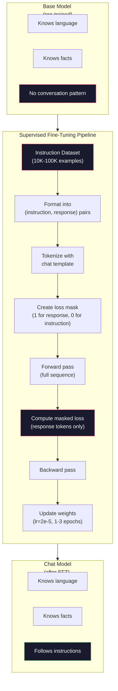

# Инструктивное дообучение (SFT)

> Базовая модель предсказывает следующий токен. Это всё, что она делает. Она не следует инструкциям, не отвечает на вопросы и не отказывается от вредных запросов. SFT — это мост между предсказателем токенов и полезным ассистентом. Каждая модель, с которой вы когда-либо общались — Claude, GPT, Llama Chat — прошла через этот этап.

**Type:** Build
**Languages:** Python (с numpy)
**Prerequisites:** Фаза 10, Урок 04 (Предобучение мини-GPT)
**Time:** ~90 минут

## Цели обучения

- Реализовать supervised fine-tuning (SFT), который превращает базовую языковую модель в ассистента, следующего инструкциям
- Форматировать обучающие данные с помощью чат-шаблонов с ролями system, user и assistant, маскируя потерю на токенах, не относящихся к assistant
- Объяснить, почему SFT необходим: базовые модели продолжают текст, а не отвечают на вопросы
- Оценить качество SFT, сравнивая ответы базовой и дообученной моделей на отложенном наборе инструкций

## Проблема

Вы обучили модель в Уроке 04. Она умеет предсказывать следующий токен по заданной последовательности. Подайте ей "The transformer architecture" — и она может продолжить "has revolutionized natural language processing". Впечатляюще для предсказателя следующего токена.

А теперь попробуйте вот что: подайте ей "What is the capital of France?" Базовая модель не ответит "Paris". Она продолжит паттерн. Она может выдать "What is the capital of Germany? What is the capital of Spain?", потому что обучалась на документах со списками вопросов. Или может выдать "is a question that many people ask", потому что это правдоподобное продолжение следующего токена. У модели нет понятия *ответа*. Она знает только *продолжение*.

Это разрыв между GPT-3 (базовая модель, выпущена в июне 2020) и ChatGPT (инструктивно дообученная, выпущена в ноябре 2022). Та же архитектура. То же предобучение. Разница — 20 000–100 000 тщательно составленных пар (инструкция, ответ), которые научили модель следовать паттерну диалога.

Stanford Alpaca доказала, что миллионы примеров не нужны. В марте 2023 года исследователи дообучили Llama 7B всего на 52 000 пар инструкция-ответ, сгенерированных GPT-3.5. Общая стоимость: $600. The result was a chatbot that could follow instructions, answer questions, and hold conversations. Not as good as ChatGPT, but shockingly close for $ 600 долларов и несколько часов обучения.

Llama 2 Chat от Meta использовала всего около 27 000 высококачественных примеров на начальном этапе SFT. Ключевой вывод: качество важнее количества. 27 000 примеров, написанных опытными аннотаторами, превосходят 1 миллион зашумлённых примеров, собранных из интернета.

## Концепция

### Что на самом деле делает SFT

Supervised Fine-Tuning продолжает тот же цикл обучения, что и предобучение — прямой проход, вычисление потерь, обратный проход, обновление весов — но на данных другого типа. Вместо сырого текста вы обучаетесь на структурированных диалогах:

```json
{
  "system": "You are a helpful assistant.",
  "user": "What is the capital of France?",
  "assistant": "The capital of France is Paris."
}
```

Модель уже знает, что Paris — столица France. Она усвоила это во время предобучения на Wikipedia, учебниках и веб-страницах. SFT не учит модель новым фактам. Он учит модель новому *поведению*: увидев вопрос, выдавать ответ. Увидев инструкцию, выдавать завершение. Увидев вредный запрос, выдавать отказ.

Подумайте об этом так. Предобучение даёт модели знания. SFT даёт модели манеры.

### Форматы данных

В индустрии доминируют три формата. Каждый кодирует одну и ту же информацию — кто что сказал — разными разделителями.

**Формат Alpaca** (Stanford, март 2023):

```json
{
  "instruction": "Summarize the following article in 3 sentences.",
  "input": "The European Central Bank raised interest rates...",
  "output": "The ECB increased rates by 25 basis points..."
}
```

Простой и широко используемый. Поле `input` опционально — многие инструкции не нуждаются в дополнительном контексте. Stanford выпустил 52 000 примеров в этом формате, сгенерированных GPT-3.5 за $600. Это дало старт движению открытого инструктивного дообучения.

**Формат ShareGPT** (сообщество, 2023):

```json
{
  "conversations": [
    {"from": "system", "value": "You are a helpful assistant."},
    {"from": "human", "value": "What causes tides?"},
    {"from": "gpt", "value": "Tides are caused by the gravitational pull of the Moon..."},
    {"from": "human", "value": "How often do they occur?"},
    {"from": "gpt", "value": "Most coastal areas experience two high tides and two low tides per day..."}
  ]
}
```

Поддерживает многоходовые диалоги. Поле "from" по соглашению использует значения "human" и "gpt", независимо от реальной модели. Vicuna обучалась на 70 000 диалогах ShareGPT, собранных из опубликованных пользователями транскриптов ChatGPT.

**Формат ChatML** (OpenAI, используется многими open-source моделями):

```
<|im_start|>system
You are a helpful assistant.<|im_end|>
<|im_start|>user
What is the capital of France?<|im_end|>
<|im_start|>assistant
The capital of France is Paris.<|im_end|>
```

Использует специальные токены (`<|im_start|>`, `<|im_end|>`) для разграничения ролей. Эти токены добавляются в словарь токенизатора во время дообучения. Qwen, Yi и многие другие модели используют ChatML.

Все три формата решают одну и ту же задачу: они сообщают модели "это инструкция, это ответ, выучи этот паттерн".

### Почему это работает

Модель уже знает язык благодаря предобучению. Она видела миллиарды примеров вопросов с последующими ответами, инструкций с последующими завершениями и диалогов между людьми. Паттерны уже закодированы в весах.

SFT концентрирует эту скрытую способность. Вместо того чтобы модели приходилось самой определять из контекста, должна ли она отвечать на вопрос или продолжать документ, SFT явно обучает на паттерне диалога. После нескольких тысяч примеров модель усваивает: увидев маркер роли assistant, нужно выдавать полезный ответ.

Вот почему 27 000 примеров достаточно. Вы не учите модель английскому языку. Вы не учите её фактам о мире. Вы учите её одному простому поведению: отвечать на инструкции. Знания уже были там.

### Маскированная потеря

Это самая важная техническая деталь в SFT, и большинство туториалов её пропускают.

Во время предобучения потеря вычисляется на каждом токене. Модель учится предсказывать каждый следующий токен в последовательности. Во время SFT потеря вычисляется только на токенах *ответа*. Токены инструкции присутствуют для контекста, но модель не штрафуется за "неправильное предсказание" их.

Почему? Потому что вы не хотите, чтобы модель научилась *генерировать* инструкции. Вы хотите, чтобы она научилась *отвечать на* инструкции. Если вычислять потерю на токенах инструкции, вы обучаете модель предсказывать "What is the capital of France?", как будто это она сама задаёт вопрос. Это тратит градиентный сигнал впустую и может запутать модель относительно её роли.

На практике создаётся маска потерь: 1 для токенов ответа, 0 для токенов инструкции. Умножьте потерю на каждый токен на эту маску перед усреднением.

```
Tokens:    [SYS] You are helpful [USER] What is the capital? [ASST] Paris is the capital [EOS]
Loss mask:   0    0    0     0      0     0   0  0     0       1     1    1   1     1      1
```

В потерю вносят вклад только токены после `[ASST]`. Модель видит весь диалог во время прямого прохода (ей нужна инструкция, чтобы выдать правильный ответ), но обновляет веса только на основании того, насколько хорошо она предсказала ответ.

### Гиперпараметры обучения

SFT использует кардинально другие гиперпараметры, чем предобучение. Вы не обучаете модель с нуля. Вы настраиваете модель, которая уже работает.

| Параметр | Предобучение (Llama 2 7B) | SFT (Llama 2 Chat) |
|-----------|---------------------------|---------------------|
| Скорость обучения | 3e-4 (пик) | 2e-5 |
| Эпохи | 1 (один проход по данным) | 2 |
| Размер батча | 4M токенов | 64 примера |
| Шаги разогрева | 2 000 | 0-100 |
| Weight decay | 0.1 | 0.0-0.1 |
| Объём данных | 2T токенов | 27 000 примеров |

Скорость обучения для SFT в 15 раз ниже. Это критично. Высокая скорость обучения при дообучении разрушает предобученные знания. Модель "забывает" то, что она выучила, и переобучается на маленьком датасете для дообучения. Это катастрофическое забывание.

Две эпохи означают, что модель видит каждый обучающий пример дважды. Более 3 эпох на маленьком датасете приводит к запоминанию — модель начинает воспроизводить обучающие примеры дословно вместо обобщения.

### Катастрофическое забывание

Дообучение может разрушить общие способности модели. Обучайте слишком долго на данных для следования инструкциям — и модель потеряет способность писать код, решать математические задачи или создавать творческий текст. Она станет очень хороша в конкретном формате своих обучающих данных и ужасна во всём остальном.

Три способа смягчения:

1. **Низкая скорость обучения.** 1e-5 — 5e-5. Меньшие обновления означают меньшее разрушение предобученных признаков.

2. **Короткое обучение.** 1-3 эпохи. Остановитесь до того, как модель переобучится.

3. **Примешивание данных предобучения.** Llama 2 Chat примешивала небольшой процент (2-5%) сырых данных предобучения в датасет SFT. Это "напоминает" модели о её общих способностях, пока она изучает новое поведение следования инструкциям.

### Реальные цифры

Дообучение модели 7B на 10 000 высококачественных парах инструкция-ответ занимает примерно 1 час на одном GPU NVIDIA A100 80GB. Вот расчёт:

- 10 000 примеров x 512 токенов в среднем = 5,12M токенов
- 2 эпохи = 10,24M токенов всего
- Пропускная способность A100 для дообучения модели 7B: ~3 000 токенов/секунду
- 10,24M / 3 000 = ~3 400 секунд = ~57 минут

Для нашего мини-GPT (4 слоя, 128 размерность) обучение проходит почти мгновенно. Суть — в понимании механики, а не масштаба.



```figure
loss-masking
```

## Реализация

### Шаг 1: Датасет инструкций

Создайте синтетический датасет инструкций. В продакшене такие компании, как Scale AI и Anthropic, нанимают людей-аннотаторов для написания таких пар. Мы создадим их программно, чтобы продемонстрировать формат.

```python
import numpy as np

INSTRUCTION_DATA = [
    {
        "instruction": "What is the capital of France?",
        "response": "The capital of France is Paris."
    },
    {
        "instruction": "Explain gravity in one sentence.",
        "response": "Gravity is the force that attracts objects with mass toward each other."
    },
    {
        "instruction": "Write a haiku about the ocean.",
        "response": "Waves crash on the shore, salt and foam beneath the sun, endless blue expanse."
    },
    {
        "instruction": "What is 15 multiplied by 7?",
        "response": "15 multiplied by 7 is 105."
    },
    {
        "instruction": "Name three programming languages.",
        "response": "Three programming languages are Python, Rust, and TypeScript."
    },
    {
        "instruction": "Summarize photosynthesis.",
        "response": "Photosynthesis converts sunlight, water, and carbon dioxide into glucose and oxygen."
    },
    {
        "instruction": "What year did World War II end?",
        "response": "World War II ended in 1945."
    },
    {
        "instruction": "Define machine learning.",
        "response": "Machine learning is a field where algorithms learn patterns from data to make predictions."
    },
]
```

Восемь примеров — это крайне мало. Stanford Alpaca использовала 52 000. Но механика идентична, есть ли у вас 8 примеров или 52 000: токенизация, маскирование, вычисление потерь только на ответах.

### Шаг 2: Токенизация с чат-шаблоном

Преобразуйте пары инструкция-ответ в последовательности токенов со специальными маркерами ролей. Маркеры показывают модели, где заканчивается инструкция и начинается ответ.

```python
SPECIAL_TOKENS = {
    "INST_START": 253,
    "INST_END": 254,
    "RESP_START": 255,
}


def tokenize_instruction_pair(instruction, response, vocab_size=256):
    inst_tokens = list(instruction.encode("utf-8"))
    resp_tokens = list(response.encode("utf-8"))

    inst_tokens = [min(t, vocab_size - 4) for t in inst_tokens]
    resp_tokens = [min(t, vocab_size - 4) for t in resp_tokens]

    tokens = (
        [SPECIAL_TOKENS["INST_START"]]
        + inst_tokens
        + [SPECIAL_TOKENS["INST_END"]]
        + [SPECIAL_TOKENS["RESP_START"]]
        + resp_tokens
    )

    return tokens


def create_loss_mask(tokens):
    mask = np.zeros(len(tokens), dtype=np.float32)
    in_response = False

    for i, token in enumerate(tokens):
        if token == SPECIAL_TOKENS["RESP_START"]:
            in_response = True
            continue
        if in_response:
            mask[i] = 1.0

    return mask
```

Маска потерь полностью нулевая для токенов инструкции и полностью единичная для токенов ответа. Сам токен `RESP_START` получает маску 0, потому что это разделитель, а не часть содержимого ответа.

### Шаг 3: Маскированная кросс-энтропийная потеря

Стандартная кросс-энтропия, но умноженная на маску потерь. В градиент вносят вклад только токены ответа.

```python
def masked_cross_entropy_loss(logits, targets, loss_mask):
    batch, seq_len, vocab_size = logits.shape
    logits_flat = logits.reshape(-1, vocab_size)
    targets_flat = targets.reshape(-1)
    mask_flat = loss_mask.reshape(-1)

    max_logits = logits_flat.max(axis=-1, keepdims=True)
    log_softmax = logits_flat - max_logits - np.log(
        np.exp(logits_flat - max_logits).sum(axis=-1, keepdims=True)
    )

    per_token_loss = -log_softmax[np.arange(len(targets_flat)), targets_flat]

    masked_loss = per_token_loss * mask_flat
    num_response_tokens = mask_flat.sum()
    if num_response_tokens == 0:
        return 0.0
    loss = masked_loss.sum() / num_response_tokens

    return loss
```

Знаменатель — это `num_response_tokens`, а не `seq_len`. Если делить на общую длину последовательности, длинные инструкции будут разбавлять градиентный сигнал. Деление на количество токенов ответа обеспечивает равный вес каждому токену ответа независимо от длины инструкции.

### Шаг 4: Цикл обучения SFT

Используем повторно MiniGPT из Урока 04. Цикл обучения выглядит почти идентично предобучению, но с форматированием инструкций и маскированной потерей.

```python
import sys
import os
sys.path.insert(0, os.path.join(os.path.dirname(__file__), "..", "..", "04-pre-training-mini-gpt", "code"))
from main import MiniGPT, LayerNorm, FeedForward, MultiHeadAttention, TransformerBlock, Embedding


def sft_train(model, dataset, num_epochs=2, lr=2e-5, seq_len=64):
    formatted_data = []
    for example in dataset:
        tokens = tokenize_instruction_pair(example["instruction"], example["response"])
        mask = create_loss_mask(tokens)
        formatted_data.append((tokens, mask))

    print(f"SFT Training: {len(formatted_data)} examples, {num_epochs} epochs, lr={lr}")
    print(f"Total tokens: {sum(len(t) for t, _ in formatted_data):,}")
    print()

    losses = []

    for epoch in range(num_epochs):
        epoch_loss = 0.0
        num_batches = 0

        indices = np.random.permutation(len(formatted_data))

        for idx in indices:
            tokens, mask = formatted_data[idx]

            if len(tokens) < 3:
                continue
            if len(tokens) > seq_len:
                tokens = tokens[:seq_len]
                mask = mask[:seq_len]

            input_ids = np.array(tokens[:-1]).reshape(1, -1)
            target_ids = np.array(tokens[1:]).reshape(1, -1)
            loss_mask = np.array(mask[1:]).reshape(1, -1)

            logits = model.forward(input_ids)
            loss = masked_cross_entropy_loss(logits, target_ids, loss_mask)

            batch_size, s_len, v_size = logits.shape
            probs = np.exp(logits - logits.max(axis=-1, keepdims=True))
            probs = probs / probs.sum(axis=-1, keepdims=True)
            dlogits = probs.copy()
            dlogits[np.arange(batch_size)[:, None], np.arange(s_len), target_ids] -= 1.0

            mask_expanded = loss_mask[:, :, np.newaxis]
            num_resp = loss_mask.sum()
            if num_resp > 0:
                dlogits = dlogits * mask_expanded / num_resp

            for block in model.blocks:
                block.ffn.W1 -= lr * np.random.randn(*block.ffn.W1.shape) * 0.01
                block.ffn.W2 -= lr * np.random.randn(*block.ffn.W2.shape) * 0.01
                block.ffn.b1 -= lr * np.random.randn(*block.ffn.b1.shape) * 0.01
                block.ffn.b2 -= lr * np.random.randn(*block.ffn.b2.shape) * 0.01

            epoch_loss += loss
            num_batches += 1
            losses.append(loss)

        avg_loss = epoch_loss / max(num_batches, 1)
        print(f"Epoch {epoch + 1}/{num_epochs} | Avg Loss: {avg_loss:.4f}")

    return model, losses
```

Скорость обучения — 2e-5, как в Llama 2 Chat. Сравните это с 3e-4, использовавшимися при предобучении — в 15 раз меньше. Градиент маскируется: токены инструкции дают нулевой градиент. Только токены ответа двигают веса.

### Шаг 5: Сравнение базовой модели и модели после SFT

Весь смысл SFT — в изменении поведения. Давайте измерим его, проверив, как модель реагирует на входы в формате инструкций в сравнении с продолжением сырого текста.

```python
def generate_response(model, prompt_tokens, max_new_tokens=50, temperature=0.8):
    tokens = list(prompt_tokens)
    seq_len = model.embedding.pos_embed.shape[0]

    for _ in range(max_new_tokens):
        context = np.array(tokens[-seq_len:]).reshape(1, -1)
        logits = model.forward(context)
        next_logits = logits[0, -1, :]

        next_logits = next_logits / max(temperature, 1e-8)
        probs = np.exp(next_logits - next_logits.max())
        probs = probs / probs.sum()
        probs = np.clip(probs, 1e-10, 1.0)
        probs = probs / probs.sum()

        next_token = np.random.choice(len(probs), p=probs)
        tokens.append(int(next_token))

    return tokens


def evaluate_instruction_following(model, instructions):
    print("Evaluating instruction following:")
    print("-" * 50)

    for instruction in instructions:
        tokens = (
            [SPECIAL_TOKENS["INST_START"]]
            + [min(t, 252) for t in list(instruction.encode("utf-8"))]
            + [SPECIAL_TOKENS["INST_END"]]
            + [SPECIAL_TOKENS["RESP_START"]]
        )

        output = generate_response(model, tokens, max_new_tokens=30, temperature=0.6)
        response_start = len(tokens)
        response_tokens = output[response_start:]
        response_bytes = bytes([t for t in response_tokens if t < 128])
        response_text = response_bytes.decode("utf-8", errors="replace")

        print(f"  Q: {instruction}")
        print(f"  A: {response_text[:80]}")
        print()
```

На крошечной модели с 8 примерами ответы не будут осмысленными. Это ожидаемо. Важна *структура*: модель учится выдавать вывод после маркера ответа вместо того, чтобы продолжать генерировать новые инструкции.

### Шаг 6: Измерение катастрофического забывания

Сравните способность модели предсказывать следующий токен до и после SFT. Если SFT повреждает общие способности, потеря на сыром тексте возрастёт.

```python
def measure_forgetting(model, test_text, seq_len=64):
    tokens = np.array(list(test_text.encode("utf-8")[:512]))

    total_loss = 0.0
    num_windows = 0

    for start in range(0, len(tokens) - seq_len - 1, seq_len):
        input_ids = tokens[start:start + seq_len].reshape(1, -1)
        target_ids = tokens[start + 1:start + seq_len + 1].reshape(1, -1)

        logits = model.forward(input_ids)

        batch, s_len, vocab_size = logits.shape
        logits_flat = logits.reshape(-1, vocab_size)
        targets_flat = target_ids.reshape(-1)

        max_logits = logits_flat.max(axis=-1, keepdims=True)
        log_softmax = logits_flat - max_logits - np.log(
            np.exp(logits_flat - max_logits).sum(axis=-1, keepdims=True)
        )

        loss = -log_softmax[np.arange(len(targets_flat)), targets_flat].mean()
        total_loss += loss
        num_windows += 1

    return total_loss / max(num_windows, 1)
```

При реальном дообучении вы бы отслеживали эту метрику на протяжении всего обучения. Если потеря на сыром тексте возрастает более чем на 10-15%, ваш SFT слишком агрессивен. Снизьте скорость обучения или уменьшите количество эпох.

## Применение

### Полная демонстрация пайплайна SFT

```python
if __name__ == "__main__":
    np.random.seed(42)

    test_text = """The transformer architecture processes sequences through self-attention.
Each layer applies multi-head attention followed by a feedforward network.
Residual connections and layer normalization stabilize deep networks.
The model learns to predict the next token given all previous tokens."""

    print("=" * 70)
    print("INSTRUCTION TUNING (SFT) DEMO")
    print("=" * 70)
    print()

    model = MiniGPT(
        vocab_size=256, embed_dim=128, num_heads=4,
        num_layers=4, max_seq_len=128, ff_dim=512
    )
    print(f"Model: {model.count_parameters():,} parameters")
    print(f"Config: 4 layers, 4 heads, 128 dims (mini GPT from Lesson 04)")
    print()

    print("PRE-SFT: Measuring base model loss on raw text")
    base_loss = measure_forgetting(model, test_text)
    print(f"  Base model loss: {base_loss:.4f}")
    print()

    print("=" * 70)
    print("SFT TRAINING")
    print("=" * 70)

    model, losses = sft_train(
        model, INSTRUCTION_DATA, num_epochs=3, lr=2e-5, seq_len=128
    )

    print()
    print("POST-SFT: Measuring fine-tuned model loss on raw text")
    sft_loss = measure_forgetting(model, test_text)
    print(f"  SFT model loss: {sft_loss:.4f}")
    print(f"  Change: {((sft_loss - base_loss) / base_loss * 100):+.1f}%")
    if abs(sft_loss - base_loss) / base_loss < 0.15:
        print("  Minimal forgetting (< 15% change)")
    else:
        print("  Significant forgetting detected")
    print()

    print("=" * 70)
    print("INSTRUCTION FOLLOWING EVALUATION")
    print("=" * 70)
    print()

    test_instructions = [
        "What is the capital of France?",
        "Name a programming language.",
        "Define gravity.",
    ]
    evaluate_instruction_following(model, test_instructions)

    print("=" * 70)
    print("DATA FORMAT EXAMPLES")
    print("=" * 70)
    print()

    for i, example in enumerate(INSTRUCTION_DATA[:3]):
        tokens = tokenize_instruction_pair(example["instruction"], example["response"])
        mask = create_loss_mask(tokens)
        resp_count = int(mask.sum())
        total_count = len(tokens)
        print(f"  Example {i + 1}: {total_count} tokens, {resp_count} response tokens ({resp_count/total_count:.0%} of sequence)")
        print(f"    Instruction: {example['instruction']}")
        print(f"    Response: {example['response']}")
        print()

    print("=" * 70)
    print("TRAINING LOSS CURVE")
    print("=" * 70)
    print()

    if losses:
        window = max(1, len(losses) // 5)
        for i in range(0, len(losses), window):
            chunk = losses[i:i + window]
            avg = sum(chunk) / len(chunk)
            print(f"  Steps {i:3d}-{i + len(chunk) - 1:3d}: avg loss = {avg:.4f}")
```

## Поставка

Этот урок производит `outputs/prompt-sft-data-curator.md` — промпт, который помогает вам проектировать и курировать датасеты инструкций для SFT. Given целевую способность (генерация кода, математика, диалог), он производит план сбора данных со спецификациями формата, критериями качества и требованиями к разнообразию.

## Упражнения

1. Добавьте поддержку системного промпта. Измените `tokenize_instruction_pair`, чтобы он принимал системное сообщение и добавлял его перед инструкцией. Создайте 5 примеров с разными системными промптами ("You are a poet", "You are a math tutor") и убедитесь, что модель видит разные системные промпты во время обучения.

2. Реализуйте смешивание данных. Создайте функцию, которая принимает датасет SFT и корпус сырого текста, а затем производит обучающие батчи, где 5% примеров — это сырой текст (без маскирования), а 95% — пары инструкций (с маскированием). Запустите 3 эпохи и сравните метрики забывания с чистым обучением SFT.

3. Постройте оценщик качества данных. Для каждой пары инструкция-ответ вычислите: (a) длину ответа в токенах, (b) соотношение инструкция-ответ, (c) разнообразие словаря (уникальные токены / общее количество токенов). Отфильтруйте примеры с длиной ответа < 10 токенов или разнообразием < 0.3. Покажите, как фильтрация влияет на итоговую потерю.

4. Реализуйте обучение на многоходовых диалогах. Расширьте токенизацию для обработки диалогов с 3 ходами (user-assistant-user-assistant-user-assistant). Маска потерь должна покрывать все три хода assistant. Проверьте корректность маски, напечатав соответствие токенов и маски для одного примера.

5. Сравните скорости обучения. Обучите одну и ту же модель трижды с lr=1e-4, lr=2e-5 и lr=1e-6. Постройте графики потерь. Запуск с 1e-4 должен показать быстрое начальное снижение, но более высокую итоговую потерю (переобучение). Запуск с 1e-6 должен почти не двигаться. Запуск с 2e-5 должен быть оптимальным.

## Ключевые термины

| Термин | Что говорят люди | Что это на самом деле означает |
|------|----------------|----------------------|
| SFT | "Дообучение на диалогах" | Supervised Fine-Tuning: продолжение обучения на парах (инструкция, ответ) с потерей, вычисляемой только на токенах ответа |
| Инструктивное дообучение | "Обучение модели следовать инструкциям" | Обучение на явных парах инструкция-ответ, благодаря которому базовая модель усваивает паттерн диалога, а не новые знания |
| Маскирование потерь | "Игнорирование промпта" | Установка потери в ноль для токенов инструкции, чтобы градиенты проходили только от предсказаний токенов ответа |
| ChatML | "Chat Markup Language" | Формат токенов, использующий разделители `<\|im_start\|>` и `<\|im_end\|>` для обозначения ролей говорящих в данных диалога |
| Формат Alpaca | "Формат Stanford" | Формат JSON с полями instruction/input/output, использованный для 52K примеров, сгенерированных GPT-3.5, стоивших $600 |
| Катастрофическое забывание | "Модель становится глупее" | Дообучение разрушает предобученные способности, потому что обновления градиента перезаписывают общие знания узкоспециализированными паттернами |
| Связывание весов (weight tying) | "Общие эмбеддинги" | Использование одной и той же матрицы для входных эмбеддингов токенов и выходной головы предсказания, что экономит параметры и улучшает согласованность |
| Чат-шаблон | "Как вы форматируете промпт" | Конкретная последовательность токенов (маркеры ролей, разделители), структурирующая диалог для модели |

## Дополнительное чтение

- [Ouyang et al., 2022 — "Training language models to follow instructions with human feedback" (InstructGPT)](https://arxiv.org/abs/2203.02155) — статья, представившая инструктивное дообучение + RLHF в OpenAI
- [Taori et al., 2023 — "Stanford Alpaca: An Instruction-following LLaMA Model"](https://github.com/tatsu-lab/stanford_alpaca) — 52K примеров инструкций за $600, доказывающих, что SFT работает на небольших датасетах
- [Touvron et al., 2023 — "Llama 2: Open Foundation and Fine-Tuned Chat Models"](https://arxiv.org/abs/2307.09288) — пайплайн SFT + RLHF от Meta с 27K высококачественными примерами
- [Chiang et al., 2023 — "Vicuna: An Open-Source Chatbot Impressing GPT-4"](https://lmsys.org/blog/2023-03-30-vicuna/) — обучение на 70K диалогах ShareGPT
- [Zhou et al., 2023 — "LIMA: Less Is More for Alignment"](https://arxiv.org/abs/2305.11206) — доказательство того, что 1 000 тщательно отобранных примеров могут не уступать SFT на гораздо больших датасетах