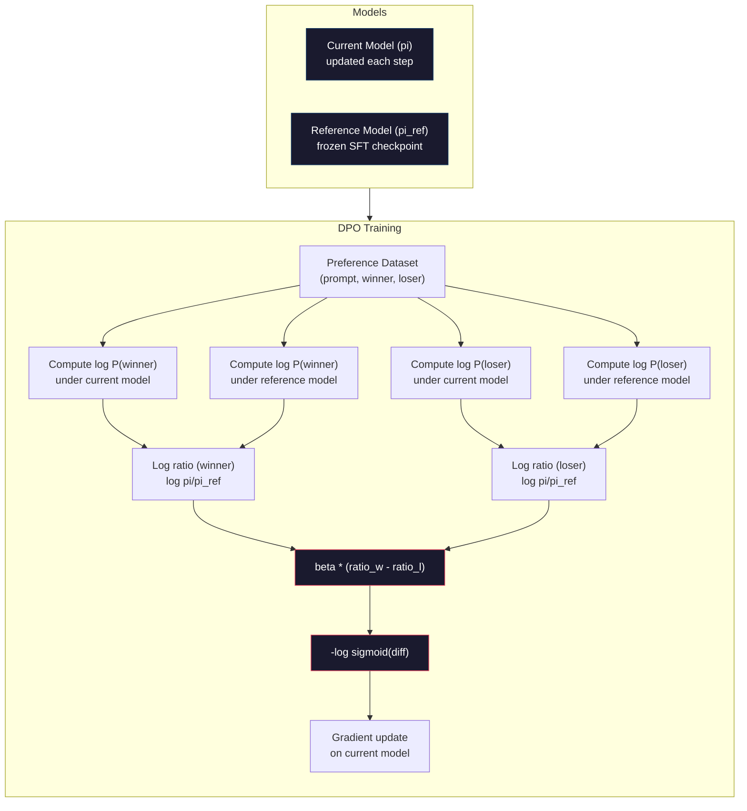

# DPO: прямая оптимизация предпочтений

> RLHF работает. Но для этого требуется обучить три модели (SFT, модель вознаграждения, политика), справиться с нестабильностью PPO и настроить штраф KL. DPO задаёт вопрос: что, если можно пропустить всё это? DPO напрямую оптимизирует языковую модель на парах предпочтений. Без модели вознаграждения. Без PPO. Один цикл обучения. Те же результаты.

**Type:** Build
**Languages:** Python (with numpy)
**Prerequisites:** Phase 10, Lesson 07 (RLHF)
**Time:** ~90 minutes

## Цели обучения

- Реализовать обучение DPO, напрямую оптимизирующее языковую модель на парах предпочтений без отдельной модели вознаграждения
- Вывести функцию потерь DPO и объяснить, как она неявно представляет модель вознаграждения через логарифмические вероятности политики
- Сравнить DPO и RLHF с точки зрения стабильности обучения, вычислительных затрат и количества требуемых моделей
- Настроить параметр beta, контролирующий, насколько сильно обученная политика отклоняется от референсной модели

## Проблема

В Уроке 07 вы построили пайплайн RLHF. Три этапа. Три модели. SFT-модель, модель вознаграждения и модель политики, оптимизируемая с помощью PPO. Одна только модель вознаграждения требовала тысяч пар человеческих предпочтений и отдельного цикла обучения. PPO требовал тщательной настройки коэффициента KL, скорости обучения, коэффициента отсечения (clip ratio) и числа эпох.

На практике обучение PPO печально известно своей нестабильностью. Небольшие изменения гиперпараметров приводят к расхождению обучения. Модель вознаграждения — несовершенный заменитель человеческих предпочтений, и политика находит способы эксплуатировать её слабости. Штраф KL помогает, но требует собственной настройки — слишком низкий, и вы получаете reward hacking, слишком высокий — и модель почти не обучается.

Именно из-за этой сложности большинство open-source моделей годами испытывали трудности с RLHF после публикации InstructGPT. Трёхэтапный пайплайн хрупок. У каждого этапа свои режимы отказа, и ошибки накапливаются.

В мае 2023 года Рафаэль Рафаилов, Арчит Шарма и коллеги из Стэнфорда опубликовали статью «Direct Preference Optimization: Your Language Model is Secretly a Reward Model». Ключевая идея: отдельная модель вознаграждения не нужна. Оптимальная функция вознаграждения математически определяется собственными вероятностями токенов языковой модели. Можно полностью пропустить модель вознаграждения и оптимизировать языковую модель напрямую на парах предпочтений.

DPO сводит RLHF к единственному шагу обучения с учителем. Одна модель. Одна функция потерь. Один цикл обучения. Никакого обучения с подкреплением. Zephyr-7B, одна из первых моделей, использовавших DPO в промышленном масштабе, сравнялась или превзошла модели, обученные полным RLHF, по нескольким бенчмаркам. Meta использовала DPO как часть пайплайна выравнивания Llama 3. Anthropic ссылается на методы в стиле DPO в своих исследованиях по выравниванию.

## Концепция

### Ключевая идея

RLHF оптимизирует следующую целевую функцию:

```
maximize: E[R(x, y)] - beta * KL(pi || pi_ref)
```

где R — модель вознаграждения, pi — политика, pi_ref — референсная модель, а beta — коэффициент KL.

Статья о DPO показала, что у этой целевой функции есть оптимальное решение в замкнутой форме. Для любой функции вознаграждения R оптимальная политика имеет вид:

```
pi*(y | x) = pi_ref(y | x) * exp(R(x, y) / beta) / Z(x)
```

где Z(x) — нормализующая константа. Преобразуя:

```
R(x, y) = beta * log(pi*(y | x) / pi_ref(y | x)) + beta * log Z(x)
```

В этом и состоит прорыв. Вознаграждение полностью выражается через вероятности модели политики и вероятности референсной модели. Обучать отдельную модель вознаграждения не нужно. Вознаграждение *неявно* заключено в отношении вероятностей.

Подставляя это в модель предпочтений Брэдли–Терри:

```
P(y_w > y_l | x) = sigmoid(R(x, y_w) - R(x, y_l))
                  = sigmoid(beta * (log pi(y_w|x)/pi_ref(y_w|x) - log pi(y_l|x)/pi_ref(y_l|x)))
```

Члены Z(x) сокращаются, поскольку оба ответа обусловлены одним и тем же промптом x. Остаётся функция, зависящая только от логарифмических вероятностей модели политики и референсной модели на предпочитаемом и отвергнутом ответах.

### Функция потерь DPO

```
L_DPO = -log(sigmoid(beta * (log pi(y_w|x)/pi_ref(y_w|x) - log pi(y_l|x)/pi_ref(y_l|x))))
```

Разберём каждый элемент:

- **y_w** = предпочитаемый (выигравший) ответ
- **y_l** = отвергнутый (проигравший) ответ
- **x** = промпт
- **pi** = текущая модель (обучаемая)
- **pi_ref** = референсная модель (замороженный SFT-чекпоинт)
- **beta** = параметр температуры, контролирующий отклонение от референсной модели (обычно от 0.1 до 0.5)

Отношение `log pi(y|x) / pi_ref(y|x)` — это логарифмическое отношение вероятностей. Когда оно положительно, текущая модель присваивает ответу y более высокую вероятность, чем референсная. Когда отрицательно — более низкую.

Функция потерь DPO подталкивает модель увеличивать логарифмическое отношение вероятностей для предпочитаемых ответов и уменьшать его для отвергнутых. Параметр beta контролирует, насколько агрессивно модель может отклоняться от референсной — маленький beta допускает большие отклонения, большой beta удерживает модель близко к референсной.



### Почему DPO проще

| Аспект | RLHF (PPO) | DPO |
|--------|-----------|-----|
| Моделей для обучения | 3 (SFT + модель вознаграждения + политика) | 1 (только политика) |
| Циклов обучения | 3 (SFT, обучение RM, PPO) | 2 (SFT, DPO) |
| Гиперпараметры | lr, коэффициент KL, clip ratio, lr RM, эпохи x3 | lr, beta, эпохи |
| Модель вознаграждения | Требуется (отдельное обучение) | Неявно присутствует в вероятностях модели |
| Алгоритм RL | PPO (сложный, нестабильный) | Обучение с учителем (стабильное) |
| Память GPU | 3-4 модели в памяти во время PPO | 2 модели (текущая + референсная) |
| Стабильность обучения | Чувствительна к гиперпараметрам | Устойчивая, похожа на SFT |

DPO требует две модели в памяти во время обучения — текущую модель и замороженную референсную. RLHF требует три или четыре: политику, референсную модель, модель вознаграждения и, опционально, базовую линию функции ценности. Для модели в 70B параметров каждая копия занимает 140 ГБ в FP16. Экономия памяти за счёт исключения модели вознаграждения существенна.

### Когда DPO превосходит RLHF

**Небольшие датасеты.** На 5000–20000 пар предпочтений DPO часто сравнивается или превосходит RLHF. Модели вознаграждения в RLHF нужно достаточно данных для обобщения — при ограниченных данных она переобучается и выдаёт ненадёжные сигналы вознаграждения. DPO обходит эту проблему, полностью не нуждаясь в модели вознаграждения.

**Ограниченные вычислительные ресурсы.** DPO требует примерно треть вычислительных затрат полного RLHF (один цикл обучения вместо трёх). Для команд без больших GPU-кластеров это практичный выбор.

**Быстрая итерация.** Хотите попробовать 10 разных датасетов предпочтений, чтобы найти лучший? DPO позволяет провести каждый эксперимент за часы. RLHF требует переобучения модели вознаграждения для каждого датасета.

### Когда RLHF превосходит DPO

**Обучение в большом масштабе.** В масштабе GPT-4 или Claude отдельная модель вознаграждения RLHF может улавливать более тонкие сигналы предпочтений. Модель вознаграждения выступает как выученная функция потерь, адаптирующаяся к сложным критериям качества.

**Сложные сигналы вознаграждения.** Когда «лучше» включает несколько измерений (полезность, безвредность, честность), модель вознаграждения может выучить этот многокритериальный компромисс. DPO рассматривает каждую пару предпочтений как бинарный сигнал — один лучше, другой хуже — без моделирования причин.

**Итеративное выравнивание.** Пайплайны RLHF могут генерировать новые ответы текущей политикой, получать оценки людей и переобучать модель вознаграждения в онлайн-цикле. DPO работает с фиксированным датасетом пар предпочтений. Constitutional AI (подход Anthropic) активно использует это итеративное свойство RLHF.

### Дальше DPO: KTO, ORPO, SimPO

DPO вдохновила целое семейство упрощённых методов выравнивания.

**KTO (Kahneman-Tversky Optimization, 2024):** пары вообще не нужны. KTO работает с непарной обратной связью — просто пометьте каждый ответ как «хороший» или «плохой», не сравнивая его с альтернативой. Это значительно упрощает сбор данных. Вместо того чтобы показывать аннотаторам два ответа и спрашивать «какой лучше?», вы показываете один ответ и спрашиваете «он хороший?». Функция потерь применяет неприятие потерь из теории перспектив: плохие ответы наказываются сильнее, чем вознаграждаются хорошие.

**ORPO (Odds Ratio Preference Optimization, 2024):** объединяет SFT и выравнивание в едином шаге обучения. Вместо того чтобы сначала выполнять SFT, а затем DPO, ORPO модифицирует функцию потерь SFT, включая сигнал предпочтений. Функция потерь состоит из двух членов: стандартной потери предсказания следующего токена на предпочитаемых ответах плюс члена отношения шансов (odds ratio), увеличивающего разрыв между вероятностями предпочитаемого и отвергнутого ответов. Один цикл обучения вместо двух.

**SimPO (Simple Preference Optimization, 2024):** полностью устраняет референсную модель. Вместо вычисления отношений логарифмических вероятностей относительно замороженной референсной модели SimPO использует среднюю логарифмическую вероятность ответа (нормализованную по длине) в качестве неявного вознаграждения. Это экономит память (референсная модель не нужна) и упрощает обучение. Нормализация по длине предотвращает предпочтение моделью более коротких ответов.

| Метод | Год | Моделей в памяти | Нужны пары? | Нужна референсная модель? | Циклов обучения |
|--------|------|-----------------|-------------|-----------------|----------------|
| RLHF | 2022 | 3-4 | Да (для RM) | Да | 3 |
| DPO | 2023 | 2 | Да | Да | 2 |
| KTO | 2024 | 2 | Нет (непарные) | Да | 2 |
| ORPO | 2024 | 1 | Да | Нет | 1 |
| SimPO | 2024 | 1 | Да | Нет | 1 |

Тенденция очевидна: каждый следующий метод устраняет ещё один элемент сложности. RLHF требовал модель вознаграждения и PPO. DPO устранила оба. KTO устранила парные данные. ORPO устранила отдельный этап SFT. SimPO устранила референсную модель. «Налог на выравнивание» — дополнительные вычислительные затраты и сложность перехода от базовой модели к выровненной — продолжает снижаться.

### Реальные развёртывания DPO

**Zephyr-7B (HuggingFace, октябрь 2023):** база Mistral 7B, SFT на UltraChat (200 тыс. примеров), затем DPO на UltraFeedback (60 тыс. пар предпочтений). Набрала 6.47 баллов на MT-Bench — лучший результат среди моделей 7B на тот момент. Для сравнения, Llama 2 Chat 70B набрала 6.86 балла, то есть Zephyr оказалась в пределах 6% от модели в 10 раз большего размера, используя только выравнивание через DPO.

**Llama 3 (Meta, апрель 2024):** использовала DPO после начальных этапов RLHF. Эта комбинация предполагает, что DPO и RLHF могут дополнять друг друга — RLHF для широкого выравнивания, DPO для целевой доработки.

**Neural Magic / nm-chat (2024):** применили DPO к нескольким open-source моделям, стабильно показывая улучшение на 5–15% по бенчмаркам выравнивания по сравнению с базовыми моделями, прошедшими только SFT.

```figure
dpo-loss
```

## Реализация

### Шаг 1: Датасет предпочтений

Тот же формат, что и в RLHF — тройки (промпт, предпочитаемый ответ, отвергнутый ответ). DPO потребляет эти данные напрямую, без промежуточной модели вознаграждения.

```python
import numpy as np
import sys
import os
sys.path.insert(0, os.path.join(os.path.dirname(__file__), "..", "..", "04-pre-training-mini-gpt", "code"))
from main import MiniGPT, LayerNorm, Embedding, TransformerBlock

PREFERENCE_DATA = [
    {
        "prompt": "What is the capital of France?",
        "preferred": "The capital of France is Paris.",
        "rejected": "France is a country in Europe. It has many cities. The capital is Paris. Paris is known for the Eiffel Tower.",
    },
    {
        "prompt": "Explain gravity in one sentence.",
        "preferred": "Gravity is the force that attracts objects with mass toward each other.",
        "rejected": "Gravity is something that makes things fall down when you drop them.",
    },
    {
        "prompt": "What is 15 times 7?",
        "preferred": "15 times 7 is 105.",
        "rejected": "Let me think about this. 15 times 7. Well, 10 times 7 is 70, and 5 times 7 is 35, so the answer might be around 105.",
    },
    {
        "prompt": "Name three programming languages.",
        "preferred": "Python, Rust, and TypeScript.",
        "rejected": "There are many programming languages. Some popular ones include various languages like Python and others.",
    },
    {
        "prompt": "What year did World War II end?",
        "preferred": "World War II ended in 1945.",
        "rejected": "World War II was a major global conflict. It involved many countries. The war ended in the mid-1940s, specifically in 1945.",
    },
    {
        "prompt": "Define machine learning.",
        "preferred": "Machine learning is a field where algorithms learn patterns from data to make predictions without being explicitly programmed.",
        "rejected": "Machine learning is a type of AI. AI stands for artificial intelligence. Machine learning uses data to learn.",
    },
]
```

### Шаг 2: Логарифмическая вероятность последовательности

Для функции потерь DPO требуется вычислить суммарную логарифмическую вероятность ответа при заданном промпте. Это означает прогон модели на полной последовательности (промпт + ответ) и суммирование логарифмических вероятностей каждого токена ответа.

```python
def tokenize_sequence(text, vocab_size=256):
    return [min(t, vocab_size - 1) for t in list(text.encode("utf-8"))]


def compute_sequence_log_prob(model, prompt_tokens, response_tokens, max_seq_len=128):
    full_sequence = prompt_tokens + response_tokens
    if len(full_sequence) > max_seq_len:
        full_sequence = full_sequence[:max_seq_len]

    if len(full_sequence) < 2:
        return 0.0

    input_ids = np.array(full_sequence[:-1]).reshape(1, -1)
    target_ids = np.array(full_sequence[1:])

    logits = model.forward(input_ids)
    logits = logits[0]

    max_logits = logits.max(axis=-1, keepdims=True)
    log_probs = logits - max_logits - np.log(
        np.exp(logits - max_logits).sum(axis=-1, keepdims=True)
    )

    prompt_len = len(prompt_tokens)
    response_start = max(0, prompt_len - 1)
    response_end = len(target_ids)

    if response_start >= response_end:
        return 0.0

    response_log_probs = log_probs[response_start:response_end, :]
    response_targets = target_ids[response_start:response_end]

    total_log_prob = 0.0
    for i, target in enumerate(response_targets):
        total_log_prob += response_log_probs[i, target]

    return total_log_prob
```

Эта функция — рабочая лошадка DPO. Для каждой пары предпочтений она запускается четыре раза: модель на предпочитаемом ответе, модель на отвергнутом ответе, референсная модель на предпочитаемом ответе, референсная модель на отвергнутом ответе. Это 4 прямых прохода на один обучающий пример против генерации + оценки вознаграждения + оценки ценности + обновления PPO в RLHF. Проще, быстрее, стабильнее.

### Шаг 3: Функция потерь DPO

Суть статьи в коде. Одна функция. Одна функция потерь. Без модели вознаграждения.

```python
def sigmoid(x):
    return np.where(
        x >= 0,
        1.0 / (1.0 + np.exp(-x)),
        np.exp(x) / (1.0 + np.exp(x))
    )


def dpo_loss(policy_logprob_preferred, policy_logprob_rejected,
             ref_logprob_preferred, ref_logprob_rejected, beta=0.1):
    preferred_ratio = policy_logprob_preferred - ref_logprob_preferred
    rejected_ratio = policy_logprob_rejected - ref_logprob_rejected

    logit = beta * (preferred_ratio - rejected_ratio)

    loss = -np.log(sigmoid(logit) + 1e-8)

    preferred_reward = beta * preferred_ratio
    rejected_reward = beta * rejected_ratio

    return loss, {
        "preferred_ratio": float(preferred_ratio),
        "rejected_ratio": float(rejected_ratio),
        "logit": float(logit),
        "implicit_preferred_reward": float(preferred_reward),
        "implicit_rejected_reward": float(rejected_reward),
        "reward_margin": float(preferred_reward - rejected_reward),
    }
```

`preferred_ratio` и `rejected_ratio` — это логарифмические отношения вероятностей из вывода DPO. Когда текущая модель присваивает более высокую вероятность предпочитаемому ответу (относительно референсной) и более низкую — отвергнутому, логит положителен, а потеря мала. Сигнал обучения подталкивает модель именно в этом направлении.

`implicit_preferred_reward` и `implicit_rejected_reward` — это вознаграждения, которые функция потерь DPO неявно присваивает. Их можно извлечь, чтобы проверить, что обучение работает — разрыв между вознаграждениями предпочитаемого и отвергнутого ответов должен увеличиваться в ходе обучения.

### Шаг 4: Цикл обучения DPO

Стандартный цикл обучения с учителем. Без PPO. Без модели вознаграждения. Только прямые проходы и обновления градиента.

```python
def copy_model_weights(source, target):
    target.embedding.token_embed = source.embedding.token_embed.copy()
    target.embedding.pos_embed = source.embedding.pos_embed.copy()
    target.ln_f.gamma = source.ln_f.gamma.copy()
    target.ln_f.beta = source.ln_f.beta.copy()
    for s_block, t_block in zip(source.blocks, target.blocks):
        t_block.attn.W_q = s_block.attn.W_q.copy()
        t_block.attn.W_k = s_block.attn.W_k.copy()
        t_block.attn.W_v = s_block.attn.W_v.copy()
        t_block.attn.W_out = s_block.attn.W_out.copy()
        t_block.ffn.W1 = s_block.ffn.W1.copy()
        t_block.ffn.W2 = s_block.ffn.W2.copy()
        t_block.ffn.b1 = s_block.ffn.b1.copy()
        t_block.ffn.b2 = s_block.ffn.b2.copy()
        t_block.ln1.gamma = s_block.ln1.gamma.copy()
        t_block.ln1.beta = s_block.ln1.beta.copy()
        t_block.ln2.gamma = s_block.ln2.gamma.copy()
        t_block.ln2.beta = s_block.ln2.beta.copy()


def dpo_train(policy_model, reference_model, preference_data,
              num_epochs=5, lr=5e-6, beta=0.1, max_seq_len=128):
    print(f"DPO Training: {len(preference_data)} pairs, {num_epochs} epochs, "
          f"lr={lr}, beta={beta}")
    print()

    losses = []
    margins = []

    for epoch in range(num_epochs):
        epoch_loss = 0.0
        epoch_margin = 0.0
        num_examples = 0

        indices = np.random.permutation(len(preference_data))

        for idx in indices:
            pair = preference_data[idx]

            prompt_tokens = tokenize_sequence(pair["prompt"])
            preferred_tokens = tokenize_sequence(pair["preferred"])
            rejected_tokens = tokenize_sequence(pair["rejected"])

            pi_logprob_w = compute_sequence_log_prob(
                policy_model, prompt_tokens, preferred_tokens, max_seq_len
            )
            pi_logprob_l = compute_sequence_log_prob(
                policy_model, prompt_tokens, rejected_tokens, max_seq_len
            )
            ref_logprob_w = compute_sequence_log_prob(
                reference_model, prompt_tokens, preferred_tokens, max_seq_len
            )
            ref_logprob_l = compute_sequence_log_prob(
                reference_model, prompt_tokens, rejected_tokens, max_seq_len
            )

            loss, metrics = dpo_loss(
                pi_logprob_w, pi_logprob_l,
                ref_logprob_w, ref_logprob_l, beta
            )

            update_direction = 1.0 if metrics["logit"] < 0 else -0.1
            for block in policy_model.blocks:
                block.ffn.W1 += lr * update_direction * np.random.randn(*block.ffn.W1.shape) * 0.01
                block.ffn.W2 += lr * update_direction * np.random.randn(*block.ffn.W2.shape) * 0.01

            epoch_loss += loss
            epoch_margin += metrics["reward_margin"]
            num_examples += 1
            losses.append(float(loss))
            margins.append(metrics["reward_margin"])

        avg_loss = epoch_loss / max(num_examples, 1)
        avg_margin = epoch_margin / max(num_examples, 1)

        print(f"  Epoch {epoch + 1}/{num_epochs} | Loss: {avg_loss:.4f} | "
              f"Avg Margin: {avg_margin:.4f}")

    return policy_model, losses, margins
```

Цикл обучения приятно прост по сравнению с RLHF. Для каждой пары предпочтений: вычислить четыре логарифмические вероятности (две модели, два ответа), подставить их в функцию потерь DPO, вычислить градиент, обновить политику. Без шага генерации. Без инференса модели вознаграждения. Без оценки преимущества. Без отсечения.

### Шаг 5: Сравнение DPO и RLHF

Измерьте неявные margin-разрывы вознаграждения и сдвиги логарифмических вероятностей, чтобы сравнить DPO с моделью RLHF из Урока 07.

```python
def evaluate_preference_accuracy(model, reference_model, preference_data, beta=0.1, max_seq_len=128):
    correct = 0
    total = 0

    for pair in preference_data:
        prompt_tokens = tokenize_sequence(pair["prompt"])
        preferred_tokens = tokenize_sequence(pair["preferred"])
        rejected_tokens = tokenize_sequence(pair["rejected"])

        pi_w = compute_sequence_log_prob(model, prompt_tokens, preferred_tokens, max_seq_len)
        pi_l = compute_sequence_log_prob(model, prompt_tokens, rejected_tokens, max_seq_len)
        ref_w = compute_sequence_log_prob(reference_model, prompt_tokens, preferred_tokens, max_seq_len)
        ref_l = compute_sequence_log_prob(reference_model, prompt_tokens, rejected_tokens, max_seq_len)

        preferred_reward = beta * (pi_w - ref_w)
        rejected_reward = beta * (pi_l - ref_l)

        if preferred_reward > rejected_reward:
            correct += 1
        total += 1

    return correct / max(total, 1)


def analyze_implicit_rewards(model, reference_model, preference_data, beta=0.1, max_seq_len=128):
    print("Implicit Reward Analysis:")
    print("-" * 65)
    print(f"  {'Prompt':<30} {'Pref Reward':>12} {'Rej Reward':>12} {'Margin':>10}")
    print("  " + "-" * 60)

    for pair in preference_data:
        prompt_tokens = tokenize_sequence(pair["prompt"])
        preferred_tokens = tokenize_sequence(pair["preferred"])
        rejected_tokens = tokenize_sequence(pair["rejected"])

        pi_w = compute_sequence_log_prob(model, prompt_tokens, preferred_tokens, max_seq_len)
        pi_l = compute_sequence_log_prob(model, prompt_tokens, rejected_tokens, max_seq_len)
        ref_w = compute_sequence_log_prob(reference_model, prompt_tokens, preferred_tokens, max_seq_len)
        ref_l = compute_sequence_log_prob(reference_model, prompt_tokens, rejected_tokens, max_seq_len)

        pref_reward = beta * (pi_w - ref_w)
        rej_reward = beta * (pi_l - ref_l)
        margin = pref_reward - rej_reward

        truncated = pair["prompt"][:28] + ".." if len(pair["prompt"]) > 30 else pair["prompt"]
        print(f"  {truncated:<30} {pref_reward:>12.4f} {rej_reward:>12.4f} {margin:>10.4f}")

    print()
```

### Шаг 6: Анализ чувствительности к beta

Параметр beta — это аналог коэффициента KL в RLHF для DPO. Он контролирует, насколько сильно модель может отклоняться от референсной. Этот эксперимент демонстрирует его эффект.

```python
def beta_sensitivity_analysis(sft_model, preference_data, betas, max_seq_len=128):
    print("Beta Sensitivity Analysis")
    print("-" * 60)
    print(f"  {'Beta':>8} {'Final Loss':>12} {'Final Margin':>14} {'Accuracy':>10}")
    print("  " + "-" * 55)

    results = []

    for beta in betas:
        policy = MiniGPT(
            vocab_size=256, embed_dim=128, num_heads=4,
            num_layers=4, max_seq_len=max_seq_len, ff_dim=512
        )
        reference = MiniGPT(
            vocab_size=256, embed_dim=128, num_heads=4,
            num_layers=4, max_seq_len=max_seq_len, ff_dim=512
        )
        copy_model_weights(sft_model, policy)
        copy_model_weights(sft_model, reference)

        policy, losses, margins_list = dpo_train(
            policy, reference, preference_data,
            num_epochs=3, lr=5e-6, beta=beta, max_seq_len=max_seq_len
        )

        accuracy = evaluate_preference_accuracy(
            policy, reference, preference_data, beta, max_seq_len
        )

        final_loss = losses[-1] if losses else 0
        final_margin = margins_list[-1] if margins_list else 0

        print(f"  {beta:>8.3f} {final_loss:>12.4f} {final_margin:>14.4f} {accuracy:>10.1%}")
        results.append({
            "beta": beta,
            "final_loss": final_loss,
            "final_margin": final_margin,
            "accuracy": accuracy,
        })

        print()

    return results
```

Маленький beta (0.01) позволяет модели свободно отклоняться от референсной — быстрое обучение, но риск вырожденных решений. Большой beta (1.0) удерживает модель близко к референсной — стабильно, но медленно обучается. Оптимальная точка для большинства приложений — от 0.1 до 0.3.

## Применение

### Демонстрация полного пайплайна DPO

```python
if __name__ == "__main__":
    np.random.seed(42)

    print("=" * 70)
    print("DPO: DIRECT PREFERENCE OPTIMIZATION")
    print("=" * 70)
    print()

    print("STEP 1: Initialize SFT Model (from Lesson 06)")
    print("-" * 50)
    sft_model = MiniGPT(
        vocab_size=256, embed_dim=128, num_heads=4,
        num_layers=4, max_seq_len=128, ff_dim=512
    )
    print(f"  Parameters: {sft_model.count_parameters():,}")
    print()

    print("STEP 2: DPO Training")
    print("-" * 50)

    policy_model = MiniGPT(
        vocab_size=256, embed_dim=128, num_heads=4,
        num_layers=4, max_seq_len=128, ff_dim=512
    )
    reference_model = MiniGPT(
        vocab_size=256, embed_dim=128, num_heads=4,
        num_layers=4, max_seq_len=128, ff_dim=512
    )
    copy_model_weights(sft_model, policy_model)
    copy_model_weights(sft_model, reference_model)

    policy_model, losses, margins = dpo_train(
        policy_model, reference_model, PREFERENCE_DATA,
        num_epochs=5, lr=5e-6, beta=0.1
    )
    print()

    print("=" * 70)
    print("STEP 3: Evaluate")
    print("=" * 70)
    print()

    pre_accuracy = evaluate_preference_accuracy(
        sft_model, reference_model, PREFERENCE_DATA, beta=0.1
    )
    post_accuracy = evaluate_preference_accuracy(
        policy_model, reference_model, PREFERENCE_DATA, beta=0.1
    )

    print(f"  Preference accuracy (pre-DPO):  {pre_accuracy:.1%}")
    print(f"  Preference accuracy (post-DPO): {post_accuracy:.1%}")
    print()

    analyze_implicit_rewards(policy_model, reference_model, PREFERENCE_DATA, beta=0.1)

    print("=" * 70)
    print("STEP 4: Training Dynamics")
    print("=" * 70)
    print()

    if losses:
        print("  Loss curve:")
        window = max(1, len(losses) // 5)
        for i in range(0, len(losses), window):
            chunk = losses[i:i + window]
            avg = sum(chunk) / len(chunk)
            print(f"    Steps {i:3d}-{i + len(chunk) - 1:3d}: loss = {avg:.4f}")
        print()

    if margins:
        print("  Reward margin curve:")
        window = max(1, len(margins) // 5)
        for i in range(0, len(margins), window):
            chunk = margins[i:i + window]
            avg = sum(chunk) / len(chunk)
            print(f"    Steps {i:3d}-{i + len(chunk) - 1:3d}: margin = {avg:.4f}")
        print()

    print("=" * 70)
    print("STEP 5: Beta Sensitivity")
    print("=" * 70)
    print()

    beta_results = beta_sensitivity_analysis(
        sft_model, PREFERENCE_DATA, betas=[0.01, 0.1, 0.3, 1.0]
    )

    print("=" * 70)
    print("DPO vs RLHF COMPARISON")
    print("=" * 70)
    print()
    print("  DPO advantages:")
    print("    - 1 training loop (vs 3 for RLHF)")
    print("    - 2 models in memory (vs 3-4 for RLHF)")
    print("    - Supervised learning (vs RL, more stable)")
    print("    - No reward model to train or maintain")
    print()
    print("  RLHF advantages:")
    print("    - Separate reward model captures complex preferences")
    print("    - Online learning: generate, rate, retrain")
    print("    - Better for multi-objective alignment")
    print("    - Proven at largest scales (GPT-4, Claude)")
    print()
    print("  Practical guidance:")
    print("    - Start with DPO. It's simpler and often sufficient.")
    print("    - Switch to RLHF if DPO plateaus on your eval metrics.")
    print("    - Many production systems use both: RLHF first, DPO to refine.")
```

## Поставка результата

Этот урок производит `outputs/prompt-alignment-method-selector.md` — промпт, который помогает выбрать правильный метод выравнивания (SFT, RLHF, DPO, KTO, ORPO, SimPO) для вашей задачи. Исходя из доступности данных, бюджета вычислений и целей выравнивания, он рекомендует метод и план обучения.

## Упражнения

1. Реализуйте KTO (Kahneman-Tversky Optimization). KTO не нуждается в парах — просто пометьте каждый ответ как «хороший» или «плохой». Потеря для хорошего ответа — `-log(sigmoid(beta * log_ratio))`, а для плохого — `-log(1 - sigmoid(beta * log_ratio))` с множителем неприятия потерь (обычно 1.5x) на потере для плохого ответа. Обучите на тех же данных (рассматривая предпочитаемый ответ как «хороший», а отвергнутый — как «плохой» независимо друг от друга) и сравните точность с DPO.

2. Реализуйте DPO с нормализацией по длине. Вместо исходных логарифмических вероятностей разделите их на число токенов ответа: `normalized_logprob = total_logprob / num_tokens`. Это предотвращает предпочтение моделью более коротких ответов (у которых выше суммарная логарифмическая вероятность). Сравните margin-разрывы неявного вознаграждения с нормализацией и без неё.

3. Постройте комбинированную функцию потерь в стиле ORPO. Добавьте стандартную потерю предсказания следующего токена на предпочитаемом ответе к потере DPO: `L = L_sft(preferred) + alpha * L_dpo`. Попробуйте значения alpha 0.1, 0.5 и 1.0. Комбинированная потеря должна дать модель, которая одновременно следует инструкциям (за счёт члена SFT) и предпочитает лучшие ответы (за счёт члена DPO), устраняя необходимость в отдельном этапе SFT.

4. Реализуйте итеративный DPO. Запустите DPO на 3 эпохи, затем сгенерируйте новые ответы обученной моделью, сопоставьте их с исходными предпочитаемыми ответами как новые пары предпочтений и снова запустите DPO. Два раунда такого процесса «самоигры» (self-play). Сравните точность предпочтений после раунда 1 и раунда 2, чтобы увидеть, помогает ли итеративное уточнение.

5. Сравните DPO с разными референсными моделями. Вместо использования SFT-чекпоинта в качестве референсной модели попробуйте: (a) базовую модель (до SFT), (b) чекпоинт после 1-й эпохи DPO, (c) экспоненциальное скользящее среднее модели политики. Укажите, какая референсная модель даёт наивысшую точность предпочтений и наиболее стабильную кривую обучения.

## Ключевые термины

| Термин | Что говорят | Что это на самом деле означает |
|------|----------------|----------------------|
| DPO | «RLHF без RL» | Direct Preference Optimization: алгоритм обучения с учителем, оптимизирующий языковую модель напрямую на парах предпочтений, минуя модель вознаграждения и PPO |
| Неявное вознаграждение | «Вознаграждение внутри модели» | Функция вознаграждения определяется логарифмическим отношением вероятностей между политикой и референсной моделью — отдельная модель вознаграждения не нужна |
| Beta (DPO) | «Температура» | Контролирует, насколько сильно политика может отклоняться от референсной модели — маленький beta допускает большие отклонения, большой beta удерживает модель близко |
| Логарифмическое отношение вероятностей | «Насколько изменилась модель» | log pi(y\|x) - log pi_ref(y\|x) — положительное значение означает, что текущая модель присваивает более высокую вероятность, чем референсная |
| Референсная модель | «Замороженный чекпоинт» | Копия SFT-модели, чьи веса никогда не меняются — служит якорем для вычисления отношений вероятностей |
| KTO | «DPO без пар» | Kahneman-Tversky Optimization: работает с непарными метками «хороший» или «плохой» вместо требования пар предпочтений |
| ORPO | «Выравнивание в один шаг» | Odds Ratio Preference Optimization: объединяет SFT и выравнивание в едином цикле обучения, добавляя член предпочтений к потере SFT |
| SimPO | «Референсная модель не нужна» | Simple Preference Optimization: устраняет референсную модель, используя нормализованную по длине среднюю логарифмическую вероятность в качестве неявного вознаграждения |
| Налог на выравнивание | «Цена безопасности моделей» | Дополнительные вычислительные затраты, данные и сложность, необходимые для перехода от базовой модели к выровненной — DPO значительно снижает эту цену |

## Дополнительное чтение

- [Rafailov et al., 2023 -- "Direct Preference Optimization: Your Language Model is Secretly a Reward Model"](https://arxiv.org/abs/2305.18290) — статья о DPO, упростившая выравнивание от RLHF до обучения с учителем
- [Tunstall et al., 2023 -- "Zephyr: Direct Distillation of LM Alignment"](https://arxiv.org/abs/2310.16944) — Zephyr-7B, показывающая, что DPO на UltraFeedback сравнивается с RLHF по бенчмаркам
- [Ethayarajh et al., 2024 -- "KTO: Model Alignment as Prospect Theoretic Optimization"](https://arxiv.org/abs/2402.01306) — устранение необходимости в парных предпочтениях
- [Hong et al., 2024 -- "ORPO: Monolithic Preference Optimization without Reference Model"](https://arxiv.org/abs/2403.07691) — объединение SFT и выравнивания в один шаг
- [Meng et al., 2024 -- "SimPO: Simple Preference Optimization with a Reference-Free Reward"](https://arxiv.org/abs/2405.14734) — полное устранение референсной модели
- [Llama 3 Technical Report](https://arxiv.org/abs/2407.21783) — пайплайн выравнивания Meta, объединяющий RLHF и DP