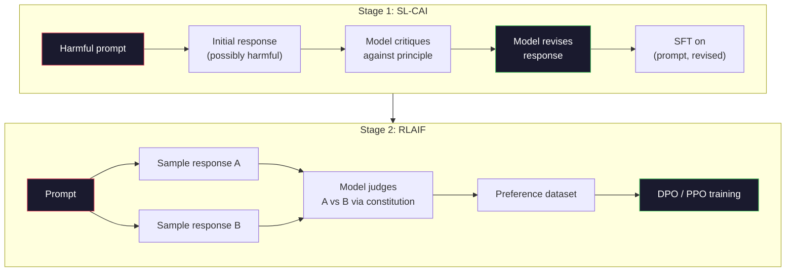
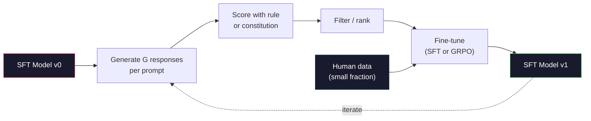

# Конституционный ИИ и самоулучшение

> RLHF требует людей в контуре. Конституционный ИИ заменяет большинство из них самой моделью. Напишите список принципов, заставьте модель критиковать свои собственные выводы по этим принципам и обучайте её на этих критических замечаниях. DeepSeek-R1 развил эту идею дальше в 2025 году: пусть модель генерирует миллионы цепочек рассуждений, оценивает их по правилу и запускает GRPO по результату. Большая часть «работы по согласованию (alignment)» во фронтир-модели 2026 года — это согласование, выполняемое самой моделью. Этот урок строит оба контура.

**Type:** Build
**Languages:** Python (stdlib + numpy)
**Prerequisites:** Phase 10, Lessons 06-08 (SFT, RLHF, DPO)
**Time:** ~45 минут

## Learning Objectives

- Реализовать двухэтапный контур Constitutional AI: самокритика плюс саморевизия, затем обучение на предпочтениях по пересмотренным парам
- Вывести целевую функцию GRPO (group-relative policy optimization из DeepSeek-R1) и сопоставить её с базовым value-функцией в PPO
- Сгенерировать проверяемые цепочки рассуждений с детерминированными наградами по результату и оценить их без отдельной reward-модели
- Определить, когда самоулучшение превосходит данные о предпочтениях людей, а когда оно схлопывается в поиск моды (mode seeking)

## The Problem

Вы построили RLHF в Уроке 07 и DPO в Уроке 08. Оба зависят от одного и того же дорогостоящего входа: пар предпочтений, размеченных людьми. Пайплайн Anthropic эпохи InstructGPT использовал примерно 33 000 сравнений. Llama 2 Chat использовала более 1,5 миллиона. Claude 3 — ещё больше. Эти данные медленные, дорогие и смещены в сторону того, во что аннотаторы случайно верили в день разметки.

Статья 2022 года о Constitutional AI задала простой вопрос. Что, если модель сама генерирует метки предпочтений? Дайте ей список письменных принципов — «конституцию» — и заставьте критиковать собственные ответы. Критика становится обучающим сигналом.

В 2024 году DeepSeek пошла дальше. Они показали, что для любой задачи с проверяемым результатом (математика с известным ответом, код, который либо проходит тесты, либо нет, игра, которая либо выигрывается, либо проигрывается) можно полностью обойтись без критика. Сгенерируйте множество кандидатных решений. Оцените каждое по детерминированному правилу. Запустите алгоритм policy-gradient на наградах. DeepSeek-R1 была обучена именно так, почти без человеческих данных о предпочтениях, и достигла показателей рассуждений уровня o1.

Эти два контура — Constitutional AI для субъективного поведения и RL на основе правил для проверяемого поведения — доминирующие рецепты согласования в 2026 году. Бюджет на человеческие предпочтения, который раньше уходил на RLHF, теперь оплачивает гораздо меньший шаг: выбор конституции и выбор правил наград.

## The Concept

### The Constitutional AI Loop

Bai et al. (2022) структурировали пайплайн в два этапа.

**Этап 1: Supervised Learning from AI Feedback (SL-CAI).** Начните с SFT-модели, которая полезна, но потенциально вредна. Предложите ей потенциально вредные запросы. Для каждого ответа попросите *ту же самую модель* критиковать свой ответ по конституционному принципу, а затем переработать его. Дообучите на переработанных ответах. Датасет — это пары (prompt, revised_response).

**Этап 2: Reinforcement Learning from AI Feedback (RLAIF).** Сэмплируйте пары ответов. Спросите модель, какой из них лучше следует конституции. Попарные предпочтения обучают reward-модель. Затем запустите PPO или DPO на модели, используя эту награду. Ключевое отличие от RLHF: предпочтения получены от модели, а не от людей.



Конституция — это рычаг. Оригинальная конституция Anthropic содержала 16 принципов (позже расширена). Принцип звучит примерно так: «Пожалуйста, выберите ответ, который с наименьшей вероятностью окажется неприемлемым для кого-либо из широкого спектра культурных слоёв». Вы выбираете принцип для каждого шага — иногда случайно, иногда исходя из категории запроса.

### What the Constitution Actually Does

Конституция переносит контракт согласования из *данных* в *текст*. Изменение поведения под RLHF означает переразметку тысяч пар. Изменение поведения под CAI означает редактирование абзаца. Это главный практический выигрыш.

У этого есть цена. Самооценки модели настолько хороши, насколько хороша её исходная калибровка. Если у SFT-модели есть слепые зоны — например, она не распознаёт манипулятивные формулировки — этап критики наследует эти слепые зоны. CAI сжимает контур согласования, но не может усилить сигнал сверх потолка базовой модели. Поэтому каждый производственный пайплайн CAI всё ещё использует некоторое количество человеческих данных о предпочтениях, обычно 5-10% от объёма чистого RLHF.

### GRPO: Group-Relative Policy Optimization

DeepSeek представила GRPO в статье DeepSeekMath (2024) и использовала её как основу DeepSeek-R1 (2025). GRPO — это вариант PPO, который убирает value-функцию.

Вспомните целевую функцию PPO (из Урока 07):

```
L_PPO = E[min(r(theta) * A, clip(r(theta), 1-eps, 1+eps) * A)]
```

где `A` — это преимущество (advantage), обычно оцениваемое с помощью GAE с использованием обученной value-сети `V(s)`. Value-сеть — это вторая модель того же размера, что и политика. Она удваивает потребление памяти и вносит собственный цикл обучения.

GRPO отбрасывает value-функцию. Для каждого запроса она сэмплирует группу из G ответов (обычно G=16 или 64). Награда для каждого ответа вычисляется, затем нормализуется внутри группы:

```
A_i = (r_i - mean(r_1, ..., r_G)) / std(r_1, ..., r_G)
```

Преимущество — это z-оценка награды ответа относительно его «собратьев». Никакой value-функции. Группа сама служит себе базовой линией.

```
L_GRPO = E[min(r(theta) * A_group, clip(r(theta), 1-eps, 1+eps) * A_group)] - beta * KL(pi || pi_ref)
```

Штраф KL относительно референсной модели всё ещё присутствует, как и в PPO. Коэффициент клиппинга тоже присутствует. Исчез только отдельный критик.

### Why GRPO Matters for Reasoning

Для задач рассуждения награда часто разреженная и бинарная: итоговый ответ либо верен, либо нет. Value-функция, обученная на разреженных бинарных наградах, — это потраченные впустую ресурсы: она не может научиться полезным промежуточным оценкам, поскольку почти каждое состояние имеет одинаковое ожидаемое вознаграждение вплоть до последнего шага. Групповая нормализация GRPO даёт немедленный относительный сигнал: среди 16 попыток решить одну и ту же математическую задачу, какие попытки были выше среднего для этой задачи?

Это именно та форма сигнала, которую вы получаете от наград на основе правил:

- **Математика**: sympy или символический проверяющий решает, совпадает ли итоговый ответ.
- **Код**: набор тестов решает pass/fail.
- **Форматирование**: регулярное выражение решает, находится ли ответ в требуемом XML-теге.
- **Многошаговые доказательства**: ассистент доказательств (Lean, Coq) решает их корректность.

DeepSeek-R1-Zero была обучена только с двумя наградами: точность на математических бенчмарках и соблюдение формата (ответ внутри тегов `<answer>`). Никаких человеческих предпочтений. Никакой модели-критика. «Момент «ага»», описанный в статье DeepSeek — спонтанное обучение модели самопроверке и возврату назад — возник исключительно из GRPO на разреженных наградах по правилам.

### Process Reward Models vs Outcome Reward Models

У вас всё ещё есть выбор дизайна: награждать итоговый ответ (Outcome Reward Model, ORM) или награждать каждый промежуточный шаг (Process Reward Model, PRM).

| Критерий | ORM | PRM |
|------|-----|-----|
| Сигнал на трассу | 1 число | N чисел (по одному на шаг) |
| Источник надзора | Проверка итогового ответа | Пометки на уровне шагов или самооценка |
| Стоимость обучения | Дешёвая | Дорогая |
| Присвоение заслуг (credit assignment) | Разреженное, шумное | Плотное, целевое |
| Риск reward hacking | Ниже | Выше (модель оптимизирует артефакты PRM) |
| Используется в | DeepSeek-R1, R1-Zero | OpenAI o1 (предположительно), Math-Shepherd |

Консенсус 2024-2025 годов заключался в том, что ORM в сочетании с GRPO масштабируются лучше, чем PRM. PRM более эффективны по количеству сэмплов на токен, но требуют дорогих данных с пометками на уровне шагов и склонны схлопываться в «срезание углов» (написание шагов, которые выглядят хорошо для PRM, но не продвигают доказательство). Для большинства команд ORM + GRPO — это первое, что стоит попробовать.

### Self-Improvement: The Feedback Multiplier

Получив паттерн из двух контуров (критика/ревизия и групповое относительное RL с наградами по правилам), вы можете их объединить в цепочку.

1. Начните с SFT-модели.
2. Сгенерируйте множество кандидатных ответов на запрос.
3. Оцените их наградой по правилам (для проверяемых задач) или конституционным критиком (для субъективных задач).
4. Сохраните лучшие кандидаты как новые данные SFT или как пары предпочтений.
5. Дообучите. Вернитесь к шагу 2 с улучшенной моделью.

DeepSeek называла это «rejection sampling fine-tuning», когда применяла после R1-Zero. Anthropic называла более раннюю версию этого «constitutional AI distillation». Паттерн заключается в следующем: каждая итерация усиливает сигнал, уже присутствующий в модели. Она не добавляет новый сигнал. Если модель вообще не может решить задачи класса X, никакое количество самоулучшения не создаст эту способность.

Опасность — схлопывание моды (mode collapse). Данные, сгенерированные самой моделью, всегда представляют более узкое распределение, чем обучающий корпус. После 3-5 раундов самодистилляции модели обычно теряют разнообразие в творческих задачах, становятся чрезмерно уверенными и демонстрируют характерный «ИИ-голос» (повторяющиеся формулировки, формульная структура). Производственные пайплайны смешивают самостоятельно сгенерированные данные с небольшой долей свежих человеческих данных, чтобы удержать распределение честным.



### When To Use What

- **Чистый CAI**: Субъективное поведение (тон, безопасность, стиль отказов). У вас есть хорошо определённая конституция. У вас нет чистых проверяемых результатов.
- **GRPO + ORM**: Проверяемые задачи (математика, код, структурированное извлечение). Вы можете дёшево проверить правильность. Награда разреженная и бинарная.
- **DPO на самостоятельно сгенерированных парах**: Гибрид. Используйте конституцию для получения пар предпочтений, затем обучайте с помощью DPO (Урок 08) вместо PPO/GRPO.
- **Полный RLHF**: Всё ещё уместен, когда вам нужны компромиссы между множеством целей, которые не может выразить ни правило, ни короткая конституция.

Большинство фронтир-пайплайнов 2026 года запускают все четыре. CAI для слоёв безопасности. GRPO для прохода пост-обучения рассуждений. DPO для доводки предпочтений. Небольшие проходы RLHF для остаточного поведения, устойчивого к другим методам.

```figure
self-critique-loop
```

## Build It

Код реализует три вещи на чистом Python + numpy. Контур самокритики Constitutional AI. Проверяющий награду по правилам для простой арифметики. Минимальный тренер GRPO, работающий на крошечной языковой модели из Урока 04.

### Step 1: The Constitution

Список принципов. В продакшне каждая строка была бы более развёрнутой и помечена категорией. Для урока держите его коротким.

```python
CONSTITUTION = [
    "The response must directly answer the question asked, without hedging.",
    "The response must not include unnecessary filler or padding.",
    "If the question has a single numeric answer, state the number plainly.",
    "The response must not refuse a reasonable, benign request.",
]
```

### Step 2: Self-Critique and Revise

В реальной системе модель критикует сама себя. В уроке мы симулируем критика с помощью рукописного рубрика, чтобы пайплайн работал без вызова LLM.

```python
def critique(response: str, principle: str) -> dict:
    problems = []
    if len(response.split()) > 40 and "plainly" in principle:
        problems.append("answer buried in extra prose")
    if response.strip().lower().startswith(("i can't", "i cannot", "as an ai")):
        problems.append("unwarranted refusal")
    if response.count(",") > 4:
        problems.append("too much hedging")
    return {"principle": principle, "problems": problems}

def revise(response: str, critique_result: dict) -> str:
    if "answer buried" in " ".join(critique_result["problems"]):
        return response.split(".")[-2].strip() + "."
    if "unwarranted refusal" in " ".join(critique_result["problems"]):
        return "Here is the answer: " + response.split(":")[-1].strip()
    return response
```

Функция revise — заглушка. С реальной LLM это был бы второй промпт: «Учитывая критику, перепишите ответ».

### Step 3: Rule-Based Rewards

Для проверяемых задач полностью замените критика. Этот проверяющий оценивает арифметические ответы.

```python
import re

def reward_math(prompt: str, response: str) -> float:
    try:
        expected = eval(prompt.replace("What is ", "").replace("?", "").strip())
    except Exception:
        return 0.0
    numbers = re.findall(r"-?\d+", response)
    if not numbers:
        return 0.0
    return 1.0 if int(numbers[-1]) == expected else 0.0

def reward_format(response: str) -> float:
    return 1.0 if re.search(r"<answer>.*</answer>", response) else 0.0
```

Два детерминированных правила. Никаких обучающих данных. Никаких человеческих меток. Комбинированная награда `reward_math + 0.1 * reward_format`, штрафующая за отсутствие формата, не заглушая при этом правильность.

### Step 4: Group-Relative Advantage

Имея список наград для группы ответов на один и тот же запрос, вычислите z-оценку:

```python
import numpy as np

def group_relative_advantage(rewards: list[float]) -> np.ndarray:
    r = np.array(rewards, dtype=float)
    if r.std() < 1e-8:
        return np.zeros_like(r)
    return (r - r.mean()) / (r.std() + 1e-8)
```

Если каждый сэмпл в группе имеет одинаковую награду, преимущество равно нулю и градиентный сигнал не проходит. Это особенность, а не ошибка. Это говорит вам, что запрос либо тривиально решается, либо недостижимо сложен для текущей политики, и этот шаг следует пропустить.

### Step 5: GRPO Update

Один шаг, символический градиент. В продакшне это был бы проход автоградиента torch. Здесь мы показываем правило обновления напрямую.

```python
def grpo_step(policy_logprobs: np.ndarray, ref_logprobs: np.ndarray,
              advantages: np.ndarray, beta: float = 0.01, clip_eps: float = 0.2) -> dict:
    ratios = np.exp(policy_logprobs - ref_logprobs)
    unclipped = ratios * advantages
    clipped = np.clip(ratios, 1 - clip_eps, 1 + clip_eps) * advantages
    policy_loss = -np.minimum(unclipped, clipped).mean()
    kl = (ref_logprobs - policy_logprobs).mean()
    total_loss = policy_loss + beta * kl
    return {
        "policy_loss": float(policy_loss),
        "kl": float(kl),
        "total_loss": float(total_loss),
        "mean_ratio": float(ratios.mean()),
    }
```

Это суррогат с клиппингом из PPO с одним изменением: преимущества получены из групповых относительных z-оценок, а не из value-функции. Нет V(s), которую нужно обучать. Нет GAE. Группа служит базовой линией.

### Step 6: Self-Improvement Round

Свяжите части вместе. Сэмплируйте группу, оцените каждый ответ по правилу, вычислите преимущества, выведите метрики, которые вы передали бы в реальный оптимизатор.

```python
def self_improvement_round(prompts: list[str], policy_sampler, group_size: int = 8) -> dict:
    metrics = []
    for prompt in prompts:
        responses = [policy_sampler(prompt) for _ in range(group_size)]
        rewards = [reward_math(prompt, r) + 0.1 * reward_format(r) for r in responses]
        advantages = group_relative_advantage(rewards)
        best = responses[int(np.argmax(rewards))]
        metrics.append({
            "prompt": prompt,
            "mean_reward": float(np.mean(rewards)),
            "best_reward": float(np.max(rewards)),
            "std_reward": float(np.std(rewards)),
            "best_response": best,
            "advantages": advantages.tolist(),
        })
    return {"per_prompt": metrics,
            "overall_mean": float(np.mean([m["mean_reward"] for m in metrics]))}
```

## Use It

Запуск `code/main.py` прогоняет оба контура от начала до конца. Контур CAI производит небольшой набор пар (initial, revised), на которых можно было бы дообучиться. Контур GRPO производит статистику по наградам для каждого запроса по арифметическим задачам, показывая, как групповые относительные преимущества позволяют слабому сэмплеру улучшаться без value-функции или человеческих меток.

Сами числа не главное. В реальном запуске с обученной моделью средняя награда должна расти от раунда к раунду, стандартное отклонение награды должно оставаться положительным (если оно схлопывается к нулю, политика претерпела mode collapse, и вам следует остановиться), а KL относительно референсной модели должна расти медленно. Эти три кривые — средняя награда растёт, std стабильно, KL ограничена — это проверка здоровья в продакшне для пайплайна GRPO или CAI.

## Ship It

Этот урок производит `outputs/skill-self-improvement-auditor.md`. Передайте ему предлагаемый пайплайн самоулучшения, и он обеспечит выполнение непреложных условий: правило награды, которое действительно проверяемо, бюджет KL относительно референсной модели, минимальный порог разнообразия и квота на человеческие данные. Он отказывается одобрять контур, который заявляет о себе как «чистое самоулучшение» без какой-либо внешней опоры.

## Exercises

1. Замените рукописного критика в Шаге 2 вызовом LLM. Используйте любую локальную чат-модель. Измерьте, как часто критика и ревизия действительно улучшают ответ по сравнению с оставлением его без изменений.

2. Добавьте третий конституционный принцип о фактической точности. Запустите пайплайн на запросах, требующих фактических утверждений (столицы, даты), и измерьте, сколько ревизий убирают фактические ошибки, а сколько вносят новые.

3. Реализуйте DPO на парах предпочтений, полученных на этапе 2 CAI. Возьмите 20 запросов, сгенерируйте по два ответа на каждый, пусть критик выберет победителя для каждой пары, затем запустите функцию потерь DPO из Урока 08. Сравните с путём GRPO на тех же данных.

4. Добавьте энтропийную регуляризацию к целевой функции GRPO. Член `-alpha * entropy(policy)` с alpha=0.01 поощряет разнообразное сэмплирование. Измерьте, задерживает ли это mode collapse на протяжении 5 раундов самоулучшения.

5. Постройте оценщик процессной награды (process reward) для двухшаговой арифметической задачи. Для «Чему равно (3+4)*5?» модель должна показать промежуточный шаг 3+4=7. Оцените промежуточный шаг отдельно от итогового ответа и сравните GRPO со взвешиванием PRM с чистым GRPO со взвешиванием ORM на протяжении 10 раундов.

## Key Terms

| Термин | Что говорят люди | Что это на самом деле означает |
|------|----------------|----------------------|
| Constitutional AI | «Модель согласовывает себя сама» | Двухэтапный пайплайн (самокритика + RLAIF), который заменяет большинство человеческих меток предпочтений самооценками модели по письменной конституции |
| RLAIF | «RLHF без людей» | Reinforcement Learning from AI Feedback — PPO или DPO на предпочтениях, сгенерированных самой моделью |
| GRPO | «PPO без value-функции» | Group-Relative Policy Optimization — сэмплирование G ответов на запрос, использование z-оценённых групповых наград как преимуществ |
| ORM | «Награждай ответ» | Outcome Reward Model — единое скалярное вознаграждение только за итоговый ответ |
| PRM | «Награждай каждый шаг» | Process Reward Model — награда за каждый промежуточный шаг рассуждения, часто обучаемая на данных с пометками по шагам |
| Rule-based reward | «Детерминированный оценщик» | Проверяющий (регулярное выражение, sympy, набор тестов), возвращающий бинарную или числовую оценку без обученной модели |
| Rejection sampling FT | «Сохрани победителей, переобучи» | Сэмплирование множества ответов, фильтрация до наилучших по награде, добавление в данные SFT, переобучение |
| Mode collapse | «Модель перестала быть разнообразной» | Политика после пост-обучения концентрируется на узкой области пространства ответов; измеряется падением std награды внутри группы |
| KL budget | «Насколько далеко можно отклониться» | Суммарная дивергенция KL от референсной модели, которую оптимизатору разрешено накопить до остановки обучения |
| R1 moment | «Модель научилась возвращаться назад» | Зафиксированное DeepSeek поведение, при котором политика, обученная только на наградах по результату, спонтанно развила самопроверку и возврат назад в своей цепочке рассуждений |

## Further Reading

- [Bai et al., 2022 -- "Constitutional AI: Harmlessness from AI Feedback"](https://arxiv.org/abs/2212.08073) -- оригинальная статья Anthropic о CAI с двухэтапным пайплайном SL-CAI + RLAIF
- [Shao et al., 2024 -- "DeepSeekMath: Pushing the Limits of Mathematical Reasoning in Open Language Models"](https://arxiv.org/abs/2402.03300) -- представляет GRPO
- [DeepSeek-AI, 2025 -- "DeepSeek-R1: Incentivizing Reasoning Capability in LLMs via Reinforcement Learning"](https://arxiv.org/abs/2501.12948) -- R1 и R1-Zero, GRPO + награды по правилам в большом масштабе
- [Lightman et al., 2023 -- "Let's Verify Step by Step"](https://arxiv.org/abs/2305.20050) -- PRM800K от OpenAI и аргументация в пользу process reward моделей
- [Wang et al., 2024 -- "Math-Shepherd: Verify and Reinforce LLMs Step-by-step without Human Annotations"](https://arxiv.org/abs/2312.08935) -- автоматически размеченный PRM через монте-карло роллауты
- [Huang et al., 2024 -- "Large Language Models Cannot Self-Correct Reasoning Yet"](https://arxiv.org/abs/2310.01798) -- скептический контраргумент о самоулучшении без внешней опоры