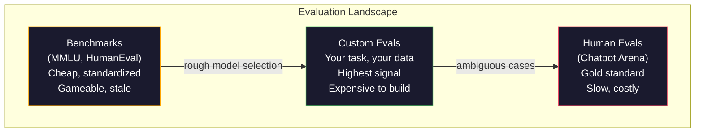
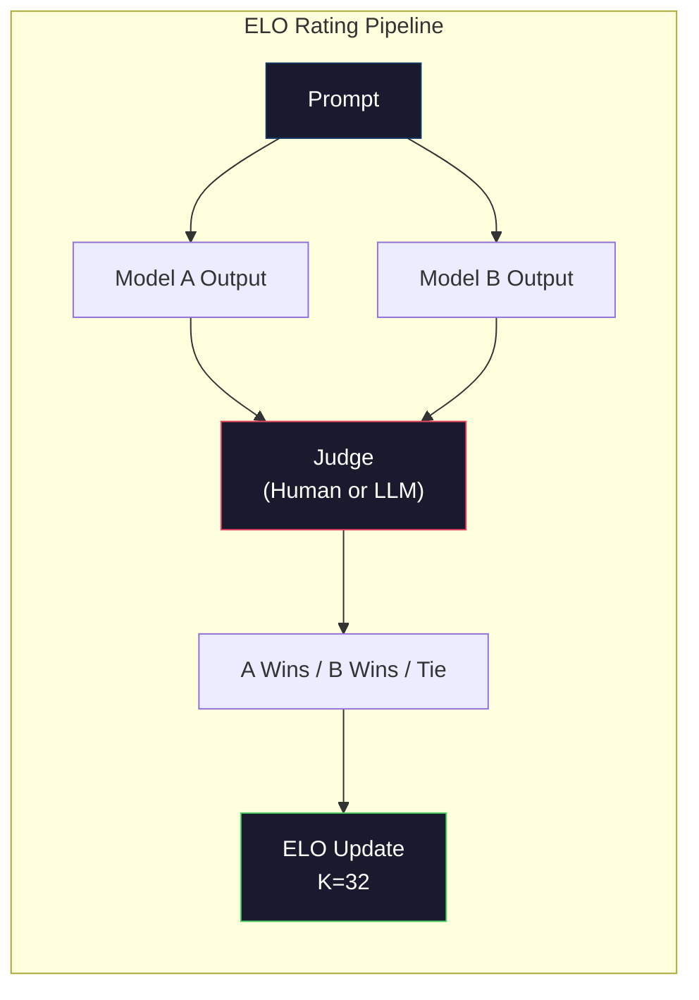

# Evaluation: Benchmarks, Evals, LM Harness

> Закон Гудхарта: когда мера становится целью, она перестаёт быть хорошей мерой. Каждая передовая лаборатория играет на бенчмарках. Показатели MMLU растут, а модели всё ещё не могут надёжно посчитать, сколько букв «R» в слове «strawberry». Единственный значимый eval — это ВАШ eval, на ВАШЕЙ задаче, с ВАШИМИ данными.

**Type:** Build
**Languages:** Python
**Prerequisites:** Phase 10, Lessons 01-05 (LLMs from Scratch)
**Time:** ~90 минут

## Learning Objectives

- Построить кастомный eval-harness, который запускает benchmarks с множественным выбором и с открытым ответом против языковой модели
- Объяснить, почему стандартные бенчмарки (MMLU, HumanEval) насыщаются и перестают различать передовые модели
- Реализовать task-specific evals с корректными метриками: exact match, F1, BLEU и LLM-as-judge scoring
- Спроектировать кастомный eval suite, нацеленный на ваш конкретный use case, а не полагаться исключительно на публичные лидерборды

## The Problem

MMLU был опубликован в 2020 году с 15 908 вопросами по 57 предметам. В течение трёх лет передовые модели его насытили. GPT-4 набрал 86.4%. Claude 3 Opus набрал 86.8%. Llama 3 405B набрал 88.6%. Лидерборд сжался в диапазон в 3 процентных пункта, где различия — это статистический шум, а не реальный разрыв в возможностях.

При этом те же самые модели проваливаются на задачах, с которыми справится 10-летний ребёнок, не задумываясь. Claude 3.5 Sonnet, набирающий 88.7% на MMLU, изначально не мог посчитать буквы в слове "strawberry" — задача, которая не требует ни знания мира, ни рассуждений, только посимвольной итерации. HumanEval тестирует генерацию кода на 164 задачах. Модели набирают 90%+ на нём, при этом всё ещё выдавая код, который падает на граничных случаях, которые заметил бы любой junior-разработчик.

Разрыв между производительностью на бенчмарках и надёжностью в реальном мире — это центральная проблема оценки LLM. Бенчмарки говорят вам, как модель работает на бенчмарке. Они почти ничего не говорят о том, как эта модель будет работать на вашей конкретной задаче, с вашими конкретными данными, при ваших конкретных сценариях отказа. Если вы строите бота поддержки клиентов, MMLU нерелевантен. Если вы строите ассистента для кода, HumanEval покрывает только генерацию на уровне функций — он ничего не говорит об отладке, рефакторинге или объяснении кода между файлами.

Вам нужны кастомные evals. Не потому, что бенчмарки бесполезны — они полезны для грубого отбора моделей, — а потому, что итоговая оценка должна точно соответствовать вашим условиям эксплуатации.

## The Concept

### The Eval Landscape

Существует три категории оценки, каждая со своей стоимостью и качеством сигнала.

**Benchmarks** — это стандартизированные наборы тестов. MMLU, HumanEval, SWE-bench, MATH, ARC, HellaSwag. Вы запускаете модель против бенчмарка и получаете оценку. Преимущество: все используют один и тот же тест, поэтому можно сравнивать модели. Недостаток: модели и обучающие данные всё сильнее загрязняют эти бенчмарки. Лаборатории обучают модели на данных, которые включают вопросы бенчмарков. Оценки растут. Возможности — не обязательно.

**Custom evals** — это наборы тестов, которые вы строите под свой конкретный use case. Вы определяете входы, ожидаемые выходы и функцию скоринга. Суммаризатор юридических документов оценивается на юридических документах. Генератор SQL оценивается на вашей схеме базы данных. Их дорого создавать, но это единственная оценка, которая предсказывает продуктивную производительность.

**Human evals** используют оплачиваемых асессоров для оценки выходов модели по критериям вроде полезности, корректности, беглости и безопасности. Золотой стандарт для открытых задач, где автоматизированный скоринг не работает. Chatbot Arena собрала более 2 миллионов голосов человеческих предпочтений среди 100+ моделей. Недостаток: стоимость ($0.10-$2.00 за одну оценку) и скорость (часы или дни).



### Why Benchmarks Break

Есть три механизма, из-за которых оценки бенчмарков перестают отражать реальные возможности.

**Загрязнение данных (data contamination).** Обучающие корпуса собираются скрейпингом интернета. Вопросы бенчмарков живут в интернете. Модели видят ответы во время обучения. Это не читерство в традиционном смысле — лаборатории не включают данные бенчмарков намеренно. Но скрейпинг веб-масштаба делает их исключение почти невозможным.

**Обучение под тест.** Лаборатории оптимизируют обучающие смеси под производительность на бенчмарках. Если 5% обучающей смеси — это вопросы в стиле MMLU с множественным выбором, модель учится формату и распределению ответов. MMLU — это выбор из 4 вариантов. Модели учатся, что распределение ответов приблизительно равномерно между A/B/C/D, что помогает даже тогда, когда модель не знает правильного ответа.

**Насыщение.** Когда каждая передовая модель набирает 85-90% на бенчмарке, бенчмарк перестаёт различать. Оставшиеся 10-15% вопросов могут быть неоднозначными, неправильно размеченными или требовать узкоспециализированных знаний. Улучшение с 87% до 89% на MMLU может означать, что модель запомнила ещё пару малоизвестных вопросов, а не то, что она стала умнее.

### Perplexity: A Quick Health Check

Perplexity измеряет, насколько модель удивлена последовательностью токенов. Формально это экспонента от средней отрицательной логарифмической правдоподобности:

```
PPL = exp(-1/N * sum(log P(token_i | context)))
```

Perplexity, равная 10, означает, что модель в среднем настолько же неуверена, как при равновероятном выборе среди 10 вариантов на каждой позиции токена. Чем ниже, тем лучше. GPT-2 получает perplexity ~30 на WikiText-103. GPT-3 получает ~20. Llama 3 8B получает ~7.

Perplexity полезна для сравнения моделей на одном и том же тестовом наборе, но у неё есть слепые зоны. Модель может иметь низкую perplexity, хорошо предсказывая распространённые паттерны, но при этом быть ужасной в редких, но важных паттернах. Она также ничего не говорит о следовании инструкциям, рассуждении или фактической точности. Используйте её как проверку на вменяемость, а не как финальный вердикт.

### LLM-as-Judge

Используйте сильную модель для оценки выхода более слабой модели. Идея проста: попросить GPT-4o или Claude Sonnet оценить ответ по шкале от 1 до 5 за корректность, полезность и безопасность. Это стоит около $0.01 за одну оценку с GPT-4o-mini и неожиданно хорошо коррелирует с человеческими оценками — около 80% согласия на большинстве задач.

Промпт для скоринга важнее модели. Расплывчатый промпт ("Оцени этот ответ") даёт шумные оценки. Структурированный промпт с рубрикой ("Поставь 5, если ответ фактически верен и указывает источник, 4, если верен, но без источника, 3, если частично верен...") даёт согласованные, воспроизводимые оценки.

Режимы сбоя: модели-судьи демонстрируют position bias (предпочитают первый ответ в попарных сравнениях), verbosity bias (предпочитают более длинные ответы) и self-preference (GPT-4 оценивает выходы GPT-4 выше, чем эквивалентные выходы Claude). Меры смягчения: рандомизировать порядок, нормализовать по длине, использовать судью, отличного от оцениваемой модели.

### ELO Ratings from Pairwise Comparisons

Подход Chatbot Arena. Показать два ответа на один и тот же промпт от разных моделей. Человек (или LLM-судья) выбирает лучший. Из тысяч таких сравнений вычисляется ELO-рейтинг для каждой модели — та же самая система, которая используется в шахматах.

Преимущества ELO: относительное ранжирование более надёжно, чем абсолютный скоринг, корректно обрабатывает ничьи и сходится при меньшем числе сравнений, чем независимый скоринг каждого выхода. На начало 2026 года рейтинги Chatbot Arena показывают GPT-4o, Claude 3.5 Sonnet и Gemini 1.5 Pro в пределах 20 очков ELO друг от друга на вершине.



### Eval Frameworks

**lm-evaluation-harness** (EleutherAI): стандартный open-source фреймворк для eval. Поддерживает 200+ бенчмарков. Запустите любую модель Hugging Face против MMLU, HellaSwag, ARC и т. д. одной командой. Используется в Open LLM Leaderboard.

**RAGAS**: фреймворк оценки специально для RAG-пайплайнов. Измеряет faithfulness (соответствует ли ответ извлечённому контексту?), relevance (релевантен ли извлечённый контекст вопросу?) и answer correctness.

**promptfoo**: конфигурационный eval для prompt engineering. Определяйте тестовые случаи в YAML, запускайте против нескольких моделей, получайте отчёт pass/fail. Полезен для регрессионного тестирования промптов — убедиться, что изменение промпта не ломает существующие тестовые случаи.

### Building Custom Evals

Единственный eval, который имеет значение для продакшена. Процесс:

1. **Определите задачу.** Что именно должна делать модель? Будьте точны. "Отвечать на вопросы" — слишком расплывчато. "По письму с жалобой клиента извлечь название продукта, категорию проблемы и тональность" — это задача, которую можно оценить.

2. **Создайте тестовые случаи.** Минимум 50 для прототипа eval, 200+ для продакшена. Каждый тестовый случай — это пара (input, expected_output). Включите граничные случаи: пустые входы, состязательные входы, неоднозначные входы, входы на других языках.

3. **Определите скоринг.** Exact match для структурированных выходов. BLEU/ROUGE для текстового сходства. LLM-as-judge для качества открытых ответов. F1 для задач извлечения. Комбинируйте несколько метрик с весами.

4. **Автоматизируйте.** Каждый eval запускается одной командой. Никаких ручных шагов. Храните результаты в формате, который позволяет сравнение во времени.

5. **Отслеживайте во времени.** Оценка eval сама по себе бессмысленна. Вам нужен тренд. Улучшилась ли оценка после последнего изменения промпта? Ухудшилась ли после смены модели? Версионируйте eval вместе с вашими промптами.

| Тип eval | Стоимость за оценку | Согласие с людьми | Лучше всего для |
|-----------|------------------|----------------------|----------|
| Exact match | ~$0 | 100% (когда применимо) | Структурированный вывод, классификация |
| BLEU/ROUGE | ~$0 | ~60% | Перевод, суммаризация |
| LLM-as-judge | ~$0.01 | ~80% | Генерация с открытым ответом |
| Human eval | $0.10-$2.00 | Н/Д (является ground truth) | Неоднозначные задачи, задачи с высокими ставками |

```figure
perplexity-loss
```

## Build It

### Step 1: A Minimal Eval Framework

Определите базовые абстракции. Eval-случай имеет input, expected output и опциональный словарь метаданных. Scorer принимает prediction и reference и возвращает оценку от 0 до 1.

```python
import json
from collections import Counter

class EvalCase:
    def __init__(self, input_text, expected, metadata=None):
        self.input_text = input_text
        self.expected = expected
        self.metadata = metadata or {}

class EvalSuite:
    def __init__(self, name, cases, scorers):
        self.name = name
        self.cases = cases
        self.scorers = scorers

    def run(self, model_fn):
        results = []
        for case in self.cases:
            prediction = model_fn(case.input_text)
            scores = {}
            for scorer_name, scorer_fn in self.scorers.items():
                scores[scorer_name] = scorer_fn(prediction, case.expected)
            results.append({
                "input": case.input_text,
                "expected": case.expected,
                "prediction": prediction,
                "scores": scores,
            })
        return results
```

### Step 2: Scoring Functions

Постройте exact match, token F1 и симулированный LLM-as-judge scorer.

```python
def exact_match(prediction, expected):
    return 1.0 if prediction.strip().lower() == expected.strip().lower() else 0.0

def token_f1(prediction, expected):
    pred_tokens = set(prediction.lower().split())
    exp_tokens = set(expected.lower().split())
    if not pred_tokens or not exp_tokens:
        return 0.0
    common = pred_tokens & exp_tokens
    precision = len(common) / len(pred_tokens)
    recall = len(common) / len(exp_tokens)
    if precision + recall == 0:
        return 0.0
    return 2 * (precision * recall) / (precision + recall)

def llm_judge_simulated(prediction, expected):
    pred_words = set(prediction.lower().split())
    exp_words = set(expected.lower().split())
    if not exp_words:
        return 0.0
    overlap = len(pred_words & exp_words) / len(exp_words)
    length_penalty = min(1.0, len(prediction) / max(len(expected), 1))
    return round(overlap * 0.7 + length_penalty * 0.3, 3)
```

### Step 3: ELO Rating System

Реализуйте попарные сравнения с обновлениями ELO. Это именно та система, которую использует Chatbot Arena для ранжирования моделей.

```python
class ELOTracker:
    def __init__(self, k=32, initial_rating=1500):
        self.ratings = {}
        self.k = k
        self.initial_rating = initial_rating
        self.history = []

    def _ensure_player(self, name):
        if name not in self.ratings:
            self.ratings[name] = self.initial_rating

    def expected_score(self, rating_a, rating_b):
        return 1 / (1 + 10 ** ((rating_b - rating_a) / 400))

    def record_match(self, player_a, player_b, outcome):
        self._ensure_player(player_a)
        self._ensure_player(player_b)

        ea = self.expected_score(self.ratings[player_a], self.ratings[player_b])
        eb = 1 - ea

        if outcome == "a":
            sa, sb = 1.0, 0.0
        elif outcome == "b":
            sa, sb = 0.0, 1.0
        else:
            sa, sb = 0.5, 0.5

        self.ratings[player_a] += self.k * (sa - ea)
        self.ratings[player_b] += self.k * (sb - eb)

        self.history.append({
            "a": player_a, "b": player_b,
            "outcome": outcome,
            "rating_a": round(self.ratings[player_a], 1),
            "rating_b": round(self.ratings[player_b], 1),
        })

    def leaderboard(self):
        return sorted(self.ratings.items(), key=lambda x: -x[1])
```

### Step 4: Perplexity Calculation

Вычислите perplexity, используя вероятности токенов. На практике вы получили бы их из логитов модели. Здесь мы симулируем с распределением вероятностей.

```python
import numpy as np

def perplexity(log_probs):
    if not log_probs:
        return float("inf")
    avg_neg_log_prob = -np.mean(log_probs)
    return float(np.exp(avg_neg_log_prob))

def token_log_probs_simulated(text, model_quality=0.8):
    np.random.seed(hash(text) % 2**31)
    tokens = text.split()
    log_probs = []
    for i, token in enumerate(tokens):
        base_prob = model_quality
        if len(token) > 8:
            base_prob *= 0.6
        if i == 0:
            base_prob *= 0.7
        prob = np.clip(base_prob + np.random.normal(0, 0.1), 0.01, 0.99)
        log_probs.append(float(np.log(prob)))
    return log_probs
```

### Step 5: Aggregate Results

Вычислите сводную статистику по прогону eval: среднее, медиану, долю прохождений при заданном пороге и разбивку по метрикам.

```python
def summarize_results(results, threshold=0.8):
    all_scores = {}
    for r in results:
        for metric, score in r["scores"].items():
            all_scores.setdefault(metric, []).append(score)

    summary = {}
    for metric, scores in all_scores.items():
        arr = np.array(scores)
        summary[metric] = {
            "mean": round(float(np.mean(arr)), 3),
            "median": round(float(np.median(arr)), 3),
            "std": round(float(np.std(arr)), 3),
            "min": round(float(np.min(arr)), 3),
            "max": round(float(np.max(arr)), 3),
            "pass_rate": round(float(np.mean(arr >= threshold)), 3),
            "n": len(scores),
        }
    return summary

def print_summary(summary, suite_name="Eval"):
    print(f"\n{'=' * 60}")
    print(f"  {suite_name} Summary")
    print(f"{'=' * 60}")
    for metric, stats in summary.items():
        print(f"\n  {metric}:")
        print(f"    Mean:      {stats['mean']:.3f}")
        print(f"    Median:    {stats['median']:.3f}")
        print(f"    Std:       {stats['std']:.3f}")
        print(f"    Range:     [{stats['min']:.3f}, {stats['max']:.3f}]")
        print(f"    Pass rate: {stats['pass_rate']:.1%} (threshold >= 0.8)")
        print(f"    N:         {stats['n']}")
```

### Step 6: Run the Full Pipeline

Соедините всё вместе. Определите задачу, создайте тестовые случаи, симулируйте две модели, запустите evals, вычислите ELO из попарных сравнений и выведите лидерборд.

```python
def demo_model_good(prompt):
    responses = {
        "What is the capital of France?": "Paris",
        "What is 2 + 2?": "4",
        "Who wrote Hamlet?": "William Shakespeare",
        "What language is PyTorch written in?": "Python and C++",
        "What is the boiling point of water?": "100 degrees Celsius",
    }
    return responses.get(prompt, "I don't know")

def demo_model_bad(prompt):
    responses = {
        "What is the capital of France?": "Paris is the capital city of France",
        "What is 2 + 2?": "The answer is four",
        "Who wrote Hamlet?": "Shakespeare",
        "What language is PyTorch written in?": "Python",
        "What is the boiling point of water?": "212 Fahrenheit",
    }
    return responses.get(prompt, "Unknown")

cases = [
    EvalCase("What is the capital of France?", "Paris"),
    EvalCase("What is 2 + 2?", "4"),
    EvalCase("Who wrote Hamlet?", "William Shakespeare"),
    EvalCase("What language is PyTorch written in?", "Python and C++"),
    EvalCase("What is the boiling point of water?", "100 degrees Celsius"),
]

suite = EvalSuite(
    name="General Knowledge",
    cases=cases,
    scorers={
        "exact_match": exact_match,
        "token_f1": token_f1,
        "llm_judge": llm_judge_simulated,
    },
)

results_good = suite.run(demo_model_good)
results_bad = suite.run(demo_model_bad)

print_summary(summarize_results(results_good), "Model A (concise)")
print_summary(summarize_results(results_bad), "Model B (verbose)")
```

"Хорошая" модель даёт точные ответы. "Плохая" модель даёт многословные перефразировки. Exact match жёстко наказывает многословную модель. Token F1 и LLM-as-judge более снисходительны. Это иллюстрирует, почему выбор метрики важен: одна и та же модель выглядит великолепно или ужасно в зависимости от того, как вы её оцениваете.

### Step 7: ELO Tournament

Запустите попарные сравнения между моделями в несколько раундов.

```python
elo = ELOTracker(k=32)

for case in cases:
    pred_a = demo_model_good(case.input_text)
    pred_b = demo_model_bad(case.input_text)

    score_a = token_f1(pred_a, case.expected)
    score_b = token_f1(pred_b, case.expected)

    if score_a > score_b:
        outcome = "a"
    elif score_b > score_a:
        outcome = "b"
    else:
        outcome = "tie"

    elo.record_match("model_a_concise", "model_b_verbose", outcome)

print("\nELO Leaderboard:")
for name, rating in elo.leaderboard():
    print(f"  {name}: {rating:.0f}")
```

### Step 8: Perplexity Comparison

Сравните perplexity среди "моделей" разного уровня качества.

```python
test_text = "The quick brown fox jumps over the lazy dog in the garden"

for quality, label in [(0.9, "Strong model"), (0.7, "Medium model"), (0.4, "Weak model")]:
    log_probs = token_log_probs_simulated(test_text, model_quality=quality)
    ppl = perplexity(log_probs)
    print(f"  {label} (quality={quality}): perplexity = {ppl:.2f}")
```

## Use It

### lm-evaluation-harness (EleutherAI)

Стандартный инструмент для запуска бенчмарков на любой модели.

```python
# pip install lm-eval
# Command line:
# lm_eval --model hf --model_args pretrained=meta-llama/Llama-3.1-8B --tasks mmlu --batch_size 8

# Python API:
# import lm_eval
# results = lm_eval.simple_evaluate(
#     model="hf",
#     model_args="pretrained=meta-llama/Llama-3.1-8B",
#     tasks=["mmlu", "hellaswag", "arc_easy"],
#     batch_size=8,
# )
# print(results["results"])
```

### promptfoo

Конфигурационный eval для prompt engineering. Определяйте тесты в YAML и запускайте против нескольких провайдеров.

```yaml
# promptfoo.yaml
providers:
  - openai:gpt-4o-mini
  - anthropic:claude-3-haiku

prompts:
  - "Answer in one word: {{question}}"

tests:
  - vars:
      question: "What is the capital of France?"
    assert:
      - type: contains
        value: "Paris"
  - vars:
      question: "What is 2 + 2?"
    assert:
      - type: equals
        value: "4"
```

### RAGAS for RAG evaluation

```python
# pip install ragas
# from ragas import evaluate
# from ragas.metrics import faithfulness, answer_relevancy, context_precision
#
# result = evaluate(
#     dataset,
#     metrics=[faithfulness, answer_relevancy, context_precision],
# )
# print(result)
```

RAGAS измеряет то, что упускают обычные evals: обоснован ли ответ модели на извлечённом контексте, а не только то, "правильный" ли ответ в абстрактном смысле.

## Ship It

Этот урок создаёт `outputs/prompt-eval-designer.md` — переиспользуемый промпт, который проектирует кастомные eval suites для любой задачи. Дайте ему описание задачи, и он сгенерирует тестовые случаи, функции скоринга и рекомендацию по порогу прохождения.

Он также создаёт `outputs/skill-llm-evaluation.md` — фреймворк принятия решений для выбора правильной стратегии оценки на основе типа вашей задачи, бюджета и требований к задержке.

## Exercises

1. Добавьте scorer "согласованности", который прогоняет один и тот же вход через модель 5 раз и измеряет, насколько часто выходы совпадают. Несогласованные ответы на детерминированных входах раскрывают хрупкие промпты или высокие настройки температуры.

2. Расширьте ELO-трекер для поддержки нескольких функций-судей (exact match, F1, LLM-as-judge) и их взвешивания. Сравните, как меняется лидерборд, когда вы сильно взвешиваете exact match по сравнению с сильным взвешиванием F1.

3. Постройте eval suite для конкретной задачи: классификация писем по 5 категориям. Создайте 100 тестовых случаев с разнообразными примерами, включая граничные случаи (письма, которые могут относиться к нескольким категориям, пустые письма, письма на других языках). Измерьте, как разные "модели" (rule-based, сопоставление по ключевым словам, симулированная LLM) справляются с задачей.

4. Реализуйте детектирование загрязнения: по набору вопросов eval и обучающему корпусу проверьте, какой процент вопросов eval (или их близких перефразировок) встречается в обучающих данных. Именно так исследователи аудируют валидность бенчмарков.

5. Постройте инструмент "model diff". По результатам eval двух версий модели выделите, какие конкретные тестовые случаи улучшились, какие ухудшились, а какие остались без изменений. Это эквивалент code diff для eval — необходим для понимания того, помогло ли изменение или навредило.

## Key Terms

| Термин | Что говорят люди | Что это на самом деле означает |
|------|----------------|----------------------|
| MMLU | "Тот самый бенчмарк" | Massive Multitask Language Understanding — 15 908 вопросов с множественным выбором по 57 предметам, насыщен выше 88% к 2025 году |
| HumanEval | "Eval для кода" | 164 задачи на дополнение Python-функций от OpenAI, тестирует только изолированную генерацию функций |
| SWE-bench | "Настоящий eval для кодинга" | 2 294 GitHub-issue из 12 Python-репозиториев, измеряет сквозное исправление багов, включая генерацию тестов |
| Perplexity | "Насколько модель запутана" | exp(-avg(log P(token_i given context))) — чем ниже, тем выше вероятность, которую модель присваивает фактическим токенам |
| ELO rating | "Шахматный рейтинг для моделей" | Относительный рейтинг навыков, вычисляемый из попарных записей побед/поражений, используется Chatbot Arena для ранжирования 100+ моделей |
| LLM-as-judge | "Использование ИИ для оценки ИИ" | Сильная модель оценивает выходы более слабой модели по рубрике, ~80% согласия с человеческими судьями при ~$0.01/оценку |
| Data contamination | "Модель видела тест" | Обучающие данные включают вопросы бенчмарков, завышая оценки без улучшения реальных возможностей |
| Eval suite | "Пачка тестов" | Версионированная коллекция триплетов (input, expected_output, scorer), которая измеряет конкретную способность |
| Pass rate | "Какой процент правильный" | Доля eval-случаев, набравших оценку выше порога — более применимо на практике, чем средняя оценка, потому что измеряет надёжность |
| Chatbot Arena | "Сайт рейтинга моделей" | Платформа LMSYS с 2 млн+ голосов человеческих предпочтений, производящая самый доверенный лидерборд LLM через ELO-рейтинги |

## Further Reading

- [Hendrycks et al., 2021 -- "Measuring Massive Multitask Language Understanding"](https://arxiv.org/abs/2009.03300) — статья о MMLU, всё ещё самый цитируемый бенчмарк LLM, несмотря на насыщение
- [Chen et al., 2021 -- "Evaluating Large Language Models Trained on Code"](https://arxiv.org/abs/2107.03374) — статья о HumanEval от OpenAI, установившая методологию оценки генерации кода
- [Zheng et al., 2023 -- "Judging LLM-as-a-Judge"](https://arxiv.org/abs/2306.05685) — систематический анализ использования LLM для оценки LLM, включая выводы о position bias и verbosity bias
- [Arena (ранее LMSYS Chatbot Arena)](https://arena.ai/leaderboard) — краудсорсинговая платформа сравнения моделей с 2 млн+ голосов, самый доверенный рейтинг LLM в реальных условиях