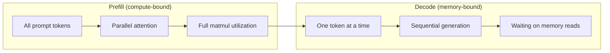
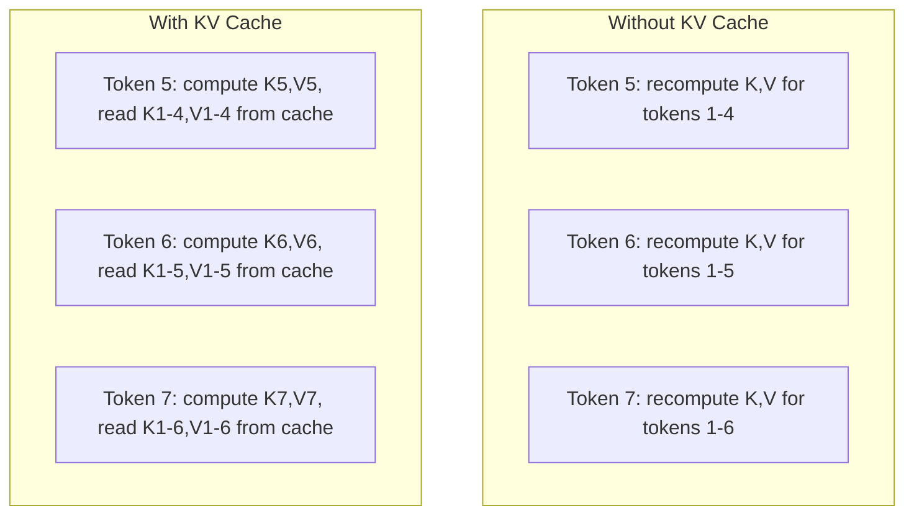
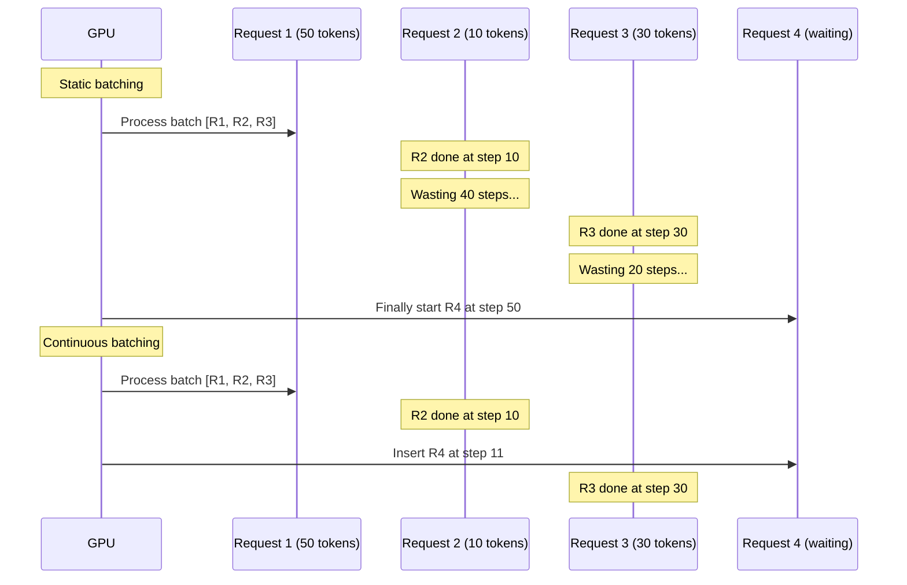
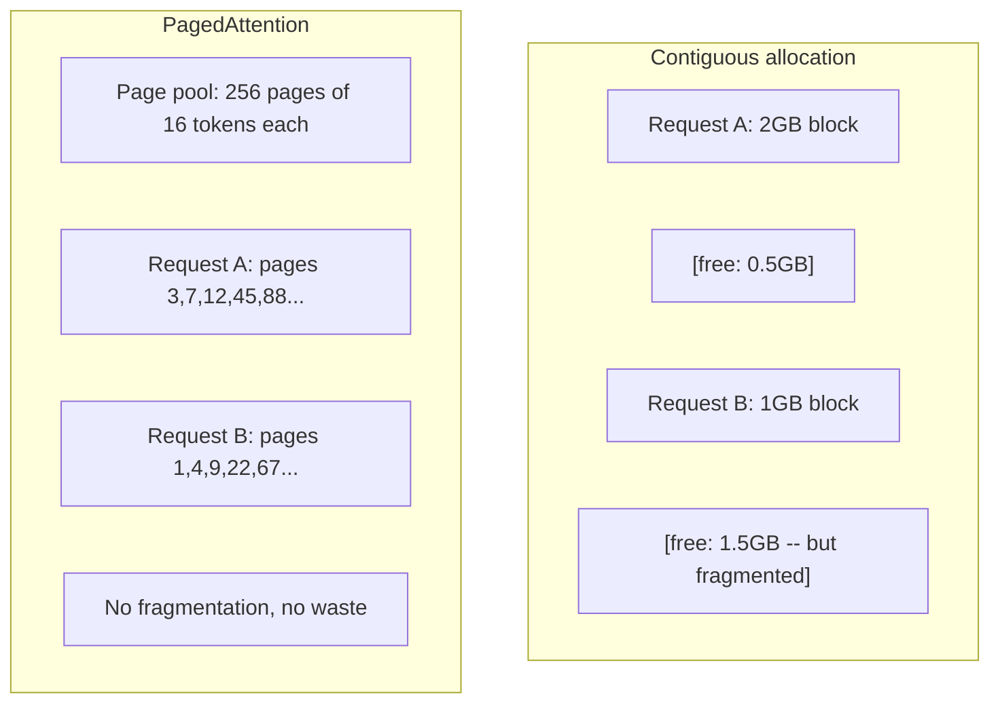
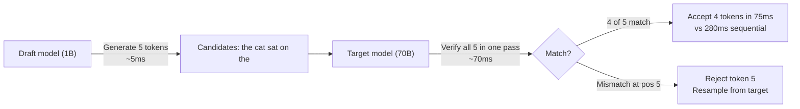

# Оптимизация инференса

> Две фазы определяют инференс LLM. Prefill обрабатывает ваш промпт параллельно — это compute-bound. Decode генерирует токены по одному — это memory-bound. Любая оптимизация нацелена на одну из фаз или на обе сразу.

**Type:** Build
**Languages:** Python
**Prerequisites:** Phase 10, Lessons 01-08 (архитектура Transformer, attention)
**Time:** ~120 минут

## Learning Objectives

- Реализовать KV-cache для устранения избыточных вычислений при авторегрессивной генерации токенов
- Объяснить фазы prefill и decode при инференсе LLM и почему у каждой из них разные узкие места (compute-bound vs memory-bound)
- Реализовать концепции continuous batching и PagedAttention для максимизации утилизации GPU при одновременных запросах
- Сравнить техники оптимизации инференса (KV-cache, speculative decoding, flash attention) и их компромиссы между throughput и latency

## The Problem

Вы развёртываете Llama 3 70B на 4xA100 GPU. Один пользователь получает ~50 токенов в секунду. Кажется быстро. Затем 100 пользователей одновременно обращаются к эндпоинту. Throughput падает до 3 токенов/секунду/пользователь. Ваш счёт за GPU в $25,000/месяц обслуживает ответы медленнее, чем человек печатает.

Сама модель не меняется между 1 пользователем и 100 пользователями. Те же веса, та же архитектура, та же математика. Меняется способ планирования работы. Наивный инференс тратит впустую 90%+ доступных вычислительных ресурсов GPU. Пользователь, ожидающий токен 47, удерживает открытым весь слот батча, пока шина памяти GPU простаивает между матричными умножениями. Тем временем промпт нового пользователя на 2000 токенов мог бы заполнить это мёртвое время полезными вычислениями.

Это не проблема масштабирования. Это проблема планирования. Техники из этого урока — KV caching, continuous batching, PagedAttention, speculative decoding, prefix caching — это то, что отделяет сервис за $25k/month inference bill from a $5k/месяц, обслуживающий тот же трафик.

vLLM, обслуживающий Llama 3 70B на 4xA100-80GB, достигает ~50 токенов/секунду/пользователь при низкой конкурентности и удерживает 15-25 TPS/пользователь при 100 одновременных запросах благодаря continuous batching и PagedAttention. Без этих оптимизаций то же железо обслуживает 5 TPS/пользователь при такой же конкурентности. Те же GPU, та же модель, 4-кратный throughput.

## The Concept

### Prefill vs Decode

Каждый запрос на инференс LLM имеет две отдельные фазы.

**Prefill** обрабатывает весь входной промпт. Все токены известны заранее, поэтому attention может быть вычислен параллельно по всей последовательности. Это крупное матричное умножение — ядра GPU остаются загружены. Узкое место — вычисления: сколько FLOPS ваше железо может выдать в секунду. A100 выдаёт 312 TFLOPS (BF16). Prefill для промпта на 4096 токенов на модели 70B занимает ~400 мс на одном A100.

**Decode** генерирует выходные токены по одному. Каждый новый токен обращается ко всем предыдущим токенам через attention, но за один forward pass производится только один токен. Матрицы весов имеют тот же размер, что и при prefill, но вы умножаете их на один вектор, а не на матрицу. Ядра GPU завершают работу за микросекунды, затем ждут поступления следующей порции весов из памяти. Узкое место — пропускная способность памяти: насколько быстро вы можете передавать веса модели из HBM в вычислительные блоки. У A100 пропускная способность 2 ТБ/с. Модель 70B в FP16 весит 140 ГБ. Чтение всей модели один раз занимает 70 мс — это ваш нижний предел для одного шага decode.



**Коэффициент ops:byte** (также называемый арифметической интенсивностью) отражает этот компромисс. Он измеряет, сколько операций вы выполняете на байт, загруженный из памяти.

```
ops:byte ratio = FLOPs per token / bytes read from memory
```

Во время prefill с батчем в 4096 токенов вы выполняете ~4096 операций умножения-накопления на каждый загруженный вес. Соотношение высокое — вы compute-bound. Во время decode с размером батча 1 вы выполняете ~1 операцию на каждый загруженный вес. Соотношение низкое — вы memory-bound.

Фундаментальный вывод: *decode — memory-bound, потому что вы читаете всю модель, чтобы произвести один токен*. Каждая оптимизация ниже либо уменьшает объём чтения, либо увеличивает размер батча токенов, обрабатываемых за одно чтение, либо полностью избегает чтения.

### KV Cache

Во время attention запрос (query) каждого токена обращается к векторам ключа и значения всех предыдущих токенов. Без кэширования генерация токена N требует пересчёта проекций ключа и значения для всех N-1 предшествующих токенов. Токен 1 проецируется при генерации токена 2, затем снова для токена 3, затем снова для токена 4. К токену 1000 вы спроецировали токен 1 в общей сложности 999 раз.

KV cache хранит проекции ключа и значения от всех предыдущих токенов. При генерации токена N вы вычисляете ключ и значение только для токена N, затем объединяете их с кэшированными K/V от токенов с 1 по N-1.



**Формула памяти для KV cache:**

```
KV cache size = 2 * num_layers * num_kv_heads * head_dim * seq_len * bytes_per_param
```

Для Llama 3 70B (80 слоёв, 8 KV-голов с GQA, head_dim=128, BF16):

```
per token: 2 * 80 * 8 * 128 * 2 bytes = 327,680 bytes = 320 KB
at 4,096 tokens: 320 KB * 4,096 = 1.28 GB
at 128K tokens: 320 KB * 131,072 = 40 GB
```

Один разговор на 128K контекста для Llama 3 70B потребляет 40 ГБ KV cache — половину памяти одного A100. При 100 одновременных пользователях с 4K токенов каждый только KV cache требует 128 ГБ. Вот почему управление KV cache — центральная задача оптимизации инференса.

### Continuous Batching

Статический батчинг ждёт, пока прибудет батч из N запросов, обрабатывает их вместе и ждёт, пока завершатся *все*, прежде чем принять новые запросы. Если одному запросу нужно 500 токенов, а другому 10, короткий запрос простаивает 490 шагов decode после своего завершения.

Continuous batching (также называемый iteration-level batching) вставляет новые запросы в батч сразу же, как только любой запрос завершается. Батч пересматривается на каждом шаге decode. Запрос, завершившийся после 10 токенов, немедленно заменяется ожидающим запросом.



Прирост throughput зависит от того, насколько сильно варьируются длины выходов. При равномерных длинах continuous batching соответствует статическому батчингу. При переменных длинах (типичный случай) continuous batching может дать 2-5-кратный прирост throughput, потому что слоты GPU никогда не простаивают пустыми.

### PagedAttention

KV cache для каждого запроса — это непрерывный блок памяти. По мере поступления и завершения запросов память фрагментируется — в точности как фрагментация RAM в операционных системах. Запросу на 4K токенов нужно 1,28 ГБ непрерывной памяти. Даже если у вас в сумме 2 ГБ свободно, у вас может не найтись 1,28 ГБ *непрерывной* памяти. Вы либо тратите память впустую, либо отклоняете запрос.

PagedAttention (из vLLM) применяет виртуальную память в стиле ОС к KV cache. Вместо выделения одного непрерывного блока на запрос он выделяет "страницы" фиксированного размера (обычно по 16 токенов). Страницы могут находиться где угодно в физической памяти GPU. Таблица страниц отображает логические позиции последовательности каждого запроса в физические расположения страниц.



PagedAttention также обеспечивает **copy-on-write** для общих префиксов. Если 50 запросов используют один и тот же системный промпт, страницы KV cache для этого системного промпта хранятся один раз и используются совместно всеми 50 запросами. Только когда запрос расходится (разные пользовательские сообщения), он получает собственные страницы. Это резко сокращает использование памяти для приложений с общими системными промптами.

vLLM сообщает о почти нулевых потерях памяти (~4% против ~60-80% при наивном выделении) благодаря PagedAttention.

### Speculative Decoding

Decode медленный, потому что он последовательный — вы генерируете один токен, подаёте его обратно, генерируете следующий. Но что если бы вы могли дёшево угадать следующие 5 токенов, а затем проверить их все сразу?

Speculative decoding использует маленькую, быструю **draft-модель** для генерации K токенов-кандидатов. Большая **целевая модель** затем обрабатывает все K кандидатов за один forward pass (который выглядит как prefill — параллельный, compute-bound, эффективный). Если целевая модель соглашается с предсказаниями draft-модели, вы принимаете все K токенов за время одного forward pass целевой модели. Если она расходится в позиции j, вы принимаете токены с 1 по j-1 и отбрасываете остальные.



Прирост скорости зависит от **acceptance rate** — насколько часто предсказания draft-модели совпадают с целевой. Для Llama 3 8B, выступающей в роли draft-модели для Llama 3 70B, типичны acceptance rate 70-85% на естественном языке. Это даёт 2-3-кратное ускорение decode.

Три подхода к speculative decoding:

| Метод | Источник draft | Acceptance rate | Накладные расходы |
|--------|-------------|-----------------|------------------|
| Draft-target (Leviathan et al.) | Отдельная маленькая модель | 70-85% | Память под draft-модель |
| EAGLE (Li et al.) | Лёгкая голова поверх целевой модели | 75-90% | ~1% дополнительных параметров |
| N-gram lookup | Таблица n-грамм токенов | 40-60% | Незначительные |

**EAGLE** обучает небольшую авторегрессивную голову поверх скрытых состояний целевой модели. Она предсказывает эмбеддинг следующего токена, используя признаки предпоследнего слоя целевой модели. Поскольку она оперирует собственными представлениями целевой модели (а не отдельной моделью), она достигает более высоких acceptance rate при минимальных дополнительных затратах памяти. EAGLE-2 добавляет динамическое дерево draft-кандидатов, которое регулирует их количество в зависимости от контекста.

**N-gram speculative decoding** поддерживает таблицу продолжений n-грамм из текущего контекста или заранее собранного корпуса. Если draft совпадает с тем, что уже встречалось ранее в том же разговоре (повторяющиеся паттерны, код, структурированный вывод), он срабатывает без накладных расходов на нейросеть. Acceptance rate в среднем ниже, но стоимость каждой спекуляции практически нулевая.

Speculative decoding *математически точен* — распределение выходов идентично распределению целевой модели. Это не приближение. Этап верификации гарантирует, что каждый принятый токен имеет ровно ту вероятность, которую присвоила бы ему целевая модель.

### Prefix Caching

Многие запросы используют один и тот же префикс. Системный промпт чат-бота. Блок контекста RAG. Набор few-shot примеров. Без prefix caching каждый запрос пересчитывает KV cache для этих общих токенов с нуля.

Prefix caching хранит KV cache для общих префиксов и повторно использует его в разных запросах. Когда поступает новый запрос с известным префиксом, система копирует (или ссылается на) кэшированные записи KV и вычисляет KV только для уникального суффикса.

Для системного промпта на 2000 токенов, общего для всех запросов, prefix caching устраняет ~400 мс prefill на запрос. При 100 запросах в секунду это экономит 40 секунд вычислений GPU в секунду — больше, чем объём работы одного GPU.

RadixAttention от SGLang реализует prefix caching с помощью radix-дерева (trie), индексирующего префиксы по их содержимому токенов. Любой запрос, совпадающий с сохранённым префиксом, получает свой KV cache бесплатно. Дерево поддерживает частичные совпадения префиксов — если вы разделяете 1500 из 2000 токенов префикса с кэшированной записью, вы переиспользуете эти 1500 и пересчитываете только 500.

### Inference Engines

Три движка доминируют в промышленной подаче LLM:

| Движок | Ключевое новшество | Лучше всего для |
|--------|---------------|----------|
| vLLM | PagedAttention, continuous batching | Универсальный сервинг, максимальная совместимость |
| SGLang | RadixAttention (prefix caching), структурированная генерация | Многоходовые чат-боты, ограниченная генерация |
| TensorRT-LLM | Слияние ядер NVIDIA, квантизация FP8 | Максимальный throughput на одном GPU NVIDIA |

**vLLM** — отправная точка по умолчанию. Он поддерживает самый широкий спектр моделей, работает на GPU любого производителя (NVIDIA, AMD, Intel) и достигает высокого throughput за счёт PagedAttention + continuous batching. API, совместимый с OpenAI, означает, что его можно подставить вместо любого вызова OpenAI API.

**SGLang** строится на тех же основах, что и vLLM, но добавляет RadixAttention для prefix caching и предметно-ориентированный язык для структурированных LLM-программ. Если ваша нагрузка включает многоходовые диалоги, использование инструментов или ограниченную генерацию (вывод JSON, генерация по регулярным выражениям), SGLang часто превосходит vLLM в 2-5 раз за счёт переиспользования префиксов.

**TensorRT-LLM** компилирует модели в оптимизированные ядра GPU NVIDIA. Он сливает операции (attention + linear + активация в одном ядре), использует FP8 на GPU H100 и интегрируется с NVIDIA Triton Inference Server для промышленного развёртывания. Он достигает максимального throughput на одном GPU NVIDIA, но требует более сложной настройки и работает только на GPU NVIDIA.

Реальные цифры для Llama 3 70B (4xA100-80GB, BF16):

| Метрика | vLLM | SGLang | TensorRT-LLM |
|--------|------|--------|---------------|
| Throughput (1 пользователь) | ~50 TPS | ~55 TPS | ~65 TPS |
| Throughput (100 пользователей) | ~2,500 TPS всего | ~3,200 TPS всего | ~3,000 TPS всего |
| Время до первого токена | ~400 мс | ~300 мс (попадание в префикс) | ~350 мс |
| Максимальный контекст | 128K | 128K | 128K |

### The Ops:Byte Framework

Вы не можете оптимизировать то, что не измеряете. Коэффициент ops:byte показывает, являетесь ли вы compute-bound или memory-bound, что и определяет, какие оптимизации имеют значение.

```
Compute roof: peak FLOPS of the GPU
Memory roof:  peak bandwidth * ops:byte ratio
```

Когда ops:byte низкий (decode, маленькие батчи), вы упираетесь в потолок пропускной способности памяти. Добавление вычислительной мощности (более высокая частота, больше ядер) не помогает. Вам нужно сократить количество чтений из памяти (квантизация, сжатие KV cache) или увеличить размер батча, чтобы амортизировать чтения на большем объёме полезной работы.

Когда ops:byte высокий (prefill, большие батчи), вы упираетесь в потолок вычислений. Оптимизация пропускной способности памяти не помогает. Вам нужны более быстрые GPU, слияние ядер или пониженная точность, чтобы выжать больше FLOPS.

| Сценарий | ops:byte | Узкое место | Оптимизировать с помощью |
|----------|----------|-------|---------------|
| Prefill, batch=1 | ~4,096 | Вычисления | Слияние ядер, FP8 |
| Decode, batch=1 | ~1 | Память | Квантизация, сжатие KV |
| Decode, batch=32 | ~32 | Память | Больший батч, continuous batching |
| Decode, batch=256 | ~256 | Переходное состояние | Важны оба фактора |
| Decode, batch=1024 | ~1,024 | Вычисления | Слияние ядер, tensor parallelism |

Точка перехода на A100 составляет примерно ops:byte = 156 (312 TFLOPS / 2 ТБ/с). Ниже 156 вы memory-bound. Выше 156 вы compute-bound. Continuous batching подталкивает decode к этой точке перехода, упаковывая больше токенов на итерацию.

```figure
context-window-slide
```

## Build It

### Step 1: KV Cache from Scratch

Мы строим многоголовый KV cache, который хранит проекции ключа и значения по слоям, по головам и демонстрирует паттерн роста памяти.

```python
import numpy as np

class KVCache:
    def __init__(self, num_layers, num_heads, head_dim, max_seq_len, dtype=np.float16):
        self.num_layers = num_layers
        self.num_heads = num_heads
        self.head_dim = head_dim
        self.max_seq_len = max_seq_len
        self.dtype = dtype

        self.k_cache = np.zeros(
            (num_layers, num_heads, max_seq_len, head_dim), dtype=dtype
        )
        self.v_cache = np.zeros(
            (num_layers, num_heads, max_seq_len, head_dim), dtype=dtype
        )
        self.seq_len = 0

    def update(self, layer_idx, new_keys, new_values):
        num_new = new_keys.shape[1]
        end = self.seq_len + num_new
        self.k_cache[layer_idx, :, self.seq_len:end, :] = new_keys
        self.v_cache[layer_idx, :, self.seq_len:end, :] = new_values
        return (
            self.k_cache[layer_idx, :, :end, :],
            self.v_cache[layer_idx, :, :end, :]
        )

    def advance(self, num_tokens):
        self.seq_len += num_tokens

    def memory_bytes(self):
        return self.k_cache.nbytes + self.v_cache.nbytes

    def used_bytes(self):
        per_token = 2 * self.num_layers * self.num_heads * self.head_dim * np.dtype(self.dtype).itemsize
        return per_token * self.seq_len
```

### Step 2: Attention with KV Cache

Упрощённый многоголовый attention, использующий KV cache для шагов decode.

```python
def scaled_dot_product_attention(query, keys, values):
    head_dim = query.shape[-1]
    scores = np.matmul(query, keys.transpose(0, 1, 3, 2)) / np.sqrt(head_dim)
    seq_len_q = scores.shape[-2]
    seq_len_k = scores.shape[-1]
    if seq_len_q > 1:
        mask = np.triu(np.ones((seq_len_q, seq_len_k), dtype=np.float32), k=seq_len_k - seq_len_q + 1)
        scores = scores + mask * (-1e9)
    max_scores = np.max(scores, axis=-1, keepdims=True)
    exp_scores = np.exp(scores - max_scores)
    attn_weights = exp_scores / np.sum(exp_scores, axis=-1, keepdims=True)
    return np.matmul(attn_weights, values)


class MultiHeadAttention:
    def __init__(self, d_model, num_heads):
        self.num_heads = num_heads
        self.head_dim = d_model // num_heads
        scale = np.sqrt(2.0 / d_model)
        self.W_q = np.random.randn(d_model, d_model).astype(np.float32) * scale
        self.W_k = np.random.randn(d_model, d_model).astype(np.float32) * scale
        self.W_v = np.random.randn(d_model, d_model).astype(np.float32) * scale
        self.W_o = np.random.randn(d_model, d_model).astype(np.float32) * scale

    def forward(self, x, kv_cache=None, layer_idx=0):
        batch, seq_len, d_model = x.shape
        Q = np.matmul(x, self.W_q).reshape(batch, seq_len, self.num_heads, self.head_dim).transpose(0, 2, 1, 3)
        K = np.matmul(x, self.W_k).reshape(batch, seq_len, self.num_heads, self.head_dim).transpose(0, 2, 1, 3)
        V = np.matmul(x, self.W_v).reshape(batch, seq_len, self.num_heads, self.head_dim).transpose(0, 2, 1, 3)

        if kv_cache is not None:
            K_full, V_full = kv_cache.update(layer_idx, K[0], V[0])
            K = K_full[np.newaxis, :, :, :]
            V = V_full[np.newaxis, :, :, :]
            if seq_len == 1:
                kv_cache.advance(1)

        attn_out = scaled_dot_product_attention(Q, K, V)
        attn_out = attn_out.transpose(0, 2, 1, 3).reshape(batch, -1, d_model)
        return np.matmul(attn_out, self.W_o)
```

### Step 3: Continuous Batching Simulator

Это симулирует разницу в планировании между статическим и continuous batching.

```python
import heapq

class Request:
    def __init__(self, request_id, prompt_tokens, output_tokens, arrival_step):
        self.request_id = request_id
        self.prompt_tokens = prompt_tokens
        self.output_tokens = output_tokens
        self.arrival_step = arrival_step
        self.tokens_generated = 0
        self.start_step = None
        self.end_step = None

    def is_done(self):
        return self.tokens_generated >= self.output_tokens


def simulate_static_batching(requests, batch_size):
    step = 0
    completed = []
    queue = list(requests)
    queue.sort(key=lambda r: r.arrival_step)

    while queue:
        batch = []
        while queue and len(batch) < batch_size:
            r = queue.pop(0)
            r.start_step = max(step, r.arrival_step)
            batch.append(r)

        if batch:
            step = max(step, max(r.start_step for r in batch))
            max_output = max(r.output_tokens for r in batch)
            for r in batch:
                r.tokens_generated = r.output_tokens
                r.end_step = step + max_output
            step += max_output
            completed.extend(batch)

    return completed


def simulate_continuous_batching(requests, batch_size):
    step = 0
    completed = []
    queue = sorted(requests, key=lambda r: r.arrival_step)
    queue_idx = 0
    active = []
    waiting = []

    while queue_idx < len(queue) or active or waiting:
        while queue_idx < len(queue) and queue[queue_idx].arrival_step <= step:
            waiting.append(queue[queue_idx])
            queue_idx += 1

        while waiting and len(active) < batch_size:
            r = waiting.pop(0)
            r.start_step = step
            active.append(r)

        if not active:
            if waiting:
                step += 1
                continue
            elif queue_idx < len(queue):
                step = queue[queue_idx].arrival_step
                continue
            else:
                break

        for r in active:
            r.tokens_generated += 1

        done = [r for r in active if r.is_done()]
        for r in done:
            r.end_step = step + 1
            completed.append(r)
        active = [r for r in active if not r.is_done()]

        step += 1

    return completed


def batching_stats(completed):
    latencies = [r.end_step - r.arrival_step for r in completed]
    total_time = max(r.end_step for r in completed) - min(r.arrival_step for r in completed)
    total_tokens = sum(r.output_tokens for r in completed)
    return {
        "avg_latency": np.mean(latencies),
        "p50_latency": np.median(latencies),
        "p99_latency": np.percentile(latencies, 99),
        "total_time": total_time,
        "throughput": total_tokens / total_time if total_time > 0 else 0,
    }
```

### Step 4: Prefix Cache

Prefix cache на основе trie, хранящий записи KV для общих префиксов.

```python
class TrieNode:
    def __init__(self):
        self.children = {}
        self.kv_data = None
        self.hit_count = 0


class PrefixCache:
    def __init__(self, max_entries=1000):
        self.root = TrieNode()
        self.max_entries = max_entries
        self.total_entries = 0
        self.hits = 0
        self.misses = 0

    def _walk(self, token_ids):
        node = self.root
        depth = 0
        for tid in token_ids:
            if tid not in node.children:
                break
            node = node.children[tid]
            depth += 1
        return node, depth

    def lookup(self, token_ids):
        node, depth = self._walk(token_ids)
        if depth > 0:
            self.hits += 1
            current = self.root
            for tid in token_ids[:depth]:
                current = current.children[tid]
                current.hit_count += 1
            kv_entries = []
            current = self.root
            for tid in token_ids[:depth]:
                current = current.children[tid]
                if current.kv_data is not None:
                    kv_entries.append(current.kv_data)
            return depth, kv_entries
        self.misses += 1
        return 0, []

    def insert(self, token_ids, kv_per_token):
        node = self.root
        for i, tid in enumerate(token_ids):
            if tid not in node.children:
                if self.total_entries >= self.max_entries:
                    return i
                node.children[tid] = TrieNode()
                self.total_entries += 1
            node = node.children[tid]
            if i < len(kv_per_token):
                node.kv_data = kv_per_token[i]
        return len(token_ids)

    def hit_rate(self):
        total = self.hits + self.misses
        return self.hits / total if total > 0 else 0.0
```

### Step 5: Speculative Decoding Simulator

Мы симулируем draft-target speculative decoding с настраиваемыми acceptance rate.

```python
class DraftModel:
    def __init__(self, vocab_size, acceptance_rate=0.8):
        self.vocab_size = vocab_size
        self.acceptance_rate = acceptance_rate

    def generate(self, context, num_tokens):
        tokens = np.random.randint(0, self.vocab_size, size=num_tokens)
        return tokens

    def get_probs(self, context, token):
        probs = np.random.dirichlet(np.ones(self.vocab_size))
        return probs


class TargetModel:
    def __init__(self, vocab_size):
        self.vocab_size = vocab_size

    def get_probs(self, context, tokens=None):
        if tokens is not None:
            return [np.random.dirichlet(np.ones(self.vocab_size)) for _ in tokens]
        return np.random.dirichlet(np.ones(self.vocab_size))


def speculative_decode(draft_model, target_model, context, num_speculative=5,
                       draft_cost=1.0, target_cost=10.0, verify_cost=12.0):
    total_tokens = 0
    total_cost = 0.0
    accepted_counts = []
    context = list(context)

    max_tokens = 100

    while total_tokens < max_tokens:
        draft_tokens = draft_model.generate(context, num_speculative)
        total_cost += draft_cost * num_speculative

        target_probs = target_model.get_probs(context, draft_tokens)
        total_cost += verify_cost

        accepted = 0
        for i, token in enumerate(draft_tokens):
            draft_p = draft_model.get_probs(context + list(draft_tokens[:i]), token)
            target_p = target_probs[i]

            r = np.random.random()
            acceptance_prob = min(1.0, target_p[token] / (draft_p[token] + 1e-10))

            if r < draft_model.acceptance_rate:
                accepted += 1
                context.append(token)
                total_tokens += 1
            else:
                new_token = np.random.choice(draft_model.vocab_size, p=target_p)
                context.append(new_token)
                total_tokens += 1
                break

        accepted_counts.append(accepted)

        if accepted == num_speculative:
            bonus_probs = target_model.get_probs(context)
            bonus_token = np.random.choice(draft_model.vocab_size, p=bonus_probs)
            context.append(bonus_token)
            total_tokens += 1

    sequential_cost = total_tokens * target_cost
    return {
        "total_tokens": total_tokens,
        "speculative_cost": total_cost,
        "sequential_cost": sequential_cost,
        "speedup": sequential_cost / total_cost if total_cost > 0 else 1.0,
        "avg_accepted": np.mean(accepted_counts),
        "acceptance_rate": np.mean(accepted_counts) / num_speculative,
    }


def compare_speculation_strategies(vocab_size=1000, num_trials=20):
    results = {}

    for name, acceptance_rate, spec_tokens in [
        ("Draft-target (8B->70B)", 0.78, 5),
        ("EAGLE", 0.85, 6),
        ("N-gram", 0.50, 4),
        ("No speculation", 0.0, 0),
    ]:
        if spec_tokens == 0:
            results[name] = {
                "speedup": 1.0,
                "acceptance_rate": 0.0,
                "avg_accepted": 0.0,
            }
            continue

        trial_results = []
        for _ in range(num_trials):
            draft = DraftModel(vocab_size, acceptance_rate=acceptance_rate)
            target = TargetModel(vocab_size)
            context = list(np.random.randint(0, vocab_size, size=10))
            result = speculative_decode(draft, target, context, num_speculative=spec_tokens)
            trial_results.append(result)

        results[name] = {
            "speedup": np.mean([r["speedup"] for r in trial_results]),
            "acceptance_rate": np.mean([r["acceptance_rate"] for r in trial_results]),
            "avg_accepted": np.mean([r["avg_accepted"] for r in trial_results]),
        }

    return results
```

### Step 6: KV Cache Memory Profiler

Вычисляем требования к памяти KV cache для реальных конфигураций моделей.

```python
MODEL_CONFIGS = {
    "Llama-3-8B": {
        "num_layers": 32, "num_kv_heads": 8, "head_dim": 128,
        "model_params_b": 8, "gqa": True,
    },
    "Llama-3-70B": {
        "num_layers": 80, "num_kv_heads": 8, "head_dim": 128,
        "model_params_b": 70, "gqa": True,
    },
    "Llama-3-405B": {
        "num_layers": 126, "num_kv_heads": 8, "head_dim": 128,
        "model_params_b": 405, "gqa": True,
    },
    "Mistral-7B": {
        "num_layers": 32, "num_kv_heads": 8, "head_dim": 128,
        "model_params_b": 7, "gqa": True,
    },
    "GPT-4-est": {
        "num_layers": 120, "num_kv_heads": 96, "head_dim": 128,
        "model_params_b": 1800, "gqa": False,
    },
}


def kv_cache_memory(config, seq_len, dtype_bytes=2):
    per_token = 2 * config["num_layers"] * config["num_kv_heads"] * config["head_dim"] * dtype_bytes
    total = per_token * seq_len
    return {
        "per_token_bytes": per_token,
        "per_token_kb": per_token / 1024,
        "total_bytes": total,
        "total_mb": total / (1024 ** 2),
        "total_gb": total / (1024 ** 3),
    }


def memory_budget(config, gpu_memory_gb, model_dtype_bytes=2, kv_dtype_bytes=2):
    model_memory_gb = config["model_params_b"] * 1e9 * model_dtype_bytes / (1024 ** 3)
    overhead_gb = gpu_memory_gb * 0.1
    available_for_kv = gpu_memory_gb - model_memory_gb - overhead_gb

    if available_for_kv <= 0:
        return {"error": "Model does not fit in GPU memory", "model_memory_gb": model_memory_gb}

    per_token = 2 * config["num_layers"] * config["num_kv_heads"] * config["head_dim"] * kv_dtype_bytes
    max_tokens = int(available_for_kv * (1024 ** 3) / per_token)

    return {
        "gpu_memory_gb": gpu_memory_gb,
        "model_memory_gb": round(model_memory_gb, 1),
        "overhead_gb": round(overhead_gb, 1),
        "available_for_kv_gb": round(available_for_kv, 1),
        "max_total_tokens": max_tokens,
        "max_users_at_2k": max_tokens // 2048,
        "max_users_at_4k": max_tokens // 4096,
        "max_users_at_32k": max_tokens // 32768,
    }
```

## Use It

С vLLM:

```python
from vllm import LLM, SamplingParams

llm = LLM(
    model="meta-llama/Meta-Llama-3-70B-Instruct",
    tensor_parallel_size=4,
    enable_prefix_caching=True,
    max_model_len=8192,
    gpu_memory_utilization=0.9,
)

params = SamplingParams(temperature=0.7, max_tokens=256)
outputs = llm.generate(["Explain inference optimization in one paragraph."], params)
```

С SGLang для prefix caching + структурированного вывода:

```python
import sglang as sgl

@sgl.function
def classify(s, text):
    s += sgl.system("You are a classifier. Output JSON only.")
    s += sgl.user(f"Classify this text: {text}")
    s += sgl.assistant(sgl.gen("result", regex=r'\{"label": "(positive|negative|neutral)"\}'))

runtime = sgl.Runtime(model_path="meta-llama/Meta-Llama-3-70B-Instruct", tp_size=4)
sgl.set_default_backend(runtime)

results = classify.run_batch([
    {"text": "This product is amazing!"},
    {"text": "Terrible experience."},
    {"text": "It was okay I guess."},
])
```

С TensorRT-LLM:

```python
import tensorrt_llm
from tensorrt_llm.runtime import ModelRunner

runner = ModelRunner.from_dir("./llama-70b-trt-engine/", rank=0)

outputs = runner.generate(
    batch_input_ids=[tokenizer.encode("Explain KV caching.")],
    max_new_tokens=256,
    temperature=0.7,
)
```

## Ship It

Этот урок производит:
- `outputs/skill-inference-optimization.md` — навык для диагностики и оптимизации сервинга инференса LLM

## Exercises

1. Модифицируйте профилировщик KV cache, чтобы сравнить квантизацию KV cache FP16 vs FP8 vs INT4. Для Llama 3 70B при контексте 4K вычислите максимальное число одновременных пользователей для каждого варианта на 4xA100-80GB. Квантизация KV до INT4 должна примерно в 4 раза увеличить вместимость по пользователям.

2. Расширьте симулятор continuous batching для отслеживания утилизации GPU (доля заполненных слотов батча на шаг). Постройте график утилизации во времени для статического и continuous batching при 50 запросах, длины выходов которых следуют распределению Парето (shape=1.5, scale=20). Continuous batching должен поддерживать утилизацию >80%.

3. Реализуйте версию KV cache с grouped-query attention (GQA), где `num_kv_heads < num_query_heads`. Llama 3 70B использует 64 query-головы, но только 8 KV-голов. Вычислите экономию памяти по сравнению с полным multi-head attention (8-кратное сокращение размера KV cache).

4. Постройте prefix cache с вытеснением LRU. Установите max_entries в 500 и сгенерируйте 1000 запросов, из которых 60% используют один из 5 общих префиксов. Измерьте hit rate и сравните с неограниченным кэшем. При хорошем вытеснении hit rate должен оставаться выше 55%.

5. Расширьте симулятор speculative decoding для реализации древовидной спекуляции (в стиле EAGLE-2). Вместо одной цепочки из K draft-токенов сгенерируйте дерево кандидатов (например, 2 ветви на каждом из 3 уровней = 8 кандидатов-листьев). Сравните общее число принятых токенов за раунд верификации с линейной спекуляцией.

## Key Terms

| Термин | Что говорят люди | Что это на самом деле означает |
|------|----------------|----------------------|
| Prefill | "Обработка промпта" | Вычисление attention по всем входным токенам параллельно — compute-bound, потому что полное матричное умножение загружает ядра GPU |
| Decode | "Генерация токенов" | Производство одного токена за forward pass, с чтением полных весов модели каждый раз — memory-bound, потому что вычисления завершаются раньше, чем прибывает следующая порция весов |
| KV cache | "Кэширование состояний attention" | Хранение проекций ключа и значения всех предыдущих токенов, чтобы не пересчитывать их на каждом шаге decode — обмен памяти на вычисления |
| Continuous batching | "Динамический батчинг" | Вставка новых запросов в работающий батч сразу же, как только любой запрос завершается, с оценкой на каждой итерации decode, а не ожиданием завершения всего батча |
| PagedAttention | "Виртуальная память для KV cache" | Выделение KV cache в страницах фиксированного размера вместо непрерывных блоков, устраняющее фрагментацию памяти и обеспечивающее copy-on-write для общих префиксов |
| Speculative decoding | "Черновик и проверка" | Использование быстрой draft-модели для предложения нескольких токенов с последующей их проверкой за один forward pass целевой модели — математически точно, ускорение в 2-3 раза |
| EAGLE | "Самоспекулятивный decoding" | Вариант speculative decoding, обучающий лёгкую голову на собственных скрытых состояниях целевой модели, достигающий более высоких acceptance rate, чем отдельная draft-модель |
| Prefix caching | "Переиспользование KV системного промпта" | Хранение вычисленных записей KV cache для общих префиксов (системные промпты, few-shot примеры) и их переиспользование в разных запросах, чтобы пропустить избыточный prefill |
| Ops:byte ratio | "Арифметическая интенсивность" | Отношение вычислительных операций к прочитанным байтам памяти — определяет, является ли нагрузка compute-bound (высокое соотношение) или memory-bound (