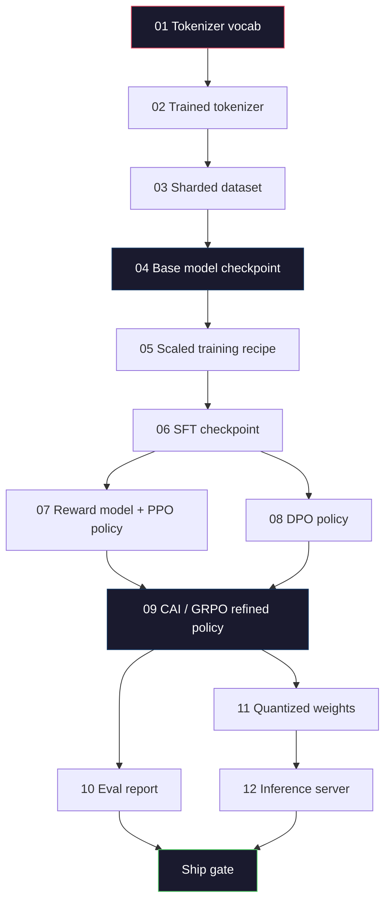
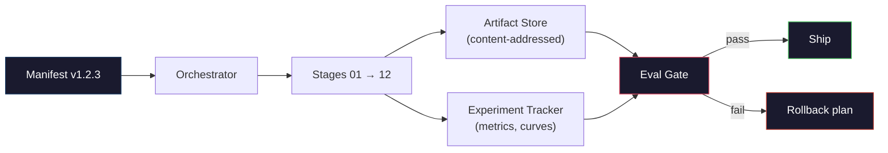

# Построение полного пайплайна LLM

> Всё, что было в уроках 01–12, — это этапы одного пайплайна. Данный урок — каркас, превращающий эти этапы в единый сквозной прогон: токенизация, предобучение, масштабирование, SFT, выравнивание, оценка, квантование, развёртывание. Вы не будете обучать модель на 70 млрд параметров на ноутбуке. Вы создадите слой оркестрации, манифест, контрольный шлюз оценки и план отката — то, чем команда фронтир-уровня в 2026 году пользуется, чтобы решить, что идёт в релиз. Это капстоун-проект.

**Type:** Build
**Languages:** Python (stdlib)
**Prerequisites:** Все уроки Фазы 10, 01–12
**Time:** ~120 минут

## Цели обучения

- Объединить одиннадцать предыдущих уроков (токенизатор, данные, предобучение, масштабирование, SFT, RLHF, DPO, CAI, оценка, квантование, инференс) в единую воспроизводимую спецификацию пайплайна
- Определить контракт артефактов между этапами: что потребляет каждый этап, что он производит и как следующий этап проверяет вход
- Построить оркестратор, который отслеживает эксперименты, хэширует артефакты и блокирует решения о релизе по порогам оценки
- Спроектировать план отката: какие артефакты дёшево пересчитать заново, какие дороги, и во что обходится повреждённый чекпоинт

## Проблема

Каждый из предыдущих уроков работает сам по себе. Токенизатор обучен. Маленький GPT предобучен. Датасет SFT собран. Модель вознаграждения обучена. DPO выполнен. Оценки измерены. Квантованные веса экспортированы. Сервер инференса запущен. Каждый из них — отдельный notebook. У каждого свои соглашения, свои пути вывода, свой seed.

Фронтир-прогон обучения — это не notebook. Llama 3 405B потребовала 30 миллионов H100-часов на протяжении примерно 54 дней. DeepSeek-V3 использовала около 2,8 миллиона H800-часов. За это время один повреждённый чекпоинт, одна контаминация данных, одна регрессия в оценке могут стоить команде недели календарного времени и месяца GPU-бюджета. Команды выживают в этих условиях благодаря гигиене пайплайна: у каждого этапа детерминированный вход, детерминированный выход, манифест, хэш и контрольный шлюз.

Это капстоун-проект. Вы не будете запускать пайплайн целиком на ноутбуке. Вы напишете оркестратор, координирующий этапы, манифест, описывающий прогон, верификатор, блокирующий решения о релизе, и план воспроизведения, позволяющий третьей стороне перезапустить вашу работу из одного файла. Кода немного; дисциплины — много.

Паттерн масштабируется от 100 млн до 1 трлн параметров без изменений. Одни и те же четыре компонента — манифест, оркестратор, контрольный шлюз оценки, хранилище артефактов — управляют и Llama 3, и вашим хобби-GPT. Разница — в размере чисел внутри конфига каждого этапа, а не в форме пайплайна.

## Концепция

### Двенадцать этапов

Каждый урок Фазы 10 — это этап. Вот полный граф зависимостей.



Этапы 07 и 08 можно выполнять параллельно. Всё остальное — жёсткая зависимость. Изменение на этапе 02 (токенизатор) инвалидирует все последующие артефакты. Изменение на этапе 10 (оценка) инвалидирует только решение о релизе.

### Манифест

Манифест — это единый файл, достаточно полно описывающий прогон, чтобы его можно было воспроизвести. Ничто, что производит пайплайн, не должно зависеть от состояния, отсутствующего в манифесте. Поля скучны и обязательны.

```
pipeline_version: 1.2.3
seed: 42
git_commit: a1b2c3d4
stages:
  01_tokenizer:
    recipe: bpe_32k
    input_hash: sha256:...
    output_hash: sha256:...
    wall_clock_sec: 3600
    cost_usd: 12
```

Хэш выхода этапа N — это хэш входа этапа N+1. Любое отклонение — и пайплайн останавливается. Так вы отлавливаете повреждение данных на раннем этапе. Так же товарищ по команде на другом континенте проверяет, что его воспроизведение дало тот же артефакт, что и ваше.

На практике команды используют небольшую YAML-схему плюс проверку манифеста, сверяющую его с предыдущим успешным прогоном. Любое отклонение вне ожидаемых полей (стоимость, календарное время) — тревожный сигнал.

### Типизация артефактов

Выход каждого этапа — типизированный артефакт. Не каталог с произвольными файлами, не pickle, а именованный тип с известной схемой.

| Этап | Тип артефакта | Ключевые поля |
|-------|--------------|-----------|
| 01-02 | Токенизатор | vocab.json, merges.txt, config.json, хэш |
| 03 | Датасет | shards[], количество строк, количество токенов, статистика дедупликации |
| 04-05 | Чекпоинт | weights.safetensors, config.json, состояние оптимизатора, номер шага |
| 06 | SFT-модель | чекпоинт + рецепт SFT + смесь данных |
| 07 | Модель вознаграждения | чекпоинт RM + хэш данных предпочтений |
| 08-09 | Политика | чекпоинт + хэш референсной модели + beta + потраченный KL-бюджет |
| 10 | Отчёт об оценке | оценки бенчмарков + диффы регрессий + хэш данных оценки |
| 11 | Квантованная модель | квантованные веса + калибровочные данные + дельта точности относительно FP16 |
| 12 | Спецификация сервера | эндпоинт + хэш модели + конфиг + хуки наблюдаемости |

Типизация предотвращает самую распространённую ошибку: использование выхода этапа 08 в качестве входа этапа 06, то есть отгрузку модели, обученной через DPO, по пути SFT. Типизированные артефакты и типизированные сигнатуры этапов превращают такие ошибки в ошибки компиляции, а не в проблемы пятого дня.

### Контрольный шлюз оценки

Релиз — это не «обучение завершилось». Релиз — это «обучение завершилось, и шлюз оценки пройден». Шлюз определяется до начала прогона.

```
gates:
  mmlu:      >= baseline + 0.5   # no regression
  humaneval: >= baseline + 1.0
  truthfulqa: >= baseline         # no drop
  safety_refusal_rate: <= 0.05
  kl_from_reference: <= 25.0
  cost_total_usd: <= 50000
```

Каждый шлюз — числовой порог. Никаких шлюзов «выглядит неплохо». Никаких субъективных одобрений. Если все шлюзы пройдены, артефакт помечается как готовый к релизу. Если хотя бы один шлюз не пройден, прогон удерживается до явного переопределения именованным ревьюером, которое само логируется в манифесте.

Два шлюза отлавливают большинство катастроф. Шлюз *регрессии* (новая модель должна быть не хуже предыдущей на основных бенчмарках) отлавливает ошибки обучения. Шлюз *KL-бюджета* (выровненная политика не должна отклониться от референсной больше чем на X) отлавливает «переобучение» выравнивания. В каждом продакшен-пайплайне есть оба.

### Оркестратор

Небольшой кусок кода, который читает манифест, диспетчеризует этапы, отслеживает артефакты и останавливается при любом нарушении контракта. Это не Airflow. Это не Kubeflow. Для гигиены пайплайна вам нужно что-то скучное, что вы написали сами.

Задача оркестратора узка:

1. Разрешить DAG из манифеста.
2. Для каждого этапа проверить, существует ли уже ожидаемый выход с правильным хэшем (если да — пропустить).
3. Выполнить этап, захватить stdout/stderr, измерить календарное время и стоимость.
4. Проверить хэш выхода относительно ожидаемого хэша входа следующего этапа.
5. При сбое записать частичный манифест с указанием точного сбойного этапа и завершиться с ненулевым кодом.

Это около 200 строк Python. Выглядеть это будет как файл `code/main.py` в этом уроке. Под капотом реальный пайплайн использует `torchrun` или `ray` для выполнения отдельных этапов на кластерах, но сам оркестратор работает на одной машине.

### Отслеживание экспериментов и хранение артефактов

Пайплайн опирается на две внешние системы.

**Трекер экспериментов (wandb, neptune, mlflow).** Логирует кривые потерь, метрики оценки, системную телеметрию по каждому этапу. Трекер — это место, куда вы идёте, когда нужно сравнить прогон A с прогоном B три недели спустя. Команды почти всегда используют размещённый трекер для этого — написание собственного отнимает время, которое должно идти на обучение.

**Хранилище артефактов (S3, R2, GCS).** Неизменяемое объектное хранилище для чекпоинтов, датасетов, токенизаторов, отчётов об оценке. Артефакты адресуются по хэшу, а не по имени файла. Имя файла вроде `latest.pt` — это мина замедленного действия; `ckpt-7b-step-20000-sha256:abc123.safetensors` — это контракт.

Оркестратор пишет в оба хранилища. Трекер — для людей, смотрящих на графики. Хранилище артефактов — для следующего этапа, ищущего входные данные.

### Оценка стоимости

У фронтир-прогона есть привязанное к нему число в долларах. Бюджетная дисциплина применяется в двух местах.

**Предварительная оценка.** Из манифеста вычисляется ожидаемое количество FLOPs (для предобучения: 6 x параметры x токены), ожидаемые GPU-часы (FLOPs / пиковая пропускная способность / утилизация) и стоимость в долларах по текущей ставке аренды. Если оценка превышает бюджетный шлюз, пайплайн отказывается стартовать.

**Отслеживание в процессе.** Календарное время и стоимость по каждому этапу логируются в манифест. После каждого этапа проверяется оставшийся бюджет. Если этап занял больше времени, чем ожидалось, шлюз следующего этапа оценивается с учётом нового оставшегося бюджета. Вы не должны узнавать, что деньги закончились, когда звонит инвестор.

Заявленная стоимость основного прогона предобучения Llama 3 составила $61M. DeepSeek-V3 reported $5.6M. Разница в соотношении — это в основном эффективность железа плюс mixture-of-experts, но конкретная стоимость видна именно потому, что обе команды отслеживали её по этапам, а не по прогону в целом.

### Воспроизводимость против детерминизма

Это не одно и то же. *Воспроизводимость* означает, что тот же манифест плюс тот же код плюс та же инфраструктура дают чекпоинт с эквивалентными итоговыми метриками. *Детерминизм* означает побитово идентичный выход.

Современное обучение LLM воспроизводимо, но не детерминировано. Порядок редукции при распределённом обучении, недетерминизм ядер GPU (cuBLAS, flash-attn) и округление при пониженной точности вместе дают числа с плавающей точкой, различающиеся на уровне 1e-5 между прогонами. Это нормально для итоговых метрик, которые не сдвигаются. Это фатально, если вы пытаетесь отлаживать по побитовым диффам. Лекарство — логировать хэш входа, хэш выхода и заглавные метрики каждого этапа: если они совпадают, прогон «воспроизведён», даже если веса не идентичны побитово.



### План отката

До начала прогона запишите, что происходит при сбое каждого этапа. Три категории.

- **Дёшево пересчитать** (часы): токенизатор, оценка, квантование, сервер инференса. Просто перезапустить.
- **Средне** (дни): SFT, DPO, CAI. Оставить базовую модель; перезапустить только этапы выравнивания.
- **Дорого** (недели и миллионы долларов): предобучение. План отката здесь — не «перезапустить». Это «использовать последний хороший чекпоинт и перезапустить более дешёвые последующие этапы с пересмотренными данными».

Поскольку зависимости этапов типизированы и хэшированы, оркестратор может автоматически вычислить множество отката: инвалидировать сбойный этап и всех его потомков. Сбой на этапе 06 (SFT) инвалидирует 06, 07, 08, 09, 10, 11, 12. Сбой на этапе 11 (квантование) инвалидирует только 11 и 12. Определив это заранее, вы избегаете импровизации, когда команда измотана в 4 утра.

### Продакшен-рецепты, наблюдавшиеся в 2026 году

Большинство фронтир-команд сошлись на одном и том же скелете.

- Токенизатор: 128k BPE с байтовым фолбэком. Обучен на небольшом, сбалансированном многоязычном срезе.
- Предобучение: 10-20 триллионов токенов, в основном веб плюс код плюс синтетика. Оптимизатор Muon или AdamW. FSDP2 или DeepSpeed ZeRO-3. Градиентный чекпоинтинг. Веса BF16, мастер-копия FP32.
- SFT: 500 тыс. – 2 млн инструктивных пар, смесь человеческих и синтетических, со строгой дедупликацией относительно eval-набора.
- Выравнивание: DPO или CAI + GRPO. RLHF — только там, где сигнал предпочтений слишком многомерен для DPO.
- Оценка: MMLU-Pro, MATH, HumanEval+, GPQA, SWE-Bench Verified, LiveBench, плюс приватный отложенный набор, который публика никогда не видит.
- Квантование: 4-битный GPTQ или AWQ для развёртывания, 8-битное — для оценок безопасности, где важны дельты точности.
- Развёртывание: vLLM, TensorRT-LLM или собственное решение. Непрерывный батчинг. Спекулятивное декодирование. Вытеснение KV-кэша.

Числа меняются каждые полгода. Скелет — нет.

```figure
beam-search
```

## Постройте это

Код урока — это оркестратор и проверка манифеста, а не двенадцать скриптов обучения. Каждый этап симулируется заглушкой, производящей выходной артефакт с правильной формой и хэшем. Сквозной запуск оркестратора доказывает, что сантехника пайплайна работает, прежде чем вы сожжёте деньги на GPU на реальных этапах.

См. `code/main.py` для полной реализации. Ключевые элементы:

- датакласс `Manifest`: версия пайплайна, seed, git-коммит, этапы, шлюзы.
- датакласс `Stage`: имя, тип, входы (хэши), выход (хэш), календарное время, стоимость.
- `Orchestrator.run()`: разрешает DAG, диспетчеризует этапы, проверяет хэши, обновляет манифест.
- `EvalGate.check()`: читает пороги, сравнивает с последним отчётом об оценке, возвращает проход/провал.
- `ArtifactStore` (заглушка в памяти): put/get по хэшу, имитирует S3.
- `CostTracker`: по этапам и кумулятивно, останавливается при превышении лимита.

Пайплайн в `main.py` выполняет двенадцать заглушечных этапов, производит манифест и отрабатывает провальный шлюз оценки, чтобы показать, как выглядит удержанный прогон. Замените каждую заглушку реальным скриптом обучения из соответствующего урока — и у вас есть скелет, который использует настоящий фронтир-пайплайн.

## Используйте это

Канонический рабочий процесс состоит из трёх команд.

```
python code/main.py plan    # validate manifest, compute cost estimate, print DAG
python code/main.py run     # execute stages, writing to manifest.out.yaml
python code/main.py gate    # read manifest.out.yaml, apply eval gates, ship-or-hold
```

Запускайте `plan` первым каждый раз. Большинство ошибок пайплайна проявляются на этапе планирования — отсутствующие пороги шлюзов, устаревшие хэши, превышение бюджета. Запуск `plan` бесплатен. Запуск `run` дорог. Экономьте деньги, отлавливая ошибки на дешёвой стороне.

Результат `gate` — это либо `SHIP`, либо `HOLD: <reason>`. Удержанный прогон — это не провал; это точка принятия решения. Именованный ревьюер либо переопределяет (и переопределение логируется), либо утверждает откат.

## Отгрузите это

Этот урок производит `outputs/skill-llm-pipeline-reviewer.md`. Подайте ему предлагаемый манифест пайплайна, и он проверит все контракты: типизацию этапов, цепочку хэшей, шлюзы, план отката, оценку стоимости. Он откажется утверждать манифест с отсутствующим шлюзом оценки, неограниченным KL-бюджетом или прогоном, смешивающим данные оценки и обучения.

## Упражнения

1. Расширьте оркестратор для поддержки параллельного выполнения этапов 07 и 08. Используйте стандартный модуль `concurrent.futures`. Убедитесь, что итоговый манифест фиксирует выходы обоих этапов и что хэш входа этапа 09 — детерминированная комбинация обоих.

2. Добавьте шлюз «проверка контаминации». Имея хэш датасета оценки и шарды обучающего датасета, вычислите пересечение (точное совпадение строк или по 13-граммам). Шлюз должен не пройти проверку, если пересечение превышает 0,1%. Подайте ему контаминированный обучающий набор и убедитесь, что шлюз удерживает прогон.

3. Реализуйте оценщик стоимости с нуля. Для этапа 04 (предобучение) оцените FLOPs как 6 x параметры x токены, примите MFU (model FLOPs utilization) 40% на H100 при 989 TFLOPs BF16, по цене $2,50/GPU-час. Сообщите оценку для модели на 7 млрд параметров, обученной на 2 трлн токенов. Сравните с опубликованными цифрами Llama 2.

4. Постройте частичный откат. Смоделируйте сбой на этапе 09 (CAI), затем перезапустите этапы с 09 по 12, оставив 01-08 закэшированными. Оркестратор должен обнаружить закэшированные артефакты по хэшу и пропустить их. Измерьте сэкономленное календарное время по сравнению с полным перезапуском.

5. Добавьте наблюдаемость. Генерируйте спаны OpenTelemetry для каждого этапа с атрибутами параметров, количества просмотренных токенов, потерь и стоимости. Направьте спаны в локальный коллектор. Суть не в дашбордах; суть в том, что состояние каждого этапа можно отследить по единому идентификатору трассировки.

## Ключевые термины

| Термин | Что говорят люди | Что это на самом деле означает |
|------|----------------|----------------------|
| Манифест | «Файл-рецепт» | YAML или JSON, описывающий версию пайплайна, seed, конфигурацию по этапам и пороги шлюзов — достаточно для воспроизведения прогона |
| Адресация по содержимому | «По хэшу, не по имени» | Артефакты хранятся по SHA-256 их содержимого, так что вы никогда не перепутаете версию A с версией B |
| Шлюз оценки | «Критерии релиза» | Числовые пороги по метрикам бенчмарков и оценкам безопасности, которые должны быть пройдены, прежде чем артефакт помечается готовым к релизу |
| KL-бюджет | «Насколько выравнивание отклонилось» | Ограничение на кумулятивный KL(политика || референс) по этапам выравнивания, применяемое как шлюз |
| MFU | «Насколько полно вы использовали GPU» | Model FLOPs Utilization — достигнутые FLOPs, делённые на теоретический пик. 40% типично для масштаба 70 млрд параметров, 55% — для 7 млрд |
| План отката | «Что мы делаем, когда ломается» | Заранее прописанный набор действий для каждого этапа при сбое: перезапуск, откат, переобучение с пересмотренными входными данными |
| Оркестратор | «Дирижёр» | Процесс, читающий манифест, диспетчеризующий этапы, проверяющий хэши, останавливающийся при любом нарушении контракта |
| Хранилище артефактов | «Версионированный S3 для весов» | Неизменяемое объектное хранилище с адресацией по содержимому — единый источник истины для чекпоинтов, датасетов, отчётов об оценке |
| Воспроизводимость | «Те же метрики при повторе» | Разные побитовые веса, но эквивалентные итоговые метрики — реалистичная цель для распределённого обучения LLM |
| Бюджетный шлюз | «Нельзя превышать X» | Предварительная оценка стоимости плюс трекер в процессе — пайплайн отказывается стартовать, если оценка превышает бюджет |

## Дополнительное чтение

- [Dubey et al., 2024 — «The Llama 3 Herd of Models»](https://arxiv.org/abs/2407.21783) — наиболее детальное публичное описание фронтир-пайплайна, включая данные, обучение, выравнивание, оценку
- [DeepSeek-AI, 2024 — «DeepSeek-V3 Technical Report»](https://arxiv.org/abs/2412.19437) — пайплайн с приоритетом эффективности, примерно в 10 раз дешевле обучения класса Llama 3
- [Kaplan et al., 2020 — «Scaling Laws for Neural Language Models»](https://arxiv.org/abs/2001.08361) — исходное соотношение масштабирования compute-data-params
- [Hoffmann et al., 2022 — «Training Compute-Optimal Large Language Models (Chinchilla)»](https://arxiv.org/abs/2203.15556) — поправка к работе Kaplan, перекалибровавшая современные бюджеты данных
- [Документация PyTorch FSDP2](https://pytorch.org/docs/stable/fsdp.html) — примитив распределённого обучения, заменяющий FSDP1 в PyTorch 2.4+
- [Weights & Biases LLM Reports](https://wandb.ai/site/solutions/llms/) — реальные манифесты и вывод трекера экспериментов для прогонов open-source LLM, полезные как шаблоны для заимствования