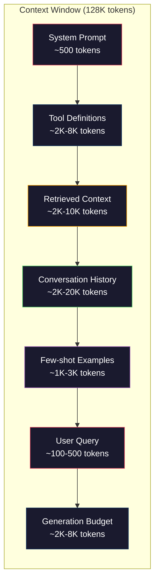
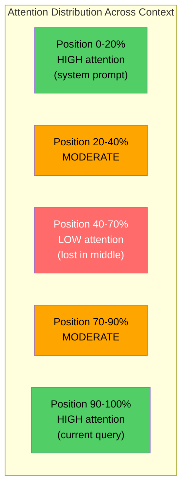
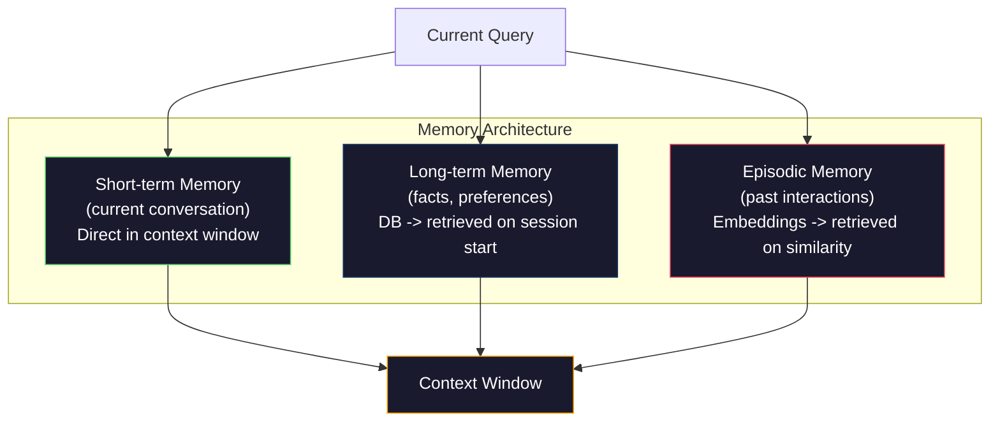

# Инжиниринг контекста: окна, бюджеты, память и извлечение

> Промпт-инжиниринг — это подмножество. Инжиниринг контекста — это вся игра целиком. Промпт — это строка, которую вы вводите. Контекст — это всё, что попадает в окно модели: системные инструкции, извлечённые документы, определения инструментов, история разговора, few-shot примеры и сам промпт. Лучшие AI-инженеры в 2026 году — это инженеры контекста. Они решают, что входит, что остаётся снаружи и в каком порядке.

**Type:** Build
**Languages:** Python
**Prerequisites:** Phase 10 (LLMs from Scratch), Phase 11 Lesson 01-02
**Time:** ~90 минут
**Related:** Phase 11 · 15 (Prompt Caching) — дружественная к кэшу раскладка является расширением инжиниринга контекста. Phase 5 · 28 (Long-Context Evaluation) о том, как измерять lost-in-the-middle с помощью NIAH/RULER.

## Цели обучения

- Рассчитывать токенные бюджеты по всем компонентам окна контекста (системный промпт, инструменты, история, извлечённые документы, запас на генерацию)
- Реализовывать стратегии управления окном контекста: усечение, суммаризацию и скользящее окно для истории разговора
- Приоритизировать и упорядочивать компоненты контекста, чтобы максимизировать внимание модели к наиболее релевантной информации
- Построить сборщик контекста, который динамически распределяет токены в зависимости от типа запроса и доступного места в окне

## Проблема

У Claude Opus 4.7 окно в 200K токенов (1M в бета-режиме). У GPT-5 — 400K. У Gemini 3 Pro — 2M. Llama 4 заявляет 10M. Эти числа звучат огромно, пока вы их не заполните.

Вот реальная разбивка для кодового ассистента. Системный промпт: 500 токенов. Определения инструментов для 50 инструментов: 8 000 токенов. Извлечённая документация: 4 000 токенов. История разговора (10 ходов): 6 000 токенов. Текущий запрос пользователя: 200 токенов. Бюджет генерации (максимальный вывод): 4 000 токенов. Итого: 22 700 токенов. Это всего 18% от окна в 128K.

Но внимание не масштабируется линейно с длиной контекста. Модель со 128K токенами контекста платит квадратичную стоимость внимания (O(n^2) в ванильных трансформерах, хотя большинство production-моделей используют эффективные варианты внимания). Что важнее, точность извлечения деградирует. Тест «Needle in a Haystack» показывает, что модели плохо находят информацию, расположенную в середине длинных контекстов. Исследование Liu et al. (2023) показало, что LLM извлекают информацию из начала и конца длинных контекстов почти с идеальной точностью, но точность падает на 10-20% для информации, расположенной в середине (позиции 40-70% контекста). Этот эффект «lost-in-the-middle» варьируется от модели к модели, но затрагивает все современные архитектуры.

Практический вывод: наличие доступных 200K токенов не означает, что использование всех 200K токенов эффективно. Тщательно отобранный контекст в 10K токенов часто превосходит сваленный в кучу контекст в 100K токенов. Инжиниринг контекста — это дисциплина максимизации отношения сигнал/шум внутри окна контекста.

Каждый токен, который вы помещаете в окно, вытесняет токен, который мог бы нести более релевантную информацию. Каждое нерелевантное определение инструмента, каждый устаревший ход разговора, каждый фрагмент извлечённого текста, не отвечающий на вопрос, — всё это делает модель чуть хуже в выполнении задачи.

## Концепция

### Окно контекста — это дефицитный ресурс

Думайте об окне контекста как об оперативной памяти, а не о диске. Она быстрая и напрямую доступная, но ограниченная. Вы не можете вместить всё. Вам нужно выбирать.



Каждый компонент конкурирует за место. Добавление большего числа определений инструментов означает меньше места для истории разговора. Добавление большего объёма извлечённого контекста означает меньше места для few-shot примеров. Инжиниринг контекста — это искусство распределения этого бюджета для максимизации производительности задачи.

### Lost-in-the-Middle

Самое важное эмпирическое открытие в инжиниринге контекста. Модели лучше обращают внимание на информацию в начале и в конце контекста. Информация в середине получает более низкие оценки внимания и с большей вероятностью игнорируется.

Liu et al. (2023) проверили это систематически. Они помещали релевантный документ среди 20 нерелевантных документов на разных позициях и измеряли точность ответов. Когда релевантный документ был первым или последним, точность составляла 85-90%. Когда он находился в середине (позиция 10 из 20), точность падала до 60-70%.

Это имеет прямые инженерные последствия:

- Помещайте самую важную информацию первой (системный промпт, критичные инструкции)
- Помещайте текущий запрос и наиболее релевантный контекст последними (эффект новизны помогает)
- Относитесь к середине контекста как к зоне наименьшего приоритета
- Если вам необходимо включить информацию в середине, продублируйте ключевой момент в конце



### Компоненты контекста

**Системный промпт**: задаёт персону, ограничения и поведенческие правила. Он идёт первым и остаётся неизменным на всех ходах. Claude Code использует примерно 6 000 токенов для своего системного промпта, включая определения инструментов и поведенческие инструкции. Держите его компактным. Каждое слово в системном промпте повторяется при каждом вызове API.

**Определения инструментов**: каждый инструмент добавляет 50-200 токенов (имя, описание, схема параметров). 50 инструментов по 150 токенов каждый — это 7 500 токенов до начала какого-либо разговора. Динамический выбор инструментов — включение только тех инструментов, которые релевантны текущему запросу — может снизить это на 60-80%.

**Извлечённый контекст**: документы из векторной базы данных, результаты поиска, содержимое файлов. Качество извлечения напрямую определяет качество ответа. Плохое извлечение хуже, чем отсутствие извлечения — оно заполняет окно шумом и активно вводит модель в заблуждение.

**История разговора**: каждое предыдущее сообщение пользователя и ответ ассистента. Растёт линейно с длиной разговора. Разговор в 50 ходов при 200 токенах за ход — это 10 000 токенов истории. Большая часть этого не релевантна текущему запросу.

**Few-shot примеры**: пары вход/выход, демонстрирующие желаемое поведение. Два-три удачно выбранных примера часто улучшают качество вывода больше, чем тысячи токенов инструкций. Но они стоят места.

**Бюджет генерации**: токены, зарезервированные для ответа модели. Если вы заполняете окно до предела, у модели не остаётся места для ответа. Резервируйте как минимум 2 000-4 000 токенов для генерации.

### Стратегии сжатия контекста

**Суммаризация истории**: вместо хранения всех предыдущих ходов дословно, периодически суммируйте разговор. «Мы обсудили X, решили Y, и пользователь хочет Z» в 100 токенах заменяет 10 ходов, занимавших 2 000 токенов. Запускайте суммаризацию, когда история превышает порог (например, 5 000 токенов).

**Фильтрация по релевантности**: оценивайте каждый извлечённый документ относительно текущего запроса и отбрасывайте документы ниже порога. Если вы извлекли 10 фрагментов, но только 3 релевантны, отбросьте остальные 7. Лучше иметь 3 высоко релевантных фрагмента, чем 10 посредственных.

**Обрезка инструментов**: классифицируйте намерение запроса пользователя и включайте только инструменты, релевантные этому намерению. Вопрос по коду не нуждается в инструментах календаря. Вопрос о планировании не нуждается в инструментах файловой системы. Это может сократить определения инструментов с 8 000 токенов до 1 000.

**Рекурсивная суммаризация**: для очень длинных документов суммируйте поэтапно. Сначала суммируйте каждый раздел, затем суммируйте сами резюме. 50-страничный документ становится дайджестом на 500 токенов, который охватывает ключевые моменты.

### Системы памяти

Инжиниринг контекста охватывает три временных горизонта.

**Кратковременная память**: текущий разговор. Хранится непосредственно в окне контекста. Растёт с каждым ходом. Управляется суммаризацией и усечением.

**Долговременная память**: факты и предпочтения, сохраняющиеся между разговорами. «Пользователь предпочитает TypeScript». «Проект использует PostgreSQL». Хранится в базе данных, извлекается при старте сессии. Claude Code хранит это в файлах CLAUDE.md. ChatGPT хранит это в функции памяти.

**Эпизодическая память**: конкретные прошлые взаимодействия, которые могут быть релевантны. «В прошлый вторник мы отлаживали похожую проблему в модуле аутентификации». Хранится в виде эмбеддингов, извлекается, когда текущий разговор совпадает с прошлым эпизодом.



### Динамическая сборка контекста

Ключевая идея: разным запросам нужен разный контекст. Статичный системный промпт + статичные инструменты + статичная история — это расточительно. Лучшие системы динамически собирают контекст под каждый запрос.

1. Классифицировать намерение запроса
2. Выбрать релевантные инструменты (не все инструменты)
3. Извлечь релевантные документы (не фиксированный набор)
4. Включить релевантные ходы истории (не всю историю)
5. Добавить few-shot примеры, соответствующие типу задачи
6. Упорядочить всё по важности: критичное — первым, важное — последним, второстепенное — в середине

Именно это отличает хорошее AI-приложение от отличного. Модель одна и та же. Контекст — вот что определяет разницу.

```figure
lost-in-the-middle
```

## Постройте это

### Шаг 1: Счётчик токенов

Вы не можете бюджетировать то, что не можете измерить. Постройте простой счётчик токенов (приближение с использованием разбиения по пробелам, поскольку точное количество зависит от токенизатора).

```python
import json
import numpy as np
from collections import OrderedDict

def count_tokens(text):
    if not text:
        return 0
    return int(len(text.split()) * 1.3)

def count_tokens_json(obj):
    return count_tokens(json.dumps(obj))
```

### Шаг 2: Менеджер бюджета контекста

Основная абстракция. Менеджер бюджета отслеживает, сколько токенов использует каждый компонент, и обеспечивает соблюдение лимитов.

```python
class ContextBudget:
    def __init__(self, max_tokens=128000, generation_reserve=4000):
        self.max_tokens = max_tokens
        self.generation_reserve = generation_reserve
        self.available = max_tokens - generation_reserve
        self.allocations = OrderedDict()

    def allocate(self, component, content, max_tokens=None):
        tokens = count_tokens(content)
        if max_tokens and tokens > max_tokens:
            words = content.split()
            target_words = int(max_tokens / 1.3)
            content = " ".join(words[:target_words])
            tokens = count_tokens(content)

        used = sum(self.allocations.values())
        if used + tokens > self.available:
            allowed = self.available - used
            if allowed <= 0:
                return None, 0
            words = content.split()
            target_words = int(allowed / 1.3)
            content = " ".join(words[:target_words])
            tokens = count_tokens(content)

        self.allocations[component] = tokens
        return content, tokens

    def remaining(self):
        used = sum(self.allocations.values())
        return self.available - used

    def utilization(self):
        used = sum(self.allocations.values())
        return used / self.max_tokens

    def report(self):
        total_used = sum(self.allocations.values())
        lines = []
        lines.append(f"Context Budget Report ({self.max_tokens:,} token window)")
        lines.append("-" * 50)
        for component, tokens in self.allocations.items():
            pct = tokens / self.max_tokens * 100
            bar = "#" * int(pct / 2)
            lines.append(f"  {component:<25} {tokens:>6} tokens ({pct:>5.1f}%) {bar}")
        lines.append("-" * 50)
        lines.append(f"  {'Used':<25} {total_used:>6} tokens ({total_used/self.max_tokens*100:.1f}%)")
        lines.append(f"  {'Generation reserve':<25} {self.generation_reserve:>6} tokens")
        lines.append(f"  {'Remaining':<25} {self.remaining():>6} tokens")
        return "\n".join(lines)
```

### Шаг 3: Переупорядочивание Lost-in-the-Middle

Реализуйте стратегию переупорядочивания: самые важные элементы идут первыми и последними, наименее важные — в середине.

```python
def reorder_lost_in_middle(items, scores):
    paired = sorted(zip(scores, items), reverse=True)
    sorted_items = [item for _, item in paired]

    if len(sorted_items) <= 2:
        return sorted_items

    first_half = sorted_items[::2]
    second_half = sorted_items[1::2]
    second_half.reverse()

    return first_half + second_half

def score_relevance(query, documents):
    query_words = set(query.lower().split())
    scores = []
    for doc in documents:
        doc_words = set(doc.lower().split())
        if not query_words:
            scores.append(0.0)
            continue
        overlap = len(query_words & doc_words) / len(query_words)
        scores.append(round(overlap, 3))
    return scores
```

### Шаг 4: Компрессор истории разговора

Суммируйте старые ходы разговора, чтобы вернуть токенный бюджет.

```python
class ConversationManager:
    def __init__(self, max_history_tokens=5000):
        self.turns = []
        self.summaries = []
        self.max_history_tokens = max_history_tokens

    def add_turn(self, role, content):
        self.turns.append({"role": role, "content": content})
        self._compress_if_needed()

    def _compress_if_needed(self):
        total = sum(count_tokens(t["content"]) for t in self.turns)
        if total <= self.max_history_tokens:
            return

        while total > self.max_history_tokens and len(self.turns) > 4:
            old_turns = self.turns[:2]
            summary = self._summarize_turns(old_turns)
            self.summaries.append(summary)
            self.turns = self.turns[2:]
            total = sum(count_tokens(t["content"]) for t in self.turns)

    def _summarize_turns(self, turns):
        parts = []
        for t in turns:
            content = t["content"]
            if len(content) > 100:
                content = content[:100] + "..."
            parts.append(f"{t['role']}: {content}")
        return "Previous: " + " | ".join(parts)

    def get_context(self):
        parts = []
        if self.summaries:
            parts.append("[Conversation Summary]")
            for s in self.summaries:
                parts.append(s)
        parts.append("[Recent Conversation]")
        for t in self.turns:
            parts.append(f"{t['role']}: {t['content']}")
        return "\n".join(parts)

    def token_count(self):
        return count_tokens(self.get_context())
```

### Шаг 5: Динамический селектор инструментов

Включайте только инструменты, релевантные текущему запросу. Классифицируйте намерение, затем фильтруйте.

```python
TOOL_REGISTRY = {
    "read_file": {
        "description": "Read contents of a file",
        "tokens": 120,
        "categories": ["code", "files"],
    },
    "write_file": {
        "description": "Write content to a file",
        "tokens": 150,
        "categories": ["code", "files"],
    },
    "search_code": {
        "description": "Search for patterns in codebase",
        "tokens": 130,
        "categories": ["code"],
    },
    "run_command": {
        "description": "Execute a shell command",
        "tokens": 140,
        "categories": ["code", "system"],
    },
    "create_calendar_event": {
        "description": "Create a new calendar event",
        "tokens": 180,
        "categories": ["calendar"],
    },
    "list_emails": {
        "description": "List recent emails",
        "tokens": 160,
        "categories": ["email"],
    },
    "send_email": {
        "description": "Send an email message",
        "tokens": 200,
        "categories": ["email"],
    },
    "web_search": {
        "description": "Search the web for information",
        "tokens": 140,
        "categories": ["research"],
    },
    "query_database": {
        "description": "Run a SQL query on the database",
        "tokens": 170,
        "categories": ["code", "data"],
    },
    "generate_chart": {
        "description": "Generate a chart from data",
        "tokens": 190,
        "categories": ["data", "visualization"],
    },
}

def classify_intent(query):
    query_lower = query.lower()

    intent_keywords = {
        "code": ["code", "function", "bug", "error", "file", "implement", "refactor", "debug", "test"],
        "calendar": ["meeting", "schedule", "calendar", "appointment", "event"],
        "email": ["email", "mail", "send", "inbox", "message"],
        "research": ["search", "find", "what is", "how does", "explain", "look up"],
        "data": ["data", "query", "database", "chart", "graph", "analytics", "sql"],
    }

    scores = {}
    for intent, keywords in intent_keywords.items():
        score = sum(1 for kw in keywords if kw in query_lower)
        if score > 0:
            scores[intent] = score

    if not scores:
        return ["code"]

    max_score = max(scores.values())
    return [intent for intent, score in scores.items() if score >= max_score * 0.5]

def select_tools(query, token_budget=2000):
    intents = classify_intent(query)
    relevant = {}
    total_tokens = 0

    for name, tool in TOOL_REGISTRY.items():
        if any(cat in intents for cat in tool["categories"]):
            if total_tokens + tool["tokens"] <= token_budget:
                relevant[name] = tool
                total_tokens += tool["tokens"]

    return relevant, total_tokens
```

### Шаг 6: Полный конвейер сборки контекста

Соедините всё вместе. По заданному запросу динамически соберите оптимальный контекст.

```python
class ContextEngine:
    def __init__(self, max_tokens=128000, generation_reserve=4000):
        self.budget = ContextBudget(max_tokens, generation_reserve)
        self.conversation = ConversationManager(max_history_tokens=5000)
        self.system_prompt = (
            "You are a helpful AI assistant. You have access to tools for "
            "code editing, file management, web search, and data analysis. "
            "Use the appropriate tools for each task. Be concise and accurate."
        )
        self.knowledge_base = [
            "Python 3.12 introduced type parameter syntax for generic classes using bracket notation.",
            "The project uses PostgreSQL 16 with pgvector for embedding storage.",
            "Authentication is handled by Supabase Auth with JWT tokens.",
            "The frontend is built with Next.js 15 using the App Router.",
            "API rate limits are set to 100 requests per minute per user.",
            "The deployment pipeline uses GitHub Actions with Docker multi-stage builds.",
            "Test coverage must be above 80% for all new modules.",
            "The codebase follows the repository pattern for data access.",
        ]

    def assemble(self, query):
        self.budget = ContextBudget(self.budget.max_tokens, self.budget.generation_reserve)

        system_content, _ = self.budget.allocate("system_prompt", self.system_prompt, max_tokens=1000)

        tools, tool_tokens = select_tools(query, token_budget=2000)
        tool_text = json.dumps(list(tools.keys()))
        tool_content, _ = self.budget.allocate("tools", tool_text, max_tokens=2000)

        relevance = score_relevance(query, self.knowledge_base)
        threshold = 0.1
        relevant_docs = [
            doc for doc, score in zip(self.knowledge_base, relevance)
            if score >= threshold
        ]

        if relevant_docs:
            doc_scores = [s for s in relevance if s >= threshold]
            reordered = reorder_lost_in_middle(relevant_docs, doc_scores)
            doc_text = "\n".join(reordered)
            doc_content, _ = self.budget.allocate("retrieved_context", doc_text, max_tokens=3000)

        history_text = self.conversation.get_context()
        if history_text.strip():
            history_content, _ = self.budget.allocate("conversation_history", history_text, max_tokens=5000)

        query_content, _ = self.budget.allocate("user_query", query, max_tokens=500)

        return self.budget

    def chat(self, query):
        self.conversation.add_turn("user", query)
        budget = self.assemble(query)
        response = f"[Response to: {query[:50]}...]"
        self.conversation.add_turn("assistant", response)
        return budget


def run_demo():
    print("=" * 60)
    print("  Context Engineering Pipeline Demo")
    print("=" * 60)

    engine = ContextEngine(max_tokens=128000, generation_reserve=4000)

    print("\n--- Query 1: Code task ---")
    budget = engine.chat("Fix the bug in the authentication module where JWT tokens expire too early")
    print(budget.report())

    print("\n--- Query 2: Research task ---")
    budget = engine.chat("What is the best approach for implementing vector search in PostgreSQL?")
    print(budget.report())

    print("\n--- Query 3: After conversation history builds up ---")
    for i in range(8):
        engine.conversation.add_turn("user", f"Follow-up question number {i+1} about the implementation details of the system")
        engine.conversation.add_turn("assistant", f"Here is the response to follow-up {i+1} with technical details about the architecture")

    budget = engine.chat("Now implement the changes we discussed")
    print(budget.report())

    print("\n--- Tool Selection Examples ---")
    test_queries = [
        "Fix the bug in auth.py",
        "Schedule a meeting with the team for Tuesday",
        "Show me the database query performance stats",
        "Search for best practices on error handling",
    ]

    for q in test_queries:
        tools, tokens = select_tools(q)
        intents = classify_intent(q)
        print(f"\n  Query: {q}")
        print(f"  Intents: {intents}")
        print(f"  Tools: {list(tools.keys())} ({tokens} tokens)")

    print("\n--- Lost-in-the-Middle Reordering ---")
    docs = ["Doc A (most relevant)", "Doc B (somewhat relevant)", "Doc C (least relevant)",
            "Doc D (relevant)", "Doc E (moderately relevant)"]
    scores = [0.95, 0.60, 0.20, 0.80, 0.50]
    reordered = reorder_lost_in_middle(docs, scores)
    print(f"  Original order: {docs}")
    print(f"  Scores:         {scores}")
    print(f"  Reordered:      {reordered}")
    print(f"  (Most relevant at start and end, least relevant in middle)")
```

## Используйте это

### Контекст, управляемый harness'ом

Claude Code управляет контекстом многоуровневым подходом. Системный промпт включает поведенческие правила и определения инструментов (~6K токенов). Когда вы открываете файл, его содержимое добавляется в контекст. Когда вы выполняете поиск, добавляются результаты. Старые ходы разговора суммируются. CLAUDE.md предоставляет долговременную память, сохраняющуюся между сессиями.

Ключевое инженерное решение: Claude Code не сваливает всю вашу кодовую базу в контекст. Он извлекает релевантные файлы по запросу. Это инжиниринг контекста на практике.

### Динамическая загрузка контекста

Cursor индексирует всю вашу кодовую базу в эмбеддинги. Когда вы вводите запрос, он извлекает наиболее релевантные файлы и блоки кода с помощью векторного сходства. Только эти фрагменты попадают в окно контекста. Кодовая база в 500K строк сжимается до 5-10 самых релевантных блоков кода.

Это и есть паттерн: встраивайте всё, извлекайте по запросу, включайте только то, что имеет значение.

### Долговременная память ассистента

ChatGPT хранит предпочтения и факты о пользователе как долговременную память. При каждом начале разговора релевантные воспоминания извлекаются и включаются в системный промпт. «Пользователь предпочитает Python» стоит 5 токенов, но экономит сотни токенов повторяющихся инструкций в разных разговорах.

### RAG как инжиниринг контекста

Retrieval-Augmented Generation — это формализованный инжиниринг контекста. Вместо того чтобы впихивать знания в веса модели (обучение) или в системный промпт (статичный контекст), вы извлекаете релевантные документы во время запроса и внедряете их в окно контекста. Весь конвейер RAG — чанкинг, эмбеддинг, извлечение, реранкинг — существует для решения одной проблемы: размещения правильной информации в окне контекста.

## Поставьте это

Этот урок производит `outputs/prompt-context-optimizer.md` — переиспользуемый промпт, который аудирует стратегию сборки контекста и рекомендует оптимизации. Передайте ему свой системный промпт, количество инструментов, среднюю длину истории и стратегию извлечения, и он выявит растрату токенов и предложит улучшения.

Он также производит `outputs/skill-context-engineering.md` — фреймворк для принятия решений по проектированию конвейеров сборки контекста на основе типа задачи, размера окна контекста и бюджета задержки.

## Упражнения

1. Добавьте «детектор растраты токенов» в класс ContextBudget. Он должен помечать компоненты, использующие более 30% бюджета, и предлагать стратегии сжатия, специфичные для каждого типа компонента (суммаризация истории, обрезка инструментов, переранжирование документов).

2. Реализуйте семантическую дедупликацию для извлечённого контекста. Если два извлечённых документа совпадают более чем на 80% (по пересечению слов или косинусному сходству их эмбеддингов), оставьте только тот, что с более высокой оценкой. Измерьте, сколько токенного бюджета это высвобождает.

3. Постройте инструмент «replay контекста». Для заданной стенограммы разговора воспроизведите её через ContextEngine и визуализируйте, как меняется распределение бюджета по ходам. Постройте график использования токенов по компонентам во времени. Определите ход, с которого контекст начинает сжиматься.

4. Реализуйте селектор инструментов на основе приоритета. Вместо бинарного включения/исключения присваивайте каждому инструменту оценку релевантности к текущему запросу. Включайте инструменты в порядке убывания релевантности, пока бюджет инструментов не исчерпан. Сравните производительность задачи при включении 5, 10, 20 и 50 инструментов.

5. Постройте многостратегийный компрессор контекста. Реализуйте три стратегии сжатия (усечение, суммаризация, извлечение ключевых предложений) и протестируйте их на наборе из 20 документов. Измерьте компромисс между коэффициентом сжатия и сохранением информации (содержит ли сжатая версия ответ на запрос?).

## Ключевые термины

| Термин | Что говорят люди | Что это на самом деле означает |
|------|----------------|----------------------|
| Окно контекста | «Сколько модель может прочитать» | Максимальное количество токенов (вход + выход), которое модель обрабатывает за один прямой проход — 400K для GPT-5, 200K (1M бета) для Claude Opus 4.7, 2M для Gemini 3 Pro |
| Инжиниринг контекста | «Продвинутый промпт-инжиниринг» | Дисциплина определения того, что попадает в окно контекста, в каком порядке и с каким приоритетом — охватывает извлечение, сжатие, выбор инструментов и управление памятью |
| Lost-in-the-middle | «Модели забывают то, что в середине» | Эмпирическое открытие о том, что LLM лучше обращают внимание на начало и конец контекста, с падением точности на 10-20% для информации, расположенной в середине |
| Токенный бюджет | «Сколько токенов у вас осталось» | Явное распределение ёмкости окна контекста по компонентам (системный промпт, инструменты, история, извлечение, генерация) с лимитами на каждый компонент |
| Динамический контекст | «Подгрузка вещей на лету» | Сборка окна контекста по-разному для каждого запроса на основе классификации намерения, выбора релевантных инструментов и результатов извлечения |
| Суммаризация истории | «Сжатие разговора» | Замена дословных старых ходов разговора кратким резюме, снижающая стоимость в токенах при сохранении ключевой информации |
| Обрезка инструментов | «Включение только релевантных инструментов» | Классификация намерения запроса и включение только тех определений инструментов, которые соответствуют ему, снижающая стоимость инструментов в токенах на 60-80% |
| Долговременная память | «Запоминание между сессиями» | Факты и предпочтения, хранящиеся в базе данных и извлекаемые при старте сессии — CLAUDE.md, ChatGPT Memory и подобные системы |
| Эпизодическая память | «Запоминание конкретных прошлых событий» | Прошлые взаимодействия, хранящиеся в виде эмбеддингов и извлекаемые, когда текущий запрос похож на прошлый разговор |
| Бюджет генерации | «Место для ответа» | Токены, зарезервированные для вывода модели — если контекст полностью заполняет окно, у модели не остаётся места для ответа |

## Дополнительное чтение

- [Liu et al., 2023 -- "Lost in the Middle: How Language Models Use Long Contexts"](https://arxiv.org/abs/2307.03172) -- определяющее исследование о зависимости внимания от позиции, показывающее, что модели испытывают трудности с информацией в середине длинных контекстов
- [Блог-пост Anthropic о Contextual Retrieval](https://www.anthropic.com/news/contextual-retrieval) -- как Anthropic подходит к извлечению фрагментов с учётом контекста, снижая частоту ошибок извлечения на 49%
- [«Context Engineering» Саймона Уиллисона](https://simonwillison.net/2025/Jun/27/context-engineering/) -- блог-пост, давший название дисциплине и отделивший её от промпт-инжиниринга
- [Документация LangChain по RAG](https://python.langchain.com/docs/tutorials/rag/) -- практическая реализация retrieval-augmented generation как паттерна инжиниринга контекста
- [Тест Needle in a Haystack Грега Камрадта](https://github.com/gkamradt/LLMTest_NeedleInAHaystack) -- бенчмарк, выявивший зависящие от позиции сбои извлечения во всех ведущих моделях
- [Pope et al., "Efficiently Scaling Transformer Inference" (2022)](https://arxiv.org/abs/2211.05102) -- почему длина контекста определяет память и задержку, и как KV cache, MQA и GQA меняют расчёт бюджета.
- [Agrawal et al., "SARATHI: Efficient LLM Inference by Piggybacking Decodes with Chunked Prefills" (2023)](https://arxiv.org/abs/2308.16369) -- две фазы инференса, делающие длинные промпты дорогими по TTFT, но дешёвыми по TPOT; базовая истина, стоящая за компромиссами упаковки контекста.
- [Ainslie et al., "GQA: Training Generalized Multi-Query Transformer Models from Multi-Head Checkpoints" (EMNLP 2023)](https://arxiv.org/abs/2305.13245) -- статья о grouped-query attention, снизившая потребление KV-памяти в 8× в production-декодерах без потери качества.