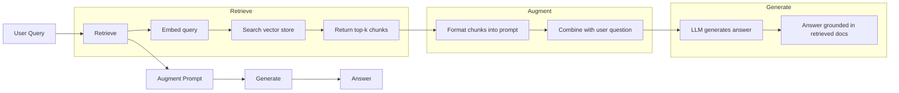
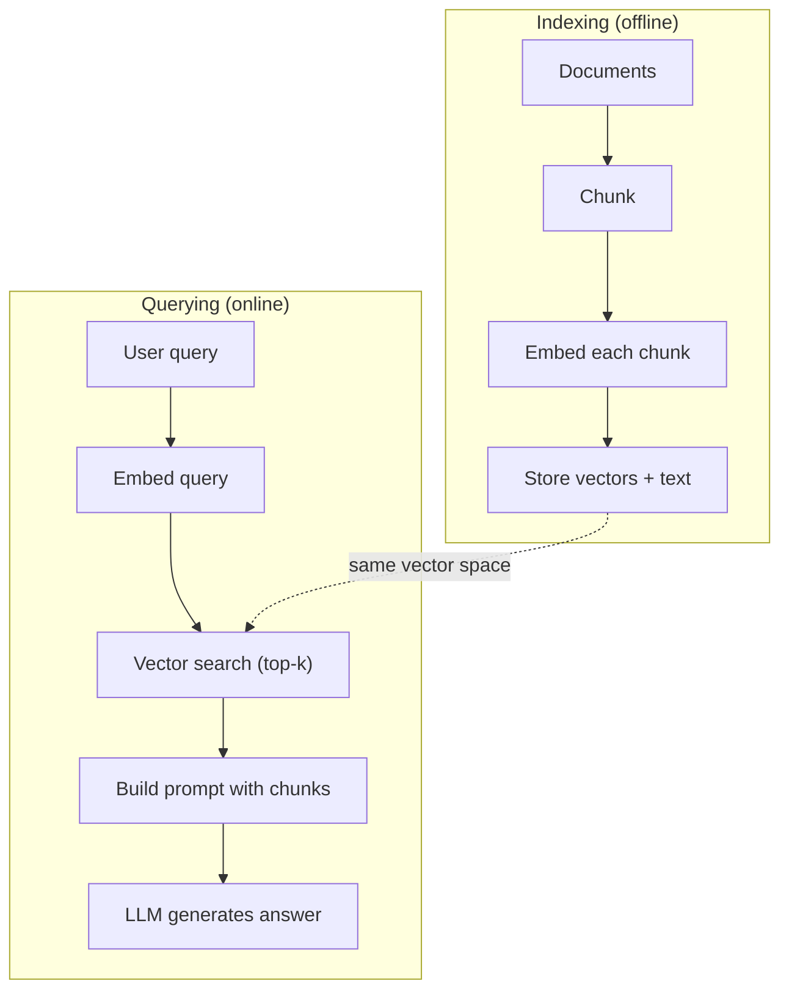

# RAG (Retrieval-Augmented Generation)

> Ваш LLM знает всё до момента своего обучения. Он ничего не знает о документации вашей компании, вашем кодовой базе или заметках со встречи на прошлой неделе. RAG решает эту проблему, извлекая релевантные документы и вставляя их в промпт. Это самый широко используемый паттерн в продакшен-ИИ. Если вы построите хотя бы одну вещь из этого курса, постройте RAG-пайплайн.

**Type:** Build
**Languages:** Python
**Prerequisites:** Phase 10 (LLMs from Scratch), Phase 11 Lessons 01-05
**Time:** ~90 минут
**Related:** Phase 5 · 23 (Chunking Strategies for RAG) — шесть алгоритмов чанкинга и когда какой побеждает. Phase 5 · 22 (Embedding Models Deep Dive) — выбор эмбеддера. Phase 11 · 07 (Advanced RAG) — гибридный поиск, реранкинг и трансформация запросов.

## Цели обучения

- Построить полный RAG-пайплайн: загрузка документов, чанкинг, эмбеддинг, векторное хранилище, извлечение и генерация
- Реализовать семантический поиск с использованием векторной базы данных (ChromaDB, FAISS или Pinecone) с правильной индексацией
- Объяснить, почему RAG предпочтительнее файнтюнинга для приложений, основанных на знаниях (стоимость, актуальность, атрибуция)
- Оценить качество RAG с помощью метрик извлечения (precision, recall) и метрик генерации (faithfulness, relevance)

## Проблема

Вы строите чат-бота для своей компании. Клиент спрашивает: «Какова политика возврата средств для корпоративных тарифов?» LLM отвечает общей фразой о типичных политиках возврата для SaaS. Реальная же политика, спрятанная в 200-страничной внутренней вики, гласит, что корпоративным клиентам предоставляется 60-дневное окно с пропорциональным возвратом средств. LLM никогда не видел этот документ. Он не может знать то, на чём не был обучен.

Файнтюнинг — одно из решений. Взять LLM, дообучить его на внутренних документах и развернуть обновлённую модель. Это работает, но имеет серьёзные проблемы. Файнтюнинг стоит тысячи долларов вычислений. Модель устаревает в момент, когда документ меняется. У вас нет способа узнать, какой источник использовала модель. А если в следующем месяце компания приобретёт ещё одну продуктовую линейку, придётся дообучать заново.

RAG — другое решение. Оставьте модель нетронутой. Когда поступает вопрос, ищите релевантные фрагменты в хранилище документов, вставляйте их в промпт перед вопросом и дайте модели ответить, используя эти фрагменты как контекст. Хранилище документов можно обновить за считанные минуты. Вы точно видите, какие документы были извлечены. Сама модель никогда не меняется. Вот почему RAG — доминирующий паттерн в продакшене: он дешевле, актуальнее, лучше поддаётся аудиту и работает с любым LLM.

## Концепция

### Паттерн RAG

Весь паттерн умещается в четыре шага:



Запрос -> Извлечение -> Дополнение промпта -> Генерация. Каждая RAG-система следует этому паттерну. Различия между продакшен-системами RAG заключаются в деталях каждого шага: как вы разбиваете на чанки, как делаете эмбеддинг, как ищете и как конструируете промпт.

### Почему RAG побеждает файнтюнинг

| Критерий | Файнтюнинг | RAG |
|---------|------------|-----|
| Стоимость | $1,000-$100,000+ за один цикл обучения | $0.01-$0.10 за запрос (эмбеддинг + LLM) |
| Актуальность | Устаревает до переобучения | Обновляется за минуты путём переиндексации документов |
| Аудируемость | Невозможно отследить источник ответа | Можно показать точные извлечённые фрагменты |
| Галлюцинации | По-прежнему свободно галлюцинирует | Опирается на извлечённые документы |
| Приватность данных | Обучающие данные «запечены» в весах | Документы остаются в вашем векторном хранилище |

Файнтюнинг меняет веса модели навсегда. RAG меняет контекст модели временно. Для большинства приложений нужен именно временный контекст.

Единственный случай, когда побеждает файнтюнинг: когда модели нужно усвоить конкретный стиль, тон или паттерн рассуждений, который невозможно получить только промптингом. Для извлечения фактических знаний RAG побеждает всегда.

### Модели эмбеддингов

Модель эмбеддинга преобразует текст в плотный вектор. Похожие тексты дают векторы, которые оказываются близко друг к другу в этом многомерном пространстве. «How do I reset my password?» и «I need to change my password» дают почти идентичные векторы, несмотря на то, что в них мало общих слов. «The cat sat on the mat» даёт совершенно другой вектор.

Распространённые модели эмбеддингов (линейка 2026 года — полный разбор см. в Phase 5 · 22):

| Модель | Размерность | Провайдер | Примечания |
|-------|-----------|----------|-------|
| text-embedding-3-small | 1536 (Matryoshka) | OpenAI | Лучшее соотношение цена/качество для большинства сценариев |
| text-embedding-3-large | 3072 (Matryoshka) | OpenAI | Более высокая точность, усекаемо до 256/512/1024 |
| Gemini Embedding 2 | 3072 (Matryoshka) | Google | Лучший результат на MTEB retrieval; контекст 8K |
| voyage-4 | 1024/2048 (Matryoshka) | Voyage AI | Доменные варианты (код, финансы, право) |
| Cohere embed-v4 | 1024 (Matryoshka) | Cohere | Хорошая многоязычность, контекст 128K |
| BGE-M3 | 1024 (dense + sparse + ColBERT) | BAAI (открытые веса) | Три представления из одной модели |
| Qwen3-Embedding | 4096 (Matryoshka) | Alibaba (открытые веса) | Лучший результат retrieval среди моделей с открытыми весами |
| all-MiniLM-L6-v2 | 384 | Открытые веса (Sentence Transformers) | Базовый вариант для прототипирования |

В этом уроке мы построим собственный простой эмбеддинг на основе TF-IDF. Не потому, что TF-IDF используется в продакшен-системах, а потому, что это делает концепцию наглядной: на входе текст, на выходе вектор, похожие тексты дают похожие векторы.

### Векторное сходство

Имея два вектора, как измерить их сходство? Три варианта:

**Косинусное сходство**: косинус угла между двумя векторами. Диапазон от -1 (противоположные) до 1 (идентичные). Игнорирует величину, учитывает только направление. Это стандарт по умолчанию для RAG.

```
cosine_sim(a, b) = dot(a, b) / (||a|| * ||b||)
```

**Скалярное произведение**: прямое внутреннее произведение. Векторы большей величины получают более высокие оценки. Полезно, когда величина несёт информацию (более длинные документы могут быть более релевантными).

```
dot(a, b) = sum(a_i * b_i)
```

**L2 (евклидово) расстояние**: расстояние по прямой в векторном пространстве. Меньшее расстояние = большее сходство. Чувствительно к разнице в величине.

```
L2(a, b) = sqrt(sum((a_i - b_i)^2))
```

Косинусное сходство — это стандарт. Оно корректно обрабатывает документы разной длины, поскольку нормализует по величине. Когда кто-то говорит «векторный поиск», почти всегда имеется в виду косинусное сходство.

### Стратегии чанкинга

Документы слишком длинны, чтобы встраивать их как единый вектор. 50-страничный PDF может дать ужасный эмбеддинг, потому что содержит десятки тем. Вместо этого документы разбивают на чанки и встраивают каждый чанк отдельно.

**Чанкинг фиксированного размера**: разбиение через каждые N токенов. Просто и предсказуемо. Чанк в 512 токенов с перекрытием в 50 токенов означает, что чанк 1 — это токены 0-511, чанк 2 — токены 462-973 и так далее. Перекрытие гарантирует, что предложение не будет разорвано в неудачной точке.

**Семантический чанкинг**: разбиение по естественным границам. Абзацы, разделы или заголовки markdown. Каждый чанк — связная смысловая единица. Сложнее в реализации, но даёт лучшее качество извлечения.

**Рекурсивный чанкинг**: попытаться разбить по самой крупной границе сначала (заголовки разделов). Если раздел всё ещё слишком большой, разбить по границам абзацев. Если абзац всё ещё слишком большой, разбить по границам предложений. Это подход LangChain RecursiveCharacterTextSplitter, и он хорошо работает на практике.

Размер чанка значит больше, чем принято думать:

- Слишком маленький (64-128 токенов): каждому чанку не хватает контекста. «It increased 15% last quarter» ничего не значит без понимания, к чему относится «it».
- Слишком большой (2048+ токенов): каждый чанк охватывает несколько тем, размывая релевантность. При поиске данных о выручке вы получаете чанк, который на 10% о выручке и на 90% о численности персонала.
- Оптимум (256-512 токенов): достаточно контекста для самодостаточности, достаточно фокуса для релевантности.

Большинство продакшен-систем RAG используют чанки по 256-512 токенов с перекрытием в 50 токенов. Рекомендации Anthropic по RAG предлагают именно этот диапазон.

### Векторные базы данных

Получив эмбеддинги, нужно где-то их хранить и искать. Варианты:

| База данных | Тип | Лучше всего для |
|----------|------|-----------|
| FAISS | Библиотека (in-process) | Прототипирование, небольшие и средние наборы данных |
| Chroma | Лёгкая БД | Локальная разработка, небольшие развёртывания |
| Pinecone | Управляемый сервис | Продакшен без эксплуатационных затрат |
| Weaviate | БД с открытым исходным кодом | Самостоятельный хостинг в продакшене |
| pgvector | Расширение Postgres | Если уже используете Postgres |
| Qdrant | БД с открытым исходным кодом | Высокопроизводительный self-hosted вариант |

В этом уроке мы построим простое векторное хранилище в памяти. Оно хранит векторы в списке и выполняет перебор для поиска по косинусному сходству. Это эквивалентно FAISS с плоским (flat) индексом. Масштабируется примерно до 100 000 векторов, прежде чем станет медленным. Продакшен-системы используют алгоритмы приближённого поиска ближайших соседей (ANN), такие как HNSW, чтобы искать среди миллионов векторов за миллисекунды.

### Полный пайплайн



Фаза индексации выполняется один раз для документа (или при его обновлении). Фаза запроса выполняется при каждом пользовательском запросе. В продакшене индексация может обрабатывать миллионы документов часами. Запрос должен отвечать менее чем за секунду.

### Реальные цифры

Большинство продакшен-систем RAG используют следующие параметры:

- **k = 5-10** извлекаемых чанков на запрос
- **Размер чанка = 256-512 токенов** с перекрытием в 50 токенов
- **Бюджет контекста**: 2 500-5 000 токенов извлечённого контента на запрос
- **Общий промпт**: ~8 000-16 000 токенов (системный промпт + извлечённые чанки + история диалога + запрос пользователя)
- **Размерность эмбеддинга**: 384-3072 в зависимости от модели
- **Пропускная способность индексации**: 100-1 000 документов в секунду при использовании API-эмбеддингов
- **Задержка запроса**: 50-200 мс на извлечение, 500-3000 мс на генерацию

```figure
rag-chunking
```

## Постройте это

### Шаг 1: Чанкинг документов

```python
def chunk_text(text, chunk_size=200, overlap=50):
    words = text.split()
    chunks = []
    start = 0
    while start < len(words):
        end = start + chunk_size
        chunk = " ".join(words[start:end])
        chunks.append(chunk)
        start += chunk_size - overlap
    return chunks
```

### Шаг 2: Эмбеддинги TF-IDF

Построим простую функцию эмбеддинга. TF-IDF (Term Frequency-Inverse Document Frequency) — не нейросетевой эмбеддинг, но он преобразует текст в векторы так, что учитывается важность слов. Частые слова в документе получают более высокий TF. Редкие в корпусе слова получают более высокий IDF. Произведение даёт вектор, в котором важные, отличительные слова имеют высокие значения.

```python
import math
from collections import Counter

def build_vocabulary(documents):
    vocab = set()
    for doc in documents:
        vocab.update(doc.lower().split())
    return sorted(vocab)

def compute_tf(text, vocab):
    words = text.lower().split()
    count = Counter(words)
    total = len(words)
    return [count.get(word, 0) / total for word in vocab]

def compute_idf(documents, vocab):
    n = len(documents)
    idf = []
    for word in vocab:
        doc_count = sum(1 for doc in documents if word in doc.lower().split())
        idf.append(math.log((n + 1) / (doc_count + 1)) + 1)
    return idf

def tfidf_embed(text, vocab, idf):
    tf = compute_tf(text, vocab)
    return [t * i for t, i in zip(tf, idf)]
```

### Шаг 3: Поиск по косинусному сходству

```python
def cosine_similarity(a, b):
    dot = sum(x * y for x, y in zip(a, b))
    norm_a = math.sqrt(sum(x * x for x in a))
    norm_b = math.sqrt(sum(x * x for x in b))
    if norm_a == 0 or norm_b == 0:
        return 0.0
    return dot / (norm_a * norm_b)

def search(query_embedding, stored_embeddings, top_k=5):
    scores = []
    for i, emb in enumerate(stored_embeddings):
        sim = cosine_similarity(query_embedding, emb)
        scores.append((i, sim))
    scores.sort(key=lambda x: x[1], reverse=True)
    return scores[:top_k]
```

### Шаг 4: Построение промпта

Именно здесь происходит «augmented» в RAG. Берём извлечённые чанки, форматируем их в промпт и просим LLM ответить на основе предоставленного контекста.

```python
def build_rag_prompt(query, retrieved_chunks):
    context = "\n\n---\n\n".join(
        f"[Source {i+1}]\n{chunk}"
        for i, chunk in enumerate(retrieved_chunks)
    )
    return f"""Answer the question based ONLY on the following context.
If the context doesn't contain enough information, say "I don't have enough information to answer that."

Context:
{context}

Question: {query}

Answer:"""
```

### Шаг 5: Полный пайплайн RAG

```python
class RAGPipeline:
    def __init__(self):
        self.chunks = []
        self.embeddings = []
        self.vocab = []
        self.idf = []

    def index(self, documents):
        all_chunks = []
        for doc in documents:
            all_chunks.extend(chunk_text(doc))
        self.chunks = all_chunks
        self.vocab = build_vocabulary(all_chunks)
        self.idf = compute_idf(all_chunks, self.vocab)
        self.embeddings = [
            tfidf_embed(chunk, self.vocab, self.idf)
            for chunk in all_chunks
        ]

    def query(self, question, top_k=5):
        query_emb = tfidf_embed(question, self.vocab, self.idf)
        results = search(query_emb, self.embeddings, top_k)
        retrieved = [(self.chunks[i], score) for i, score in results]
        prompt = build_rag_prompt(
            question, [chunk for chunk, _ in retrieved]
        )
        return prompt, retrieved
```

### Шаг 6: Генерация (симулированная)

В продакшене на этом этапе вызывается API LLM. В рамках этого урока мы симулируем генерацию, извлекая наиболее релевантное предложение из полученного контекста.

```python
def simple_generate(prompt, retrieved_chunks):
    query_words = set(prompt.lower().split("question:")[-1].split())
    best_sentence = ""
    best_score = 0
    for chunk in retrieved_chunks:
        for sentence in chunk.split("."):
            sentence = sentence.strip()
            if not sentence:
                continue
            words = set(sentence.lower().split())
            overlap = len(query_words & words)
            if overlap > best_score:
                best_score = overlap
                best_sentence = sentence
    return best_sentence if best_sentence else "I don't have enough information."
```

## Используйте это

С реальной моделью эмбеддингов и LLM код почти не меняется:

```python
from openai import OpenAI

client = OpenAI()

def embed(text):
    response = client.embeddings.create(
        model="text-embedding-3-small",
        input=text
    )
    return response.data[0].embedding

def generate(prompt):
    response = client.chat.completions.create(
        model="gpt-4o-mini",
        messages=[{"role": "user", "content": prompt}],
        temperature=0
    )
    return response.choices[0].message.content
```

Или с Anthropic:

```python
import anthropic

client = anthropic.Anthropic()

def generate(prompt):
    response = client.messages.create(
        model="claude-sonnet-5",
        max_tokens=1024,
        messages=[{"role": "user", "content": prompt}]
    )
    return response.content[0].text
```

Пайплайн остаётся тем же. Заменяем функцию эмбеддинга. Заменяем функцию генерации. Логика извлечения, чанкинг, построение промпта — всё идентично независимо от того, какие модели вы используете.

Для хранения векторов в масштабе замените поиск перебором на полноценную векторную базу данных:

```python
import chromadb

client = chromadb.Client()
collection = client.create_collection("my_docs")

collection.add(
    documents=chunks,
    ids=[f"chunk_{i}" for i in range(len(chunks))]
)

results = collection.query(
    query_texts=["What is the refund policy?"],
    n_results=5
)
```

Chroma сама обрабатывает эмбеддинг (по умолчанию используется all-MiniLM-L6-v2) и хранит векторы в локальной базе данных. Тот же паттерн, другая «сантехника».

## Отправьте в продакшен

Этот урок даёт:
- `outputs/prompt-rag-architect.md` -- промпт для проектирования RAG-систем под конкретные сценарии использования
- `outputs/skill-rag-pipeline.md` -- навык, который учит агентов строить и отлаживать RAG-пайплайны

## Упражнения

1. Замените эмбеддинги TF-IDF на простой подход bag-of-words (бинарный: 1, если слово присутствует, 0, если нет). Сравните качество извлечения на образцах документов. TF-IDF должен показать результат лучше, поскольку присваивает редким словам больший вес.

2. Поэкспериментируйте с размерами чанков: попробуйте 50, 100, 200 и 500 слов на одном и том же наборе документов. Для каждого размера выполните одни и те же 5 запросов и посчитайте, сколько раз релевантный чанк попадает в топ-3. Найдите оптимальную точку, где качество извлечения максимально.

3. Добавьте метаданные к каждому чанку (имя исходного документа, позиция чанка). Измените шаблон промпта так, чтобы включить атрибуцию источника, чтобы LLM цитировал свои источники.

4. Реализуйте простую оценку: имея 10 пар «вопрос-ответ», прогоните каждый вопрос через RAG-пайплайн и измерьте, какой процент извлечённых чанков содержит ответ. Это retrieval recall at k.

5. Постройте RAG-пайплайн с учётом диалога: храните историю последних 3 обменов репликами и включайте её в промпт вместе с извлечёнными чанками. Протестируйте на уточняющих вопросах вроде «А что насчёт корпоративного тарифа?» после вопроса о ценах.

## Ключевые термины

| Термин | Что говорят люди | Что это на самом деле означает |
|------|----------------|----------------------|
| RAG | «ИИ, который читает ваши документы» | Извлечение релевантных документов, вставка их в промпт и генерация ответа, основанного на этих документах |
| Embedding (эмбеддинг) | «Преобразование текста в числа» | Плотное векторное представление текста, в котором похожие по смыслу тексты дают похожие векторы |
| Vector database (векторная база данных) | «Поисковая система для ИИ» | Хранилище данных, оптимизированное для хранения векторов и поиска ближайших соседей по сходству |
| Chunking (чанкинг) | «Разбиение документов на части» | Разбиение документов на меньшие сегменты (обычно 256-512 токенов), чтобы каждый можно было встроить и извлечь независимо |
| Cosine similarity (косинусное сходство) | «Насколько похожи два вектора» | Косинус угла между двумя векторами; 1 = идентичное направление, 0 = ортогональность, -1 = противоположное направление |
| Top-k retrieval | «Получить k лучших совпадений» | Вернуть k наиболее похожих на запрос чанков из векторного хранилища |
| Context window (контекстное окно) | «Сколько текста может увидеть LLM» | Максимальное количество токенов, которое LLM может обработать за один запрос; извлечённые чанки должны в него уместиться |
| Augmented generation (дополненная генерация) | «Ответ с использованием заданного контекста» | Генерация ответа с использованием извлечённых документов как контекста, а не только на основе знаний, полученных при обучении |
| TF-IDF | «Оценка важности слов» | Term Frequency умноженное на Inverse Document Frequency; присваивает словам вес в зависимости от их отличительности в корпусе |
| Indexing (индексация) | «Подготовка документов к поиску» | Офлайн-процесс чанкинга, эмбеддинга и сохранения документов, чтобы их можно было искать во время запроса |

## Дополнительное чтение

- Lewis et al., «Retrieval-Augmented Generation for Knowledge-Intensive NLP Tasks» (2020) -- оригинальная статья о RAG от Facebook AI Research, формализовавшая паттерн «сначала извлечение, затем генерация»
- Документация Anthropic по RAG (docs.anthropic.com) -- практические рекомендации по размерам чанков, построению промптов и оценке
- Pinecone Learning Center, «What is RAG?» -- наглядные визуальные объяснения RAG-пайплайна с учётом продакшен-аспектов
- Sentence-BERT: Reimers & Gurevych (2019) -- статья, лежащая в основе моделей эмбеддингов all-MiniLM, показывающая, как обучать bi-encoder'ы для семантического сходства
- [Karpukhin et al., «Dense Passage Retrieval for Open-Domain Question Answering» (EMNLP 2020)](https://arxiv.org/abs/2004.04906) -- статья о DPR, доказавшая, что плотное извлечение на bi-encoder'ах превосходит BM25 в открытых вопросно-ответных задачах, и задавшая паттерн для современных RAG-ретриверов.
- [LlamaIndex High-Level Concepts](https://docs.llamaindex.ai/en/stable/getting_started/concepts.html) -- основные понятия, которые нужно знать при построении RAG-пайплайнов: загрузчики данных, парсеры узлов, индексы, ретриверы, синтезаторы ответов.
- [LangChain RAG tutorial](https://python.langchain.com/docs/tutorials/rag/) -- оркестратор противоположного стиля; взгляд на тот же паттерн «сначала извлечение, затем генерация» через цепочку runnable-компонентов.