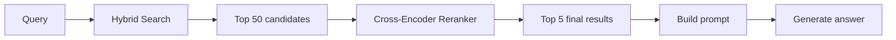
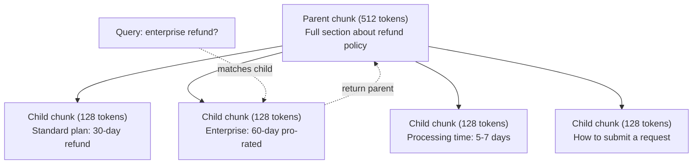
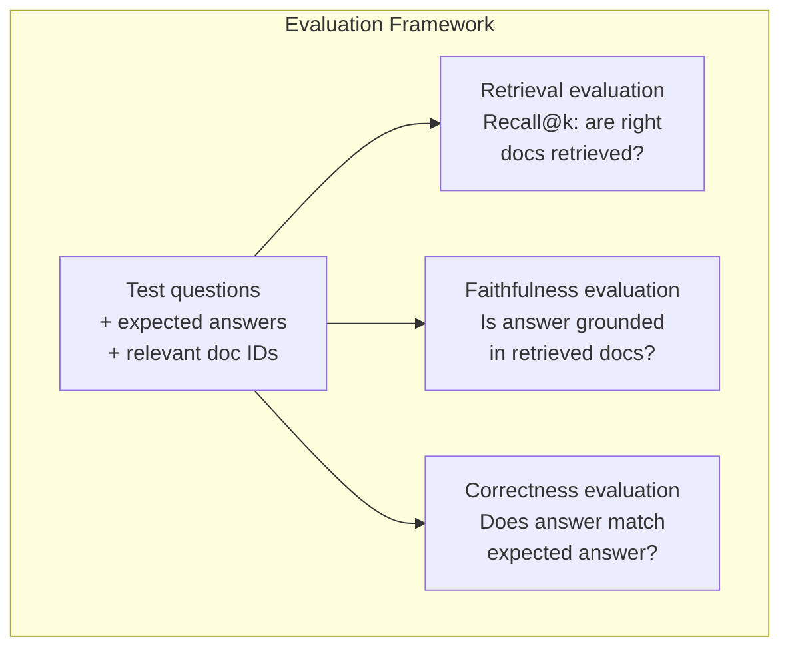

# Продвинутый RAG (чанкинг, реранкинг, гибридный поиск)

> Базовый RAG извлекает top-k наиболее похожих чанков. Это работает для простых вопросов. Но не справляется с многошаговыми рассуждениями, неоднозначными запросами и большими корпусами. Продвинутый RAG — это разница между демо, работающим на 10 документах, и системой, работающей на 10 миллионах.

**Type:** Build
**Languages:** Python
**Prerequisites:** Фаза 11, Урок 06 (RAG)
**Time:** ~90 минут
**Related:** Фаза 5 · 23 (Стратегии чанкинга для RAG) охватывает все шесть алгоритмов чанкинга — рекурсивный, семантический, по предложениям, parent-document, late chunking, contextual retrieval — с бенчмарками Vectara/Anthropic. Этот урок строится поверх: гибридный поиск, реранкинг, трансформация запроса.

## Цели обучения

- Реализовать продвинутые стратегии чанкинга (семантический, рекурсивный, parent-child), сохраняющие структуру документа и контекст
- Построить конвейер гибридного поиска, сочетающий ключевой поиск BM25 с семантическим векторным поиском и реранкером на основе cross-encoder
- Применить техники трансформации запроса (HyDE, multi-query, step-back) для улучшения поиска по неоднозначным или сложным вопросам
- Диагностировать и устранять типичные сбои RAG: извлечён не тот чанк, ответа нет в контексте, провал многошагового рассуждения

## Проблема

Вы построили базовый конвейер RAG в Уроке 06. Он работает для простых вопросов на небольшом корпусе. Теперь попробуйте следующее:

**Неоднозначный запрос**: «Какая была выручка в прошлом квартале?» Семантический поиск возвращает чанки о стратегии выручки, прогнозах выручки и мыслях финансового директора о росте выручки. Все семантически похожи на слово «выручка». Ни один не содержит фактического числа. Правильный чанк говорит «$47.2M in Q3 2025" but uses the word "earnings" instead of "revenue." The embedding model thinks "revenue strategy" is closer to the query than "Q3 earnings were $47.2M».

**Многошаговый вопрос**: «Какая команда показала наибольший рост показателя удовлетворённости клиентов?» Это требует найти показатели удовлетворённости для каждой команды, сравнить их и определить максимум. Ни один отдельный чанк не содержит ответа. Информация разбросана по отчётам команд.

**Проблема большого корпуса**: у вас 2 миллиона чанков. Правильный ответ находится в чанке #1,847,293. Ваш топ-5 поиск извлекает чанки #14, #89,201, #1,200,000, #44 и #901,333. Они близки в пространстве эмбеддингов, но ни один не содержит ответа. На таком масштабе приближённый поиск ближайших соседей вносит достаточно ошибок, чтобы релевантные результаты выталкивались из top-k.

Базовый RAG не справляется, потому что векторное сходство — это не то же самое, что релевантность. Чанк может быть семантически похож на запрос, но бесполезен для ответа на него. Продвинутый RAG решает это четырьмя техниками: гибридный поиск (добавление ключевого сопоставления), реранкинг (более тщательная оценка кандидатов), трансформация запроса (исправление запроса перед поиском) и улучшенный чанкинг (извлечение на правильном уровне гранулярности).

## Концепция

### Гибридный поиск: семантический + ключевой

Семантический поиск (векторное сходство) хорошо понимает смысл. «Как мне отменить подписку?» совпадает с «Шаги по прекращению вашего плана», хотя они не имеют общих слов. Но он пропускает точные совпадения. «Код ошибки E-4021» может не совпасть с чанком, содержащим «E-4021», если модель эмбеддингов трактует это как шум.

Ключевой поиск (BM25) — противоположность. Он отлично справляется с точными совпадениями. «E-4021» совпадает идеально. Но «отменить подписку» вернёт ноль результатов, если в документе написано «прекратить ваш план».

Гибридный поиск запускает оба метода, а затем объединяет результаты.

**BM25** (Best Matching 25) — стандартный алгоритм ключевого поиска. Он был основой поисковых систем с 1990-х годов. Формула:

```
BM25(q, d) = sum over terms t in q:
    IDF(t) * (tf(t,d) * (k1 + 1)) / (tf(t,d) + k1 * (1 - b + b * |d| / avgdl))
```

Где tf(t,d) — частота термина t в документе d, IDF(t) — обратная частота документа, |d| — длина документа, avgdl — средняя длина документа, k1 управляет насыщением частоты термина (по умолчанию 1.2), а b управляет нормализацией по длине (по умолчанию 0.75).

Простыми словами: BM25 оценивает документы выше, если они содержат термины запроса (особенно редкие), но с убывающей отдачей для повторяющихся терминов. Документ, в котором слово «выручка» встречается 50 раз, не в 50 раз более релевантен, чем документ, где оно встречается один раз.

### Reciprocal Rank Fusion (RRF)

У вас есть два ранжированных списка: один из векторного поиска, другой из BM25. Как их объединить? Reciprocal Rank Fusion — стандартный подход.

```
RRF_score(d) = sum over rankings R:
    1 / (k + rank_R(d))
```

Где k — константа (обычно 60), которая предотвращает доминирование результата, занимающего первое место.

Документ, занявший #1 в векторном поиске и #5 в BM25, получает: 1/(60+1) + 1/(60+5) = 0.0164 + 0.0154 = 0.0318

Документ, занявший #3 в векторном поиске и #2 в BM25, получает: 1/(60+3) + 1/(60+2) = 0.0159 + 0.0161 = 0.0320

RRF естественным образом балансирует два сигнала. Документ, который высоко ранжируется в обоих списках, получает лучший результат. Документ, который занимает #1 в одном списке, но отсутствует в другом, получает умеренный результат. Это устойчиво, поскольку используются ранги, а не исходные оценки, поэтому различия в распределениях оценок между двумя системами не имеют значения.

### Реранкинг

Извлечение (будь то векторное, ключевое или гибридное) быстрое, но неточное. Оно использует bi-encoder'ы: запрос и каждый документ кодируются независимо, а затем сравниваются. Эмбеддинги вычисляются один раз и кэшируются. Это масштабируется до миллионов документов.

Реранкинг использует cross-encoder'ы: запрос и документ-кандидат подаются вместе в модель, которая выводит оценку релевантности. Модель видит оба текста одновременно и может улавливать тонкие взаимодействия между ними. Cross-encoder способен понять, что «Какова была прибыль за третий квартал?» сильно релевантен чанку, содержащему «$47.2M в третьем квартале», даже если bi-encoder упустил эту связь.

Компромисс: cross-encoder'ы в 100-1000 раз медленнее bi-encoder'ов, поскольку обрабатывают пару запрос-документ совместно. Вы не можете заранее вычислить оценки cross-encoder'а для миллиона документов. Решение: извлечь больший набор кандидатов (топ-50 из гибридного поиска), а затем выполнить реранкинг с помощью cross-encoder'а, чтобы получить итоговый топ-5.



Распространённые модели реранкинга (линейка 2026 года):
- Cohere Rerank 3.5: управляемый API, многоязычный, лучший прирост полноты на смешанных корпусах
- Voyage rerank-2.5: управляемый API, самая низкая задержка среди размещённых опций
- Jina-Reranker-v2 Multilingual: открытые веса, 100+ языков
- bge-reranker-v2-m3: открытые веса, сильный базовый вариант
- cross-encoder/ms-marco-MiniLM-L-6-v2: открытые веса, работает на CPU для прототипирования
- ColBERTv2 / Jina-ColBERT-v2: реранкеры с поздним взаимодействием и мульти-векторами — O(токенов), а не O(документов) при оценке

### Трансформация запроса

Иногда проблема не в извлечении, а в самом запросе. «Что там было по поводу того нового изменения политики?» — ужасный поисковый запрос. Он не содержит конкретных терминов. Эмбеддинг расплывчат. Ни одна система извлечения не сможет найти нужные документы по такому запросу.

**Переписывание запроса**: перефразировать запрос пользователя в более удачный поисковый запрос. LLM может это сделать:

```
User: "What was that thing about the new policy change?"
Rewritten: "Recent policy changes and updates"
```

**HyDE (Hypothetical Document Embeddings)**: вместо поиска по запросу сгенерировать гипотетический ответ, закодировать его и искать похожие реальные документы.

```
Query: "What is the refund policy for enterprise?"
Hypothetical answer: "Enterprise customers are eligible for a full refund
within 60 days of purchase. Refunds are pro-rated based on the remaining
subscription period and processed within 5-7 business days."
```

Закодируйте гипотетический ответ и ищите реальные документы, похожие на него. Интуиция такова: гипотетический ответ находится в пространстве эмбеддингов ближе к реальному ответу, чем исходный вопрос. Вопросы и ответы имеют разную лингвистическую структуру. Генерируя гипотетический ответ, вы наводите мост между «пространством вопросов» и «пространством ответов» в эмбеддинге.

HyDE добавляет один вызов LLM перед извлечением. Это увеличивает задержку на 500-2000 мс. Оправдано, когда качество извлечения по сырым запросам низкое.

### Parent-child чанкинг

Стандартный чанкинг вынуждает идти на компромисс: маленькие чанки для точного извлечения, большие чанки для достаточного контекста. Parent-child чанкинг устраняет этот компромисс.

Индексируйте маленькие чанки (128 токенов) для извлечения. Когда маленький чанк извлечён, возвращайте его родительский чанк (512 токенов) для промпта. Маленький чанк точно соответствует запросу. Родительский чанк предоставляет достаточно контекста, чтобы LLM сгенерировала хороший ответ.



Запрос «корпоративный возврат?» точно соответствует дочернему чанку C2. Но промпт получает весь родительский чанк P, который включает окружающий контекст о времени обработки и процессе подачи заявки.

### Фильтрация по метаданным

Перед запуском векторного поиска отфильтруйте корпус по метаданным: дата, источник, категория, автор, язык. Это сокращает пространство поиска и предотвращает нерелевантные результаты.

«Что изменилось в политике безопасности в прошлом месяце?» должен искать только в документах за последние 30 дней в категории безопасности. Без фильтрации по метаданным вы ищете по всему корпусу и можете извлечь документ по безопасности двухлетней давности, который случайно оказался семантически похожим.

Производственные системы RAG хранят метаданные вместе с каждым чанком: исходный документ, дата создания, категория, автор, версия. Векторные базы данных поддерживают предварительную фильтрацию по метаданным перед поиском по сходству, что критично для производительности на масштабе.

### Оценка

Вы построили систему RAG. Как узнать, работает ли она? Три метрики:

**Релевантность извлечения (Recall@k)**: для набора тестовых вопросов с известными релевантными документами — какой процент релевантных документов попадает в топ-k результатов? Если ответ на вопрос находится в чанке #47, попадает ли чанк #47 в топ-5?

**Достоверность (Faithfulness)**: обоснован ли сгенерированный ответ в извлечённых документах? Если извлечённые чанки говорят «60-дневное окно возврата», а модель говорит «90-дневное окно возврата», это сбой достоверности. Модель галлюцинировала, несмотря на наличие правильного контекста.

**Корректность ответа**: совпадает ли сгенерированный ответ с ожидаемым ответом? Это сквозная метрика. Она объединяет качество извлечения и качество генерации.

Простая проверка достоверности: возьмите каждое утверждение в сгенерированном ответе и проверьте, встречается ли оно (по сути) в извлечённых чанках. Если ответ содержит факт, которого нет ни в одном извлечённом чанке, скорее всего, это галлюцинация.



```figure
agentic-rag-loop
```

## Постройте это

### Шаг 1: Реализация BM25

```python
import math
from collections import Counter

class BM25:
    def __init__(self, k1=1.2, b=0.75):
        self.k1 = k1
        self.b = b
        self.docs = []
        self.doc_lengths = []
        self.avg_dl = 0
        self.doc_freqs = {}
        self.n_docs = 0

    def index(self, documents):
        self.docs = documents
        self.n_docs = len(documents)
        self.doc_lengths = []
        self.doc_freqs = {}

        for doc in documents:
            words = doc.lower().split()
            self.doc_lengths.append(len(words))
            unique_words = set(words)
            for word in unique_words:
                self.doc_freqs[word] = self.doc_freqs.get(word, 0) + 1

        self.avg_dl = sum(self.doc_lengths) / self.n_docs if self.n_docs else 1

    def score(self, query, doc_idx):
        query_words = query.lower().split()
        doc_words = self.docs[doc_idx].lower().split()
        doc_len = self.doc_lengths[doc_idx]
        word_counts = Counter(doc_words)
        score = 0.0

        for term in query_words:
            if term not in word_counts:
                continue
            tf = word_counts[term]
            df = self.doc_freqs.get(term, 0)
            idf = math.log((self.n_docs - df + 0.5) / (df + 0.5) + 1)
            numerator = tf * (self.k1 + 1)
            denominator = tf + self.k1 * (1 - self.b + self.b * doc_len / self.avg_dl)
            score += idf * numerator / denominator

        return score

    def search(self, query, top_k=10):
        scores = [(i, self.score(query, i)) for i in range(self.n_docs)]
        scores.sort(key=lambda x: x[1], reverse=True)
        return scores[:top_k]
```

### Шаг 2: Reciprocal Rank Fusion

```python
def reciprocal_rank_fusion(ranked_lists, k=60):
    scores = {}
    for ranked_list in ranked_lists:
        for rank, (doc_id, _) in enumerate(ranked_list):
            if doc_id not in scores:
                scores[doc_id] = 0.0
            scores[doc_id] += 1.0 / (k + rank + 1)
    fused = sorted(scores.items(), key=lambda x: x[1], reverse=True)
    return fused
```

### Шаг 3: Конвейер гибридного поиска

```python
def hybrid_search(query, chunks, vector_embeddings, vocab, idf, bm25_index, top_k=5, fusion_k=60):
    query_emb = tfidf_embed(query, vocab, idf)
    vector_results = search(query_emb, vector_embeddings, top_k=top_k * 3)
    bm25_results = bm25_index.search(query, top_k=top_k * 3)
    fused = reciprocal_rank_fusion([vector_results, bm25_results], k=fusion_k)
    return fused[:top_k]
```

### Шаг 4: Простой реранкер

В продакшене вы использовали бы модель cross-encoder. Здесь мы построим реранкер, который оценивает релевантность запрос-документ, используя перекрытие слов, важность термина и совпадение фраз.

```python
def rerank(query, candidates, chunks):
    query_words = set(query.lower().split())
    stop_words = {"the", "a", "an", "is", "are", "was", "were", "what", "how",
                  "why", "when", "where", "do", "does", "for", "of", "in", "to",
                  "and", "or", "on", "at", "by", "it", "its", "this", "that",
                  "with", "from", "be", "has", "have", "had", "not", "but"}
    query_terms = query_words - stop_words

    scored = []
    for doc_id, initial_score in candidates:
        chunk = chunks[doc_id].lower()
        chunk_words = set(chunk.split())

        term_overlap = len(query_terms & chunk_words)

        query_bigrams = set()
        q_list = [w for w in query.lower().split() if w not in stop_words]
        for i in range(len(q_list) - 1):
            query_bigrams.add(q_list[i] + " " + q_list[i + 1])
        bigram_matches = sum(1 for bg in query_bigrams if bg in chunk)

        position_boost = 0
        for term in query_terms:
            pos = chunk.find(term)
            if pos != -1 and pos < len(chunk) // 3:
                position_boost += 0.5

        rerank_score = (
            term_overlap * 1.0
            + bigram_matches * 2.0
            + position_boost
            + initial_score * 5.0
        )
        scored.append((doc_id, rerank_score))

    scored.sort(key=lambda x: x[1], reverse=True)
    return scored
```

### Шаг 5: HyDE (Hypothetical Document Embeddings)

```python
def hyde_generate_hypothesis(query):
    templates = {
        "what": "The answer to '{query}' is as follows: Based on our documentation, {topic} involves specific policies and procedures that define how the process works.",
        "how": "To address '{query}': The process involves several steps. First, you need to initiate the request. Then, the system processes it according to the defined rules.",
        "default": "Regarding '{query}': Our records indicate specific details and policies related to this topic that provide a comprehensive answer."
    }
    query_lower = query.lower()
    if query_lower.startswith("what"):
        template = templates["what"]
    elif query_lower.startswith("how"):
        template = templates["how"]
    else:
        template = templates["default"]

    topic_words = [w for w in query.lower().split()
                   if w not in {"what", "is", "the", "how", "do", "does", "a", "an",
                                "for", "of", "to", "in", "on", "at", "by", "and", "or"}]
    topic = " ".join(topic_words) if topic_words else "this topic"

    return template.format(query=query, topic=topic)


def hyde_search(query, chunks, vector_embeddings, vocab, idf, top_k=5):
    hypothesis = hyde_generate_hypothesis(query)
    hypothesis_emb = tfidf_embed(hypothesis, vocab, idf)
    results = search(hypothesis_emb, vector_embeddings, top_k)
    return results, hypothesis
```

### Шаг 6: Parent-child чанкинг

```python
def create_parent_child_chunks(text, parent_size=200, child_size=50):
    words = text.split()
    parents = []
    children = []
    child_to_parent = {}

    parent_idx = 0
    start = 0
    while start < len(words):
        parent_end = min(start + parent_size, len(words))
        parent_text = " ".join(words[start:parent_end])
        parents.append(parent_text)

        child_start = start
        while child_start < parent_end:
            child_end = min(child_start + child_size, parent_end)
            child_text = " ".join(words[child_start:child_end])
            child_idx = len(children)
            children.append(child_text)
            child_to_parent[child_idx] = parent_idx
            child_start += child_size

        parent_idx += 1
        start += parent_size

    return parents, children, child_to_parent
```

### Шаг 7: Оценка достоверности

```python
def evaluate_faithfulness(answer, retrieved_chunks):
    answer_sentences = [s.strip() for s in answer.split(".") if len(s.strip()) > 10]
    if not answer_sentences:
        return 1.0, []

    grounded = 0
    ungrounded = []
    context = " ".join(retrieved_chunks).lower()

    for sentence in answer_sentences:
        words = set(sentence.lower().split())
        stop_words = {"the", "a", "an", "is", "are", "was", "were", "and", "or",
                      "to", "of", "in", "for", "on", "at", "by", "it", "this", "that"}
        content_words = words - stop_words
        if not content_words:
            grounded += 1
            continue

        matched = sum(1 for w in content_words if w in context)
        ratio = matched / len(content_words) if content_words else 0

        if ratio >= 0.5:
            grounded += 1
        else:
            ungrounded.append(sentence)

    score = grounded / len(answer_sentences) if answer_sentences else 1.0
    return score, ungrounded


def evaluate_retrieval_recall(queries_with_relevant, retrieval_fn, k=5):
    total_recall = 0.0
    results = []

    for query, relevant_indices in queries_with_relevant:
        retrieved = retrieval_fn(query, k)
        retrieved_indices = set(idx for idx, _ in retrieved)
        relevant_set = set(relevant_indices)
        hits = len(retrieved_indices & relevant_set)
        recall = hits / len(relevant_set) if relevant_set else 1.0
        total_recall += recall
        results.append({
            "query": query,
            "recall": recall,
            "hits": hits,
            "total_relevant": len(relevant_set)
        })

    avg_recall = total_recall / len(queries_with_relevant) if queries_with_relevant else 0
    return avg_recall, results
```

## Используйте это

С реальной моделью cross-encoder для реранкинга:

```python
from sentence_transformers import CrossEncoder

reranker = CrossEncoder("cross-encoder/ms-marco-MiniLM-L-6-v2")

def rerank_with_cross_encoder(query, candidates, chunks, top_k=5):
    pairs = [(query, chunks[doc_id]) for doc_id, _ in candidates]
    scores = reranker.predict(pairs)
    scored = list(zip([doc_id for doc_id, _ in candidates], scores))
    scored.sort(key=lambda x: x[1], reverse=True)
    return scored[:top_k]
```

С управляемым реранкером Cohere:

```python
import cohere

co = cohere.Client()

def rerank_with_cohere(query, candidates, chunks, top_k=5):
    docs = [chunks[doc_id] for doc_id, _ in candidates]
    response = co.rerank(
        model="rerank-english-v3.0",
        query=query,
        documents=docs,
        top_n=top_k
    )
    return [(candidates[r.index][0], r.relevance_score) for r in response.results]
```

Для HyDE с реальной LLM:

```python
import anthropic

client = anthropic.Anthropic()

def hyde_with_llm(query):
    response = client.messages.create(
        model="claude-sonnet-5",
        max_tokens=256,
        messages=[{
            "role": "user",
            "content": f"Write a short paragraph that would be a good answer to this question. Do not say you don't know. Just write what the answer would look like.\n\nQuestion: {query}"
        }]
    )
    return response.content[0].text
```

Для производственного гибридного поиска с Weaviate:

```python
import weaviate

client = weaviate.connect_to_local()

collection = client.collections.get("Documents")
response = collection.query.hybrid(
    query="enterprise refund policy",
    alpha=0.5,
    limit=10
)
```

Параметр alpha управляет балансом: 0.0 = чистый ключевой поиск (BM25), 1.0 = чистый векторный поиск, 0.5 = равный вес. Большинство производственных систем используют alpha между 0.3 и 0.7.

## Отправьте это в продакшен

Этот урок производит:
- `outputs/prompt-advanced-rag-debugger.md` -- промпт для диагностики и устранения проблем качества RAG
- `outputs/skill-advanced-rag.md` -- навык для построения промышленного RAG с гибридным поиском и реранкингом

## Упражнения

1. Сравните BM25, векторный поиск и гибридный поиск на примерах документов. Для каждого из 5 тестовых запросов зафиксируйте, какой подход возвращает наиболее релевантный чанк на позиции #1. Гибридный поиск должен побеждать по крайней мере в 3 из 5 случаев.

2. Реализуйте фильтр по метаданным. Добавьте поле "category" к каждому документу (security, billing, api, product). Перед запуском векторного поиска отфильтруйте чанки только по релевантной категории. Протестируйте на запросе «Какое шифрование используется?» и убедитесь, что поиск идёт только по чанкам категории security.

3. Постройте полный конвейер HyDE, используя простую функцию генерации из Урока 06. Сравните качество извлечения (релевантность топ-3) между прямым поиском по запросу и поиском HyDE по всем 5 тестовым запросам. HyDE должен улучшать результаты для расплывчатых запросов.

4. Реализуйте стратегию parent-child чанкинга на примерах документов. Используйте child_size=30 и parent_size=100. Выполняйте поиск по дочерним чанкам, но возвращайте родительские чанки в промпте. Сравните сгенерированные ответы со стандартным чанкингом при chunk_size=50.

5. Создайте оценочный набор данных: 10 вопросов с известными чанками-ответами. Измерьте Recall@3, Recall@5 и Recall@10 для (a) только векторного поиска, (b) только BM25, (c) гибридного поиска, (d) гибридного поиска + реранкинга. Постройте график результатов и определите, где реранкинг помогает больше всего.

## Ключевые термины

| Термин | Что говорят люди | Что это на самом деле означает |
|------|----------------|----------------------|
| BM25 | «Ключевой поиск» | Вероятностный алгоритм ранжирования, оценивающий документы по частоте терминов, обратной частоте документа и нормализации по длине документа |
| Гибридный поиск | «Лучшее из обоих миров» | Параллельный запуск семантического (векторного) и ключевого (BM25) поиска с последующим объединением результатов через слияние рангов |
| Reciprocal Rank Fusion | «Слияние ранжированных списков» | Объединение нескольких ранжированных списков путём суммирования 1/(k + ранг) для каждого документа по всем спискам |
| Реранкинг | «Повторная оценка второго прохода» | Использование более дорогой модели cross-encoder для повторной оценки набора кандидатов из первоначального извлечения |
| Cross-encoder | «Совместная модель запрос-документ» | Модель, принимающая запрос и документ как единый вход и выдающая оценку релевантности; точнее bi-encoder'ов, но слишком медленная для поиска по полному корпусу |
| Bi-encoder | «Модель независимого эмбеддинга» | Модель, кодирующая запросы и документы независимо; быстрая, поскольку эмбеддинги предвычислены, но менее точная, чем cross-encoder'ы |
| HyDE | «Поиск с помощью фейкового ответа» | Генерация гипотетического ответа на запрос, его кодирование и поиск реальных документов, похожих на него |
| Parent-child чанкинг | «Маленький поиск, большой контекст» | Индексирование маленьких чанков для точного извлечения, но возврат большего родительского чанка для предоставления достаточного контекста |
| Фильтрация по метаданным | «Сузить перед поиском» | Фильтрация документов по атрибутам (дата, источник, категория) перед запуском векторного поиска для сокращения пространства поиска |
| Достоверность (Faithfulness) | «Осталось ли это обоснованным» | Подтверждён ли сгенерированный ответ извлечёнными документами, в противовес галлюцинации из обучающих данных модели |

## Дополнительное чтение

- Robertson & Zaragoza, «The Probabilistic Relevance Framework: BM25 and Beyond» (2009) -- определяющий справочник по BM25, объясняющий вероятностные основы формулы
- Cormack et al., «Reciprocal Rank Fusion Outperforms Condorcet and Individual Rank Learning Methods» (2009) -- оригинальная статья об RRF, показывающая, что он превосходит более сложные методы слияния
- Gao et al., «Precise Zero-Shot Dense Retrieval without Relevance Labels» (2022) -- статья о HyDE, демонстрирующая, что гипотетические эмбеддинги документов улучшают извлечение без каких-либо обучающих данных
- Nogueira & Cho, «Passage Re-ranking with BERT» (2019) -- показали, что реранкинг cross-encoder поверх BM25 значительно улучшает качество извлечения
- [Khattab et al., «DSPy: Compiling Declarative Language Model Calls into Self-Improving Pipelines» (2023)](https://arxiv.org/abs/2310.03714) -- рассматривает построение промптов и выбор весов как задачу оптимизации над конвейерами извлечения; прочитайте это, чтобы понять «программирование LLM» вместо «промптинга LLM».
- [Edge et al., «From Local to Global: A Graph RAG Approach to Query-Focused Summarization» (Microsoft Research 2024)](https://arxiv.org/abs/2404.16130) -- статья о GraphRAG: извлечение сущностей-связей + обнаружение сообществ по алгоритму Лейдена для суммаризации, ориентированной на запрос; различие между глобальным и локальным извлечением.
- [Asai et al., «Self-RAG: Learning to Retrieve, Generate, and Critique through Self-Reflection» (ICLR 2024)](https://arxiv.org/abs/2310.11511) -- самооценивающийся RAG с токенами рефлексии; агентный рубеж за пределами статического извлечения-затем-генерации.
- [Блог LangChain о построении запросов](https://blog.langchain.dev/query-construction/) -- как переводить запросы на естественном языке в структурированные запросы к базе данных (Text-to-SQL, Cypher) как этап перед извлечением.