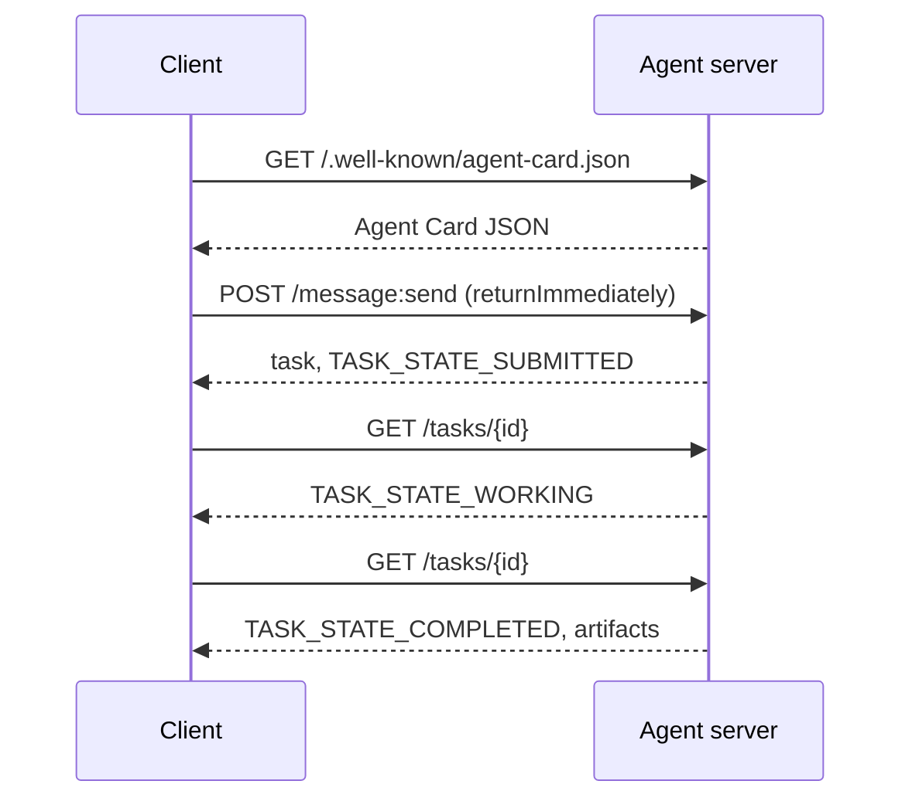

# A2A — протокол взаимодействия агентов (Agent-to-Agent)

> Google анонсировала A2A в апреле 2025 года; к апрелю 2026 года спецификация находится на версии https://a2a-protocol.org/latest/specification/, и её поддерживают более 150 организаций. A2A — это горизонтальное дополнение к MCP (Урок 13): если MCP вертикален (агент ↔ инструменты), то A2A — одноранговый (агент ↔ агент). Он определяет Agent Cards (обнаружение), задачи с артефактами (текст, структурированные данные, видео), непрозрачные жизненные циклы задач и аутентификацию. Промышленные системы всё чаще сочетают MCP с A2A. Google Cloud встроила поддержку A2A в Vertex AI Agent Builder в течение 2025–2026 годов.

**Type:** Learn + Build
**Languages:** Python (stdlib, `http.server`, `json`)
**Prerequisites:** Phase 16 · 04 (Primitive Model)
**Time:** ~75 минут

## Проблема

Вашему агенту нужно вызвать другого агента в другой системе. Как это сделать? Можно открыть HTTP-эндпоинт, определить собственную JSON-схему и надеяться, что другая сторона её поймёт. Каждая пара агентов превращается в индивидуальную интеграцию.

A2A — это универсальный протокол передачи данных для таких вызовов. Стандартное обнаружение, стандартная модель задач, стандартный транспорт, стандартные артефакты. Как HTTP+REST, но для агентов как полноправных участников.

## Концепция

### Четыре элемента

**Agent Card.** JSON-документ по адресу `/.well-known/agent-card.json`, описывающий агента: имя, навыки, `supportedInterfaces` (URL эндпоинта, привязку протокола, версию протокола), медиатипы ввода и вывода по умолчанию, а также требования к аутентификации (`securitySchemes` плюс `securityRequirements`). Обнаружение происходит путём чтения карты.

```http
GET /.well-known/agent-card.json HTTP/1.1
Host: agent.example.com
```

```json
{
  "name": "code-review-agent",
  "description": "Reviews Python and TypeScript code.",
  "version": "1.0.0",
  "supportedInterfaces": [
    {
      "url": "https://agent.example.com",
      "protocolBinding": "HTTP+JSON",
      "protocolVersion": "1.0"
    }
  ],
  "capabilities": {"streaming": false, "pushNotifications": false},
  "securitySchemes": {
    "bearer": {"httpAuthSecurityScheme": {"scheme": "Bearer"}}
  },
  "securityRequirements": [{"schemes": {"bearer": {"list": []}}}],
  "defaultInputModes": ["text/plain", "application/json"],
  "defaultOutputModes": ["application/json"],
  "skills": [
    {
      "id": "review-python",
      "name": "Review Python",
      "description": "Reviews Python code.",
      "tags": ["code-review", "python"]
    },
    {
      "id": "review-typescript",
      "name": "Review TypeScript",
      "description": "Reviews TypeScript code.",
      "tags": ["code-review", "typescript"]
    }
  ]
}
```

**Задача (Task).** Единица работы. Асинхронный объект с состоянием и жизненным циклом: `TASK_STATE_SUBMITTED` → `TASK_STATE_WORKING` → `TASK_STATE_COMPLETED` / `TASK_STATE_FAILED` / `TASK_STATE_CANCELED`. Клиент отправляет сообщение, сервер создаёт задачу, а клиент опрашивает её или подписывается на обновления.

**Артефакт.** Тип результата, который производит задача. Текст, структурированный JSON, изображение, видео, аудио. Артефакты типизированы: каждая часть несёт один из `text`, `raw`, `url` или `data` и может называть свой `mediaType`, так что разные модальности становятся полноправными гражданами.

**Непрозрачный жизненный цикл.** A2A не предписывает, *как именно* удалённый агент решает задачу. Клиент видит переходы состояний и артефакты; реализация вправе использовать любой фреймворк.

### Разделение MCP/A2A

- **MCP** (Урок 13): агент ↔ инструмент. Агент читает/пишет через JSON-RPC на сервер инструментов. По умолчанию без сохранения состояния.
- **A2A**: агент ↔ агент. Одноранговый протокол; обе стороны — агенты со своим собственным рассуждением.

Промышленные мультиагентные системы используют оба протокола. Одноранговый узел A2A вызывает инструменты MCP на своей стороне. Такое разделение сохраняет чистоту обеих задач.

### Поток обнаружения



Это маршруты привязки HTTP+JSON, и каждый запрос несёт `A2A-Version: 1.0`. По умолчанию `SendMessage` блокируется до тех пор, пока задача не достигнет финального или прерванного состояния, поэтому опрашивающий клиент устанавливает `configuration.returnImmediately`, чтобы получить задачу немедленно.

Или со стримингом: `POST /message:stream` возвращает события Server-Sent Events (сначала `task`, затем события `statusUpdate` и `artifactUpdate`), а `/tasks/{id}:subscribe` переподключается к уже выполняющейся задаче. Поток закрывается, когда задача достигает финального состояния; флага `final` не существует.

### Аутентификация

A2A поддерживает три распространённых паттерна:

- **Bearer-токен**: OAuth2 или непрозрачный (`httpAuthSecurityScheme` или `oauth2SecurityScheme`).
- **mTLS**: взаимный TLS; организации подтверждают идентичность друг другу (`mtlsSecurityScheme`).
- **API-ключ**: ключ в заголовке, параметре запроса или cookie (`apiKeySecurityScheme`).

Аутентификация объявляется в Agent Card: `securitySchemes` называет каждую схему, а `securityRequirements` указывает, каким из них клиент должен соответствовать. Клиенты обнаруживают их и подчиняются требованиям.

### 150+ организаций к апрелю 2026

Корпоративное внедрение обеспечило масштаб A2A. Главное: A2A стал способом, которым корпоративные агентные системы пересекают границы доверия. Google Cloud выпустила поддержку A2A в Vertex AI Agent Builder; Microsoft Agent Framework её поддерживает; большинство крупных фреймворков (LangGraph, CrewAI, AutoGen) поставляются с адаптерами A2A.

### Где A2A выигрывает

- **Межорганизационные вызовы.** Агент в компании A вызывает агента в компании B. Без A2A каждая пара — это индивидуальный контракт.
- **Разнородные фреймворки.** Агент LangGraph вызывает агента CrewAI, который вызывает кастомного Python-агента. A2A нормализует это.
- **Типизированные артефакты.** Видеорезультат, структурированный JSON, аудио — всё это полноправные граждане.
- **Долгоживущие задачи.** Непрозрачный жизненный цикл + опрос делает многочасовые задачи простыми.

### Где A2A испытывает трудности

- **Чувствительные к задержке микровызовы.** Жизненный цикл A2A асинхронен. Субмиллисекундные вызовы агент-агент сюда не вписываются; используйте прямой RPC.
- **Тесно связанные внутрипроцессные агенты.** Если оба агента работают в одном процессе Python, HTTP-обмен A2A избыточен.
- **Небольшие команды.** Издержки спецификации реальны; внутренним агентам может не требоваться такая формальность.

### A2A против ACP, ANP, NLIP

В 2024–2026 годах появилось несколько смежных спецификаций:

- **ACP** (IBM/Linux Foundation) — предшественник A2A, более узкая область применения.
- **ANP** (Agent Network Protocol) — с упором на одноранговое обнаружение, децентрализованный по умолчанию.
- **NLIP** (Ecma Natural Language Interaction Protocol, стандартизирован в декабре 2025) — тип контента на естественном языке.

A2A — наиболее широко внедрённый одноранговый протокол по состоянию на апрель 2026 года. См. arXiv:2505.02279 (Liu et al., "A Survey of Agent Interoperability Protocols") для сравнения.

```figure
sw-agent-card-discovery
```

## Постройте это

`code/main.py` реализует минимальный сервер и клиент A2A с использованием `http.server` и JSON, на привязке HTTP+JSON версии 1.0. Сервер:

- предоставляет `/.well-known/agent-card.json`,
- принимает `POST /message:send`,
- управляет состоянием задач,
- возвращает артефакты по `GET /tasks/{id}`.

Клиент:

- получает Agent Card,
- отправляет сообщение с `returnImmediately`,
- опрашивает до завершения,
- читает артефакт.

Запустите:

```
python3 code/main.py
```

Скрипт запускает сервер в фоновом потоке, затем выполняет клиент против него. Вы видите полный поток: обнаружение, отправку, опрос, артефакт.

## Используйте это

`outputs/skill-a2a-integrator.md` проектирует интеграцию A2A: содержимое Agent Card, схемы задач, выбор аутентификации, стриминг против опроса.

## Отправьте это в продакшн

Чек-лист:

- **Зафиксируйте версию спецификации.** A2A всё ещё развивается; каждая запись `supportedInterfaces` объявляет свой `protocolVersion`, а клиенты отправляют `A2A-Version: 1.0`.
- **Идемпотентное создание задач.** Повторные отправки (из-за сетевых повторов) должны приводить к созданию одной задачи. Дедуплицируйте по `messageId` клиента.
- **Схемы артефактов.** Объявите, какие формы возвращает агент; потребители должны их валидировать.
- **Ограничения скорости + аутентификация.** A2A обращён вовне; применяйте стандартные меры веб-безопасности.
- **Dead-letter для неудавшихся задач.** Отслеживайте паттерны со временем для повторяющихся типов сбоев.

## Упражнения

1. Запустите `code/main.py`. Убедитесь, что клиент обнаруживает сервер и получает корректный артефакт.
2. Добавьте второй навык на сервер (например, "summarize"). Обновите Agent Card. Напишите клиента, который выбирает навык в зависимости от типа задачи. Запрос версии 1.0 не содержит поля навыка, поэтому сервер маршрутизирует по частям сообщения.
3. Реализуйте `POST /message:stream`: отвечайте событиями Server-Sent Events (сначала `task`, затем события `statusUpdate`) и закрывайте поток при достижении финального состояния. Что клиенту нужно делать иначе?
4. Прочитайте спецификацию A2A (https://a2a-protocol.org/latest/specification/). Найдите три вещи, которые спецификация предписывает, но которые не реализованы в этой демонстрации.
5. Сравните A2A (обнаружение через Agent Card) с MCP (перечисление возможностей на стороне сервера через `listTools`). В чём компромисс между самоописывающимися агентами и зондированием возможностей?

## Ключевые термины

| Термин | Что говорят люди | Что это означает на самом деле |
|------|----------------|------------------------|
| A2A | "Agent-to-agent" | Одноранговый протокол для вызова агентами других агентов в разных системах. Google, 2025. |
| Agent Card | "Визитка агента" | JSON по адресу `/.well-known/agent-card.json`, описывающий навыки, `supportedInterfaces`, аутентификацию. |
| Task | "Единица работы" | Асинхронный объект с состоянием и жизненным циклом; артефакты производятся по завершении. |
| Артефакт | "Результат" | Типизированный вывод: текст, структурированный JSON, изображение, видео, аудио. Полноправные медиа. |
| Непрозрачный жизненный цикл | "Как решается — дело агента" | Клиент видит переходы состояний; сервер волен выбирать фреймворк/инструменты. |
| Discovery | "Поиск агента" | `GET /.well-known/agent-card.json` возвращает карту. |
| MCP vs A2A | "Инструменты против одноранговых узлов" | MCP: вертикальный агент ↔ инструмент. A2A: горизонтальный агент ↔ агент. |
| ACP / ANP / NLIP | "Родственные протоколы" | Смежные спецификации; A2A — наиболее внедрённый в 2026 году. |

## Дополнительное чтение

- [Спецификация A2A](https://a2a-protocol.org/latest/specification/) — каноническая спецификация
- [Релиз A2A v1.0.1](https://github.com/a2aproject/A2A/tree/v1.0.1): тегированные `docs/specification.md` и `specification/a2a.proto`, которым следует этот урок
- [Google Developers Blog — анонс A2A](https://developers.googleblog.com/en/a2a-a-new-era-of-agent-interoperability/) — пост о запуске в апреле 2025 года
- [Репозиторий A2A на GitHub](https://github.com/a2aproject/A2A) — эталонные реализации и SDK
- [Liu et al. — A Survey of Agent Interoperability Protocols](https://arxiv.org/html/2505.02279v1) — сравнение MCP, ACP, A2A, ANP